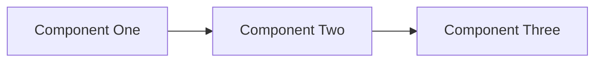

# Application Design - Detailed Steps

## Purpose
**Identify the logical building blocks of the system — the components you will write code for.**

A component is a bounded piece of software with its own business logic, entities, and lifecycle: **code you write, not infrastructure you deploy.** Databases, caches, queues, and third-party services are dependencies OF components, not components themselves.

This stage does NOT decide deployment topology (monolith, microservices, serverless, etc.) — that is Units Generation's job. Application Design produces the building blocks so the team can then decide how to group them into deployable units. It also does NOT choose the tech stack, NFR patterns, or detailed method signatures — those belong to the NFR, Infrastructure, and Functional Design stages in Construction.

Application Design focuses on:

- Identifying components and their business capabilities
- Defining component boundaries (what each component does NOT own is as important as what it does)
- Capturing entity ownership (each entity has exactly one owning component)
- Mapping component dependencies (who calls whom, and why)
- Linking components back to upstream requirements and stories

**Note**: Detailed business rules, method signatures, data types, and validation logic are deferred to Functional Design (per-unit, CONSTRUCTION phase).

## Prerequisites

- Workspace Detection must be complete
- Requirements Analysis recommended (provides functional context)
- User Stories recommended (stories guide boundary decisions)
- Working Wireframes recommended if executed (screen flow informs component boundaries)
- Execution plan must indicate Application Design stage should execute

## Step-by-Step Execution

### 1. Analyze Context

- Read `aidlc-docs/inception/requirements/requirements.md`
- Read `aidlc-docs/inception/user-stories/stories.md` (if produced)
- Read `aidlc-docs/inception/working-wireframes/wireframes.md` (if produced — the screens and mock-data shapes are strong hints at component boundaries and entities)
- Read reverse-engineering artifacts (if brownfield): architecture.md, component-inventory.md, dependencies.md
- Identify the main business capabilities and natural boundaries in the problem

### 2. Create Application Design Plan

- Generate a plan with checkboxes `[]` for application design generation
- Focus on component boundaries, entity ownership, responsibilities, and dependencies
- Each step and sub-step should have a checkbox `[]`
- The plan drives Part 2 generation; be concrete about what each step produces

### 3. Include Mandatory Design Artifacts in Plan

**ALWAYS** include these mandatory artifacts in the design plan:

- [ ] Generate `aidlc-docs/inception/application-design/components.yaml` — the structured, machine-readable component catalogue (source of truth)
- [ ] Generate `aidlc-docs/inception/application-design/components.md` — the human-readable view derived from `components.yaml` (diagram, summary table, rationale)
- [ ] Validate every component has at most one business capability it owns, non-overlapping with others
- [ ] Validate every entity has exactly one owning component (no shared entities)
- [ ] Validate component dependency graph is acyclic (call out any deliberate cycle in Rationale)
- [ ] Validate every component traces back to at least one requirement or story (via the `Source` block)

**What is NOT produced here** (deferred to later stages):

- Method signatures, input/output types → Functional Design (per-unit, Construction)
- Data types, validation constraints, allowed values → Functional Design (per-unit, Construction)
- Service definitions as separate from components → there is no separate "service" layer; a service IS a component
- Deployment topology (what runs where, monolith vs. microservices) → Units Generation

### 4. Generate Context-Appropriate Questions

**DIRECTIVE**: Analyze the requirements, stories, and wireframes (if any) to generate questions relevant to THIS specific application design. Use the categories below as guidance. When in doubt about applicability, ask the question — overconfidence leads to poor outcomes (see `common/overconfidence-prevention.md`).

**See `common/question-format-guide.md` for question formatting rules**.

- EMBED questions using `[Answer]:` tag format
- Focus on ANY ambiguity in boundaries, ownership, or dependencies
- Generate questions wherever user input would improve design decisions
- **When in doubt, ask the question** — overconfidence leads to poor designs

**Question categories to evaluate** (consider ALL categories):

- **Component Boundaries** — Ask about which capabilities belong together and which should be separate. If two viable decompositions exist (e.g., one component vs. two), present the trade-off and let the user choose. Boundary ambiguity now becomes a refactor cost later.
- **Entity Ownership** — Ask who owns each entity. Each entity has exactly one owning component; ambiguous ownership is a design smell to resolve before the gate. Ask about cross-component references and how they will be named.
- **Component Responsibilities** — Ask what business capabilities each component owns. Ask about what each component explicitly does NOT own (its boundaries).
- **Component Dependencies** — Ask which component calls which, and why. Ask about interaction style when relevant (synchronous call, asynchronous message, event). Flag any deliberate cycle for Rationale.
- **External Dependencies** — Ask about databases, caches, queues, and third-party services each component uses. These are listed as dependencies OF components, never as components themselves.
- **Traceability** — If the mapping between stories/requirements and components is not obvious, ask the user to confirm which requirements each component covers.

### 5. Store Application Design Plan

- Save as `aidlc-docs/inception/plans/application-design-plan.md`
- Include all `[Answer]:` tags for user input
- Ensure the plan covers component boundaries, entity ownership, dependencies, and traceability

### 6. Request User Input

- Ask the user to fill `[Answer]:` tags directly in the plan document
- Emphasize that boundary and ownership decisions made here are hard to reverse later
- Provide clear instructions on completing the `[Answer]:` tags

### 7. Collect Answers

- Wait for the user to provide answers to all questions using `[Answer]:` tags in the document
- Do not proceed until ALL `[Answer]:` tags are completed
- Review the document to ensure no `[Answer]:` tags are left blank

### 8. ANALYZE ANSWERS (MANDATORY)

Before proceeding, carefully review all user answers for:

- **Vague or ambiguous responses**: "mix of", "somewhere between", "not sure", "depends"
- **Undefined criteria or terms**: references to concepts without clear definitions
- **Contradictory answers**: responses that conflict with each other
- **Missing design details**: answers that lack specific guidance (e.g., named a component but did not say what it owns)
- **Ownership ambiguity**: an entity attributed to two components, or no component at all
- **Infrastructure masquerading as component**: the user named a database, cache, or third-party service as a component — flag and reframe as external dependency

### 9. MANDATORY Follow-up Questions

If the analysis in step 8 reveals ANY ambiguous answer, you MUST:

- Add specific follow-up questions to the plan document using `[Answer]:` tags
- DO NOT proceed to approval until all ambiguities are resolved
- Examples of required follow-ups:
  - "You mentioned 'mix of A and B' - what specific criteria should determine when to use A vs B?"
  - "Entity X was mentioned under both Component A and Component B. Which single component owns it, and how do the other components access it?"
  - "You listed PostgreSQL as a component. Databases are external dependencies, not components. Which component owns the entities stored there?"
  - "You said 'depends on complexity' - how do you define complexity levels?"

### 10. Generate Application Design Artifacts

Execute the approved plan to generate the two artifacts.

**10a. Create `aidlc-docs/inception/application-design/components.yaml`**

This is the structured, machine-readable source of truth. Use the following shape per component, with YAML document separators (`---`) between components:

```yaml
Component:
  Id: CMP-001
  Name: "[ComponentName]"                  # PascalCase, unique within the catalogue
  Behaviour-summary: >
    [Conceptual description of the business capability this component owns.
     Stay technology-agnostic. No deployment, implementation, or framework choices here.]
  Responsibilities:
    - "[business capability or responsibility this component owns]"
  Boundaries:
    - "[what this component explicitly does NOT own — the capabilities handed off to other components or deferred]"
  Source:
    Requirements:
      - FR-1                                # IDs from requirements.md
    Stories:
      - US1.1                               # IDs from stories.md (if produced)
  Dependency:                               # components this one CALLS; [] if none
    - Component:
        Id: CMP-002
        Name: "[OtherComponentName]"
        Interaction: "[Why and what for — e.g., Authentication calls Email Service to send verification emails]"
  Dependent-Component:                      # components that CALL this one; [] if none
    - Component:
        Id: CMP-003
        Name: "[CallerComponentName]"
        Interaction: "[Why and what for — e.g., API Gateway calls Authentication to validate sessions]"
  External-Dependencies:                    # databases, caches, queues, third-party services; [] if none
    - Name: "[e.g. PostgreSQL, Redis, Stripe API]"
      Kind: "[database | cache | queue | object-store | third-party-api | other]"
      Purpose: "[what this component uses it for]"
  Entities:                                 # entities owned by THIS component; [] if none
    ENT-001:
      Name: "[EntityName]"
      Description: "[conceptual meaning of this entity]"
      Attributes:
        - "[attribute-name]"
        - "[attribute-name]"
      References:                           # entities in OTHER components this points to; optional
        - Entity: "[OtherEntityName]"
          Owned-by: "[OwningComponentName]"
          Relationship: "[plain language — e.g., each Order belongs to one Customer]"
```

**Well-formedness rules** (all must hold — call out any violation in Rationale):

- Each `Id` and `Name` is unique within the catalogue
- Every `Component.Name` or `Owned-by` named anywhere in the file is a declared component
- No component depends on itself
- `Dependency` and `Dependent-Component` are symmetric (if A depends on B, B lists A as a dependent)
- Every entity is owned by exactly one component and has at least one attribute
- Every `References.Entity` is declared under its `Owned-by` component
- The dependency graph is acyclic (document any deliberate cycle in Rationale with reasoning)
- `External-Dependencies` carries infrastructure and third-party services; those are never components themselves

**Entity capture depth**: capture entities at the ownership + shape level only. Each entity has a `Name`, a `Description`, and a list of `Attributes` (attribute names only — no data types, validation, allowed values, or cardinality). The full schema belongs to Functional Design in Construction.

**10b. Create `aidlc-docs/inception/application-design/components.md`**

This is the human-readable view, derived from `components.yaml`. Same data, formatted for reading. Use this structure:

```markdown
# Components

> Derived from components.yaml — same data, human-readable view.

## Component Diagram



## Component Summary

| ID      | Component       | Capability                          | Dependencies     | Entities Owned      |
|---------|-----------------|-------------------------------------|------------------|---------------------|
| CMP-001 | [name]          | [one-line conceptual capability]    | [components it calls] | [entity names] |

## Entity Ownership

| Entity    | Owning Component | Attributes              | References                   |
|-----------|------------------|-------------------------|------------------------------|
| ENT-001   | CMP-001          | id, name, created_at    | belongs to Customer (CMP-002)|

## External Dependencies

| Component | Dependency   | Kind     | Purpose                              |
|-----------|--------------|----------|--------------------------------------|
| CMP-001   | PostgreSQL   | database | Persistence for Order and OrderItem  |

## Rationale

| ID      | Component  | Why it's a separate component                                      |
|---------|------------|--------------------------------------------------------------------|
| CMP-001 | [name]     | [distinct lifecycle, distinct concern, distinct data ownership, distinct change rate — pick what applies] |

```

Validate every Mermaid block per `common/content-validation.md` before writing.

**Component-boundary alternatives**: when a decomposition had more than one viable approach, add a short block at the bottom of `components.md` under `## Alternatives Rejected`:

```markdown
## Alternatives Rejected

- **Option A — [name]**: pros / cons / reversibility. Rejected because [reason tied to responsibilities, change rate, or ownership].
- **Option B — [name]**: pros / cons / reversibility. Rejected because [reason].
```

When only one decomposition was viable, state so in one line under Rationale and omit this block.

### 11. Log Approval Prompt

- Log the approval prompt with timestamp in `aidlc-docs/audit.md`
- Include the complete approval prompt text
- Use ISO 8601 timestamp format

### 12. Present Completion Message

```markdown
# 🏗️ Application Design Complete

[AI-generated summary — bullet points covering:
 - Number of components identified
 - Key boundary decisions (one line each)
 - Entity ownership overview (count, any notable cross-component references)
 - External dependencies in use
 - Any alternatives rejected and why]

> **📋 <u>**REVIEW REQUIRED:**</u>**
> Please examine the application design artifacts at: `aidlc-docs/inception/application-design/`
> - `components.yaml` — structured catalogue (source of truth)
> - `components.md` — human-readable view

> **🚀 <u>**WHAT'S NEXT?**</u>**
>
> **You may:**
>
> 🔧 **Request Changes** — Ask for modifications to the component boundaries, ownership, or dependencies
> [IF Units Generation is skipped:]
> 📝 **Add Units Generation** — Choose to include **Units Generation** stage (currently skipped)
> ✅ **Approve & Continue** — Approve design and proceed to **[Units Generation/CONSTRUCTION PHASE]**
```

### 13. Wait for Explicit Approval

- Do not proceed until the user explicitly approves the application design
- Approval must be clear and unambiguous
- If the user requests changes, update both `components.yaml` and `components.md` (keep them in sync — the YAML is the source of truth) and repeat the approval process

### 14. Record Approval Response

- Log the user's approval response with timestamp in `aidlc-docs/audit.md`
- Include the exact user response text
- Mark the approval status clearly

### 15. Update Progress

- Mark Application Design stage complete in `aidlc-docs/aidlc-state.md`
- Update the "Current Status" section
- Prepare for transition to the next stage

---

# CRITICAL RULES

## Design Phase Rules

- **COMPONENTS ARE CODE, NOT INFRASTRUCTURE**: Databases, caches, queues, and third-party services are `External-Dependencies`, never components
- **ONE OWNER PER ENTITY**: Every entity is owned by exactly one component; shared ownership is a design smell
- **BOUNDARIES ARE EXPLICIT**: Every component states what it does NOT own as well as what it does
- **DEFER DEPLOYMENT**: This stage does not decide monolith vs. microservices — Units Generation does
- **DEFER METHODS**: No method signatures, data types, or validation here — Functional Design does
- **TRACEABILITY IS BUILT IN**: Each component's `Source` block lists the requirements and stories it realises; no separate traceability file at this stage

## Artifact Rules

- **YAML IS THE SOURCE OF TRUTH**: `components.yaml` is machine-readable and authoritative; `components.md` is the derived human view
- **KEEP THEM IN SYNC**: Every change to the design updates both files; the markdown is regenerated from the YAML
- **TWO FILES ONLY**: `components.yaml` + `components.md`. No separate services, methods, or dependency files — the shape above encodes everything this stage owns
