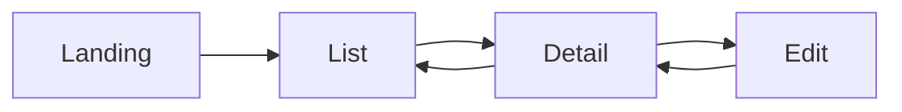

# Working Wireframes - Detailed Steps

## Purpose
**Build a working frontend wireframe with mock data in the user's chosen tech stack, so the user can see-and-iterate on the UI before any backend work begins.**

Working Wireframes focus on:
- Producing an actual, runnable frontend project under the workspace root `/wireframes` folder
- Using the exact tech stack the user intends to use for the real frontend (not pseudo-wireframes or static screenshots)
- Driving every screen with realistic mock data that mirrors the shape of what the backend will eventually return
- Letting the user iterate on screens, flows, copy, interactions, and data shapes as many times as they need before the design settles
- Capturing the resulting design — screen flow, user-provided details, how screens work together — in a single document that will inform backend design in later stages

The output of this stage is two things:
1. A working frontend project at `<workspace-root>/wireframes/` that can be run and clicked through
2. A design document at `aidlc-docs/inception/working-wireframes/wireframes.md` that captures the final screen flow, data shape expectations, and user decisions

## Prerequisites
- Workspace Detection must be complete
- Requirements Analysis must be complete (the wireframe is designed against known requirements)
- User Stories recommended if executed (stories inform which screens are needed)
- Workflow Planning has indicated that Working Wireframes should execute for this project

## Intelligent Assessment Guidelines

### Execute if ANY of these apply
- User-facing UI is in scope
- Greenfield project with a frontend component
- Major UI redesign of an existing product
- User explicitly wants to see-and-iterate on the UI before committing to backend
- Multiple user personas with distinct screen experiences
- The requirements leave UI/UX details open and iteration will clarify them

### Skip if ANY of these apply
- Backend-only service, API-only service, or infrastructure change
- No UI changes (pure backend refactor, data migration, etc.)
- Internal tooling with no human-facing frontend
- User explicitly declines (prefers to go straight to backend/API design)
- Existing frontend is being lightly modified and no new screens are introduced

### Default Decision Rule
**When in doubt, include Working Wireframes.** Early visual iteration surfaces UX issues cheaply and gives the eventual backend design a concrete, user-approved target to serve.

---

# PART 1: PLANNING

## Step 1: Validate Working Wireframes Need (MANDATORY)

Perform the assessment above against the project's actual scope. Document the decision in `aidlc-docs/inception/plans/working-wireframes-assessment.md`:

```markdown
# Working Wireframes Assessment

## Request Analysis
- **Project Type**: [Greenfield / Brownfield]
- **UI Scope**: [Full new UI / Major redesign / Minor changes / No UI]
- **User Personas**: [count and brief list]
- **Iteration Appetite**: [High / Medium / Low]

## Assessment Criteria Met
- [ ] UI is in scope: [yes/no]
- [ ] Project type justifies working wireframe: [yes/no]
- [ ] User wants to iterate on UI before backend: [yes/no]

## Decision
**Execute Working Wireframes**: [Yes / No]
**Reasoning**: [detailed justification]
```

If the decision is **No**, mark the stage skipped in `aidlc-state.md` with the reasoning and proceed to Workflow Planning.

## Step 2: Load Prior Context

Load the full upstream context before asking the user anything:
- Requirements from `aidlc-docs/inception/requirements/`
- User stories and personas from `aidlc-docs/inception/user-stories/` (if executed)
- Reverse-engineering artifacts from `aidlc-docs/inception/reverse-engineering/` (if brownfield)
- Any existing design hints the user already shared (vision docs, mockups, references)

## Step 3: Generate the Wireframe Plan Document

Create `aidlc-docs/inception/plans/working-wireframes-plan.md` with:
- A step-by-step checklist for Part 2 generation (each sub-step a `[]` checkbox)
- Embedded questions using the `[Answer]:` tag format

**See `common/question-format-guide.md` for question formatting rules.**

## Step 4: Ask the Tech-Stack Questions

The whole point of this stage is "build it in the real tech stack". Ask explicitly:

- **Frontend framework and language** (React + TypeScript, Vue + TypeScript, Svelte, Angular, SolidJS, plain HTML+CSS+JS, something else)
- **Styling approach** (Tailwind, CSS Modules, styled-components, vanilla CSS, a specific design system like MUI/Chakra/Mantine/shadcn)
- **Build tooling** (Vite, Next.js, Nuxt, SvelteKit, Create React App, custom)
- **Routing** (React Router, Next.js app router, TanStack Router, Vue Router, none / single-page)
- **State management** (local component state only, Zustand, Redux, Pinia, TanStack Query for server state, none decided yet)
- **Package manager** (npm, pnpm, yarn, bun)
- **Target runtime** (desktop browser only, mobile-first, responsive, specific breakpoints)

If any answer is "I don't know" or "you decide", recommend a sensible default for the project type, name it, and record it as the chosen stack. Do not stall the stage waiting for a decision the user cannot make.

## Step 5: Ask the Screen Questions

Enumerate the screens the wireframe should cover. For each candidate screen (derived from user stories and requirements):

- **Should this screen exist in the wireframe?** [Yes/No/Later]
- **Primary user action on this screen** [free text]
- **Key data shown** [free text — list of fields, with any shape hints]
- **Entry points** (how the user gets here)
- **Exit points** (where the user goes next)
- **Empty / loading / error states** needed [checklist]

Also ask the open-ended ones:
- Are there any screens NOT derived from user stories that the user wants in the wireframe (admin, settings, onboarding, help, 404)?
- Which screen is the landing screen when the wireframe opens?
- Any specific micro-interactions the user cares about (drag-and-drop, inline edit, keyboard shortcuts, modals, wizards)?

## Step 6: Ask the Mock-Data Questions

The data is the backbone of a believable wireframe:
- **Realism level**: generic placeholders ("Lorem ipsum", "User 1") versus domain-plausible fakes ("Q3 Innovation Portal review", `jsmith@acme.com`)
- **Volume**: how many rows / items per list screen (3, 10, 50, enough-to-show-pagination)
- **Variety**: should the mock cover edge cases (empty list, one item, many items, long strings, special characters, errors)
- **Persistence**: within one session only, or should the wireframe persist locally (localStorage, IndexedDB) so a refresh keeps state
- **Fakery library**: free hand, Faker.js, MSW, JSON Server, custom mock module

## Step 7: Ask the Iteration Questions

The stage is explicitly built around repeat cycles:
- How does the user want to review each iteration (run locally and click, screen recording, deployed preview)?
- What's the quickest way for the user to request changes (annotate screenshots, write bullet points, screen-share)?
- How much reshaping is in scope here versus deferred to Refined Mockups later?
- Hard stop criteria: what has to be true for the user to say "this is good enough, move on"?

## Step 8: Ask the Scope-Boundary Questions

What this stage will NOT do, said out loud:
- No real API calls — all data is mocked
- No authentication flow unless the wireframe needs to show the login screens
- No real persistence beyond what Step 6 confirmed
- No performance tuning, accessibility pass, or production hardening — those live in later stages
- No commitment to the chosen tech stack as the final choice unless the user confirms

Confirm each boundary with the user so expectations are set before Part 2.

## Step 9: Analyze Answers (MANDATORY)

Review every answer for:
- **Vague responses** ("some framework", "modern-looking", "a few screens")
- **Contradictions** (chose Vue in Step 4 but asked for React-Router in Step 7)
- **Missing details** (named a screen but did not list what's on it)
- **Assumption-based responses** that depend on unstated knowledge

Any vagueness or contradiction produces a follow-up question. Resolve before Step 11.

## Step 10: Follow-up Questions (MANDATORY if needed)

Create a separate clarification file at
`aidlc-docs/inception/plans/working-wireframes-clarifications.md`
with `[Answer]:` tags for the specific items that need resolution.

## Step 11: Log Approval Prompt

Log the approval prompt with an ISO 8601 timestamp in `aidlc-docs/audit.md` before asking.

## Step 12: Wait for Explicit Approval of the Plan

Do not start Part 2 until the user explicitly approves the plan.

## Step 13: Record Approval Response

Log the user's exact response in `aidlc-docs/audit.md`.

---

# PART 2: GENERATION

## Step 14: Scaffold the Wireframe Project

- [ ] Create `<workspace-root>/wireframes/` if it does not exist
- [ ] Initialize the project in the user's chosen tech stack and build tool
- [ ] Install dependencies (framework, styling, routing, state, mock library) using the chosen package manager
- [ ] Add a `README.md` under `/wireframes` with the exact `install` and `run` commands
- [ ] Add a `.gitignore` tuned for the chosen tool (node_modules, build output, etc.)
- [ ] Verify the empty project builds and serves locally before writing any screen code

Record the install and run commands in both the project `README.md` and the wireframes document (Step 17).

## Step 15: Implement the Screens

For each approved screen from Step 5:
- [ ] Build the screen in the chosen framework
- [ ] Wire routing / navigation between screens
- [ ] Hook up mock data per Step 6 (volume, variety, realism, persistence)
- [ ] Implement empty, loading, and error states if requested
- [ ] Implement the specific micro-interactions requested
- [ ] Match the styling approach (Tailwind utility classes, CSS modules, design-system components, etc.)

Keep code organised so the user can read it: one file per screen or feature, clear naming, no dead code.

## Step 16: Verify the Wireframe Runs

- [ ] Run the install command exactly as documented
- [ ] Run the start command exactly as documented
- [ ] Click through every screen, every state (empty / loading / error), every transition
- [ ] Capture any build warnings, console errors, or broken navigation and fix before proceeding

## Step 17: Write the Wireframes Document

Create `aidlc-docs/inception/working-wireframes/wireframes.md` with these sections:

```markdown
# Working Wireframes

## Tech Stack
- Framework: [chosen framework and version]
- Language: [TypeScript/JavaScript]
- Styling: [chosen styling approach and any design system]
- Build tool: [Vite/Next/etc.]
- Routing: [chosen routing library or `none`]
- State: [chosen state tool or `local only`]
- Package manager: [npm/pnpm/yarn/bun]
- Install command: `[exact command]`
- Run command: `[exact command]`

## Screen Catalog
For each screen:
### [Screen Name]
- Route: [URL path]
- Primary action: [what the user does here]
- Data shown: [fields, with shape hints — this is a HINT to the backend design]
- Entry points: [where the user came from]
- Exit points: [where the user goes next]
- States handled: [empty / loading / error / success]
- User-specific decisions captured: [free text — what the user asked for during iteration]

## Screen Flow
A Mermaid diagram showing how screens connect:


## Mock Data Shape
For each entity used across screens, document the shape (field names and example values).
This section is the raw input for Domain Design and Application Design later.

## User-Captured Details
A record of the specific choices and feedback the user gave during iteration — the things
that would otherwise be lost. Include direct user quotes where useful.

## Implications for Backend
Based on the screens and data shapes above, note what the backend will need to provide:
- Endpoints suggested by each screen's data load
- Mutations suggested by each primary action
- Any ordering, filtering, pagination, or search behaviour implied by list screens
- Any computed values the frontend expects
```

Validate every Mermaid block per `common/content-validation.md` before writing.

## Step 18: Iteration Loop (THE HEART OF THE STAGE)

Present the running wireframe to the user and ask explicitly for changes. Iterate as many times as needed. One cycle looks like:

1. **Show** — tell the user the install and run commands and that the wireframe is ready
2. **Collect feedback** — the user clicks through locally, then reports changes they want (new screens, revised flows, different copy, different data, different interactions)
3. **Apply changes** — update the code, update the wireframes document to reflect what changed, log the user's feedback in `aidlc-docs/audit.md` with the user's complete raw input
4. **Verify** — rerun Step 16's verification
5. **Loop** — go back to show, or exit when the user says the wireframe is good enough

Do not pressure the user to approve. The whole stage exists so iteration is cheap. If the user requests changes that are clearly out of scope for a wireframe (production security, real backend, auth integration), name the deferral and move on.

## Step 19: Log Approval Prompt

Log the completion approval prompt with timestamp in `aidlc-docs/audit.md`.

## Step 20: Present Completion Message

Present the completion message in this structure:

1. **Completion Announcement** (mandatory):

```markdown
# 🎨 Working Wireframes Complete
```

2. **AI Summary** (optional, factual):
   - Chosen tech stack (one line)
   - Number of screens built
   - Location of the running wireframe (`<workspace-root>/wireframes/`)
   - Install and run commands
   - Number of iterations completed with the user
   - Keep factual; no "please" or "proceed to"

3. **Formatted Workflow Message** (mandatory):

```markdown
> **📋 <u>**REVIEW REQUIRED:**</u>**
> The running wireframe is at: `wireframes/`
> The wireframes design document is at: `aidlc-docs/inception/working-wireframes/wireframes.md`
> Install:  `[exact install command]`
> Run:      `[exact run command]`


> **🚀 <u>**WHAT'S NEXT?**</u>**
>
> **You may:**
>
> 🔧 **Request Changes** -  Ask for another iteration of the wireframe
> ✅ **Approve & Continue** - Lock the wireframe and proceed to **Workflow Planning**

---
```

## Step 21: Wait for Explicit Approval

Do not proceed until the user explicitly approves. If the user asks for more changes, return to Step 18.

## Step 22: Record Approval Response

Log the user's exact response in `aidlc-docs/audit.md`.

## Step 23: Update Progress

- Mark Working Wireframes stage complete in `aidlc-docs/aidlc-state.md`
- Update the "Current Status" section
- Prepare for transition to Workflow Planning

---

# CRITICAL RULES

## Planning Phase Rules
- **CONTEXT-APPROPRIATE QUESTIONS**: Only ask questions relevant to this specific project
- **MANDATORY ANSWER ANALYSIS**: Analyze every answer for ambiguity before Part 2 starts
- **NO PROCEEDING WITH AMBIGUITY**: Resolve vague answers in a follow-up file before approval
- **EXPLICIT APPROVAL REQUIRED**: User approves the plan before any code is scaffolded

## Generation Phase Rules
- **REAL TECH STACK**: Use the exact tools the user chose; no "wireframe tools" or placeholders
- **REAL CODE**: The wireframe is a running project, not a sketch — it compiles, it serves, it clicks
- **MOCK DATA ONLY**: No real API calls, no real auth, no real persistence beyond what Step 6 approved
- **ITERATE FREELY**: Step 18 is the point of the stage; expect many cycles
- **UPDATE THE DOCUMENT**: Every iteration updates `wireframes.md` so the final document matches the final code
- **CODE AT WORKSPACE ROOT**: Project goes to `<workspace-root>/wireframes/`, never under `aidlc-docs/`
- **DOCUMENT UNDER aidlc-docs**: The `wireframes.md` lives under `aidlc-docs/inception/working-wireframes/`, never beside the code

## Completion Criteria
- All planning questions answered and ambiguities resolved
- Plan explicitly approved by the user
- Working wireframe project exists at `<workspace-root>/wireframes/` and runs locally
- All approved screens built with the specified mock data and interactions
- `aidlc-docs/inception/working-wireframes/wireframes.md` reflects the final state of the wireframe
- At least one full iteration cycle completed with the user (or the user explicitly skipped iteration)
- Generated wireframe explicitly approved by the user
- Audit log captures every iteration's user input
