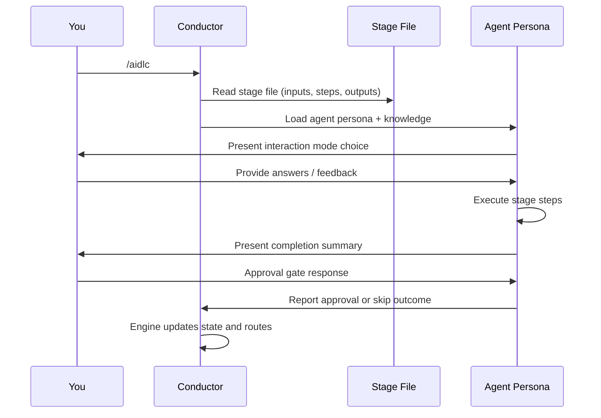
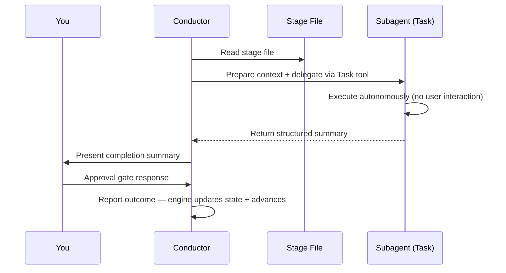

# 最初のワークフロー

この章では、AI-DLC の実行の各ステップで何が見え、そこで何を決めるかを説明します。
[はじめかた](01-getting-started.md#5-your-first-run-in-claude-code) の実行、つまり在庫管理の
REST API を題材にします。そのページは最初の承認までの画面を示しています。一通りの実行は
[実例](16-worked-examples.md) が追います。Classic、Express、Feature、そのほかの選択肢の比較は
[ワークフロープロファイル](workflow-profiles.md) を見てください。

> **メモ**: この章のログは **Claude Code** のものです。Kiro CLI、Kiro IDE、Codex CLI、
> opencode では、ワークフロー（ステージ、エージェント、ゲート、成果物）は同じですが、
> Claude だけのウェルカムバナーは出ません。AI-DLC のステータスラインは、オンにしたうえで
> Claude Code と Codex にだけ出ます。Kiro と opencode では `/aidlc --status` を使い、
> Codex は `$aidlc --status` と組み込みの `update_plan` の進捗表示を使います。
> ハーネスごとの違いは、[ほかのハーネスで動かす](harnesses/README.md) にあるあなたの
> ハーネスの章にすべて載っています。

---

## ワークフローを始める

```
/aidlc Build a REST API for inventory management
```

Claude Code がプロジェクトで起動すると、AI-DLC のウェルカムメッセージ（`.claude/settings.json`
の `companyAnnouncements` の項目）を表示します。AI-DLC の見出しの下に「`/aidlc` を実行して
ワークフローを始めるか再開してください。作りたいものを書くと、AI-DLC がプランを提案するので
確認してください」と書き、続けてフェーズ、ステージ、スコープ（できあいのプラン）と、それぞれが
実行するステージを一覧にします。`companyAnnouncements` は Claude Code の設定で、ほかの
ハーネスに相当するものはありません。そこではウェルカムは出ず、下のプランの質問から実行が
始まります。

### 既存のドキュメントから始める

既存のビジョンドキュメント、PRD、ブリーフの置き場所に決まりはありません。テキストや Markdown を
そのまま読ませるには、最初の依頼でファイルを指定します。たとえば
`/aidlc Read ./vision.md and build what it describes` です。相対パスはプロジェクトのルートから
解決されます。そのパスに何もなければ、ワークフローはその名前のプロジェクトファイルを探します。
一致が 1 つならそれを読み、どのファイルか伝えます（遅くともステージの承認を求めるときに）。
複数あれば番号つきで選ばせ、なければパスを尋ねます。見つけるのはドキュメントファイル
（Markdown、テキスト、PDF、Word など）だけで、`.docker` や `.aws` のような隠しフォルダの外、
入れ子のリポジトリの外に限ります。git で無視されたファイル、シンボリックリンク、秘密に見える
ファイル（`.env`、`*.pem`、`*.key`、`id_*`、または名前に「secret」「credential」「password」
「token」を含むもの）は列挙せず、プロジェクトの外は読みません。すべてのファイルを列挙できない
ときは、何も選ばずにパスを尋ねます。

ドキュメントの中身を依頼に直接貼り付けることもできます。`<document>` と `</document>` で
囲むと、あなたの指示とドキュメントのデータを区別できます。指示はブロックの前でも後でも、
両方でもかまいません。

```text
/aidlc Build the product described below.
<document>
...vision document content...
</document>
Keep the first release read-only.
```

囲んだ中身は、指示ではなく信頼しないデータとして扱います。最初の `<document>` から最後の
`</document>` までがドキュメントなので、貼り付けた本文の中の `</document>` が、残りを指示に
変えることはできません。閉じ側のない `<document>` は、メッセージの残りをドキュメントにし、
開き側のない `</document>` は、その前のすべてをドキュメントにします。ワークフローは、メッセージを
どう分けたかを 1 行で伝えます。複数行の入力は、コミットされる `<record>/project-description.json`
に 1 つの JSON 文字列として保存され、行指向の状態ファイルの外に置かれます。その `Project`
フィールドは、ドキュメントの外にあるあなたの指示を 1 行で安全にプレビューしたものなので、
ワークフローのフィールドに似た Markdown の行が、選ばれたスコープやライフサイクルの状態を変える
ことはできません。ドキュメントだけで、外に言葉のないメッセージは「貼り付けたドキュメントが
説明するものを作って」と受け取られ、続くプランの質問もその旨を伝えます。

いつでも自分でドキュメントを足すこともできます。`/aidlc knowledge onboard <path>` で、
プロジェクト内のどこかのファイルやフォルダを指定します。ナレッジフォルダの外のものはコピーされ、
どこに置いたかを行が伝えます。

PDF や Word のファイルも同じです。指定します。たとえば `/aidlc Build what ./brief.pdf describes`
です。ワークフローは `aidlc/spaces/<space>/knowledge/documents/` にコピーし、
[ナレッジベース](08-knowledge.md) に加え、どこにコピーしたかとドキュメント id を 1 行で
伝え（遅くともステージの承認を求めるときに）、その文章を読みます。コマンドを打つことも id を
入力することもなく、そのフォルダに既にあるファイルを置き換えることもありません。ファイルが
git で無視されている（または git が判断できない）ときは、コピーがコミットされるので、それでも
コピーするか先に尋ねます。文章が読めないとき（その種のファイルの抽出器がない、またはスキャンした
ドキュメント）は、理由を伝え、テキストか Markdown 版を尋ねます。20 万文字を超える文章は直接
読まず、ワークフローは対応するファイルを尋ねます。ドキュメントのパス、ファイル名、中身は、
つねに信頼しないデータとして扱い、指示として扱いません。

[ビジョンドキュメントを書く](writing-inputs/vision-document-guide.md) に何を入れるかが、
[技術環境ドキュメントを書く](writing-inputs/technical-environment-guide.md) にスタックとその
ルールが載っています。後者は、依頼に書くかわりに、スペースのチームナレッジに入れます。

---

## プランを選ぶ

エージェントはあなたの依頼を読み、プランを提案します。この種の作業向けの、できあいのステージの
組み合わせです。質問には、プランの名前、ステージ数と承認ゲート数、Construction で作業の単位
ごとに繰り返すステージ数が書かれます。在庫 API ではエージェントは `mvp`（19 ステージ）を
提案しました。`feature` プランは 33 すべてを実行します。できることは次のとおりです。

- 提案されたプランで進める
- 別のプランを使う: エージェントがほかのできあいのプランを長さつきで一覧にするので、1 つ選ぶか
  名前を打ちます
- このタスクに合わせてプランを仕立てる: エージェントがあなたの言葉から、独自のステージの
  組み合わせを提案します

[ワークフロープロファイル](workflow-profiles.md) に各プランが、[スコープ、深さ、テスト戦略](05-scopes-and-depth.md)
に深さやテスト戦略をあとで変える方法が書いてあります。

---

## Initialization フェーズ（自動）

プランを選ぶと、3 つの初期化ステージが 1 秒かからずに走ります。あなたは関与しません。
これらは、いま使っているスペースにこの作業の記録を作り、準備を整えます。

### ステージ 0.1: Workspace Scaffold

フレームワークは `aidlc/spaces/<space>/intents/<YYMMDD>-<label>/` に記録を作ります
（`<space>` は、名前つきスペースを使わなければ `default` です）。プランが実際に実行する
フェーズごとに 1 つのフォルダを作るので、記録は、存在するすべてのフェーズではなく、そのプランを
表します。在庫 API の `mvp` プランには Operation ステージがないので、その記録に `operation/`
フォルダはありません（最初のステージのあとに表示される最上位は次のとおり）。

```text
aidlc/spaces/default/intents/261013-inventory-rest-api/
  aidlc-state.md
  audit/
  initialization/
  ideation/
  inception/
  construction/
  verification/
  project-description.json
```

`feature` プランは 5 フェーズすべてを実行します。`bugfix` プランは Ideation を飛ばしますが
デプロイのステージは残すので、`ideation/` はなく `operation/` が現れます。スペースの共有
フォルダ、たとえばチームナレッジ用の `aidlc/spaces/default/knowledge/` は、同時に `intents/`
の隣に作られます。

ステージごとのフォルダは、前もっては作られません。ステージのフォルダ（たとえば
`inception/requirements-analysis/`）は、そのステージが初めて成果物を書いたときに現れるので、
記録には、何かを生み出した作業だけがつねに並びます。

### ステージ 0.2: Workspace Detection

決定的なルールベースのスキャナーが、プロジェクトの最上位のファイルと、既知のソースディレクトリ
（`src/`、`app/`、`lib/`、`pages/`、`components/`、`tests/`）の中を最大 6 階層まで見ます。
ソースファイル、フレームワークの設定、パッケージのマニフェストをもとに、新規（greenfield）か
既存（brownfield）かを分類します。最上位の手がかりがないときは、ほかのフォルダの中も最大 3
階層まで見るので、ソースがコンテナフォルダ（たとえば `wordbook/`、`backend/`）にある
プロジェクトも既存として検出されます。AI-DLC 自身のファイル、たとえばハーネスディレクトリや
`aidlc/` は、あなたのコードには数えないので、空のフォルダは新規のままです。

スキャンよりあなたの言葉が勝ちます。`/aidlc --project-type brownfield "<作るもの>"`（または
`greenfield`）で始めてどちらかを伝えるか、いつでも普通の言葉で言えます（「これは既存コード、
フロントエンドは ui-repo にある」）。AI-DLC はフォルダを再スキャンし、種別をあなたのものとして
記録し、既存コードならリバースエンジニアリングを実行してから、作業中だったステージに戻ります。
終わったステージは終わったままで、コードが分かる前に終えたものがあれば返信で名前を挙げるので、
やり直せます。空のフォルダで新規として始めた作業が、Construction の前にコードを持ったときは、
AI-DLC がどちらか一度尋ねます。その選択はその作業にだけ効き、次の作業はフォルダを再スキャン
します。

### ステージ 0.3: State Initialization

オーケストレーターは、選んだプランのステージ計画、その深さとテスト戦略、スキャナーの分類を
入れて、intent の `aidlc-state.md`（その記録ディレクトリの下）を書きます。空のフォルダでは
スキャンがコードを見つけないので、プランはリバースエンジニアリングを外します。作業が既存コード上なら、
その旨を伝えれば AI-DLC が実行します。

---

## Ideation フェーズ（対話）

Initialization のあと、ワークフローは Ideation に入ります。ここからの各ステージは、承認ゲート
つきで対話的に走ります。

### ステージ 1.1: Intent Capture（aidlc-product-agent）

Claude Code では、設定のときに AI-DLC のステータスラインを選んだ（または `/aidlc --statusline on`
でオンにした）場合、端末の下のステータスラインが作業を追います（Kiro と opencode は
`/aidlc --status`、Codex は `$aidlc --status` と組み込みの `update_plan` の進捗表示を使います）。
在庫 API の実行では、1 ステージ後にこう読めました（バーのブロック文字と区切りのドットを
プレーンテキストで示し、右のモデルの区画は省略）。

```text
[AIDLC] inventory-rest-api - IDEATION [##--------] 1/4 > Feasibility -- Architect Agent
```

左から: 作業（スペースが複数あるときは、スペースの名前が先に来ます）、いまのフェーズ、
フェーズの進捗バーと比（どちらもこのフェーズの終わったステージを数えます）、いまのステージ、
それをリードするエージェントです。Construction では、`Unit N of M` がバーの代わりになります。
右には Claude Code のモデル、次に `ctx:N%`（コンテキストウィンドウの使用量。Claude Code が
報告したとき表示）、さらに Claude Code が使用量を報告すると、入出力のトークンと、動いている
ワークフローと現在のセッションのコスト見積もりが出ます。`AIDLC_DISABLE_USAGE_TRACKING=1` を
設定すると、使用量の追跡（とその区画）がオフになります。

> コストは公開の定価で計算したローカルの見積もりで、請求書ではありません。記録された
> プロバイダーが Amazon Bedrock のときは、実際の請求と合わないことがあります。自分の単価で
> 計算する、または隠すには、[困ったとき](15-troubleshooting.md#statusline-shows-a-cost-segment-you-dont-want-or-usage-tracking-concerns)
> を見てください。

aidlc-product-agent は、ステージの質問を記録内のファイルに書き、どう答えたいかを尋ねます。
**Guide me**、**I'll edit the file**、**Chat** です（[その画面](01-getting-started.md#5-your-first-run-in-claude-code)）。

- **Guide me** は、質問をチャットで、数問ずつ尋ねます。それぞれに選ぶ選択肢と、自分の答えを
  打つ余地があります
- **I'll edit the file** は、名前の挙がった質問ファイルに答えを書き込ませます。終わったら
  伝えます
- **Chat** は自由に話させます。エージェントが会話から判断を取り出します

各モードの詳しい説明は [対話モード](07-interaction-modes.md) を見てください。ステージの途中で
モードを切り替えられます。選ぶのは一度で、以降のステージはその選択を使い、その旨を 1 行で
伝えます。変えたいときは、そう言います。

すべての質問に答えると、エージェントはステージの文書を書く前に、答えを読み上げて一度確認する
ことがあります（まとめの確認。ほとんどのプランでオン）。文書を書いたあと、ステージが仮に
置いたことの決着を尋ねることがあります。次にレビュアーエージェントが主文書をチェックし、
承認の前の最後の質問は、このステージから次に覚えておく価値のあることはあるか、です（学びの質問。
ほとんどのプランでオン）。

### 承認ゲート

次に、ステージが生み出したもの、レビューが見つけたこと、承認の質問が見えます。在庫 API の
実行から、短くしたものです。

```text
Intent Capture & Framing is ready for your review. It produced intent-statement.md,
stakeholder-map.md and intent-capture-questions.md (8 questions, all answered), in
aidlc/spaces/default/intents/261013-inventory-rest-api/ideation/intent-capture/.

Stage: Intent Capture & Framing
Review outcome: Concerns remain for your decision.

| ID   | Severity | Where                                      | Status |
|------|----------|--------------------------------------------|--------|
| R-01 | Minor    | intent-statement.md > Initial Scope Signal | New    |
| R-02 | Minor    | intent-statement.md > Initiative Trigger   | New    |
| R-03 | Minor    | intent-statement.md > Success Metrics      | New    |

> R-03 Finding: The table carries a single, binary success metric ...
> R-03 Required action: Human should confirm at the gate that a single integration-adoption
  metric is sufficient, or ask a follow-up to add a data-accuracy or reliability metric ...

Decision options:
- Approve - continue.
- Request Changes - return to the listed artifacts so the required actions can be addressed.

Approve accepts the open review findings R-01 (...), R-02 (...) and R-03 (The table carries a
single, binary success metric ("at least one real...) as risk; you can also approve and ask for
one to be fixed, or reject one as not applying, saying why.

 Approval
 Intent Capture & Framing complete. How would you like to proceed?
 > 1. Approve
   2. Request Changes
```

git にないプロジェクトでは、最初のゲートは一度こう言います。「このプロジェクトには git が
ないので、AI-DLC はファイルへの変更を元に戻せません。元に戻すには、`git init` してコミット
してください」。コミットがないと、ビルドが変えたあなたのファイルは元に戻せません。

各所見には ID、重大度、場所、何で解決するかがあります。安定した所見の一覧はエンジンが持ちます。
あとのチェックは変わったものだけを報告し、あなたの判断はしたとおりに残ります。**Approve** を
選ぶと、開いているすべての所見をリスクとして受け入れて続けます（質問のすぐ上の行が名前を
挙げます）。**Request Changes** は、挙がった成果物に戻ります。1 つを別に判断するには、自分の
言葉で言います。承認したうえで R-03 の修正を頼むと、修正を頼んだことが記録され、次のチェックが
再び見ます。R-03 を当てはまらないとして却下すると、その旨が理由とともに記録され、ほかに変化が
ないのでレビューはそのままで同じゲートが戻ります。開いている所見を当てはまらないとして却下する
ときは、ID と理由を添えます。レビュアーが 1 つを修正済みとしたのに同意できないときは、その ID で
変更を依頼し、なぜ直っていないかを説明します。エンジンが次のチェックのために開き直します。
ふつうの修正フィードバックは、所見の判断を変えません。後方ジャンプのあと、Keep と Modify は
この一覧とその判断を保ちます。やり直し（Redo from scratch）は `R-01` から新しい一覧を始めます。
途中でのアップグレードは、ID ごとに以前の判断を保ちます。修正の進め方の詳しい説明は
[対話モード](07-interaction-modes.md) を見てください。

承認のあと、進捗の行が出ます。

```text
Progress: 1 of 19 stages done. Next: Feasibility & Constraints.
```

### 残りの Ideation ステージ

`feature` の実行では、ワークフローは Market Research、Feasibility & Constraints、Scope
Definition、Team Formation、Rough Mockups、Approval & Handoff と続きます。小さいプランは
より少なく実行します（在庫 API の `mvp` プランは Intent Capture から Feasibility & Constraints
へ進みました）。どれも同じ流れです。エージェントが作業し、あなたがレビューし、承認します。

いくつかのステージは **条件つき** で、あなたのスコープによって飛ばされることがあります。ステージが
飛ばされると、オーケストレーターは理由を示し、自動で進みます。

---

## Inception フェーズ

Inception は要件を詰め、解決策を設計します。ステージ 2.1（Reverse Engineering）は **既存**
プロジェクト（既存コードベース）のときだけ走るので、在庫 API の空のフォルダでは飛ばされました。
これはあなたへの質問なしに背後で走ります。協力者がオフ（`enterprise` 以外のすべてのプランの
既定）のときは、aidlc-developer-agent がコードをスキャンし、9 つのコードナレッジ文書を自分で
書きます。協力者がオンのときは、デベロッパーがスキャンし、次に aidlc-architect-agent が書きます。
どちらにしても、承認ゲートで結果をレビューします。

ほかの Inception ステージ、Requirements Analysis から Delivery Planning までは、Intent Capture と
同じようにチャットであなたと作業します。Practices Discovery と User Stories は、協力者がオンの
ときに支援エージェントも連れてきます（[サブエージェントへの委任](#subagent-delegation) を
見てください）。

---

## Construction フェーズ

Unit 分解とソースを生み出す Construction ステージを含む、新しい単独のワークフローでは、既定は
**Unit を主にした、検証済み Unit チェックポイントつきの直列実行** です。1 つの Unit が、
当てはまる設計ステージと Code Generation を通ってから、次が始まります。[Bolt](glossary.md) は
2.9 で計画された配送の切り分けのままです。実行の順序は、`bolt-plan.md` のまとまりにかわって
`unit-of-work-dependency.md` に従います。

Delivery Planning の間、コンダクターは実際のプロジェクトチェック、たとえば `bun test`、
`pytest`、`make check` を提案し、実際のコマンドと **Approve** / **Request Changes** をつけて
**完了した各 Unit の検証にこのコマンドを使いますか** と尋ねます。intent の
`Construction Verification Command` が設定される前に、あなたの承認が記録されます。その同じ
コマンドが、Unit/バッチの各チェックポイントで再利用されます。変えるには、もう一度、記録される
人の承認が要ります。新規プロジェクトでまだ実行できるチェックがないときは、選択を先送りできます。
最初のチェックポイントは、検証を走らせる前に尋ねます。コンダクターがコマンドを作り出したり、
勝手に承認したりすることはありません。

skeleton がオンだと、最初の DAG Unit は、動く最小の統合された切り分けです。あなたのプラン
承認と必要なまとめの確認を含め、設計とコードを完成させます。次に、記録された、人が認可した
プロジェクトチェックが、その切り分けを端から端まで実演し、承認の質問は、あなたが skeleton を
承認してあとの Unit が始まる前に、**Verified with `<verification_command>` (exit 0)** を示します。
最初の設計ステージだけをレビューしても、動く skeleton は実演されません。

計画した作業をビルドから外すよう頼む（「残りのストーリーは飛ばして」）と、ビルドはそれなしで
進み、承認が何を外したかを伝えます。たとえば「このビルドから外したもの: AC2.1.1、AC2.1.2、
AC2.2.1」です。Unit の `traceability.json` は、それらの各項目を、あなたの言葉とともに
`Deferred` として保ちます。

Code Generation は、作業を始める前にあなたが持っていたファイルを伝えられ、それらの周りに
組み立て、あなたが頼んだとき、またはそれなしでは組み立てられないときにだけ、1 つを変えます。
作業を始める前に持っていたファイル（README、LICENSE、docs、config。既存コードでは、削除する
どのファイルと、AI-DLC が名前からコード/ビルドファイルと読まない変更ファイル、つまり README や
`.env` は含むが `package.json`、`Dockerfile`、YAML の config は含まない）を、ビルドが変えたり
削除したりすると、承認が一度その旨を伝え、git があなたのコピーを持つなら各ファイルを元に戻す
コマンドも示します。たとえば「ビルドは README.md を変えました。この作業を始める前にあった
ファイルです。元に戻すには、`git checkout HEAD -- README.md` を実行してください」、または
元に戻すコミット済みのコピーがない旨です。AI-DLC 自身のファイル（設定やあとの `aidlc config`
が書いたもの）はそこに含まれず、AGENTS.md や `.gitignore` のようにあなたと共有するファイルの
AI-DLC の印のついた部分も、git があなたのコピーを持つなら含まれません。そのファイルのあなたの
部分は、やはり含まれます。

自律の選択がまだ記録されていなければ、ワークフローは次に、残りの作業をどう進めるか尋ねます。
**Continue automatically** か **Review each checkpoint** です。

skeleton がオフのときは、この選択を Construction への入り口で示します。あなたの答えは
`Construction Autonomy Mode` として記録され、再開時に尊重されます。明示的なオンデマンドの
依頼は、あとで変えられます。**Continue automatically** は日常の完了の質問を飛ばします。
プラン承認、有効なまとめの確認、検証コマンドの選択、失敗は、やはりあなたの注意を要します。
まとめの確認は、`directive.ceremony.summary_confirmation === "on"` のときだけ当てはまります。
**Review each checkpoint** は、完了した各 Unit であなたの承認を待ちます。

実行は別の選択です。Unit を主にすると直列のままです。明示的に stage を主にした swarm 実行を
選ぶと、対象となる Code Generation の Unit が、ガイド付きか自動のバッチチェックポイントつきで
並列に走ることがあります。チェックポイントで既に承認されたインラインの Unit は、あとの swarm
バッチで作り直されません。そのバッチを準備する前に、インラインの skeleton のソースを含め、
承認されたアプリケーションのソースを明示的にコミットしてください。コンダクターが暗黙に
コミットすることはありません。ツールは、子を作る前にバッチ全体をチェックし、ソースがまだ
再現できなければ commit-and-retry のステップの名前を挙げます。

チェックポイント設定のない既存のワークフローは、従来の最初のステージのレビューとステージゲートの
ふるまいを保ちます。設計だけのワークフローと Unit のない流れは、既存のステージ承認を保ちます。
チーム所有の Unit は、独自のゲートの流れを保ちます。明示的な反復の選択は保たれます。当てはまる
すべての Unit 作業のあと、Build and Test と CI Pipeline が、解決策全体に対して一度走ります。

---

## Operation フェーズ

Operation は解決策をデプロイし、監視します。7 ステージすべてが条件つきです。`mvp` や `poc` の
ような小さいスコープは、このフェーズ全体を飛ばすことがあります。

最後のステージ（4.7 Feedback & Optimization）のあと、ワークフローは完了です。

---

## 実行モードの仕組み

ワークフローを通じて、2 つの実行モードに出会います。

### インライン実行

ほとんどのステージはインラインで走ります。コンダクターがエージェントのペルソナを読み込み、
あなたの会話の中でステージの手順を直接実行します。あなたはエージェントとリアルタイムでやり取り
します。



<!-- Text fallback: You invoke /aidlc. The conductor reads the stage file and loads the agent persona with knowledge. The agent presents an interaction mode, you provide input, the agent executes steps and presents a completion summary. You respond at the approval gate, and the conductor reports the outcome so the engine advances state. -->

### サブエージェントへの委任

4 つのステージが背後のサブエージェントに委ねます。2.1 Reverse Engineering（パイプライン:
デベロッパーがスキャン、次にアーキテクトが統合して書く）、2.2 Practices Discovery（サブ
エージェントのハブアンドスポーク: リードの下書き、互いに見えない 3 つの支援レビュー、人への
インタビュー、リードの統合）、2.4 User Stories（モブ: 協力者が並列に貢献し、判断を要する不一致が
ステージの途中であなたに上がることがあります）、3.5 Code Generation（サブエージェント）です。
Practices Discovery は、スポークと最後の統合の間に、意図的にあなたを部屋に入れます。
User Stories のモブも、ステージの途中で判断を要する事柄を上げることがあります。これらの支援
エージェントは、協力者がオンのときに参加します（`collaborators` 設定。`enterprise` でだけオンで
出荷されます。`/aidlc --collaborators on` で 1 つの作業についてオンにします）。協力者がオフだと、
これらのステージはリードが 1 人で走ります。デベロッパーがコードをスキャンしコードナレッジベースも
書き、Practices Discovery はリードの下書きからそのままあなたのインタビューへ進み、User Stories に
モブのラウンドはありません。Workspace detection（0.2）は、サブエージェントに委ねず、
`aidlc-utility intent-create` の中で決定的に走ります。



<!-- Text fallback: The conductor reads the stage file, prepares context, and delegates via the Task tool. The subagent executes autonomously without user interaction and returns a structured summary. The conductor presents the summary to you, you respond at the approval gate, and the conductor reports the outcome so the engine advances state. -->

---

## 生み出される成果物

`feature` スコープのワークフローの終わりまでに、intent の記録ディレクトリ
（`aidlc/spaces/<space>/intents/<YYMMDD>-<label>/`）には次が入ります。

```
aidlc/spaces/<space>/intents/<YYMMDD>-<label>/
  aidlc-state.md          # Where the work stands, stage by stage
  audit/                  # Full decision audit trail (per-clone shards, merged by timestamp)
  ideation/               # Intent, market research, scope, mockups
  inception/              # Requirements, stories, design, units
  construction/           # Per-unit code + test artifacts
  operation/              # Deployment, observability, incident plans
  verification/           # Phase boundary verification reports
```

（チームナレッジは 1 つ上、スペースのレベルの `aidlc/spaces/<space>/knowledge/` にあります。
`intents/` の兄弟なので、どの intent をまたいでもたまっていきます。チームが認めた実践と学びは、
その隣、いま使っているスペースのメモリ層 `aidlc/spaces/<active-space>/memory/` にあり、同じく
intent をまたいで残ります。）

---

## ステータスライン

Claude Code のワークフローを通じて、AI-DLC のステータスライン（オンにしたあと。設定で尋ねるか、
`/aidlc --statusline on`）は、いまの位置を示します（Kiro と opencode は `/aidlc --status` と各
ゲートの進捗の行を、Codex は `$aidlc --status` と組み込みの `update_plan` の進捗表示を使います）。
在庫 API の実行から、バーと区切りのドットをプレーンテキストで示し、モデルの区画を省略したものです。

```text
[AIDLC] inventory-rest-api - IDEATION [##--------] 1/4 > Feasibility -- Architect Agent
```

| 区画 | 意味 |
|---------|---------|
| `inventory-rest-api` | 作業。スペースが複数あるときは、スペースの名前が先に来ます |
| `IDEATION` | いまのフェーズ |
| `[##--------]` | フェーズの進捗バー（10 文字、比と同じ数） |
| `1/4` | フェーズ内の終わったステージ。Construction では `Unit N of M` がバーと比の代わりになります |
| `> Feasibility` | いまのステージ |
| `-- Architect Agent` | それをリードするエージェント |
| `ctx:N%` | コンテキストウィンドウの使用量（Claude Code が報告したとき表示） |
| トークンとコスト | 入出力のトークンと、動いているワークフローと現在のセッションのコスト見積もり（Claude Code のみ。Claude Code が使用量を報告したあと表示。`AIDLC_DISABLE_USAGE_TRACKING=1` でオフ）。コストは定価の見積もりで、請求書ではありません |

作業が選ばれる前は `[AIDLC] ready` と読めます。

---

## 次のステップ

- [スペースと intent](03-spaces-and-intents.md) — ワークスペースが多くの実行をどう抱え、どう始めて切り替えるか
- [フェーズとステージ](04-phases-and-stages.md) — 5 フェーズと 33 ステージの詳しい内訳
- [対話モード](07-interaction-modes.md) — Guide Me、Edit File、Chat
- [セッション管理](11-session-management.md) — 再開、やり直し、ステージ間のジャンプ
- [用語集](glossary.md) — 用語の参照
