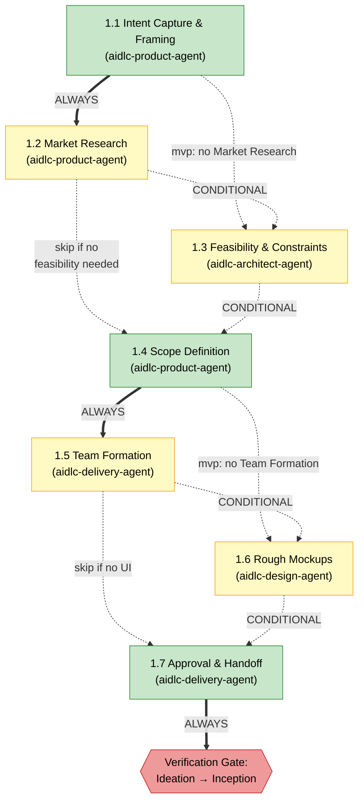
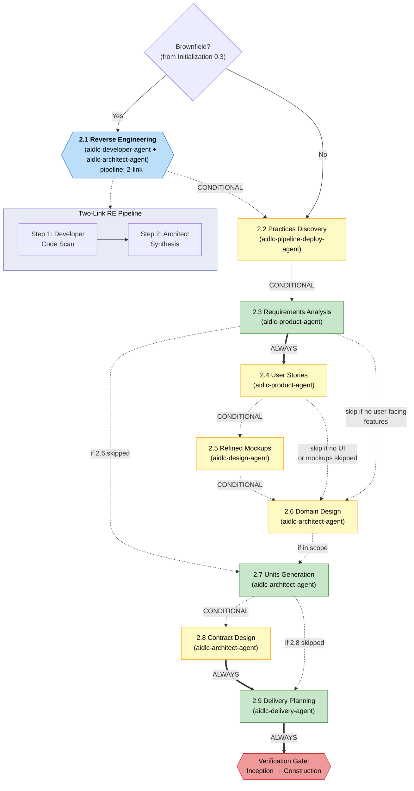
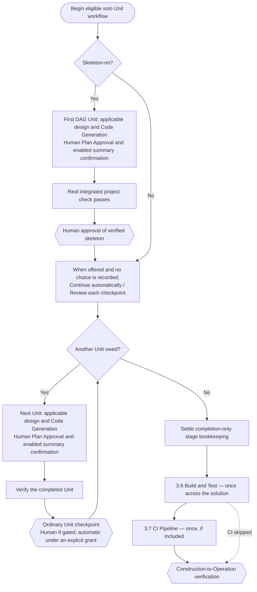
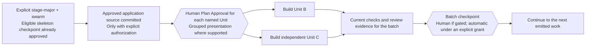
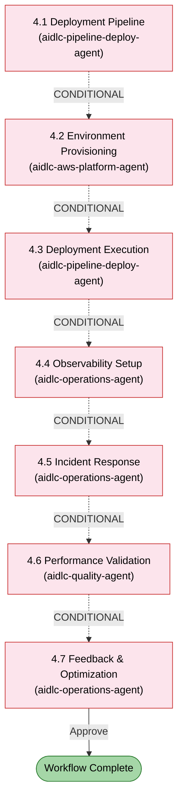

# フェーズとステージ

AI-DLC ライフサイクルは、33 のステージを含む 5 つのフェーズに整理されています。この章では、各フェーズを説明し、そのステージを挙げ、それらがどうつながるかを示します。

> **ハーネスについての注記。** 方法論（このガイドが説明するフェーズ・ステージ・エージェント・ゲート）は、どのハーネスでも同じです。仕組みがハーネスによって違うところ（ゲートの描画のされ方、サブエージェントの送り出し方、設定の置き場所）は、その違いを示し、あなたのハーネスの章で表にまとめます。
> [ほかのハーネスで動かす](harnesses/README.md) を参照してください。ここでの例は、断りがなければ Claude Code を使います。

---

## ライフサイクルの全体像

```mermaid
graph LR
    subgraph INITIALIZATION["INITIALIZATION (0.1-0.3)"]
        Z1["Workspace Scaffold"]
        Z4["State Init"]
        Z1 -.->|"3 stages"| Z4
    end

    subgraph IDEATION["IDEATION (1.1-1.7)"]
        I1["Intent Capture"]
        I7["Approval & Handoff"]
        I1 -.->|"7 stages"| I7
    end

    subgraph INCEPTION["INCEPTION (2.1-2.9)"]
        N1["Reverse Engineering"]
        N7["Delivery Planning"]
        N1 -.->|"9 stages"| N7
    end

    subgraph CONSTRUCTION["CONSTRUCTION (3.1-3.7)"]
        C1["Functional Design"]
        C7["CI Pipeline"]
        C1 -.->|"3.1–3.5 per Unit in the recorded order; 3.6–3.7 once after all Units"| C7
    end

    subgraph OPERATION["OPERATION (4.1-4.7)"]
        O1["Deployment Pipeline"]
        O7["Feedback & Optimization"]
        O1 -.->|"7 stages"| O7
    end

    Z4 -->|"auto-proceed"| I1
    I7 -->|"Verification Gate 1"| N1
    N7 -->|"Verification Gate 2"| C1
    C7 -->|"Verification Gate 3"| O1
    O7 -.->|"Feedback Loop"| I1

    style INITIALIZATION fill:#f3e5f5,stroke:#9c27b0,color:#000
    style IDEATION fill:#e8f5e9,stroke:#4caf50,color:#000
    style INCEPTION fill:#e3f2fd,stroke:#2196f3,color:#000
    style CONSTRUCTION fill:#fff3e0,stroke:#ff9800,color:#000
    style OPERATION fill:#fce4ec,stroke:#e91e63,color:#000
```

<!-- Text fallback: Linear flow: INITIALIZATION (0.1-0.3) auto-proceeds to IDEATION (1.1-1.7), which passes through Verification Gate 1 to INCEPTION (2.1-2.9), through Verification Gate 2 to CONSTRUCTION (3.1-3.7), through Verification Gate 3 to OPERATION (4.1-4.7). A feedback loop returns from 4.7 back to 1.1. -->

フェーズは順番に実行されます。各フェーズの境目（Initialization → Ideation を除く）で、**検証ゲート** が自動のトレーサビリティ確認を走らせ、後続のステージがそれらの上に積み上がる前に、欠けたリンク・孤立した成果物・不整合をとらえます。

### 順番に動くもの、並行して動くもの

**ステージは一つずつ、順番に動きます。** ステージが完了すると、エンジンはライフサイクル順で次のステージ、つまりあなたのスコープが走らせ、まだ done でも skipped でもないステージへ進みます（Construction は後述のとおりステージを Unit ごとに繰り返します）。一つのワークフロー内で、前のフェーズのステージがまだ開いている間に、後のフェーズが始まることはありません。

- それでも先へ進むには、ジャンプします。`/aidlc --stage <name>` または `/aidlc --phase <name>` です。飛ばしたステージは skipped（`[S]`）と印され、後で勝手に走ることはありません。前のステージへジャンプで戻ると、そのステージとあなたの計画内の後のすべてのステージが開き直します。ファイルは残ります。開き直したステージは、前のファイルを見つけると、それを保つか、直すか、ステージを一から作り直すかをたずねます。[ステージのスキップと移動](07-interaction-modes.md#skipping-and-navigating-stages) を参照してください。
- ワークフローを動かさずに一つのステージだけを走らせるには、`/aidlc --stage <name> --single` を使います。そのステージの成果物を書き、ワークフローのゲートなしで止まります。あなたのワークフローは元の場所にとどまります。あなたの作業がすでにそのステージのファイルを持っているときは、まず記録の `archive/` フォルダにそれらのコピーを保ち、一行でどこに保ったかを言います。

**Construction は各 Unit に対してステージを繰り返します。** 二つの歩き方のどちらかです。

- **Unit-major**（Unit を持ちソースを生む、新しいソロ作業のデフォルト）: 一つの Unit が設計ステージと Code Generation を通り、それから次の Unit が最初の設計ステージから改めて始まります。各 Unit を検証済みの Unit チェックポイントで承認します。最後の Unit に続くステージゲートは、記帳として記録されます。Unit チェックポイントのないワークフロー（古いものなど）は、それらのステージ承認に代えて一つの質問を得ます。一つの Approve がすべてを承認し、変更要求はどれも承認しません。一つの Unit のステージへの変更（「beta の NFR design で、失敗した呼び出しをキュー経由でリトライする」）は、その Unit だけのそのステージと後のステージを、あなたの言葉からやり直します。ほかの Unit には何もたずねず、その一つの質問が一度戻ってきます。[なぜ Construction はこういう働き方なのか](#why-construction-works-the-way-it-does) を参照してください。
- **Stage-major**: すべての Unit が一つのステージを通ってから次のステージが始まり、そのステージのゲートは、最後の Unit の後に一度来ます。walking skeleton をオンにすると、最初の Unit は依然としてすべてのステージ（Code Generation を含む）を通ってから、ほかの Unit が始まります。

**並行して動けるもの**、一つのステージ内、または Construction の Unit 間で:

- **Construction の Unit。** stage-major の歩き方で `Construction Execution: swarm` のとき、依存が済んだ Unit が一つのバッチでまとまってビルドされ、それから一つのバッチチェックポイントを共有します。Unit-major は直列のままです。[並行 Unit バッチ](#parallel-unit-batches) を参照してください。
- **Unit ごとの設計パス。** stage-major の歩き方で、設計ステージは互いに依存しない Unit の波をあなたに渡せます。各 Unit の質問は、まずあなたのチャットで、Unit を次々と一つずつたずねます。それからあなたの答えから、Unit を並べて設計します。
- **人、チームモードで。** `Unit Ownership: team` のとき、各人が Unit をクレームし、ほかの人と同時に自分のチェックアウトでそれをビルドします。各チェックアウトは自分の位置を保つので、二人が同時に別々の Construction ステージに居られます。クレームは、その Unit の依存と、必要な walking skeleton が完了するまで拒否されます。
- **一つのステージ内のエージェント。** User Stories（2.4）は mob です。design・developer・quality の各エージェントが同時に寄与します。Practices Discovery（2.2）は、その inspector がドラフトを独立して見ます。エージェントと設計の波は、ハーネスが並行で送り出せるところでは同時に走ります。できないハーネスでは、同じ brief で次々に走ります。[ステージ実行モードリファレンス](#stage-execution-modes-reference) を参照してください。

**いつも得られる停止と、設定が変えるもの。**

- あなたのスコープが走らせる、Initialization 以外のすべてのステージは、承認ゲートで終わります。どのステージが走るかはあなたのスコープが決めます。スコープが飛ばすステージにゲートはありません。Construction では、上記の歩き方が、Unit ごとに承認するかステージごとに承認するかを決めます。チームモードでは、クレーム時に選ぶゲートのリズム（`per-stage` か `unit-end`）が、代わりにレビューの地点を決めます。[複数チームの Construction](workshop-mode.md) を参照してください。
- Construction で **Continue automatically** を選ぶと、ふつうの完了チェックポイントを見送ります。それでも Plan Approval（その作業で plan approval がオフでない限り）、有効な要約の確認、検証コマンドの選択、skeleton の承認、そしてすべての失敗は得ます。
- ceremony スイッチは、それが名指しするものだけを取り除きます。センサー、learnings、要約の確認、plan approval、collaborator（ステージが連れてくる補助エージェント）です。[ceremony スイッチ](13-customization.md#ceremony-switches) を参照してください。Guard Policy は、どのゲートが見えるかではなく、ガードがどれだけ強く押さえるかを変えます。
- あなたに出されたゲートは、承認するのにあなたからの本当のメッセージを要します。スコープ・作業ごとの設定・Guard Policy のどれも、それを下げません。下げるのは `AIDLC_SKIP_HUMAN_PRESENCE_GUARD=1` だけで、マシン全体に設定するか `aidlc config flags --bypass` で記録します。AI-DLC は、それがオフの間そう伝えます。自動で走らせることを選んだチェックポイントは、あなたにたずねずに記録されます。

**後のステージが前のステージにどう依存するか。** 各ステージは、読む（`consumes`）成果物と書く（`produces`）成果物を宣言します。エンジンは、ステージに必要なパスを渡します。必要な入力が欠けているとき、ステージは、それが想定内か（それを作るステージがあなたのスコープにない）、本当のギャップか（たとえばジャンプで飛ばしたステージ）を知らされます。想定内のギャップは、ステージがファイルを作り出さず、存在するものから働くことを意味します。本当のギャップはあなたに持ち出されるので、ファイルを作るステージを走らせるか、ファイルを自分で置けます。各フェーズの境目の検証ゲートが、フェーズ間のリンクが保たれているかを確かめます。

---

## フェーズ 0: Initialization

**目的:** ワークスペースを立ち上げます。intent の記録ディレクトリを作り、ワークスペースを検出し、状態を初期化します。ようこそのメッセージは、`settings.json` の `companyAnnouncements` エントリを通じてセッション開始時に表示されます（ステージではありません）。

Initialization のステージは、承認ゲートなしで **自動的に** 走ります。三つすべてが、一秒を大きく下回る時間で完了する一つの決定的なツール呼び出し（`aidlc-utility intent-create`）の中で実行されます。

| # | Stage | Lead | Key Artifacts | Condition |
|---|-------|------|---------------|-----------|
| 0.1 | Workspace Scaffold | orchestrator | 最初の intent の記録ディレクトリ（`aidlc/spaces/<space>/intents/<YYMMDD>-<label>/`） | ALWAYS |
| 0.2 | Workspace Detection | orchestrator | `aidlc-state.md`（ワークスペースの状態） | ALWAYS |
| 0.3 | State Initialization | orchestrator | `aidlc-state.md`、`audit/` のシャード | ALWAYS |

**実行についての注記:**
- 三つのステージすべてが `aidlc-utility intent-create` の中でインラインに走ります。LLM サブエージェントへの委譲も、ステージごとのプロンプトもありません。
- ワークスペース検出は、ルールに基づくスキャナ（ファイル拡張子、既知の設定ファイル名、パッケージマニフェスト）です。
- このフェーズの間、ユーザーとのやり取りは要りません。

---

## フェーズ 1: Ideation

**目的:** 施策を検証します。intent をとらえ、実現性を評価し、スコープを定め、チームを作り、進める承認を得ます。

<!-- Text fallback: 1.1 Intent Capture (ALWAYS) flows to 1.2 Market Research (CONDITIONAL); mvp goes from 1.1 to 1.3. 1.2 flows to 1.3 Feasibility (CONDITIONAL) or to 1.4. 1.3 flows to 1.4 Scope Definition (ALWAYS). 1.4 flows to 1.5 Team Formation (CONDITIONAL); mvp goes from 1.4 to 1.6. 1.5 flows to 1.6 Rough Mockups (CONDITIONAL, skip if no UI) or to 1.7. 1.6 flows to 1.7 Approval & Handoff (ALWAYS), then Verification Gate 1. poc leaves Ideation after 1.1, mvp after 1.6, and the other plans except enterprise and feature skip Ideation. -->

| # | Stage | Lead | Supporting | Key Artifacts | Condition |
|---|-------|------|-----------|---------------|-----------|
| 1.1 | Intent Capture & Framing | aidlc-product-agent | aidlc-architect-agent | intent の記述、ステークホルダーマップ | ALWAYS |
| 1.2 | Market Research | aidlc-product-agent | — | 競合分析、ビルド対購入 | CONDITIONAL |
| 1.3 | Feasibility & Constraints | aidlc-architect-agent | aidlc-aws-platform-agent, aidlc-compliance-agent | 実現性評価、制約レジスタ、RAID ログ | CONDITIONAL |
| 1.4 | Scope Definition | aidlc-product-agent | aidlc-delivery-agent | スコープ定義、intent バックログ | ALWAYS |
| 1.5 | Team Formation | aidlc-delivery-agent | — | チーム評価、mob 構成計画 | CONDITIONAL |
| 1.6 | Rough Mockups | aidlc-design-agent | aidlc-product-agent | ワイヤーフレーム、ユーザーフロー | CONDITIONAL |
| 1.7 | Approval & Handoff | aidlc-delivery-agent | aidlc-product-agent | 施策ブリーフ、意思決定ログ | ALWAYS |

そもそもどの計画が Ideation に入るか: `enterprise` と `feature` は七つのステージすべてを走らせ、`mvp` は Intent Capture、Feasibility & Constraints、Scope Definition、Rough Mockups を走らせ、`poc` は Intent Capture だけを走らせ、ほかのすべての計画は Ideation を飛ばします。

**ステージの色:** 緑 = ALWAYS（選んだスコープがそれを含むとき必ず走る）。黄 = CONDITIONAL（スコープ・プロジェクト種別・計画によって飛ばされることがある）。スコープごとの正確なステージの構成は、[スコープ別ステージマトリクス](05-scopes-and-depth.md#stage-by-scope-matrix) を参照してください。

Intent Capture は、最初の記述、ワークフローが選んだスコープ、使ったメモリルールを、その質問ファイルに記録します。intent の記述とステークホルダーマップの主張は、インラインのソースタグを帯びます。どちらの成果物も、前提と未解決の問いを表に出します。保たれた前提は、Product Lead のレビュアーと承認ゲートが走る前に、明示的な確認を要します。

---

## フェーズ 2: Inception

**目的:** 要件を練り上げます。コードベースを分析し、要件を引き出し、アーキテクチャを設計し、作業の単位に分解し、デリバリーを計画します。

<!-- Text fallback: Brownfield check (from stage 0.3). If yes, 2.1 Reverse Engineering runs as a two-link pipeline (developer code scan then architect synthesis-and-write). Then 2.2 Practices Discovery runs as a hub-and-spoke on every included scope (lead draft, mutually blind quality/developer/devsecops spokes, human interview, lead integration) and promotes affirmed work to active-space memory. Next are 2.3 Requirements Analysis (ALWAYS), optional 2.4 User Stories mob, optional 2.5 Refined Mockups, optional 2.6 Domain Design, 2.7 Units Generation (ALWAYS), optional 2.8 Contract Design, and 2.9 Delivery Planning (ALWAYS), followed by Verification Gate 2. -->

補助エージェントは、collaborator がオンのとき参加します（`collaborators` 設定。`enterprise` でのみオンで出荷されます。`/aidlc --collaborators on` が一つの作業に対してオンにします）。そうでなければ、各ステージはリードエージェントだけで走ります。

| # | Stage | Lead | Supporting | Key Artifacts | Condition |
|---|-------|------|-----------|---------------|-----------|
| 2.1 | Reverse Engineering | aidlc-developer-agent | aidlc-architect-agent | 9 つの RE 成果物 | ブラウンフィールドのプロジェクト |
| 2.2 | Practices Discovery | aidlc-pipeline-deploy-agent | aidlc-quality-agent, aidlc-developer-agent, aidlc-devsecops-agent | `team-practices.md`、`discovered-rules.md`、`evidence.md`（確認時に `aidlc/spaces/<active-space>/memory/team.md` / `project.md` に昇格） | CONDITIONAL |
| 2.3 | Requirements Analysis | aidlc-product-agent | — | `requirements.md` | ALWAYS |
| 2.4 | User Stories | aidlc-product-agent | aidlc-design-agent, aidlc-developer-agent, aidlc-quality-agent | `stories.md`、`personas.md` | ユーザー向けの機能 |
| 2.5 | Refined Mockups | aidlc-design-agent | aidlc-product-agent | ハイファイのモックアップ、インタラクション仕様 | UI のプロジェクト |
| 2.6 | Domain Design | aidlc-architect-agent | aidlc-aws-platform-agent, aidlc-design-agent | `components.md`、`decisions.md`（ADR） | 実行計画による |
| 2.7 | Units Generation | aidlc-architect-agent | aidlc-delivery-agent | `unit-of-work.md`、`unit-of-work-dependency.md`（DAG）、`unit-of-work-story-map.md` | ALWAYS |
| 2.8 | Contract Design | aidlc-architect-agent | aidlc-aws-platform-agent | `contract-summary.md` | CONDITIONAL |
| 2.9 | Delivery Planning | aidlc-delivery-agent | aidlc-architect-agent | `bolt-plan.md`、`team-allocation.md`、`risk-and-sequencing-rationale.md`、`external-dependency-map.md` | ALWAYS |

**重要なふるまい:** ステージ 2.1 は **パイプライン** として走ります。collaborator がオンなら、2 リンクの連鎖（まず aidlc-developer-agent のコードスキャン、それから成果物を書く aidlc-architect-agent の統合）。collaborator がオフなら、developer だけがスキャンして書きます。各リターンは順序付きの永続的なレシートを作り、複数リポジトリの作業は、承認の前にリポジトリごとに一つの完全な連鎖を要します。これはブラウンフィールドのプロジェクトでだけ実行されます。ステージ 2.2 は、グリーンフィールドとブラウンフィールドの作業で **サブエージェントの hub-and-spoke** として走ります。リードがドラフトを書き、quality/developer/devsecops が独立してそれを見て、人へのインタビューがギャップを埋め、リードが統合します。ステージ 2.4 は **mob** として走ります。リードがドラフトを書き、design・developer・quality の各エージェントが寄与ファイルを通じて並行して寄与します。

---

## フェーズ 3: Construction

**目的:** 解決策をビルドします。設計し、実装し、テストします。レビューできるスライスでです。

### なぜ Construction はこういう働き方なのか

Unit の分解とソースを生む Construction ステージを含む、新しいソロのワークフローは、**検証済みの Unit チェックポイントを伴う unit-major の直列実行** をデフォルトにします。各 Unit は、次の Unit の前に、適用される設計ステージと Code Generation を完了します。実行時の順序は `unit-of-work-dependency.md` に従います。`bolt-plan.md` は、その DAG を置き換えずに、デリバリーのグループ分けと根拠を記録します。

skeleton をオンにすると、最初の DAG の Unit が、動く最小の統合スライスです。そのコードは本物のエンドツーエンド確認を通らねばならず、後の Unit が始まる前に、検証済みの skeleton をあなたが承認します。これは、あなたが明示的に stage-major の順序を選んでも起こります。最初の設計ステージのレビューだけでは、動く skeleton ではありません。

その確認は、intent に記録された、人が認可した `Construction Verification Command` で、Unit / バッチの各チェックポイントで再利用されます。Delivery Planning がプロジェクトのスキャンからそれを提案し、あなたにそれを承認するよう求めます。その質問へのあなたの承認が、あなた自身の言葉で、または **Approve** を選ぶことで、それを設定します。たずねたチャットで、またはそれが最新の質問である間なら新しいチャットで。**Request Changes** や、ほかの質問への回答はそうしません。走らせられる確認がまだなければ、先送りできます。最初のチェックポイントはそのとき、検証の前にたずねます。認可の欠如や後のコマンド変更は、常に [記録コマンドのフロー](12-cli-commands.md#construction-verification-command-record-human-authorization) を要し、verify 時に選んだコマンドは使いません。承認の質問は **Verified with `<verification_command>` (exit 0)** を示します。
verifier は、証明ファイルとともに、ツールが所有する `CHECKPOINT_VERIFICATION_RECORDED` レシートを記録し、承認にはそのレシートを要します。手書きの証明ファイルは Unit を検証できません。証明ファイルがまったくないチェックアウト（新しいクローン、別のマシン）では、そのレシートが、証拠の変わらない、すでに承認済みの Unit の証明の代わりに立つので、何も再び走りません。

Unit や skeleton のチェックポイントで、あなたは **Approve** か **Request Changes** を求められます。あなた自身の言葉で答えるか、オプションを選びます。そのチェックポイントの質問へのあなたの返信が、たずねたチャットで、またはそれが最新の質問である間なら新しいチャットで、それを決め、あなたが選ぶオプションが記録されます。別の質問への返信は数えられません。たずねられた後に作業が変わったチェックポイントは、再びたずねられます。自動で走らせることを選んだチェックポイントは、質問なしで記録されます。

自律性の提案は **Continue automatically** / **Review each checkpoint** です。対象となるチェックポイントのワークフローでは、skeleton-off は Construction の入口でそれを提案し、skeleton-on は本物の skeleton チェックポイントの後にそれを提案します。既存の選択は繰り返されません。オンデマンドの付与 / 取り消しの要求は使えるままです。Plan Approval、有効な要約の確認、検証コマンドの選択、そして失敗は、どちらの選択でも依然として人の注意を要します。要約の確認は、`directive.ceremony.summary_confirmation === "on"` のときにだけ適用されます。

新しいデフォルトは、既存のワークフロー・設計だけの作業・Unit のないフローを変換しません。それらの既存のステージ承認はそのまま残ります。チームが所有する Unit は、自分のステージごとまたは unit-end のゲートのリズムを保ちます。明示的な反復の選択は保たれます。

### Construction のフロー

この図は、ソースを生む対象のソロワークフローのデフォルトの経路を示します。ほかのワークフローは、自分の記録された実行と承認のポリシーを保ちます。

<!-- Text fallback: An eligible solo source-producing workflow completes and verifies the first integrated Unit with human skeleton approval when skeleton-on. When offered, choose Continue automatically or Review each checkpoint unless a choice already exists. Complete remaining Units serially with human Plan Approval and any enabled summary confirmation, verify each, and approve ordinary checkpoints according to the recorded policy. Completion-only stage gates are bookkeeping; Build and Test and optional CI Pipeline run once across the solution. -->

### 並行 Unit バッチ

Unit-major は直列のままです。対象のチェックポイントのワークフローで swarm 実行を使うには、stage-major と `Construction Execution: swarm` を明示的に選びます。あなた自身の言葉でそう言えば（たとえば「Unit を並行で走らせて」）、AI-DLC がこれに必要な変更を行い、それぞれを一行で言います。
実行と承認は別々の選択です。バッチの完了は、ガイド付きでも自動でもかまいません。依存が済んだ Unit は一緒に走れます。チェックポイントですでに承認されたインラインの Unit は、後のバッチで再ビルドされません。
最初の保護された prepare の前に、承認済みの親アプリケーションのソースはコミットされ再現できねばなりません。とりわけ、並行 Unit を prepare する前に、承認済みのインライン skeleton のソースをコミットしてください。これは明示的なアクションです。ツールが自動でコミットすることはなく、どの子を作る前にもすべての Unit を確認します。[swarm の prepare](12-cli-commands.md#aidlc-engine-swarm-prepare-prepare-a-reproducible-batch) を参照してください。

ガイド付きのバッチは、バッチに対する一つの **Approve** / **Request Changes** の質問で終わり、同じように読まれます。そのバッチの質問へのあなたの返信が、それを決めます。
自動のバッチ承認は何もたずねません。

<!-- Text fallback: After explicit stage-major/swarm selection and any required skeleton approval, ensure the approved application source is committed with explicit authorization, then obtain Plan Approval for the exact emitted Units. Build dependency-independent Units in parallel, collect current verification and review evidence, then resolve that batch's guided or automatic checkpoint before the next work. -->

設計ステージは、stage-major の経路で、送り出された Unit ごとの波を使えます。conductor は、Bolt-plan のグループ分けから並行性を導くのではなく、送り出された Unit の集合に従います。`BOLT_STARTED` / `BOLT_COMPLETED` は swarm / worktree の経路に当てはまります。直列のインライン Unit の作業は、自分のライフサイクルとチェックポイントのレシートを使います。

### 失敗時の停止してたずねる

失敗は、自律モードでも、常に Construction を止めます。Build-and-Test のループバックの rung 4 も、人のために止まります。必要な Plan Approval、要約の確認、検証コマンドの選択は、別々の人の判断のままです。

- ソロの Unit の Code Generation が失敗すると、Construction はすぐに止まり、**retry**（その Unit だけ走らせ直す）、**skip**（`[S]` と印して続ける。依存先もおそらく失敗する）、**abort** を提案します。
- 並行バッチの一つの Unit が、ほかが成功している間に失敗すると、conductor はバッチ全体が終わるのを待ち、成功した Unit の成果物をディスクに保ち、失敗した Unit だけに同じ retry / skip / abort の選択を出します。

### ステージリファレンス

| # | Stage | Lead | Supporting | Key Artifacts | Runs |
|---|-------|------|-----------|---------------|------|
| 3.1 | Functional Design | aidlc-architect-agent | aidlc-developer-agent | `entities.md`、`rules.md`、`functional-spec.md` | Unit ごと（実行計画により CONDITIONAL） |
| 3.2 | NFR Requirements | aidlc-architect-agent | aidlc-devsecops-agent, aidlc-compliance-agent, aidlc-quality-agent | パフォーマンス・セキュリティ・スケーラビリティ・信頼性・可観測性の NFR | Unit ごと（CONDITIONAL） |
| 3.3 | NFR Design | aidlc-architect-agent | aidlc-aws-platform-agent | NFR の設計仕様 | Unit ごと（CONDITIONAL） |
| 3.4 | Infrastructure Design | aidlc-aws-platform-agent | aidlc-devsecops-agent, aidlc-compliance-agent | インフラ仕様、IaC 設計 | Unit ごと（CONDITIONAL） |
| 3.5 | Code Generation | aidlc-developer-agent | — | アプリケーションコード + コードのドキュメント | Unit ごと（ALWAYS） |
| 3.6 | Build and Test | aidlc-quality-agent | aidlc-devsecops-agent | テスト結果、品質レポート | ALWAYS、最後に一度 |
| 3.7 | CI Pipeline | aidlc-pipeline-deploy-agent | — | CI の設定、品質ゲート | CONDITIONAL、最後に一度 |

**重要なふるまい:**

- 対象となる、ソースを生む新しいソロの Unit ワークフローは、unit-major と直列実行をデフォルトにします。レガシー・設計だけ・Unit なし・チーム所有のワークフローは、自分の既存の経路を保ちます。
- 本物の skeleton は、最初の完全な統合 Unit で、後の Unit の前に検証され人が承認します。レガシーの最初のステージのゲートは、ステージのレビューにすぎません。
- ふつうの完了は、記録された自律性のポリシーに従います。`completion_only` のステージ指示は、本体・レビュアー・人の完了の質問を繰り返さずに、既存の承認を片付けます。
- 自律性の答えは、swarm を選んだり反復の順序を変えたりしません。明示的な stage-major / swarm の選択は、ガイド付きまたは自動のバッチチェックポイントをサポートします。
- Plan Approval がその作業でオンの間、各 Unit の計画が承認されます。その提示をグループ化しても、個々の承認レシートが取り除かれることはありません。有効な要約の確認、検証コマンドの選択、そして失敗は、依然として人を要します。
- Build and Test は、すべての Unit のコードを読みます。いくつかの Unit で Code Generation が終わっていないとき（たとえば先へのジャンプがそれを飛ばした）、そのゲートとともに、またはゲートが示される前にあなたが承認するとき（今は止めるよう求めるときも）、どれかを一行で言います。「Code Generation has not finished for units beta and gamma, so their code may be missing from Build and Test」。承認を止めることは決してありません。

---

## フェーズ 4: Operation

**目的:** デプロイして運用します。デプロイパイプラインを用意し、環境をプロビジョニングし、可観測性を設定し、フィードバックループを確立します。

<!-- Text fallback: All Operation stages are CONDITIONAL. 4.1 through 4.7 flow sequentially. On approval of Stage 4.7 the workflow is complete. -->

| # | Stage | Lead | Supporting | Key Artifacts | Condition |
|---|-------|------|-----------|---------------|-----------|
| 4.1 | Deployment Pipeline | aidlc-pipeline-deploy-agent | — | CD の設定、デプロイ戦略、ロールバックの runbook | CONDITIONAL |
| 4.2 | Environment Provisioning | aidlc-aws-platform-agent | aidlc-devsecops-agent, aidlc-compliance-agent | 環境インベントリ、検証レポート | CONDITIONAL |
| 4.3 | Deployment Execution | aidlc-pipeline-deploy-agent | aidlc-developer-agent | デプロイログ、スモークテスト、ヘルスチェック | CONDITIONAL |
| 4.4 | Observability Setup | aidlc-operations-agent | — | ダッシュボード、アラーム、SLO の設定 | CONDITIONAL |
| 4.5 | Incident Response | aidlc-operations-agent | — | SSM の runbook、インシデント計画、エスカレーションマトリクス | CONDITIONAL |
| 4.6 | Performance Validation | aidlc-quality-agent | — | 負荷テスト結果、NFR 検証マトリクス | CONDITIONAL |
| 4.7 | Feedback & Optimization | aidlc-operations-agent | aidlc-aws-platform-agent | SLO レポート、コスト分析、フィードバックループのドキュメント | CONDITIONAL |

**重要なふるまい:**
- 七つのステージすべてが **conditional** です。フェーズ全体が `mvp` と `poc` のスコープで飛ばされることがあります。
- ステージ 4.7 は **最終ステージ** です。承認すると、ワークフローは完了です。

---

## フェーズの移り変わりと検証ゲート

各フェーズの境目（Ideation → Inception、Inception → Construction、Construction → Operation）で、フレームワークは **フェーズ境界の検証** を走らせます。この自動の確認は次を検証します。

- 完了するフェーズの、必要なすべての成果物が存在する
- 成果物間のトレーサビリティのリンクが保たれている（たとえば、すべての要件がストーリーに対応づく）
- 孤立した成果物や欠けた参照がない
- 関連する成果物間の整合

検証が失敗すると、conductor は問題を報告し、進めるか、戻って直すかをたずねます。

---

## ステージ実行モードリファレンス

| Mode | Stages | User Interaction | Description |
|------|--------|-----------------|-------------|
| Inline（auto-proceed） | 0.1, 0.2, 0.3 | なし | `aidlc-utility intent-create` の中で決定的に走る、承認ゲートなし |
| Inline | 26 ステージ | フル | エージェントが会話で働き、最後に承認ゲート |
| Subagent | 2.2, 3.5 | 2.2 は practices インタビュー + 最後のゲート、3.5 は承認ゲート | hub-and-spoke の Practices Discovery、絞った Code Generation |
| Pipeline | 2.1 | 承認ゲートのみ | developer のスキャン、それから architect の統合と書き込み（collaborator がオフなら developer 単独） |
| Mob | 2.4 | ステージ途中の判断の質問 + 承認ゲート | リードがドラフトを書き、design/developer/quality が寄与ファイルを通じて並行して協力 |

33 のステージすべてを通して、トポロジーの数は **inline 29 / subagent 2 / pipeline 1 / mob 1** です。

---

## 次のステップ

- [スコープ、深さ、テスト戦略](05-scopes-and-depth.md) — スコープがどのステージを実行するかをどう制御するか。完全な [スコープ別ステージマトリクス](05-scopes-and-depth.md#stage-by-scope-matrix) を含む
- [エージェント](06-agents.md) — 14 エージェントの顔ぶれと、そのドメイン・レビュー・構成の役割
- [最初のワークフロー](02-your-first-workflow.md) — 注釈つきの通し解説
- [用語集](glossary.md) — 用語の参照
