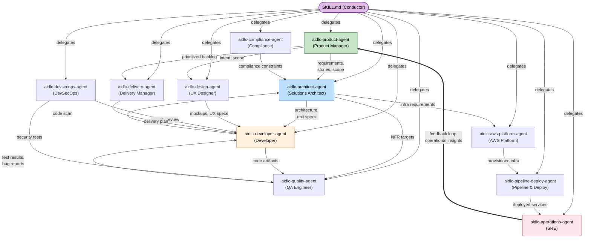

# エージェント

AI-DLC は 14 のエージェントのペルソナを出荷します。ステージの作業を実行する 11 のドメイン専門家、レビューだけの 2 エージェント、そして適応するワークフローの composer です。この章は、まずドメインエージェントから始め、それからレビュアーと composer を扱って、全体の顔ぶれを説明します。

---

## 考え方: 小さな mob、広いエージェント

数十の狭い専門家（これはウォーターフォールの引き継ぎの連鎖を再現します）ではなく、AI-DLC は **広く有能な 11 のエージェント** を使います。各エージェントは、複数のステージとフェーズにまたがって参加します。

### なぜ 30 ではなく 11 か?

人のソフトウェアチームでは、3〜5 人の mob が、要件からデプロイまで、一つの機能全体をカバーします。各人は、いくつかの専門にまたがる広いスキルセットを持ち込みます。AI-DLC はこのモデルをなぞります。

- **各エージェントは、多くのタスクにまたがってドメイン全体をカバーします。** aidlc-architect-agent は、feasibility、domain design、units generation、contract design、functional design、NFR requirements、NFR design を扱います。三つのフェーズにまたがる七つのステージです。狭い専門家のモデルでは、ほぼ同じ知識ベースを持つ七つの別々のエージェントが要るでしょう。

- **エージェントが少ないと引き継ぎが少なくなります。** すべてのエージェントの境界は、情報が失われうる地点です。同じ aidlc-architect-agent が Domain Design と Functional Design の両方をリードすると、明示的な引き継ぎの成果物を要さずに、自然にコンテキストを保ちます。

- **補助の役割が、増殖なしに協力を可能にします。** 「security-reviewer-agent」と「compliance-reviewer-agent」と「cost-reviewer-agent」を作るのではなく、aidlc-devsecops-agent と aidlc-compliance-agent が、ほかがリードするステージに補助エージェントとして参加します。どう参加するかは、ステージの `mode`、つまりその通信のトポロジーです。`inline` のステージでは、conductor は各補助エージェントを自分のコンテキストの中のペルソナとして採ります。`subagent`（hub-and-spoke）と `mob`（mesh）のステージでは、各補助エージェントが本物の独立した協力者として送り出され、リードが統合するための自分の寄与ファイルを書きます（みんなが書き、リードが最終の成果物を所有します。user-stories が mob の見本として出荷されます）。`pipeline`（chain）のステージでは、リンクが成果物を順に直接進め、各リターンが順序付きの完了の証拠として記録されます（reverse-engineering が出荷される chain です）。どのトポロジーでも、conductor がすべての委譲を行います。エージェントが互いを呼び出すことは決してありません。

- **知識の読み込みはエージェントごとです。** 各エージェントは、方法論の知識を `.claude/knowledge/<agent-name>/` から、チームの知識をスペースレベルの `aidlc/spaces/<space>/knowledge/<agent-name>/` から（チームがそれを作っていれば）読み込みます。エージェントが少ないと、管理する知識ディレクトリが少なくなり、矛盾する指針の機会が少なくなります。

---

## エージェント協力マップ

次の図は、ワークフローの間にエージェントがどう情報をやり取りするかを示します。実線の矢印は、主な成果物の流れを示します。破線の矢印は、助言やレビューの関係を示します。operations から product へのフィードバックループが、完全なライフサイクルを閉じます。

<!-- Text fallback: The SKILL.md conductor delegates to all 11 agents. Key flows: aidlc-product-agent sends requirements/stories to aidlc-architect-agent, who sends specs to aidlc-developer-agent. aidlc-developer-agent sends code to aidlc-quality-agent, who sends test results back. aidlc-aws-platform-agent provisions infrastructure for aidlc-pipeline-deploy-agent, who deploys for aidlc-operations-agent. The feedback loop: aidlc-operations-agent sends operational insights back to aidlc-product-agent, closing the cycle. -->

---

## 11 のドメインエージェント

> **出荷されたエージェントが知っていることをカスタマイズする?** `.claude/agents/*.md` の 14 の出荷されたエージェントファイルを編集しないでください。それらはフレームワークのファイルで、アップグレードで上書きされます。代わりに、あなたの会社の基準をスペースレベルの `aidlc/spaces/<space>/knowledge/<agent-name>/` に足してください。完全なワークフローは [ナレッジ](08-knowledge.md) を参照してください。*新しい* エージェントが欲しいチームは、必要なフロントマターを持つファイルを `.claude/agents/<slug>.md` に置けます。そのファイルはユーザーが所有します。[コントリビューション: エージェントを足す](../reference/11-contributing.md#adding-an-agent) を参照してください。あなたのハーネス自身のサブエージェントは、同じディレクトリに置けます。AI-DLC のペルソナのキー（`display_name`、`examples`、`tier`、`plugin`）をどれも持たず `aidlc-` プレフィックスもないファイルは、ハーネスに任され、`aidlc doctor --verbose` がそれを参考として挙げます。

下の各エージェントは **詳説ページ** を持ちます。その完全な責務、リードし補助するステージ、読み込む知識です。[エージェント詳説の索引](agents/README.md) が 11 すべてを挙げます。エージェントごとのリンクは、各見出しの下にインラインであります。

### [aidlc-product-agent](agents/product-agent.md)

**Domain:** 要件、ユーザーストーリー、スコープ、市場調査

aidlc-product-agent は、プロダクトマネージャーとビジネスアナリストとして働きます。intent をとらえ、市場調査を行い、スコープを定め、要件を引き出し、ユーザーストーリーを生みます。Ideation と Inception のフェーズでいちばん活発なエージェントです。

- **Leads:** intent-capture, market-research, scope-definition, requirements-analysis, user-stories
- **Supports:** rough-mockups, approval-handoff, refined-mockups
- **Special tools:** WebSearch（市場調査のため）

### [aidlc-design-agent](agents/design-agent.md)

**Domain:** UX/UI 設計、ワイヤーフレーム、インタラクション設計、アクセシビリティ

aidlc-design-agent は、ワイヤーフレーム、モックアップ、インタラクション仕様を作ります。ユーザー向けの機能で aidlc-product-agent と、設計が実装できることを確かめるため aidlc-developer-agent と、密に働きます。

- **Leads:** rough-mockups, refined-mockups
- **Supports:** user-stories, domain-design
- **Special tools:** WebSearch（設計調査のため）

### [aidlc-delivery-agent](agents/delivery-agent.md)

**Domain:** チーム編成、キャパシティ計画、デリバリーの順序付け

aidlc-delivery-agent は、エンジニアリングマネージャーとして働きます。チームのキャパシティを評価し、mob の構成を作り、デリバリーの順序を計画し、フェーズの引き継ぎを管理します。

- **Leads:** team-formation, approval-handoff, delivery-planning
- **Supports:** scope-definition, units-generation
- **Special tools:** 共有の集合を超えるものはなし

### [aidlc-architect-agent](agents/architect-agent.md)

**Domain:** ドメイン設計、ドメインモデリング、NFR、コンポーネントの分解

aidlc-architect-agent は、中心の設計の権威です。いちばん広いステージの関わり（三つのフェーズにまたがる 10 ステージ）を持ち、ほかの七つの高判断エージェント（product、design、developer、quality、devsecops、compliance、aws-platform）と並んで `judgment` の tier を帯びます。記録されたモデルポリシーがないと、判断エージェントはあなたのセッションのモデルと effort を受け継ぎます。delivery、pipeline-deploy、operations は `templated` の tier を帯びます。その出力が主に計画・CI/CD の YAML・runbook の足場だからです。その出荷されたベースラインも受け継ぎます。reviewer の tier は、Claude Code では Sonnet を medium effort で使います。Codex と opencode ではセッションのモデルを受け継ぎ、medium の reasoning effort を当てます。ウィザードのデフォルトの `balanced` プリセットは、三つのグループすべてへの明示的な effort の上書きで、モデルを変えずに各々を medium に設定します。Kiro CLI では、対話セッション全体に一つの effort を設定します。Kiro IDE、Cursor、Copilot は、それらのグループの effort のダイヤルを表せないので、ウィザードはそこでプリセットを記録しません。[モデルポリシー](18-install-and-lifecycle.md#model-policy) を参照してください。

- **Leads:** feasibility, domain-design, units-generation, contract-design, functional-design, nfr-requirements, nfr-design
- **Supports:** intent-capture, reverse-engineering (synthesis), delivery-planning

### [aidlc-aws-platform-agent](agents/aws-platform-agent.md)

**Domain:** AWS インフラ、CDK/CloudFormation、コスト最適化

aidlc-aws-platform-agent は、インフラを設計し、環境をプロビジョニングし、コストを最適化します。AWS CLI と CDK のコマンドを走らせる Bash アクセスを持ちます。

- **Leads:** infrastructure-design, environment-provisioning
- **Supports:** feasibility, domain-design, contract-design, nfr-design, feedback-optimization
- **Special tools:** Bash（`aws`、`cdk` のコマンドのため）

### [aidlc-compliance-agent](agents/compliance-agent.md)

**Domain:** 規制のスキャン、データの分類、リスク評価

aidlc-compliance-agent は、純粋に助言の立場で働きます。リードするステージを持ちません。ほかのエージェント、とりわけ aidlc-architect-agent と aidlc-devsecops-agent がリードするステージに、規制の制約を供します。

- **Leads:** なし（補助のみ）
- **Supports:** feasibility, nfr-requirements, infrastructure-design, environment-provisioning
- **Special tools:** WebSearch（規制調査のため）

### [aidlc-devsecops-agent](agents/devsecops-agent.md)

**Domain:** 脅威モデリング、セキュリティスキャン、DevSecOps のパイプライン

aidlc-devsecops-agent は、設計をセキュリティの観点でレビューし、セキュリティ要件を定め、CI/CD のパイプラインにセキュリティを組み込みます。aidlc-compliance-agent と同じく、補助の役割で働きます。

- **Leads:** なし（補助のみ）
- **Supports:** practices-discovery, nfr-requirements, infrastructure-design, build-and-test, environment-provisioning
- **Special tools:** Bash（セキュリティスキャンのため）

### [aidlc-developer-agent](agents/developer-agent.md)

**Domain:** コードの実装、コードの分析、データモデリング

aidlc-developer-agent は、三つのフェーズにまたがります。Inception でのリバースエンジニアリングから、Operation でのデプロイの補助まで。既存のコードベースのコードスキャンを走らせ、実装コードを生成します。

- **Leads:** reverse-engineering (code scan), code-generation
- **Supports:** practices-discovery, user-stories, functional-design, deployment-execution

ワークスペース検出（workspace-detection）は、かつて aidlc-developer-agent のサブエージェントでした。今は、ルールに基づくファイルとマニフェストの検出を使って、`aidlc-utility intent-create` の中で決定的に走ります。
- **Special tools:** Bash（ビルドと実行のコマンドのため）

### [aidlc-quality-agent](agents/quality-agent.md)

**Domain:** テスト戦略、テスト生成、パフォーマンス検証

aidlc-quality-agent は、テスト戦略を定め、テストスイートを生成し、品質ゲートを検証し、パフォーマンステストを走らせます。

- **Leads:** build-and-test, performance-validation
- **Supports:** practices-discovery, user-stories, nfr-requirements
- **Special tools:** Bash（テストの実行のため）

### [aidlc-pipeline-deploy-agent](agents/pipeline-deploy-agent.md)

**Domain:** CI/CD のパイプライン、デプロイ戦略、リリースの実行

aidlc-pipeline-deploy-agent は、CI/CD のパイプラインを設定し、デプロイ戦略を計画し、ロールバックの能力とともにリリースを実行します。

- **Leads:** practices-discovery, ci-pipeline, deployment-pipeline, deployment-execution
- **Supports:** なし
- **Special tools:** Bash（パイプラインとデプロイのコマンドのため）

### [aidlc-operations-agent](agents/operations-agent.md)

**Domain:** 可観測性、インシデント対応、SLO の追跡、フィードバックループ

aidlc-operations-agent は、監視を用意し、インシデント対応の手順を定め、運用の洞察を次の反復のために aidlc-product-agent へ戻して、ライフサイクルのループを閉じます。

- **Leads:** observability-setup, incident-response, feedback-optimization
- **Supports:** なし
- **Special tools:** Bash（可観測性と監視のコマンドのため）

---

## フェーズへの参加

この表は、どのエージェントがどのフェーズで活発か、そしてリード（L）か補助（S）かを示します。

| Agent | Phase 0 | Phase 1 | Phase 2 | Phase 3 | Phase 4 |
|-------|---------|---------|---------|---------|---------|
| aidlc-product-agent | — | L (intent-capture, market-research, scope-definition), S (rough-mockups, approval-handoff) | L (requirements-analysis, user-stories), S (refined-mockups) | — | — |
| aidlc-design-agent | — | L (rough-mockups) | L (refined-mockups), S (user-stories, domain-design) | — | — |
| aidlc-delivery-agent | — | L (team-formation, approval-handoff), S (scope-definition) | L (delivery-planning), S (units-generation) | — | — |
| aidlc-architect-agent | — | L (feasibility), S (intent-capture) | L (domain-design, units-generation, contract-design), S (reverse-engineering, delivery-planning) | L (functional-design, nfr-requirements, nfr-design) | — |
| aidlc-aws-platform-agent | — | S (feasibility) | S (domain-design, contract-design) | L (infrastructure-design), S (nfr-design) | L (environment-provisioning), S (feedback-optimization) |
| aidlc-compliance-agent | — | S (feasibility) | — | S (nfr-requirements, infrastructure-design) | S (environment-provisioning) |
| aidlc-devsecops-agent | — | — | S (practices-discovery) | S (nfr-requirements, infrastructure-design, build-and-test) | S (environment-provisioning) |
| aidlc-developer-agent | — | — | L (reverse-engineering), S (practices-discovery, user-stories) | L (code-generation), S (functional-design) | S (deployment-execution) |
| aidlc-quality-agent | — | — | S (practices-discovery, user-stories) | L (build-and-test), S (nfr-requirements) | L (performance-validation) |
| aidlc-pipeline-deploy-agent | — | — | L (practices-discovery) | L (ci-pipeline) | L (deployment-pipeline, deployment-execution) |
| aidlc-operations-agent | — | — | — | — | L (observability-setup, incident-response, feedback-optimization) |

### 気づき

- **aidlc-architect-agent** は、いちばん広い関わり（三つのフェーズにまたがる 10 ステージ）を持ちます。ほかの七つの高判断エージェントと同じく `judgment` の tier（あなたのセッションのモデルと effort を受け継ぐ）を帯びます。`templated` の tier を帯びるのは **aidlc-delivery-agent**、**aidlc-pipeline-deploy-agent**、**aidlc-operations-agent** だけです
- **aidlc-developer-agent** は、三つのフェーズ（Inception、Construction、Operation）にまたがります
- **aidlc-compliance-agent** と **aidlc-devsecops-agent** は、純粋に補助の役割で働き、ほかがリードするステージに参加します
- **aidlc-operations-agent** は、洞察を aidlc-product-agent へ戻して、ライフサイクルのループを閉じます

---

## エージェントのツールアクセス

Claude Code では、すべてのエージェントが **セッションの完全なツールセット** と、プロビジョニングされた MCP ツールを受け継ぎ、`disallowedTools: Task` がネストした委譲をブロックします。ほかのハーネスは、同じ境界にネイティブのツールポリシーを使います。Kiro の delegate のアローリストは `subagent` を省き、その projection されたエージェントの Markdown は、サポートされない Claude のキーを帯びません。下の表は、各ペルソナが自分の作業でどのツールを使うと *期待される* かを記録し、エージェントごとの付与ではありません。

| Tool | Expected to exercise it |
|------|-------------|
| Read, Edit, Write, Glob, Grep, AskUserQuestion | 14 エージェントすべて |
| Bash | aidlc-aws-platform-agent, aidlc-devsecops-agent, aidlc-developer-agent, aidlc-quality-agent, aidlc-pipeline-deploy-agent, aidlc-operations-agent |
| WebSearch | aidlc-product-agent, aidlc-design-agent, aidlc-compliance-agent |
| Task / native delegation tool | なし（各ハーネスの projection されたエージェントポリシーがブロック） |

Claude のペルソナを絞るには、そのフロントマターに任意の `tools:` アローリストを足します。ただしそうすると、完全修飾の `mcp__<server>__<tool>` の id も挙げない限り、受け継いだ MCP アクセスが落ちます。ほかのハーネスは、ネイティブのエージェント設定を使います。

### MCP サーバーは共有で、エージェントごとではない

上の表は、各ペルソナが使うと期待される組み込みのツールを示します。実際には、すべてのエージェントがそれらすべてを受け継ぎます。MCP サーバーは、同じすべて受け継ぐモデルに従います。この実装は、それらをプロジェクトルート（`.claude/` の隣）の `.mcp.json` に一度宣言し、Claude Code がそれらをセッションにプロビジョニングし、すべてのエージェントがそれらすべてを受け継ぎます。エージェントごとの付与はありません。14 のエージェントそれぞれが、宣言されたすべてのサーバー（`context7` と四つの AWS サーバー）に、それ以上の設定なしで届けます。あなたが資格情報を持たないサーバーは、作業を止めるブロッカーにはならず、単に使えない状態になります。特定のエージェントがサーバーに届くのを止めるには、そのエージェントの `tools:` アローリストを、それが保つべき完全修飾の `mcp__<server>__<tool>` の id に絞ります（たとえば `mcp__context7__<tool>`）。この実装は、今日そのような制限を出荷しません。

サーバーのレジストリと資格情報は [はじめかた](01-getting-started.md) を、MCP が Claude Code のネイティブのツールモデルにどう対応づくかは [ハーネスプリミティブの対応づけ](../reference/14-claude-features.md#mcp-servers) を参照してください。

---

## レビュアーエージェント

11 のドメイン専門家のエージェントを超えて、AI-DLC は **2 つの品質ゲートのレビュアーエージェント** を出荷します。これらは成果物を生みません。ビルダーが生んだものをレビューしてそれに異を唱え、ゲートで顧客（またはレビューボード）を代表します。

| Reviewer | Reviews | Tier |
|----------|---------|------|
| `aidlc-product-lead-agent` | 要件、ユーザーストーリー、UX/モックアップの成果物。完全性、ビジネスとの整合、テストしやすさ | balanced |
| `aidlc-architecture-reviewer-agent` | 技術設計の成果物。健全性、実装しやすさ、壊れた相互参照、達成できない NFR の目標 | balanced |

## composer エージェント

もう一つのエージェントが、どちらのグループの外にも座ります。`aidlc-composer-agent`、適応するワークフローの composer です。conductor は、compose の要求（`/aidlc compose`、コールドスタートでの compose の申し出、`--report`、`--new-scope`）でそれを送り出します。タスクの実装エントロピー（五つの要素: intent のあいまいさ、構造的な不確かさ、検証のエントロピー、リスク、未解決の前提。設定されていれば CodeKB MCP の分析に、そうでなければワークスペースのスキャンに根ざす）を見積もり、スコアの内訳とステージごとの根拠とともに、実行可能な最小の EXECUTE/SKIP のグリッドを提案し、ゲートでのあなたの承認の後にだけ、その作業に計画が作られるか（front/report。composer はスコープファイルを書かず、エンジンは、あなたが求めたときだけ計画をスコープとして保ちます）、その保留中のステージの反転が決定的な `recompose` 動詞で当てられます（in-flight）。そのペルソナは、エントロピーのプロファイルに照らして、存在と不在の両方を正当化します。すべての EXECUTE はそれが減らす要素を挙げ、すべての SKIP はすでにそれを覆うものを挙げ、背骨（core、検証、荷重を担う discovery ステージ）を切ることは、危険な失敗として扱われます。[スコープと深さ - 適応する composer](05-scopes-and-depth.md#the-adaptive-composer) を参照してください。

レビュアーは、ステージが `reviewer:` フィールドを宣言するときだけ発火します。今日、product lead は `intent-capture`、`rough-mockups`、`refined-mockups`、`requirements-analysis`、`user-stories` をレビューします。architecture reviewer は `domain-design`、`units-generation`、`contract-design`、`functional-design`、`nfr-requirements`、`nfr-design`、`infrastructure-design`、`code-generation` をレビューします。

**レビュアーのステップ。** ステージの本体がその成果物を生んだ後、learnings の儀式と承認ゲートの前に、conductor は名指しされたレビュアーを **別のサブエージェント** として呼び出します。レビュアーは、ステージの定義、Q&A、成果物を読み（ビルダーの `memory.md` や計画は決して読まず、独立した判断を作ります）、それからそのレビュー（**READY** か **NOT-READY** の判定と、何が変わったかの報告。再確認した以前の指摘と新しい指摘）を、conductor が名指しするレビューファイルに書きます。エンジンが指摘のリストを保ちます。ID を割り当て、あなたの決定をあなたが下したとおりに正確に保ち、レビュアーに一つも書かせません。レビュアーは、レビューする成果物を決して編集しません。エンジンは、レビューを intent の `.aidlc-engine/reviews/` ディレクトリの下のフレームワークが所有する記録として記録し、そのレビュー時点の完全な指摘のリストを持つ、人が読めるコピーを、レビューされた成果物の隣の `<stage dir>/reviews/review-NN.md` に書き、成果物が変わった判定を拒否します。判定がどう扱われるかは、ステージのレビュークラスによります。

- **Advisory**（人のゲートのある ideation/inception の散文ステージ）: どの判定でも、通常フローの一回のレビューのパス。エンジンの指摘のリストは、判断の助けとして承認ゲートで示されます。あなたがそれをトリアージし、ゲートでの Request Changes が、指摘を改訂にする道です。後の出力の書き込みが終端のレシートを無効にすると、一つの制限された回復の要求が、次の ordinal で走ります。
- **Adversarial**（Construction の設計/ビルドのステージ）: NOT-READY のとき、ビルダーが指摘に対応するため走り直し、レビュアーが再確認し、`reviewer_max_iterations` 回（デフォルト 2、エンジンが強制）までループします。上限の後に指摘が残ると、ワークフローは、未解決の指摘を記して承認ゲートへ進みます。

ステージのレビューのパスが使い切られ、そのレビューされた作業が最後のレビューの後に変わったとき（たとえば作業が別の手法を取った）、承認は一度たずねます。「決める前に、新しい手法を確認させますか?」。はいと言えば、承認を求められる前に、パスを超えて、レビューが再び走ります。承認と言えば、そのまま承認されます。

レビュアーはまた、硬いターンの予算の下で走ります。`maxTurns: 60`、ペルソナのフロントマターに書かれ、Claude Code でネイティブに強制され、opencode のエージェントごとの `steps: 60` へ projection されます。ほかではペルソナの散文として出荷されます。レビューが使える判定なしで返ってきたら（レビューファイルがない、または一つの正規の READY / NOT-READY の行がない。上限に達した・クラッシュした・途切れたレビュアー）、conductor はその同じレビューを一度送り直し、二度目の不完全な試みは NOT-READY として記録され、ゲートは指摘「The review did not finish, so there is no review result to rely on」（レビュアーの返信が言ったときは、なぜかが続きます）を示すので、黙った途切れが、欠けた判定ではなく、ゲートで見える指摘になります。その結果はどのレビュアーのものでもありません。あなたはレビューが終わらなかったと知らされ、あなたの承認はそれをそのように記録します。あなた自身がレビューを止めて欲しいものを言ったら、conductor はそれを自分で再試行しません。まず次のステップを確認し、あなたが求めたことをします。すべての要求が新しいレビューのスロットを開くので、改訂前の古いレビューが、新しい作業を覆っていると読み違えられることは決してありません。以前のリリースが成果物の中の `## Review` セクションとして記録したレビューは、次のレビューがそれらを置き換えるまで、ゲートで読めるままです。

スコープはクラスに上限をかけられます（`bugfix`、`poc`、`classic`、`workshop` はすべてのステージを advisory に上限し、`express` はレビューを none に上限します）。`/aidlc --review <class>` は、実行ごとにそれに上限をかけます。明示的な自律性は、マージ前の一回のレビューを保ち、スコープの上限と実行ごとの上書きから免れます。どちらでも、レビュアーがブロックすることは決してありません。人が常に最終の決定権を持ちます。

(IMPORTANT: use plain agent names in backticks as shown — do NOT make them markdown links; per-agent reviewer doc pages do not exist yet.)

---

## 次のステップ

- [フェーズとステージ](04-phases-and-stages.md) — 完全なステージの流れの文脈でエージェントを見る
- [ナレッジ](08-knowledge.md) — エージェントが方法論とチームの知識をどう読み込むか
- [ルールと学習ループ](09-rules-and-the-learning-loop.md) — エージェントのふるまいを縛るふるまいのルール
- [用語集](glossary.md) — 用語の参照
