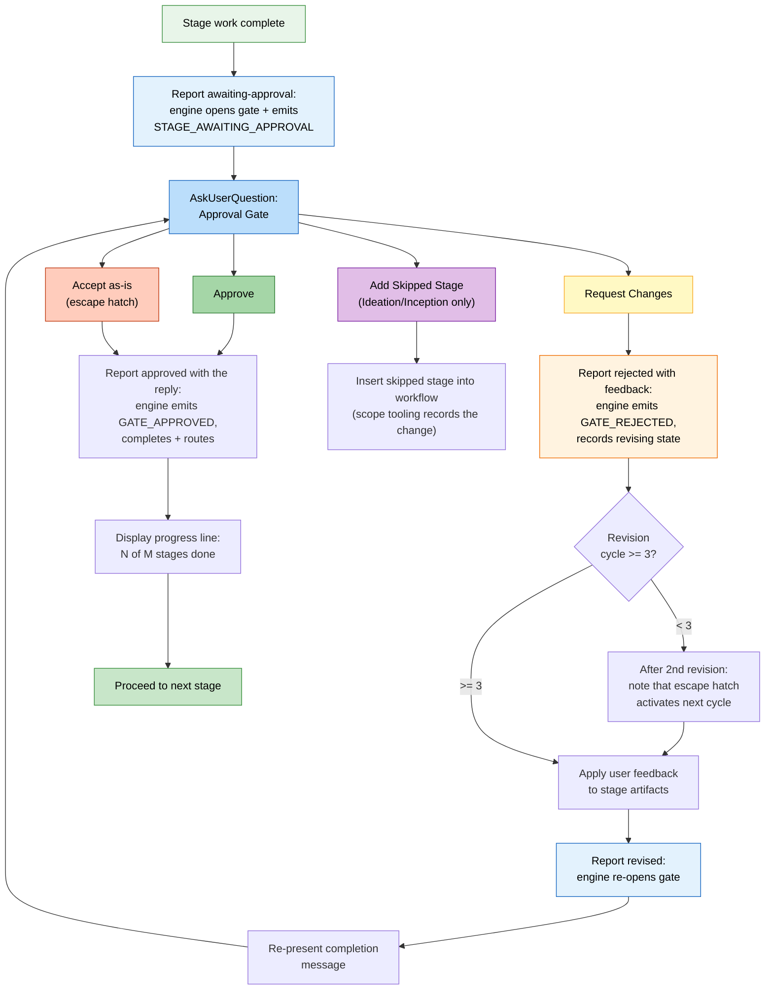

# 対話モード

AI-DLC は、ステージの間にエージェントと対話する三つの方法と、どの判断の場面でもあなたが舵を握ったままにする承認ゲートを提供します。

> **ハーネスについての注記。** ゲートと質問は、ハーネスによって違う描かれ方をします。Claude Code は、そのネイティブの質問ピッカーを使います。Codex は、有効にされているときそのピッカーを使います。Kiro、opencode、GitHub Copilot は、番号付きの散文のオプションを描きます（Copilot のピッカーの結果は、信頼される human-presence イベントを発火しません）。質問ファイルが真実の源のままです。*意味* （ゲートがいつ発火するか、何をたずねるか、あなたが舵を握ったままであること）は、エンジンにあるので同じです。[ほかのハーネスで動かす](harnesses/README.md) を参照してください。

---

## 三モードの質問フロー

ステージがあなたの入力を集めるとき、エージェントはその質問をファイルに書き、三つの対話モードを申し出ます。あなたは、自分に合うものを選びます。後のステージは、その選択を再利用します（[一度たずね、それから再利用](#asked-once-then-reused) を参照）。[はじめかた](01-getting-started.md) の実行から:

```text
 Answer mode
 I've created 8 questions at
 aidlc/spaces/default/intents/261013-inventory-rest-api/ideation/intent-capture/intent-capture-questions.md.
 How would you like to answer them?
 > 1. Guide me
      Walk through each question interactively here
   2. I'll edit the file
      Fill in the answers in the file directly
   3. Chat
      Discuss freely; I'll extract the decisions from the conversation
   4. Type something.
   5. Chat about this
```

エージェントが作る質問ファイルでは、ふつうの各質問が、たいていそれに答える人（たとえば `[Product owner]` や `[Developer]`）を挙げ、同じ人の質問はまとめて置かれます。ただし、どれかが別の人の答えを待たねばならないときを除きます。チームはそうやって質問を分けられますし、あなた一人でも、どれが製品が何をするかについてで、どれがどう作られるかについてかが見えます。誰でもどの質問にも答えられます。エージェントがこれらの質問の一つをあなたに、チャットかその質問ピッカーでたずねるとき、ラベルがそのテキストの前にも来ます。後で足された質問は、自分のラベルとともに末尾に行きます。確認・変更要求・承認のセクションは、ラベルを帯びません。すでにあったファイルは、その質問を元のまま保ちます。ただし、ステージを一からやり直すよう求めると、新しいもので置き換えます。

### Guide Me

エージェントが、構造化されたプロンプトを使って、各質問を対話的に案内します。エージェントに会話をリードさせ、漏れがないようにしたいとき最適です。

- エージェントが質問を一つずつ（またはバッチで）出す
- あなたが各質問に直接答える
- トレーサビリティのため、答えがステージの質問ファイルに記録される

### Edit File

エージェントが質問ファイルを作り（または開き）、あなたが直接それを編集します。欲しいものがすでに分かっていて、質問に答えるより書き留めたいとき最適です。

- 質問ファイルが、空の答えのフィールドとともに intent の記録ディレクトリに現れる
- あなたが自分のペースで答えを埋める
- エージェントが埋められたファイルを読んで進む

### Chat

エージェントとの自由な会話です。アイデアを探るときや、要件がまだよく定まっていないとき最適です。

- あなたがエージェントと自由に話す
- エージェントが会話から判断を取り出す
- 取り出された判断が、真実の源として質問ファイルに書き戻される

### ステージの途中でモードを切り替える

ステージの間、どの時点でもモードを切り替えられます。三つのモードはすべて、判断の正規の記録として質問ファイルに集まります。切り替えても進み具合は失われません。すでにとらえられた答えはファイルに残ります。

### 一度たずね、それから再利用

モードは作業ごとに一度選びます。質問のある最初のステージがたずね、後のステージは、もう一度たずねずにあなたの選択を再利用します。それらのステージはそれでも、どのモードを使っているかを一行で言います。

```
Answering the way you chose earlier: Guide me. Say if you'd rather edit the file or chat.
```

変えるには、そう言うだけです（「let me edit the file this time」）。エージェントが切り替え、後のステージはあなたの新しい選択を使います。あなたが答えをどう言い表しても、エージェントはあなたが意図したモードを記録するので、言い回しのせいで再びたずねられることはありません。

---

## 承認ゲート

すべてのステージ（3 つの Initialization ステージを除く）は、承認ゲートで終わります。これは、ワークフローが進む前にエージェントの作業をレビューする、あなたのチェックポイントです。Construction では、ゲートが代わりに Unit ごとに来ることがあり、自動で走らせることを選んだものは質問なしで記録されます（[フェーズとステージ](04-phases-and-stages.md#what-runs-in-order-and-what-runs-in-parallel) を参照）。

### 標準のゲート

デフォルトの承認ゲートは、二つのオプションを出します。同じ実行から:

```text
 Approval
 Intent Capture & Framing complete. How would you like to proceed?
 > 1. Approve
      Continue to Feasibility & Constraints
   2. Request Changes
      Provide revision feedback
   3. Type something.
   4. Chat about this
```

Approve の行は、ワークフローが実際に走らせる次のステージを挙げるか（たとえば「Continue to NFR Requirements」）、最終ステージでは「Complete workflow」を挙げます。エンジンがそれを計算するので、推測に頼ることなく、常に正しいです。

- **Approve** は成果を報告します。エンジンはステージを完了と印し、`aidlc-state.md` を更新し、進捗の行を示し、次のステージへ進みます
- **Request Changes** は、具体的なフィードバックを与えさせます。エージェントが作業を直し、承認ゲートを再び出します

同僚に答えるように、あなた自身の言葉で答えます。あなたが舵を握ります。エージェントはあなたの返信を読み、あなたが言ったことを、どの質問でも（このゲート、要約の確認、検証コマンド、Construction のチェックポイント、Plan Approval、回復の質問）します。オプションのラベルを打ち直したり、同じことを二度言ったりすることは決してありません。

- `1`、`a`（オプションが文字で振られているとき）、`approved`、`looks good`、`aprove` は、どれも承認します。
- 変更要求は Request Changes で、あなたの言葉がフィードバックです。`rename the handler`、`no, split the tests`。
- 指示つきの承認は両方です。`looks fine but rename the handler` は承認し、エージェントがそれをリネームして一行でそう言い（「Renamed processOrder to handleOrder in 3 files」）、作業が続きます。
- 今は止めるよう求める承認は、承認してワークフローを止めます。`Approve, but let's stop there for today`。`/aidlc --resume` が後でそれを取り上げます。
- 質問は答えを得て、あなたの次の返信が決めます。
- 本当にはっきりしない返信（`hmm`、`not sure`）だけが、短い質問を一つ返されます。

AI-DLC は、ゲート・Plan Approval・チェックポイント・検証コマンド・Construction の設定の変更を、あなたの言葉をその横に置いて記録します（監査証跡の `Person Reply`）。あなたのハーネスが渡し、刈り込んだとおりに。ステージのゲートでは、それは最後の判断以降とステージの開始以降のすべてのメッセージです。ただし、別の質問へのあなたの答えとしてすでに記録されたもの（あなたの最新のものである場合を除く）を除きます。そのどれかが 8000 字を超える、またはもう記録にないなら、どれも添えられず、行は代わりに最新のメッセージを挙げ、変更要求はエージェントの `--reason` を記録します。Plan Approval では、あなたの最新の 8 件の返信、それぞれ 8000 字に切られます。チェックポイントや検証コマンドの質問では、あなたの返信が順につながれ、末尾の 8000 字を保ちます。あなたが変えるよう求めた Construction の設定では、それを求めたメッセージ。要約の確認は、エージェントが読んだ選択と、変更要求については、あなたが変えるよう求めたものを記録します。判断には、質問が示された後のあなたからの返信が要ります（ステージのゲートでは、ステージの開始以降のもので、エージェントがあなたの答えとして挙げるものも数えます。たとえば、ステージの出力が最後に書かれた後に送った、learnings の質問での承認）。エージェントがあなたの代わりに答えることはできません。

ステージのゲートで変更を求めると、監査証跡は、改訂のフィードバックとして、あなたのハーネスが最後の判断以降にあなたのチャットの human-turn フックに渡した言葉を、届いたとおりに正確に記録し（別の質問へのあなたの答えとしてすでに記録されたメッセージは、あなたの最新のものである場合を除いて除きます）、エージェントはあなたが求めたものから直します。Request Changes を選び、それから「What should change?」に答えたなら、両方がフィードバックです。あなたの要求に対するエージェント自身の要約が違うとき、それはあなたの言葉の横に `Conductor Summary` として保たれます。これには、あなたがタイプしたプロンプトとチャットセッションを human-turn フックに渡すハーネスが要ります。渡さないところでは、フィードバックは、以前のようにエージェントが報告するものです。human turn 自体と同じく、これは、誰がタイプしたかではなく、プロンプトの継ぎ目が受け取ったものを記録します。

ゲートは、観測された人のやり取りの継ぎ目を要します。プロンプトをタイプすることや、ネイティブの質問ピッカーに答えることが、監査台帳に human turn（`HUMAN_TURN` イベント）を記録し、承認（とどの明確化の質問の答えも）は、最後のゲートの解決以降に一つ記録されない限り拒否します。ステージのゲートの承認や変更要求は、ステージの開始以降かつゲートが示された後に送られたもの、またはエージェントがあなたの答えとして挙げるメッセージ（承認では、ステージの出力が最後に書かれた後に送ったもの。それより前のものは、あなたが承認するものを見ていませんでした）を要します。これは、存在と順序を証明し、後で呼び出し側が供した判断のテキストの作者性は証明しません。信頼されるプロンプト/ウィジェットの内容を表に出さないハーネスもあります。ピッカーが human turn を記録しないハーネスでは、短いメッセージを一度タイプして（たとえば「approve」）、一つが記録に残るようにします。

human-turn フックは、ディスパッチャーのフックの経路を通じてだけ有効化されます。誰がディスパッチャーを起動したかを認証しません。フックとツール呼び出しは、同じユーザーとして走り、どのハーネスも、同じユーザーのプロセスがコピーできない identity をフックに与えません。runtime-integrity 確認は、多層防御として、フックとその記録への、認識されるツール呼び出しの経路を拒否します。ハーネスの権限モデルと、エージェントが走らせるものへのあなたのレビューが、外側の境界です。

人が居ないままプロンプトを送る自動化は、駆動するプロセスに `AIDLC_UNATTENDED=1` を設定せねばなりません。この宣言はオプトインです。プロンプトが無人かどうかは駆動側だけが知るからです。それなしでは、プロンプト送信のイベントは対話的なふるまいを保ちます。それが設定されていると、すべてのハーネスが、権限を帯びる `HUMAN_TURN` を出さないので、承認とインタビューのゲートは待ち続けます。人が引き継ぐときは、`AIDLC_UNATTENDED` を解除し、新しい応答を送ります。存在に関わる拒否のメッセージは、そのフラグがまだ設定されているとき、それを挙げます。

### 承認ゲートのフロー



<!-- Text fallback: Stage work completes, report awaiting-approval opens the gate (the engine records STAGE_AWAITING_APPROVAL), and AskUserQuestion presents the approval gate. Approve: report approved with the exact choice so the engine records GATE_APPROVED, completes, and routes; show progress; proceed. Request Changes: report rejected with the exact Request Changes choice and separate feedback (the engine records GATE_REJECTED), check revision count (if <3, note escape hatch coming, revise, report revised to re-open the gate, and re-present; if >=3, Accept-as-is becomes available). Accept as-is: report approved with that exact label. Add Skipped Stage (Ideation/Inception only): recompose the plan. The report calls own the gate's audit trail; no separate log entries are added for the gate prompt or choice. -->

---

## 3 回で開く改訂の避難ハッチ

同じステージで 3 回以上変更を求めたら、三つ目のオプションが現れます。

同じステージで **Request Changes** を 3 回繰り返した後、質問は、それが何回目の改訂サイクルかを言い、三つ目のオプション **Accept as-is**（「そのまま承認して先へ進む」と説明される）を足します。

**Accept as-is** は、その文書をそのままにしてステージを承認し、ワークフローを進めます。これは、完璧が良いの敵になるとき、終わりのない改訂のループを防ぎます。

### どう有効になるか

| Revision Cycle | What Happens |
|----------------|-------------|
| 1 回目 | 標準の 2 オプションのゲート |
| 2 回目 | 標準の 2 オプションのゲートに、注記を足す。「After one more revision, an 'Accept as-is' option will become available.」 |
| 3 回目以降 | Accept as-is を持つ 3 オプションのゲート |

改訂の回数は、次のステージへ進むとリセットされます。AI-DLC はそれを、チャットではなく作業の記録に保つので、止めて再開しても、新しいチャットで続けても、それも保たれます。

---

## 飛ばしたステージを足すオプション

**Ideation** と **Inception** のフェーズの間、承認ゲートは、前に飛ばしたステージをワークフローに戻して足す、条件付きのオプションを含むことがあります。

```
▸ How would you like to proceed?
  (1) Approve — Continue to Scope Definition
  (2) Request Changes — Provide revision feedback
  (3) Add Market Research — Include Market Research which was skipped
```

このオプションは、次のときだけ現れます。
- 現在のステージが Ideation か Inception にある
- 先のステージが、スコープのルーティングの間に飛ばされた
- 飛ばしたステージが、現在の文脈に関わる

このオプションを選ぶと、飛ばしたステージがワークフローの計画に差し込まれます。ワークフローは、足したステージを通って、ふつうに続きます。

---

## ステージのスキップと移動

承認ゲートを超えて、追加の移動のオプションがあります。

| Command | Effect |
|---------|--------|
| `/aidlc --stage <name>` | 特定のステージへジャンプ（間のステージは `[S]` と印） |
| `/aidlc --phase <name>` | フェーズの先頭へジャンプ |

詳細は [セッション管理](11-session-management.md) と [CLI コマンド](12-cli-commands.md) を参照してください。

---

## 自分でファイルを編集する

どの成果物も手で編集できます。次に何が起こるかは、あなたがどこにいるかによります。

| When you edit | What you do | What you see |
|---|---|---|
| ステージの質問への答え | **I'll edit the file** を選び、`[Answer]:` の行を埋め、それから終わったとエージェントに伝える | エージェントがあなたの答えを読んでそこから続ける。要約の確認がオンのとき、まず要約を確認する |
| 承認を待っているコードの計画 | **I'll edit the files** を選び、計画やテストの指示を変える（または `code-generation-questions.md` に答えを書く）、それから終わったとエージェントに伝える | 編集した計画が、あなたが残したとおりに承認され、ビルドが始まる。あなたが編集する間、エージェントはそれらのファイルを書けない。あなたの編集が計画の Testing Contract ブロックを壊したら、エージェントがそれを直し、ビルドしてよいか一度たずねる |
| あなたがいるステージで、そのゲートの前に、すでにレビューされた成果物 | ファイルを編集し、それから続ける | Guard Policy `relaxed` か `off`（ほとんどのスコープ）の下では、ファイルが変わったと一行聞き、編集が監査証跡に `CHANGE_ACCEPTED` として一度記録され、実行が続く。`strict` の下では、古いレビューはもう編集されたファイルを覆わないので、ゲートの前に、今の状態でもう一度レビューされる。その追加のレビューは一度だけ起こる。その後にまたファイルを編集すると、エージェントが止まってあなたに伝え、あなたが **Request Changes** を選んでレビューを始め直す |
| すでに終わったステージの成果物 | ファイルを編集し、それから続ける | 何も自分で走り直さず、後のステージはあなたが残したとおりにファイルを読む。[ステージが終わった後](#after-a-stage-is-finished) を参照 |
| セッションの合間 | ファイルを編集し、それから `/aidlc` で再開する | 次にファイルが確認されるとき、同じルールが当てはまる |

ファイルが変わり実行が続いていると伝えられたとき、それがすべての記録です。手で記録することは何もありません。`strict`・`relaxed`・`off` が何をするかは [Guard Policy](13-customization.md#guard-policy) を、計画の停止そのものは [Plan approval](13-customization.md#plan-approval) を参照してください。

### ステージが終わった後

終わったステージのファイルへの編集は、あなたが求めない限り、再びレビューや承認はされません。

- **何があなたに警告するか。** Guard Policy `strict` の下で、終わったステージについて AI-DLC が追跡するステージ文書の一つを編集すると、次のステップが、どの終わったステージが今後ろにあるか、それをやり直すには何と言うかを一度言います。`relaxed` と `off`（ほとんどの計画のデフォルト）の下では、編集はあなたのものとして受け取られます。次のステップはどのステージも後ろにあると挙げず、あなたが編集したファイルがレビューされた文書か確認された質問ファイルだったときだけ、一度だけ伝えられます。なくなった追跡される文書は、どのポリシーの下でも挙げられます。`/aidlc --status` が、下流で影響を受けるステージを挙げます。プロジェクトフォルダを動かす・リネームする・コピーすることは、それらの文書を何も変えないので、警告をもたらしません（まだもたらしうるときは [成果物リファレンス](14-artifacts-reference.md) を参照）。警告は助言で、停止ではありません。検証の記録なしで終わったステージ（たとえば、古い AI-DLC リリースによる）は、警告を得ず、`/aidlc --status` もそれを挙げません。
- **何が警告しないか。** あなたのアプリケーションコードは、このやり方で追跡されないので、Code Generation の後にそれを変えても警告をもたらしません。
- **もう一度確認させる。** `/aidlc --stage <name>` で、影響を受けるいちばん早いステージ（アプリケーションコードなら Code Generation）へジャンプで戻ります。それがそのステージとあなたの計画の後のすべてのステージを開き直します。ファイルは残るので、前のファイルを見つける各開き直したステージは、それらを **Keep**（保つ）・**Modify**（直す）・**Redo from scratch**（一から作り直す）のどれかをあなたにたずねます。Keep はファイルの再生成を飛ばし、確認は飛ばしません。ステージが要るどのレビューや承認も、依然として起こります。あなたの変更を通すべきところでは Modify か Redo を選びます。Code Generation のレビューは、Unit のソースマニフェストに挙げられたアプリケーションファイルだけを覆うので、あなたが手で足した・動かしたファイルは、そこに挙げられるまでレビューされません。Modify を選ぶときは、足した・動かしたファイルと、それらが属する Unit を挙げます。Unit のない作業（たとえば bugfix や refactor のスコープ）にはソースマニフェストがないので、承認する前に、アプリケーションコードへの手編集を自分で確認してください。自動で走らせるよう設定した Construction のチェックポイントは、自動のままです。

---

## 進捗の追跡

別のステージへ進む承認の後、進捗の行が現れます。同じ実行から:

```text
Progress: 1 of 19 stages done. Next: Feasibility & Constraints.
```

ここから次が分かります。
- Initialization の後にあなたの計画が走らせるステージにわたる進み具合（作業が始まったとき示された数）
- 次のステージの名前

より短い計画では、数はその計画自身のものです。

---

## 次のステップ

- [最初のワークフロー](02-your-first-workflow.md) — 文脈の中で対話モードを見る
- [状態と監査](10-state-and-audit.md) — 判断がどう追跡されるか
- [セッション管理](11-session-management.md) — 再開、やり直し、ジャンプ
- [用語集](glossary.md) — 用語の参照
