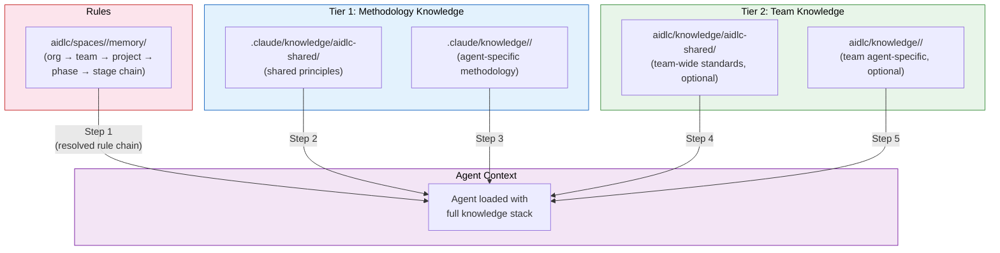
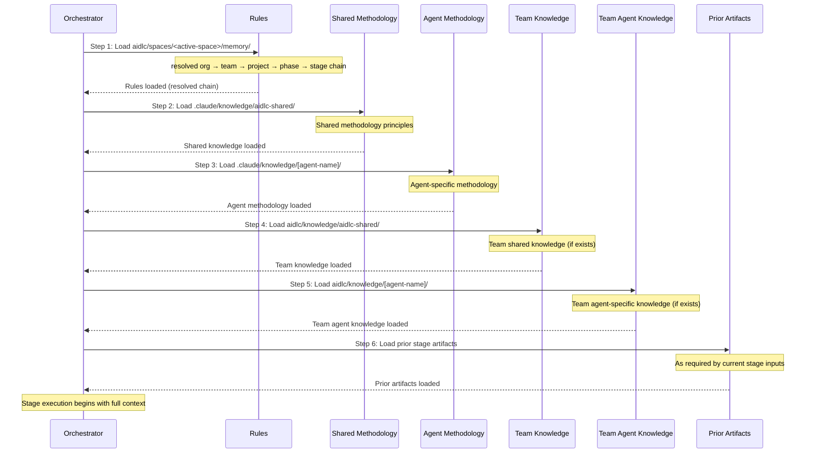

# ナレッジ

AI-DLC は二層のナレッジシステムを使い、エージェントが方法論の専門知識（フレームワークとともに出荷される）と、あなたのチームの具体的な基準（あなたが管理する）の両方を引き出せるようにします。

---

## 二層のナレッジアーキテクチャ



<!-- Text fallback: The resolved rule chain loads first, then Tier 1 methodology knowledge (shared, then agent-specific), then Tier 2 team knowledge (shared, then agent-specific). All feed into the agent context for stage execution. -->

### Tier 1: 方法論ナレッジ

**Location:** `.claude/knowledge/`

フレームワークとともに出荷されます。AI-DLC のステージがどう実行されるかを定める、共有の原則とエージェントごとの方法論の参照を含みます。フレームワークを更新すると更新されます。

```
.claude/knowledge/
+-- aidlc-shared/                       # Methodology loaded by every agent, plus format references
|   +-- ai-dlc-principles.md        # Core methodology principles
|   +-- audit-format.md             # 132-event audit taxonomy
|   +-- brownfield.md               # Brownfield safeguards and reverse-engineering guidance
|   +-- knowledge-readme-template.md # Optional README template a team can copy into Tier 2
|   +-- memory-template.md          # The per-stage diary template
|   +-- rules-reading.md            # How an agent reads the space's rule files
|   +-- state-template.md           # State file contract
|   +-- verification.md             # Phase boundary verification rules
|   `-- worktree-info-schema.md     # Worktree output contract (Construction)
+-- aidlc-architect-agent/                 # Loaded when aidlc-architect-agent is active
+-- aidlc-developer-agent/                 # Loaded when aidlc-developer-agent is active
+-- aidlc-product-agent/                   # Loaded when aidlc-product-agent is active
`-- ...                              # One directory per agent
```

`aidlc-shared/` の形式の参照（監査のタクソノミーと、state・memory・worktree・README のテンプレート）は、エージェントが読み込むもの（インラインでも、自分で送り出されたもの。レビュアーや、サブエージェントとして走るステージ）から外されています。それを要るステップがそれを挙げ、エージェントはそのとき読みます。

> **チームのナレッジを注ぎ込むために Tier 1 のファイルを編集しないでください。** `.claude/knowledge/` と `.claude/agents/*.md` はフレームワークのファイルです。アップグレードのたびに上書きされ、あなたの変更は消えます。会社の基準、アーキテクチャの好み、ドメインの文脈を足したいなら、**Tier 2**（下記）に足してください。エージェントのふるまいを縛りたいなら、**ルール** を足してください（[ルールと学習ループ](09-rules-and-the-learning-loop.md) を参照）。

### Tier 2: チームナレッジ

**Location:** アクティブなスペース — `aidlc/knowledge/`（`aidlc/spaces/<space>/knowledge/` の略）

ユーザーが管理します。あなたの会社固有の基準・ポリシー・慣習を含みます。それは一つのスペースに属します。スペースとプロジェクトの間で [何が引き継がれるか](03-spaces-and-intents.md#what-carries-over-and-what-doesnt) は、スペースと intent に挙げています。それはスペースの `memory/`・`codekb/`・`intents/` の兄弟です。だからチームのナレッジは、どれか一つの intent の記録の中にとどまらず、スペースのすべての intent にまたがって積み上がります。それは **自由形式で、ブートストラップ時は空** です。エンジンは、最初の `/aidlc` で空の `aidlc/knowledge/` ディレクトリを作るだけです。固定のファイルの集合も、強いる構造もありません。下の慣習（`aidlc-shared/` ディレクトリに加え、エージェントごとに一つ）は、エージェントのペルソナが探すものなので、進めながら欲しいサブディレクトリを作ってください。

```
aidlc/knowledge/                  # empty at bootstrap; create the subdirs you need
├── aidlc-shared/                 # if present, loaded by every agent
│   ├── company-coding-standards.md
│   └── company-architecture-principles.md
├── aidlc-architect-agent/           # if present, loaded when aidlc-architect-agent is active
│   └── company-architecture-patterns.md
├── aidlc-developer-agent/           # if present, loaded when aidlc-developer-agent is active
│   └── company-coding-conventions.md
├── aidlc-devsecops-agent/           # if present, loaded when aidlc-devsecops-agent is active
│   └── company-security-policy.md
├── aidlc-quality-agent/             # if present, loaded when aidlc-quality-agent is active
│   └── company-testing-standards.md
└── ...                        # add a directory per agent only if you have content for it
```

## 文書ナレッジ（DocumentKB）

チームのナレッジファイルは、整えられた参照の材料です。DocumentKB は、チームがすでに所有する文書のための、連れ添う目録です。ビジョンドキュメント、PRD、要件のブリーフ、ポリシー、契約、PDF、Word と Excel のファイル、Markdown、CSV、プレーンテキスト。AI-DLC は Word と Excel のファイルを自分で読みます（ワークブックのすべてのシートを、表として）。PDF は、コンピューターに `pdftotext` が要り、Windows はデフォルトでそれを持ちません。それをワークフローの入力として使う方法は
[既存の文書から始める](02-your-first-workflow.md#starting-from-an-existing-document)
を参照してください。

所有の分け方は意図したものです。

| Directory | Owner | Purpose |
|---|---|---|
| `aidlc/spaces/<space>/knowledge/documents/` | あなたのチーム | 原本の文書。あなたが整理し、消す |
| `aidlc/spaces/<space>/knowledge/documentkb/` | AI-DLC | 導いた索引、メタデータ、抽出したテキスト |

一つの文書を足すか、フォルダをさらうには、`/aidlc knowledge onboard [path]` を使います。
たとえば、Claude Code のチャットでの `/aidlc knowledge onboard docs/inventory-vision.md` は、AI-DLC からのこの行で終わり、エージェントがそれを伝えます。

```text
Copied inventory-vision.md into AI-DLC's documents as
aidlc/spaces/default/knowledge/documents/inventory-vision.md and added it. The
knowledge base reads that copy from now on, not your own inventory-vision.md.
```

プロジェクトのどこにあるファイルやフォルダも名指しできます。まだ `documents/` の下にないものは、その名前とフォルダのレイアウトを保って、あなたのためにコピーされ、結果はコピーがどこにあるかを言います。それ以降、ナレッジベースはそのコピーを読むので、`documents/` の下でそれを編集し、`sync` を実行して変更を拾います。名指しするフォルダの中で、git が無視するファイルはそのまま残され、行はいくつかを言います（どれかを直接名指しすれば、あなたが名前で求めたので足されます）。全体として git が無視するフォルダは、名指しすると丸ごとコピーされ、行はコピーが無視されないと言うので、そこでも git から外さない限りコミットされます。バッチの上限より多くの文書を抱えるフォルダや、文書ごとの上限を超える文書は、何かがコピーされる前に拒否されるので、複製するものが後に残りません。プロジェクトの外のパスは拒否され、フォルダが欠けていれば作られるので、空のスペースをさらっても何も足さず、そこに何もないと言います。
ファイルが足された・編集された・動かされた・消された後に `sync` を使います。`list` はすべての目録の行と状態を示し、`show <id>` は、一つの引用できる記録と、利用できるとき現在の抽出したテキストを返します。`/aidlc-knowledge` スキルが、同じワークフローを案内します。

Inception のステージはこれらの文書を読みます。あなたのチャットで働く各 Inception ステージの読む一覧は、ナレッジベースのテキストを持つ文書（この作業のものが先、それからスペース全体のもの）を、それぞれの要約かそのテキストの冒頭とともに運びます。質問する前に、エージェントはそれをそれらに照らして確認します。あなたの文書がすでに答える質問は、一つの最初の質問にまとまり、それぞれにその答えとそれが来た文書がついて、あなたが確認するか変えます。どの文書も言わないこと、または二つの文書が食い違うことは、依然としてたずねられます。作業を始めるとき名指しする文書は、その作業のために綴じられます。`knowledge dissociate <id> --intent` が、それをスペース全体のものに戻します。

文書は、短い **要約とタグ** も帯びられるので、エージェントはファイル全体を読み直さずにその要点を引用できます。エージェントが自分で要約を書き、`summarize <id>` でそれを永続し、それが説明するリビジョンに綴じられます。原本が編集された後、`sync` を実行します。要約はそのとき `invalidated` を報告し、古いまま供することを避けて控えられます。抽出したテキストが従う、同じリビジョン綴じのルールです。タグはその無効化を生き延びます。`--tags` を渡すとその集合を置き換え、省くと既存のタグをそのままにします。タグは顧客の内容から LLM が書くことがあるので、`list` と `show` はそれらを、指示として扱わず、信頼されないラベルとして枠に収めます。

回復は意図して限られています。`documentkb/index.json` だけが失われたなら、`sync` が、生き残った文書ごとの `metadata.json` の記録（tombstone を含む）からそれを作り直します。`documentkb/` ツリー全体を消すと、それらの記録も消すので、文書 ID・tombstone・intent の綴じは生き残りません。生き残った原本は、新しい文書として索引されます。

すべての動詞とフラグは [CLI コマンド](12-cli-commands.md) を、スキルの面は [スキルとランナーコマンド](17-skills.md) を参照してください。

---

## 会社の基準を足す

会社固有のファイルを、適切な `aidlc/knowledge/` ディレクトリに置きます。エージェントが有効になると自動で読み込まれます。設定の変更は要りません。

### チーム全体の基準（すべてのエージェントが読み込む）

`aidlc/knowledge/aidlc-shared/` に足します。

```
aidlc/knowledge/aidlc-shared/company-coding-standards.md
aidlc/knowledge/aidlc-shared/company-architecture-principles.md
aidlc/knowledge/aidlc-shared/naming-conventions.md
```

### エージェント固有の基準（そのエージェントが有効なときだけ読み込む）

`aidlc/knowledge/<agent-name>/` に足します。

| Directory | Example Files |
|-----------|--------------|
| `knowledge/aidlc-architect-agent/` | アーキテクチャパターン、ADR テンプレート、設計の原則 |
| `knowledge/aidlc-developer-agent/` | コーディングの慣習、フレームワークガイド、API パターン |
| `knowledge/aidlc-devsecops-agent/` | セキュリティポリシー、脅威モデルのテンプレート、スキャンのルール |
| `knowledge/aidlc-quality-agent/` | テストの基準、カバレッジのしきい値、パフォーマンスの基準 |
| `knowledge/aidlc-aws-platform-agent/` | AWS アカウントの構造、CDK の慣習、タグ付けのポリシー |
| `knowledge/aidlc-compliance-agent/` | 規制の要件、データの分類、監査の基準 |
| `knowledge/aidlc-operations-agent/` | SLO の定義、インシデントの手順、監視の基準 |
| `knowledge/aidlc-product-agent/` | プロダクト戦略、ペルソナの定義、優先順位付けの枠組み |
| `knowledge/aidlc-design-agent/` | デザインシステム、アクセシビリティの基準、UX のガイドライン |
| `knowledge/aidlc-delivery-agent/` | スプリントのテンプレート、キャパシティのモデル、見積もりのガイドライン |
| `knowledge/aidlc-pipeline-deploy-agent/` | CI/CD パターン、デプロイのチェックリスト、ロールバックの手順 |

### ディレクトリはどこから来るか

チームが作ります。最初の `/aidlc` で、エンジンは空のスペースレベルの `aidlc/knowledge/` ディレクトリを作ります。その中には何もありません。足場のコマンドも、種を蒔いたエージェントごとのサブディレクトリも、案内の README もありません。`aidlc-shared/` とエージェントごとのサブディレクトリは、エージェントのペルソナが探す慣習です。内容があるものを作ってください。エージェントの slug に正確に合わせます（`architect/` ではなく `aidlc-architect-agent/`）。打ち間違えたディレクトリ名は、黙って無視されます。

---

## 実践例: 最初のナレッジファイルを足す

あなたのチームが Amazon API Gateway を特定のパターンで使っているとしましょう。すべてのルートの前に authorizer Lambda、リクエスト検証の JSON スキーマ、標準の応答の封筒です。新しい API を設計するときはいつでも、aidlc-architect-agent にそのパターンをデフォルトにさせたいとします。

**Step 1 - 必要なナレッジディレクトリを作る。** 最初の `/aidlc` で、エンジンは空の `aidlc/spaces/default/knowledge/` ディレクトリを作ります（デフォルトスペースのプロジェクトで）。エージェントごとの足場も種を蒔いた README もないので、エージェントのサブディレクトリを自分で作ります。ここでは `aidlc/spaces/default/knowledge/aidlc-architect-agent/` です。エージェントの slug に正確に合わせます。

**Step 2 — 正しいエージェントのディレクトリに、絞ったナレッジファイルを作る:**

```
aidlc/spaces/default/knowledge/aidlc-architect-agent/api-gateway-standards.md
```

ファイル名のルール:
- 小文字、ハイフン区切り、説明的に
- ファイルごとに一つの話題。`architecture.md` ではなく `api-gateway-standards.md`
- ディレクトリのどの `.md` ファイルも読み込まれます。命名の慣習は要りませんが、説明的な名前は毎週のレビューで役立ちます

**Step 3 — 内容を簡潔な参照の材料として書く。** エージェントはファイルをそのまま読み込むので、引き締めておきます。

```markdown
# API Gateway Standards

All new HTTP APIs use Amazon API Gateway REST APIs (not HTTP APIs) with:

## Authorization
- Lambda authorizer in front of every route
- Token source: `Authorization` header, Bearer scheme
- Authorizer result cached for 300 seconds

## Request validation
- Every request body validated against a JSON schema attached to the method
- Reject at the gateway layer — do not validate in handlers

## Response envelope
All successful responses follow:
  { "data": <payload>, "requestId": "<uuid>", "timestamp": "<iso-8601>" }

Error responses follow:
  { "error": { "code": "<short-code>", "message": "<human-readable>" }, "requestId": "<uuid>" }
```

**Step 4 — ワークフローを走らせる。** 次の `/aidlc` の呼び出しで、aidlc-architect-agent がステージの開始時にこのファイルを自動で読み込みます（下の読み込み順の step 5）。設定も、CLI フラグも、登録もありません。ファイルがあることが登録です。

**避けるべきよくある誤り:**

| Wrong | Right |
|-------|-------|
| `.claude/agents/aidlc-architect-agent.md` を編集する | `aidlc/knowledge/aidlc-architect-agent/` の下にファイルを足す |
| `.claude/knowledge/aidlc-architect-agent/architecture-guide.md` を編集する | `aidlc/knowledge/aidlc-architect-agent/` の下にファイルを足す |
| すべてを `knowledge/aidlc-shared/` に置く | 基準が本当に 14 エージェントすべてに当てはまらない限り、エージェント固有のディレクトリを使う |
| API・認証・データ・ロギングを覆う一つの大きな `company-standards.md` | `api-gateway-standards.md`、`auth-standards.md` などに分ける |

---

## ナレッジが読み込まれたか確かめる

チームがナレッジを展開する前に、エージェントが実際にファイルを見ているか確かめます。

**Option 1 — 承認ゲートでエージェントにたずねる。** ワークフロー中のどのゲートでも、こう返します。

```
What team knowledge are you using for this stage?
```

エージェントは、読み込んだ Tier 2 のファイルを挙げます。Intent Capture のゲートでの Claude Code の実行で、`aidlc/spaces/default/knowledge/aidlc-product-agent/` の下に一つのファイルがある場合、答えはこう始まりました（短くしています）。

```text
For this stage I used one team knowledge file:
aidlc/spaces/default/knowledge/aidlc-product-agent/inventory-terms.md. It has two rules:
- A stock item is a SKU. Say "SKU", never "product".
- A SKU is retired, never deleted. Retired SKUs keep their history.
I followed the first one throughout the documents.
```

あなたがたずねる間、承認の質問は開いたままです。あなたのファイルが欠けていたら、ファイル名の拡張子が `.md` か、ディレクトリがエージェント名に正確に合うか（たとえば `architect/` ではなく `aidlc-architect-agent/`）を確かめます。

**Option 2 — エージェントについて監査証跡を確かめる。** すべてのステージの開始は、ステージとそのリードエージェントを記録する `STAGE_STARTED` 監査イベントを出します。ステージを走らせた後、次を調べます。

```
<record>/audit/        # per-clone shards; glob and merge by timestamp
```

あなたのステージの、いちばん新しい `STAGE_STARTED` のエントリを見つけ、**Agent** フィールドが、そのナレッジディレクトリにあなたのファイルを抱えるものか確かめます。それは、正しいペルソナが有効になり、その `aidlc/knowledge/<agent>-agent/` ディレクトリがスコープにあったことを伝えます。監査証跡は、どのエージェントが走ったかを記録し、それが読んだ個々のファイルは記録しません。特定のファイルが読み込まれたか確かめるには Option 1 を使います。

**Option 3 — 速いワークフローでスモークテストする。** 軽量なエンドツーエンドの確認には、対象のエージェントを動かす小さなスコープを使います。

```
/aidlc-mvp Prototype a new inventory API
```

aidlc-architect-agent は、mvp プランの二つ目のステージである Feasibility をリードし、後で Domain Design をリードします。それが読み込んだどの Tier 2 のファイルも、その出力に目に見えて影響します（この例では、その設計は Lambda authorizer のある API Gateway に触れるはずです）。エージェントがリードするステージのない計画は、そのフォルダを決して読み込みません。たとえば `poc` は、architect のステージを走らせません。

---

## 時とともにナレッジを管理する

ナレッジファイルは、仕掛けて放っておくものではありません。基準が変わるにつれて、チームのナレッジの蔵は、コードと同じように刈り込みと作り直しが要ります。

### 既存のファイルを更新する

ファイルをその場で編集します。ナレッジは各ステージの開始で読み込み直されるので、次の `/aidlc` の呼び出しが変更を拾います。再起動も、キャッシュも、登録もありません。

### 古くなったナレッジを取り除く

ファイルを消します。更新するレジストリも、片付ける設定もありません。エージェントが今は取り除かれた基準に頼っていたなら、以降の実行は、単にそれを当てるのをやめます。

### 大きくなりすぎたファイルを分ける

一つのファイルが今は複数の話題を覆うなら（よくある流れです）、分けます。

```
api-standards.md          →   api-gateway-standards.md
                              api-versioning-standards.md
                              api-error-handling-standards.md
```

小さく絞ったファイルは、更新しやすく、レビューしやすく、矛盾を含みにくいです。

### エージェント固有を共有に昇格する

もともと一つのエージェントのために書いた基準が、チーム全体に当てはまると分かったら、上げます。

```
aidlc/knowledge/aidlc-architect-agent/naming-conventions.md
  →  aidlc/knowledge/aidlc-shared/naming-conventions.md
```

`aidlc-shared/` ディレクトリは、すべてのエージェントが読み込みます（読み込み順の step 4）。

### レビューの頻度

四半期ごとの刈り込みを予定してください。アクティブなプロジェクトはどれも、古いナレッジを溜めます。古い・矛盾するファイルは、等しい重みでそのまま読み込まれるので、エージェントを実際に混乱させます。レトロスペクティブでの短い毎週またはスプリントのレビューで、たいてい十分です。各ファイルを開き、まだ実態を映すか確かめ、そうでないものを消すか更新します。

---

## ナレッジ対ルール: どちらを使うか

ナレッジファイルとルールはどちらもエージェントのふるまいをカスタマイズしますが、入れ替えはききません。決めるにはこの表を使います。

| ナレッジを使うのは... | ルールを使うのは... |
|-----------------------|--------------------|
| エージェントが参照すべき **参照の材料** を与えるとき | エージェントが従わねばならない **ふるまいのルール** を述べるとき |
| 「これが私たちの使うパターン」 | 「X を決してしない」/「Y を常にする」 |
| 内容が情報的で文脈的 | 内容が規範的で交渉の余地がない |
| 特定のドメインやエージェントに当てはまる | ステージとエージェントにまたがって当てはまる |
| 長文の散文・図・表でよい | 短く、命令形で、一行ずつがよい |
| 例: API Gateway の基準、コーディングの慣習、ドメインの用語集 | 例: 「PII を決してログに出さない」「すべてのデータアクセスはリポジトリ層を通す」「スキャン操作で DynamoDB を使う設計はどれも却下する」 |

役立つ目安: **ルールが破られたとき人のレビュアーがステージの出力を却下するなら、それはスペースのメモリ層（`aidlc/spaces/<active-space>/memory/`）に属します。** レビューのとき背景の文脈としてルールを使うなら、それはナレッジです。

ルールとナレッジは別の面に座り、だから読み込みのふるまいが違います。ナレッジファイルは、エージェントがステージの間に重みづける参照の材料です。ルールは、strict-additive な連鎖（org、それから team、それから project、それから phase、それから stage）を通って解決し、フレームワークがワークフローに先立ってそれをコンパイルします。当てはまるすべてのルールがエージェントに届き、何も黙って落とされません。保つ learnings については、ゲートのプロトコルが、決定的なライターが走る前に、org ポリシーに照らして潜在的な衝突を確認するよう orchestrator に求めます。ライターはその LLM の確認を独立して強制せず、実行時はステージの途中で衝突を調停しません。

完全なルールのモデル（ファイルの置き場所、五層の連鎖、学習ループ、受け入れ時の衝突の確認）は [ルールと学習ループ](09-rules-and-the-learning-loop.md) を参照してください。

---

## ナレッジの読み込み順

エージェントがステージのために送り出されるとき（レビュアー、またはサブエージェントとして走るステージ）、そのナレッジはこの 6 ステップの順で読み込まれます。インラインのステージと mob ステージのリードでは、あなたのチームのナレッジ（step 4〜5）が、出荷された方法論（step 2〜3）の前に来ます。下の要点が言うとおりです。



<!-- Text fallback: Six steps: 1. Rules (the resolved org → team → project → phase → stage chain), 2. Shared methodology knowledge, 3. Agent-specific methodology knowledge, 4. Team shared knowledge (if exists), 5. Team agent-specific knowledge (if exists), 6. Prior stage artifacts. -->

| Step | Source | What Loads | Priority |
|------|--------|-----------|----------|
| 1 | `aidlc/spaces/<active-space>/memory/` | 解決された org → team → project → phase → stage のルールの連鎖 | ふるまいのルール。当てはまるすべてのルールが読み込まれる（strict-additive） |
| 2 | `.claude/knowledge/aidlc-shared/` | 共有の方法論の原則 | フレームワークレベルのデフォルト |
| 3 | `.claude/knowledge/<agent>/` | エージェント固有の方法論 | エージェントの専門性 |
| 4 | `aidlc/knowledge/aidlc-shared/` | チーム全体の基準 | あなたの会社のデフォルト |
| 5 | `aidlc/knowledge/<agent>/` | チームのエージェント固有の基準 | あなたの会社 + エージェントの専門性 |
| 6 | Prior stage artifacts | 前のステージからの出力 | 実行時の文脈 |

**要点:**
- Step 1〜5 は、ディスク上のファイルから読み込みます
- Step 6 は、現在のステージが宣言する入力に基づいて、orchestrator が実行時に足す文脈です
- Step 4〜5 は、ディレクトリがあってファイルを含むときだけ読み込みます
- インラインのステージと mob ステージのリードでは、エージェントはそのペルソナのすぐ後、出荷された方法論（step 2〜3）の前に、あなたのチームのナレッジ（step 4〜5）を読みます
- [ルール](09-rules-and-the-learning-loop.md) は、参照の材料ではなく、ふるまいの制約です。解決された連鎖が最初に読み込まれ、当てはまるすべてのルールがエージェントに届きます

---

## ベストプラクティス

### ナレッジファイルを絞って保つ

各ファイルは一つの話題を覆うべきです。一つの大きなファイルより、多くの小さなファイルを選んでください。更新しやすく、古い基準を取り除きやすくなります。

### 横断する関心には共有ディレクトリを使う

すべてのエージェントに当てはまる基準（命名の慣習、コーディングのスタイル、コミットメッセージの形式）は `knowledge/aidlc-shared/` に行きます。ドメインに固有の基準（アーキテクチャパターン、セキュリティポリシー）は、エージェントのディレクトリに行きます。

### ワークフローの前にナレッジをレビューする

ナレッジファイルは、各ステージの開始で読み込まれます。古い・矛盾するナレッジは、エージェントを混乱させます。ナレッジのディレクトリを定期的にレビューし刈り込んでください。

### Tier 1 の内容を複製しない

エージェントが方法論の原則をどう当てるかを **縛り** たいなら、Tier 1 のファイルを複製せず、ルールを足してください。[ルールと学習ループ](09-rules-and-the-learning-loop.md) を参照してください。

### チームの文脈を注ぎ込むためにエージェントのファイルを編集しない

`.claude/agents/*.md` は、projection されたペルソナとツールアクセスを定め、パッケージャーがその必須の委譲ナレッジのプリフライトを足します。その生成されたファイルを編集してチームのナレッジを足すのは、よくある誤りです。変更はフレームワークのアップグレードで上書きされます。常に代わりに `aidlc/knowledge/<agent>/` を使ってください。

### ディレクトリをエージェントの slug に合わせて名付ける

スペースレベルの `aidlc/knowledge/` ディレクトリは、ブートストラップ時は空です。基準を溜めながら、`aidlc-shared/` とエージェントごとのサブディレクトリを自分で作ります。ディレクトリ名は、エージェントの slug に正確に合わねばなりません（たとえば `architect/` ではなく `aidlc-architect-agent/`）。打ち間違えた名前は黙って無視されます。ローダーがエージェント自身のディレクトリを名前で歩き、何も見つけないからです。

---

## 次のステップ

- [ルールと学習ループ](09-rules-and-the-learning-loop.md) — strict-additive なルールの連鎖と、フレームワークがワークフローをまたいで新しいルールをどう学ぶか
- [はじめかた](01-getting-started.md) — ワークスペースの殻と、ナレッジディレクトリが現れる場所
- [カスタマイズ](13-customization.md) — 完全なカスタマイズガイド
- [用語集](glossary.md) — 用語の参照
