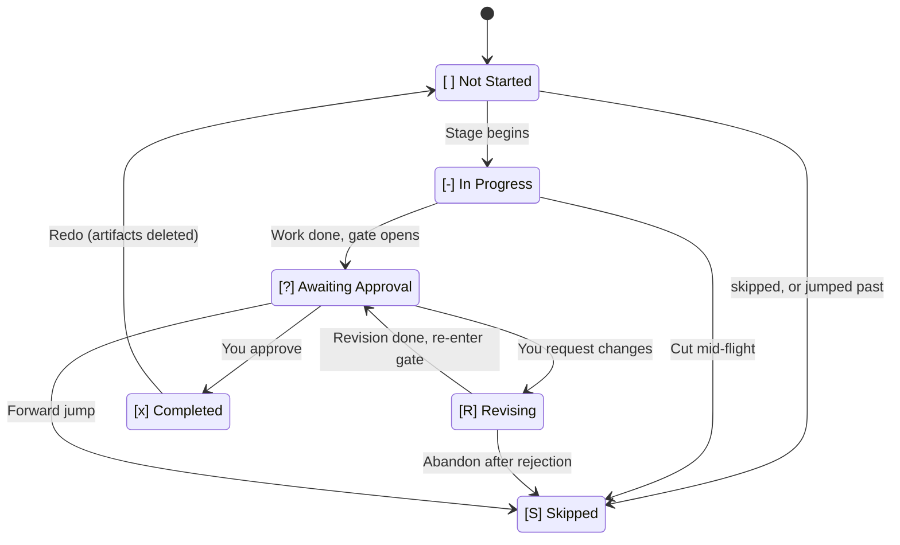
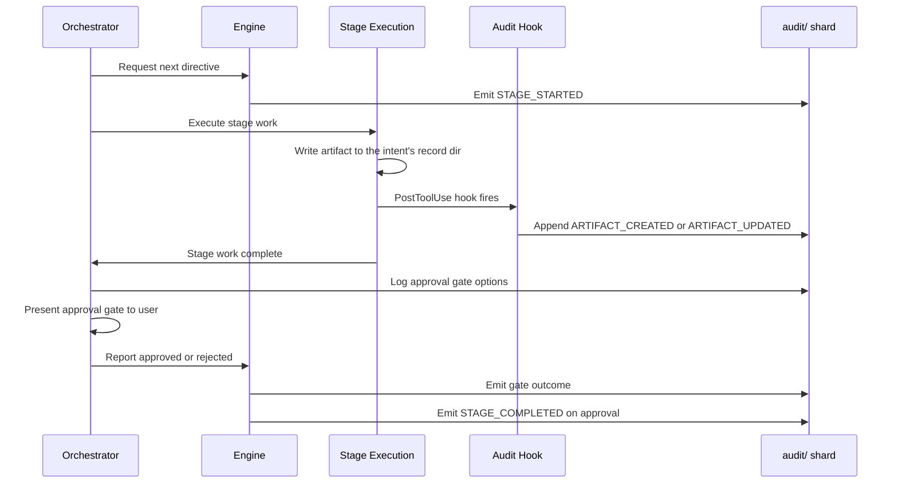

# 状態の追跡と監査証跡

各作業は、intent から本番まで完全なトレーサビリティを合わせて与える、二つのコミットされた記録を保ちます。**状態ファイル** が、ワークフローのどこにいるかを追い、ファイルのフォルダである **監査証跡** が、その道のすべての判断・アクション・イベントを記録します。

---

## 状態ファイル（`aidlc-state.md`）

各 intent は、`aidlc/spaces/<space>/intents/<YYMMDD>-<label>/aidlc-state.md`（intent の記録ディレクトリの下）に自分の状態ファイルを持ちます。その intent のワークフローの進み具合の、唯一の真実の源です。エンジンは、すべてのセッションの開始で、アクティブな intent の状態ファイルを読み、何が完了し、何が進行中で、次に何が来るかを判断します。

最初の記述は、その隣の `project-description.json` に一つの JSON 文字列として、タイプしたとおりに蓄えられます。ただし、キー・トークン・パスワードの形をしたものはマスクされます（[あなたがタイプするキーとパスワード](#keys-and-passwords-you-type) を参照）。`aidlc-state.md` は、そのコミットされた源を挙げ、安全な一行の `Project` プレビューだけを保つので、複数行のユーザー入力が追加の状態フィールドを持ち込めません。源のマーカーのない 2.6.115 より前の記録は、既存の `Project` フィールドを記述として使い続けます。ファイルが欠けている・壊れている、マークされた新しい記録は、黙って劣化せず、源の検証に失敗します。JSON のデコードは、Git が sidecar の最後の行末を正規化しても、元の記述を保ちます。

### 何を含むか

| Section | Purpose |
|---------|---------|
| **Project Information** | プロジェクトの記述、種別（greenfield/brownfield）とそれを設定したの（`Project Type Source`: `workspace scan` か `you`）、スコープ、開始日、アクティブなエージェント |
| **Scope Configuration** | 実行するステージ、飛ばすステージ（理由つき）、深さレベル、テスト戦略、`Review Override`、そして intent ごとの設定: `Guard Policy`、`Guards Off`（この作業のために下げた fence）、`Guards On`（ポリシーの語を超えて強制したオン）、`Sensors`、`Learnings`、`Summary Confirmation`、`Plan Approval`、`Collaborators`。fence の行は、使われたときだけ現れ、人の存在を含みません。人の存在に作業ごとのスイッチはありません。 |
| **Workspace State** | プロジェクトルート、検出された言語、フレームワーク、ビルドシステム |
| **Execution Plan Summary** | 合計ステージ、完了数、進行中のステージ |
| **Runtime State** | 改訂の回数、Construction のチェックポイント、反復と実行の設定、レシートに綴じた Construction Verification Command、任意の Unit の所有と Unit ゲートのリズム |
| **Phase Progress** | 各フェーズを `Pending`、`Active`、`Verified`、`Skipped` として |
| **Stage Progress** | ステージごとの完了状況を追うチェックボックス |
| **Unit Progress** | チームモードのみ: 導かれた Unit ごとの Construction ステージとゲートのセル。`next` が書き直し、正式ではない |
| **Current Status** | ライフサイクルのフェーズ、現在/次のステージ、ステータス、最終更新のタイムスタンプ |
| **Session Resume Point** | 最後に完了したステージ、次のアクション、保留中の成果物 |

次に、Intent Capture が承認された直後の `mvp` プランの Claude Code の実行からの一部を示します（短くしています。ファイルは各ステージとその `EXECUTE` か `SKIP` の間に長いダッシュを置きます。ここでは `-` で示します）。

```text
## Scope Configuration
- **Depth**: Standard
- **Test Strategy**: Minimal
- **Review Override**:
- **Guard Policy**: off (from scope mvp)
- **Sensors**: on (from scope mvp)
- **Learnings**: on (from scope mvp)
- **Summary Confirmation**: on (from scope mvp)
- **Plan Approval**: on (from scope mvp)
- **Collaborators**: off (from scope mvp)

## Phase Progress
- **Initialization**: Verified
- **Ideation**: Active
- **Inception**: Pending
- **Construction**: Pending
- **Operation**: Skipped

## Stage Progress
### IDEATION PHASE
- [x] intent-capture - EXECUTE
- [ ] market-research - SKIP
- [-] feasibility - EXECUTE
- [ ] scope-definition - EXECUTE
...

## Current Status
- **Lifecycle Phase**: IDEATION
- **Current Stage**: feasibility
- **Next Stage**: scope-definition
- **Status**: Running
- **Last Updated**: 2026-10-13T10:43:59Z
```

`Guard Policy` と退役した `Change Control` の両方が違うポリシーの語で現れると、ステータスは次の `next` まで `strict (from conflicting state lines)` を示します。`next` は一つを保ち、それを唯一の行として書きます。監査証跡が最後に設定されたと示すもの、なければあなたが設定したもの、なければスコープ自身のもの、なければより厳しいもの（`Source: command` と `Settled` フィールドを持つ `GUARD_POLICY_SET` の行がそれを記録します）。あなた自身の最後の選択を保ったときは何も言わず、それ以外は一度言います。たとえば:

> この作業には、AI-DLC が変更をどれだけ細かく確認するかの設定が二つあり、食い違っていました。記録はどちらが最後に設定されたかを言わないので、AI-DLC はより厳しいものを保ちます。すべてを確認します。いつでも変えられます。

メモリが抱える strict は依然として優先し、両方の行をそのままにします。両方が合えば、`Guard Policy` の行が使われます。ポリシーの行のどの書き込みも、退役した行を取り除き、一つの設定を残します。

`Construction Verification Command` は、すべての Unit/バッチのチェックポイントで再利用されるプロジェクトの確認を記録します。合致する現在のワークフローの人の承認のレシートが、`state set-construction-verification-command` がフィールドを書く前に要ります。フィールドだけが実行を認可することは決してなく、汎用の `state set` はそれを拒否します。人の **Approve** / **Request Changes** の返信は、たずねたチャットで、またはそれが最新の質問である間なら新しいチャットで数えます。**Approve** だけがレシートを認可します。無関係な返信・**Request Changes**・別の質問への返信はしません。
[記録コマンドのフロー](12-cli-commands.md#construction-verification-command-record-human-authorization) を参照してください。

### 六状態のチェックボックス

ステージの進み具合は、六状態のチェックボックスの記法を使います。

| Checkbox | Meaning |
|----------|---------|
| `[ ]` | 未着手 |
| `[-]` | 進行中 |
| `[?]` | あなたの承認待ち（ゲートが開いている） |
| `[R]` | 改訂中（あなたがゲートを却下し、ステージが改訂されている） |
| `[x]` | 完了 |
| `[S]` | 作業が走る間に飛ばされた（`skip` で切った、または `--stage`/`--phase` のジャンプで迂回した） |

計画が外すステージは、ボックスを変えません。上の `market-research` のように、名前の後に `SKIP` がついて `[ ]` のままです。

ステージは、ハッピーパスで `[ ]` → `[-]` → `[?]` → `[x]` と移ります。ゲートで却下すると、ステージは改訂される間 `[R]` に移り、準備ができると `[?]` に戻り、最後に承認で `[x]` になります。`/aidlc --status` は、チェックボックスを読み、誰がブロックしているかを伝えます。`[?]` には「Awaiting your approval on \<stage\>」、`[R]` には「Revising \<stage\> (revision N of 3)」。

正規の状態機械の参照（遷移の表、監査イベントの発行元）は [開発者リファレンス: 状態機械](../reference/12-state-machine.md) を参照してください。

### 状態の遷移



<!-- Text fallback: [ ] Not Started transitions to [-] In Progress when a stage begins. [-] In Progress transitions to [?] Awaiting Approval when stage work is done and the gate opens. [?] Awaiting Approval transitions to [x] Completed when you approve, or to [R] Revising when you request changes. [R] Revising transitions back to [?] Awaiting Approval when revision is complete. [ ] Not Started, [-] In Progress, [?] Awaiting Approval, and [R] Revising can each transition to [S] Skipped via a skip, a jump, or abandonment. [x] Completed transitions back to [ ] Not Started on redo (artifacts deleted). -->

### 通常・改訂・スキップ・やり直し・ジャンプのフロー

- **通常フロー**: `[ ]` -> `[-]` -> `[?]` -> `[x]`（ステージが始まり、作業が完了し、ゲートが開き、あなたが承認する）
- **改訂フロー**: `[?]` -> `[R]` -> `[?]` -> `[x]`（あなたが却下し、ステージが改訂され、ゲートが開き直し、あなたが承認する）
- **スコープのスキップフロー**: なし。計画にないステージは `[ ]` のまま、作業が作られるとき `SKIP` と印される
- **やり直しフロー**: `[x]` か `[-]` -> `[ ]` -> `[-]`（あなたがやり直しを求め、成果物が消され、ステージが再実行される）
- **ジャンプフロー**: ステージ A で `[-]`、あなたがステージ B へのジャンプを求め、間のステージが `[S]` と印される

---

## 監査証跡（`audit/`）

監査証跡は、後のステージと回復のために、アクティブな intent の判断とイベントを記録します。AI-DLC のツールとフックがそれを書きます。読みはどんな手段でも開いたままです。書き込みのガードは、ガードレールであって、セキュリティの境界ではありません。所有するコマンドと読み取り専用のクエリの契約は [監査証跡のルール](../reference/04-stage-protocol.md#audit-trail-rules) を参照してください。

### 132 イベントのタクソノミー

イベントは 27 のカテゴリに整理されています。

| Category | Count | Events |
|----------|------:|--------|
| **Workflow Lifecycle** | 9 | `WORKFLOW_STARTED`, `WORKFLOW_COMPLETED`, `WORKFLOW_PARKED`, `WORKFLOW_UNPARKED`, `WORKFLOW_ARCHIVED`, `WORKFLOW_UNARCHIVED`, `STATE_UPGRADED`（古い AI-DLC が記録した作業を、エンジンが最初に読んだとき今のものに引き上げる）, `INTENT_REPOS_CHANGED`, `INTENT_CHECKOUTS_CHANGED` |
| **Phase Lifecycle** | 4 | `PHASE_STARTED`, `PHASE_COMPLETED`, `PHASE_VERIFIED`, `PHASE_SKIPPED` |
| **Stage Lifecycle** | 9 | `STAGE_STARTED`, `STAGE_AWAITING_APPROVAL`, `STAGE_REVISING`, `STAGE_COMPLETED`, `STAGE_SKIPPED`, `STAGE_JUMPED`, `STAGE_DEFINITION_CHANGED`, `STAGE_OUTPUT_AMENDED`（あなたが承認した後、次のメッセージの前に、ステージ自身の文書が変わった）, `SOURCE_WORK_NOT_FOUND`（Code Generation が見たところに新しいコードを見つけず、何をしたか: エージェントに伝えた、あなたに質問を出した、Guard Policy off の下で身を引いた） |
| **Session** | 6 | `SESSION_STARTED`, `SESSION_RESUMED`, `SESSION_COMPACTED`, `SESSION_ENDED`, `HUMAN_TURN`（フックが出す）, `HOST_TURN`（フックが出す、参考: ホストがエージェントのために作ったプロンプト。人のターンではない） |
| **Initialization** | 3 | `WORKSPACE_SCAFFOLDED`, `WORKSPACE_SCANNED`, `WORKSPACE_INITIALISED` |
| **Navigation** | 9 | `SCOPE_CHANGED`, `SCOPE_DETECTED`, `DEPTH_CHANGED`, `TEST_STRATEGY_CHANGED`, `REVIEW_CLASS_CHANGED`, `RECOMPOSED`, `WORKSPACE_RECLASSIFIED`, `SCOPE_SAVED`, `PLUGIN_SELECTION_CHANGED` |
| **Guard Policy** | 5 | `GUARD_POLICY_SET`, `CHANGE_CONTROL_SET`（退役した名前、まだ読まれる）, `CHANGE_ACCEPTED`, `GUARD_RESTORED`, `GUARD_STOOD_ASIDE` |
| **Ceremony** | 1 | `CEREMONY_SET`、`aidlc-utility.ts config-change` が出す（共有の `scope-change` の適用元経由でも）。フィールド: `Key`（`sensors`, `learnings`, `summary_confirmation`, `plan_approval`, `collaborators`）、`Old`、`New`、`Source`（明示的な設定は `you`、受け継いだデフォルトは `scope <name>`）。`Old` は、以前に保存された値（無効なら生のテキスト、なければスコープのデフォルト）で、環境で実効の値ではない。実際に蓄えられたフィールド/源の変更ごとに一行。何もしないコマンドは出さない。 |
| **Interaction** | 19 | `DECISION_RECORDED`, `GATE_APPROVED`, `GATE_REJECTED`, `QUESTION_ANSWERED`, `QUESTION_REPLIED`, `QUESTION_UNANSWERED`, `QUESTION_ASKED`, `QUESTION_SHOWN`, `REQUEST_ROUTED`, `SUMMARY_CONFIRMATION_RECORDED`, `VERIFICATION_COMMAND_RECORDED`, `CONSTRUCTION_POLICY_RECORDED`, `CHECKPOINT_VERIFICATION_RECORDED`, `PLAN_APPROVAL_RECORDED`, `PLAN_APPROVAL_SKIPPED`, `PLAN_APPROVAL_OVERRIDDEN`, `REVIEW_REQUESTED`, `REVIEW_COMPLETED`, `PIPELINE_LINK_COMPLETED` |
| **Unit Configuration and Lifecycle** | 9 | `UNIT_OWNERSHIP_SET`, `UNIT_GATE_RHYTHM_SET`, `CONSTRUCTION_POLICY_SET`, `UNIT_STARTED`, `UNIT_PAUSED`, `UNIT_RESUMED`, `UNIT_COMPLETED`, `UNIT_SKIPPED`, `UNIT_MERGED` |
| **Artifact** | 3 | `ARTIFACT_CREATED`, `ARTIFACT_UPDATED`（write-audit-log フック）, `ARTIFACT_REUSED` |
| **Subagent** | 4 | `SUBAGENT_DISPATCHED`（deliver-stage-rules フック、または Cursor と Kiro IDE の log-subagent）, `SUBAGENT_COMPLETED`（log-subagent フック）, `SUBAGENT_PROMPT_UNMATCHED`（Copilot アダプター、参考）, `REVIEW_VERDICT_DICTATED`（もう書かれない。以前のリリースの plan-approval-guard フック。レビュアー自身の `**Verdict Dictated:**` の行は今 `REVIEW_COMPLETED` に乗る） |
| **Reviewer Enforcement** | 2 | `REVIEWER_SCOPE_BLOCKED`（reviewer-scope フック）, `REVIEW_FREEZE_BLOCKED`（review-freeze フック） |
| **Plan Approval** | 2 | `PLAN_APPROVAL_BLOCKED`, `GUARD_DISABLED`（plan-approval-guard フック、またはこの作業のために切った fence） |
| **Guard Refusals** | 2 | `STATE_TRANSITION_BLOCKED`（state-transition ガードが、委譲されたエージェントのライフサイクルやルーティングのコマンドを拒否した）, `STAGE_RULES_BLOCKED`（ステージルールが大きさで拒否された、または必要なルールファイルが読めなかった）。各々が `Guard`、`Reason`、拒否した `Target`/`Session` を帯び、拒否ごとに一行 |
| **System Install** | 2 | `SYSTEM_INSTALL_BLOCKED`（あなたが求めず承認した計画も名指ししない、`sudo apt-get install` のようなシステムパッケージのインストールを、あなたが言うまで止めた）, `SYSTEM_INSTALL_ALLOWED`（あなたのメッセージで、あなたの言葉とともに通した一つ） |
| **Documents** | 3 | `DOCUMENT_INDEXED`, `DOCUMENT_UPDATED`, `DOCUMENT_REMOVED` — intent にスコープされても、スペースレベルのシャード |
| **Utility** | 1 | `HEALTH_CHECKED` |
| **Error/Recovery** | 3 | `ERROR_LOGGED`, `RECOVERY_COMPLETED`, `COORDINATION_STOOD_ASIDE` |
| **Construction Bolt** | 4 | `BOLT_STARTED`, `BOLT_COMPLETED`, `BOLT_FAILED`, `AUTONOMY_MODE_SET` |
| **Worktree** | 7 | `WORKTREE_CREATED`, `WORKTREE_MERGED`, `WORKTREE_DISCARDED`, `STATE_FORKED`, `STATE_MERGED`, `AUDIT_FORKED`, `AUDIT_MERGED` |
| **Practices** | 4 | `PRACTICES_DISCOVERED`, `PRACTICES_AFFIRMED`, `PRACTICES_OVERRIDE`, `PRACTICES_SECTION_EMPTY` |
| **Merge Dispatch** | 3 | `MERGE_DISPATCH_INVOKED`, `MERGE_DISPATCH_RETURNED`, `MERGE_DISPATCH_FALLBACK` |
| **Sensors** | 6 | `SENSOR_FIRED`, `SENSOR_PASSED`, `SENSOR_FAILED`, `SENSOR_COULD_NOT_RUN`, `SENSOR_BUDGET_OVERRIDE`, `GUARDRAIL_LOADED` |
| **Learning Loop** | 3 | `MEMORY_EMPTY`, `RULE_LEARNED`, `SENSOR_PROPOSED` |
| **Swarm** | 8 | `SWARM_STARTED`, `SWARM_UNIT_CONVERGED`, `SWARM_SOURCE_MERGED`, `SWARM_UNIT_FAILED`, `SWARM_BATON_RETURNED`, `SWARM_COMPLETED`, `SWARM_DEGRADED`, `MAIN_CHECKOUT_CHANGE_ALLOWED` |
| **Commit Provenance** | 1 | `SOURCE_COMMITTED`（`aidlc attest anchor`、またはオプトインのセッション開始のスイープ。エンリッチメントのみ。`resolve` はそれを読まない） |

### 何がいつログされるか

- **すべてのステージの開始と完了** が、`STAGE_STARTED` と `STAGE_COMPLETED` のイベントでログされます
- **エージェントがそのファイルツールで書くか編集するすべてのファイル**、intent の記録ディレクトリかスペースの `codekb/` の中のもの（`audit/` シャード自身を除く）が、write-audit-log フックでログされます。シェルコマンドが書いたファイルはされません
- **すべての承認ゲートの判断**（approve、request changes、accept-as-is）がログされます
- **あなたが与えるすべての質問の答え** が記録されます
- **すべてのサブエージェントの完了** が log-subagent フックでログされ、送られるすべてのヘルパーは、送られるときログされます
- **すべてのエラーと回復** がログされます

### 監査ログの読み方

各シャードは素の Markdown で、イベントごとに一つのブロックです。上の実行の Intent Capture ステージからの二つ:

```text
## Stage Start
**Timestamp**: 2026-10-13T10:27:19Z
**Event**: STAGE_STARTED
**Stage**: intent-capture
**Agent**: aidlc-product-agent

---

## Question Answered
**Timestamp**: 2026-10-13T10:34:07Z
**Event**: QUESTION_ANSWERED
**Stage**: intent-capture
**Details**: Q9: One total per SKU
**Person Reply**: One total per SKU
```

イベントのタイムラインを JSON で得るには `aidlc engine audit history` を実行するか、一つのステージを見るには `--stage <slug>` を足します。各イベントは、そのタイムスタンプ・種別・名前つきフィールドを帯びます。結果は古い順です。`unordered: true` が、ライター間で既知の順序のない並んだエントリを印します。自由形式のメモは、その見出しと本文つきの `NOTE` エントリとして現れます。`--event NOTE` がメモを選びます。`--stage` はそれらを除きます。

`Human Turn` エントリは、あなたが動いたことを記録し、あなたの言葉は決して記録しません。各ターンで送ったものを読むには、`aidlc engine audit turns` を実行します。各ターンを、このマシンが一日保つメッセージの記録に結びつけ、ターンの言葉がここにないときはそう言います。

ペアの前の質問と答えには、`aidlc engine log answers --stage <slug>`（Unit には `--unit <unit>` を足す）を実行します。一つの返信が、それが答えたメニューにログされたすべての質問とペアになります。開いた質問と、まれなあいまいな答え（前に質問がない、またはライターが一秒で並んだ）は、別に報告されます。どちらのコマンドも、ファイルを変えず、ロックを取りません。

エージェントが質問の選択の一つを「(Recommended)」と印すと、記録はその選択を `Recommended` として保ちます。ログされた選択がその印を帯びるとき質問の `Decision Recorded` エントリに、Claude Code か Codex の質問ボックスで答えるとき `Question Replied` エントリに、ボックスの `Options` とあなたの `Reply` の横に。だから、あなたがそれに従ったかが見えます。`log answers` は、ログされた質問の `Recommended` を、その `options` とあなたの答えの横に `recommended` として挙げます。これより前に書かれたエントリは `Recommended` を持たず、いつもどおりに読めます。

### あなたがタイプするキーとパスワード

状態ファイル・`project-description.json`・監査シャードは、あなたの作業とともにコミットされるので、AI-DLC は、それらを書く前に、キー・トークン・パスワードの形をしたものをマスクします。ベンダーのトークン（GitHub、GitLab、Slack、Stripe、OpenAI、Anthropic、Google、npm、Hugging Face、AWS アクセスキー）、秘密鍵のブロック、JWT や `Bearer` トークン、アドレスの中のパスワード（`postgres://app:[masked]@db`）、そして秘密の名前の後に設定された値（`password=`、`DB_PASSWORD=`、`GITHUB_TOKEN:`）で、値に文字と数字か記号があるとき（パスワードの名前の後では、`-`・`.`・`_` でつながれた語も数えます）。`$DB_PASSWORD` のような参照は残り、`your-api-key-here` のようなプレースホルダも残ります。あなたの言葉の残りは、タイプしたとおりに残ります。たとえば `**Person Reply**: Approve, the deploy key is [masked]`。あなたのメッセージ全体は `aidlc/.aidlc-sessions/` にだけ残り、AI-DLC の `.gitignore` ブロックがそれをコミットから外します。あなたのメッセージが一つを抱えていたとき、AI-DLC はチャットで一度そう言います。チャット自身はそれを受け取ったので、本物ならそれが発行されたところでキーを変えてください。マスクは形だけによるので、別のやり方で書かれた秘密（`my password is hunter2`）はタイプしたとおりに保たれ、doctor のバンドルは同じ形とそれ以上をマスクします。

### 誰が決めたか

ステージを承認する、変更を求める、ステージを飛ばす・ジャンプする、確認を切る・入れる、変わった入力を通すとき、監査行はあなたの git の名前も記録します。たとえば `**Git Name**: Jane Doe`。この名前は、あなたがこのプロジェクトで `git config user.name` に設定したもの（リポジトリ自身の設定、それからあなたのグローバルのもの）で、Unit ボードが示すのと同じ名前なので、チームのクローンで各人の行は自分の名前を帯びます。AI-DLC はそれを読むだけです。それを設定したり、求めたり、あなたのメールを記録したりすることは決してなく、git に名前がなければ何も記録しません。署名や identity の証明ではなく、git が報告するとおりに誰がキーボードの前にいたかを言います。`/aidlc --status` は、最後に完了したステージを誰が承認したかを挙げます。たとえば `Last Completed: Requirements Analysis (approved by Jane Doe)`。どの行がそれを帯びるかは、あなたのハーネスフォルダの `knowledge/aidlc-shared/audit-format.md` の「Git Name」の下に挙げています。

### 監査イベントのフロー

ステージが実行され成果物を生むと、監査証跡が完全な連なりをとらえます。



<!-- Text fallback: The orchestrator requests the next directive and the engine emits STAGE_STARTED. Stage execution writes artifacts; the PostToolUse hook appends ARTIFACT_CREATED or ARTIFACT_UPDATED. After the stage work and approval gate, the orchestrator reports the outcome. The engine emits the gate result and, on approval, STAGE_COMPLETED while updating state and routing. -->

---

### 源に綴じたレビューのレシート

Code Generation は、intent の記録の外にアプリケーションのソースを書くので、その Unit ごとの終端のレビューのレシートは、markdown の成果物より多くを綴じます。レビューされた Unit の strict な `source-manifest.json` は、作られた・直された・消されたソースのパスを挙げます。`Unit Source Fingerprint` が、それらの主張とマニフェストのバイトを綴じます。完了時、エンジンは各 Unit を新しい順に検証し（新しいレビューされた主張が、意図した共有ファイルの統合を所有できます）、それから新しい主張の和集合を、ステージ入口のソースのベースラインと比べます。Guard Policy strict の下では、覆われない変更や古い Unit が、四つの完了の経路すべてをブロックし、その Unit の一つの制限された古いレシートの回復を申し出ます。どの Unit も主張できない、git が無視するファイル（追跡もされず `.aidlc-source-paths.json` に登録もされない、ビルドの出力やテスト実行の記録のようなもの）は、覆われない変更ではなく、そのファイルの `exclude` リストが歩きから外すパスも、ステージが始まった後にその行が書かれたときでも同じです（プロジェクトが無視しないツールのキャッシュ、このプロジェクトのコードでないネストしたリポジトリ）。レジストリファイル自身は AI-DLC 自身のものなので、どの Unit もそれを主張しません。strict の拒否は、通る三つの道を挙げます。変更をした Unit がパスを挙げてもう一度レビューされる、誰も意図しなかった変更が元に戻される、ソースでないパスがそこで除かれる。relaxed か off の下では、覆われない変更は保たれます。完了がそれを一度 `CHANGE_ACCEPTED` として記録し、ファイルを一行で挙げます（「These files changed outside any unit's work in Code Generation: ... Kept them.」）。このマシンに欠けているステージ入口のベースライン（新しいクローン）は、どの Guard Policy の下でも一行で確認を飛ばします。ここにあって合わないものは、strict の下では依然として完了をブロックします。

ワークスペース全体の `Source Fingerprint` は、ふつうレビュー後の変更の外側の境界です。一つの狭い調停が、文書化された「revert」の回復を本物にします。主張されないベースラインの変更（追加・修正・削除）が完全に元に戻された後、ステージのベースラインがあって有効で、当てはまるすべての Unit がまだ新しい近代の綴じを持ち、ベースラインから現在への差分に主張されないパスがゼロのときだけ、完了が続けられます。ふつうのレビュー後の編集、古い・レガシーの Unit の証拠、残る主張されないパスは、依然として拒否します。アップグレード前のフィールドのないレシートやベースラインは、文書化された移行の fail-open のふるまいを保ちます。欠けた・壊れた近代の証拠は fail-closed です。`AIDLC_SKIP_SOURCE_FRESHNESS=1` は、決定的な緊急の off スイッチで、bypass と印されたレシートを消費するとき再びなければなりません。

レビューの後の AI-DLC の更新は、AI-DLC 自身のファイルだけを変えるので、レシートの `Source Listing` がこのマシンにあるとき、レビューを現在のままにします。それのないレシートは、上のように `Source Fingerprint` で比べられます。

---

## 状態と監査がどう協働するか

状態ファイルと監査証跡は、補い合う目的を担います。

| Concern | State File | Audit Trail |
|---------|-----------|-------------|
| **Purpose** | 現在の位置と進み具合を追う | イベントの完全な履歴を記録する |
| **Read by** | Orchestrator（ルーティングと再開のため） | ユーザーと監査者（トレーサビリティのため） |
| **Update pattern** | 各状態変化で上書き | 追記のみ（決して変えない） |
| **Session resume** | どこから続けるかを判断する主な源 | 元のプロジェクトの記述と判断の文脈を与える |
| **Git policy** | バージョン管理にコミット | コミット（`audit/` の下のクローンごとのシャード。マージ衝突なし） |

orchestrator は、`aidlc-state.md` を持続するカーソルとして使います。チームが所有する Construction はさらに、アクティブな intent の監査シャードから、Unit のセル・レシートの下限・ゲート・マージされた行を導きます。ソロのルーティングは、状態だけのカーソルのふるまいを保ちます。監査証跡はまた、intent から本番まで、すべての判断を追えるようにします。

状態ファイルが壊れたら、`STAGE_STARTED` と `STAGE_COMPLETED` のイベントを見て、監査証跡からそれを再構築できます。修復の手順は [困ったとき](15-troubleshooting.md) を参照してください。

---

## 次のステップ

- [セッション管理](11-session-management.md) — 状態がセッションの再開にどう使われるか
- [成果物リファレンス](14-artifacts-reference.md) — intent の記録ディレクトリに何が蓄えられるか
- [困ったとき](15-troubleshooting.md) — 状態の破損の修復
- [用語集](glossary.md) — 状態ファイル、監査証跡、チェックポイント、コンパクションの定義
