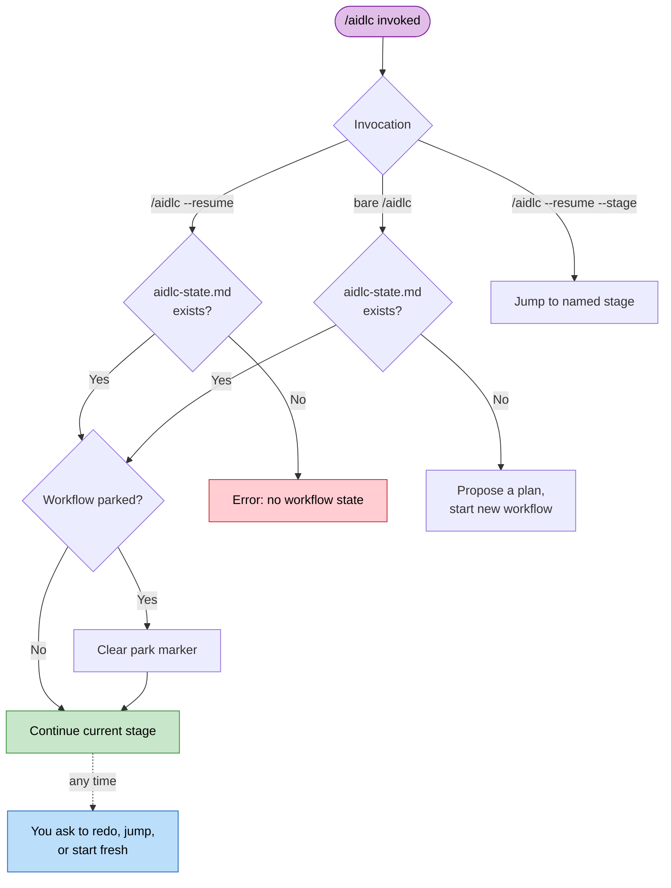

# セッション管理

ワークフローは、複数のハーネスセッションにまたがることがあります。AI-DLC はすべての進み具合をディスクに永続するので、いつでも再開・やり直し・ジャンプ・新規開始ができます。

> **ハーネスについての注記。** セッションの再開はどのハーネスでも働きます（状態は、ハーネスではなく intent の記録ディレクトリにあります）。セッションの *ライフサイクルイベント* は違います。Claude Code は `SESSION_STARTED/RESUMED/ENDED` と `SESSION_COMPACTED` を出します。Kiro CLI は `SESSION_STARTED` だけを出します。Kiro IDE は `SESSION_STARTED` を、そしてプロンプトが前のチャットに戻ると `SESSION_RESUMED` を出します。Codex は `SESSION_ENDED` を推し量り、それから compact-source の `SessionStart` を通じてミッションを再注入します。[ほかのハーネスで動かす](harnesses/README.md) を参照してください。

---

## 再開のフロー

新しいセッションで素の `/aidlc` を実行し、アクティブな intent の `aidlc-state.md` があると、AI-DLC は `/aidlc --resume` と同じく、作業が止まったところから続け、どこから拾ったかを言います。前のチャットでたずねられて答えなかった質問は、たずねられたとおりに再びたずねられます。別のことをするには、そう言います。現在のステージをやり直す、ステージへジャンプする、新規開始する。



<!-- Text fallback: bare /aidlc with state carries on like /aidlc --resume; you can ask to redo, jump, or start fresh at any time; without state it starts with a plan proposal. /aidlc --resume with state clears a park marker if needed and continues directly; without state it errors. /aidlc --resume --stage jumps to the named stage. -->

コマンドの面から `/aidlc park` で park します。エンジンが park のコマンドを挙げ、conductor がどこで止まったかを報告します。`/aidlc --resume` がそれを戻します。

### やり直し、ジャンプ、新規開始

素の `/aidlc` は、最後のチェックポイントから再開します。ほかの一つをあなた自身の言葉で、いつでも求めます。

| Option | What happens | What is preserved | What is lost |
|--------|-------------|-------------------|-------------|
| **Resume from last checkpoint** | 進行中か次の保留中のステージから続ける。セッションがタスクツールを持つとき、タスクのサイドバーが状態ファイルから作り直される。 | すべての成果物、状態、監査証跡 | 前のセッションのメモリ内の会話の文脈 |
| **Redo current stage** | 現在のステージのチェックボックスをリセットし（`aidlc-jump.ts execute --direction redo` 経由）、それを一から再実行する。Construction が Unit を一つずつ走らせ、Unit が作業を終えているとき、Redo は代わりにアクティブな Unit のステップだけを最初からやり直す。その Unit が一時停止や、要約の確認やチェックポイントの承認を待っているときも。Code Generation では計画も含むので、計画が承認のためあなたに戻ってくる（plan approval がオフでない限り）。 | ほかのすべての成果物と状態（Unit を一つずつでは、ほかの Unit の終えた作業） | 現在のステージの完了状況と途中の作業（Unit を一つずつでは、その Unit のステップ） |
| **Jump to stage** | 特定のステージへ飛ばす（`next --stage <slug>` 経由）。前へのジャンプの後、AI-DLC は、どのステージを飛ばしたか、どう戻るかを一行で伝える。 | すべての既存の成果物 | 現在とターゲットの間のステージが `[S]`（飛ばした）と印される |
| **Start fresh** | 既存のものの隣に新しい intent を始める（スコープと記述を確認した後、`next --new-intent` 経由）。 | 既存のワークフローの成果物・状態・監査証跡（その場に残る） | 何も。前の intent は再開できるまま |

`/aidlc --resume --stage <slug>` は、明示的なステージをターゲットとして扱い、ふつうのジャンプの経路を取ります。

送り出されたアンサンブルの作業は、ディスク上の証拠から再開します。Practices Discovery では、conductor がリードのドラフトとすべての既存の寄与ファイルを保ち、欠けている quality/developer/devsecops のスポークだけを送り出し、それから人へのインタビューとリードの統合で続けます。完了したスポークを繰り返すことはありません。

Code Generation は、計画のチェックから再開します。developer エージェントは、`code-generation-plan.md` の各ステップを、終えるごとにチェックします。ビルドが途中で止まると（モデルやプロバイダーのエラー、エディタを閉じた）、同じ計画の次の実行は、最初のチェックされていないステップで拾い、「Picking up unit-2's code at step 5 of 9 (1-4 done).」のような一行が見えます。何もチェックされていないが最初のステップが名指すファイルが書かれていたとき、代わりにそれらの後で拾います（「(1-4 wrote their files)」）。コードが書かれ、どのステップが済んだか何も言わないとき、「Picking up unit-2's code: the plan marks none of its 9 steps done, checking what is built.」が見え、developer が終えたステップをチェックします。developer は、各済んだステップが名指すファイルを確認し、作ったはずのファイルがないときだけステップをやり直します。Redo、Request Changes、計画の再承認は、そのステップを新しく始めます。新しいビルドが始まると計画のチェックがクリアされ、それがまた途切れたら、それが作るチェックだけが数えられます。ビルドが始まった後に計画を編集することも新しく始めます。ビルドの前に編集した計画は、ほかと同じように拾います。

---

## コンテキストのコンパクション

Claude Code は、コンテキストウィンドウがいっぱいになると、前の会話の文脈を自動で要約します。これを **コンパクション** と呼びます。この実装は、コンパクションのイベントをまたいでワークフローの状態を保つための安全策を持ちます。

### 何が保たれ、何が失われるか

| Preserved | Lost |
|-----------|------|
| すべての記録ディレクトリの成果物（ディスク上のファイル） | メモリ内の会話の文脈（前の議論） |
| `aidlc-state.md`（ステージの進み具合、スコープ、プロジェクト情報） | まだファイルに書かれていない途中の作業 |
| `audit/` シャード（判断とアクションの完全な履歴） | タスク ID（再開時に状態ファイルから作り直される） |
| | エージェントのペルソナの文脈（エージェントのファイルから読み込み直される） |

### コンパクションの後に回復する方法

1. `/aidlc` を実行します。AI-DLC は状態ファイルを読み、作業が止まったところから続けます
2. 進行中だったステージをもう一度やらせるには、それをやり直すよう求めます。Construction が Unit を一つずつ走らせるとき、再開の文脈がアクティブな Unit のいるステップを挙げ（たとえば `Current Step: code-generation for unit beta`）、Redo はその Unit のステップだけをやり直します。ほかの Unit の終えた作業は承認されたまま残ります

コンパクションは、長いセッションのふつうの一部です。ディスク上の状態ファイルと成果物が、完了した作業が失われないようにします。

---

## ワークフローの途中でモデルを変える

走っているチャットの中で別のモデルに切り替えるのは遅く、多くのトークンを使います。新しいモデルは、答える前に会話全体をもう一度読みます。Claude のモデルでは、会話のプロバイダーのキャッシュが一つのモデルに属するので、どれも引き継がれず、同じチャットで effort レベルを変えても、たいていそれも捨てます。

AI-DLC は、要るものをすべてディスクに保つので、新しいチャットの方が安い切り替えです。

1. ステージの境目で止めます。ステージを承認し、同じ返信で止めるよう求めます。たとえば `Approved. Stop here for today.`。ワークフローは次のステージが始まる前に park します（[対話モード](07-interaction-modes.md) を参照）。`/aidlc park` もそれをその場で park します。
2. 新しいチャットかセッションを開き、そこで新しいモデルと effort を選びます。Kiro IDE では、チャットパネルのエージェントピッカーで **aidlc** エージェントも選びます。新しいチャットは Kiro の Default エージェントで始まるからです（[Kiro IDE のチャットで AI-DLC を始める](harnesses/kiro-ide.md#start-ai-dlc-in-a-kiro-ide-chat) を参照）。
3. `/aidlc --resume` を実行します。新しいチャットは、古い会話ではなく、保存された状態・成果物・監査証跡をディスクから読み、ワークフローが止まったところから続けます。

古いチャットが議論したが、ファイルに書かなかったものは引き継がれません。だからステージの終わりが最適の瞬間です。Codex CLI では、`/aidlc` の代わりに `$aidlc` とタイプします。どのモデルと effort を選ぶかは [モデルと effort を選ぶ](18-install-and-lifecycle.md#choosing-a-model-and-effort) を参照してください。

---

## ステージのジャンプ

ユーティリティコマンドを使って、ワークフローを前へも後ろへもジャンプできます。

### 特定のステージへジャンプ

```
/aidlc --stage code-generation
/aidlc --stage 3.5
```

前へジャンプすると、現在の位置とターゲットの間のステージが `[S]`（飛ばした）と印され、AI-DLC は、どのステージを飛ばしたか、戻れることを一行で伝えます。たとえば「Moved to Code Generation; skipped User Stories. You can go back to Requirements Analysis any time.」。後のステージは、飛ばしたステージが書いたはずのファイルを期待することがあります。

Construction が Unit を一つずつ走らせるとき（unit-major、新しい作業のデフォルト）、ジャンプは、あなたが求めると通ります。アクティブな Unit のいるステップへのジャンプは、単にそれを続けます。アクティブな Unit がすでに終えたステップへ戻るジャンプ、たとえば unit beta が Code Generation にいる間の `/aidlc --stage nfr-design` は、その Unit だけのそれとその後のステップを開き直し（前のファイルを見つける各開き直したステップが Keep・Modify・Redo を申し出ます）、アシスタントが一行でそう言います。「Reopened NFR Design for unit beta. alpha keeps its finished work. You can redo it for alpha too.」。すべての Unit を求めるか、Unit を名指しすると、代わりにそれらの Unit に対してそれを開き直します。ステージの承認が後の Unit ごとのステップへ進んだ後でも、すべての Unit がビルドされた後でも。Build and Test で「go back to Code Generation for Unit 2 only」は、その Unit だけに Code Generation を開き直し、ほかの Unit は承認を保ち何もたずねられず、Build and Test がその後に再び走ります。ステージ全体への戻るジャンプ、たとえば「go back to Code Generation」は、そのステージとその後のステージをすべての Unit に対してやり直し、その前のステージを保ちます。beta がステップの途中にいる間に別の Unit を名指しすると、まず beta のステップを一時停止し、アシスタントが言います。「Paused unit beta at Code Generation and reopened NFR Design for unit alpha. You can pick beta up again any time.」。何も失われません。alpha がそのステップをやり直し、それから beta が止まったところから拾うか、あなたが beta に戻るよう求めると早く拾います。どの Unit もまだ取っていないチームのメインチェックアウトが、すべての Unit を自分で働くとき、Unit を名指すジャンプを同じように取ります。それが当てはまらないところで Unit を名指すこと（Unit ごとに済まないステップ、または Construction のチェックポイントがオフで、すべての Unit ですでに承認されたステップ）は、平たく言われ、何も変わらず、アシスタントが代わりにすべての Unit に対して開き直すかをたずねます。はいと言えばそうします。Unit が作業を終えると、後のステップへ先にジャンプすること、たとえば unit beta が NFR Requirements にいる間の `/aidlc --stage code-generation`（「設計をやめて、ビルドして」）は、beta だけを進めます。beta の Code Generation までのステップが beta に対して飛ばされ（そのファイルは残り）、ほかのすべての Unit は終えた作業と承認を保ち、まだ始まっていない Unit は、そこに着いたとき自分のステップをします。`/aidlc --stage <skipped step> --unit beta` が、beta に対して飛ばされたものを開き直します。どの Unit も作業を終える前は、先へのジャンプがすべての Unit に対してそれらのステップを飛ばします。さらに先へジャンプすること、たとえば Build and Test や、Construction を早く離れる `/aidlc --phase operation` は、Unit が終えていないステップを飛ばし（そのファイルは残り）、あなたが自分で Unit をビルドするとき、AI-DLC が Unit ごとに一行で挙げます。たとえば「Moved to Build and Test. Skipped for unit beta: Code Generation. Their files stay. You can go back to Code Generation any time.」。`/aidlc --stage <earliest skipped step>` が、飛ばされたものを開き直します。

後ろへジャンプすると、ターゲットのステージとあなたの計画の後のすべてのステージが `[ ]`（未着手）にリセットされ、順に再び現れ、AI-DLC は戻れることを一行で伝えます。たとえば「Moved back to Requirements Analysis. You can return to Code Generation any time.」。ジャンプは、進捗の印をリセットし、ファイルはしません。成果物はディスクに残り、前のファイルを見つける各開き直したステージは、それらを保つか、直すか、やり直すかをたずねます。

### フェーズの先頭へジャンプ

```
/aidlc --phase construction
/aidlc --phase 3
```

これは、指定したフェーズの最初のステージへジャンプします。ステージのジャンプと同じく、AI-DLC は、どのステージを飛ばしたか、どう戻るかを伝えます。

### ジャンプとスコープを組み合わせる

`--stage` や `--phase` を `--scope` と組み合わせられます。

```
/aidlc --stage code-generation --scope bugfix
```

まだワークフローがないとき、これは指定したスコープで新しいワークフローを作り、ターゲットのステージへ直接ジャンプします。走っている作業では、AI-DLC はまずスコープを変え、それから新しいスコープでジャンプをします。その横にタイプした `--depth`・`--test-strategy`・`--guard-policy` の設定は、変更とともに当てられます。`--review` と `--sensors` のような儀式のスイッチは、ジャンプの前に単独で設定します。

---

## セッションスキル

三つの読み取り専用のスキルが、現在のワークフローを変えずに報告します。各々はコマンドのようにタイプされ、`/` のスキルピッカーに現れます。

| Skill | What it does | Output |
|-------|--------------|--------|
| `/aidlc-session-cost` | 決定的なコストの眺め（所要時間、ステージの成果、メモリのエントリ、センサーの発火、とらえた learnings）を出す | ターミナルのみ |
| `/aidlc-replay` | その場にいなかったステークホルダーのために、読めるセッションの物語（何がなぜ決まったか）を描く | ターミナルのみ |
| `/aidlc-outcomes-pack` | ワークフローを再実行せずにチームがシステムを所有し続けられるよう、引き継ぎ文書を生成する | `OUTCOMES.md` を書く |

**これらは読み取り専用です。** どれもワークフローのステージポインターを進めず、どれも監査イベントを出さないので、ステージの途中を含め、どの時点でも安全に実行できます。`/aidlc-session-cost` と `/aidlc-replay` はターミナルに出力し、何も書きません。ファイルを書くのは `/aidlc-outcomes-pack`（ワークスペースルートの `OUTCOMES.md`）だけです。

**それらが報告するすべての数は、data plane からまっすぐ来ます。** 各スキルは、その数字を `aidlc engine runtime summary --json`（`runtime-graph.json` の上の実体化されたビュー）から読みます。スキルが見積もったり数え直したりすることは決してありません。数の周りの散文（物語、判断の根拠）だけが、監査証跡と成果物から合成される部分です。トークンの見積もりは意図してありません。古いファイルサイズからトークンへの経験則は当て推量で、取り除かれました。

```
/aidlc-session-cost      # quick "where are we" snapshot, any time
/aidlc-replay            # narrate the session for async review
/aidlc-outcomes-pack     # at workflow close - write the handover doc
```

たとえば、`mvp` プランで Intent Capture をちょうど終えた Claude Code の実行での `/aidlc-session-cost`（短くしています）:

```text
  Scope:      mvp
  Duration:   17 min
  Stages
    Total:      5
    Approved:   4
    Failed:     0
    Pending:    1
  By phase
    initialization    3/3 approved
    ideation          1/2 approved, 1 pending
  Memory entries
    Total:            2
    Interpretations:  1
    Deviations:       1
    Trade-offs:       0
    Open questions:   0
  Sensors
    Fired:            9
    Passed:           9
    Failed:           0
    Could not run:    0
    Budget-override:  0
    Incomplete:       0
  Learnings captured
    From orchestrator:    1
    From user additions:  1
```

エージェントがその後に一、二文を足します。ここでは、九つの確認すべてが通ったこと、そして合計がこれまでに始まったステージだけを覆うことです。

各スキルは、読むのにコンパイル済みの `runtime-graph.json` が要ります。ワークフローが最初のステージを始める前に一つを実行すると、短い「no session data yet」の注記を出して止まります。

**あなたのハーネスがスラッシュコマンドを表に出さないとき。** `/aidlc-session-cost`、`/aidlc-replay`、`/aidlc-outcomes-pack` はスキルです。`/` のピッカーにスキルを表に出すハーネス（Claude Code、Kiro、Cursor など）でだけ、タイプできるコマンドとして現れます。出さないハーネスでは、`/aidlc-session-cost` とタイプすると無効なコマンドと報告されます。コストの眺めは依然として働きます。土台のコマンドを直接実行します。それはスキルが実行するものそのもので、すべての数が来るところです。

```bash
aidlc engine runtime summary          # human-readable cost view
aidlc engine runtime summary --json   # machine-readable, same numbers
```

これは読み取り専用で、ワークフローのどの時点でも安全に実行できます。スキルと同じく、コンパイル済みの `runtime-graph.json` が要ります。最初のステージの遷移の前は、「run a workflow first」の注記とともに非ゼロで終わります。

---

## 次のステップ

- [状態の追跡と監査証跡](10-state-and-audit.md) — 状態ファイルの構造とチェックポイントの記法
- [スキルとランナーコマンド](17-skills.md) — 読み取り専用のセッションのビュー（`/aidlc-session-cost`、`/aidlc-replay`、`/aidlc-outcomes-pack`）とランナーの一族
- [CLI コマンド](12-cli-commands.md) — `--stage`、`--phase`、ほかのフラグの完全な参照
- [困ったとき](15-troubleshooting.md) — コンパクションの回復と状態の破損
- [用語集](glossary.md): コンパクション、セッションの定義
