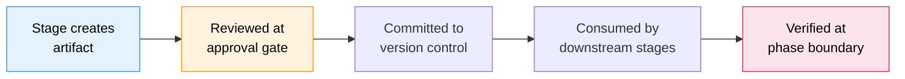

# 成果物リファレンス

AI-DLC のワークフローはすべて、**intent の記録ディレクトリ** の下に成果物を生み出します。`aidlc/spaces/<space>/intents/<YYMMDD>-<label>/` です（`<space>` は非デフォルトのスペースが使われていない限り `default`、`<YYMMDD>-<label>` は intent のディレクトリ。以下では `<record>/` と表記します）。この章は、ディレクトリ構成、成果物ごとの説明、ライフサイクル、git ポリシーの完全なリファレンスです。

---

## ディレクトリツリー

これは成果物が配置されうる場所の完全なセットであって、作ったばかりの記録の姿ではありません。intent の作成はスコープが実行するフェーズごとに1つのフォルダを作ります（加えて `verification/`）。残りは作業が進むにつれて現れ、ステージごとのフォルダはそのステージが最初に書き込むときに作られます。

フレームワークのファイルは、人の成果物の隣にある1つの `.aidlc-engine/` ディレクトリを共有します。アップグレード後も、既存の監査行は記録されたパスでレビューを検証できます。Sensor の検出結果とサマリーの承認は、対応する新しいディレクトリがない間だけ、古いディレクトリを使います。新しい書き込みは `.aidlc-engine/` を使い、その他の一時ファイルや派生ファイルはそこに再作成されます。

```
aidlc/spaces/<space>/intents/<YYMMDD>-<label>/   # one record dir per intent
  aidlc-state.md                    # Workflow state (commit)
  project-description.json          # Your first request, exactly as given (commit)
  audit/                            # Audit trail — per-clone shards (commit)
    <host>-<clone>.md               # this clone's shard; readers glob + merge by timestamp
  .aidlc-engine/                    # Framework state (gitignore)
    sensors/                       # Advisory findings and type-check cache
    reviews/                       # Digest-bound review records and drafts
    summary-authorization/         # Active summary confirmations
    source-review/                 # Local reviewed-source snapshots
    hooks-health/                  # Hook heartbeats and drop counters
    plan.json                      # Derived scope plan
    state-writes.json              # Recent state writes, for doctor
    stop-hook/                     # No-progress guard counters
    human-turn                     # Last human prompt marker
    engine-touch                   # Last engine advance marker
    turn-end                       # Last step that ended the turn, until the person replies
    reviewer-dispatch.json         # Active per-unit reviewer scope
    document-input-path            # Document input handoff
    active-directive.json           # Transient execution cursor
    active-directive.lock/          # Cursor coordination
    guard-refusals/                 # Repeated refusal counters
    steering-token-key             # Local continuation signing key
    codekb-stage-<repo>/            # Temporary CodeKB candidates
  runtime-graph.json                # Execution telemetry view (gitignore)

  verification/                     # Phase boundary checks (commit)
    phase-check-ideation.md         # written by Approval and Handoff
    phase-check-inception.md        # written by Delivery Planning
    phase-check-construction.md     # written by CI Pipeline

  initialization/                   # Phase 0: stays empty (state and audit only)

  ideation/                         # Phase 1 artifacts
    intent-capture/
    market-research/                (conditional)
    feasibility/                    (conditional)
    scope-definition/
    team-formation/                 (conditional)
    rough-mockups/                  (conditional)
    approval-handoff/

  inception/                        # Phase 2 artifacts
    practices-discovery/            (conditional)
    requirements-analysis/
    user-stories/                   (conditional)
    refined-mockups/                (conditional)
    domain-design/             (conditional)
    units-generation/
    contract-design/           (conditional)
    delivery-planning/

  construction/                     # Phase 3 artifacts
    {unit-name}/                    (per unit of work, repeated)
      functional-design/            (conditional)
      nfr-requirements/             (conditional)
      nfr-design/                   (conditional)
      infrastructure-design/        (conditional)
      code-generation/
    build-and-test/
    ci-pipeline/                    (conditional)

  operation/                        # Phase 4 artifacts
    deployment-pipeline/            (conditional)
    environment-provisioning/       (conditional)
    deployment-execution/           (conditional)
    observability-setup/            (conditional)
    incident-response/              (conditional)
    performance-validation/         (conditional)
    feedback-optimization/          (conditional)

  archive/                          (created on-demand)
    {ISO-date}-{stage-name}/
```

ステージフォルダの中には、そのステージの成果物、質問ファイル、learnings が有効なときの `memory.md` 日誌、そして `reviews/review-NN.md` があります。最後のものは、ステージの各レビューを読める形で複製したもので、判定が返ってきた順に番号が振られます。`mvp` プランで Intent Capture を終え、Feasibility を開始した状態の記録の一例です（キャプチャ時点、`.aidlc-engine/` は省略）。

```text
aidlc/spaces/default/intents/261013-inventory-api/
  aidlc-state.md
  project-description.json
  runtime-graph.json
  audit/
    <host>-<clone>.md
  construction/
  ideation/
    feasibility/
      feasibility-questions.md
      memory.md
    intent-capture/
      intent-capture-questions.md
      intent-statement.md
      memory.md
      reviews/
        review-01.md
      stakeholder-map.md
  inception/
  initialization/
  verification/
```

**9つの reverse-engineering 成果物は記録ディレクトリにはありません。** それら（`architecture.md`、`code-structure.md`、`technology-stack.md` …）は1つ上のレベル、スペースレベルのリポジトリごとの CodeKB（`aidlc/spaces/<space>/codekb/<repo>/`）に配置されます。これはリポジトリごとに1つのストアで、intent ごとに複製されることはありません。プロジェクトフォルダ自体がリポジトリの場合、`<repo>` はそのフォルダ名（リンクされた git worktree ではメインチェックアウトの名前）から始まり、英字・数字・`.`・`_`・`-` 以外の各文字はハイフンに置き換えられ（`portal app` は `portal-app` になり、フォルダ名はそのまま）、ストアとともに保持されます。移動・改名・複製されたプロジェクトフォルダも同じストアを読み続けます。例外は、どの intent も自分のリポジトリとして記録していないストアを2つ以上持つスペースです。そこでは現在のフォルダ名が使われ、次のステップは完了済みステージの結果がずれていると警告できます。該当する各ブラウンフィールドの intent では、ステージはまずストアの記録済みスコープとワーキングツリーのフィンガープリントを確認します。検証済みで最新のストアのカバレッジが intent に合えば、人の選択で再利用できます。そうでなければ、フルの再スキャンがその9ファイルを置き換え、フォーカススキャンは新しく分析された領域をそれらにマージし、その外の既存の文章を保ちます。検証済みで最新のカバレッジは和集合として蓄積され、古い、または検証できない過去の deep カバレッジは文章として残され shallow に降格されます（`reverse-engineering-timestamp.md` が、最後のスキャンがいつ実行され何をカバーしたかを記録します）。スキャン前のソース/ストア世代と、全成果物のロック付き公開が、ソース変更が最新と誤認されるのを防ぎ、同時に走るフォーカススキャンが互いを黙って置き換えるのを防ぎます。したがって各 intent は、自分の記録ディレクトリが作られた時点のものではなく、リポジトリの最新のスキャンを読みます。これは古いスキャンに固定されることを防ぎます。learnings の儀式が有効なとき、記録ディレクトリにはそのステージ自身の `memory.md` 日誌が置かれます。エンジンが run-stage ディレクティブを発行するときに作成するものです（下記の **ステージごとのメモリ日誌** を参照）。そのため `inception/reverse-engineering/` ディレクトリがそこに現れ、日誌だけを収めることがあります。codekb の書き込みは `codekb > <repo> > <name>` のパンくずとともに監査ログに記録されるため、intent ごとの証跡は何がいつ変わったかを記録し続けます。

**チーム知識は記録ディレクトリにはありません。** 1つ上のスペースレベル（`aidlc/spaces/<space>/knowledge/`、`intents/` の兄弟）に置かれるため、1つの intent の記録に閉じ込められず、スペース内のすべての intent にまたがって蓄積されます。エンジンは空で作成し、チームは任意の `aidlc-shared/` やエージェントごとのサブディレクトリの下に自由形式のファイルを追加します。[Knowledge](08-knowledge.md) を参照してください。

**ステージごとのメモリ日誌。** learnings の儀式が有効なとき、実行された各ステージは成果物の隣に、コミット対象の `memory.md` も保持します（例: `<record>/inception/requirements-analysis/memory.md`）。これはステージの観察日誌です。エンジンが run-stage ディレクティブを発行するときにテンプレートから作成し、ステージの間オーケストレーターが保守します。ステージによるエージェントの推論の記録であって、その中の何も、残すべきものとしてあなたに提示されることはありません。手編集することはありません。学習ループ（あなたが行った修正を保持します）については [Rules and the Learning Loop](09-rules-and-the-learning-loop.md) を参照してください。

**コードは兄弟リポジトリに置かれ、記録ディレクトリには置かれません。** `aidlc/` ツリーが持つのは方法、状態、監査、成果物だけで、アプリケーションコードは決して置きません。生成されたコードはワークスペースの **コードリポジトリ** に配置されます。単一リポジトリの一般的なケースではプロジェクトディレクトリ自体、マルチリポジトリのワークスペースでは、ワークスペースルートの直下の子である兄弟リポジトリのディレクトリ（それぞれ独自の `.git` を持つ）です。intent は作成時に、自分が触れるリポジトリを記録します。自動検出されるか、`--repos a,b` でスコープ指定され、その `intents.json` の行（`repos: [...]`）に入ります。Construction は各 git 操作をそのうちの1つに固定します。`repos` を記録していない intent は単一リポジトリのデフォルトです。[CLI Commands](12-cli-commands.md) を参照してください。

---

## 成果物のライフサイクル

成果物は、作成から下流ステージによる消費まで、予測可能なライフサイクルを流れます。



<!-- Text fallback: Stage creates artifact, reviewed at approval gate, committed to version control, consumed by downstream stages, verified at phase boundary. -->

1. **作成** — リードエージェントがステージ実行中に成果物を作り、intent の記録ディレクトリの適切なサブディレクトリに書き込みます（上記のスペースレベルの例外あり。Reverse Engineering はリポジトリごとの codekb ストアに、チーム知識は `knowledge/` に書きます）
2. **レビュー** — あなたは承認ゲートで成果物をレビューし、承認するか変更を求めます
3. **コミット** — 承認後、成果物はバージョン管理の準備ができます（下記の git ポリシーを参照）
4. **消費** — 下流ステージが成果物を入力として読みます（下記の入力表を参照）
5. **検証** — フェーズ境界の検証チェックが、そのフェーズのすべての成果物にわたるトレーサビリティを確認します

---

## フェーズ別の成果物

### Initialization（ステージ 0.1-0.3）

| ステージ | 何を残すか | 備考 |
|-------|-----------|-------|
| 0.1 Workspace Scaffold | 記録ディレクトリ。プランが実行するフェーズごとに1フォルダ、加えて `verification/` とスペースの `knowledge/` | 決定的（`aidlc-utility intent-create` 内で実行） |
| 0.2 Workspace Detection | `aidlc-state.md` の `Project Type` と `Workspace State` の裏にあるスキャン、および `WORKSPACE_SCANNED` 監査行 | 決定的なルールベースのスキャナー |
| 0.3 State Init | 完全な `aidlc-state.md` | 決定的 |

3つのいずれも独自のドキュメントを書かないため、`initialization/` は空のままです。

ウェルカムメッセージは `settings.json` の `companyAnnouncements` 経由でセッション開始時にレンダリングされます。これはステージではなく、成果物も生みません。

### Ideation（ステージ 1.1-1.7）

| ステージ | 主要な成果物 | 条件 |
|-------|--------------|-----------|
| 1.1 Intent Capture | `intent-capture-questions.md`（ソースレジスタと確認済みの回答）、`intent-statement.md`、`stakeholder-map.md`（インラインのソースタグと必須の assumptions セクション） | 常に |
| 1.2 Market Research | `competitive-analysis.md`、`build-vs-buy.md` | 条件付き |
| 1.3 Feasibility | `feasibility-assessment.md`、`constraint-register.md`、`raid-log.md` | 条件付き |
| 1.4 Scope Definition | `scope-document.md`、`intent-backlog.md` | 常に |
| 1.5 Team Formation | `team-assessment.md`、`mob-composition.md` | 条件付き |
| 1.6 Rough Mockups | `wireframes.md`、`user-flow.md` | 条件付き |
| 1.7 Approval & Handoff | `initiative-brief.md`、`decision-log.md` | 常に |

### Inception（ステージ 2.1-2.9）

| ステージ | 主要な成果物 | 条件 |
|-------|--------------|-----------|
| 2.1 Reverse Engineering | `architecture.md`、`code-structure.md`、`technology-stack.md` を含む9ファイル（スペースレベルの `aidlc/spaces/<active-space>/codekb/<repo>/` に書かれる。リポジトリごとに共有される1ストアで、検証済みで最新なら再利用、フルの再スキャンで置き換え、フォーカススキャンで累積的に拡張される。intent の記録には、learnings の儀式が有効なとき、ステージの `memory.md` 日誌だけが配置される） | ブラウンフィールドのみ |
| 2.2 Practices Discovery | `team-practices.md`、`discovered-rules.md`、`evidence.md`、`practices-discovery-timestamp.md`、加えて quality/developer/devsecops の貢献ファイル（承認後に `aidlc/spaces/<active-space>/memory/team.md` と `project.md` へ昇格） | 条件付き |
| 2.3 Requirements Analysis | `requirements.md` | 常に |
| 2.4 User Stories | `stories.md`、`personas.md` | ユーザー向け機能 |
| 2.5 Refined Mockups | `mockups.md`、`interaction-spec.md`、`accessibility-checklist.md` | UI プロジェクト |
| 2.6 Domain Design | `components.md`（統合されたコンポーネントカタログ）、`decisions.md`（ADR ログ） | 新しいコンポーネントが必要なとき |
| 2.7 Units Generation | `unit-of-work.md`、`unit-of-work-dependency.md`、`unit-of-work-story-map.md` | 常に |
| 2.8 Contract Design | `contract-summary.md`（ユニット間の契約、および公開または外部の API） | ユニットが2つ以上、またはシステム外で使われる API を持つユニットがある場合 |
| 2.9 Delivery Planning | `bolt-plan.md`、`team-allocation.md`、`risk-and-sequencing-rationale.md`、`external-dependency-map.md` | 常に |

### Construction（ステージ 3.1-3.7）

ステージ 3.1-3.5 は作業ユニットごとに繰り返されます。成果物は `construction/{unit-name}/{stage-name}/` に入ります。ステージ 3.6-3.7 はすべてのユニットの後に一度だけ実行されます。

4つの設計ステージ（3.1-3.4）は、各ユニットの **kind**（2.7 のエッジブロックでタグ付けされる。`service`、`spec`、`ui`、`packaging`、`library`）に合わせて成果物を刈り込みます。`spec` ユニットはスケーラビリティ文書を負わず、`packaging` ユニットは機能仕様を負いません。タグなしのユニットには下記のフルマトリックスが適用されます。どの成果物がどの kind に当てはまるかはステージのフロントマターのデータ（`produces_kinds`、[Stage definition](../reference/15-stage-definition.md) を参照）です。あるステージの成果物のどれも当てはまらないユニットは、そのステージについてファイル0個で完了です。

| ステージ | 主要な成果物 | 条件 |
|-------|--------------|-----------|
| 3.1 Functional Design | `entities.md`、`rules.md`、`functional-spec.md` | プランごと、ユニットごと（kind 別） |
| 3.2 NFR Requirements | `security-requirements.md`、`performance-requirements.md` | プランごと、ユニットごと（kind 別） |
| 3.2 NFR Requirements | `observability-requirements.md` | プランごと、service ユニットのみ |
| 3.3 NFR Design | `security-design.md`、`performance-design.md` | プランごと、ユニットごと（kind 別） |
| 3.3 NFR Design | `observability-design.md` | プランごと、service ユニットのみ |
| 3.4 Infrastructure Design | `infrastructure-specification.md`、`monitoring-design.md`、`cicd-pipeline.md` | プランごと、ユニットごと（kind 別） |
| 3.5 Code Generation | `code-generation-plan.md`、`code-generation-questions.md`、`unit-test-instructions.md`、`code-summary.md`、`traceability.json`、加えてエンジンが要求する `source-manifest.json`（コードはワークスペースルートに行く） | 常に、ユニットごと |
| 3.6 Build and Test | `build-instructions.md`、`test-results.md` | 常に、すべてのユニットの後 |
| 3.7 CI Pipeline | `ci-config.md`、`quality-gates.md` | 条件付き、すべてのユニットの後 |

### Operation（ステージ 4.1-4.7）

| ステージ | 主要な成果物 | 条件 |
|-------|--------------|-----------|
| 4.1 Deployment Pipeline | `cd-config.md`、`deployment-strategy.md`、`rollback-runbook.md` | 条件付き |
| 4.2 Environment Provisioning | `environment-inventory.md`、`validation-report.md` | 条件付き |
| 4.3 Deployment Execution | `deployment-log.md`、`smoke-test-results.md` | 条件付き |
| 4.4 Observability Setup | `dashboards.md`、`alarms.md`、`slo-config.md` | 条件付き |
| 4.5 Incident Response | `runbooks.md`、`incident-plan.md`、`escalation-matrix.md` | 条件付き |
| 4.6 Performance Validation | `load-test-plan.md`、`nfr-validation-matrix.md` | 条件付き |
| 4.7 Feedback & Optimization | `slo-report.md`、`cost-analysis.md`、`feedback-loop.md` | 条件付き |

---

## 質問ファイル

ユーザー入力を集めるステージはすべて、同じ場所に `{stage-name}-questions.md` という名前の質問ファイルを生み出します。質問は英字の選択肢（A-E、または質問ボックスに4つ表示される Claude Code では A-D）に、必須の `X. Other (please specify)` 選択肢を加えた形で、回答を記録する `[Answer]:` タグが付きます。エージェントが作るファイルでは、通常の各質問の見出しは普段それに答える人を示し（`## Q3. [Developer] ...`）、各人の質問は、ある質問が別の人の回答を待つ必要がない限りまとめられます。あとで追加された質問は末尾に入ります。確認、変更依頼、承認のセクションにはラベルが付きません。既存のファイルは、あなたがステージを最初からやり直すよう求めない限り、質問をそのまま保ちます。やり直すと新しいものに置き換わります。

各ステージで答え方を選べます。

| モード | 仕組み |
|------|-------------|
| **Guide me** | エージェントがここで、バッチごとに質問します（Claude Code は一度に最大4つ表示） |
| **I'll edit the file** | 質問ファイルを直接編集し、終わったらエージェントに伝えます |
| **Chat** | 自由な会話。決定が抽出されファイルに書かれます |

後のステージは選んだ方法を再利用し、ステージの途中で切り替えられます。質問ファイルが常に真実のソースです。[Interaction Modes](07-interaction-modes.md) を参照してください。

---

## コミットするもの対 Gitignore するもの

同梱の `.gitignore` はこの切り分けを符号化します。共有される作業（方法、レジストリ、状態、監査、成果物）はコミットされ、ユーザーごとのセッションカーソル、あなた自身の設定、マシンローカルの派生状態は無視されます。

| コミット | Gitignore |
|--------|-----------|
| `aidlc-state.md` | `aidlc/active-space`、`intents/active-intent`（ユーザーごとのカーソル） |
| `audit/*.md`（クローンごとのシャード） | `.aidlc-engine/`（フレームワーク状態） |
| すべてのステージ成果物 | `runtime-graph.json`（監査シャードから再導出可能） |
| `verification/` のフェーズチェック結果 | `aidlc/.aidlc-clone-id`（このクローンのシャードを命名。マシンローカルに保つ必要がある） |
| スペースレベルの `aidlc/spaces/<space>/knowledge/` チーム知識ファイル | `aidlc/.aidlc-sessions/`（セッションごとの UUID スタンプ、ワークフローのバインディング、PID の祖先マップ） |
| ステージごとの `memory.md` 日誌、スペースの `memory/` レイヤー | `.aidlc-engine/hooks-health/`、`.aidlc-engine/sensors/`（ハートビート、アドバイザリーの検出結果） |
| レビュー済みの各ステージの `reviews/` コピー | `.claude/settings.local.json`、`aidlc.settings.local.json`（あなた自身の設定） |
| | `aidlc/active-memory/`（すべてのハーネスの include が読む、アクティブなスペースの `memory/` のエンジンによるコピー。セッション開始時とスペース切り替え時に書かれるため、切り替えは追跡対象ファイルを変えない。コピーされた各ファイルは編集すべきファイルを示すコメントで始まり、コピー内で行った編集は次のリフレッシュで置き換えられる） |
| | `aidlc/.aidlc-request-text/`（エンジンが読むためにエージェントがファイルに書いたリクエスト。コマンドが進むと削除され、進まなかったときはそこに残る） |

---

## 入力と依存関係

各ステージは先行ステージの成果物を入力として読みます。主要な依存の連鎖は次のとおりです。

- **Intent Capture** の成果物は Market Research、Feasibility、Scope Definition、Rough Mockups へ流れます
- **Requirements Analysis** の成果物は User Stories、Domain Design、すべての Construction ステージへ流れます
- **Domain Design** と **Units Generation** の成果物は、ユニットごとのすべての Construction ステージへ流れます
- **すべての Construction 成果物** は Build and Test と CI Pipeline へ流れます
- **Infrastructure Design** の成果物は Operation ステージへ流れます

各ステージ自身の入力は、開発者リファレンスのそのフェーズのページに載っています。[Initialization](../reference/04-stages/initialization.md)、[Ideation](../reference/04-stages/ideation.md)、[Inception](../reference/04-stages/inception.md)、[Construction](../reference/04-stages/construction.md)、[Operation](../reference/04-stages/operation.md) です。

---

## フェーズ境界の検証

3つのステージは、トレーサビリティチェックでフェーズを終え、それを `verification/` に書きます。そのステージを飛ばすプランは、そのフェーズのチェックを得ません（たとえば `mvp` は Approval and Handoff を飛ばします）。

| チェックファイル | 書く主体 | 何を検証するか |
|-----------|-----------|-------------------|
| `phase-check-ideation.md` | 1.7 Approval and Handoff | intent からスコープ、intent バックログへの一貫性 |
| `phase-check-inception.md` | 2.9 Delivery Planning | 要件からストーリー、アーキテクチャへの整合 |
| `phase-check-construction.md` | 3.7 CI Pipeline | すべてのユニットがビルド・テストされ、CI が構成済み |

---

## 次のステップ

- [State Tracking and Audit Trail](10-state-and-audit.md) — 状態ファイルと監査証跡の詳細
- [How a Stage Runs](04-phases-and-stages.md) — ステージの実行と成果物の生成
- [Glossary](glossary.md) — 成果物、フェーズ境界の検証、質問ファイルの定義
