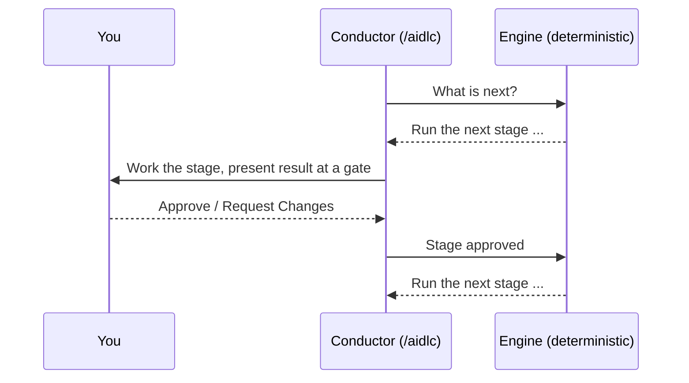

# Onboarding: 手引き付きの最初の 1 週間

AI-DLC v2 は初めてですか。チームはいつも同じことを言います。決定的な phase と stage の強制は強力だが、engine が*なぜ*そう振る舞うのかが分かりにくい、と。そのため最初の数回は、ツールを使うというより、ツールと戦っているように感じられます。

この章は、手を取って進める道です。ほかのすべてが腑に落ちる 1 つのメンタルモデルを説明し、次に、使い捨ての Express 実行から完全な feature まで、意図的に組んだ 5 回の進行を案内します。順に進めてください。終わる頃には、強制がシートベルトのように感じられるはずです。

> **もうインストール済みで待ちきれない？** [Run 1](#run-1-a-throwaway-express-run-15-minutes) へ飛んでください。まだインストールしていない？ 先に [Getting Started](01-getting-started.md) を済ませ、それからここに戻ってください。

---

## AI-DLC が腑に落ちる 1 つの考え

AI-DLC は、要件・判断・実装をつないだままにするため、ワークフローのルーティングを実行から分離します。

**決定的な engine がルーティングを担い**、**conductor が実行を担います**:

- **engine**（素朴で非 AI のプログラム）は、*次に何が起きるか*を決めます。どのステージが走るか、scope がどのステージをスキップするか、いつゲートがブロックすべきか、いつ phase 境界が検証されるかです。これは決定的で、同じ state を入れれば同じ次の手が出ます。即興はしません。
- **conductor**（`/aidlc` セッション）は、*作業がどれだけうまく行われるか*を決めます。正しいエージェントのペルソナを取り、あなたに良い質問をし、判断を表に出します。ルーティングは決して決めません。engine に次の手を尋ね、それを実行し、結果を報告し、また尋ねます。



<!-- Text fallback: The conductor asks the engine what is next. The engine returns a specific stage. The conductor runs that stage with you and stops at an approval gate. You approve or request changes. The conductor reports the outcome to the engine, which returns the next move. The loop repeats. -->

**新参者のあなたにこれが大事な理由:** 「なぜ頼んだことをそのままやってくれないの？」という場面のほとんどは、conductor が自由に動くと期待することから来ます。設計上、それはできません。ステージが詰まって見えるなら、engine が何かを待っているからです。たいていはゲートでのあなたの回答か、前のステージからの欠けた入力です。「engine がルーティングし、私はゲートを解く」と腹に落ちれば、強制の筋が見えてきます。

全体のアーキテクチャは、後で [Introduction](00-introduction.md#how-the-orchestrator-works) を読んでください。今はその 1 段落で十分です。

---

## 道の 4 つのルール

この 4 つの事実が、新参者をもっとも驚かせる振る舞いを説明します。最初の 1 週間、頭に置いておきたい要点です。

### 1. ステージは順に走り、入力が存在する前には決して走らない

lifecycle は 5 つの phase（**Initialization → Ideation → Inception → Construction → Operation**）で、その中のステージは固定の順で走ります。ステージは、必要な入力が存在する前には決して走りません。Construction は、scope に含まれる前のステージが必要な artifact を生成するまで、コードを書けません。これは、人が最初に感じる強制です。これは官僚主義ではありません。まだ存在しない入力の上に積み上げることを、engine が拒むのです。

儀式を*減らしたい*なら、engine を迂回しません。より小さな scope を選びます。scope は、ルートから丸ごとのステージ（ときには丸ごとの phase）を前もって取り除きます。ルール 3 を参照してください。

### 2. approval gate は意図してブロックする

ほとんどのステージの後、ワークフローは approval gate で止まり、あなたが **Approve** か **Request Changes** するのを待ちます。これは本当にブロックされていて、自分では進みません（自動の初期化ステージ、そして、あなたが選べば、通常の Construction checkpoint を除く）。

ゲートはあなたの制御点です。完了サマリーは、何が生成されたか、未決の findings を示します。各 findings には安定した ID が付き、後の再チェックで、同じ懸念が解消されたか、まだ未決か、リスクとして受け入れられたかを伝えられます。未決の findings がある状態で承認すると、それらは受け入れとして記録されます。これは問題なく普通のことです。

ゲートでは、次に何が起きるかを選びます。承認、変更の要求、インタラクションモードの切り替え、別のステージへのジャンプです。[Interaction Modes](07-interaction-modes.md) を参照してください。ゲートの外で作業が止まることもあります。hook が走らないとき、またはチェックがエージェントのコマンドを拒否し続けるときです。それはあなたの誤りではなく、不具合です。[何かが詰まって見えたら](#when-something-looks-stuck) を参照してください。

### 3. scope がどれだけ走るかを制御する — まず小さいものを選ぶ

完全な `feature` は、セットアップ後に 30 ステージすべてを走らせます。これは production の feature には適切な量の儀式で、最初に見るにははるかに多すぎます。**scope**（*workflow profile* とも呼ぶ）が、儀式を上げ下げする方法です:

| あなたが… | 使うもの | ステージ |
|---|---|---|
| 全体を端から端まで素早く見たい | `express` | 7 / 30 |
| 既知のバグを 1 つ直したい | `bugfix` | 6 / 30 |
| アイデアが実現可能かを試したい | `poc` | 5 / 30 |
| 本物の production feature を作りたい | `feature` | 30 / 30 |

小さく始めてください。`poc` や `express` の実行は、ゲートに溺れさせずに、数分でループを教えます。全体は [Workflow Profiles](workflow-profiles.md) を、depth と test strategy が各 scope をどう調整するかは [Scopes, Depth, and Test Strategy](05-scopes-and-depth.md) を参照してください。

### 4. すべてが書き留められる — record ディレクトリがあなたの記憶

すべてのステージが、バージョン付きの markdown を intent の record ディレクトリに書きます:

```text
aidlc/spaces/<space>/intents/<YYMMDD>-<label>/
```

要件、判断、設計、コードサマリー、そして完全な `audit/` trail が、すべてそこにあります。だから AI-DLC は、プロジェクトが育っても筋を見失いません。何かが*なぜ*作られたかを知りたいとき、そこを見ます。レイアウト全体を今すぐ理解する必要はありません。何が起きたか混乱したときは、答えがそのフォルダのディスク上にある、とだけ知っておいてください。[Spaces and Intents](03-spaces-and-intents.md) と [Artifacts Reference](14-artifacts-reference.md) を参照してください。

---

## 手引き付きの進行

この 5 回を順に行ってください。各回がちょうど 1 つの新しい考えを加えます。Run 1〜3 では、捨ててかまわないスクラッチプロジェクトを使ってください。

> 以下の例は Claude Code を使います。ほかのどの harness も同一のワークフローを走らせます。違うのは welcome バナーとステータス行だけです。あなたの harness の章は [Running on other harnesses](harnesses/README.md) の配下に違いを列挙し、[Your First Workflow](02-your-first-workflow.md) が注釈付きの実行を示します。

### Run 1: 使い捨ての Express 実行（15 分）

**ゴール:** ask → stage → gate → next のループを、最小の儀式で一度味わう。

```bash
mkdir /tmp/aidlc-hello && cd /tmp/aidlc-hello
aidlc config --harness claude   # use your harness
aidlc doctor
```

harness を開き、もっとも軽い profile を走らせます:

```text
/aidlc express Build a CLI that converts between Celsius and Fahrenheit
```

何が起きるか見てください:

1. **Initialization が自動で走ります。** 3 つのステージが、ゲート無しで 1 秒足らずで完了します。あなたは何もしていません。これが lifecycle の始まりです。
2. **ルートが告げられます。** `express` を名指ししたので、ワークフローは即座に始まり、いくつのステージと approval gate を走らせるかを表示します。
3. **最初のゲートに当たります。** ステージが何かを生成し、サマリーを示し、止まります。これがルール 2 です。サマリーを読み、**Approve** します。
4. **ループが繰り返され**、実行が完了するまで続きます。

**気づくべきこと:** 「今は requirements を、今は design を」とは一度も指示していません。engine がすべてのステップをルーティングし、あなたはゲートに答えただけです。1 回の実行に収まったモデルの全体像。

### Run 2: 同じアイデアを `poc` として — scope がルートを変えるのを見る

**ゴール:** 儀式を制御するのはスキップではなく scope だと、自分で確かめる。

新しいスクラッチフォルダで（Run 1 と同じく、まずそこで `aidlc config --harness <your harness>` を走らせます）、同じ種類の要求を proof of concept として走らせます:

```text
/aidlc poc Build a CLI that converts between Celsius and Fahrenheit
```

Run 1 と比べてください。`poc` は異なる scope のルートを持つので、異なるステージの組が走ります。あなたは profile を変えることで、*どれだけ*起きるかを変えました。手作業で何かを省く操作は一切していません。engine が profile に応じて別のルートを計画したのです。これがルール 3 を具体にしたものです。どの profile がどのステージを含むかは、[stage-by-scope のマトリクス](05-scopes-and-depth.md#stage-by-scope-matrix) を一目見てください。

### Run 3: ゲートで変更を要求する — あなたの制御点を味わう

**ゴール:** ゲートが双方向の扉として働き、ゴム印だけでは終わらないと学ぶ。

小さな `poc` 実行をまた始めます（`poc` は reviewer のある Intent Capture を走らせます。`express` は reviewer を無効にします）。最初のステージのゲートで、承認する代わりに **Request Changes** を選び、具体的な指示を 1 つ与えます（例: 「success criteria に目標日が要る」）。conductor がその artifact に戻り、改訂し、ゲートをまた提示するのを見てください。

**気づくべきこと:** reviewer が findings を挙げていたら、その ID は再チェックをまたいで安定しているので、同じ項目が未決から解消へ移るのを見られます。いずれにせよ、conductor は artifact を改訂し、ゲートを再提示します。これが、自分でファイルを編集せずに操舵する方法です。試し終えたら、承認して完了させてください。ステージの途中で切り替えられる Guide Me / Edit File / Chat モードは、[Interaction Modes](07-interaction-modes.md) を参照してください。

### Run 4: record ディレクトリを調べる — ディスク上の「なぜ」を見つける

**ゴール:** ワークフローを、それが残す artifact につなげる。

Run 3 が完了したら、intent の record ディレクトリを開きます:

```bash
ls aidlc/spaces/default/intents/
# open the newest <YYMMDD>-<label>/ folder
```

`aidlc-state.md` を読み（走ったステージは `[x]`、scope で除外されたものは `[S]`）、scope が走った phase フォルダ配下の artifact（例: `inception/`）を流し読みします。`audit/` シャードを 1 つ開き、タイムスタンプ付きで記録された判断を見てください。これがルール 4 です。record ディレクトリは、育つプロジェクトを一貫させる、永続的な記憶です。[State and Audit](10-state-and-audit.md) と [Artifacts Reference](14-artifacts-reference.md) を参照してください。

### Run 5: 本物のコードで本物の `feature`

**ゴール:** 本当に気にかけている作業で、すべてを組み合わせる。

本物のプロジェクトで実行します:

```text
/aidlc feature <describe the feature you want>
```

これは完全な lifecycle を走らせます。初回は多く感じます。それが、production の feature にふさわしい儀式です。でももう、形は分かっています。engine がルーティングし、phase は順に走り、ゲートはあなたの制御点、scope がサイズを決め、すべての判断が record ディレクトリに着地します。この実行の傍らで [Your First Workflow](02-your-first-workflow.md) をゲートごとの語りとしてたどり、何かが詰まって見えた瞬間に [Troubleshooting](15-troubleshooting.md) を頼ってください。

---

## 何かが詰まって見えたら

新参者はたいてい、このどれかに当たります。ほとんどは、設計どおりに動いているワークフローです。最後の行は不具合です:

| 症状 | 実際に起きていること | すること |
|---|---|---|
| 「止まって進まない。」 | approval gate にいます（ルール 2）。 | サマリーを読み、**Approve** か **Request Changes** に答えます。 |
| 「コードをなかなか書いてくれない。」 | Construction は前の phase からの入力を必要とします（ルール 1）。 | 前のステージを走らせるか、より小さな scope を選びます。 |
| 「ステップが多すぎる。」 | scope が、タスクに必要な以上に大きいです（ルール 3）。 | `express`、`poc`、`bugfix` でやり直します。 |
| 「質問が多すぎる。」 | depth が、各ステージの質問数を決めます。scope が既定を選びます。 | `/aidlc --depth minimal` とタイプします（ステージごとおよそ 2〜4 問）。 |
| 「今どのステージ？」 | ステータス行 / 進捗行が教えます。 | Claude Code では、on にしてあれば AI-DLC のステータス行を読み（`/aidlc --statusline on`）、ほかでは `/aidlc --status`（Codex では `$aidlc --status`）を走らせます。 |
| 「あの判断はどこへ？」 | record ディレクトリにあります（ルール 4）。 | `aidlc/spaces/<space>/intents/<...>/` とその `audit/` シャードを開きます。 |
| 「エージェントが走らせるすべてのコマンドが拒否される」、または同じステップが繰り返される。 | ワークフローの下層で何かが失敗しました。hook が走っていないか、チェックが誤って拒否しています。 | エージェントを止め、自分のターミナルで `aidlc doctor --export` を走らせ、[リカバリー手引き](facilitator-guide.md#recovery-playbook) に従います。 |

setup、hook、provider、trust、古い state の問題には、プロジェクトルートから `aidlc doctor` を走らせてください。対処コマンドを名指しします。その後 [Troubleshooting](15-troubleshooting.md) を参照してください。

---

## Onboarding チェックリスト

- [ ] engine/conductor の分担を 1 文で言える。
- [ ] `express` 実行を完了し、ゲートに答えただけだった。
- [ ] 同じアイデアを別の scope で走らせ、ルートが変わるのを見た。
- [ ] ゲートで **Request Changes** を使い、conductor が改訂して再提示するのを見た。
- [ ] record ディレクトリで、要件・判断・audit シャードを見つけた。
- [ ] 本物の `feature` を端から端まで走らせた。

すべてのボックスにチェックが付けば、決定的な強制は、摩擦よりも予測可能性として読めるはずです。狙いはそこにあります。

---

## 次のステップ

- [Your First Workflow](02-your-first-workflow.md) — 注釈付きの feature 実行
- [Workflow Profiles](workflow-profiles.md) — すべての scope とそれを使うとき
- [Phases and Stages](04-phases-and-stages.md) — 5 phase・33 stage の全体地図
- [Interaction Modes](07-interaction-modes.md) — Guide Me、Edit File、Chat、そしてゲート
- [Spaces and Intents](03-spaces-and-intents.md) — workspace が多くの実行をどう保持するか
- [Glossary](glossary.md) — すべての用語の定義
