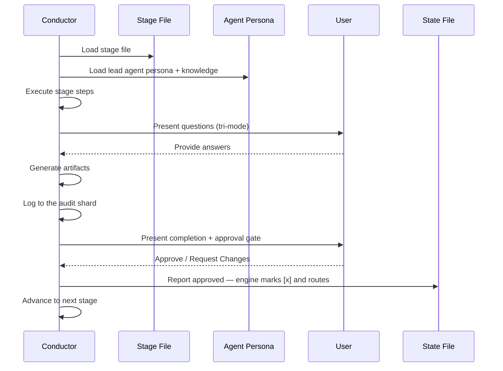
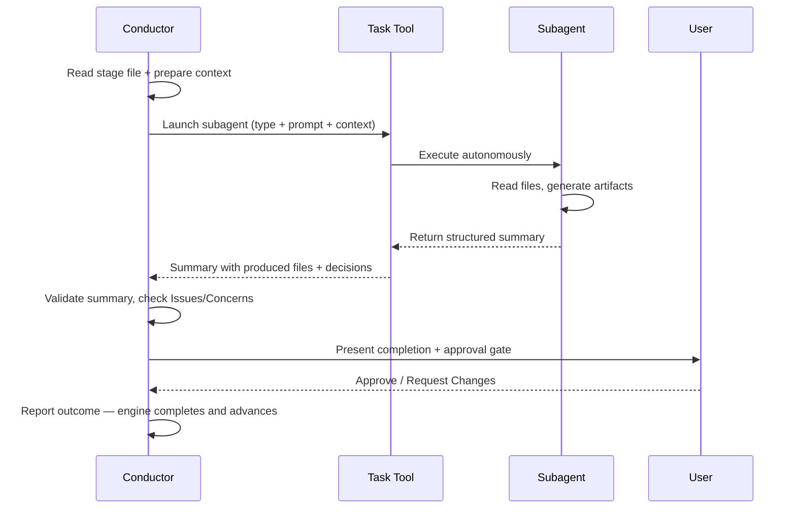

# アーキテクチャ

> **出典**: engine と conductor（`.claude/tools/aidlc-orchestrate.ts` および `.claude/skills/aidlc/SKILL.md`）とその周辺ファイルから導出しています。

## 概要

AI-DLC はハイブリッドな実行モデルを採用します。ある stage は inline で実行され（conductor が agent persona を読み込み、会話の中で直接実行する）、別の stage は Claude Code の Task ツール経由で subagent に委譲します。inline stage はユーザーとの対話（質問、確認、承認）に対応します。subagent stage は自律的に実行され、構造化された要約を返します。

```mermaid
graph LR
    subgraph INITIALIZATION["INITIALIZATION (0.1-0.3)"]
        Z1["Workspace Scaffold"]
        Z4["State Init"]
        Z1 -.->|"3 stages"| Z4
    end

    subgraph IDEATION["IDEATION (1.1-1.7)"]
        I1["Intent Capture"]
        I7["Approval & Handoff"]
        I1 -.->|"7 stages"| I7
    end

    subgraph INCEPTION["INCEPTION (2.1-2.9)"]
        N1["Reverse Engineering"]
        N7["Delivery Planning"]
        N1 -.->|"9 stages"| N7
    end

    subgraph CONSTRUCTION["CONSTRUCTION (3.1-3.7)"]
        C1["Functional Design"]
        C7["CI Pipeline"]
        C1 -.->|"5 stages per unit, then 2 once"| C7
    end

    subgraph OPERATION["OPERATION (4.1-4.7)"]
        O1["Deployment Pipeline"]
        O7["Feedback & Optimization"]
        O1 -.->|"7 stages"| O7
    end

    Z4 -->|"auto-proceed"| I1
    I7 -->|"Verification Gate 1"| N1
    N7 -->|"Verification Gate 2"| C1
    C7 -->|"Verification Gate 3"| O1
    O7 -.->|"Feedback Loop"| I1

    style INITIALIZATION fill:#f3e5f5,stroke:#9c27b0,color:#000
    style IDEATION fill:#e8f5e9,stroke:#4caf50,color:#000
    style INCEPTION fill:#e3f2fd,stroke:#2196f3,color:#000
    style CONSTRUCTION fill:#fff3e0,stroke:#ff9800,color:#000
    style OPERATION fill:#fce4ec,stroke:#e91e63,color:#000
```



## 5 つのレイヤー

**Rules**（space memory レイヤー。`aidlc/spaces/<active-space>/memory/` にあり、`rules/aidlc.md` の @-import スタブ経由で到達します）-- org、team、project、phase の各 rule ファイルです。フレームワークの作業慣行、テスト、デプロイ、コードスタイルのデフォルト、Guard Policy セクション、ガードレールの各セクション（`## Forbidden`、`## Mandated`、`## Corrections`）を含みます。自己学習: 人間が確認した修正は、ここに practice として書き込まれます。

**Agents**（`agents/*.md`）-- 14 個のフラットな agent ファイルです。11 のドメイン専門家 persona、2 つのレビュー専用 agent、adaptive-workflows の composer です。それぞれが役割、責務、協調パターン、ツール、関連する memory の焦点を定義します。記述済みのコア persona は `disallowedTools: Task` を持ちます。packager はサポートされる場所ではそのネイティブな拒否を保ち、nested-delegation を禁じる同じ境界を各ハーネスのツールポリシーへ投影します。Kiro agent の Markdown はサポートされないキーを省き、Kiro CLI agent の JSON と Kiro IDE の `tools:` 付与は、委譲先から `subagent` ツールを除外します。

**Knowledge**（`knowledge/`）-- 2 層の方法論リファレンスです。
- `aidlc-shared/` -- 原則、検証、brownfield の安全策、**監査イベントのタクソノミー**（正規のイベントレジストリ）、state テンプレート
- `aidlc-<agent>-agent/` -- agent ごとの方法論ファイル（アーキテクチャパターン、テスト戦略など）

**Skills**（`skills/aidlc/`）-- orchestrator のエントリポイント（`SKILL.md`。付属の `composer.md` はワークフロープランが構成されたときだけ読まれます）、static/recovery/governance のプロトコルファイル、さらに `aidlc-common/protocols/` 配下に条件付きで読み込まれる 5 つのモジュール（reviewer/ensemble/Construction/swarm/learnings）、そして `aidlc-common/stages/` 配下の 5 つのフェーズディレクトリ（`initialization/`、`ideation/`、`inception/`、`construction/`、`operation/`）にまたがる 33 個の stage ファイルです。

**Hooks**（`hooks/`）-- フレームワークの hook です。監査出力（Write/Edit に対する PostToolUse）、セッションライフサイクル（SessionStart、SessionEnd）、state 同期（TaskUpdate に対する PostToolUse）、state 検証（PreCompact）、subagent 追跡（SubagentStop）、statusline の描画を担います。フレームワークのファイルはすべて `aidlc-*.ts` の接頭辞を持ちます。

## 設定レイヤー

> **対象読者**: 新しい関心事（rule、方法論の一部、sensor のバインディング、ドメイン知識の事実）をどこに置くか判断する貢献者。
> **source-of-truth としての位置づけ**: これはルーティングの原則です。コードとこのセクションが食い違うときは、このセクションが優先されます。コードの側が誤って分類されています。

このリポジトリの設定は、**直交する 2 つの軸** で分割されます。

### 軸 1 — 誰が記述するか

- **Framework-authored** — AI-DLC のディストリビューションに同梱されます。すべてのプロジェクトで同じ内容です。フレームワークのリリース時に更新されます。ユーザーが自分のワークスペースで編集することはありません。
- **Team-authored** — 人間（またはこのワークスペースで実行される stage が書き、その後人間が追認したもの）が記述します。このプロジェクト固有です。このワークスペース内のワークフローをまたいで残ります。編集できます。

### 軸 2 — いつ消費されるか

- **継続的に読み込まれる（ハーネス設定）** — セッション開始時に読まれ、このワークスペースのすべてのワークフロー実行のすべての stage から利用できます。`.claude/` 配下にあります。
- **ワークフローごとのアーティファクト** — 特定の stage が出力として生成し、後続の stage が入力として読みます。intent の record ディレクトリ（`aidlc/spaces/<space>/intents/<YYMMDD>-<label>/`。以下では `<record>/` と表記）配下にあります。ワークフロー実行のたびに再生成されます。

### 4 つの象限

2 つの軸を掛け合わせると 4 つの象限ができます。3 つは埋まっており、1 つは意図的に空です。

|  | Framework-authored | Team-authored |
|---|---|---|
| **継続的に読み込まれる**（ハーネス設定） | `.claude/skills/`、`.claude/agents/`、`.claude/knowledge/`、`aidlc/spaces/<active-space>/memory/org.md`、`aidlc/spaces/<active-space>/memory/phases/*.md`、`.claude/scopes/`、`.claude/tools/data/scope-grid.json`、`.claude/tools/data/stage-graph.json` | `aidlc/spaces/<active-space>/memory/team.md`、`aidlc/spaces/<active-space>/memory/project.md` |
| **ワークフローごとのアーティファクト** | *(設計上、空)* | `<record>/aidlc-state.md`、`<record>/audit/*.md`（clone ごとの shard）、`<record>/<phase>/<stage>/*.md`、`.aidlc/worktrees/bolt-<id8>_<slug>/` |

フレームワークがワークフローごとのアーティファクトを生成しないのは、そうした出力はディストリビューションに同梱せざるを得ず、それはワークフローごとの出力ではなく framework-authored のハーネス設定になるからです。空のセルはルーティングルールの特徴であり、抜け漏れではありません。

> **Framework-authored = upstream から同梱される。自分のプロジェクトでは不変として扱う。** これを git やファイルシステムが強制するわけではありません。`.claude/` は編集可能な領域であり、望めば `org.md` や `phases/*.md` のファイルを編集できます。しかし慣例としては、フレームワークのデフォルトを書き換えるのではなく、自分の practice を `team.md` / `project.md`（右側のセル）に追加します。そうすることで、追加分がレビュー時に見え、フレームワークがクリーンにアップグレードでき、同じフレームワークバージョンを共有するプロジェクト間の drift を防げます。

### 新しい関心事を配置するための境界テスト

新しい関心事が来たとき、2 つの問いで置き場所が決まります。

1. **すべてのプロジェクトで同じ内容か、それともプロジェクト固有か。** framework-authored か team-authored か。
2. **毎セッション agent のコンテキストに読み込まれるか、それとも特定の stage だけが読むか。** ハーネス設定かワークフローごとのアーティファクトか。

具体例:

- *「私たちは常に main へ squash-merge する」* — プロジェクト固有（他チームは rebase を使う）で、継続的に読み込まれる（conductor が Bolt のマージごとに読む）。`aidlc/spaces/<active-space>/memory/team.md` に置きます。
- *「service レイヤーでは ALWAYS use Result<T,E>、NEVER throw」* — プロジェクト固有で、継続的に読み込まれる（agent がコード生成のたびに読む）。`aidlc/spaces/<active-space>/memory/project.md` に置きます。
- *「trunk-based development が推奨のブランチ戦略」* — すべてのプロジェクトで同じ（フレームワークの見解）で、継続的に読み込まれる（delivery-planning で読む）。`aidlc/spaces/<active-space>/memory/org.md` に置きます。
- *「よくある 5 つのブランチ戦略とそのトレードオフ」* — すべてのプロジェクトで同じ（フレームワークのリファレンス）で、継続的に読み込まれる（aidlc-pipeline-deploy-agent がブランチ戦略を見極めるときに読む）。`.claude/knowledge/aidlc-pipeline-deploy-agent/branching-strategies.md` に置きます。
- *「今回の実行の要件分析」* — プロジェクト固有で、ワークフローごと（実行のたびに新しい分析ができる）。`<record>/inception/requirements-analysis/` に置きます。
- *「Construction の途中で payments Unit をホストする worktree の state」* — プロジェクト固有で、ワークフローごと（swarm モードの Bolt ごとに再生成）。その worktree にある record ディレクトリのコピー `.aidlc/worktrees/bolt-7c31e9a0_payments/<record>/aidlc-state.md` に置きます。[Bolt identity](../../core/knowledge/aidlc-shared/worktree-info-schema.md#bolt-identity) は Unit の claim と同じ intent UUID 接尾辞を使います。

### ハーネス設定のサブカテゴリ（上段）

上段はさらに **内容の形式** で分割されます。

- **フレームワークのハーネス機構** → frontmatter / JSON。ワークフローの順序、stage 定義、アーティファクトの生成、gate の意味論。ツールが決定的に読みます。`.claude/skills/`、`.claude/tools/data/` にあります。
- **フレームワークのドメインリファレンス** → `.claude/knowledge/aidlc-<agent>-agent/` 配下の agent KB の散文。あるドメインの選択肢のメニュー（5 つのブランチ戦略、デプロイパターン、テスト方法論）。所有する agent がそのメニューを必要とするときに読みます。
- **フレームワークの方法論デフォルト** → `aidlc/spaces/<active-space>/memory/org.md` の散文。チームが別の方針を追認するまでフレームワークが推奨する内容。チームの声で書かれます（チームが自分の practice を追加するまで、org デフォルトが *そのまま* チームの声だからです）。
- **チームの practice** → `aidlc/spaces/<active-space>/memory/team.md` の散文。チームの選択、つまり「これが私たちの働き方だ」。practices-discovery の追認 gate によって埋められます。agent が判断点で読みます（delivery-planning がブランチ戦略を読み、conductor が `SKILL.md` で walking-skeleton の立場を読みます）。
- **プロジェクトのオーバーライド** → `aidlc/spaces/<active-space>/memory/project.md` の散文。team と org のデフォルトと並んで読み込まれるプロジェクト固有の修正。該当するすべてのレイヤーは追加的で、自身の解決方法を宣言するフィールドは自身の resolver を使います（`tier_cap` は project を team と org より優先します）。これも practices-discovery の追認 gate で埋められます。
- **ガードレール**（`## Forbidden`、`## Mandated`、`## Corrections` の各セクション）— `org.md`、`team.md`、`project.md` にあります。agent 向けの修正ルール、つまり `ALWAYS X`、`NEVER Y`。継続的に agent のコンテキストに読み込まれます。

### `.claude/` に直接置いてはいけないもの

設定に見えて設定ではない 2 つのケースがあります。

- **永続的なリポジトリ分析の出力。** reverse-engineering の 9 つの brownfield アーティファクト（`code-structure.md`、`architecture.md` など）は、1 つのリポジトリに対する最新のスキャンを記述します。これらは `.claude/` や intent record ではなく `aidlc/spaces/<active-space>/codekb/<repo>/` にあります。Reverse Engineering は該当する各ワークフローで再実行され、そのリポジトリごとの共有知識を更新します。
- **実行状態。** `aidlc-state.md` ファイルはワークフローごとの「今の真実」です。`.claude/` ではなく intent の record ディレクトリに属します。`audit/` の shard も同様です。

### 段をまたぐ昇格 — practices-discovery の例外

ほとんどの stage は 1 つの段に書き込みます。いくつかの stage は両方に書き込み、その段をまたぐ書き込みはチームの追認で gate されます。**practices-discovery（Inception 2.2）は、これを行う唯一の stage です。** その出力は次のとおりです。

- `<record>/inception/practices-discovery/team-practices.md` — ワークフローごとの監査証跡（下段）。
- 追認されると、内容が space memory レイヤー、つまり `aidlc/spaces/<active-space>/memory/team.md` と `memory/project.md` にコピーされます。team-authored のハーネス設定（右上のセル）です。

監査証跡のコピーは、今回の実行で何が追認されたかを証明します。space memory のコピーは、以後のすべてのワークフローが読み込むチームの恒常的な設定になります。

このパターン（scan → draft → affirm → publish）は reverse-engineering の構造に一致します。違うのはその *帰結* です。reverse-engineering の追認は単に「このスキャンは正確だ」を意味します。practices-discovery の追認は「フレームワークがこの言葉を恒常的な設定に書き込み、以後のすべてのワークフローで読み込んでよい」を意味します。

追認 gate がなければ、フレームワークはチームの口に言葉を入れてしまい、さらに悪いことにその言葉はワークフローをまたいで残ります。gate があれば、常にチームが書いたことになります。

このパターンはまれであり、意図的に使うべきです。次の 3 つすべてが真のときだけ使ってください。
1. その stage の出力が、チーム、プロジェクト、またはワークスペースについての構成的な真実である。
2. その真実が、今回の下流 stage だけでなく、以後のすべてのワークフロー実行に影響すべきである。
3. チームがその真実を自ら記述する意思がある。フレームワークに書かせるだけでなく、gate でレビューし承認する。

3 つのいずれかが偽なら、デフォルトでワークフローごとのみにします。

### 相互参照

- [Agent System](05-agent-system.md) — agent ファイルの構造（左上のセルの機構）。
- [Knowledge System](10-knowledge-system.md) — `knowledge/` の 2 層の形。
- [Stage Definition](15-stage-definition.md) — stage frontmatter の仕様（ハーネス機構のフォーマット）。
- [Stage Protocol](04-stage-protocol.md) — stage ごとの実行ルール。

## 実行モデル

**Inline stage** -- conductor は lead agent のフラットファイル（例: `agents/aidlc-architect-agent.md`）と `knowledge/[agent]/` の知識を persona の枠組みとして読み込み、その stage を会話の中で直接実行します。これにより、質問する、曖昧さを解消する、承認前にアーティファクトを反復するといった、リアルタイムのユーザー対話ができます。

29 の stage が inline 実行を使います。Initialization の 3 つの stage すべて（Workspace Scaffold、Workspace Detection、State Init — いずれも `aidlc-utility intent-create` の内部で決定的に実行）、Ideation のすべての stage、Inception の 6 つの stage（Requirements Analysis、Refined Mockups、Domain Design、Units Generation、Contract Design、Delivery Planning）、Construction の 6 つの stage（Functional Design、NFR Requirements、NFR Design、Infrastructure Design、Build and Test、CI Pipeline）、Operation のすべての stage を含みます。注: Build and Test（3.6）は unit ごとではなく、すべての unit の完了後に一度だけ実行されます。

**Subagent stage** -- conductor はコンテキスト（先行アーティファクト、プロジェクトの説明、ワークスペースの調査結果）を準備し、Claude Code の Task ツールの subagent に委譲します。subagent は自律的に実行され、構造化された要約を返します。これは、実行中のユーザー対話なしに、集中した独立作業が有利な stage に使われます。subagent の呼び出しが失敗すると、conductor はコンテキストを減らしたプロンプトで一度リトライし、その後フォールバックとしてユーザーに inline 実行または後回しを提示します。

4 つの stage が dispatch 実行を使います。Reverse Engineering（2.1、`mode: pipeline` — developer のスキャン後に architect が統合と書き込み）、Practices Discovery（2.2、`mode: subagent` — pipeline-deploy lead のドラフト、相互に盲検の quality/developer/devsecops スポーク、人間へのインタビュー、lead の統合）、User Stories（2.4、`mode: mob` — product lead のドラフトと design/developer/quality の貢献ラウンド）、Code Generation（3.5、ビルド用に集中した developer subagent。人間の承認前の plan ステップは inline で conductor 自身のコンテキストで実行され、そのステップにもそう書かれています）。collaborator をオフにすると（`enterprise` 以外の出荷済みスコープすべて）、最初の 3 つは lead agent 単独で実行されます。完全なトポロジーは inline 29 / subagent 2 / pipeline 1 / mob 1 です。Workspace Detection（0.2）は subagent としてではなく `aidlc-utility intent-create` の内部で決定的に実行されます。

```mermaid
flowchart LR
    subgraph INLINE["Mode 1: Inline"]
        direction TB
        IN1["Conductor reads\nstage file"]
        IN2["Load agent persona\n+ knowledge"]
        IN3["Execute stage steps\ndirectly in conversation"]
        IN4["User interaction\navailable"]
        IN5["Approval gate\n(AskUserQuestion)"]
        IN1 --> IN2 --> IN3 --> IN4 --> IN5
    end

    subgraph SUBAGENT["Mode 2: Subagent (simple)"]
        direction TB
        SA1["Conductor reads\nstage file"]
        SA2["Prepare context:\nartifacts + persona"]
        SA3["Task tool call\n(subagent_type specified)"]
        SA4["Subagent executes\n(no user interaction)"]
        SA5["Return structured\nsummary to conductor"]
        SA6["Conductor presents\ncompletion + approval"]
        SA1 --> SA2 --> SA3 --> SA4 --> SA5 --> SA6
    end

    subgraph TWOSTEP["Mode 3: Pipeline (2-link RE chain)"]
        direction TB
        TS1["Conductor reads\nRE stage file"]
        TS2["Task: aidlc-developer-agent\ncode scan"]
        TS3["Developer returns\nscan results"]
        TS4["Task: aidlc-architect-agent\nsynthesis"]
        TS5["Architect produces\n9 artifacts"]
        TS6["Conductor presents\ncompletion + approval"]
        TS1 --> TS2 --> TS3 --> TS4 --> TS5 --> TS6
    end

    style INLINE fill:#e8f5e9,stroke:#4caf50,color:#000
    style SUBAGENT fill:#e3f2fd,stroke:#2196f3,color:#000
    style TWOSTEP fill:#fff3e0,stroke:#ff9800,color:#000
```



### conductor による inline stage の実行



### conductor による subagent への委譲



## ソースとディストリビューション（1 つの core、多くのハーネス）

フレームワークは **一度だけ記述し、ハーネスごとに生成** します。現在は Claude
Code、Kiro CLI、Kiro IDE、Codex CLI、Cursor、opencode、GitHub Copilot、そして
移植できる能力のある任意の CLI です。手で記述するソースは、ハーネスに依存しない
`core/` と、CLI ごとの薄い `harness/<name>/` 表層からなります。`bun scripts/package.ts`
は、無視されるローカルな `dist/<harness>/` ツリーを生成します。

```
core/                  # hand-authored, harness-neutral (tools, aidlc-common,
                       #   agents, rules, scopes, sensors, knowledge, hooks,
                       #   3 session skills); prose uses the {{HARNESS_DIR}} token
harness/<name>/        # per-CLI surface: manifest.ts + orchestrator skill +
                       #   harness files (+ emit.ts for codex)
scripts/package.ts     # the build: copy core (token→.claude/.kiro/.codex) +
                       #   harness, compile the graph, generate runners, emit;
                       #   writes both channels; `--check` builds twice and compares
scripts/package-sources.ts # content fingerprint of the build's inputs, recorded
                       #   per harness in dist/.package-sources.json; tools that
                       #   read dist/ (the coverage generator) refuse a stale tree
scripts/build-binaries.ts # release-only binary compiler + smoke gate, writing
                       #   per-target executable + runtime/<harness>/ bundles
                       #   under ignored build/binaries/
dist/<harness>/        # GENERATED + ignored: claude/.claude, kiro/.kiro,
                       #   kiro-ide/.kiro, codex/{.codex,.agents},
                       #   opencode/{.aidlc,.opencode}, copilot/{.aidlc,.github} — never hand-edited
```

`core/` の `.ts` は変換せずバイト単位でコピーされます。runtime の `harnessDir()`
継ぎ目（`core/tools/aidlc-lib.ts`）は、実行時に出荷されたレイアウトからハーネス
ディレクトリを導出します。ツール自身のパスから求めるオープンセット方式（ハードコードされた
一覧を使いません）なので、新しいハーネスを追加してもここの編集は不要です。マニフェスト名と
rules ディレクトリの改名は、生成された `tools/data/harness.json` にツリーごとに同梱されます。
runtime のパス解決はその名前を使って共有 engine ディレクトリを区別し、`rulesSubdir()` が
改名を読みます。1 組のツールソースがすべてのハーネスで動きます。
[Porting to a New Harness](../harness-engineering/09-porting-to-a-new-harness.md) を参照してください。

`dist/` と `dist-release/` は、同じ記述済みツリーの、無視されるローカル投影です。
`dist/` 配下のソース/開発チャネルは、生成された TypeScript dispatcher を Bun 経由で呼び出します。
`dist-release/` 配下のリリースチャネルは、hook、生成されたコマンド、アダプタ、ホスト trust
エントリを、ネイティブの `aidlc` dispatcher 経由でルーティングします。ホスト trust シードのような
ネイティブ専用のルート統合は、リリース投影にのみ追加されます。どちらのルートもコミットされません。
`package.ts --check` は、独立した一時ルートで投影セット全体を 2 回ビルドし、その結果をバイト単位で比較します。
CI、テスト、バイナリビルド、リリースパッケージングは、どちらのローカルルートを使う前にも再生成します。

### Markdown の構造

`core/tools/aidlc-markdown.ts` の `markdownBlocks` は、可視性、コンテナ、link reference
definition、claim の分割、確認のパースを担う唯一の Markdown ブロックインタープリタです。
これは `Bun.markdown`、つまり Bun とすべてのネイティブ `aidlc` バイナリに組み込まれた
CommonMark/GFM レンダラに支えられており、パーサのインストールや同梱はありません。
`Bun.markdown` はソース位置ではなくレンダリング後の要素を報告するため、アダプタは各行の、
ブロック構造を変えられない桁に probe 語を挿入し、レンダリング後の HTML がバイト単位で同一に
保たれる probe だけを残し、各 probe がどこにレンダリングされたか（そのブロック、コンテナ、
インラインコードや生 HTML）を読み取ります。link reference definition も同じ方法で特定します。
`visibleMarkdownLines` はその構造の投影であり、別のスキャナではありません。その consumer
オプションは、既存の raw-source と不可視境界の契約を保ちます。種別 1 〜 7 の生 HTML
ブロックは、Markdown の見出し、回答、制御タグを供給することはありません。

アダプタは、レンダラが見出しを隠したりコードを露出させたりする `Bun.markdown` の
4 つの逸脱（1.3.14 から少なくとも 1.4.2 までで見られる）を補正します。

- GFM タスクリストをオフにしてレンダリングします。`- [x]` のような空のタスク項目は、次の行、
  見出しさえも飲み込んでしまうためです。
- 見出し、fence、HTML ブロックを始める行は GFM の表を終わらせるため、アダプタは空行を挿入した
  後にその行をレンダリングします（表の行としては扱いません）。
- fence ブロックを開いた引用やリスト項目の外にある fence 行は新しい fence を始めるため、
  アダプタは先に HTML コメント行を挿入してコンテナを終わらせます。
- 段落テキストの下で 4 桁以上インデントされたタグは段落を継続します（そのインデントで HTML
  ブロックの開始を許す規則がない）。そのためアダプタは、最後のインデント桁を no-break space に
  置き換えてその行をレンダリングします。

挿入・置換された行はアダプタのレンダリングにだけ存在し、どの位置も依然としてソースを指します。
マークアップ外に英字も数字もない行にも probe が付き、どのコードスパンにも 1 つ付きます。probe
語はソースにもそのレンダリングにも決して現れないため、何者もそれを綴れません。probe が
レンダリングを変え続ける文書は、一定回数のレンダリング内で分類されます。置けない行は `unknown`
のまま残ります。

2 つの consumer は、行が誤読されたり未配置のまま残ったりしたときに fail closed します。summary
digest は、トップレベルの `## Q<n>`（先頭の絵文字装飾の有無を問わない）や
`## Requested Changes Feedback` の見出しとして綴られた行で、除外される `Assumption Confirmation`
セクションを終わらせます。アダプタが生 HTML やコードとして読む行でもそうなるため、隠れた見出しは
確認済みの内容を広げる方向にしか働きません。claim-sources sensor は、アダプタが配置できなかった
非空行を、それ自身の claim として読みます。

Markdown の振る舞いは、ツールを動かす Bun に従います。ネイティブリリースに埋め込まれた Bun か、
コピーチャネルのユーザーがインストールした Bun です（`Bun.markdown` は Bun 1.3.8 以降を必要とし、
なければアダプタは明確に拒否します）。review-authority のチェック（`renderedReviewAuthority`）は
同じレンダラを直接呼び、あえて別のコードパスにしています。

### 投影の同一性と所有権

生成された各ハーネスディレクトリは、`tools/data/` 配下に 4 つの異なるメタデータ契約を持ちます。

- `harness.json` は runtime 設定です。ディストリビューションの同一性、プロダクト名、次ステップの
  テキスト、harness/rules ディレクトリ、そしてプラグイン選択やオプションの `runtime`、`providers`、
  `trust`、`project` レコードといった可変のプロジェクト選択を含みます。モデルポリシーとフラグは
  ここに保持されません。それらは `aidlc.settings.json`（プロジェクト）、
  `aidlc.settings.local.json`（このチェックアウト）、マシン設定ファイルにあり、`models` や
  `flags` をまだ持つ `harness.json` は、それらを削除して `aidlc config` を実行するよう告げる
  一文とともに拒否されます。
- `agent-tiers.json` は、`core/agents/*.md` の frontmatter から生成される、出荷済みの agent 名と
  tier の対応表です。runtime のモデルポリシーは、agent の一覧をハードコードする代わりにこの
  ファイルを読みます。
- `aidlc-stamp.json` は不変の投影同一性です。スキーマ、フレームワークバージョン、
  ディストリビューション、ハーネスディレクトリを含みます。
- `aidlc-projection.json` は網羅的なインストール記述子です。すべてのトップレベル出力を、
  framework-managed ディレクトリか、1 つの型付きマージポリシーを持つルート統合として分類します
  （`managed-block`、`json-map`、`json-array`、`whole-file`、`jsonc-settings`（エディタの JSONC
  設定ファイルをキー単位で編集します。出荷されたキーを不在のときだけ追加し、他のすべてのキーと
  コメントを保ち、コピー runtime からは除外されます）、`json-entries`（`opencode.json` のような
  チームの JSON ファイルに対して、任意の深さで同じことを行います。AI-DLC の値と配列文字列は不在の
  ときに追加され、変更されていない間だけ追従・削除され、その一部は root-blocks に同梱され、コピー
  runtime はそのファイルを除外します））。2.10.0 のインストールは、記述子が知らないポリシーを
  指すリリースを拒否するため、それ以降に追加されたポリシー（`jsonc-settings`、`json-entries`）は
  `whole-file` として書かれ、本来のものは `extendedPolicy` に入り、すべての reader がそれを元に
  戻します（`core/tools/aidlc-distribution.ts` の `writtenRootIntegration` と
  `readRootIntegrations`。`tests/unit/t-previous-release-validates-runtime.test.ts` が 2.10.0 自身の
  チェックをすべての runtime ツリーに対して実行します）。オプションの統合と、レガシーの正確な
  ハッシュはここで宣言されます。分類されていないトップレベルエントリがあると、パッケージングや
  ロードが失敗します。

`aidlc config` は、計画の前に stamp と記述子を検証します。そしてインストール済みのハーネスに
5 つ目のファイル `aidlc-manifest.json` を、プロジェクト固有のベースラインとして書き込みます。
upstream バージョン、ファイルごとのハッシュ、Claude 設定と Codex テーブルの出荷エントリハッシュ、
ルート貢献、選択されたオプション統合モードを含みます。refresh はそのベースラインを使って、変更の
ないフレームワークのバイトを更新し、ローカルの変更を保持し、ルート統合をマージし、廃止された
所有コンテンツを削除します。ネイティブ記述子に記録されたコピーチャネルのハッシュにより、無改変で
正確なレガシーコピーインストールを引き継げます。未知のバイトが framework-owned と推測されることは
ありません。ハーネスディレクトリ配下のプロジェクト自身のファイル（チーム skill、構成された scope、
プラグイン sidecar）はコンパイル向けにステージされますが記録はされず、manifest はこれを
`shippedOnly` で示します。この印のない manifest はそうしたファイルを記録することがあるため、
refresh はリリースが出荷しない記録済みファイルをそこに残し、その記録を止めます。

### モデルポリシーの投影

`aidlc config models` は、7 つ目の公開コマンドではなく、既存の公開コマンド `config` の下の
セクションです。ポリシーは、ハーネスのメタデータとは別に、共有の設定階層にあります。

- マシンのインストールルートの `aidlc.settings.json`
- プロジェクトルートの `aidlc.settings.json`
- プロジェクトルートの `aidlc.settings.local.json`

レイヤーはこの順でリーフ単位にマージされ、その後に環境変数のオーバーライドが優先されます。
local ファイルは個人用で gitignore され、project ファイルはチームで共有されます。

```json
{
  "schemaVersion": 1,
  "models": {
    "schemaVersion": 1,
    "preset": "thorough",
    "groups": {
      "reviewing": { "effort": "xhigh" }
    },
    "agents": {
      "architect": {
        "effort": "xhigh",
        "model": { "claude": "provider/raw-id" }
      }
    },
    "profiles": {
      "my-profile": {
        "groups": {
          "reviewing": { "effort": "medium" }
        }
      }
    }
  },
  "flags": {
    "schemaVersion": 1,
    "swarm": true
  }
}
```

resolver は、agent ごとの例外、グループのダイヤル、出荷された tier のデフォルト、そして
session の継承の順に適用します。出荷デフォルトのレイヤーは、共有の tier 投影モジュールと
アクティブな tier cap resolver を呼び、モデルテーブルを複製しません。同じ表層 writer が、
パッケージ時と config refresh 時に、Claude と Cursor の Markdown、Codex の TOML、opencode の
Markdown、Kiro agent の JSON および `chat.modelDefaults` に対して使われます。

refresh は、解決された設定のチェーンを手つかずのステージ投影に渡し、`planManagedFiles` が
ステージ済みのバイトをハッシュする前にモデルとフラグの表層を書き換えます。ポリシーのキーが
`harness.json` にコピーされることはありません。したがって、後続の素の `aidlc config` は解決済みの
ポリシーを再適用し、所有する agent 表層への手動編集は通常どおり refresh の衝突を生みます。

サポートされないポリシーは明示的です。resolver はハーネスの正直さを報告し、最も近い語彙値へ
下方向にのみクランプします。選択されたハーネスが無視するキーを書くことはなく、稼働中の provider に
対して検証することもなく、モデルポリシーを stage ファイル経由でルーティングすることもありません。

### runtime、provider、trust の診断

`core/tools/aidlc-config-diagnostics.ts` は、`aidlc config runtime`、`aidlc config providers`、
`aidlc config trust`、および対応する doctor の行の共有実装です。各セクションはスキーマ
バージョン付きの回答レコードを `harness.json` に保存します。runtime のローダは、これらの
オプションの兄弟キーを無視します。

runtime プローブは、ログインに依存しない hook の PATH を導出し（Windows の Machine と User の
`Path`、macOS の `getconf PATH` に加えて `/etc/paths` と `/etc/paths.d`、Linux の `getconf PATH` に
加えて `/etc/environment` の `PATH` 行、`/etc/login.defs` の `ENV_PATH`、`environment.d`）、
インストール済みの hook バイトが必要とするコマンドだけを解決し、選択されたハーネスの CLI を
プローブします。記録される絶対パスは診断の証跡であり、書き換えられた hook コマンドではありません。
ホストの allowlist と Codex trust のハッシュは、素のコマンド接頭辞にバインドします。doctor の
runtime 行は、プロジェクトの hook ハートビートも読みます。現在のシェルの PATH にのみ見つかる
コマンドは、それらの hook が過去 10 分以内に発火していれば（stale でなく、最後の `session-start`
より新しい `session-end` ハートビートがない）合格します。その hook はそのコマンドを経由して
実行されたからです。

provider の検出は、ローカルの AWS の環境、profile、認証情報、role、SSO キャッシュの証跡のみを
読みます。Bedrock の region と profile の回答は、managed-file のハッシュ化の前にステージ投影へ
適用されます。Claude は、ステージされた AWS MCP のエンドポイントとメタデータも同じ region へ
書き換えます。Codex のモデルと effort のキーは手つかずのままです。OpenCode の provider オプションは、
ユーザーが提案を受け入れた後にのみ書き込まれます。instruct 専用のハーネスは、無効な provider キーを
書く代わりに承諾を記録します。

オフラインで確認できない provider アクションは、小さな pending-action の一覧として provider レコードに
あります。config と doctor は、アクション ID から人間向けのテキストを導出します。レコードは ID と、
pending か done かのステータスのみを保存します。

trust の診断は、既存のホスト表層を読みます。Codex はユーザー設定にあるプロジェクト固有のシード集合
全体を確認し、Kiro IDE はインストール済みの trusted command エントリを確認し、Copilot は Copilot CLI の
`trustedFolders` を確認し、どのハーネスも必要な兄弟ディレクトリを確認します。config trust が trust
シードや permission-rule のジェネレータを呼ぶことはなく、Copilot CLI の `config.json` を書くことも
ありません。CLI 自身の trust プロンプトへ人を案内します。Kiro IDE では、Kiro の Workflows スイッチ
（`kiroAgent.workflows.enabled`。ユーザー設定のみ）も読みます。これはチャットから sub-agent ツールを
差し控えます。`core/tools/aidlc-kiro-ide-workflows.ts` は、人の回答（`--kiro-workflows`、setup、
`config --yes`、またはセッション開始からのマシン 1 回限りのチャットでの確認）に応じてその 1 つの
JSONC キーを変更し、回答をインストールルートの `kiro-ide-workflows` マーカーに保ちます。JSONC として
読めない設定ファイルは unknown として報告され、off とは決して報告されず（trust、setup、doctor）、
セッション開始はエラーごとに 1 回チャットに伝え、そのファイルのパスとフィンガープリントを
`kiro-ide-settings-error-told` マーカーに保ちます。Kiro CLI 自身の Workflows スイッチ
（`chat.enableWorkflows`）も、空フォルダでの `kiro-cli settings`（transport の `aidlc-kiro-session.ts`
が所有）を通して読み、人の回答（`--kiro-cli-workflows`、setup、`config --yes`、または Kiro CLI
チャットのセッション開始が行う確認）に応じて同じ方法で設定し、その回答を別の `kiro-cli-workflows`
マーカーに保ちます。Windows では、Kiro のデフォルトのターミナルプロファイル
（`terminal.integrated.defaultProfile.windows`）も読みます。Command Prompt では agent の AI-DLC
コマンドが人の語を分割し、どのコマンドも exit code -1 を報告するため、
`core/tools/aidlc-kiro-ide-terminal.ts` が同じ種類の回答（`--kiro-terminal powershell`）に応じて
PowerShell に設定し、`kiro-ide-terminal` マーカーに保ちます。そのターミナル（TERM_PROGRAM=kiro と、
チャットの hook が記録したシェル）では、各ツールエントリは `AI-DLC reply:` のポインタ行の背後で
ツールを子として実行し、返信を `aidlc/.aidlc-sessions/replies/` 配下に保ち、cmd.exe が引数に残した
シングルクォートの対を再結合します。engine は返信を fd 1 に直接書き込み、Kiro はコマンド送信の
1 秒後にターミナルを読むからです。

成功したどの非 dry-run の config トランザクションも、その後インストール済みのバイトに対して安価な
適用後スイープを実行します。runtime の処理は、非対話の PATH 上で実際の hook コマンドファイルが
必要とするバイナリだけを解決し、ハーネス CLI のバージョンプローブをあえて飛ばします。trust の処理は
ホストの trust 表層を読み、provider の処理は記録された pending アクションのみを読みます。human と
quiet の出力は正確なセクションのフォローアップを示し、JSON は構造化された `outstandingActions`
配列を運びます。トランザクションは正常にコミットされたため、exit code は 0 のままです。

doctor は、instruction-file の行を `tools/data/aidlc-manifest.json` から導出します。managed-block
統合は、順序付きのマーカー対 1 組と記録されたブロックハッシュで確認され、framework-owned の
whole-file instruction 表層は、記録されたファイルハッシュと照合されます。この行は intact、missing、
locally modified の各状態を区別し、マルチハーネスのプロジェクトでは呼び出し元のハーネスを選びます。

### フラグとプロジェクト選択

`aidlc config flags` は、ターゲットが指す設定ファイルにスキーマバージョン付きの `flags` レコードを
保存します。`--project` は `aidlc.settings.json` に、`--local` は `aidlc.settings.local.json` に、
`--global` はマシン設定ファイルに書き込みます。`resolveProjectFlag` は、それらのレイヤーに対する
共通の環境変数優先のルックアップを提供します。既存のツールと hook は実際の環境変数の挙動を保ち、
変数が存在しないときだけレコードにフォールバックします。orchestrator の skill は、conductor が
所有する swarm 選択に同じ優先順位を使います。

flags レコードには、デフォルト scope、swarm、hook デバッグ、sensor タイムアウト、そして文書化された
バイパス環境変数名の固定一覧が含まれます。scope の検証は、インストール済みの scope frontmatter を
読みます。Claude のステージ設定 writer は `AWS_AIDLC_DEFAULT_SCOPE` も更新します。そうしないと、
出荷されたセッション環境がレコードより高い優先順位になるからです。

`aidlc config project` は、MCP と completion の回答をスキーマバージョン付きの `project` レコードに
保存し、プラグイン選択は確立したトップレベルの `plugins` 配列に引き続き保存します。インストール済みの
プラグインは、graph、scope、プラグイン sidecar のデータから検出されます。ワークフローが開いている間に
変更されたプロジェクト選択は、通常の refresh と同じように行われ、その出力は開いている作業と、以前の
選択に戻すコマンドを示します。

記録された MCP の同意は、同じトランザクション中、および後続の素の refresh 時に、Claude の同意管理下の
`.mcp.json` に対して既存のルート統合マージモードへ渡されます。MCP の診断は、Claude のレイアウトを
前提とせずホスト表層を分類します。Kiro の設定ファイルは常に出荷されるため、`defaults` はその存在を
検証し、`none` は instruct 専用です。現在の MCP ファイルがないハーネスは、修正不能な drift を起こさずに
回答を記録します。completion の回答は、正確なネイティブまたはコピーチャネルの instruction を生みます。
config がシェルプロファイルやその他のマシンスコープのファイルを書くことはありません。

refresh の間、3 つのレコードは手つかずのステージ済み `harness.json` にマージされます。その後 provider
writer が、`planManagedFiles` がハッシュする前にステージ済みのホストファイルを更新します。したがって
後続の素の `aidlc config` は記録された provider の回答を再適用し、reset は変更のない出荷時フォールバックの
バイトに戻します。

### dispatcher のルートポリシー

`core/tools/aidlc.ts` は、両チャネルのルートレジストリであり、コンパイル済みバイナリの
エントリポイントでもあります。各ルートは、プロジェクト要件、出力モード、ネットワークポリシー、
mutation スコープ、可視性、そして 3 つの pin ポリシーのいずれかを宣言します。

- `active` は、マシンのライフサイクルコマンドと管理コマンドに対して現在アクティブなバイナリを
  実行します。
- `inspect` も、`doctor`、`init`、`use` が壊れたプロジェクト pin を診断・修復できるよう、アクティブな
  バイナリに留まります。
- `pinned` はプロジェクトの engine パスです。有効な `.aidlc-version` があると、プロジェクトデータの
  ロード前にその保持バージョンへ 1 回再 exec します。保持バージョンが存在しないか不完全な場合は、
  インストールコマンドとともに fail closed します。

dispatcher は、解決されたルートポリシーを `AIDLC_ROUTE_*` 変数で委譲先に渡します。リリースの取得と
トランザクション engine がネットワークと mutation の境界を強制し、セッションごとのフィンガープリント
キャッシュが、pin の検証を弱めずに保持バージョンの完全な検査の繰り返しを避けます。

ルートの `all` の使用形式は、公開コマンドが受け付けるオプションの唯一の情報源でもあります。
`routeOptions` はそれらを読み、ルート自身の `outputModes` と `networkPolicy` が許す launcher の
グローバルを加え、`aidlc <command> --help` とシェル補完のジェネレータの両方がその結果を描画するため、
help と補完が異なるフラグを示すことはありません。その経路で到達できるフラグには、`FLAG_SUMMARIES`
での 1 行の意味、またはコマンドごとに意味が異なる場合は `COMMAND_FLAG_SUMMARIES` での意味が必要で、
いずれかの公開パーサが受け付けるフラグ（ライフサイクルコマンドには `PUBLIC_LIFECYCLE_GRAMMARS`、
doctor と version には `SIMPLE_PUBLIC_GRAMMARS`）には使用形式が必要です。
`tests/unit/t230-dispatcher-routes.test.ts` はどちらの欠落でも失敗し、これが新規追加のオプションを
未文書のまま出荷させないようにしています。

### 共有トランザクション engine

インストール機構の mutation は `core/tools/aidlc-transaction.ts` を使います。plan は、期待される
宛先状態を持つ、重複しないルート相対の `write`、`copy`、`tree`、`remove`、`symlink` 操作の集合です。
コピー元はコンテンツハッシュも持ちます。engine は、mutation の前にパスのエスケープ、symlink の
たどり、特殊ファイル、ファイルシステム境界の越境、ソースの drift、重複するターゲットを拒否し、
その後ルートロックを保持したまま検証を繰り返します。

候補はライブ書き込みの前にステージされ fsync され、現在のターゲットはスナップショットが取られ、
コミットは rename の境界を使います。候補と確定の validator により、呼び出し側はドメインの不変条件を
証明できます。ステージ、コミット、検証、監査のいずれかが失敗すると、確定済みのパスを逆順に復元します。
rollback が失敗すると復旧の証跡が保持され、次のトランザクションは放棄されたステージを削除せず
隔離します。プロジェクトの init/refresh、マシンのライフサイクル、プロジェクトの pin、プラグイン選択、
プラグイン sync は、いずれもこの engine 向けの plan を構築します。

ルートロックは、所有者 stamp 付きの 1 つのディレクトリ `.aidlc-transaction.lock` です。`mkdir`
（どのストレージでも排他的）で作られ、`owner.json`（`'wx'` の後に `fsync`）で stamp されます。
古いリリースが同じパスでハードリンクによって取ったライブファイルロックも、依然としてこれを
ブロックします。receipt で管理される `withAuditLock` ヘルパーは、一時ディレクトリ内に正規ルートを
キーとする専用のローカル gate を、トランザクション実行（取得、stale-owner の復旧、所有権確認付きの
解放を含む）の周りに提供します。復旧（`clearStaleLock`）は、所有者の PID が死んでいるか、今は後発の
プロセスを動かしている場合、その所有者を消えたとみなします。stamp は保持者のプロセス世代（gate の
reaper も比較する OS の開始レコード）を記録し、それを記録しなかったリリースのロックは、ライブプロセスが
ロック書き込みの 2 秒より後に開始したかどうかで判定されます。各復旧は stderr に 1 行出力します。
stamp はホスト同一性（platform、hostname、boot）、マシン同一性（platform、hostname）、boot も記録します。
別の boot 下のこのマシンの stamp は、その保持者がその boot とともに停止したため消去されます。別の
マシンのもの、または別のホスト同一性下でマシンを持たないもの（古いリリースのもの）は、何も動いて
いなくなったら削除すべきフォルダを示す `TransactionLockStateError` とともに保持されます。完了しな
かった stamp（owner ファイルがない、空である、パースできない）は、フォルダがワークフローロックの
stamp なし猶予（デフォルト 5 秒）を過ぎるまで busy（`TransactionBusyError`）として読まれ、その後
消去されます。パースできるが有効な所有者を示さない stamp は、読み取り不能として保持されます。ライブの
所有者、および死んだ所有者の消去からこのコマンドの `mkdir` までの間に再び取られたロックは busy として
読まれます。update のバージョン予約とプラグイン sync は、そのクラスでリトライします。

gate は、ローカルの一時ディレクトリを共有するコマンドを直列化します。プロジェクトロックだけでも、
異なる一時ディレクトリを持つコマンド、1 つのフォルダ上の WSL と Windows、フォルダを共有する
コンピュータ同士を引き離します。外来の stamp は決して消去されないためです。1 つのコンピュータ上の
コマンドは、その PID 名前空間を共有しなければなりません。フォルダの 1 つのビューを共有しない独立した
マウント間の分散ロックは提供しません。データ契約は変わりません。ワークフローの append と記述子の
同一性は整合し続けなければならず、トランザクションの公開は依然として、ファイルシステムが提供する
アトミックなファイル置換とディレクトリ rename に依存します。copy-and-delete の rename フォールバックは
追加されません。ストレージがサポートしないコミット rename（`ENOTSUP`、`EOPNOTSUPP`、`ENOSYS`）は、
rollback の後、その操作を示す `TransactionFilesystemError` として失敗します。

engine のコードはハードリンクを作りません（`tests/unit/t-no-hard-links-lint.test.ts`）。名前を
置き換えてはならない場合、`installWithoutReplacing`（aidlc-locks.ts）が排他的作成でそれを claim し、
`replaceAtomically` の Windows リトライを通してバイト全体をその claim の上に rename します。その間に
名前が取られると `EEXIST` で失敗します。ドキュメントのコピーとワークスペース sync の生成ファイルが
これを使い、最初の active-space カーソルは 1 回の排他的書き込みで、space の切り替えは自身のカーソルを
所定の位置へ rename します。

`assertTransactionFilesystem` は、排他的作成、通常ファイルの `fsync`、可変の append/readback と記述子の
同一性、ファイル/ディレクトリの rename、Unix の `chmod`、トランザクションと runtime のワークフロー
ロックをプローブします。初回実行のウィザードは最初の質問の前にこれを呼び、トランザクションは繰り返し
ません。ディレクトリ `fsync` がサポートされないことは許容されます。成功したプローブは、クラッシュ
耐久性や rename のアトミック性を確立できず、シミュレートされた失敗でドライバを認証することもできません。
Mountpoint のディレクトリ rename / 可変ファイルのサポート欠如と、s3fs の非アトミックな rename は、
完全なトランザクション契約の外に残ります。[ストレージ互換性マトリクス](../guide/18-install-and-lifecycle.md#transactions-and-recovery) を参照してください。

### リリースの組み立てと provenance

`scripts/build-binaries.ts` は、投影を再生成し、`dist-release/claude/.claude/tools/aidlc.ts` から
dispatcher をコンパイルし、smoke gate 向けに各ターゲットアーティファクトの横へすべてのネイティブ
runtime をステージし、1 つの `build-results-<target>.json` を書きます。ホストで実行可能なアーティ
ファクトは、完全なネイティブ/最終レイアウトの gate 一式を通った後にのみ `VERIFIED` になります。
クロスアーティファクトは、`inspection-only` の証跡とともに明示的に `UNVERIFIED` です。

`scripts/package-release.ts` は、まずローカル投影を再生成し、2 回ビルドのパッケージ決定性ガードを
実行し、それらのレコード（リリースモードでは 7 ターゲットのマトリクス全体）を検証し、各
`dist/<harness>/` を帯域外の Bun 形式 `aidlc-copy-runtime-X.Y.Z.tar.gz` に、各
`dist-release/<harness>/` を manifest 掲載のネイティブ `aidlc-runtime-X.Y.Z.tar.gz` にアーカイブし、
フラットな `version.json` と `checksums.txt`、両方のインストーラ、バイナリを出力します。staging
ジョブは、その候補を署名せずに再検証してアップロードします。Unix と Windows のライフサイクルジョブは、
そのチェックサムを検証してテストします。`update-from-previous` ジョブは、Linux、macOS、Windows 上で、
最後の安定版リリースをそれ自身のインストーラでインストールし、各ハーネスについて人の作業が gate で
待っている状態のプロジェクトをセットアップし、`aidlc update` で候補へ更新し、各プロジェクトの hook、
`aidlc config --yes` の refresh、doctor が依然として動くこと、そして何も再び尋ねられずに人がその gate で
作業を引き継ぐことを確認します。そのコピー側は、最後のリリースのコピー runtime からコピーされた
プロジェクトに対して同じことを行い、それらは自身の `config --from` で refresh します。安定版リリースは
失敗したときは公開されません。プレビューはノートに警告を付けて公開されます。`publish` は、同じ候補を
ダウンロードし、再検証し、attest し、エクスポートされた `aidlc-release.intoto.jsonl` バンドルを追加し、
インベントリ全体を検証し、1 つの `attested-release` ワークフローアーティファクトをアップロードします。
`release` は、タグとチェックサムを再確認し、`GITHUB_TOKEN` でこのリポジトリに GitHub Release を作成し、
アップロードされたアセットのインベントリを検証します。バンドルは独立した trust チャネルであり、あえて
`version.json` と `checksums.txt` には含まれていません。このパイプラインは、先送りされた npm チャネルを
実装しません。[Supply-Chain Security](19-supply-chain-security.md) を参照してください。

## ディレクトリ構造

ソースから生成された Claude 投影（`dist/claude/.claude/`。`core/` + `harness/claude/` から生成されます。
リリースアーカイブはネイティブ形式を `runtime/claude/.claude/` 配下に持ちます）。

```
dist/claude/.claude/
+-- CLAUDE.md
+-- settings.json
+-- hooks/
|   +-- aidlc-continue-workflow.ts
|   +-- aidlc-deliver-stage-rules.ts
|   +-- aidlc-fold-usage.ts
|   +-- aidlc-log-subagent.ts
|   +-- aidlc-plan-approval-guard.ts
|   +-- aidlc-rebuild-stage-graph.ts
|   +-- aidlc-record-human-turn.ts
|   +-- aidlc-review-freeze.ts
|   +-- aidlc-reviewer-scope.ts
|   +-- aidlc-run-sensors.ts
|   +-- aidlc-session-end.ts
|   +-- aidlc-session-start.ts
|   +-- aidlc-state-transition-guard.ts
|   +-- aidlc-statusline.ts
|   +-- aidlc-sync-workflow-state.ts
|   +-- aidlc-validate-state.ts
|   +-- aidlc-write-audit-log.ts
|   +-- review-freeze-command.ts, runtime-integrity.ts   # helpers the hooks import
+-- rules/
|   +-- aidlc.md                  # @-import stub -> ../../aidlc/active-memory/ (the engine's git-ignored copy of the active space's memory)
+-- agents/
|   +-- aidlc-product-agent.md
|   +-- aidlc-design-agent.md
|   +-- aidlc-delivery-agent.md
|   +-- aidlc-architect-agent.md
|   +-- aidlc-aws-platform-agent.md
|   +-- aidlc-compliance-agent.md
|   +-- aidlc-devsecops-agent.md
|   +-- aidlc-developer-agent.md
|   +-- aidlc-quality-agent.md
|   +-- aidlc-pipeline-deploy-agent.md
|   +-- aidlc-operations-agent.md
+-- knowledge/
|   +-- aidlc-shared/
|   |   +-- adding-a-repo.md
|   |   +-- ai-dlc-principles.md
|   |   +-- verification.md
|   |   +-- brownfield.md
|   |   +-- audit-format.md
|   |   +-- state-template.md
|   |   +-- knowledge-readme-template.md
|   +-- aidlc-product-agent/
|   |   +-- requirements-guide.md
|   |   +-- product-guide.md
|   |   +-- functional-design-guide.md
|   |   +-- requirements-elicitation.md
|   |   +-- prioritization-frameworks.md
|   |   +-- user-story-patterns.md
|   |   +-- market-research-methods.md
|   |   +-- corner-checklist.md
|   +-- aidlc-architect-agent/
|   |   +-- architecture-guide.md
|   |   +-- nfr-design-guide.md
|   |   +-- ddd-patterns.md
|   |   +-- architecture-patterns.md
|   |   +-- nfr-design-patterns.md
|   |   +-- adr-template.md
|   +-- aidlc-developer-agent/
|   |   +-- code-analysis-guide.md
|   |   +-- code-generation-guide.md
|   |   +-- code-generation-patterns.md
|   |   +-- api-design-guide.md
|   |   +-- data-modelling-patterns.md
|   |   +-- re-artifacts.md
|   +-- [... 8 more agent knowledge dirs]
+-- skills/
|   +-- aidlc/
|   |   +-- SKILL.md
|   |   +-- composer.md
|   |   +-- question-rendering.md
|   +-- [... runner and session skills]
+-- aidlc-common/
    +-- conductor.md
    +-- protocols/
    |   +-- stage-definition.md
    |   +-- stage-protocol.md
    |   +-- stage-protocol-recovery.md
    |   +-- stage-protocol-governance.md
    |   +-- stage-protocol-reviewer.md
    |   +-- stage-protocol-reviewer-unit.md
    |   +-- stage-protocol-reviewer-repair.md
    |   +-- stage-protocol-ensemble.md
    |   +-- stage-protocol-collaborators.md
    |   +-- stage-protocol-construction.md
    |   +-- stage-protocol-checkpoint.md
    |   +-- stage-protocol-loopback.md
    |   +-- stage-protocol-wave.md
    |   +-- stage-protocol-swarm.md
    |   +-- stage-protocol-learnings.md
    |   +-- stage-protocol-summary.md
    |   +-- stage-protocol-sensors.md
    +-- stages/
        +-- initialization/
        |   +-- workspace-scaffold.md
        |   +-- workspace-detection.md
        |   +-- state-init.md
        +-- ideation/
        |   +-- intent-capture.md
        |   +-- market-research.md
        |   +-- feasibility.md
        |   +-- scope-definition.md
        |   +-- team-formation.md
        |   +-- rough-mockups.md
        |   +-- approval-handoff.md
        +-- inception/
        |   +-- reverse-engineering.md
        |   +-- practices-discovery.md
        |   +-- requirements-analysis.md
        |   +-- user-stories.md
        |   +-- refined-mockups.md
        |   +-- domain-design.md
        |   +-- units-generation.md
        |   +-- contract-design.md
        |   +-- delivery-planning.md
        +-- construction/
        |   +-- functional-design.md
        |   +-- nfr-requirements.md
        |   +-- nfr-design.md
        |   +-- infrastructure-design.md
        |   +-- code-generation.md
        |   +-- build-and-test.md
        |   +-- ci-pipeline.md
        +-- operation/
            +-- deployment-pipeline.md
            +-- environment-provisioning.md
            +-- deployment-execution.md
            +-- observability-setup.md
            +-- incident-response.md
            +-- performance-validation.md
            +-- feedback-optimization.md
```

### ワークスペース: space と intent

上のツリーは **engine** です。ハーネス固有で、ユーザーが閲覧することはありません。engine が
*runtime で読み書きする* ものはすべて、プロジェクトルートの別の中立な `aidlc/` ディレクトリにあり、
2 階層のコンテナ、つまり **space → intent** として構成されます。（エンドユーザー向けの案内は、
ユーザーガイドの [Spaces and Intents](../guide/03-spaces-and-intents.md) を参照してください。この
セクションは engine が解決の対象とするデータモデルです。）

```
aidlc/                                    # neutral, harness-independent, committed to git
+-- active-space                          # cursor: active space name (gitignored, per-user)
+-- spaces/
    +-- default/                          # one space per team; "default" is auto-resolved
        +-- memory/                        # the method — org.md/team.md/project.md, phases/, templates/
        +-- knowledge/                     # space-level domain knowledge (free-form)
        +-- codekb/<repo>/                 # per-repo code knowledge base
        +-- intents/
            +-- active-intent              # cursor: active intent record dir (gitignored, per-user)
            +-- intents.json               # the registry: [{ uuid, slug, dirName, scope, repos, status }]
            +-- <YYMMDD>-<label>/          # one record dir per intent (date-prefixed, short kebab label; UUIDv7 carries identity in intents.json)
                +-- aidlc-state.md          # per-intent workflow state
                +-- audit/<host>-<clone>.md # per-clone audit shards (glob-and-merge by timestamp)
                +-- <phase>/<stage>/*.md    # artifacts + the per-stage memory.md diary
```

**解決。** ワークフローの同一性は、1 つのライブラリのチョークポイントで、優先順位
`in-process sessionId > AIDLC_SESSION_OVERRIDE > the chat the host names in the agent's shell (CODEX_THREAD_ID; CLAUDE_CODE_SESSION_ID while its CLAUDE_PID process is alive; KIRO_SESSION_ID) > PID ancestry > none`
で解決されます。hook ペイロードの同一性は in-process のオプションを使い、権威を持ちます。ホストまたは
hook ペイロードがチャットを指すと、プロセスの祖先はまったくたどられません。その答えが結果を変える
ことはないからです。そこから得られる id は、binding が読まれる前に `resolveChat` を通ります。helper の
id は、アダプタが書いた `<id>.helper-of` レコードを通してそのルートチャットへ対応し（Codex agent と
review スレッド、Kiro CLI の委譲、Copilot subagent）、binding のないチャットは、SessionStart が新しい
チャットに適用するルール（`classifyFirstContact`）によって最初の接触時にバインドされます。そのため、
engine がコマンドで最初に出会ったチャットは、そのとき選んだ作業に留まります。セッション同一性が
まったくないプロセスだけが、共有カーソルを直接読みます。無効な環境値は無視されます。祖先と異なる
有効な環境オーバーライドは、binding やワークフローレコードのパスが導出される前に、型付きの拒否を
投げます。明示的なセレクタと、その結果のマシンローカルなセッション binding が、その後ユーザーごとの
2 つの共有カーソルに先行します。

- **Space** - 優先順位 `explicit arg > session binding > aidlc/active-space cursor > "default"`
  （`core/tools/aidlc-locks.ts` の `DEFAULT_SPACE` と resolver `activeSpace()`）。`listSpaces()` は、
  ディスクに何もなくても常に `default` を報告します（`core/tools/aidlc-lib.ts`）。
- **Intent** - 優先順位 `explicit arg > session binding > aidlc/spaces/<space>/intents/active-intent cursor (if it names a real record holding aidlc-state.md) > lone-intent > null`。
  `null` の intent は「まだレコードがない」を意味し、orchestrator が最初の intent を自動生成するために
  使うシグナルです。

**参加。** 解決はレコードを指しますが、この会話がそのレコードに書き込めるか、あるいはそのレコードに
拘束されるかは決めません。それを決めるのは `workflowParticipation()` で、マシンローカルな証跡のみから
判断します。すなわち、`source` が選択を記録している binding（`create`、`migration`、`switch`、
`space-switch-cursor`、`cursor`、`cursor-followed`、`stamp`）か、レコードを指す `active-intent`
カーソルです。さらに、保存された source として信頼するのではなく毎回の呼び出しで再確認されるものとして、
検証された委譲 worktree、この worktree 自身のメタデータ（作成元リポジトリの git common dir に対して
確認）、そしてこのマシンでその intent のために claim された Unit があります。コマンドの出力にのみ見られる
作成は、intent create のワンショット receipt がレコードの gitignore された engine ディレクトリにあるとき
`create` とみなされます。resume 時、binding のないセッションは自身の UUID stamp に従い、そのレコードを
`stamp` としてバインドします。stamp されるのは join 済みのセッションだけです。選択なしでバインドする
writer（`observed-create`、`space-switch-lone`）は stamp を消すからです。単独のコミット済みレコードや、
カーソルが別のレコードを指す source なしの binding は証跡ではないため、AI-DLC の worktree メタデータを
持たない素の `git worktree` は、その intent を明示的に選択します。hook は呼び出しごとに 1 回分類し、
ペイロードのセッションを pin して書き込みが同じ選択を使うようにします。選択されたワークフローの外の
会話は、そこへ何も書き込まず、その gate に拘束されません。一方で runtime の整合性、直接のライフ
サイクルコマンドの拒否、claim されたチェックアウトの書き込み境界は依然として適用されます。engine は
そうした会話を active intent なしとして扱います（`next` はどの intent で作業するか尋ね、`continue`、
`report`、`park` は agent 向けのステップとともに拒否します。作業を一覧し、リクエストに該当するものを
選び、同じコマンドを再実行する）。SessionStart（またはその最初のコマンド）がカーソルの指す作業に
乗せたチャットは、agent コマンドがチャットを指すホスト（Claude Code、Codex、Kiro CLI、opencode:
`CHAT_NAMING_HOSTS`）では `cursor-followed` です。それはそこのどのチャットとも同じようにその作業に
参加しますが、そこでの最初の AI-DLC ステップ（`next`、`continue`、read-only プローブ以外の `report`
または `park`、回答の読み取り以外に `aidlc-log.ts` を通して記録するもの、Unit の checkpoint 判断、
変更する設定）まで、gate はそれを脇に置きます（`hookOutsideGate`、`chatAwaitsFirstStep`）。最初の
ステップは source を `cursor` に書き換えます（`chatTookStep`）。このチェックアウトの worktree や、
ここで claim された Unit は、最初からそれを拘束します。その developer のディスパッチは、その作業上の
どのチャットとも同じように plan に出会います。Cursor、Copilot、Kiro IDE（およびそのツリーを動かす
Kiro CLI v3）では、コマンドはプロセスツリーを通してのみチャットを見つけるため、そこでの最初の接触は
`cursor` を記録し、gate は最初からチャットを拘束します。兄弟のみの worktree の委譲メタデータが壊れて
いるか stale であるために参加を決められないときは、どのワークフローも選択されません。hook は何も
書かず、reviewer の読み取りスコープは fail open し、gate は脇に置かれないため Plan Approval は mutation を
拒否し、engine は修復すべきファイル（`.aidlc/worktree-meta.json`）か、作業の起点とすべき親チェックアウトを
示して拒否します。

セッション binding は `aidlc/.aidlc-sessions/<safe-session-id>.binding.json` にあります。spawn された
ツールは、`aidlc/.aidlc-sessions/pids/<pid>` の最も近いライブエントリを通して自身のセッションを
見つけます。どちらのストアも gitignore され、ベストエフォートです。カーソルは引き続き write-through
フォールバックです。engine は、解決した同一性を `AIDLC_SESSION_OVERRIDE` を通して子ツールに渡します。
これはハーネスプロセスに設定されたときの headless 自動化の継ぎ目でもあります。

SessionStart は、訪れた各 PID の以前のセッションを、同一性が検証されるまで `sessionId` が null の
レコードで退役させます。POSIX は、ルックアップの前にその barrier を書きます。Windows はまず親のエッジを
確認します。検証済みの、より新しいか同時刻の親は、GC 中を含め、その PID レコードを変えずに拒否されます。
検査が利用できない場合、Windows はそれでも既知の親スロットを退役させて停止します。未検証のセッションは
公開しません。したがって、失敗またはタイムアウトした refresh は、プロセス検査が回復しても以前の
セッションを復元できません。明示的なペイロード同一性、環境同一性、共有カーソルのフォールバックは
依然として適用されます。後続の成功した SessionStart が null レコードを置き換えます。

Codex アダプタはさらに、検証済みのペイロード同一性をすべての POSIX Bash コマンドとコアフックの子に
pin するため、サンドボックス化された macOS は `ps` の祖先に依存しません。Windows x64/arm64 の祖先は、
`NtQueryInformationProcess(ProcessBasicInformation)`、`GetProcessTimes`、ゼロ時間のプロセスオブジェクト
生存確認のために、安定した `OpenProcess` ハンドルを使います。ネイティブな 48 バイト構造体の返却長と
PID は検証され、プロセスハンドルはどのパスでもクローズされます。作成時刻は PID receipt の中で lossless
のまま保たれます。各親は子より前に存在しなければならないため、再利用された親 PID が、より新しい
プロセスへの walk に加わることはできません。検証済みの Windows 作成時刻を持たない receipt は、セッションの
所有権を確立しません。ルックアップの失敗、曖昧な親のエッジ、または 2 秒 / 64 祖先の上限の枯渇は、祖先
セッションを生みません。null barrier とネガティブキャッシュは既存の挙動を保ちます。Linux は各ホップで
`/proc` を読みます。macOS は walk ごとに 1 回の `ps` 呼び出しで、そしてそこからの各ホップで、プロセス
テーブル全体（pid、親、`lstart`）を読み、記録される開始時刻は、pid ごとのルックアップが出力する文字列
です。1 つのプロセスはそのテーブルを最大 1 秒（ネガティブキャッシュの窓）再利用し、SessionStart の書き込みが
それをクリアします。上限はどの OS でも同じで、終われない walk（決して答えない `ps`）のみを縛ります。walk は
答えが得られ次第終わり、アイドルなマシンでは数ミリ秒、忙しいマシンではチャットを失う代わりに完了します。

複数の Kiro IDE チャットと opencode セッションは、依然として 1 つのプロセスを共有できます。プロセスの
祖先はそれらの会話を区別できません。AI-DLC の opencode プラグインは、各シェルコマンドにそのチャットを
`AIDLC_SESSION_OVERRIDE` として与え（opencode の `shell.env` hook）、ファイル書き込みの監査と sensor、
to-do リストの同期を、そのチャットのセッション id とともに転送します。祖先が利用できないか曖昧な、spawn
されたツールは、ペイロードを持つ hook かハーネスプロセスが `AIDLC_SESSION_OVERRIDE` を供給しない限り、
共有カーソルの挙動を使います。

プロジェクトを意識するパスヘルパーは、同じ選択のはしごを通して解決します。明示的なセレクタ、次に
セッション binding、最後のフォールバックとして共有カーソルです。解決済みの `intent:null` を受け取った
ヘルパーは、素の space ルートを選ぶときにその選択された space を保ちます。`/aidlc space <name>` で space を
切り替えると、切り替えた space の `memory/` ファイルを `aidlc/active-memory/` にも書き込みます。これは、
ハーネスネイティブのどの rule インクルードも読む gitignore されたコピーです（前述の Claude の
`@`-import スタブ、Kiro CLI のリソース、Cursor rules、opencode の `instructions` glob、Copilot の
`AGENTS.md` の `@`-import。Kiro IDE の steering ファイルはテキスト自体を持ち、Codex にはインクルードが
なく、engine が各ステップにその rule を手渡します）。追跡されるファイルは変わらないため、コミットされた
ツリーが churn することはなく、チームメイトは自分の space を保ちます。SessionStart は、解決されたセッション
space のコピーを書きますが、そのコピーは 1 つのチェックアウト全体の表層のままです。ワークフロー選択は
space をまたいでセッションに拘束される一方、同時の複数 space の環境的な method 配信は、依然として競合し
得ます。

**コミットされるものと gitignore されるもの。** `aidlc/` は、チームが作業を共有できるようチェックイン
されます。その切り分け（`harness/claude/dot-gitignore`）は次のとおりです。2 つのカーソル
（`active-space`、`active-intent`）、clone ごとの runtime（`.aidlc-clone-id`、`.aidlc-sessions/`）、
engine によるアクティブ space の method のコピー（`active-memory/`）、派生状態（`runtime-graph.json`、
レコード配下の `.aidlc-*`）は **gitignore** されます。method（`memory/**`）、知識（`knowledge/**`、
`codekb/**`）、`intents.json` レジストリ、各レコードの `aidlc-state.md`、`audit/` の shard、
アーティファクトは **コミット** されます。監査は clone ごとの shard（`audit/<host>-<clone>.md`）として
コミットされます。これはまさに、git が並行する append をマージしなくてよいようにするためで、あえて
`merge=union` 属性はありません。名前の両部分は `.aidlc-clone-id`（トークンと、鋳造時に記録されたホスト）
から来るため、マシン名が変わったりフォルダが別のマシンにコピーされたりしても、clone は 1 つの shard を
保ちます。最初の行が同じで始まる shard ファイルは、1 つのファイルのコピーです（sync ツールの衝突コピー、
手作業のコピー）。reader は共有する行を 1 回だけ読みます（`core/tools/aidlc-record-core.ts` の
`copiedAuditBlocks`）。

## 主要な設計上の判断

1. **ハイブリッドな実行モデル（inline + dispatch のトポロジー）** -- ユーザー対話（質問、確認、承認の反復）が必要な stage は、conductor が会話に直接アクセスできる inline で実行されます。集中した自律作業（コードスキャン、コード生成）や真のマルチエージェント協調（mob）を行う stage は、その stage の `mode` トポロジーに従って subagent に dispatch されます。純粋な subagent モデルでは stage の途中のユーザー対話ができず、純粋な inline モデルでは集中した agent の専門化や独立した視点の恩恵を受けられません。

2. **inline stage の agent persona** -- inline stage では、conductor は subagent に委譲するのではなく、視点を枠づけるコンテキストとして agent のフラットファイルを読み込みます。これにより、subagent へのコンテキスト転送のコストやユーザー対話の喪失なしに、ドメイン専門家としての枠づけの恩恵（Domain Design 中、conductor は architect のように考える）が得られます。

3. **2 リンクの Reverse Engineering パイプライン** -- Reverse Engineering（`mode: pipeline`）は、コードスキャンに developer subagent を使い、その後 architect subagent が統合とアーティファクトの書き込みを行います。conductor はバスとして働き（Claude Code では subagent が subagent を spawn できない）、developer のコードスキャン結果を architect に渡します。チェーンのトポロジーが設計どおりに機能します。

4. **aidlc-state.md による状態追跡** -- 1 つの markdown 状態ファイルが、stage の完了、現在の状態、ワークスペースのコンテキスト、scope 設定、実行計画、runtime 状態（リビジョン数と Construction 設定。receipt にバインドされた `Construction Verification Command` を含む）を追跡します。stage は結果をオーケストレーション engine に報告し、その内部の状態遷移がファイルを更新し、ライフサイクルの監査行を出力し、アトミックにルーティングします。stage の散文がライフサイクルのチェックボックスを直接編集することはありません。PreCompact hook は、コンテキスト圧縮の前に状態ファイルの構造を検証します。stage レベルのタスク ID は、状態ファイルに保存されるのではなく `TaskList`（「Inception - Requirements Analysis」のような subject で一致）経由で runtime に解決されます。これは実際のタスクシステムの状態を反映するため、コンテキスト圧縮後でもより堅牢です。

5. **共有の契約としての stage protocol** -- 33 のすべての stage が、承認 gate、質問フォーマット（tri-mode: Guide Me / Edit File / Chat）、完了メッセージ、状態追跡のために `stage-protocol.md` を読み込みます。recovery と phase governance は条件付きファイルのままです。reviewer、ensemble、Construction、swarm、§13 の learnings 機構は、`directive.protocol_modules` で選ばれる 5 つの追加の条件付きモジュールにあります。learnings モジュールが日誌と儀式を所有し、なければどちらも実行されません。これにより、まれなパスのコンテキストコストを毎 stage で払うことなく、一貫した振る舞いが保たれます。

6. **2 層の知識アーキテクチャ** -- 方法論の知識は、フレームワークとともに `knowledge/`（共有の原則 + agent ごとの方法論）に同梱されます。ユーザー管理のチーム知識は、space レベルの `aidlc/spaces/<space>/knowledge/`（space の `intents/` の兄弟）にあり、engine が空で作成し、チームが埋めます。これにより、フレームワークのアップグレードとチームのカスタマイズが分離されます。

7. **フラットな agent ファイル** -- 各 agent は `agents/` にある 1 つの `.md` ファイルです（`agent.md` + `knowledge/` を持つサブディレクトリではありません）。これにより構造が単純になり、agent が見つけやすくなります。方法論の知識は `knowledge/[agent]/` に別途あります。

8. **scope 駆動の適応的な深さ** -- 11 の名前付き scope（enterprise、feature、mvp、poc、bugfix、refactor、infra、security-patch、classic、workshop、express）と、agent が自由記述の語から提案する plan が、どの stage をどの深さで実行するかを決めます。各 scope は `.claude/scopes/aidlc-<name>.md` ファイル（同一性）です。所属は stage ごとの `scopes:` frontmatter タグで、コンパイル時に EXECUTE/SKIP のグリッド（`.claude/tools/data/scope-grid.json`、権威あり）へ転置され、orchestrator skill の横の `tables.md` の要約表（情報提供）へコンパイルされます。plan 提案ステップは、各 scope の `.md` frontmatter の `keywords` をヒントとして agent に手渡します。ツールがそれらを一致させることはありません。ユーザーは任意の承認 gate でオーバーライドできます。

9. **rules は reference ではなく method に留まる** -- アクティブ space の memory レイヤー（`aidlc/spaces/<active-space>/memory/`。`.claude/rules/aidlc.md` の @-import スタブ経由で取り込まれる）が、フレームワークの作業デフォルトとガードレールを保持します。それ以外のすべて（検証、brownfield の安全策、監査フォーマット、適応パターン）は `knowledge/aidlc-shared/` か static/条件付きのプロトコルファイルにあります。rules は常に読み込まれるため、これにより AI-DLC 以外の会話でのコンテキストの肥大化を防ぎます。

10. **自己学習ループ** -- 人間が agent の振る舞いを修正すると、その修正は永続的な Rule になり得ます。§13 の Learnings Ritual（tool-as-actor: `aidlc-learnings.ts` が浮上させて永続化し、ユーザーが確認する）は、確認された各 learning を practice としてアクティブ space の memory レイヤーに書き込み（`aidlc/spaces/<active-space>/memory/project.md`（デフォルト）、ワンクリックで `memory/team.md` に昇格、進行中のワークフローの次 stage の配信から適用）、または Sensor を足場づくりします（次の stage-graph コンパイルでバインドされます）。[Rule System](08-rule-system.md) を参照してください。

11. **フェーズ境界の検証** -- トレーサビリティのチェックは、Ideation、Inception、Construction の終わりに実行され（Initialization->Ideation の遷移にはありません）、そのフェーズの最後の stage が `<record>/verification/` に書きます。これにより、下流の stage が不完全な土台の上に構築する前に、要件から設計へのリンクの欠落、孤立したアーティファクト、不整合を捕まえます。

12. **hook ベースの監査ログ** -- Write/Edit 操作に対する PostToolUse hook が、アーティファクトの作成と変更を intent の `audit/` shard に自動で記録します。PreCompact hook は、コンテキスト圧縮の前に状態ファイルの構造を検証します。SubagentStop hook は subagent の完了を記録します。132 イベントのタクソノミー（`knowledge/aidlc-shared/audit-format.md` で定義。emitter レジストリは [State Machine](12-state-machine.md) を参照）により、事後分析が可能になります。主要なイベントには `STAGE_STARTED`、`STAGE_COMPLETED`、`DECISION_RECORDED`、`SCOPE_CHANGED`、`RULE_LEARNED` があります。

13. **nested delegation なし** -- conductor（SKILL.md）がすべての agent Task 呼び出しを行います。agent が互いを呼び出したり subagent を spawn したりすることはありません。これにより委譲グラフがフラットに保たれ、デバッグしやすくなります。

14. **セッションの resume** -- 新しいセッションでの素の `/aidlc` は、checkpoint から続行します。人は、現在の stage をやり直す、特定の stage にジャンプする、新しく始める（並行して新しい intent）を頼めます。手作業の状態ファイル編集なしに、ワークフローのナビゲーションをきめ細かく制御できます。

15. **Stage/Phase ジャンプコマンド** -- `--stage <slug|#>` と `--phase <name|#>` は、特定の stage やフェーズへ直接ジャンプします。`--scope <scope>` はワークフロー scope を設定またはオーバーライドします。前方ジャンプは中間の stage を `[S]`（skip）と印します。単独の unit-major Construction では、walk が今いるステップへのジャンプは単にそれを続行し、Unit が作業を終えた後の、より後の unit ごとのステップへのジャンプは進行中の Unit だけを進め、その他の前方ジャンプは何を skip するか、あるいは始め直すかを示します。後方ジャンプは下流の stage を `[ ]` にリセットし、ターゲットから前方へ再生します。互いに組み合わせられます。

## ディレクトリ構造: テスト

```
tests/
+-- run-tests.ts              # Native Bun test runner (all levels, flag-selectable)
+-- run-tests.sh              # POSIX compatibility wrapper for run-tests.ts
+-- gen-coverage-registry.ts  # Builds the coverage registry fresh from covers: headers; --check --base is CI's ratchet
+-- .coverage-registry.json   # Local only (gitignored): the registry a plain generator run writes
+-- README.md                 # Discoverable suite index + quick reference
+-- lib/
|   +-- bun-junit-to-meta.ts  # Bun JUnit -> runner metadata glue
+-- harness/                  # Shared TS helpers: fixtures, sdk-drive, tui-drive, windows/
+-- fixtures/                 # State files, stub projects, RE artifacts
+-- hooks/
|   +-- pre-commit            # Git hook: runs the default levels (smoke + unit + integration)
+-- smoke/                    # Level: structural validation (no LLM, seconds)
+-- unit/                     # Unit, process, and workflow contracts (no LLM)
+-- integration/              # Level: cross-component contracts + live stage/CLI utilities
+-- e2e/                      # Level: full lifecycle, worktree, rendered terminal journeys
```

どのテストも `bun` の下で実行される `t*.test.ts` ファイルで、シェルのテストファイルはありません。
4 つのディレクトリが、このスイートの 4 つのレベルです。

## テスト

このプロジェクトのテストスイートは **すべて TypeScript** であり（`.sh` のテストファイルはゼロ）、
4 つのレベル（`smoke`、`unit`、`integration`、`e2e`）に整理されています。これらは、古典的な 3 層の
ピラミッド（smoke + unit = L1 Protocol、integration = L2 Stage、e2e = L3 Acceptance）に対応します。
すべて TS であることで、スイートは構造上クロスプラットフォームになります。同じファイルが macOS、
Linux、ネイティブ Windows で同じように動きます。テストは、ファイルの存在からレンダリング済みターミナルの
旅路まですべてを検証し、hook、agent、stage、設定への変更がリグレッションを持ち込まないことを保証します。

### テストレベル

| レベル | ディレクトリ | 対象範囲 |
|-------|-----------|----------------|
| **Smoke**（L1） | `tests/smoke/` | ファイルの存在、agent/stage/protocol の構造、SKILL.md のグラフ整合性、settings.json のスキーマ。欠落やファイル名の誤りを捕まえる高速な構造チェック。LLM なし。 |
| **Unit**（L1） | `tests/unit/` | hook、CLI ツール、stage/agent の frontmatter、知識インベントリ、オーケストレーション engine の契約。この実行 tier には現在、unit、process/adapter、決定的なワークフローのテストが含まれます。ディレクトリ名は、単一コンポーネントの分離や低コストを意味しません。LLM なし。 |
| **Integration**（L2） | `tests/integration/` | コンポーネント横断の契約（scope から stage への対応、stage-agent の相互チェック、protocol 準拠、audit/runtime-graph の端から端まで）と、`claude` CLI または SDK を通して駆動されるライブの stage/CLI ユーティリティ。ライブのファイルは `claude` がないときクリーンに skip します。 |
| **E2E**（L3） | `tests/e2e/` | 完全なライフサイクルと worktree のプリミティブ、さらに、実際の AskUserQuestion gate に答えるとディスクの状態が進むことを証明するレンダリング済みターミナル（`tui-drive.ts`）の旅路。ライブの旅路は `claude` + Bedrock の認証情報を必要とし、`AIDLC_TUI_LIVE=1` の背後で gate されます。 |

完全なテスト戦略、カバレッジレジストリ、テストの追加方法については、[Testing](09-testing.md) を参照してください。

## 相互参照

- [Orchestrator](03-orchestrator.md) -- SKILL.md の詳細
- [Stage Protocol](04-stage-protocol.md) -- 振る舞いの契約
- [Agent System](05-agent-system.md) -- agent の構造と設定
- [Hooks and Tools](06-hooks-and-tools.md) -- hook の実装
- [Knowledge System](10-knowledge-system.md) -- 2 層アーキテクチャ
- [Diagrams](diagrams.md) -- すべての Mermaid 図を 1 か所に
