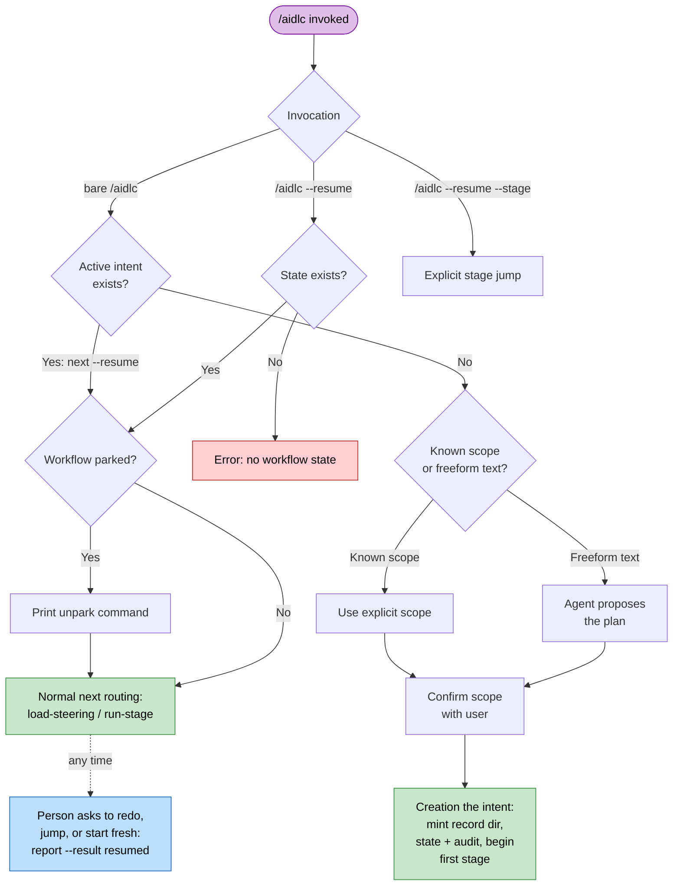
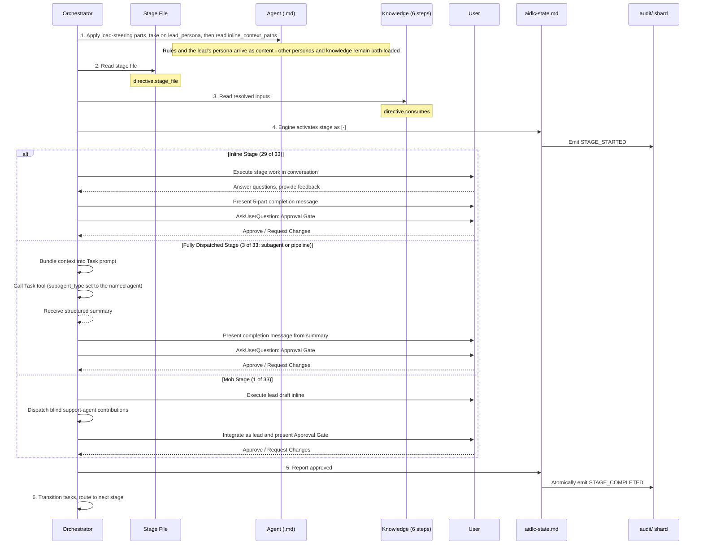
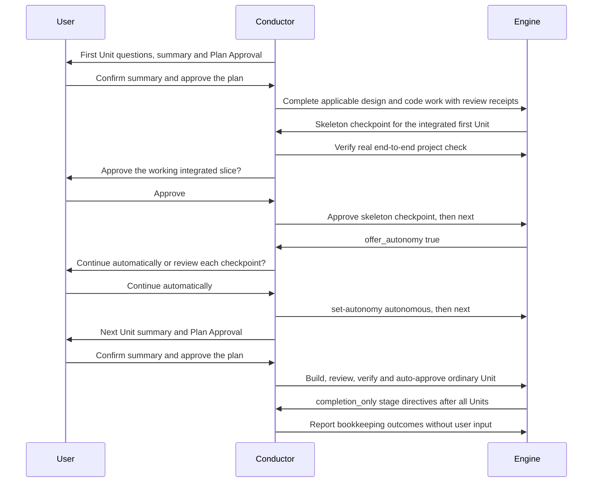
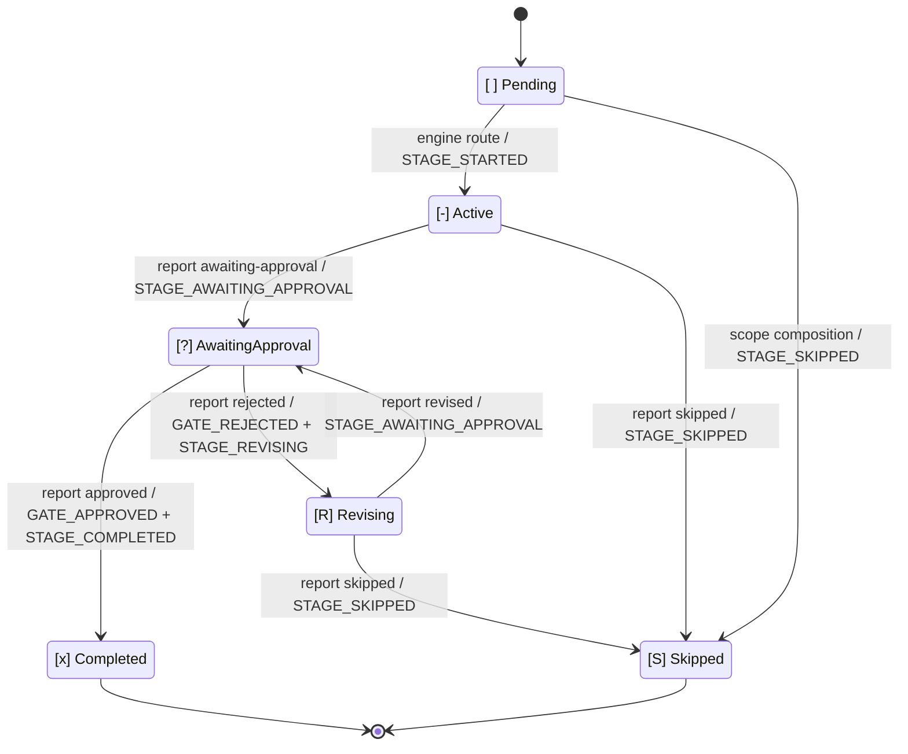

# Orchestrator

オーケストレーションは 2 つの部品に分かれます。決定的な **engine**（`aidlc-orchestrate.ts`。サブコマンドはちょうど 6 つ: `next`、`continue`、`report`、`park`、`team-board`、`wait`。`continue` は内部のステアリング転送で、`team-board` は read-only の Team Construction クエリ、`wait` は dispatch された作業に対する上限付きの read-only の待機です）が、stage 間のすべての判断（scope の決定、stage ルーティング、jump の解決、resume と init のガード、gate の状態、ワークフローの完了）を所有し、各 `next` で型付きの **directive** を出力します。**conductor**（`.claude/skills/aidlc/SKILL.md`。`/aidlc` 経由で呼び出される）は薄い forwarding ループで、各 directive に従って動き（指定された stage を実行する、人間に質問する、swarm を展開する）、stage 作業の結果を `report` で報告します。engine の ask への回答は、代わりにその型付きの `next`、`command`、`claim`、`execute-remedy` のルートに従います。やり直し、jump、または新しく始めるための再入のリクエストだけが、stage 以外の report（`report --result resumed`）を使います。SKILL.md は control プレーンではありません。ルーティングの判断は engine と、それが読むコンパイル済みデータ（`tools/data/stage-graph.json`、`tools/data/scope-grid.json`）にあり、SKILL.md は engine が指名した手の中の実行品質を所有します。

この章では、ワークフローの振る舞いを conductor の側から記述します。エントリポイント、セッション管理、scope から stage への対応づけ、stage の実行と前進のプロトコル、意図的な逸脱です。engine の内部（`next`/`report` の契約、型付き directive の union、conductor persona、複数の skill、scope の形、swarm referee）については、[Engine and Skill System](17-skill-system.md) を参照してください。ユーザー向けのコマンドの使い方については、[ユーザーガイド -- CLI コマンド](../guide/12-cli-commands.md) を参照してください。

> **所有に関する注記。** この章を通して、記述される振る舞い（引数の解決、plan の質問、jump の検証、resume の分岐）は、各 `next` で **engine** が計算し、directive として conductor に届けられます。以前の散文で「orchestrator が X を行う」とあった箇所は、「engine が X を決めて directive を出し、conductor がそれを実行する」と読んでください。判断ロジックは決定的なツールコードであり、SKILL.md の散文ではありません。

> **パスの規約。** 各 intent の state、監査証跡、intent スコープの
> アーティファクトは、その **record ディレクトリ** 配下にあります。
> `aidlc/spaces/<space>/intents/<YYMMDD>-<label>/`（以下では `<record>/` と表記）です。
> Reverse Engineering は例外です。その永続的でリポジトリごとの出力は
> `aidlc/spaces/<active-space>/codekb/<repo>/` にあります。監査証跡は、単一ファイルではなく、
> `<record>/audit/` 配下の clone ごとの shard のディレクトリです。

---

## 目次

- [エントリポイント](#entry-points)
- [セッション管理](#session-management)
- [scope から stage への対応づけ](#scope-to-stage-mapping)
- [stage 実行 engine](#stage-execution-engine)
- [stage 前進プロトコル](#stage-advancement-protocol)
- [タスク追跡](#task-tracking)
- [意図的な逸脱](#deliberate-deviations)
- [エラー処理](#error-handling)
- [付録 A: Stage Graph リファレンス](#appendix-a-stage-graph-reference)
- [付録 B: Hook リファレンス](#appendix-b-hook-reference)
- [付録 C: 承認 Gate のパターン](#appendix-c-approval-gate-patterns)

---

## エントリポイント

conductor は `$ARGUMENTS` を engine の最初の `next` へ一字一句そのまま渡します。事前にパースすることは
ありません。engine がフラグと自由記述のテキストをパースし、以下のどの呼び出しパターンが当てはまるかを
解決して、対応する directive を出力します。これらのパターンは engine が解決する入力であり、conductor
側の分岐ではありません。

### `/aidlc [scope]` -- 明示的な scope

引数が既知の 11 の scope（`enterprise`、`feature`、`mvp`、`poc`、`bugfix`、`refactor`、`infra`、`security-patch`、`classic`、`workshop`、`express`）のいずれかに一致するとき:

説明を伴って、まっさらなワークスペース（intent がまだない。`aidlc/spaces/*/intents/*/` 配下に `aidlc-state.md` がない）で明示的に指名された scope は、**最初の intent を作成** します。engine の `next` は、`aidlc-utility.ts intent-create --scope <scope>` を指名する「実行してから続行する」`print` directive を出力します（`--depth` / `--test-strategy` / `--project-type` / `--review` の各フラグがあれば、その指名コマンドにつなぎます）。conductor はそれを実行し、`next` を再実行して最初の stage に着地します。後に何もなく指名されると、scope はまだ作業が説明されていない、その人の選択です（#2355）。何も作成されず、そのステップはターンを終わらせる `print` で、その narration は何に取り組むか尋ね、そのメッセージは回答が実行する唯一のコマンド、つまり `next --scope <scope>` に、その横に打たれた設定と、1 つのシェルセーフな引数としての `-- <their words>` を添えて指名します。これは上の作成 print です。指名の両方の形、素の位置引数（`/aidlc bugfix`）と明示的なフラグ（`/aidlc --scope bugfix`）は、同じように読まれます。コロンが続く scope 名（`/aidlc bugfix: Fix duplicate todos`）も同じように指名します。agent がリクエスト全体を 1 つのクォート引数として渡すときでもそうです。scope の語だけで始まりコロンのない 1 つのクォート引数は説明のままなので、conductor はその人が自分の引数を plan に指名したものとして扱います。plan の語を自分の引数に、リクエストをもう 1 つの引数に持つもの（`next bugfix 'Fix duplicate todos'`。orchestrator skill が conductor に求めるもの）はその指名であり、作成します。plan の語の後に緩い語が並ぶ生の行（`next bugfix Fix duplicate todos`。ハーネスが打たれた行を渡すもの）は、plan の名でもある語で始まる本人の文なので、最初の語を消費する代わりに、下の読み取りステップを返します。何を作るかを説明すること（`/aidlc "build the auth service"`）も作成します。明示的に指名された scope も説明もない素の `/aidlc` は作成しません（env またはデフォルトで解決された scope は作成のシグナルではありません）。space で進行中の作業がない場合（intent レジストリの行がない、またはアーカイブ済みのものだけ）、それは通常の最初のステップなので、ターンを終わらせる `print` で、その narration は何を作るか尋ね、そのメッセージは回答をその人のリクエストとして agent に実行させます。`error` がないことは、その最初のステップで engine エラーの中継がないことを意味します。このチャットが、その人が次に始める作業に対して設定したもの（チェックのオフ、Guard Policy、儀式、または plan approval のオフ。まだ 1 時間以内: `switchKeptForNextWork`）を保持しているときも、ステップは同じで、すでに伝えた行がそれに乗ります。作業のない `/aidlc --resume` と、state ファイルが消えた作業（`aidlc-state.md` のないレジストリ行）は、no-state エラーを出力し、何を作るか説明するか scope を指名するようユーザーを導きます。Kiro IDE の Plan Approval 復旧は、そのエラーを fail closed として読みます。

1. `aidlc/spaces/<active-space>/memory/` からガードレールを読みます。
2. ユーザーに「何を作りたいですか」と尋ねます。
3. scope から stage への対応づけに従って、実行する stage を決めます。
4. Initialization フェーズ（workspace-scaffold、workspace-detection、state-init）を、単一の決定的な `aidlc-utility intent-create` の呼び出しとして実行します。ウェルカムメッセージは、セッション開始時に `settings.json` の `companyAnnouncements` 経由でレンダリングされます。
5. scope 内のすべての stage について stage レベルのタスクを作成します。最初の stage は `in_progress` に設定され、残りは `pending` です。scope 外の stage にはタスクがまったく付きません。
6. Initialization の後の最初の stage を開始します。

### `/aidlc [freeform]` -- agent が plan を提案する

引数が自由記述のテキスト（既知の scope キーワードではない）のとき:

1. `aidlc/spaces/<active-space>/memory/` からガードレールを読みます。
2. リクエストを質問として保持し（`--request <8hex id>`）、agent 向けの `print` を返します。書かれたままのリクエスト、このインストールが出荷するすべての plan（このプロジェクトでの stage 数、その stage が作業を Unit に分割するかどうか、それが何のためか、作者が書いた `keywords` ヒント）、そしてそれに答える 2 つのコマンド、つまりその人が説明したものに合う plan のための `next --propose <plan> --request <id>` か、既製の plan が合わないときの `next --propose compose --request <id>` です。完了した作業についての語（選択されたワークフローが完了している、またはこのチャットで何も選択されておらず完了した作業がここにある）は、代わりにその stage の 1 つへ戻るよう求めている場合があるため、そこでは print はその語を新しい作業と呼ばずその人の語で開き、その作業を指名し、plan の横に戻り方を与えます。このチャットで選択されていないときは `intent <record>`、その後 `next --stage <slug>`。Unit を指名したときは `--unit <unit>` または `--every-unit` を添えます。その作業についての質問（何を作ったか、何か残っているか）は、他のコマンドを実行せず `status` から答えます（このチャットで選択されていない 1 件には `status --intent <record>`。複数あり何も選択されていないときは `status` 単独で各件を一覧します）。その人が `--new-intent` で確認した新しい作業は、plan ステップだけを得ます。リクエストの意味を読むツールはありません。agent が読みます。リクエストとともに打たれた設定はその質問に保存され、回答に乗ります。同じ `--request <id>` で再実行すると、ステップは同じ id で同じ print を返します。
3. `next --propose <plan> --request <id>` は、コンパイル済みのグリッドとワークスペースのスキャンから実効的な儀式を指名する型付きの `scope-confirm` ask を出力します。plan、リクエストのプレビュー、stage 数、承認 gate、そして確認する・plan を変える・あつらえの plan を compose するという選択です。directive は `response_route: "next"`、`confirm_command`（`next --scope <plan> --request <id>`）、`compose_command`、`scope_commands`（有効な scope ごとに 1 行、その `stages` 数付き）を運ぶため、その人の yes は、事前構築された正確なコマンドを実行します。リクエストとともに打たれた stage の変更（`--skip`/`--add`）は、`confirm_command` と各 `scope_commands` 行に乗り、各 plan はそれが受け取れるものを運びます（すでに作るものは外されるため、コマンド自体は作成が拒否するものを運ばず、各件数は、質問の件数を含め、そのコマンドが作成する plan です）。そして `compose_command` にも乗り、その front dispatch はそれらをその人自身の変更として composer に指名します。`compose` は、その回答のときだけ stage 一覧を受け取ります。
4. `next --propose compose --request <id>` は、`response_route: "next"`、`compose_command`、`scope_commands` を持つ型付きの `compose-offer` ask を出力します。各 `scope_commands` 行は、このプロジェクトでのその plan の `stages` 数（「15 stages」、Initialization の後の stage）を、質問と同じ数え方で運び、plan 質問の行と同じく、その plan が受け取れる、リクエストとともに打たれた stage の変更を運びます。
5. plan のテーブル外の語を伴う `--propose` は、plan を指名する値読み取りステップです。値のない、または `--request` のない `--propose` は、コマンドの形を指名する agent 向けの `print` です。これらはどれもその人に届きません。
6. 確認時、conductor は `report` を呼ぶ代わりに、ask の完全なシェルセーフな `next` コマンドを実行します。scope と compose のコマンドは `--request <8hex id>` を運び、リクエストのテキストは運びません。別の scope の場合は、`scope` が選ばれた plan に一致する `scope_commands` エントリを実行します。エントリのない名前は有効な scope ではありません。下の `new-work-routing` ask は、plan を提案しないとき `scope_commands` を運びません。その separate-work の回答が次に plan を選びます。engine は id を保存された完全な説明に解決し、intent 作成はそれを `aidlc-state.md` に `Project` として記録します。plan を選ぶ回答（scope、あつらえの plan、または質問自身のもの）は、質問が尋ねられた後にその人のメッセージが記録に残って初めて実行されます（打たれた返信、またはハーネスが human-turn hook に転送する質問ボックスの選択。メッセージは秒単位を保つため、質問自身の秒のものも数えます。何かを設定するだけの打たれた `/aidlc` 行は返信ではありません）。それまで `next` は何も作成せず、質問を見せてターンを終えるよう agent に告げる `print` を返します。stage gate は、見せた後の返信を必要とするからです。human presence チェックのスイッチと、その人自身のターミナルは、この待機を解きます。記録にメッセージがまったくないときは、AI-DLC の hook が過去 5 分以内に実行されプロンプト hook が実行されなかった（ホストがその人のメッセージに対してその hook を飛ばした）間だけ待ちます。そうでなければ判断する手がかりがなく（保存に失敗したプロンプト hook、実行されていない hook、無人のドライバ）、回答は従来どおり実行されます。
7. ユーザーが提案された plan をオーバーライドした場合、代わりにユーザーが選んだ scope を使います。

engine は、各質問のリクエストのコピーを `{id, text, proposedScope, origin, askedAbout?, newWork?, composedFrom?, stateSha256?, settings?, approvedRequest?, createdAt}` として保持します（routing の質問での `settings` は `{newWork, existingWork}` を保持します。その new-work の回答と、既存作業についての回答が運ぶ `next` フラグのトークンで、各トークンはフラグ名か 1 語の値、コンマで結合した stage 一覧で、読み取り時に検査されます。これには、stage の質問が開いている間に打たれた新しい作業についての routing の質問が含まれ、そのオプションのコマンドなしで届く回答、つまりオプションを指名する返信や素の `next --request <id>` は、これらの設定を質問から得ます。`approvedRequest` は、routing の質問が止めた回答の質問の id です。まっさらな clone での plan approval などです。routing の質問から始まった新しい作業がそのリクエストに答えるため、それは一度始まり、その質問で言われた語がそれに届き、作業が存在すればどのルートもその作業で続きます。リクエストとともに打たれた `--skip`/`--add` は、plan の質問と同じく、その plan が受け取れる限りで各 plan の new-work の回答に乗り、それを作れない plan の作成（それが外す stage や、常に実行される initialization stage の skip、それが実行するものの add）はそれを外し、その narration で一度言います（「The classic plan already leaves out Deployment Pipeline.」）。plan が作れたのに実行するコマンドが外したものについても言い（「Deployment Pipeline runs in this work: the skip you typed with the request was left off. Say so to skip it.」）、それを決して戻しません。一覧のないコマンドは、その人がもうそれを望まないと conductor が言う方法でもあるからです。承認された plan のものは、その approval を止めた routing の質問では、それ自身の plan の new-work の回答にのみ乗ります）（`newWork` は `next --new-intent` を通して新しい作業のために尋ねられた質問を印し、その回答はどの既存レコードが意図されたか尋ねる代わりにその作業を始めます）。それを `aidlc/.aidlc-sessions/questions/` 配下の、それ自身の gitignore されたファイルに、一度だけ書き、書き直すことはしません。そのため、1 つの clone 内の並行セッションが互いの ask を共有したり無効化したりすることはありません。再び尋ねるのは新しい id の新しい質問で、以前のものは答えられるまま残ります。コピーは、作業が始まればいずれにせよリクエストが着地するワークスペースの残りと同じオペレーティングシステムの権限に従い、symlink されたパスを通っては到達されません。コピーは、その回答が作業を始めると取り除かれ、同じリクエストの他の質問（`composedFrom` を通して派生した元のものと、そのルートから派生した他のもの、提案ステップの質問とその横の routing の質問など）は、そのリクエストによって `answeredBy` と印されます。それらのどれも、その人の次の語に、まだ開いている質問として出会うことはなく、それらのいずれかによる繰り返しの回答もその作業で続きます。答えられていない質問は、`question-retention-days`（または `AIDLC_QUESTION_RETENTION_DAYS`）が保持期間を設定しない限り保たれ、コピーが消えた質問は、作業を再び説明するよう促すメッセージでエラーになります。intent 作成は、一覧に載せる前にレコード全体を構築します。フォルダ、audit、プロジェクトの説明が最初、次にワークフローの state（質問を `Question Id` として指名）、最後に `intents.json` の行（それを `request` として記録）です。その start が一覧に載せなかった完了済みレコード（2 つの間で止まった start）を見つけるリトライは、別のものを構築する代わりにそのレコードを一覧に載せます。`aidlc-state.md` のないフォルダは、どのレコードスキャンにも見えないため、state が着地する前に断ち切られた start は何も一覧に載せず、再試行は作業を作成します（次の空きフォルダ名の下に）。繰り返しの回答が作業を二度作成することはありません。`intent create` と `next` はその質問 id を運ぶ行を見つけ、まだ飛行中の作業を続け（`Already started <record>, continuing it.`）、アーカイブ済みまたは完了済みの作業にはまず尋ね（`You already started this as <record>, which is archived. Start it again as new work?`）、そのレコードの保存された説明から、それが最後に実行された scope で再び始めます（scope 変更は新しい scope をその `intents.json` 行に記録します）。遅い回答: new-work の質問の start または new-plan の回答は、他の作業がアクティブになった後でも答えられたものとして働き、新しい作業をそれと並べて始めます。`new-work-routing` の質問は space にバインドされ、それが指名したもの（フォルダと uuid で）を記録し、その `continue_command` と `compose_command` は、別のものが選択されたとき、人間が確認した scope で routing の質問を再び尋ねて、それらのうちの 1 つにのみ働きます。レガシーのフラットレイアウト（ワークスペース以前）のプロジェクトでは、質問に裏打ちされた作成は、何かが動く前に拒否し、質問を答えられるまま保ちます。その拒否は、フラットなワークフローをそれ自身の intent へ移す 1 回限りの `intent create --scope <scope>` を指名し、その後は同じコマンドがリクエストを作成します。conductor はこれらの runtime ファイルを読んだり書き直したりせず、プレビューを完全なリクエストの代わりにしてはなりません。

既存の intent に選択されたカーソルがなく、少なくとも 1 つのレコードが選択可能なとき、保留中の作業は、リクエストを picker に落とす代わりに、どのハーネスでも `new-work-routing` を出力します。語によるリクエストは、どの plan 質問よりも前にそれを得て、agent が提案した plan を separate-work の回答に指名します（あつらえの plan には指名されず、それは次に選ばれます）。リクエストとともに打たれた、または plan 質問で確認された scope も、同じようにそれを得ます。`new_work_description` はリクエストの指示を一度含み、`proposed_scope` は確認された scope を保ち、`available_intents` は正確なセレクタを一覧し、`response_route` は `next` で、`numbered_prose_question` は engine が記述した番号付きレンダリングを提供します（どの ask もそれを 1 つ運び、`numberedProseQuestion` がその `choices` から構築します。routing ask のものは、その出力地点でそのオプション順から構築され、その `choices` はルートコマンドを運びます。continue と reshape には、まずレコードが選ばれなければならない間は運びません）。ルートはフィールドとして運ばれ、人間向けの質問の中には入りません。`new_intent_command`（提案された scope での別個の新しい作業）、`scope_commands`（有効な scope ごとに同じもの。人間が訂正した scope のため）、`compose_command`（reshape）、`select_commands`（セレクタごとに 1 つの完全な `next --pick` コマンド。そのレコードを選択し、同じターンでそれを続ける。または、設定がリクエストとともに打たれたときは、セレクタごとに 1 つの `next --continue --request <id> --record <selector>`。そのレコードを選択し、それらとともにそれを続ける）、`reshape_commands`（セレクタごとに 1 つ。それを選択してから reshape する）で、すべて同じ質問 id を運びます。代わりにアクティブなワークフローについて尋ねられると、ask は `available_intents` と `select_commands` の代わりに `continue_command` を運びます。リクエストとともに打たれた設定はこれらのコマンドに乗り、その人が選ぶ作業に着地します。new-work のコマンドはそれとともに作業を作成し、review レベルと引き上げられた Guard Policy を含みます（引き下げられた Guard Policy は既存作業についての回答に乗り、そこでそれを適用します。それは新しい作業のフラグとして試されることはありません。human-turn hook がそのためにリクエストとともに打たれたその人自身の語を保ち、作成の `narration` がどこに着地したか言います。それらの語がそのために保たれたとき `Guard Policy <value> for the new work (set by you).` です。リクエストとともにオフに打たれたチェック `--guard.<fence> off` も同じように乗り、説明の一部になることはなく、その行は `The review freeze check is off for the new work (set by you).` です。語は、途中で engine が尋ねるさらなる質問を越えて保たれます。別の質問に答えている間に保存された質問は、そのリクエスト自身のルートを `composedFrom` として記録するためで、その人は最初の行 `The review freeze check is off for the work you are asking for (set by you).` を routing の質問そのものとともに聞きます。作成は、このチャットがまだ負っている行を、それが作成する作業に手渡します（`carryPendingPersonLines`）。新しいレコードを選択すると、それらがチャットが離れた作業にキー付けされたまま残るからです）。`continue_command` はそれをアクティブな作業に適用し、reshape は compose の前に `config set` を通してそれを適用します。質問は設定を保存されたコピーの `settings` としても保ち、オプションを指名するだけの返信がそれらを再生します。作業がアクティブなとき、新しい説明とともに打たれた設定、またはその前に自分の引数で指名された plan（`next bugfix 'Fix login'`）は、アクティブな作業を変えて説明を落とす代わりに、この方法で尋ねられます。plan の語の後に緩い語が並ぶ生の行は、まず下の読み取りステップを返すため、plan の語が、その人が選ばなかった名前として消費されることはありません。continuation は選ばれたレコードの select コマンドを実行し、その `print` に従います。reshape は選ばれたレコードの `reshape_commands` エントリを実行し、それはそのレコードを選択してから、途中で止まらずに reshape します。この質問のオプションの 1 つだけを指名する返信（そのラベル、レンダリングされた番号付き行、または素の `1`〜`3`。下と同じルールで）は、この作業上のどのチャットからでもそれに答え、approval を止めた質問には、その承認されたリクエストが作業を始めるまで答えます。オプション 2 は、一覧のレコードに何が起きても `new_intent_command` を実行します。新しい作業はそれらのどれにも働かないため、まっさらな clone で承認された plan へのフォローアップではその承認された plan を作成します。オプション 1 と 3 は、何も選択されていない間はその人のルートを保ち、質問が一覧した、同じ名前と uuid で今もそこにあるレコードにのみ働きます（それらの進捗は問題ではないため、別のチャットで作業が進んでも何も変わりません）。質問が 1 つのレコードを一覧したときは、その select または reshape コマンドを実行します。複数を一覧したときは、engine はどの作業かだけを尋ねる `intent-pick` ask を返し、各選択肢はそのレコード自身の select または reshape コマンドを運びます。一覧したレコードが残っていないか、以降に作業が選択されたときは、オプション 1 と 3 は質問自身の遅い回答（`--continue` または `compose --request <id>`）を実行し、それは今選択された一覧の作業に働くか、リクエストを保ったまま、ある作業について再び尋ねます。保留中の作業がないとき、engine は `intent-pick` を出力します。`selector` が選択された `available_intents` の値に一致する `select_commands` エントリを選び、その `command` を一字一句そのまま実行します。セレクタをコマンドに差し込んではいけません。そのコマンド（`next --pick <record>`）はレコードを選択してそれを続けるため、作業の引き継ぎは 1 回の回答で済みます。選択されていない作業の読み取りステップがこのチャットの最新メッセージをそのレコードのために保ったとき、切り替え後のステップは素の `next` ではなく `next --request-file <file>` で、そのファイルは `aidlc/.aidlc-request-text/` にある、保たれたとおりに語を保持するそれ自身のものです（途中のどのシェルも、改行や cmd.exe が読む文字を変えないように）。pick の前に打たれた語は、その作業自身の読み取りを得ます（gate や質問自身のルールが、それがそれに答えるかどうかを今も決めます）。park された作業は `next --resume` を保ち、その後に同じファイルを置くため、resume がそれを unpark してから語が読まれ、その人の後のメッセージ、つまり pick 質問への回答などは、素の `next`（park された作業には素の `next --resume`）を保ちます。agent がレコード名の後に加える語や、読み取りステップの `--request <id>` は何も変えません。そこの他のどのフラグも拒否され、pick 質問自身のコマンドを指名します。質問はその人に尋ね、1 件のときは作業を指名し（「Carry on with `<name>`, or not now?」）、agent はそれを見せて回答を待つため、今はやめるが選択肢のまま残ります。

作業を続けるよう求めるだけの語（`carry on`、`proceed`、`keep going`。その人がどう言っても）は、engine の語リストではなく agent が読みます。語だけの `next` は、下に記述する `print` を返し、それはその読み取りのコマンドとして素の `next` を指名し、agent がそれを実行するため、作業は素の `next` がそれを続けるのとまったく同じように続きます（作業が park されていてその人が戻ったときは unpark の print を通して）。作業がここにあるが何も選択されていないとき（チームメイトの clone、作業に参加していないチャット）、語だけはまず同じ形の `print` を得ます。それは作業の各件を指名し、続けるよう求めるだけの語には素の `next`（どの件を引き継ぐか尋ねる）を、ちょうど 1 件を指名してそれを続けるよう求める、または 1 件だけに何かを求める語には `next --pick <name>`（pick 質問自身の回答: その件を選択してそれを続ける。尋ねられたことに答える、その中の stage をやり直すか jump する、新しく始める、または変える）を、1 件だけを指名する語には `intent switch <name>` を、それ以外には `next --request <id>`（保たれた語を、それであり得るリクエストとして戻す。上の `new-work-routing` ask）を指名します。そのため、agent が語を読む前に何かが新しい作業として提示されることはありません。完了した作業もここにあるときは、print はそれと、その stage の 1 つへの戻り方（`intent <record>`、その後 `next --stage <stage slug>`）も指名します。その print の後の素の `next` が、その人の `/aidlc` 行として二度目に読まれることはありません。語を routing の質問として保ったステップは、そのメッセージを id で読み取り済みと印し（`aidlc-orchestrate.ts` の `saveReadingQuestion`）、その人自身の行を取る読み取りは、印されたメッセージを飛ばします。team モード（`Unit Ownership: team`）では、語だけは同じ 2 つのコマンド、素の `next` か `next --request <id>` を持つ、より短い `print` を得ます。Unit のチェックアウトは jump を拒否するからです。

ワークフローがアクティブな間に `next` へ渡される自由記述の散文は、2 つの例外を除いて同じ `new-work-routing` ask を得ます。routing の質問が開いている間（最も最近に保存された質問で、そのときのままの作業についてのオプションで尋ねられ、そこから何も始まっておらず、以降に質問が記録されていない）、`next` へ渡される散文はどのオプションも実行しません。素の `2` やラベルを含んでいてもです。`next` は、ask が供給したとおりに（`continue_command`、`new_intent_command`、`compose_command`、または複数のレコードが一覧されたときは各レコードの select または reshape コマンド）、質問の各回答をそれ自身のコマンドとともに指名する `print` を返します。質問が plan を指名したときは、`new_intent_command` の後に他の各 plan の `scope_commands` 行を添え（返信で別のものを指名する人のため）、各 reshape コマンドの後に `-- '<their words>'` を添えます（composer はその人のチャットなしで働き、そのタスクはそのとき何に答えたか言うため）。別のことについての語には `next -- '<their words>'` です。conductor は、見せた質問に照らして返信を読み、その人の選択のコマンドを実行し、判断できないときは一度尋ねます。continue と reshape のコマンドは、今も質問が指名した作業にのみ働き、それ以外では再び尋ねます。現在の `[-]` stage に、その人が答えていない質問があるとき（Stop hook が読む `DECISION_RECORDED` の対応。同じように読まれます。自律 Construction 中でも人がいる間はそうで、無人のドライバ `AIDLC_UNATTENDED=1` には checkpoint の質問だけ）、engine は回答を新しい作業と区別できないため、各読み取りのコマンドを持つ `print` を返します。質問の回答コマンド（`log answer`。選択肢を指名し conductor が読んだものを尋ねる質問には、または hook がその人の語を保たない・他の質問が同じ返信を待つところでは返信そのものには。verification コマンドや Construction policy 質問自身のフラグと approval が実行する setter を伴い、summary confirmation 自身のフラグと、その `[Answer]:` 行が選択を先に取る questions ファイルを伴い、または Unit もしくは batch の checkpoint 自身の approve か reject コマンドで、その Unit もしくは batch を指名する）、または `next --request <id>`（質問コピーとして保たれたその人の語を使って、作業がどこに属するか尋ねる）です。conductor はどちらかを読み、判断できないときはその人に尋ねます。engine 自身の code plan 質問も同じように、どのチャットからでも stage の質問より前に読まれます。待っている間、散文はその `log answer --stage code-generation --checkpoint plan-approval` ステップ（その人が plan ファイルを編集している間は、終わったと言えば `next`）または `next --request <id>` を指名する `print` を得ます。それが尋ねるすべての plan が答えられ、まだ何も作られていないとき、散文は返信を読む `print` を得ます。記録された回答を変えるときは、より後の選択を記録する `log answer` ステップ（`Approve Plan`、`I'll edit the files`（すぐに編集モードを始める）、または `Review the plan`（何かが作られる前に質問を戻す））、その編集は記録された回答の後にその人が返信して初めて、その後に素の `next` です。そうでなければ素の `next` で、記録された選択を実行します。engine の recovery 質問（guard が拒否してどう続けるか尋ねた）も同じように、stage の質問の後、gate の前に、その人の返信を保ち選択が記録されていないとき、stage のどの質問もその人を待っていない間に（summary を再び確認するなど、それ自身を尋ねる選択がそれへの返信を所有する）読まれます。散文は、その各選択肢をその `log answer --checkpoint guard-recovery --details <op>` コマンド、`next --skip <stage>`、または `next --request <id>` とともに指名する `print` を得ます。リクエストが尋ねる routing の質問にその人が「その作業の一部」と答え、作業が recovery の質問を待っているとき、その語はそれへの返信として保たれ、`next` は、新たに尋ねる代わりに、同じコマンドで、その人がそれに答えると言う `print` を返します。現在の stage がその approval gate で待っている間の散文は、gate の `report --result approved` と `report --result rejected` のステップ、または `next --request <id>` を指名する `print` を得ます。質問の監査テキストも返信も、directive には乗りません。現在の stage に、ステップ `next` が返すものが指名しないそうした質問（checkpoint なしで記録され、stage の questions ファイルに空の回答で保持されていないもの、verification コマンド、レコードが運ぶ Construction policy 質問、または summary confirmation）があるときの素の再入（単独の `/aidlc`、または `--resume`）は、ターンを終わらせる `print` を返します。質問の記録されたテキストを一字一句そのまま、そしてその選択肢を、再び見せるために（verification コマンドはそれが尋ねるコマンドとともに、summary confirmation はその行が指名する questions ファイルの回答の要約とともに）、同じ回答コマンドで返します。引き継ぎの行がそれに乗ります。Unit もしくは batch の checkpoint の承認と、guided batch のような questions ファイル内の質問は、それ自身のステップを通して戻ってきます。

現在の stage にそうした質問があり、その人がすでに素の語で返信しているとき（そのメッセージがこのチャットの最新で、その後に記録されているのはチャットが開始・resume・圧縮・終了するときにホストが書くセッション行だけ）、素の `next` または agent の `--resume` は、質問を再び見せたり回答を落として stage を戻したりする代わりに、その返信を `next -- '<their words>'` と同じように一度読みます。質問が尋ねられるのを見たことのない新しいチャットは、その回答を保ちます。質問が開いていない素の語はこの読み取りを受けず、agent が指名する plan の横の語（`next --scope <plan>`。切り替えの読み取り）もそうで、それはその plan のステップを保ちます。

ワークフローのものと異なる `--scope` とともに打たれた散文は、同じ `new-work-routing` ask を得ます。語を落としてしまう素の scope 変更にはなりません。その separate-work オプションが最初に来て、説明された作業をその scope で始めます。その continue オプションは 2 番目で、ワークフローをその scope に変えるものとして読まれ、その `continue_command` は `--scope` を運ぶため、その回答が scope を変えます。素の番号やオプションのラベルはその順に照らして読まれ、continue の回答だけが scope を運びます。語を伴わない、異なる `--scope` は、今すぐに scope を変えます（新しい scope が最後の stage を越えて延ばす完了済みの作業では、print は停止ではなく `next` の再実行を告げます。その変更は最初に追加された stage で作業を再び開き、`next` とツールが 1 つの共有された述語でそれを決めます）。stage の変更（`--skip`、`--add`）とともに打たれたものはその人の経路を保ちます。指名された stage は、scope とともに、開いた作業の plan を変えます。

アクティブな作業上の自由記述の語だけ（`next` がフラグ・scope・動詞・名詞として読むものがなく、それらが答えられる開いた質問も approval gate もない）は、素の `next`（「carry on」や「proceed」など、作業を続けるよう求めるだけの語のため）、他のコマンドのない read-only の `status`（作業についての質問のため: どこにあるか、次の stage はどれか、どれだけ残っているか）、打たれた再入 report（`report --result resumed --choice <redo|jump|fresh>`。「take me back to requirements analysis」などの語のため）、または `next --request <id>`（conductor が判断できないときも）を指名する `print` を得ます。後者は語を保ったまま `new-work-routing` の質問を尋ねるため、`/aidlc` 自体で打たれた、やり直し・jump・新しく始めるリクエストはそのリクエストです。横に設定が打たれた語は、それとともに尋ねられます。

`next` は回答フラグを取らず、1 つのルールが、それが取らないフラグ形のすべてのトークンを、
行のどこにあっても扱います。そうしたトークンは、agent が間違ったコマンドに送った引数
（`--choice`、`--details`、`--result`、このチャットの `--session`）、その人が綴り違えた名前
（`--plan-aprroval`、`guard.` 接頭辞のない `--review-freeze`）、または作ってほしいと頼んでいる
フラグ（`add a --verbose flag`）のいずれかです。それがどこにあるかはどれなのかを何も語らず、
それを読めるのは agent だけです。`next` はそれらのどの場合も行を丸ごと取れないため、そこから何も
取らず、`narration` なしで、取ったトークンと値を指名する `print` を返します。その人には何も届かず、
打たれたことのないかもしれない語について new-work の質問が尋ねられることもなく、質問コピーは保存されず、
何も記録されません。print は、agent が選ぶ各読み取りを指名します。その人の語だけで `next` を再実行する、
その語の前に `--` を付けて一字一句実行する（その人のトークンをすべて保つ）、または `next` が取る
フラグとその語とで実行する。判断できないときは素の語で一度尋ねます。Plan Approval の質問が開いているときは、
その質問の回答コマンド `log answer --stage code-generation --checkpoint plan-approval --details '<their choice>'`
の後に素の `next` を、唯一のものとしてではなく、もう 1 つの読み取りとして指名します。既存の回答の所有者は、
今もその人の返信を必要とします。2 つのものが、トークンをその人のものと印して丸ごと保ちます。`--`
区切りと、リクエスト全体を保持する 1 つのクォート引数（`--help flag for the reverser`）です。

行を読む方法は 3 つあり、一度だけ決められます。`readNextLine`（`aidlc-lib.ts`）がどれかを答え、agent が行を見る前に走るすべての継ぎ目が同じ答えを読むため（`classifyTerminalCommand` と `isReadOnlyNextArgv`。Kiro CLI の verb intercept と pre-dispatch、Kiro IDE の terminal 継ぎ目、Copilot claim gate がすべて参照します）、engine が読む行に対して off-band で動くものはありません。どのトークンがフラグで、どれがフラグの値で、どれがその人のものかも、一度だけ決められます。`readNextTokens` は `--` マークの前のトークンだけを読むため、マークもその後ろの語も、フラグやフラグの値になることはありません。`parseNextFlags` はそこからフラグを取り、Copilot claim と Plan Approval guard は行がどのフラグを運ぶか `nextLineFlags` に尋ねます。orchestrator 自身の `--project-dir` と attempt id は `readOrchestratorLauncherOptions` が行から取ります。これは engine の `main()` が使う読み取りで、Copilot claim や Stop hook のような hook が共有します。**Exact**: 文法の下で読まれるすべてのトークンで、自由な語はその人のものと印されます（`--` 区切り、またはコロンで指名された plan）。これは従来どおりに働きます。Unit コマンドはその形で exact です（`unitCommandArgv`、`aidlc-command.ts`）。`unit`、Unit の動詞の 1 つ、そしてその動詞が取る多くても 1 つの Unit 名で、残りは Unit ツールが読みます（`unit pin alpha`、`unit land alpha --step git`、または Kiro IDE が渡すとおり、クォートを含めて同じ行を 1 つの引数として）。`next` はそのコマンドを agent が実行するよう指名し、どの継ぎ目もそれを off-band で実行しません。gate の `--user-input` の語は、next ステップの語と同じく、gate が読むリクエストファイル（`--request-file`）に入ります。`unit` で始まる他のどの行（`unit tests for the parser`、`unit pin alpha -- why first`、単独の `unit`、`unit help`、綴り違いの動詞）もその人の語で、`plugin` と `knowledge` の名詞が与えるような、動詞を指名する拒否はありません。**Words**: 行から何も読まれなかったので、それはリクエストです。**A reading step**: それ以外は、上の `print`（`narration` なし）で、各読み取りを実行すべきコマンドとして指名し、agent が読む前に何も作成・切り替え・jump・破棄・拒否しません。取られなかったトークンのほかに、4 種類の行がここに到達します。

- `next` が取るフラグで、それ自身のテーブルが保持しない値を伴うもの（`--plan-approval off.`、`--depth banana`）。print はそのテーブルが保持する語を指名するため、その人の `off` は、拒否されたターンではなく再実行 1 回で届きます。
- 先頭の `plugin` または `knowledge` 名詞に、その人の 2 語以上が続くもの（`plugin is confusing`）。名詞の後の 1 語は、どう綴られていても動詞か名前であり、その名詞自身の、動詞を指名する拒否を保ちます。
- plan の名でもある語で始まるその人自身の文で、ハーネスが渡すどちらの形でも。トークンとして（`bugfix Fix duplicate todos`）か、1 つの引数として（`classic car rental website`）です。plan を自分の引数に、リクエストをもう 1 つにクォートしたもの（`next classic 'Build a notes app'`。orchestrator skill が conductor に求めるもの）と、コロンで指名された plan は、すでになされた読み取りであり、働きます。語数で決まるのではありません。plan の名ともう 1 語は、1 つの引数でも 2 つでも同じ読み取りステップです（`feature flags` を打たれたとおり通すのは、1 語のリクエストで読まれる plan と同じ 2 つの引数です）。ステップはガイド自身の形（`/aidlc <plan> <the task>`）を指名します。その plan のタスクとして読める残りは plan で続き、1 つの句として読める行はその人の語で、両方に読めるときだけ agent が一度尋ねます。
- engine 自身の plan 質問が開いていて、そこから何も始まっていない間に打たれた返信。print はその質問自身のコマンドを指名するため、提案の後の「yes」は、「yes」という名の作業になる代わりにそれに答えます。`--` 区切りの後ろの語は、すでにリクエストと印されており、ここに戻ってくることはありません。

レコードを指名しない語を伴うワークスペースの名詞は、その名詞の動詞とそこのレコードを一覧する、それ自身のステップを保ちます。名前の後にその人の文があるときは、その語をすべて保つ方法も指名します。

単独の unit-major の walk では、Unit の作業、その summary confirmation、その checkpoint（learnings の質問と checkpoint の承認）が Current Stage の前に実行され、その質問を `next` が指す stage の下に記録します（checkpoint はブロックの最後の stage の下）。散文はその後、その stage の開いた質問を Stop hook の同じルールで読むため、尋ねたチャットが終わった後に新しいチャットで打たれた回答は、new-work routing ask ではなく、それが答える質問に届きます。Unit の承認が一度尋ねられると、その checkpoint ステップはもう `learnings` を一覧しないため、そのステップを再実行する新しいチャットは、直接承認の質問に進みます。

### `/aidlc compose` -- 適応的な composer

compose の表層（先頭の `compose` 動詞、`--new-scope`、または `--report <path>`）は、engine に、scope の確認ではなく composer-dispatch の `print` を出力させます。このフローに対する conductor の指示（dispatch、提案 gate、承認が実行するもの）は、orchestrator の `SKILL.md` の横の `composer.md` にあり、print がそのファイルを指名するため、agent は plan が compose されたときだけそれを読みます。この動詞はあえてワークスペースの動詞ではありません（ワークスペースの動詞は Kiro の継ぎ目が off-band で実行する terminal ユーティリティコマンドで、レコードでない名前や、名前の後の語は例外として conductor が読みます。compose は conductor が dispatch するワークフローの作業です）。2 つのモードが state ファイルで分かれます。

1. **Front / report（まだワークフローなし）:** conductor は `aidlc-composer-agent` を dispatch します。これは read-only の `detect --json` スキャンを実行し、実装エントロピーの 5 つの要素を見積もり（設定されていれば CodeKB MCP の証跡、そうでなければワークスペースのスキャン）、構造化された提案を返します（`mode matched|custom`、必須で非空の `creationDescription`、要素スコアと証跡手法を持つ `ars` ブロック、`arsRationale`、グリッド、1 行の根拠を持つ 5 つの `scopeSettings`（`sensors`、`learnings`、`summary_confirmation`、`plan_approval`、`review_cap`）、SKIP ごとの根拠、validator から一字一句コピーした `summary`、さらに事前レンダリングされた 2 つの markdown テーブル: バンド付きの ARS スコアと、理由付きの stage ごとの判断）。これを `aidlc-graph.ts validate-grid` が検証します。検証は正確なコンパイル済みの stage 集合を必要とし、グリッドの stage/gate/unit ごとの `summary` と `nearest_stock` を返し、scope ローダが受け付ける語に照らして設定を確認し（`scope_settings` として反響され、`summary.off` が何をオフにするか指名）、composer の最終 `--matched <stock-scope>` 実行では、その stock scope と異なるグリッドや適用できない Guard Policy を拒否し、残りの設定をこの作業に適用する `creation_settings` を反響します。最終 `--custom` 実行は、plan が実行される stock scope を選び（Guard Policy のデフォルトが提案と同じかそれ以下の最も近いもの。`strict` には任意。walking skeleton を持つものや plan の depth 以外のテスト戦略を持つものは決して選ばず、それを gate は見せません。新しいプロジェクトには、適格なものがある限り `existing_code: true` と印された scope より新しい作業向けのものを優先し、新しい作業が修正と分類されないようにします）、それに照らした `plan_changes` と `creation_settings` を持つ `base_scope` として反響し、提案の必須 `depth` がその scope のものと異なるときは `creation_depth` を、plan がその scope が実行する stage を落とすとき（作成が skip として記録するのと同じ stage）、または plan 自身の変更が、その scope が設計上は残す必須入力なしに、保持した stage を残すときは `summary.skipped_inputs` を加えます（conductor は提案時に一度、すべてを指名する 1 行で言います。テーブルは要求次第です）。`--matched` のないすべての実行は `custom_start`（`classic` scope の Guard Policy と設定。custom 提案が、それが実行されるどの stock scope からでも始める）も反響し、すべての実行は `matched_start`（matched 提案が運ぶ stock scope の depth、Guard Policy、設定。`--matched` が指名するもの、なければ `nearest_stock[0]`）を反響し、matched 提案はそこから始めます。どちらのルートも scope ファイルを書きません。composer が記述した scope はランキングから除外され、欠けているキーや余分なキーは差分として数えられます。composer は matched か custom かを、最終提案の `nearest_stock[0].diff <= 2` だけでルーティングします。機械的な ARS スクリーン距離は参考です。stock グリッドを採用するときは、その最終グリッドを再検証し、summary/distance を置き換え、影響を受ける各 decision-table 行を再構築してから返します。conductor は判定を再導出しません。conductor は approve/edit/reject gate を短い提案としてレンダリングします。素の推奨と、素の語による validator の数値（「Plan: poc, 8 stages, 5 approval questions」。その `shown` と `gates` の件数から: Initialization の後の stage）、そして承認前に人間が切り替えられる Scope settings 行です。composer の stage-decision テーブルと ARS スコアテーブル（「Scoring detail (advisory)」の下）は、その人が求めたとき一字一句そのまま見せられます。matched の stock グリッドへの編集、またはその Guard Policy を下げる編集は、改訂された提案を custom に変換し、検証とテーブルのレンダリングを繰り返します。matched の承認は stock plan を作成するからです。承認時、AI-DLC は stock match にはワークフローを直接作成します。custom plan には、`intent create --skip <slugs> --add <slugs>`（`creation_depth` からの `--depth`、composer の `scopeName` を持つ `--plan-name`）で `base_scope` 上にワークフローを作成し、それが plan を state ファイルの EXECUTE/SKIP 接尾辞（recompose が使うオーバーライドチャネル）として書き、gate が見せた名前（なければ `tailored plan`）を `Plan: <name>` として記録し、それが実行される scope は記録しません。scope ファイルは書かれないため、compose が scope ライブラリを増やすことはありません。custom gate は「Approve and save as scope」も提示します。conductor は作成フラグとともに `--save-as <name>` を渡し、作成はユーティリティの `scope-save` ハンドラの保存を実行します。それは実行中の作業の plan を永続レコード `aidlc/scopes/<name>.md` として書き、その投影をコンパイルするため、scope は engine の再インストールを生き延び、このハーネスで直ちに解決され、別のハーネスでは次の `graph compile` で解決されます（[保存された scope の保管場所](../guide/05-scopes-and-depth.md#where-a-saved-scope-is-stored) を参照）。`scope save --name <name>` は、その人が後で求めたときにいつでもその保存を実行します。skeleton-gate のアンカー `firstPlannedStageOfPhase("construction", scope, state)` はそれらの接尾辞を読むため、compose された plan の最初の Construction stage がその Bolt-1 gate になります。タスクに裏打ちされた compose は、元のタスクを一字一句 `creationDescription` にコピーします。report のみとタスクなしの compose は、承認された report/plan からそれを導出します。タスクに裏打ちされた作成は、dispatch の `--request <id>` コマンドに従い、保存されたリクエストをシェルの差し込みなしで保ちます。report のみ/タスクなしの dispatch も `--request <id>` を運び、テキストを保持しない `compose` エントリを指名します。作成はその id と、承認された説明を、リテラルの `--` 区切りの後に 1 つの POSIX シングルクォート argv 値として渡し、engine はその説明を、この作業が答える front リクエストとして、エントリを指名する `composedFrom` とともに保存し、その後エントリを取り除きます。そのため、その gate で言われた plan-approval の skip はこの作業に届き、他には届きません。後のリクエストはエントリを置き換え、engine はその後それを拒否します。scope のみの作成は決して実行しないでください。front dispatch は、提案ファイルの横にそのリクエスト用のスコアレコード（`composer-scores.json`）も開きます。composer の `graph ars` がそれを 5 つのスコアとその `--method` で埋め、そのリクエスト、またはそれが compose された元のリクエストの作成が、作成する plan が composer が最後に検証したグリッドであるとき、`WORKFLOW_STARTED` でそれらを `ARS Scores` と `ARS Method` として書き、その後レコードを取り除きます。composer の最後に通った `--matched` または `--custom` 実行は、その plan を同じレコードに保ち（それが実行される scope、その stage の変更、実行に与えられた `--project-type`）、その scope でのそのリクエストの作成 print は、それとともに打たれた `--skip`/`--add` の代わりにそれらの stage の変更を運ぶため、Approve で手で打ち直された一覧が stage を落としたり加えたりすることはありません。一覧のない作成（Reject の後に選ばれた素の scope）、別の scope での作成、または他の作業の作成は、打たれたものを保ちます。レコードは plan の `creation_depth`、`creation_settings`、そしてその scope のデフォルトより上の Guard Policy も保ち、その一覧で承認された custom plan の作成 print は、コマンドが外したそれぞれを埋めます。コマンドとともに打たれた値は残り（Approve でのその人自身の語であり得る）、作業が存在する前にこのチャットでその人が求めた設定も残り、それを `intent create` がその語から適用します。matched plan の設定は打たれたまま残ります。作成される plan が composer が検証したもの（それらの stage の変更、または変更のない matched plan）で、その人が `--project-type` を打たず、保たれた型が dispatch がレコードを開いたときにスキャンが見つけたもの（レコードもそれを保ちます。composer は、その人が別途言わない限りスキャンの型で plan を立てます）ではなく、作成時のスキャンがフォルダを別の型として読むとき、print は `--project-type <the kept type>` も運ぶため、スキャンがコードを見ないフォルダで既存コード向けに compose された plan は、その Reverse Engineering と gate が見せた件数を保ちます。それ以外（別の plan、他の作業、欠けた提案、進行中の compose）は何も記録しません。
2. **In-flight（ワークフロー実行中）:** composer は、完了した stage が実際に解決したものからエントロピー要素を再見積もりし、現在の scope、保たれた完全な実効グリッド、そしてカーソルより前の PENDING の stage に対する正確な `changes.skip` / `changes.add` 配列とともに `mode: in-flight` を返します。近くの stock グリッドを採用したり、scope/depth を変えたり、完了/進行中/skip 済みのアクションを書き直したりは決してしません。この分岐では両方の stock-distance 一覧は参考です。各切り替えの根拠は、スコアを動かした完了 stage の証跡を指名し、検証は `--strict` で実行されるため、飢えた切り替えは gate の前に捕まります。conductor は gate の前に pending-proposal マーカー（`aidlc/.aidlc-compose-pending`）を書き（Stop hook はそれをターン停止のシグナルとして尊重します）、解決時にそれを削除します。承認時には、それらの正確な配列を `aidlc-utility.ts recompose [--skip <slug,...>] [--add <slug,...>]` に渡し（空の一覧は省略、繰り返しのフラグは累積）、それが audit ロックの下で plan の接尾辞を切り替え、新しい飢えに対して strict 検証し、派生フィールドを再構築し、`RECOMPOSED` を出力します。マーカーがまだあるうちに実行すると、その出力は後続のステップで終わります。マーカーを削除して `next` を実行し、作業がある位置から同じターンで続きます。承認が設定も対象とするとき、同じコマンドがそれらを `--sensors`、`--learnings`、`--summary-confirmation`、`--review` として運び、1 回の state 書き込みで適用します。scope レジストリファイルは書かれません。マーカーには上限があります。Stop hook はそれが新しい間（mtime で 24 時間より新しい）だけ尊重し、より古い孤児（書き込みと解決の間にクラッシュしたセッション）は無視されベストエフォートで削除されるため、取り残されたマーカーが forwarding ループの強制を静かに無効化することはありません。`--doctor` も、存在するマーカーをその経過時間とともに報告します（新しい = 参考の pass、stale = fail）。自律 Construction では、`recompose` は scope 変更がそうするようにその人自身のリクエストを受け取り、作業は自動で動き続けます。記録にその人のリクエストのない変更、または無人のドライバ（`AIDLC_UNATTENDED=1`）が実行する変更は拒否され、`set-autonomy --mode gated` を指名します。検出はチャット優先です。conductor の forward 前の判断ステップ（new-work を見つけるのと同じもの）は、開かれた素のチャットの reshape リクエスト（「what else can we cut?」）を分類し、それを一字一句転送する（一字一句の転送は Branch 10 に落ちて現在の stage を実行する）のではなく `next compose '<their words>'` としてルーティングします。conductor が Unit の追加・分割・削除と読む reshape は `--unit-plan` を運びます（`next compose --unit-plan '<their words>'`）。作業が Units Generation を過ぎており（jump resolver はそこへの jump が後方だと言う）、チームの clone ではないチェックアウト（参加者マーカー、または claim された Unit の stamp）では、composer は実行されず、`next` は `ask_type: unit-plan-change`（response route `command`、`unitPlanChangeAsk`）を返します。その最初の選択肢 **Go back to Units Generation** は `next --stage units-generation` を、2 つ目の **Run it as separate work** はその語をリクエストファイルに入れた `next --new-intent` を実行します。それ以外の場所ではこのフラグは何も変えず、composer は上のとおり実行されます。その人が skip または add する stage を自分の語で指名するとき（貼り付けた文書内のテキストは決して対象外）、conductor は代わりに `next --skip` / `--add` を実行し、それは gate なしで直ちに recompose し、undo を指名します。この動詞は、誰が呼んでも、frozen/カーソルより後ろ/skeleton-gate の切り替え（および自律 Construction では記録にその人のリクエストのない変更）を今も拒否します。例外は、Construction が始まる前の Reverse Engineering（`next` がまだそれを実行する間の skip と、Brownfield ワークスペースでそれを戻す add）と、その人自身の指名した skip（ステップが `--reason 'the person asked to skip it'` を渡す）、またはこの作業が skip した stage を戻すこと（ステップが指名する undo、後でその人自身の `--add`、またはそれへの jump）である飢えた切り替えです。2 つのものが、1 つのメッセージに打たれた承認と skip をそれぞれ 1 ステップに保ちます。すでに始まった指名 stage（現在の stage、Active、Revising、またはそれ自身の approval 質問で待つもの。どの `execution` 種別でも）は、他の切り替えの後に `report --stage <slug> --result skipped --reason 'the person asked to skip it'` を通してその場で skip され（その理由は engine 自身のトークンで、`report` に `execution: CONDITIONAL` でない stage を取らせるものです）、ステップは作業が続くよう `next` を再実行するよう agent に告げます。そして開いた gate では、ステップは停止する前に、その人のメッセージが与えた回答（approve または変更リクエスト）のための gate の `report` を agent に手渡すため、承認が記録され、次の stage が変更された plan から選ばれます。その人が読む 1 行は、slug ではなく stage を指名し、戻り方（反対の切り替え、またはその場で skip した stage には `--stage <slug> --single`）を指名します。完了した作業（`Status: Completed`）では、その plan はもう stage を取らないため、`compose` は composer を dispatch しません。`next` は、最後の stage の後に作業を再び開く plan を、それぞれが実行する stage とともに指名し（済んだものを保つ scope 変更）、その人が選ぶ plan は `next --scope <plan>` として実行されます。完了した作業に対する `recompose` は、加えるよう求められた stage に対して同じ plan を指名して拒否します。

そのリクエストに対して composer が保った plan ではない front-compose された plan の作成とともに打たれた `--skip`/`--add` の一覧（gate でその人が求め作成に打ち込んだ変更、または手で打ち直された Approve）は、何も作成しません。`next` は gate が見せた plan と両方の進み方、変更には再び composer、Approve にはその plan 自身の承認コマンド（その plan の一覧、それとともに打たれたフラグ、同じ `--request`、report のみのエントリにはエントリが消費される前の `--` の後の説明）を指名するため、gate で求められた変更が composer に届き、Approve が gate が見せた plan を作成します。リクエストの保存された設定から読み返された一覧はそこに打たれておらず、従来どおり作成されます。

gate が見せた plan は、記録上その人の最後のメッセージより前に composer が保った plan です。レコードは各 plan が保たれた時刻を保ち、後で検証された別の plan はその前のものを保ちます。そのメッセージの後に保たれた plan（`codex exec resume` が残すように、plan を提示したものが消えたため Approve のターンで再び実行された composer、または新しいチャットでの composer）は、作成に打ち込まれても何も作成しません。`next` は、メッセージより前に保たれた plan とそれ自身の承認コマンド（レコードからのその plan の stage、depth、設定、Guard Policy。これに agent は、その人が自分の語で求めた設定を加える）を、その plan を見せて承認を読んだ agent のために指名し、そうでなければ agent に新しい plan をその gate とともに見せてターンを終えさせ、その人の次の返信がそれを作成します。見せた plan の stage を持つが別の depth や設定を持つ後の plan は、同じステップを一度得ます。その後、それらの stage を持つ作成は打たれたとおりに作成されます。見せた plan とは別の scope でのそのリクエストの作成（agent が推測した基盤の上で自ら再構築した Approve）も、見せた plan の承認コマンドを一度得て、変更には再び composer が付きます。その承認の作成は、plan が立てられたプロジェクトタイプを運び、同じコマンドを再実行すると打たれたとおりに作成されます。plan を断って別の plan を選んだ人のためで、その plan 提示のコマンドは同じ `--request` を運びます。メッセージより前に保たれた plan がないとき、plan を再び立てた agent は、まず 1 行でそう言います。記録にその人のメッセージがまったくないとき、無人の実行、その人自身のターミナルでのコマンド、または presence チェックのオフでは、従来どおり、最後に保たれた plan が見せた plan です。

### `/aidlc --status` -- 進捗チェック

現在のワークフローを進めずに検査する read-only コマンドです。

1. アクティブな intent の `aidlc-state.md`（`aidlc/spaces/<space>/intents/<YYMMDD>-<label>/` 配下）を読みます。
2. 現在のフェーズ、現在の stage、完了率、保留中の判断、アクティブな agent を表示します。
3. そのレポートを出力して停止します。フェーズ境界のチェックは実行しません。
4. ワークフローを進めません。厳密に read-only です。

### `/aidlc --stage <id>` / `/aidlc --phase <name>` -- stage/フェーズへの jump

特定の stage またはフェーズへ直接 jump します。前方と後方の両方の jump に対応します。engine はターゲットを解決し、scope の所属を検証し、jump 方向を計算します。実行中の作業に対しては、その後 `aidlc-jump.ts execute` を自ら実行し、jump が書いた state から先へルーティングするため、同じ `next` が jump の着地するステップを返し、jump 自身の行（作業がどこに移ったか、戻り方）をそれとともに言います（その `change_notices` の中、またはチャット内での戻り jump ではその `narration` の前）。jump からの拒否は、その `next` の `error` として戻ってきます。代わりに次の 4 つのケースで、conductor が `next` を再実行する前に実行する「実行してから続行する」`print` で `aidlc-jump.ts execute` を指名します。記録上のステップが Code Generation であるとき（plan-approval guard がそのコマンドでそこへの jump を判定します。[Plan-Approval Guard Hook](06-hooks-and-tools.md#plan-approval-guard-hook) 参照）、Stop-hook または route-check のプローブ（作業を決して動かさない）、plan が skip するターゲット（まず plan に戻す、ステップ 3）、そして進行中の Unit だけを進める単独の unit-major の jump（その周りにステップと行がある、ステップ 4）です。conductor は jump 自体を解決も検証もしません。以下の番号付きステップは、jump の計算（engine + ツール）が行うことを記述します。

**前方 jump**（ターゲットが現在位置より前）:
1. ターゲットを解決します。`--stage` は slug（`code-generation`）または表示番号（`3.5`）を受け付けます。`--phase` は名前（`construction`）または番号（`3`）を受け付け、そのフェーズの最初の scope 内 stage に解決します。
2. 既存の state ファイルを確認します。なければ jump すべきワークフローがなく、engine は求められた stage を直接実行し（素の `run-stage`。intent は作成されない）、scope が skip する stage は、そう言う 1 行とともに実行されます。
3. ターゲットを plan に照らして確認します。plan が skip する stage は、まず plan に戻されます（`recompose --add <slug> --reason 'jump to <slug>'`、その後 `aidlc-jump.ts execute`）。これにより jump は求められたことを行います。`recompose` は今も plan が取れない切り替えを拒否し、代わりに何をすべきか指名します。現在の stage より後ろ、またはそこにある skip 済みの stage は、isolated-run の代替（`--stage <slug> --single`）とともに拒否されます。戻るとその後のすべての stage を再び実行することになるからです。
4. 中間の scope 内 stage を `[S]`（jump による skip）と印します。すでに完了した `[x]` stage は変更しません。単独の unit-major Construction では、Current Stage が unit ごとの stage である間も、明示的な jump は通ります。walk がすでにいるステップ（Unit の作業、summary、または一時停止のステップ）であるターゲットは素の `next` のようにルーティングされるため、何も skip されません（park されたワークフローは `--resume` と同じくまず unpark されます）。進行中の Unit がすでに終えた unit ごとの stage であるターゲットは、より後の unit ごとの stage すべてとともに、その Unit だけに対して再び開かれます。directive は `aidlc-jump.ts reopen --target <stage> --stages <stage,...> --units <unit>` を指名し、それは Unit checkpoint の Request Changes が書くのと同じ Unit スコープの `GATE_REJECTED` を書くため、その Unit だけがそれらの stage（その Code Generation Plan Approval を含む）をやり直し、他のすべての Unit はその完了済みで承認済みの作業を保ちます。Unit ライフサイクルの receipt は、checkpoint のオン・オフを問わず、単独の unit-major Construction では Unit ごとに床止めされるため、その行はその Unit にのみ届きます。`next --stage <stage> --every-unit` は、そのステップにいる Unit を含め、それに到達したすべての Unit に対してそれを再び開き、`--unit <name>` はその Unit に対して開きます。その stage に到達していない Unit は 1 行の回答を得て何も実行されず、`--stage` のないどちらのフラグ、または名前のない `--unit` も素のエラーです。同じことが、stage の gate が Current Stage をより後の unit ごとの stage へ進めたとき（jump が後方に解決される）にも成り立ち、指名された Unit（`--unit`）には、Current Stage が unit ごとの stage を過ぎて Build and Test のようなより後の Construction stage へ移った後も成り立ちます。そこでは reopen は Current Stage もターゲットへ戻し、後方 jump がするようにターゲットとその後の stage をリセットしますが `STAGE_JUMPED` はなく、その Unit だけがそれらをやり直し、その後 Build and Test が再び実行されます。そこから Unit を指名しない戻り jump、または `--every-unit` は通常の後方 jump で、その `STAGE_JUMPED` はターゲット以降から新しい試行を始めます。すべての Unit がターゲットとその後の stage をやり直し、その前のものを保ちます。1 つの遅い質問（Unit checkpoint オフの unit-major）では、一覧された 1 つの stage にその人が求める変更は `--change` を加えます。reopen は `--via change` を運び、その行はその人の語を変更として保ち、`next` は開いた gate の前に reopen された Unit のステップをルーティングし、agent は keep・change・redo の質問なしにその語から変更を行います。その後、同じ 1 つの質問が戻ってきます。reopen されない開いたステップを持つ Unit は、まず一時停止されます（`aidlc-state.ts unit pause --set-aside-for <reopened unit>`。すでに一時停止したステップには、この動詞がそれ自身の理由と次のアクションを保つため、記録された語がコマンドに出力されることはありません）。park されたワークフローはまず unpark されます。その行はこう言います。「Paused unit beta at Code Generation and reopened NFR Design for unit alpha. You can pick beta up again any time.」walk は、脇に置かれた一時停止では、それが脇に置かれた相手の Unit に作業がある間は止まりません。その後、脇に置かれた Unit を再び引き継ぐよう尋ね、`next --stage <its step> --unit <it>` がそれをより早く引き継ぎます（進行中の Unit を同じように一時停止してから `unit resume`）。進行中の Unit が walk で先に行きます。walk が受け入れられない `--unit` jump（stage-major Construction、unit ごとでない stage、または checkpoint オフですべての Unit に既に承認された stage）は何も変えません。print directive は、その人のための 1 行（「... Nothing changed. Do you want me to reopen it for every unit?」）を agent に与え、agent にのみ、その人が yes と言えば実行する `next --stage <stage> --every-unit` を与えます。そこでは `--every-unit` はまさに通常の jump を意味するため、それを実行し、agent は何を reopen したか 1 行で言います。state-transition guard は `jump reopen` をライフサイクルの mutation として扱うため、委譲された subagent はそれを実行できません。いずれかの Unit が作業を終えた後のより後の unit ごとの stage は、進行中の Unit だけを進めます。directive は `aidlc-jump.ts execute --target <stage> --direction forward --units <unit> --stages <stage,...>` を指名し、それは state ツール自身の 1 Unit skip（`aidlc-state.ts skip <stage> --unit <unit>`、`UNIT_SKIPPED` receipt）でその Unit の各指名ステップを skip し、まさにそれらのステップを `stages_skipped` として報告します。`STAGE_JUMPED` を書かず、別の Unit がまだ負うチェックボックスを印さず、Current Stage をそのままにするため、他のすべての Unit はその完了済みで承認済みの作業を保ちます。それらのステップは、walk がターゲットの前にその Unit を止めるものです。park されたワークフローはまず unpark され、その行は戻り方として `/aidlc --stage <earliest skipped step> --unit <unit>` を指名します。現在の試行で skip されたステップは到達済みとして数えられるため、walk が Unit を過ぎればその reopen は働きます。その移動は、何を skip したか、そして `/aidlc --stage <earliest skipped step> --unit <unit>` がそれを reopen することを、1 行で言うよう agent に告げます。他のどの前方ターゲットも通常どおり jump され（素の jump を行うところはどこでも `next` 自身が）、jump 自身の行は、Unit ごとに、Unit が終えていない skip するステップ（そのファイルは残る）と、Unit がターゲット以降で終えて始め直され再び承認が必要なステップを、戻り方として最も早い skip ステップとともに指名します（`forwardJumpUnitSteps`。jump が state を書く前に読まれる。`forwardJumpNotice` がそれを言う）。どの Unit にも言うことがないとき（すべての Unit が終えている、1 つの遅い質問で）は、どの前方 jump もするように、その承認を skip する stage を指名します。どの jump の行とも同じく、それは agent が話す次のステップのために保たれ、どのチャットもそれを保持できないときだけ jump の出力に運ばれます。
5. 欠けている上流アーティファクトについて警告します。確認は求めません。その人が jump を求めたからです。
6. stage レベルのタスクを作成し、ターゲット stage から実行を始めます。

**後方 jump**（ターゲットが現在位置より後ろ）:
1. 前方 jump と同じ解決と検証です。
2. 下流のすべての stage（ターゲットの後）を `[ ]`（未開始）にリセットします。ディスク上のアーティファクトは、削除されず保たれます。
3. ターゲット stage と後続の stage が再実行されるとき、それらは既存のアーティファクトを検出し、Keep / Modify / Redo from scratch を提示します。その人がどれを望むか既に言っている場合（例えばやり直しを求めた場合）は除きます。
4. stage レベルのタスクを作成し、ターゲット stage から実行を始めます。

`--scope`（scope の設定/オーバーライド）、`--depth`（depth レベルのオーバーライド）、`--test-strategy`（テスト量のオーバーライド）と組み合わせられます。

### `/aidlc --scope <scope>` -- scope の設定/オーバーライド

ワークフロー scope を設定します。単独で使うと（`/aidlc --scope bugfix`）、`/aidlc bugfix` のように振る舞います。`--stage` または `--phase` と組み合わせると、jump 操作の scope を提供します。`--depth` と `--test-strategy` と組み合わせてデフォルトをオーバーライドできます。

### `/aidlc --depth <level>` -- depth のオーバーライド

depth レベル（minimal、standard、comprehensive）をオーバーライドします。単独で使うと、アクティブなワークフローの depth を更新します。`--scope` と組み合わせると、新しい scope のデフォルトをオーバーライドします。単独の変更には `DEPTH_CHANGED` 監査イベントを記録します。

### `/aidlc --test-strategy <level>` -- テスト戦略のオーバーライド

depth とは独立に、テスト量の戦略（minimal、standard、comprehensive）をオーバーライドします。指定しないときは現在の depth にデフォルトします。`--depth standard --test-strategy minimal` のような組み合わせで、完全なアーティファクトに最小限のテストを許します。単独の変更には `TEST_STRATEGY_CHANGED` 監査イベントを記録します。

### `/aidlc --project-type <type>` -- 新しいプロジェクトか既存コードか

作業が新しいプロジェクト（`greenfield`）か既存コード（`brownfield`）かについてのその人の語で、ワークスペースのスキャンに優先します。ワークフローがないとき、`next` はそれを作成コマンドと scope-confirm・compose の回答につなぎ、composer dispatch は composer にスキャンの型の代わりにそれで plan を採点するよう告げ、儀式のプレビューはそれに応じて Reverse Engineering を数えます。ワークフローが実行中で、他のどの分岐もリクエストを読む前（jump、single run、compose、設定）、`next` は、選択された作業の `--intent` と `--space` にバインドされた `workspace reclassify --project-type <type>`（再スキャン、`Project Type Source: you`、作成以降に見つかったリポジトリ、plan に戻るか plan から外れる Reverse Engineering、`WORKSPACE_RECLASSIFIED`）を指名する `print` を出力し、型を言ったその人のメッセージの id を agent が埋める `--message <id>` を添えます（print は指名できるメッセージの id と時刻を指名します）。そのため変更は、そのメッセージを `Message Id` として、その語を `Person Reply` として記録します。reclassify の返信は型付き directive です。その人の行はチャットのために保たれ、agent が話す次のステップとともに言われます（[次に話すステップに運ばれる行](#lines-carried-to-the-next-spoken-step) 参照）。単独で言われると、常に再スキャンし、続行する `done` で返信するため、素の `next` が続きます。もっと多くとともに打たれると、print は `--then-rerun` を加え、返信は同じ `next` コマンドを指名する `print` で、そのコマンドが再実行され、state がその型をその人のものとして保つと、リクエストの残りは通常どおりルーティングされるため、それとともに打たれたものは何も落とされません。happy path では、Reverse Engineering が plan 上にあり、未開始で、カーソルより後ろにあり、Construction stage が開始していないとき、`next` はその後 `aidlc-jump execute --target reverse-engineering --direction redo` を指名します。その redo は終わった stage をそのままにし、walk はその人がいた stage へ戻ります。jump はそれを 1 行で言い（「Once you approve the code's documentation, we're back at ...」）、後方 jump の通知のようにチャットのために保たれるか、その出力の `notice` にあり、print がそれを言うよう agent に告げます。reclassify の返信はそれを外します。ルートは jump が実行されるときにのみ決まるからです。スキャンが作業を greenfield としてセットアップし、フォルダが今 Construction の前に brownfield としてスキャンされるとき、`next` は `project-type` ask（開いた gate の外）を返し、尋ねられた作業にバインドされたその 2 つのコマンドはどちらも型をその人のものとして記録します。

### intent 作成 -- Initialization フェーズ

別個の scaffold コマンドはありません（以前の `init` フラグは廃止され、ワークスペースのシェルはインストール済みまたはバージョン付きの `runtime/<harness>/` 投影に事前構築済みで同梱されます）。3 つの Initialization stage（workspace-scaffold、workspace-detection、state-init）は `aidlc-utility intent-create` の内部で決定的に実行され、作業が始まるときに engine が指名します（作業の説明とその人が選ぶ plan、または説明を伴う指名された scope。素の `/aidlc` は何も作成しません）。または `/aidlc-init` のパッケージング経由で明示的に実行されます。作成は、state を初期化し、scope ルーティングを適用し、ワークフローを Initialization の後の最初の stage に位置づけて、intent の record ディレクトリを `aidlc/spaces/<space>/intents/<YYMMDD>-<label>/` に鋳造します。

1. record ディレクトリのツリーを作成します（冪等。既存のディレクトリ/ファイルは skip）。`audit/` の shard ディレクトリ、scope が実行する各フェーズに 1 つずつの空のアーティファクトディレクトリ（アクティブな scope で EXECUTE stage のないフェーズには付かず、ステップ 4 の `PHASE_SKIPPED` イベントに一致）、そして verification ディレクトリです。stage ごとのディレクトリは作成時に事前作成されません。`next` は、そこに書くステップを手渡すときに stage のディレクトリを作ります（stage 自身のフォルダと、ステップが指名するファイルの各フォルダ、Unit の `construction/<unit>/<stage>/`、batch の各 Unit に対する Code Generation の plan フォルダ、Reverse Engineering の `.aidlc-engine/codekb-stage-<repo>/` ステージングフォルダなど）。Copilot CLI のファイルツールがフォルダを作らず、code plan が待つ間、plan-approval guard が record への書き込みと読めないシェルコマンドを拒否するからです。
2. 空の space レベルの `aidlc/spaces/<space>/knowledge/` ディレクトリ（space の `intents/` の兄弟）と、space の空の `codekb/` 親を作成します。これは固定のファイル集合のない自由記述です。作成は agent ごとのサブディレクトリも README も播きません。チームが自らファイルを追加します。
3. ワークスペースをスキャンし、intent の `aidlc-state.md` を、実際のフェーズ（例: `--scope feature` には `IDEATION`）、解決された scope、コンパイル済みの scope グリッド（`scope-grid.json`。各 stage の `scopes:` frontmatter の転置）から導出された stage plan とともに書きます。正確な初期の説明は、コミットされる `project-description.json` に 1 つの JSON 文字列として永続化されます。state はそのソースを指名し、安全な 1 行の `Project` プレビューを保ちます。
4. 完全なイベント列を出力します。`WORKFLOW_STARTED`、`WORKSPACE_SCAFFOLDED`、`WORKSPACE_SCANNED`、`WORKSPACE_INITIALISED`、最初に実行されるフェーズの `PHASE_STARTED`、各 Initialization stage の `STAGE_STARTED` + `STAGE_COMPLETED`、そして scope が skip するフェーズの `PHASE_SKIPPED` イベントです。
5. 自動作成は、未完了の intent のないワークスペースでのみ行われます（アーカイブ済みと完了済みの intent は数えません）。未完了の intent があってアクティブなカーソルがないとき、engine は重複を作成する代わりに、それぞれどこにあるか（`at <stage>`、または Unit ごとに進む作業には `in Construction`）を指名して、その 1 つを選ぶようユーザーに促します。素の `next` はワークフローが存在しないと答える代わりに同じことを尋ね、複数の件が開いているときは `next --resume` もそうします。ここで選択できる 1 件だけのときは、素の `next --resume` がそれを引き継ぎ、1 行でそう言います（「Picked up `<work>`, the only open work; it is at <stage>. You can start something new any time.」）。完了済みの intent はその促しに一覧も計上もされません。`/aidlc intent list` は今もそれらを見せます。1 件だけだからという理由だけで見つかる単独のレコード（チームメイトの作業のまっさらな clone）は選択されていないものと数えられるため、そこでの素の `/aidlc` も尋ねます。自身の UUID stamp を運ぶ resume されたセッションが例外で、その intent を続けます。ワークフロー再誕生のフラグはありません。これはプロジェクトレベルの `aidlc config` とは無関係です。
6. 自動作成の print 経由で作成に到達したとき、conductor は `next` を再実行し、Initialization の後の最初の stage へ続きます。明示的な `/aidlc-init --scope <name> <description>` のパッケージングは Initialization の後に停止するため、ユーザーは対話的に始めるために再び `/aidlc` を呼び出します。説明のない `/aidlc-init --scope <name>` は、それ自体は何も作成しません。`next --new-intent --scope <name>` を実行し、それは scope だけが指名されたときのステップ（作業が何のためか尋ねる）を取ります。回答が、進行中の作業と並べて作業を始めます。説明があり `--scope` のない `/aidlc-init` も、それ自体は何も作成しません。説明を `next --new-intent` に渡し、それは `--scope` がないため、まっさらなワークスペースでの `/aidlc "<description>"` と同じ scope-confirm または compose 提示を返し（進行中の作業はそのまま）、回答コマンドに `--depth`、`--test-strategy`、`--project-type` を運びます。ユーザーが選ぶと、フローは `/aidlc` と同じように続きます。

### Resume（state ファイルが存在する）

アクティブな intent の `aidlc-state.md` が存在し、新しいハーネスセッションが素の `/aidlc` で再入すると、session-start のコンテキストは、`/aidlc --resume` と同じく作業を続けるよう conductor に告げます。最初の呼び出しは `next --resume` で、resume メニューはありません。作業がどこで引き継がれるか言う最初の行の後、conductor は recovery プロトコルの 1 つの SAY 行、つまりその人がやり直し・stage への jump・新しく始めるを頼めることを言います。頼まれると、conductor はどれを意味するか読み、`report --result resumed --choice <redo|jump|fresh>`（指名された stage には `--target <stage slug>`）で報告します。その人の語はそのコマンドに運ばれず、engine は choice ごとのルーティングを決定的に保ちます。

1. session-start hook が state ファイルを読み、永続化された scope、フェーズ、stage、status、agent、次のアクションを注入します。
2. 素の `/aidlc` の再入では、conductor は `next --resume` を呼んで続けます。
3. その人がやり直し・jump・新しく始めるを頼むと、conductor はどれを意味するか読み、それを型付きの choice（`report --result resumed --choice ...`）として報告します。engine は、その人の語ではなくその choice をルーティングし、正確な後続の手を返します。

単独の unit-major Construction では、各 Unit が後の stage を進める間、Current Stage は最初の unit ごとの stage に留まります。そのため session-start のコンテキストは、アクティブな Unit 自身の stage（`Active Unit: <unit> on <stage>` と `Current Step: <stage> for unit <unit>`）を指名します。`/aidlc --status` は、Unit のフィールドが消えているとき（そのステップの間、その checkpoint で）engine が最後に手渡したステップから、同じように指名し、その Construction 行は、1 件が開いている間は status 行と同じく Unit を数えます（「Unit 2 of 2」）。Unit が開いている間に打たれた設定は、walk 自身のステップから、作業がどこで引き継がれるかで終わります（「The work picks up at Code Generation for u2-note-tags.」、または Unit がそこで待つ間は「at the Unit checkpoint for u2-note-tags.」）。いずれかの Unit が作業を終えた後、Redo は jump を指名しません。redo の jump はすべての Unit の終わった作業を捨てるからです。代わりにその Unit のステップに対して `aidlc-jump.ts reopen --via redo` を質問なしで指名するため、その Unit だけが新しい試行からやり直します。Unit がいる、または一時停止しているステップ（その build 進捗と Plan Approval は引き継がれない）、summary のステップ、または Unit checkpoint では Unit が最後にしたステップです。agent は何がやり直されるか 1 行でその人に告げます。Code Generation ではそれは plan でもあり、plan approval がオフでない限り承認のためにその人に戻ってきます。Unit がまだ開始していないステップにはリセットするものがないため、そこでの Redo は `next` を再実行してそれを行うよう conductor に告げます。reopen は Redo をそのステップのアーティファクト再利用の質問への回答として記録するため、ステップの directive は `artifact_reuse` を運び、conductor は Keep・Modify・Redo を再び尋ねずにそれをやり直します。他の Unit は、その終わった作業、review、Plan Approval、checkpoint 承認を保ちます。

明示的な `/aidlc --resume` は同じルートを取ります。dispatcher は `next --resume` を呼び、それは素の `next` と同じ continuation ルートに落ちます。park されたワークフローは今も先に unpark 指示を出力します。選択された state がないとき、素の `--resume` は space 内の 1 つの未完了の件を引き継ぎ（1 行がそれとどこにあるかを指名）、複数あればその人に選ばせ、空の space だけがエラーになります。`/aidlc --resume --stage <slug>` は明示的な jump ルートを取ります。`--resume` の横の語（その人の `/aidlc --resume redo the scan`、または agent がその後に置く語）は、それなしで `next` が行を読むように読まれます（`resumeWithWords`）。上の作業に対する語の読み取り、`space default` のようなワークスペースコマンド、何も選択されていないときの pick です。それらとともに打たれた設定と stage の変更は、それなしのときと同じように取られるため、resume モードの横の `--review`、儀式、`--skip`/`--add` の拒否は適用されません。park された作業に対しては resume は今も先に unpark し、unpark 指示の再実行は打たれたもの（設定、stage の変更、語）を、`aidlc/.aidlc-request-text/` にあるそれ自身のリクエストファイル（チャットごとに 1 つ）に運ぶため、改行や cmd.exe が読む文字が打たれたとおりに通ります。語を伴う jump または single run は、それ自身のルートを保ちます。

### hook が一度も実行されていないとき

`next` は、会話のワークフローを解決した直後、何か作業をする前に 1 つのことを確認します。`harness.json` が `hookActivation.agentStep` を宣言するハーネスでは、stage または gate イベントを持つワークフローに参加したが、そのレコードに hook ハートビートのない会話（`hookLiveness(...).neverFired`。engine 自身の選択のために読まれる）は、それを読む最初の `next` で、1 つの `print` directive だけを得て、他には何も得ません。レコードを作成したターンは、レコードが存在する前に鼓動しました。ホストの hook はそのハートビートを space のワークフロー前フォルダ（`space-create` と `space switch` が同じコマンドで実行されたとき、離れた space）、またはチャットがいたレコードに書き、1 つのシェルコマンドとして実行される `intent-create` と `next` は、新しいレコードに何も残しません（#2263）。そのため `hookLiveness` は、自身のハートビートのないレコードについて、レコードの最初のイベントの `HOOK_HEARTBEAT_STALE_SLACK_MS`（5 分）前からそのイベントまでの、任意の space の最新のそうした鼓動を数え、レコードの最新の stage または gate イベントと時計の両方が、`stale` が使うルールと同じ slack 内にある間だけそうします（gate で park されたレコードは stage イベントを書きません）。それを過ぎると、レコード自身の hook が鼓動していたはずです。`hookHealthNotice` の参考の `notRunInWorkflow` 行と `doctor` の診断は、同じ liveness を読みます。停止のメッセージは、agent に、AI-DLC の hook スクリプトを自ら実行しないこと、チェックをオフにすると提示しないこと、別の原因を探さないこと、これを直す間は他の doctor の問題を引き受けたりプロジェクトのフォルダの外の何かを変えたりしないことを告げ、その後ハーネス自身のステップを与えます。agent が自ら行うこと（例えば Copilot では `.vscode/settings.json` に `chat.useHooks` を設定、Claude Code では `.claude/settings.local.json` に `disableAllHooks`）と、その後その人に見せる正確な行です（ハーネスが `hookActivation.registration`（Claude Code では `.claude/settings.json`）を宣言し、そのファイルが欠けている・有効な JSON でない・AI-DLC の hook をどれも登録していないとき、ステップは代わりにその修復を指名する 1 行です。欠けたファイルや AI-DLC の hook のないファイルには doctor の `config` コマンド、有効な JSON でないファイルにはファイルそのもので、doctor の hooks の行も同じ行を与えます。ハーネスが `hookActivation.startedInsideProject` を宣言し、ホスト自身のチャットの記録がそれをプロジェクトフォルダ自体ではなくプロジェクト内のフォルダで開始したと言うとき、Claude Code の config フォルダ内の `sessions/<pid>.json`、または Codex スレッドの rollout の最初の行を、その 1 つのフィールドのために読み取り専用で読み、ステップは代わりに、ツールを開始すべきプロジェクトフォルダを指名する 1 行で、doctor も同じ行を与えます）。無人の実行（`AIDLC_UNATTENDED=1`）、human-presence チェックのオフ（環境変数または記録されたスイッチ。Copilot の `notRunInWorkflow` 通知は今も現れる）、参加していない会話、委譲された worktree、またはレコードの hooks-health ディレクトリへの途中のリンクがハートビートの書き込みを妨げるときには、停止はありません。ワークフローを動かさない `next`（`--status`、`--doctor`、`--help`、`--version`、設定、intent・space・plugin・knowledge の各コマンド、`park`、`team-board`、claim や release）は求められたとおり実行されます。ステップが engine を再び実行するところでは、agent に、停止したコマンドを実行したとおりに、固定の語で（コマンド自身の引数はメッセージに決して入らない）再実行するよう告げるため、そのコマンドが運んだものが続きます。ハーネスが `agentStep` を宣言するのは、agent 自身のシェルコマンドの hook が、自身のチェックをオフにしていても engine の実行前にそのハートビートを書くときだけです。Cursor はそうしません。どのワークフローも存在する前、`notRunYet` も宣言するハーネス（その hook は最初のものを含むその人のすべてのメッセージで鼓動します。human-turn hook がそのときどのレコードの外でもハートビートを書く）は、ハートビートがまったくないとき、slack なしで（まだ測る stage や gate イベントがない）、同じように最初の `next` を停止するため、その人は何か作業の前にそのステップを見ます。そのステップがその人に新しいチャットを始めさせられるところ（opencode、どちらの Kiro 行の Kiro CLI と ACP クライアント、Copilot CLI、Claude Code の再起動行、Claude Code と Codex の start-folder 行）では、そのチャットはコマンドを見たことがないため、停止はそれを、ワークフロー内でも前でも保ちます。素の `next` や `--resume` より多くを運ぶ停止した `next` は、その引数を engine に届いたとおりに（`--request-file` はすでにそこに読み込まれている）、その space、そして停止されたワークフロー（フォルダと uuid）とともに、`aidlc/.aidlc-sessions/restarts/<id>.json`（マシンローカルで gitignore される）として保存され、その人に見せられる行はそれを `<entry> --request <id>` として指名します（id のみ。コマンドの引数は行に決して入らず、doctor のステップは素のエントリを保ちます）。新しいチャットで、`next --request <id>` 単独は、その人がそこで打ったかのようにそのコマンドを一度実行します。それが運んだ jump、語、scope、設定は、取ったはずの同じルーティングを通ります。語を運び返すステップが `print` のとき、その print はその人の保たれた語で始まり、ステップがまだ送れる限り丸ごと、そうでなければ切り詰めてそう印し、それらを渡すステップが、リクエストが丸ごと続けるには長すぎた（そのチャットはそれらを見たことがない）とその人に告げるよう agent に告げる行を添え、ステップの `narration` は「Carrying on with your earlier request.」で始まります。それは停止された space でのみ、そしてワークフローで停止されたときはその作業で実行されます。その作業がここにあるが別のものか何も選択されていないとき、それ（とその space）に切り替えて同じコマンドを再び指名する `print` を返します。このチャットがそれに参加していないとき、このチャットからそれに参加する `<entry> intent switch <record>` 行を指名する `error`。その space や作業が消えているとき、`error` で、何も実行されません。そのルーティングが `error` で終わるとき、エラーは保たれた行（引用、600 文字で切り詰め）を見せるため、その人は再びそれを頼めます。id の横の何か（その人の語、フラグ、リクエストファイル、別の id）は何も実行せず、保たれたリクエスト（引用、ステップが運べるときは丸ごと、そうでなければ 600 文字で切り詰めそう印す）を見せて agent に両方を読ませる `print` を返し、そのリクエストの同一チャットファイルを落とします。id の横のその人の語が保たれたリクエストを変えるか取り消すなら、agent はそれらに従い id を実行しません。そうでなければ先に id 単独を実行し、そのステップが済んだら、その横にあったものをそれ自身の `next` として実行します（その人の語はそのチャットにあるか、id の横に指名されたリクエストファイルにあり、agent は別のリクエストをそこに書く前にそれを渡します。その実行が再起動のために再び停止したら、agent は新しいチャットで再び送るようその人に告げます）。`--` の後の語は決して id として読まれません。engine と Copilot アダプタは、同じ関数（`keptRestartLine`）でその形を読みます。それを実行すると、ルーティングが始まる前に taken と印し（`<id>.taken`。一度作成）、その印はステップが何と言おうと残るため、このチャットまたは別のチャットからの同じ行は、すでに一度使われた（そしてそのとき拒否されたなら、再び頼むよう）と言って素の `next` を指名する `print` を返します（横にもっとあれば、何も実行されず、id なしでそのもっとを実行するよう言う `print`）。書けない印は、それを実行させてそう 1 行で言います（agent が話すステップのために保たれるか、チャットが分からないときはこのステップの `change_notices` に）。選択されたワークフロー内では、素の `next` や `--resume` が保たれたコマンドを実行することはありません。再び停止された保たれたコマンドはその id を保ち、同じチャットで再び停止された同じコマンドは、その id が実行されていない間はそれが持つ id を保ちます。どのワークフローも前では、リクエスト（その語、または scope。作成設定のみ）も `aidlc/.aidlc-sessions/kept-request.json` に、同じ id を指名して書かれ、同じチャットで続くステップのためです。ワークフローが選択されていない最初の素の `next` が、その id がすでに実行された（そして id を先に実行するとファイルを落とす）のでない限り、それを一度ルーティングしてファイルを落とします。その人が代わりに打つリクエストはファイルを落とし、すでに見せられた id 行は今もそれ自身のリクエストを実行します。そのファイルは、プロジェクトフォルダからの途中にリンクのない最大 64 KB の通常ファイルとしてのみ、1 日、同じ space に対して、そしてそれがまだリクエストとしてパースできるときにのみ読まれます。保たれたコマンドとその印は `question-retention-days` に従います。

---

## セッション管理

### セッション resume のフロー

アクティブな intent での素のセッション再入と明示的な resume は、同じルートを取ります。最初の呼び出しは `next --resume` なので、park されたワークフローは unpark され、作業は resume メニューなしで続きます。conductor は、作業がどこで引き継がれたか、そしてその人が代わりにやり直し・stage への jump・新しく始めるを頼めることを言います。そうしたリクエストは `report --result resumed --choice <redo|jump|fresh>` に行き、それは正確な後続の手を返します。作業が park された stage での最初のステップは、その人がそれを止めたときに言ったこと（`parked_reply`。`WORKFLOW_PARKED` 行の Person Reply から）を、その stage の行が agent がそこで動いたと言うまで運びます。



### state ファイルのスキーマ

`aidlc/spaces/<space>/intents/<YYMMDD>-<label>/aidlc-state.md`（intent の record ディレクトリ）にある state ファイルは、`.claude/knowledge/aidlc-shared/state-template.md` の契約に従って engine が生成します。stage の行は、テンプレートではなく、コンパイル済みの `tools/data/stage-graph.json` と `scope-grid.json` から来ます。State Version 8 を使い、次を含みます。

| セクション | 内容 |
|---------|----------|
| Project Information | プロジェクトの説明、型（greenfield/brownfield）、scope、開始日、ライフサイクルフェーズ、アクティブな agent、worktree のパス、Bolt の参照、practice 追認のタイムスタンプ |
| Scope Configuration | 実行する stage、skip する stage（理由付き）、depth レベル、テスト戦略、ソース付きの `Guard Policy`、`Guards Off`（この作業で下げられた fence）、`Guards On`（ポリシーの語より上に強制された fence）、そして 5 つの儀式の行（Sensors、Learnings、Summary Confirmation、Plan Approval、Collaborators）。fence の行は使われたときだけ現れ、作業ごとのスイッチを持たない human presence を決して含みません。 |
| Workspace State | プロジェクトルート、検出された言語、フレームワーク、ビルドシステム |
| Execution Plan Summary | 全 stage 数、完了数、進行中の stage |
| Runtime State | リビジョン数、Construction の checkpoint、iteration と実行の選択、receipt にバインドされた Construction Verification Command、加えてオプションの Unit 所有関係と Unit gate のリズム |
| Phase Progress | フェーズごとの status |
| Stage Progress | コンパイル済みのグラフから生成された、フェーズで整理された stage ごとのチェックボックス（下記参照） |
| Unit Progress | team が所有する unit-major Construction にのみ存在する、毎 `next` で書き直される派生の DAG/アーティファクト/receipt/gate の投影 |
| Current Status | ライフサイクルフェーズ、現在/次の stage、status、最終更新タイムスタンプ |
| Session Resume Point | 最後に完了した stage、次のアクション、保留中のアーティファクト |

**Stage Progress** は 6 状態のチェックボックスを使います。
- `[ ]` 未開始
- `[-]` 進行中
- `[?]` あなたの承認待ち（gate が開いている）
- `[R]` 改訂中（あなたが gate を reject し、stage が改訂されている）
- `[x]` 完了（ユーザーが承認）
- `[S]` skip 済み（init 時に scope 除外、`skip` でカット、または `--stage`/`--phase` の jump で迂回）

Construction フェーズのセクションは、記録された iteration と checkpoint のポリシーに従います（下の [Construction Execution](#construction-execution) 参照）。各 Unit ごとの stage は、`unit-of-work-dependency.md` からの Unit ごとのチェックボックスを持ちます。`bolt-plan.md` は計画の内容であり、チェックボックスのソースではありません。正確な `Unit Ownership: team` では、別個の Unit Progress テーブルが、Unit ごとに 1 行、該当する Unit ごとの Construction stage とその Unit gate ごとに 1 セルを運びます。Stage Progress の行は stage ごとに 1 行のままで、それらの列から派生するようになります。`Construction Autonomy Mode: [unset|autonomous|gated]` は **Current Status** の下に記録され、はしごの回答、または明示的なオンデマンドの付与か取り消しで書かれ、セッション resume で尊重されます。

アクティブな team fan-out の間、scope のない main は、ターン終端の `notice` を出力し、そのメッセージは決定的な Team Construction ボードです。Unit Progress、ローカルで観測された claim の動き、マージの準備状況、claim 可能な Unit、ブロッカーです。Stop hook は、キャッシュや state の書き込みなしに同じ分岐をプローブします。`/aidlc --status` は、同じ純粋なボードクエリをスナップショットモードで呼び出します。

### 再入時のやり直し・jump・新しく始める

セッション再入は、素でも `--resume` でも、メニューなしで続行します（オプション 1）。その人は、他のいずれかを自分の語で頼めます。conductor はどれを意味するか読み、`report --result resumed --choice <resume|redo|jump|fresh>` で報告し、engine は正確な手を指名する choice ごとの directive を返します。`--choice`、`--target`、`--every-unit` は他のどの report でも拒否され（再入リクエストは `--single` と `--skeleton-stance` を拒否）、`--target` は redo と jump 以外のどの choice でも、`--unit` と `--every-unit` は redo と jump 以外のどの choice でも拒否されます。conductor が gate の report から保った `--stage` は拒否されません。redo は、それが作業のいる stage または Unit ステップのとき、指名された stage として読みます。resume、fresh、`--target` 付きの report はそれを外します。それ以外では report は `--target` で stage を指名するよう言い、何も動きません。stage を指名する redo は、それが現在の stage または Unit のいるステップのときそれをやり直し、すでに実行済みのとき後方に jump し（Unit を指名しない単独の Unit ごとの walk では、進行中の Unit が既にした unit ごとのステップがその後方 jump で、ブロックの最初の stage を含めそのステップをその Unit に対して reopen します）、指名された Unit または every Unit には、それらに対して unit ごとのステップを reopen します。作業が持たない Unit は、作業の Unit を指名する 1 つの素の質問としてその人に出され、何も動きません。まだ実行されていない stage は、その人のための語で、何が起きたか、代わりに何を言えるかで拒否されます。unit ごとのステップでない stage は、Unit が指名されても自身のチェックボックスで判定されるため、そうした redo が前方 jump になることはありません。再入リクエストが指名するどの手（resume、redo、jump、fresh）も、その人の停止を運びます。その print は、その人が今はそこで止めるよう頼んだとき（`--park` がそうだと言い、それなしでは conductor がその語をそれのために読む）、手を行ってから、続行する `next` の代わりに `park` を実行するよう言います。`--choice` がないと、report は何もルーティングせず、打たれた形を指名します。4 つの choice は次のとおりです。

**1. 最後の checkpoint から resume** -- デフォルトです。進行中の stage から続けます。`next --resume` は `aidlc-state.md` を読み、完了/進行中/未開始の stage を決めます。

**2. 現在の stage をやり直す** -- その人が指名した Unit には `--unit <unit>` または `--every-unit` を付け、directive はそのフラグ付きの `next --stage <the step the walk is on>` を指名し、それはそのステップをそれらの Unit に対して reopen します。`--unit` が walk のいる Unit を、それがいるステップで指名するとき、それは下に記述する Unit 自身の Redo（`aidlc-jump.ts reopen ... --via redo`）です。それを指名する `next` は、止まったところに戻るだけになります。そうでなければ directive は `aidlc-jump.ts execute --target <current> --direction redo --scope <scope>` を指名し、それは現在の stage のチェックボックスをリセットします。次の `next` がそれをゼロからやり直します。単独の unit-major Construction では、いずれかの Unit が作業を終えた後、Redo は代わりに walk のいる Unit に適用され、他の Unit はその終わった作業を保ちます。Unit がそれにいる、そこで一時停止している、またはその summary か checkpoint の停止にいる（park されたワークフローでは `aidlc-state.ts unpark` の後）かを問わず、その Unit のステップに対して `aidlc-jump.ts reopen ... --via redo` を指名します。Unit が開始していないステップでは、park されたワークフローで `aidlc-state.ts unpark` のみを指名します（`next` を再実行してそのステップを行う）。上の「Resume（state ファイルが存在する）」の unit-major の段落を参照してください。

**3. stage へ jump** -- その人が指名した stage には `--target <stage slug>` を付け、directive は `next --stage <that slug>` を指名し、その人が Unit を指名したか every Unit と言ったとき `--unit <unit>` または `--every-unit` を引き継ぎます（未知の stage は stage 一覧とともに拒否され、initialization stage は同じチェックから `next --stage` がそれに与える拒否を得ます。現在の stage かそれより前にある、plan が skip する stage は、同じチェックから `next --stage` がそれについて尋ねる質問（plan はそのままに、それ単独で実行する）を得て、それより前にあるものは `next --stage` によって plan に戻されます。その unit ごとのステップの 1 つに対して指名された、作業が持たない Unit は、`next --stage --unit` がそれを拒否するチェックから、作業の Unit を指名する 1 つの素の質問としてその人に出されます。`next --stage` が方向を解決してターゲットを検証します）。unit ごとのステップには、`--change` 付きの同じ `next --stage` も指名します（その人が指名しないときは、チェックアウトが claim した Unit に `--unit`、なければ walk のいる Unit で）。これは、その人がそのステップの作業への変更を頼んだとき conductor が代わりに実行します。reopen はその後それをその人の変更として、その語で記録します（`Reopen: change`）。ターゲットがないと、どの stage か尋ねてから、それを付けて再び報告するよう conductor に告げます。

**4. 新しく始める** -- directive は、その人が言っていなければ新しい作業が何か尋ね、その後その説明を 1 つのシングルクォート引数（engine 自身のコマンドが使うシェルセーフな形）として `next --new-intent` を実行するよう conductor に告げ、それは新しい説明がするように scope を確認のために提示します。既存のワークフローは、新しい intent と並んでそのまま残ります。

### セッション resume のコンテキスト読み込み

| フェーズ / stage 種別 | 読み込まれるコンテキスト |
|---|---|
| INITIALIZATION（0.1-0.3） | ガードレールのみ（ワークスペースはまだ検出されていない） |
| IDEATION（1.1-1.7） | これまでに完了した `<record>/ideation/` のアーティファクト + ガードレール |
| INCEPTION -- RE の stage | `aidlc/spaces/<active-space>/codekb/<repo>/` + ideation のアーティファクト |
| INCEPTION -- Requirements の stage | リポジトリごとの `codekb/` のアーティファクト（実行された場合） + requirements のアーティファクト |
| INCEPTION -- Design の stage | Requirements + user stories + domain design のアーティファクト |
| INCEPTION -- Delivery Planning | すべての inception のアーティファクト |
| CONSTRUCTION -- Code Generation | 現在の unit の design アーティファクト + story design + acceptance criteria + 先行コード |
| CONSTRUCTION -- Build/Test | すべての unit にわたる code generation の出力（Unit なしの作業では stage レベルのもの） + test plan + build 設定 |
| CONSTRUCTION -- CI/Infra | infrastructure design + code generation の出力 |
| OPERATION（4.1-4.7） | Construction の出力 + operation のアーティファクト。より後の stage（4.4+）は 4.1-4.3 の deployment 出力も読み込む |

---

## scope から stage への対応づけ

scope は、33 の stage のうちどれをどの深さで実行するかを決めます。scope にない stage は skip されます。それらにはタスクが作成されず、承認 gate も提示されません。すべての scope は Initialization フェーズ（0.1-0.3）で始まります。

### 完全な対応づけ

権威あるデータは、`.claude/scopes/aidlc-<name>.md` ファイルと各 stage の `scopes:` frontmatter にあり、`.claude/tools/data/scope-grid.json` にコンパイルされます。ライブのコンパイル済み件数には `aidlc engine gen scope-table` を実行してください。

| Scope | Stages Included | EXECUTE / Total | Depth | Test Strategy |
|---|---|---|---|---|
| `enterprise` | All: 0.1-0.3, 1.1-1.7, 2.1-2.9, 3.1-3.7, 4.1-4.7 | 33 / 33 | Comprehensive | Comprehensive |
| `feature` | All: 0.1-0.3, 1.1-1.7, 2.1-2.9, 3.1-3.7, 4.1-4.7 | 33 / 33 | Standard | Standard |
| `mvp` | 0.1-0.3, 1.1, 1.3, 1.4, 1.6, 2.1 (if brownfield), 2.2, 2.3, 2.4, 2.5 (if UI), 2.6, 2.7, 2.8, 2.9, 3.1-3.7 | 23 / 33 | Standard | Standard |
| `poc` | 0.1-0.3, 1.1 (minimal), 2.1 (if brownfield), 2.3 (minimal), 3.5, 3.6 | 8 / 33 | Minimal | Minimal |
| `bugfix` | 0.1-0.3, 2.1 (if brownfield), 2.3 (minimal), 3.5, 3.6, 4.1, 4.3 | 9 / 33 | Minimal | Minimal |
| `refactor` | 0.1-0.3, 2.1 (if brownfield), 2.3 (minimal), 3.1 (refactoring plan), 3.5, 3.6, 4.1, 4.3 | 10 / 33 | Minimal | Minimal |
| `infra` | 0.1-0.3, 2.2, 2.3 (infra requirements), 3.2, 3.3, 3.4, 3.7, 4.1, 4.2, 4.3, 4.4 | 13 / 33 | Standard | Standard |
| `security-patch` | 0.1-0.3, 2.1 (if brownfield), 2.3 (minimal), 3.2, 3.5, 3.6, 4.1, 4.3 | 10 / 33 | Minimal | Minimal |
| `classic` | 0.1-0.3, 2.1-2.9, 3.1-3.6 (skips all Ideation, CI Pipeline, and Operation) | 18 / 33 | Standard | Standard |
| `workshop` | 0.1-0.3, 2.1-2.9, 3.1-3.7, 4.1-4.7 (skips all ideation 1.1-1.7) | 26 / 33 | Standard | Minimal |
| `express` | 0.1-0.3, 2.1 (if brownfield), 2.3, 3.5, 3.6, 4.1, 4.3, 4.4 | 10 / 33 | Minimal | Minimal |

### scope の詳細な内訳

- **enterprise** -- comprehensive 深度で 33 の stage すべて。各 stage が完全なアーティファクトの詳細、深い分析、すべてのオプション stage を含めて実行されます。完全なトレーサビリティを要する規制下のエンタープライズ機能に適します。
- **feature** -- 完全なライフサイクル。standard 深度で 33 の stage すべて。enterprise と同じ stage 集合ですが、中程度のアーティファクト詳細です。`--scope feature` と `/aidlc-feature` で明示的に、または `AWS_AIDLC_DEFAULT_SCOPE=feature` でプロジェクトのデフォルトとして利用できます。
- **mvp** -- Ideation の一部を skip します（Intent Capture、Feasibility、Scope Definition、Rough Mockups を保持）。Inception と Construction のすべてを実行します。Operation なし。
- **poc** -- 最小限の Ideation（Intent Capture のみ）。コアな Inception。Construction からは Code Generation と Build and Test のみ。Operation なし。
- **bugfix** -- Ideation なし。既存コードに対する Reverse Engineering（バグを見つけるため。greenfield のフォルダは skip）と最小限の Requirements Analysis。Code Generation、Build and Test、Deployment Pipeline、Deployment Execution が修正の道を完成させます。
- **refactor** -- Ideation なし。bugfix と同じ Inception の始まり。Functional Design（refactoring plan として）を加え、その後同じ build、test、deployment の末尾を使います。
- **infra** -- Ideation なし。infra に焦点を当てた Requirements Analysis。Construction からは NFR stage + Infrastructure Design + CI Pipeline。Operation からは Deployment と Observability。
- **security-patch** -- Ideation なし。脆弱性の文脈を見つけるための既存コードへの Reverse Engineering と、最小限の Requirements Analysis（脆弱性とその修復基準の監査可能な記述）。NFR Requirements、Code Generation、Build and Test。Operation からは Deployment Pipeline と Deployment Execution。
- **classic** -- 暗黙のデフォルト（ユーザーも `AWS_AIDLC_DEFAULT_SCOPE` も scope を指名しないとき）。Inception と Construction を通した v1 風の儀式です。Inception stage ごとに 1 つの人間の承認、Construction では Unit ごとに、各 Unit の Plan Approval、そして `gated` の自律性（**Review each checkpoint**）ではその Unit checkpoint です。そのため Unit ごとの design stage はそれ自身の gate を持たず、team が所有する Unit は、stage ごとまたは unit 終わりの gate を保ちます。Ideation は skip され、Operation はプレースホルダのままです。stage が宣言する実行モードと support agent は変わりません。3 つの Initialization stage、Requirements Analysis、Units Generation、Delivery Planning、Code Generation、Build and Test だけが ALWAYS で、残りの stage は自己選択します。standard 深度と standard テスト戦略が、本番のテストの床を保ちます。walking-skeleton の儀式と summary confirmation はオフです。sensor は実行され、learnings の儀式も実行されます。review は advisory です（stage ごとに 1 パス、承認 gate での findings）。明示的な自律性は、マージ前の 1 回の review を保ちます。intent ごとの `/aidlc --sensors on|off`、`--learnings on|off`、`--summary-confirmation on|off` は scope をオーバーライドし、`AIDLC_DISABLE_SENSORS=1`、`AIDLC_DISABLE_LEARNINGS=1`、`AIDLC_DISABLE_SUMMARY_CONFIRMATION=1` はその儀式を強制的にオフにします。承認 gate、Plan Approval、human-turn の権威、audit、team 書き込み保護は残ります。
- **workshop** -- 互換性のあるファシリテートセッションのライフサイクル。Inception、Construction、Operation で、確立した `workshop` / `lab` / `training` のキーワード、advisory な stage review、Minimal のテスト戦略オーバーライドを伴います。
- **express** -- requirements から deploy への最軽量のルート。条件付きの Reverse Engineering、Requirements Analysis、1 回の Unit なしの Code Generation iteration、Build and Test、条件付きの deploy/observability の末尾です。Units Generation を skip するため、Bolt、skeleton、ladder、Unit ごと、swarm のパスは構造的に到達不能です。Code Generation のアーティファクトパスと validity receipt は、stage レベルの Construction ディレクトリを使います。`review_cap: none` は reviewer を無効にします。

### 深度レベル

| 深度 | scope | 特徴 |
|---|---|---|
| Minimal | poc, bugfix, refactor, security-patch, express | 最小限のアーティファクト、簡潔な分析、オプション stage は skip |
| Standard | feature, mvp, infra, classic, workshop | 中程度の詳細の完全なアーティファクト |
| Comprehensive | enterprise | 深い分析を伴う comprehensive なアーティファクト、すべての stage を実行 |

---

## stage 実行 engine

各 stage は、4 つのアクティブな実行パターン（inline、subagent、pipeline、mob。出荷グラフでは 29 / 2 / 1 / 1）のいずれかに従います。コンパイル済みの stage グラフ（`tools/data/stage-graph.json`）が各 stage の mode を運びます。engine はそれを読み、`run-stage` directive で `directive.mode` として届けます。orchestrator skill の横の `tables.md` にある Stage Graph テーブルは、人間が読めるミラーであり、dispatch のソースではありません。

### stage の完全なライフサイクル



### ステアリング継続の復旧

`load-steering` または `run-stage` のマーカー上の保存された各 `steering_payload` は、
`steering_payload_receipt`、つまりローカルキーの下でのペイロードの MAC を持ちます。現在の
どのパートにも一致しない `continue` receipt は、どのハーネスでも、Copilot でも、現在の
ルーティングにフォールバックします。ステートフルなワークフローは、マーカーのルートヒントに
関わらず、その state ファイルからルーティングします。ステートレスな実行は、保存された receipt が
検証されたときだけ、保存された scope、stage、single-run フラグを再生します。編集されたルート
フィールド、またはその receipt のないレガシーマーカーは、信頼できるルートを供給しません。state
ファイルがないと、engine は、receipt が現在のどのパートにも一致せず保存されたルートを検証できな
かったと言う error directive を返します。新しい `next --scope <scope> --stage <stage>` を発行し、
single run だったなら `--single` を加えてください。
[Rule delivery and the continuation cursor](06-hooks-and-tools.md#rule-delivery-and-the-continuation-cursor)
を参照してください。

### Code Generation の Unit record の復旧

Unit のファイルが書かれ、その残りのステップが review または completion record のとき、Code Generation はその Unit を指名する `run-stage` directive を保ち、正確なコマンドを `unit_record_step`（その `gate_note` も）に運びます。conductor は、stage の本体を再構築したり stage 全体の gate を提示したりせず、それらのコマンドと `next` を実行します。通常の directive 公開は、Plan Approval hook がそのコマンドを見る前に、古くなった state authority をリフレッシュします。通常の plan ルーティングは依然として適用されます。変更された、または未承認の plan は、completion コマンドの代わりにその repair または approval ステップを得ます。Unit アーティファクト、新鮮な review、completion receipt は既存のチェックを保ちます。他の stage は短い `print` 復旧ステップを保持し、read-only のルーティング探査は何も公開しません。

### 次に話すステップに運ばれる行

人に向けたいくつかの行は、agent が話さずに通り過ぎるステップに届きます。作業を作成する `print`
（「Setting up the poc workflow for this ... The folder has no code yet, so I'm starting this as a new project ...」）、
`workspace reclassify` の返信、カーソルより後ろで負っている Reverse Engineering を実行する redo
jump です。agent はそれらを実行して先へ進み、その後より後のステップでだけ話すため、そこに残された
行は失われました。scope とともに打たれたリクエストは ask を通らなかったため、その作成の行は、貼り
付けられた文書がどう分割されたか（`document_split` 行）も言います。compose へ直接打たれたものは、
plan が提示される前に composer の開始行とともにそれを聞きます。文書を読む stage はそれを再び言いま
せん。その作業のために compose された plan は、作成の行では「the plan you approved」、最初の stage の
行では「the approved plan」と指名され、作業を引き継ぐチームメイトもそれを聞き、それが構築された
scope では決して指名されません。engine はそうした行をチャットのために保ち
（`aidlc/.aidlc-sessions/<session>.person-lines`）、agent が話す次の directive の `change_notices` に、
順に一度、置きます（それ自身のものより前に）。`ask`、`present-gate`、`parked`、`error`、最後の `done`、
または自身の `narration` か `change_notices` を運ぶその他のどの directive でもです。作業が
`next --resume` で引き継がれるところ（`withPickUpLine`）と、フレームワークのフェーズ rules を space に
戻すところ（`withPhaseRulesAddedLine`）は、それらが来るステップの同じフィールドに乗ります。
`change_notices` は、その人が聞かなければならない行のための 1 つのフィールドで、その
`change_notices_note` が 1 つの順です。一度、書かれたとおりに、その人が返信する前に agent が書く最後の
メッセージで（ターンが質問で終わるときは、質問の前に）です。それはどのホストも見せるメッセージです。
Copilot CLI の headless はほとんどのターンで 1 つのメッセージを書き、`claude -p` は最後のものだけを
出力するため、ステップが来たときに言われた行はそこで失われました。Kiro CLI が自ら実行したステップの
手渡しは、その notice に同じ順を与えます。それが記述する作業の前にだけ真である行は、ステップの中で
それ自身の順を保ちます（plan approval がオフの `plan_note`、`inputs_note`）。rules のパート
（`load-steering`）はそれらを決して取りません。その `run-stage` が取ります。それらはその人の現在の
ターンに属します。作業に対する新しいプロンプト、またはプロンプト hook のない 15 分が、それらを落と
すため、行が後で、または別のチャットで表面化することはありません。stage の内部でツールが与える行
（`document-input` の `selection_note` と `onboard_note`）は、それを得次第、stage ファイルの **SAY:**
行で、untrusted-path の notice の横で、stage が言います。それらを保つチャットがないと、行はそれ自身の
ステップに留まります。ステップをサイズ上限を超えさせる行は、次のものを待ちます。ステップ自身の
`narration` はそれ自身の行のまま、来たときに言われます（`run-stage` では、stage のコンテキストが
読まれるのと同じメッセージで）。reclassify の返信が、コードがそこにある前に実行された完了済みの
stage を指名するとき、チャットはその stage の out-of-date 警告をその作業で聞いたものと数え（同じ
ファイルで）、その警告を持つ `stage_validity` の advisory は、その後のステップから外されます。

そうした行の 1 つは作成そのものから来ます。新しい作業のためのチャットの plan 質問が開いている間、
Plan-Approval guard は、agent がそこに書く各ファイルを、その直前に保持していたものとともに保ちます
（[Plan-Approval Guard Hook](06-hooks-and-tools.md#plan-approval-guard-hook)）。その人の選択が作業を
作成するとき、`intent create` は、まだ異なる保たれたファイルを、その瞬間に git に照らして割り出した
戻り方とともに、一度指名します。「Before this work started, src/app.js was changed;
`git checkout HEAD -- src/app.js` puts it back as last committed.」その人のコミットされていない編集を
保持したファイル、または git の外のファイルは、元に戻せないと言われます。新しいファイルは削除すべき
ものです。その人自身の編集、チームメイトの pull、生成されたファイルは、どの hook にも届かず、決して
指名されません。作業は、それらのファイルが前に保持していたもの（`.aidlc-engine/before-pick.json`）を
保つため、その人が戻すファイルは、Code Generation がその Unit を会計するとき、誰の変更でもないものと
して読まれます。

もう 1 つは承認から来ます。作業が、AI-DLC 自身の記録だけを書く stage で、まだ Code Generation の前に
ある間、guard は agent の書き込みを作業とともに保ち（`.aidlc-engine/during-work.json`）、`approve` は、
まだ異なる保たれたファイルを、同じ戻り方とともに、一度指名します。「During Requirements Analysis,
src/app.js was changed; `git checkout HEAD -- src/app.js` puts it back as last committed.」それらの以前の
内容は `before-pick.json` に加わります。Code Generation がステップになってからの書き込みは、それ自身の
会計のものであり、この方法で指名されることはありません。

### inline 実行

inline stage は orchestrator の会話の中で直接実行されます。ユーザーは stage とリアルタイムで対話できます。33 の stage のうち 29 が inline で、残りの 4 つが dispatch されます（practices-discovery と code-generation の subagent、reverse-engineering の pipeline、user-stories の mob）。

6 ステップのプロセス:

1. **stage のステアリングを読み込む。** `run-stage` まで順序付きの `load-steering` 列に従います。それはアクティブ space の実質的なすべての rule を content として届けます。このステップは lead の persona を content として運びます（`lead_persona`）。それを引き受けてから、各 `inline_context_paths` のエントリを読みます。support persona と知識はパス読み込みのままです（ステップの横に乗せるには大きすぎる lead persona は、代わりに最初に一覧されます）。欠けている・読めない・無効な UTF-8 のオプションファイルは、名簿から省かれ、個別または集約された `context_warnings` を通して報告されます。
2. **stage ファイルを読む。** conductor は正確な `directive.stage_file` を読みます。
3. **解決された入力を読む。** conductor は `directive.consumes` の既存のアーティファクトを読み、期待される不在の入力には stage の文書化されたフォールバックを適用します。
4. **条件付きのプロトコルモジュールを読み込む。** `directive.protocol_modules` が指名する各ファイルを読み、セッションの早い段階で既に読み込まれたモジュールは skip します。このフィールドは reviewer、ensemble、Construction、swarm の契約を選びます。SKILL の散文のトリガーは互換性のためのフォールバックです。
5. **会話の中で直接ステップを実行する。** orchestrator は stage の作業を inline で行います。質問する、回答を分析する、アーティファクトを生成する、ユーザーと対話する、です。
6. **承認 gate について stage-protocol.md に従う。** すべての inline stage（3 つの Initialization stage を除く）は、5 部構成の完了メッセージと `AskUserQuestion` の承認 gate で終わります。その directive が `construction_policy.human_completion_required: false`（自律 Construction、またはその人が既に Unit ごとに承認した Construction 作業の完了のみのクローズ）を運ぶ場合を除き、その場合は質問なしで報告します。
7. **engine に制御を返す。** 承認後、conductor は結果を報告します。engine はアトミックに state を更新し、完了を記録し、次の stage にルーティングします。

### dispatch とハイブリッドの実行

3 つの stage が、その lead の作業を別個の agent のタスクに委譲します。mob は
その lead を inline に保ち、support agent だけを dispatch します。

| Stage | Mode | Claude Code Subagent Type | Agent | 理由 |
|-------|------|---------------------------|-------|--------|
| 2.1 Reverse Engineering | pipeline | `aidlc-developer-agent` then `aidlc-architect-agent`（2 リンクの連鎖） | aidlc-developer-agent + aidlc-architect-agent | 深いコード解析は大きな中間出力を生み、最後のリンクがアーティファクトを書きます |
| 2.2 Practices Discovery | subagent | `aidlc-pipeline-deploy-agent`、次に並列の 3 つのスポーク、その後再び lead | pipeline-deploy + quality + developer + devsecops | ハブ・アンド・スポークの discovery は、人間へのインタビューと lead の統合の前に、証跡の視点を独立に保ちます |
| 2.4 User Stories | mob | lead は inline。`aidlc-design-agent` + `aidlc-developer-agent` + `aidlc-quality-agent` を並列で | 4 participants | lead が草案を書き、互いに盲検の協力者が貢献ファイルを書き、lead が gate の前に統合します |
| 3.5 Code Generation | subagent | `aidlc-developer-agent` | aidlc-developer-agent | コード記述は、unit specification に集中したクリーンなコンテキストから恩恵を受けます |

協力者がオフのとき（`enterprise` を除くすべての出荷 scope）、directive の `support_agents` は空で、最初の 3 行はその lead だけで実行されます。developer がパイプラインの唯一のリンクで、スポーク・mob ラウンド・貢献ファイルは続きません。

Workspace detection（0.2）は以前は subagent でした。今は `aidlc-utility intent-create` の内側の決定的なルールベースのスキャナです。ルールは `aidlc-common/stages/initialization/workspace-detection.md` に文書化されています。

The 6-step process:

1. **Load delivered rules, read stage and inputs.** Apply every ordered
   `load-steering` part before `run-stage`. Use the exact directive paths for
   the stage file and artifacts.
2. **Load conductor-owned context.** A mob directive carries its lead's persona
   lead の persona を `lead_persona` に、lead の知識名簿を `inline_context_paths` に運びます。
   完全に dispatch される subagent/pipeline の directive はどちらも運びません。
3. **ブリーフを準備する: rule は content、アーティファクトはパス。** `stage-protocol.md` の
   §「For subagent stages」ステップ 2 に従って stage の rule を届けます。関連するアーティファクトの
   パスとタスクの指示を渡します。指名されたハーネスの agent 設定が persona と知識を読み込みます。
   どちらもプロンプトにコピーしないでください。
4. **トポロジーを適用する。** subagent の support には盲検のスポーク、pipeline には順序付きのリンク、
   mob には盲検の support 貢献と上限付きの異議ラウンドを使います。各 pipeline の返却後、次のリンクを
   dispatch する前に、`directive.pipeline.record` のそのリンクのコマンドで現在試行の
   `PIPELINE_LINK_COMPLETED` receipt を鋳造し、`directive.pipeline.completed` から再開します。
5. **永続的な出力を集める。** lead が `produces[]` を所有します。dispatch される subagent/mob の
   support は、それぞれ同一性を印した貢献ファイルを書きます。
6. **engine を通して完了する。** アーティファクト/証跡を検証し、承認 gate を提示します。

### マルチエージェントの協調

いくつかの stage は複数の agent、つまり lead agent と 1 つ以上の support agent を伴います。協調パターンは `directive.mode`、つまり stage の通信トポロジーに従い、常に orchestrator が仲介します。

1. まず lead agent の作業を実行し、一次アーティファクトを生成します。
2. トポロジーに従って各 support agent を招き入れます。`inline` stage では、orchestrator は `directive.lead_persona` から lead の persona を引き受け、`directive.inline_context_paths` の各 support エントリを読み、それらを dispatch するのではなくその視点を採用します。`mob` では、lead の persona を引き受け、lead の知識名簿を読んで lead の作業を inline で行い、各 support は実際の dispatch です。`subagent`（ハブ&スポーク）と `pipeline`（チェーン）では、lead と support が dispatch されます。subagent では相互に盲検のスポーク、pipeline では順序付きの enrichment ホップ、mob では並列の盲検貢献と上限付きの異議ラウンド（`stage-protocol-ensemble.md`）です。返却された各 pipeline ホップは、`directive.pipeline.record` のそのコマンドとともに記録され（`aidlc-log.ts link`。既に developer の handoff パス、マルチリポジトリのチェーンには `--repo`、isolated run には `--single` を運ぶ）、リポジトリスコープの再利用行は、再利用されるストアの dispatch を抑制します。
3. すべての agent の出力を最終的な stage アーティファクトに統合します。dispatch される support agent は、lead が統合する貢献ファイル（Contribution + Positions、`stage-protocol-collaborators.md`）を書きます。lead だけが `produces[]` のアーティファクトを編集します（pipeline のリンクはそれらを直接進めます）。解決されない mob の判断は stage の途中で人間に表面化し、維持された異議は gate で一字一句引用されます。
4. agent は互いを呼び出しません。orchestrator だけが委譲します。記述済みのコアと Claude の persona は `disallowedTools: Task` でこれを強制します。ハーネスの投影は、必要なところで代わりにそのネイティブのツールポリシーを使います。Kiro はそのサポートされない Markdown キーを省き、委譲先の JSON/frontmatter の allowlist から `subagent` ツールを除外します。

Practices Discovery は gate 順序の例外です。そのハブ&スポークの作業は **Approve** / **Request Changes**
gate で終わります。Approve の後、conductor は `practices-promote` を実行します。追認のタイムスタンプと
`PRACTICES_AFFIRMED` 監査 receipt をコミットできるのはそのコマンドだけで、engine が `approved` を
受け入れる前に、receipt は現在の stage 試行に対して新しくなければなりません。欠けている、stale な、
または失敗した promotion は、gate を開いたまま、stage を未完了のままにします。

### 2 リンクの Reverse Engineering パイプライン

stage 2.1 は、出荷された `mode: pipeline` の例です。collaborator がオンのとき、各リンクが
作業成果物を直接進める 2 リンクのチェーンです。

1. **Developer（リンク 1、lead）:** コードベースをスキャンし、コード構造を分析し、コンポーネントを特定し、依存関係を対応づけ、生の分析を返します。
2. **Architect（リンク 2、最終リンク）:** developer の生の分析を受け取り、それを `aidlc/spaces/<active-space>/codekb/<repo>/` 配下の 9 つの codekb アーティファクトに統合します。pipeline の契約に従って、最終リンクは `produces[]` のアーティファクトを完成した状態で残します。

Reverse Engineering は、スキャンの前に各 brownfield リポジトリの共有 codekb を確認します。verified-current
のストアは、人間の選択で再利用できます。stale、未検証、レガシー、intent 不一致のカバレッジは再
スキャンされます。マルチリポジトリの intent は、stage が報告または前進する前に、すべてのリポジトリの
判断を解決します。スキャンされた各リポジトリは、それ自身の receipt チェーンを持ちます。実行が dispatch
する各リンクに 1 つの receipt です（collaborator がオンなら 2 つ、オフなら developer のものだけ）。負う
すべての現在試行の receipt を持たないアーティファクトは、承認に入ることも完了することもできません。

10 以上のリポジトリでは、各リンクの receipt は `analysed`（この試行でチェーンが完了したリポジトリの
`total` のうちの `done`）を運び、それは status 行が見せる件数です。`analysed_note` は、集合の新しい
10 分の 1 に達したとき件数を言うよう conductor に求め、すべてのチェーンを完了させる receipt は、gate を
開く報告が 10 秒以上と見積もられるとき（`gateEstimateSeconds`、`aidlc-lib.ts`）、その報告を実行する前に
conductor が 1 行で言うための `gate_wait_note` を運びます。

### Construction の実行 <a id="construction-execution"></a>

新しくソースを生成する単独 Unit のワークフローは、`Construction Checkpoints: enabled`、
`Construction Iteration: unit-major`、`Construction Execution: serial` を記録します。Unit の分解と、
ソースを生成する unit ごとの stage が含まれていることが必要です。実際の空でない Unit DAG があると、
デフォルトは 1 つの Unit を、次の Unit の前に、Code Generation を含む該当するすべての unit ごとの stage
を通して進めます。runtime の順序は `unit-of-work-dependency.md` から来ます。`bolt-plan.md` は、DAG を
置き換えるのではなく配信の意図を記録します。明示的な stage-major の選択は保たれます。checkpoint
フィールドのないレガシーワークフローは、最初の stage の review を保ち、その後の stage 承認は 1 つの質問
（`approve_together`）として来ます。team が所有する `unit_gate` は、それ自身のポリシーを使います。
design のみ、Unit なし、isolated run は、checkpoint の儀式を得ません。

誰が Unit を作るかは、Inception が終わるときに一度尋ねられます。`next` がルーティングするステップが
最初の Unit ごとの Construction ステップで、まだ何も作られておらず、Unit DAG が 2 つ以上の Unit を
持ち、state が `Unit Ownership` を記録していないとき、`next` は代わりに `ask_type: construction-staffing`
を返します。**Just me** は `state set-unit-ownership solo` を、**Several teams** は
`state set-unit-ownership team`（これは stage-major の plan を unit-major に、swarm の実行をまず serial に
切り替えます。setter 自身の記録と notice を伴います）を実行し、最初の team ステップは team の承認が
どう進むか言います。Construction への jump も同じルールに出会い、walking skeleton の立場を定めるステップ
（agent が話さずに通り過ぎる）を越えて 1 行が待ちます。質問を見せると engine の ask 印が記されます。
その後、回答が記録されないまま human ターンが記録に残ると、質問は再び出されず、最初のステップは、この
セッションが Unit を作ることと team を頼む方法を 1 行で運びます。記録されたリポジトリを持つ作業は
決して尋ねられません。最初のステップは代わりに `teamsAcrossReposLine`、つまり setter の拒否も言う行を
運びます。

Reverse Engineering がどのリポジトリを読むかは、同じように、作業ごとに一度尋ねられます（`reverseEngineeringScopeAsk`）。ステップ `next` がルーティングするものが、既存コードに対する、まだ始まっていない（記録にリンクがない）Reverse Engineering で、作業がその人の指名したことのない 10 以上のリポジトリ（`MANY_REPOS`）を記録しているとき、attended の `next` は `ask_type: repo-scope` を返します。**Read all N** は `intent set-repos --all` を実行し、**Only some** では、agent がその人が与える名前で `intent set-repos <names>` を実行し、ユーティリティがそれをワークスペースに照らして確認します。どちらの回答も、その集合をその人のものと印すため（`intent create --repos` がするように、レジストリ行の `repos_named`）、それは二度と尋ねられません。どれか（すべて、または指名されたもの）をすでに言ったリクエストがその回答で、質問のノートは、agent がそれを打たずにコマンドを実行するようにします。指名された集合、無人の実行（`AIDLC_UNATTENDED=1`）、見送られた質問（その ask 印の後、回答のない human ターン）は、記録されたすべてのリポジトリを読み、ステップはそのコストを一度言います。質問と、質問が出されなかったときのステップは、`repo_facts` を運びます。件数、git のカウントによるコード行数（`codekbSourceSize`。集合ごとに一度数えられ、リポジトリが Git の checkout でないときは除外されます）、そしてこの depth で 1 つのリポジトリが要する分数（`REPOSITORY_ANALYSIS_MINUTES`）で、その `estimate_note` が agent にそれを自分の言葉で言わせます。行数は質問にも入っています。2 つ以上のリポジトリからは、stage の進捗行がその件数を運びます。

Units Generation が承認された後の作業のリポジトリへの変更は、Guard Policy `strict` のときだけ、
同じように尋ねられます（`unitsReposAsk`。`routeNext` の両方の ask チェーンで上の 2 つの ask の後）。
`unitsRepoChange`（aidlc-lib）がその唯一の所有者です。Units Generation が承認されたリポジトリ集合は、
最新の units-generation の `STAGE_COMPLETED` の後のすべての `INTENT_REPOS_CHANGED` 行を取り消した
現在の集合です。そのため取り消しは何も保留のまま残さず、そのペアに対する checkpoint `units-generation`
の `CHANGE_ACCEPTED` 行がそれを定めます。ペアが保留中の間、attended の strict `next` は
`ask_type: units-repos`（response route `command`）を返します。**They stand** は `next` を、**Go back to
Units Generation** は `next --stage units-generation` を実行します。ask 印にその後の human ターンが
付くと、返信が何であれ、または `relaxed` か `off` か unattended では、`next` は `recordAcceptedChanges` を
通して 1 つの `CHANGE_ACCEPTED` 行を書き、その行をステップとともに言い（「carrying on with its
Units ... You can go back to Units Generation any time」）、印をクリアするため、後の変更は新たに尋ね
られます。その行を取れない ledger は、その関数自身の修復ステップでステップを拒否します。`relaxed` か
`off` では、リポジトリコマンド自体が変更時にその行を書きます。

skeleton-on が適用されるとき、最初の DAG Unit は、最小の動作する統合スライスとして計画されなければ
なりません。それは stage-major でも、より後の Unit の前にその該当する unit ごとの stage を完了します。
engine はその後 `construction_checkpoint`: `{kind, unit, stages, fingerprint, ready, verified, approved,
human_required, verification_command, command_authorized, errors, proof_path}` を持つ `run-stage` を
出力し、Guard Policy `strict` で Unit の reviewed されたコードや文書が review 以降に変わっただけのとき
`rereview`（`{stage, reviewer, iteration, command}`）を加え（`relaxed` と `off` では変更が受け入れられ、
承認済みの Unit は承認済みのまま）、現在の review がその再チェックのとき `rechecked`
（`{verdict, approved_before, changed}`）を加えます。`unfinished`（`no-verdict` または `not-ready`）を
持つ `rereview` は、代わりに Unit 自身の review を完了させるリクエストを指名します。その人の「approve it
as it is」（`verify --over-unfinished-review`。team ロックの `strict` を除くどの Guard Policy でも）の後、
`review_not_finished`（`{stages, approved_in_words}`）はその語が承認だと言うため、`approve` は質問なしで
実行されます。review が reviewer モジュールの NOT-READY フォールバックで終わった stage（どの reviewer も
その verdict を与えなかった）には、`{stages, question}`、つまり 1 つの承認質問を、どの Guard Policy でも、
readiness を変えずに運びます。`first` を持つ `rereview` は、この Unit の作業の実行で一度も求められな
かった Unit review の最初のリクエスト（後方 jump または reopen が新しい実行を始める）で、`log review` が
期待するパスで、どの Guard Policy でもです。`verification_command` は完全な正準の記録されたコマンドで
あり、省略された表示ラベルではありません。skeleton checkpoint は、実際の端から端までのプロジェクト
チェック、現在のアーティファクト/ソース/試行にバインドされた proof、本物の人間の承認を必要とします。
通常の Unit checkpoint は検証を必要とし、記録された完了承認ポリシーに従います。最初の design-stage の
review は、出荷された skeleton の証跡ではありません。

intent の `Construction Verification Command` は、Delivery Planning 中に、または実行可能なチェックが
存在しないために人間が先送りする場合は最初の checkpoint で記録されます。コマンドを提示する前に、
ハーネスのファイル書き込みツール（Write/edit）で `<record>/verification-command.txt` に書きます。
シェルの `echo` や heredoc は決して使いません。リポジトリ由来のコマンドテキストは、置換が承認の前に
実行され得るシェル行に決して差し込んではなりません。`log decision` と `log answer` の両方が
`--checkpoint verification-command --command-file verification-command.txt` を取り、実行されるセッションを
見つけます。`log decision` を **質問を見せる前に** 実行します。見せた後はターンを終えて待ちます。その人の
返信の後に再び登録するのではなく、すでに保留中の一致する質問を保ちます。`decision` ツールの JSON 出力の
`command` フィールドから、完全な正準コマンドを正確に verification-command 質問のコードスパンにコピー
します。決して省略しないでください。コマンドのバッククォートを保つ区切りを選びます。人間は
`<record>/verification-command.txt` も開けます。正準コマンドは、最大 1024 文字の非空の 1 行です。制御
文字と表示を偽装する文字（ゼロ幅や bidi 制御を含む Unicode フォーマット文字、行/段落の区切り、no-break
space U+00A0）は拒否されます。人間の **Approve** / **Request Changes** の返信は、尋ねたチャットで、または
それが最新に尋ねられた質問である間は新しいチャットで、回答を正準コマンドのダイジェストにバインドします。
**Approve** だけが receipt を認可します。無関係な返信、**Request Changes**、別の質問への返信はしません。
人間が選んだのでない限り `--details "Approve"` を決して書かないでください。それがあって初めて、対応する
Runtime State フィールドを書くために `state set-construction-verification-command --command-file verification-command.txt`
を実行します。最新の現在ワークフローの `VERIFICATION_COMMAND_RECORDED` receipt が権威であり、フィールド
単独ではありません。`command_authorized: false` のとき、自律下でも、どの `verify` よりも前にその質問へ
ルーティングし、その後 `next` を再実行します。その `gate_note` は、現在のインストールのコマンドで、同じ
登録と回答の列を運びます。すべての Unit/batch checkpoint は認可されたコマンドを再利用します。それを
変えるには新しい receipt と型付きの setter が必要で、汎用の `state set` は決して使いません。承認質問は
「Verified with `<full command>` (exit 0)」を見せ、ツール出力からの完全な正準 `verification_command` を
省略せずに使います。Version-3 の proof は、コマンドの SHA-256 と完全な正準コマンドを表示ラベルとして
保存します。より古い proof は再検証を必要とします。verifier は proof ファイルの横にツールが所有する
`CHECKPOINT_VERIFICATION_RECORDED` receipt を記録し、承認はその receipt を必要とします。手書きの proof
ファイルは Unit を検証できません。proof ファイルがまったくないチェックアウト（まっさらな clone、別の
マシン）では、その receipt が、証跡が変わっていない承認済みの Unit の proof の代わりになるため、何も
再実行されません。

**汎用の gate の前にメタデータをルーティングする。** conductor は、body/reviewer/settle の処理の前に、
`unit_gate` を team パスを通して、その後 `swarm_checkpoint` または `construction_checkpoint` をその
checkpoint コマンドを通して処理します。directive が `run-stage` と言うからといって、完了した Unit を
再生成することは決してありません。checkpoint の承認/拒否は、whole-stage の report-approval ではなく
`next` に戻ります。`rereview` は質問なしで直ちに実行され、再チェックされた checkpoint は learnings 質問
のない 1 つの承認質問です。他の欠けた/stale な証跡は、必要に応じて人間に相談しながら、それを所有する
review/receipt の手順を通して修復されます。検証を決して創作してはなりません。
[checkpoint コマンド](../guide/12-cli-commands.md#aidlc-engine-bolt-checkpoint-verify-and-approve-a-completed-unit)
が正確なアクションの形を見せます。

`verify` が `verified: true` を報告し、現在の checkpoint が `ready: true` を持った後に初めて、
`aidlc engine bolt checkpoint --action ask --unit "<unit>" --kind <unit|skeleton>` で人間の Unit/skeleton
承認質問を開きます。
`ask` は、準備できていない、または未検証の checkpoint を拒否します。人間向けの batch 質問には、status が `ready: true` を報告した後に初めて、`aidlc engine bolt swarm-checkpoint --action ask --batch <N> --units "<Units>"` を実行します。その後 **Approve** / **Request Changes** を提示して待ちます。ただし `ask` が `earlier_reply` を返す場合は別です。Unit の review が求められた後、他のどの質問も尋ねられる前のそのセッションでのその人の語が返信なので、質問を提示せずに、その人が選んだアクションを実行します（その人が何も答えないときは提示します）。`ask` が `left_out`（Unit の `Deferred` トレーサビリティ項目。その人がそのビルドから外すよう頼んだもの）、`changed_files`（その人が持ち込んだファイルのうちビルドが変更または削除したもの。戻り方付き）、または `check_offer`（stage の review パスが使い切られ、その review 済みの作業が最後の review の後に変更された）を返すときは、質問の直前に各行を言います。この checkpoint 質問への人間の返信は、そのチャットでも新しいチャットでも、conductor がそこから読むアクションを承認します。それ自身の質問を持たない新しいチャットの返信は、別のチャットが尋ねた checkpoint 質問のために保たれます。それが最も新しく尋ねられ、今も開いている質問である間はそうです。無関係な返信、agent 自身の語、または別の質問への返信はそうしません。これらのコマンドはそれ自身のセッションを見つけます。人間が選ばなかった `--user-input` を決して渡さないでください。承認（consent）は一度限りで、現在の checkpoint fingerprint、検証の proof ID、承認されたコマンドの digest にバインドされます（batch 質問は fingerprint と Unit ごとの `Command SHA-256` 集合をバインドします）。
`verify` または swarm の `finalize` を再実行すると、この intent の開いたすべての checkpoint 質問と、
捕らえた checkpoint の応答が、どのセッションでも取り下げられます。再検証し、`verified: true`
（batch: source landing 後の `ready: true`）を確認し、再び尋ねます。より古い応答が新しい証跡を承認する
ことはできません。自動承認（`human_required: false`）は `ask` も `--user-input` も必要としません。人間の
拒否は常にこの検証済みの質問と回答のフローを必要とします。

通常の `run-stage` は、`iteration`、`execution`、`autonomy`、`offer_autonomy`、
`human_completion_required`、`completion_only` を持つ `construction_policy` も運べます。`completion_only:
true` かつ `human_completion_required: false` のとき、Unit の承認が既に作業をカバーしています。body、
質問、reviewer、learnings の促しを skip し、`--user-input` なしで `awaiting-approval` の後 `approved` を
報告し、その後 `next` です。そうでなければ出力された body と必要な review を実行し、その通常の完了質問に
`human_completion_required` を使います。未完了の Unit ごとの iteration も、その Unit receipt を書いて
`next` を呼びます。`plan_approval` がオンの間、Plan Approval はどの完了ポリシーでも human-required の
ままです（poc と express が出荷するようにオフだと、準備できた plan が進み `PLAN_APPROVAL_SKIPPED` を
記録します）。Code Generation は summary confirmation を宣言しません。Plan Approval がその confirmation
です。出力される `directive.ceremony.summary_confirmation` は、共有の gate/logger チェックの下で stage が
summary を負うとき（その stage 宣言、scope か intent の設定、Construction の自律性を含む）にのみ `on` と
言います。summary confirmation チェックを無効にしても質問は無効になりません。ステップはその強制スイッチ
だけを無視します。その儀式の note、agent ブリーフ、summary プロトコルモジュールは、その実効値に従います。

**自律性の提示。** `offer_autonomy: true` は **Continue automatically** / **Review each checkpoint** を
提示し、`bolt set-autonomy` によって `autonomous` / `gated` に対応づけ、その後 `next` に戻ります。
skeleton-off は Construction 入場時に提示し、skeleton-on は本物の skeleton checkpoint の後に提示します。
既知の選択は再び促されません。明示的なオンデマンドのリクエストは Construction 中も有効です。エスカレー
ションは新しい human ターンを必要とします。自律性は通常の完了質問を免除しますが、skeleton 承認、Plan
Approval、verification command の選択、有効な summary confirmation、失敗時の停止は免除しません。

**実行の選択。** 適格な、新しくソースを生成する単独 Unit のワークフローは、自律性とは独立に serial 実行を
選びます。明示的な `Construction Execution: swarm` は stage-major を必要とし、gated または autonomous の
batch 完了をサポートします。unit-major は serial のままで、矛盾する swarm 設定を拒否します。execution
フィールドがないと、レガシーワークフローは既存の自律性ベースの swarm ルートを保ちます。承認された inline
Unit は、後の swarm batch で繰り返されません。`plan_approval` がオンの間、出力された各 swarm Unit も初回
の Plan Approval を必要とします。複数の Unit の plan が一緒に準備できたとき、engine はそのすべてに 1 つの
質問を尋ね、Unit ごとに 1 つの承認を記録します。承認後、同じターゲットと試行の plan、test instruction、
Testing Contract の編集は、実効の plan-approval fence に従います。lowered は continuation を許し、on は再び
尋ねます。他のコードの移動は再び尋ねません。例外は `strict` でのその人自身のファイルです。prepare は
その後 plan が再び承認されるまで拒否し、source landing は、それが取り消されるか Guard Policy が
`relaxed` になるまで同じ変更を拒否します。元の人間の承認の証跡は、無傷のまま残ります。

**初回の prepare はコミット済みの承認されたソースを必要とする。** レガシー自律性か新しい checkpoint
ワークフローのいずれかの保護された Code Generation では、承認された親アプリケーションのソースがコミット
され再現可能でなければなりません。初回の prepare は、worktree を作成する前に Unit 集合全体を read-only で
検証します。コミットされていない承認されたソースは、孤児の子なしで、実行可能な commit-and-retry の拒否を
生みます。これにより、承認された inline skeleton のソースのコミットが、後の並列 batch の前の明示的な
ステップになります。自律性の付与は自動コミットを認可しません。Plan Approval がオンの間、現在の承認は
使われたソースを今もバインドしなければなりません。

swarm batch が settle した後、`swarm_checkpoint` は `{batch, units, fingerprint, ready, approved,
human_required, errors}` を運びます。それは `swarm_settled` と通常の body ロジックの前に処理されます。
guided completion は **Approve** / **Request Changes** を提示します。automatic completion は `--user-input` を
省きます。checkpoint は ready でなければならず、承認は別の batch の前に `next` に戻ります。それが、作られて
いない batch を代行して Code Generation stage 全体を完了することは決してありません。

batch の Request Changes の後、出力される `resume_existing: true` は `prepare --resume-existing` を使います。
拒否が先の承認を退役させたなら、そのリビジョンの新しい Plan Approval を得ます。その実際の承認が存在すると、
同じ intent、ターゲット、試行のリトライはそれを保ち、lowered-fence の承認後 continuation を使えます。
`execution_allowed: true`（exit 0）は `ok: false` でもその continuation を許します。それがより古い試行から
承認を復元することはありません。生き残った子は、先のメタデータがアーカイブされる間、そのソースを保ちます。
ネイティブの source landing が子を削除したなら、検証された landing の証跡が、すでに landing された親のソース
からの新しい fork を許し、そのリビジョンとその実際の承認の証跡を保ちます。その証跡のない欠けた子は拒否
されます。マージ後のすべての子が保たれると仮定したり、初回の prepare を rejected-batch の resume の代わりに
したりしないでください。

design stage（3.1–3.4）と serial code-generation の engine 駆動の unit ごとのループは、作業が残る間、具体的な
Unit パスを `gate: false` で conductor に手渡します。明示的に選択された stage-major の walk では、4 つの inline
design stage は `directive.wave` も運べます。1 つのキャッシュ検証済みで自己修復された DAG スナップショットから
導出された、最初の未 settle の batch の Unit ごとの完全なエントリです。各エントリは、その Unit と kind、存在/
不在の consumes、すべての produces、kind に該当する必須の produce 部分集合、Unit ローカルの memory パス、
build 状態、completion-receipt 状態、ペアになった fingerprint にバインドされた review 状態を特定します。
conductor は DAG を決して読んだり再構築したりしません。

builder はその人と話せないため、batch の wave が出る前に、それが作る各 Unit は、チャットで
`questions_only: true`（stage ファイルの QUESTION-ONLY モード）の 1 つの Unit ごとのステップを得ます。
conductor はその Unit の質問を尋ね、summary が負われているときはその summary を確認し、Unit の文書を何も
書かず、`next` を実行します。これらのステップは batch 順で 1 Unit ずつ来て、この試行ですべての building Unit
の summary confirmation が記録されると wave が続きます（summary が負われていないときは、その questions
ファイルにすべての回答が入ると。尋ねることのない Unit もそれを書きます）。そのステップでの serial な
`unit start`、`pause`、`resume` は、wave でのと同じように拒否されます。

wave の builder は、親 directive の stage メタデータ、inline persona/knowledge 名簿、context warnings、累積した
ステアリングの content、実効の review クラスを継承します。それらはそのエントリのパスだけを使い、その
`questions_file`（stage ファイルの ARTIFACT-ONLY モード）から書き、その人に何も尋ねず、serial の single-active-Unit
ライフサイクルに入りません。代わりに、build とペアの review の settle の後、`aidlc-state.ts unit complete
--wave` がライブのエントリを検証し `UNIT_COMPLETED` を出力します。各 builder のメモはそれ自身の
`entry.unit_memory_path` に留まり、親の `memory_path` はそれが指名する Unit の日誌です。engine は、該当する
すべての Unit がアーティファクト、有効な summary confirmation、必要なとき終端の review の証跡、completion
receipt を持つまで、batch をアクティブに保ちます。依存する batch と単一の stage gate は、それらのいずれも追い
越せません。code-generation は、共有ワークスペースに書き、必須の Plan Approval のハードストップを運ぶため、
除外されたままです。unit-major の iteration は serial のままです。完全な契約については `stage-protocol-wave.md` の
§「Per-unit batch waves」を参照してください。

learnings の儀式がオフの wave は、Unit の日誌を作りません。

失敗処理は **halt-and-ask** で、自律性のモードに関わらず実行されます。

- 単独の Code Generation の失敗: halt し、swarm/worktree パスで `BOLT_FAILED` を出力し、retry / skip / abort を提示します。
- 並列 batch の部分的な失敗: すべての並列 Task が返るのを待ち、成功した Unit のアーティファクトをディスクに保ち、`Succeeded=[names]` とともに `BOLT_FAILED` を出力し、失敗した Unit にスコープした同じ選択を提示します。Retry は失敗した Unit だけを再実行します。batch の兄弟は `[x]` のまま残ります。

この例は、ソースを生成する単独 Unit のデフォルト（unit-major と serial）、skeleton-on、summary confirmation
有効（`directive.ceremony.summary_confirmation === "on"`）、そして skeleton の後の明示的な automatic-completion
の選択を使います。



<!-- Text fallback: With summary confirmation enabled, build the integrated first Unit through its applicable design and code stages, keeping human summary confirmation and Plan Approval. Verify and obtain human skeleton approval before offering the autonomy choice. Continue serially with each next Unit's human Plan Approval; automatic completion may approve verified ordinary Units. After all Unit approvals, completion-only stage directives are bookkeeping. -->

並列 dispatch の下での state と audit の安全性: `aidlc-audit.ts` は mkdir ベースのロックを使うため、並行する append は安全です。ライフサイクルの書き込みは、必要なすべての Task の結果が返り、conductor が 1 つの結果を報告した後にのみ行われます。engine は内部の状態遷移を直列化します。state のレースのリスクはありません。

---

## stage 前進プロトコル

状態遷移は engine が所有します。conductor は `aidlc-orchestrate.ts` を通して結果を報告します。engine は、
state ファイルを更新し、ライフサイクルの監査行を出力し、アトミックにルーティングするために、その内部の
状態遷移を呼び出します。正準の workflow / phase / stage の状態図と完全な監査イベントのタクソノミーは、
[State Machine](12-state-machine.md) を参照してください。

### stage のライフサイクル



上のすべての遷移は、オーケストレーション engine が所有します。conductor は結果を報告し、チェックボックスの状態を書くこと、state ライフサイクルの動詞を直接呼ぶこと、stage/gate/phase の監査イベントを散文で出力することは決してありません。

### stage が完了するとき（ユーザーが gate で承認する）

1. **完了検証を実行する** - アーティファクトがディスクに存在し、ガードレールが守られているか確認します。これは状態遷移ではなく正しさのチェックです。これも決定的に強制されます。`approve` は、宣言された `produces` アーティファクトが欠けている gated stage を拒否するため（`AIDLC_SKIP_ARTIFACT_GUARD=1` でない限り）、stage はその出力なしに完了と印せません（#366）。Unit ごとの Construction stage は、代わりに swarm referee が検証します。

2. **gate に入る**: `aidlc engine orchestrate report --stage <slug> --result awaiting-approval`。この試行で review が求められなかったとき、report はまず stage の advisory gate チェックを一度実行します（`completionChecksStep`。review リクエストがするように）。1 つが findings を報告すると、何も開かず agent のステップを返し、それらと同じ report を指名します。state トランザクションが開く前、人間が gate に答えるとき、engine は gate にバインドされた各 sensor を、既存の宣言された成果物ごとに一度発火します（`upstream-coverage` と `claim-sources` は出力フォルダごとに一度。Reverse Engineering では、`required-sections` と `upstream-coverage` が stage に対してすべてのリポジトリのファイルにわたって一度）。engine が Construction の自律性の下で自ら承認する gate は、advisory の証跡にそこで読み手がいないため、blocking sensor だけを発火します。blocking のバインディングは検証済みの pass を必要とします。findings、実行不能、不正な verdict、タイムアウトは遷移を拒否します。対話的にオーバーライドするには、まず別個の `Fix findings` / `Override blocking sensors` の判断を `aidlc-log.ts` を通して記録・提示し、正確な人間の回答を待って記録し、その後 `--override-blocking-sensors --user-input "Override blocking sensors"` でリトライします。自律的な実行はオーバーライドできません。そうでなければ engine は `[-]` → `[?]` と印し、`STAGE_AWAITING_APPROVAL` を出力し、`/aidlc --status` に「Awaiting your approval on \<stage\>」を見せさせます。

3. **承認 gate を提示する**（AskUserQuestion）。

4. **ユーザーの応答を記録する**:
   - **Approve** -> `aidlc engine orchestrate report --stage <slug> --result approved --user-input "Approve"`（`--user-input` は conductor が読んだとおりの選択で、渡されたものとして記録されます。`--message <id>` はそれを読んだその人の 1 つのメッセージを指名します。`--plan-approval off` のような `config set` フラグは、同じ返信が求めた設定で、そのメッセージに先に書かれます）。欠けている gate 行があれば出力し、その後 `GATE_APPROVED` + `STAGE_COMPLETED` を出力して前進します。stage の `produces` 出力が不在なら、missing-produced-artifact エラーで拒否します。
   - **Request Changes** -> `aidlc engine orchestrate report --stage <slug> --result rejected --user-input "Request Changes"`（何を変えるか言う返信はそれ自身のフィードバックです。そうでなければ `--reason '<feedback>'` を加えます）。engine は `GATE_REJECTED` + `STAGE_REVISING` を出力し、`[?]` → `[R]` と印し、Revision Count を増やします。
   - `[R]` stage の作業を再実行した後、gate に再入するために `aidlc engine orchestrate report --stage <slug> --result revised` を呼びます（gate sensor を再実行し、新しい `STAGE_AWAITING_APPROVAL` を出力し、`[R]` → `[?]` と印す）。approve 時の未記録リビジョンの backstop は、復旧した再入の前に同じ sensor の強制を使います。blocking な結果は、永続的な状態を `[R]` のままにします。

5. **次の stage へ前進する**: ステップ 4 の承認 report も前進します。engine は、state ファイルの EXECUTE/SKIP 接尾辞（`init` が設定）とコンパイル済みの scope グリッド（`scope-grid.json`）から、次の scope 内 stage を導出します。完了したものに `[x]`、次のものに `[-]` と印し、Current Stage / Lifecycle Phase / Active Agent / Next Stage / Last Completed Stage / Last Updated / Completed 数を更新し、次の stage の `STAGE_STARTED` を出力します。フェーズ境界では、さらに `PHASE_COMPLETED` + `PHASE_VERIFIED` + `PHASE_STARTED` をアトミックに出力します。

   このツールは冪等です。`advance <slug>` を二度目に再生しても、イベントを再出力せずに `{replay: true}` を返します。

6. **これが最後の scope 内 stage だった場合**: 同じ `report --stage <slug> --result approved --user-input "Approve"` の呼び出しが `[x]` と印し、Status=Completed を設定し、`PHASE_COMPLETED` + `PHASE_VERIFIED` + `WORKFLOW_COMPLETED` を出力します。完了の要約を提示します。

7. **タスクを遷移する**: 古いタスクを `completed` と印し、新しいタスクを `activeForm: "Running <Next Stage> [slug]"` で `in_progress` に設定します。`[slug]` 接尾辞は、statusline のフィールドを同期する PostToolUse hook をトリガーします。

### フェーズ境界の検証

フェーズ遷移（ideation から inception、inception から construction、construction から operation）では、conductor の `report` がトリガーする状態遷移が PHASE_COMPLETED + PHASE_VERIFIED + PHASE_STARTED を出力します。intent 作成は Initialization に対して同じ 3 つを書き、conductor は `advance` を自ら呼ぶことはありません。PHASE_VERIFIED は、チェックではなく越境を記録します。`.claude/knowledge/aidlc-shared/verification.md` のトレーサビリティチェックは、Approval & Handoff、Delivery Planning、CI Pipeline でのみ実行されます（各々がその report の前に `phase-check-<phase>.md` を書く）。そのため、その stage のない plan は、チェックなしで越境します。検証が失敗したら、進む前に問題をユーザーに表面化します。

---

## タスク追跡

orchestrator は、ワークフローを通して見える進捗サイドバーを維持するために、Claude Code の TaskCreate/TaskUpdate/TaskList ツールを使います。他のハーネスは、その skill が言うように、これらのステップを自身の plan または todo ツールに対応づけます。どちらも提供しないセッションでは、agent はサイドバーを静かに skip します。

### stage レベルのタスク

タスクは stage レベルで作成されます。scope 内の stage ごとに 1 つのタスクです。タスクは Claude Code のタスクサイドバーにのみ存在します（state ファイルには保存されません）。コンテキスト圧縮の後にタスク ID が失われた場合、subject ベースのルックアップで `TaskList` を通して復旧されます。

### タスク作成のタイミング

タスクはフェーズのバッチで作成されます。

- **INITIALIZATION**: すべての Initialization stage タスク（workspace-scaffold、workspace-detection、state-init）が `aidlc-utility intent-create` の実行前に作成されます。ツールは 1 回の呼び出しで 3 つの stage すべてを完了します。タスクはツールが返った後に completed に変わります。
- **IDEATION**: すべての Ideation stage タスクが stage 1.1 の開始前に作成されます。
- **INCEPTION**: すべての Inception stage タスクが stage 2.1 の開始前に作成されます。
- **CONSTRUCTION**: コンパイル済みの scope グラフと `unit-of-work-dependency.md` の Unit DAG からタスクが作成されます。Unit ごとの stage タスクが各 unit に対して作成され、横断的なタスクも作成されます。`bolt-plan.md` は計画であり、タスクのソースではありません。
- **OPERATION**: すべての Operation stage タスクが stage 4.1 の開始前に作成されます。

### Unit ごとのタスク命名規約

| フェーズ | パターン | 例 |
|---|---|---|
| Initialization | `"Initialization - [Stage Name]"` | `"Initialization - Workspace Scaffold"` |
| Ideation | `"Ideation - [Stage Name]"` | `"Ideation - Intent Capture"` |
| Inception | `"Inception - [Stage Name]"` | `"Inception - Requirements Analysis"` |
| Construction（Unit ごと） | `"Construction — [Stage Name] (Unit: [unit-name])"` | `"Construction — Functional Design (Unit: notification-core)"` |
| Construction（Unit ごとの code gen） | `"Construction — Code Generation (Unit: [unit-name])"` | `"Construction — Code Generation (Unit: notification-email)"` |
| Construction（Unit 横断） | `"Construction — [Stage Name]"` | `"Construction — Build and Test"` |
| Operation | `"Operation - [Stage Name]"` | `"Operation - Observability Setup"` |

### skip された stage の処理

実行計画で SKIP と印された stage に対して、orchestrator はタスクを作成しますが、skip の説明とともに直ちに completed と印します。これにより、サイドバーは明確な skip の注釈とともに完全な stage 集合を見せます。

### 必須の status 行の更新

どの stage を実行する前にも、orchestrator は次を行わなければなりません。

1. 前の stage タスク（あれば）を `completed` と印します。
2. 現在の stage タスクを、`activeForm` を `"Running [Stage Name] [slug]"` に設定して `in_progress` に有効化します（state-sync hook は末尾の slug を必要とします）。

`activeForm` のスピナーを表示するには、タスクが `in_progress` でなければなりません。この更新は、stage ファイルを読む前に行われなければなりません。

---

## 意図的な逸脱

upstream の `aidlc-workflows/` リファレンスと v2 フレームワーク仕様からの、次の意図的な違いは、将来の「修正」の試みを防ぐためにここに記録されています。

| # | 逸脱 | リファレンス | 実装 | 根拠 |
|---|-----------|-----------|----------------|-----------|
| 1 | NFR アーティファクトの粒度 | 各 2 ファイル | 6 NFR Requirements + 6 NFR Design ファイル | より細かい粒度がトレーサビリティを改善する |
| 2 | plan/question ファイルの同じ場所への配置 | フラットな集中パターン | stage アーティファクトと同じ場所に配置 | 発見しやすさを改善する |
| 3 | Infrastructure Design の統合 | 2-3 ファイル | 3 ファイル: 統合された `infrastructure-specification.md`（deployment + services + shared） + 専用の `monitoring-design.md` + `cicd-pipeline.md` | 表形式の infra 仕様。monitoring/CICD は Operation stage の consumer のために別々に保つ |
| 4 | inline の質問 | すべての質問をファイルに | 1-3 の単純な選択肢に `AskUserQuestion` | Claude Code の構造化 UI |
| 5 | Architecture Decision Records | なし | Rationale/Alternatives-Rejected を `components.md` に、ADR ログを `decisions.md`（Domain Design）に捕らえる | アーキテクチャのトレーサビリティ |
| 6 | ウェルカムメッセージ | より長い Unicode ベース | より短く ASCII セーフ。`settings.json` の `companyAnnouncements` 経由でレンダリング（stage ではない） | リファレンス自身の ascii-diagram-standards 違反を直す |
| 7 | RE 再実行ガード | キャッシュされたアーティファクトを使う | scope/fingerprint を検証し、その後再利用か再スキャンを提示 | stale な、または静かに狭くなった分析を防ぐ |
| 8 | セッション resume | ファイルベースの `[Answer]:` タグ | 再入または `--resume` で直ちに続行、resume メニューなし。やり直し・jump・新しく始めるは、その人が頼むもの | その人が戻ってきた作業の前に質問がない |
| 9 | 明確化の質問 | 別々のファイル | inline で処理 | 通常は 1-2 の的を絞ったクエリ |
| 10 | 監査ログの書き込み | 手書きの単一フォーマット | ツールが所有するイベントタクソノミー。自由記述の Error / Recovery / Change Request のメモは `aidlc engine audit append-raw` を通り、PreToolUse guard が直接の shard 書き込みを拒否 | 偽造に強い証跡、事後分析 |
| 11 | tri-mode の質問フロー | ファイルベースのみ | 「Guide me」/「I'll edit the file」/「Chat」 | 異なる好みに対応する |
| 12 | Delivery Planning | Workflow Planning（stage セレクタ） | 改名。作業分解の分析を加える | より実行可能な Construction 計画 |
| 13 | state ファイルの命名 | `state.md` | `aidlc-state.md` | hook がパスをハードコードする。変えるとスクリプトが壊れる |
| 14 | memory レイヤーの rule | 複数の rule ファイル | space memory ファイル（`org.md` は作業慣行、walking skeleton、testing、Guard Policy、deployment、コードスタイル、ガードレールを保持。`team.md`、`project.md`、phase ファイル）を、各 stage にその rule バンドルで届ける | AI-DLC 以外の会話でのコンテキストの肥大化を避ける |
| 15 | scope から stage への対応づけの場所 | rule の中 | ファイルで記述: `.claude/scopes/aidlc-<name>.md`（同一性） + stage ごとの `scopes:` frontmatter（所属）を、コンパイル時に `scope-grid.json`（engine が読む runtime ソース）に転置 | scope はファイルで記述するプリミティブ。`scope-mapping.json` なし、SKILL.md 常駐のルーティングなし |
| 16 | agent のツールアクセス | スコープ付きの制限 | 記述済みの persona はどれも `tools:` 一覧を持たないため、Claude Code では各々がセッションのツール集合を継承し、`Task` は拒否 | 他のハーネスは persona をそのネイティブのツール一覧に投影（17 行目） |
| 17 | nested delegation なし | agent が委譲できる | 記述済み/Claude の persona が `Task` を拒否。他のハーネスは同じ境界をネイティブのツールポリシーに投影 | カスケードする subagent チェーンを防ぐ |
| 18 | フラットな agent の場所 | `.claude/agents/aidlc/*.md` | `.claude/agents/*.md` | Claude Code の標準の発見に一致 |
| 19 | agent の memory | `memory: project` を定義 | 省略 | サポートされる Claude Code の frontmatter フィールドではない |
| 20 | design-agent の support 追加 | 1.6、2.5 のみ | 2.4、2.6 に support として追加 | UX に基づいた開発 |

---

## エラー処理

### subagent 失敗のリトライ

Claude Code の Task ツールの呼び出しが失敗したとき:

1. **一度リトライ** します。コンテキストを減らしたプロンプトで（inception アーティファクトを要約し、現在の unit の design アーティファクトだけを渡す）。
2. **リトライも失敗したら**、2 つの選択肢を提示します。「Run inline」（orchestrator の会話で実行）または「Skip and revisit」（未完了と印して続ける）。
3. **失敗を記録** します。`audit/` の shard の Error フォーマットを使って。

### state 破損の復旧

`aidlc-state.md` が存在するがパースできないとき:

1. バックアップ（`aidlc-state.md.bak`）を作成します。
2. どの stage が実際に完了したか判断するために、intent の record ディレクトリをアーティファクトの証跡についてスキャンします。
3. アーティファクトの証跡から state ファイルを再構築します。
4. ユーザーに伝えます。「State file was corrupted. Rebuilt from artifacts. Please verify.」

### 欠けたアーティファクトの復旧

stage が存在しない先行アーティファクトを参照するとき:

1. どの期待されるアーティファクトが欠けているか確認します。
2. state と相互参照します（生成する stage は complete と印されているか）。
3. complete と印されているがアーティファクトが欠けているなら、stage を再実行するか、アーティファクトを手動で提供するかを提示します。
4. complete と印されていないなら、stage を通常どおり実行します。

### 矛盾する入力の復旧

異なる stage からのユーザー入力が互いに矛盾するとき:

1. 両方のソースからの引用で、具体的な矛盾を指摘します。
2. 1 つの解釈を選んで解決しないでください。
3. どの入力が優先されるかユーザーに尋ねます。
4. オーバーライドされたアーティファクトを更新し、解決を記録します。

### エラーの重大度レベル

| 重大度 | アクション | 例 |
|---|---|---|
| **Critical** | 停止して直ちにユーザーに尋ねる | 破損した state、欠けた重要アーティファクト、復旧不能なパースエラー |
| **High** | 停止して直ちにユーザーに尋ねる | 矛盾する入力、不完全な回答、欠けた依存関係 |
| **Medium** | 解決を試みる。未解決ならユーザーに尋ねる | 曖昧な応答、部分的なコンテキスト、曖昧な要件 |
| **Low** | 静かに処理して記録する | フォーマットの不整合、些細な命名の不一致 |

---

## 付録 A: Stage Graph リファレンス

実行メタデータ付きの、33 の stage すべての完全なリファレンスです。ウェルカムメッセージは、セッション開始時に `settings.json` の `companyAnnouncements` 経由でレンダリングされます。stage ではありません。

| # | Stage | Phase | Execution | Lead Agent | Support Agents | Mode |
|---|---|---|---|---|---|---|
| 0.1 | Workspace Scaffold | Initialization | ALWAYS | (orchestrator) | -- | inline |
| 0.2 | Workspace Detection | Initialization | ALWAYS | (orchestrator) | -- | inline |
| 0.3 | State Initialization | Initialization | ALWAYS | (orchestrator) | -- | inline |
| 1.1 | Intent Capture & Framing | Ideation | ALWAYS | aidlc-product-agent | aidlc-architect-agent | inline |
| 1.2 | Market Research | Ideation | CONDITIONAL | aidlc-product-agent | -- | inline |
| 1.3 | Feasibility & Constraints | Ideation | CONDITIONAL | aidlc-architect-agent | aidlc-aws-platform-agent, aidlc-compliance-agent | inline |
| 1.4 | Scope Definition | Ideation | ALWAYS | aidlc-product-agent | aidlc-delivery-agent | inline |
| 1.5 | Team Formation | Ideation | CONDITIONAL | aidlc-delivery-agent | -- | inline |
| 1.6 | Rough Mockups | Ideation | CONDITIONAL | aidlc-design-agent | aidlc-product-agent | inline |
| 1.7 | Approval & Handoff | Ideation | ALWAYS | aidlc-delivery-agent | aidlc-product-agent | inline |
| 2.1 | Reverse Engineering | Inception | CONDITIONAL | aidlc-developer-agent | aidlc-architect-agent | pipeline (aidlc-developer-agent → aidlc-architect-agent) |
| 2.2 | Practices Discovery | Inception | CONDITIONAL | aidlc-pipeline-deploy-agent | aidlc-quality-agent, aidlc-developer-agent, aidlc-devsecops-agent | subagent |
| 2.3 | Requirements Analysis | Inception | ALWAYS | aidlc-product-agent | -- | inline |
| 2.4 | User Stories | Inception | CONDITIONAL | aidlc-product-agent | aidlc-design-agent, aidlc-developer-agent, aidlc-quality-agent | mob |
| 2.5 | Refined Mockups | Inception | CONDITIONAL | aidlc-design-agent | aidlc-product-agent | inline |
| 2.6 | Domain Design | Inception | CONDITIONAL | aidlc-architect-agent | aidlc-aws-platform-agent, aidlc-design-agent | inline |
| 2.7 | Units Generation | Inception | ALWAYS | aidlc-architect-agent | aidlc-delivery-agent | inline |
| 2.8 | Contract Design | Inception | CONDITIONAL | aidlc-architect-agent | aidlc-aws-platform-agent | inline |
| 2.9 | Delivery Planning | Inception | ALWAYS | aidlc-delivery-agent | aidlc-architect-agent | inline |
| 3.1 | Functional Design | Construction | CONDITIONAL | aidlc-architect-agent | aidlc-developer-agent | inline |
| 3.2 | NFR Requirements | Construction | CONDITIONAL | aidlc-architect-agent | aidlc-devsecops-agent, aidlc-compliance-agent, aidlc-quality-agent | inline |
| 3.3 | NFR Design | Construction | CONDITIONAL | aidlc-architect-agent | aidlc-aws-platform-agent | inline |
| 3.4 | Infrastructure Design | Construction | CONDITIONAL | aidlc-aws-platform-agent | aidlc-devsecops-agent, aidlc-compliance-agent | inline |
| 3.5 | Code Generation | Construction | ALWAYS | aidlc-developer-agent | -- | subagent (aidlc-developer-agent) |
| 3.6 | Build and Test | Construction | ALWAYS | aidlc-quality-agent | aidlc-devsecops-agent | inline |
| 3.7 | CI Pipeline | Construction | CONDITIONAL | aidlc-pipeline-deploy-agent | -- | inline |
| 4.1 | Deployment Pipeline | Operation | CONDITIONAL | aidlc-pipeline-deploy-agent | -- | inline |
| 4.2 | Environment Provisioning | Operation | CONDITIONAL | aidlc-aws-platform-agent | aidlc-devsecops-agent, aidlc-compliance-agent | inline |
| 4.3 | Deployment Execution | Operation | CONDITIONAL | aidlc-pipeline-deploy-agent | aidlc-developer-agent | inline |
| 4.4 | Observability Setup | Operation | CONDITIONAL | aidlc-operations-agent | -- | inline |
| 4.5 | Incident Response | Operation | CONDITIONAL | aidlc-operations-agent | -- | inline |
| 4.6 | Performance Validation | Operation | CONDITIONAL | aidlc-quality-agent | -- | inline |
| 4.7 | Feedback & Optimization | Operation | CONDITIONAL | aidlc-operations-agent | aidlc-aws-platform-agent | inline |

**Execution のキー:**
- ALWAYS: この stage を含むすべての scope で実行されます。
- CONDITIONAL: scope、プロジェクトタイプ、または実行計画に基づいて skip される場合があります。

**Mode のキー:**
- `inline`: orchestrator の会話で実行されます。ユーザーは対話できます。
- `subagent (<agent-name>)`: Claude Code では、`subagent_type` を指名された agent（例: `aidlc-developer-agent`）に設定した Task ツール経由で委譲されます。subagent は、オプションの `tools:` allowlist で絞られない限り、セッションのツール集合全体を継承します。`disallowedTools: Task` は nested delegation をブロックします。他のハーネスはそのネイティブの dispatch とツールポリシーの表層を使います。Kiro の委譲先の allowlist は `subagent` を省きます。

---

## 付録 B: Hook リファレンス

フレームワークの hook は `settings.json` にプロジェクト全体で登録されます（ワークフローがアクティブでないとき、そのワークフローアクションを自己 gate します）。そのうち 3 つを以下に詳しく記します。残り（`aidlc-run-sensors.ts`、`aidlc-sync-workflow-state.ts`、`aidlc-rebuild-stage-graph.ts` を含む）は [Hooks and Tools](06-hooks-and-tools.md) で扱われ、そこがそれらすべての権威ある hook 一覧とソースレベルの完全な文書を運びます。

### PostToolUse: aidlc-write-audit-log.ts

- **Matcher**: `Write|Edit`
- **Trigger**: skill セッション中のすべての Write または Edit の Claude Code ツール呼び出し。
- **Behavior**: intent の record ディレクトリのパスと、アクティブ space の CodeKB にフィルタします。`audit/` の shard 自体は skip します（再帰を避ける）。`appendAuditEntry` 経由で正準の `ARTIFACT_CREATED`（新規パスへの Write）または `ARTIFACT_UPDATED`（Edit、または既存を上書きする Write）イベントを出力します。`aidlc-lib.ts` 経由で `mkdir` ベースのロックを使います。
- アクティブな intent の `audit/` shard が存在しないとき **静かに終了** します。

### PreCompact: aidlc-validate-state.ts

- **Matcher**: （空。すべての圧縮イベントに一致）
- **Trigger**: Claude Code がコンテキスト圧縮を行う前。
- **Behavior**: state ファイルが存在しなければ静かに終了します。`aidlc-state.md` が「Stage Progress」と「Current Status」のセクションを含むか検証します。証跡が存在するとき、監査証跡に `SESSION_COMPACTED` を追記します。

### SubagentStop: aidlc-log-subagent.ts

- **Matcher**: （空。すべての subagent 完了に一致）
- **Trigger**: いずれかの subagent が実行を終えたとき。
- **Behavior**: アクティブなワークフロー state が `Status: Running` でない限り、静かに終了します。そうでなければ `appendAuditEntry` 経由で正準の `SUBAGENT_COMPLETED` 監査イベントを出力します（以前の自由記述の `## Subagent Completed` markdown 書き込みを置き換える）。フィールド: agent タイプ、agent ID、切り詰めたメッセージ（最初の 200 文字）。`aidlc-lib.ts` 経由で `mkdir` ベースのロックを使います。転送された `SubagentStart`（Cursor、Kiro IDE）は代わりに `SUBAGENT_DISPATCHED` を記録します。deliver-stage-rules hook が、他所に放つすべての dispatch に対してするように。

これらの hook は `aidlc` を通してルーティングされる TypeScript ソースです。runtime で Bun も
`jq` も必要としません。

---

### human ターンと保護された質問の応答

human-turn hook は、人が開いた質問に返信したこと、そしてその正確な語を保ちます。そこに意味を読み込む
ことは決してありません。conductor は返信を読み、質問自身のコマンドを通してその人がした選択を記録します。
engine は質問が見せられた後の返信を必要とし、その人の語を receipt（`Person Reply`）に運びます。engine の
Plan Approval 質問がアクティブな directive の間、`notePlanApprovalAskReply` は、この作業上のどのチャット
からでも、開いた質問への各メッセージを保ちます（plan 質問がそのチャットで最後に見せられて以降、agent が
`log decision` で自身の質問を尋ねた、まだ開いているチャットで打たれたものは、代わりにその質問へ行きます。
別のチャットが plan 質問を見せていることは数えません）。conductor の `answer --checkpoint plan-approval`
（`recordPlanApprovalAnswer`）は、plan ファイルのそのままの fingerprint を取り、questions ファイルの回答、
receipt、`PLAN_APPROVAL_RECORDED` 行を書きます。plan を再び見るリクエストは、conductor の
`answer --details "Review the plan"`（`requestPlanApprovalReviewNow`）です。そうでなければ返信は、レガシーの
Kiro IDE パスの `recordPlanApprovalHumanResponse`、またはセッションの verification-command、Construction-policy、
checkpoint-approval の質問のための `recordProtectedHumanResponse` へ行きます。いずれかのチャレンジを鋳造すると、
もう一方のチャレンジと応答が取り除かれます。それでも矛盾するファイルが存在するなら、hook は両方を削除し、
応答を記録しません。保護された応答は、セッション、新しいチャレンジ ID、その人の語をバインドし、提示された
選択ちょうど 1 つである返信は、それをその人の選択としても記録します。その consumer は、現在の正準ターゲットの
ダイジェストも必要とします。

picker がレンダリングされた質問を供給するとき、その正確なテキストダイジェストが鋳造コマンドの `--decision`
テキストに一致するとき、または、conductor がどう言い回しても、picker が Approve と Request Changes だけを
提示し（`(Recommended)` を剥がして）その人がそのどちらかを選んだとき、1 つの選択が保護された質問に答えます。
複数の選択は、正確なテキストの下でもそれに答えることはありません。他のオプションを提示する picker、または
その 2 つの外の選択の場合は、別の質問への回答として扱われます。レンダリングされたテキストがないときは、one-open-question
ルールがフォールバックです。すべての `log decision` は、通常の質問を含め、判断を記録する前に、その明示的
または祖先で解決されたセッションの保護された同意を取り下げます。セッションが解決できないなら、すべての
セッションの保護された同意を取り下げます。`report --result awaiting-approval` を通してライフサイクル gate を
開くことも、すべてのセッションの保護された同意を取り下げます。保護された質問は一度に 1 つずつ尋ね、他の
何よりも前に回答を待ちます。取り下げられた質問は再び尋ねられなければなりません。これらの通常の判断と
ライフサイクル gate の取り下げは、Plan Approval の別個のチャレンジ/応答のライフサイクルを変えません。

## 付録 C: 承認 gate のパターン

### 標準の 2 選択肢 gate（Construction と Operation）

```
AskUserQuestion({
  questions: [{
    question: "[Stage Name] complete. How would you like to proceed?",
    header: "Approval",
    multiSelect: false,
    options: [
      { label: "Approve", description: "Continue to [next stage]" },
      { label: "Request Changes", description: "Provide revision feedback" }
    ]
  }]
})
```

`[next stage]` は、gate を開いた返信（`report --result awaiting-approval` または `revised`。gate が開く
ときに計算されるため、stage 中に行われた plan 変更がそれに入る）の `next_stage` フィールド（次の scope
内 stage の表示名）から一字一句レンダリングされ、なければ run-stage directive のもの（出力時に計算）、
`next_stage` が null のときは `Complete workflow` です。team Unit を claim したチェックアウトでは、Unit
ステップの `next_stage` はその Unit の次のステップで、その最後の後は `landing Unit <unit>` です。Build
and Test はすべての Unit が land すると一度実行されます。conductor は次の stage を推測しません。同じ返信の
`narration` は、stage が何を生成しどこに生成したか（「<Stage> is ready for your review. It produced
requirements.md and requirements-analysis-questions.md (5 questions, all answered), in <folder>/.」）を、
ディスク上のファイルから言うため、質問の前に summary が来なくてもその人はそれを見ます。後の `next` が
再び見せる gate は、同じ行を運びます。stage が何を見つけたか尋ねる、開いた gate で打たれた語は、まず
それらのファイルから答えられ、その後承認質問が再び尋ねられます（`next <words>` ステップが、その
new-work 分岐の前にそう言います）。

gate を開く、または見せる返信、gate のみのステップ、すべての engine `ask`、そして JSON の `log decision`
と checkpoint の ask の print は、`question_id`、つまりレコード上のその質問の id（尋ねる行の `Question Id`、
`tools/aidlc-questions.ts`）を運びます。それは agent のための構造であり、その人には決して見せられません。
まだそれを読み返すものはありません。

### 条件付きの approve-and-add gate（Ideation と Inception のみ）

```
AskUserQuestion({
  questions: [{
    question: "[Stage Name] complete. How to proceed?",
    header: "Approval",
    multiSelect: false,
    options: [
      { label: "Approve", description: "Continue to [next stage]" },
      { label: "Request Changes", description: "Provide revision feedback" },
      { label: "Approve, and add [Skipped Stage] next", description: "Include [stage], which was skipped, and start it now" }
    ]
  }]
})
```

その選択は `next --add <stage>` を実行し、そのステップは `recompose --add` と、その後承認を記録する report を指名するため、加えられた stage が次に実行されます。agent が先に承認を記録するとき、承認はすでに作業を skip された stage の先へ移し、次のものを始めています。その stage のものがまだ作業のレコードにない間（そして skip された stage の後の他の何も始まっていない間）、`recompose` はなお add を取り、ステップは続き、`next` は `aidlc-jump execute --target <stage> --direction backward` を指名します。それは作業がちょうど入った stage だけをリセットし、何も言わないため、いずれにせよ加えられた stage が次に実行され、state は add-first の順が残すものです。その後の何かが始まると、現在の stage より後ろへの add は、どれもそうであるように、isolated run とともに拒否されます。

### git なし: 最初の gate で一度言う

git のないプロジェクト（フォルダも、作業のリポジトリも、ワークスペース内の git チェックアウトも、
git ワークツリーの中にない。`aidlc-git.ts` の `isGitRepo`）では、プロジェクトが見せる最初の gate が、
「This project has no git, so AI-DLC can't undo the changes it makes to your files; to get an undo, run
`git init` and commit them.」をその `change_notices` に運びます。stage gate または team Unit の gate を
開く返信、または開いた gate を再び見せる `next` です。すべての出荷された scope は、Code Generation の前に
gate を見せます。そのステップが書かれると、engine はそれを `aidlc/.aidlc-sessions/no-git-said` に記録し、
プロジェクトの後のどの gate もそれを言いません。無人の実行（`AIDLC_UNATTENDED=1`）は記録なしでそれを
言うため、引き継ぐ人は、再び見せられた gate でそれを聞きます。

### リビジョンループの脱出口

gate を見せる返信（`report --result awaiting-approval` または `revised`）は、stage 自身の変更リクエスト数
`revision_cycle` を運び、park を生き延びるよう監査証跡から読みます。それが `accept_as_is: "offered"`
（3 回目のリクエスト以降）も運ぶとき、3 つ目の選択肢が現れます。

```
AskUserQuestion({
  questions: [{
    question: "[Stage Name] -- this is revision cycle [N]. How would you like to proceed?",
    options: [
      { label: "Approve" },
      { label: "Request Changes" },
      { label: "Accept as-is", description: "Approve it as it is and move on" }
    ]
  }]
})
```

「Accept as-is」の選択肢は、gate の承認として報告され、stage を完了します。

返信が `accept_as_is: "next-revision"` を運ぶとき（2 回目のリクエストで、脱出口が有効になる前）、承認質問は注記を含みます。「After one more revision, an 'Accept as-is' option will become available.」conductor は両方を返信から取り、ラウンドをチャットで数えることはありません。

### 最終 stage の gate（4.7 Feedback & Optimization）

```
Options:
  - Approve (workflow complete)
  - Request Changes
```

### Build-and-Test 失敗のループバック

loop-back プロトコルモジュール（`aidlc-common/protocols/stage-protocol-loopback.md`）の Build-and-Test
失敗ループバックは、その影響を見積もった halt-and-ask の質問で終わります。ループバックは、診断が指名する
Unit に対して Code Generation を reopen します（`next --stage code-generation --unit <unit>`。作業を戻す
`jump reopen` を出力します）。他のすべての Unit は、その終わった作業、review、承認を保ちます。すべての
Unit にまたがる原因だけが、後方 jump を通して、それらすべてに対してそれを reopen します。replay は
settle を意識します。アーティファクトのみの Code Generation ワークフロー（Construction checkpoint がオフ、
まだライフサイクル receipt なし）は、all-covered gate に直接戻れます。sticky な receipt モードのワークフローは、
Unit ごとの directive を再出力し、`unit start` / `unit complete` を再鋳造します。どちらのルートも、gate の前に
計画された修正と決定的な Artifact Re-use の判断を適用し、その後、新しい現在試行の `REVIEW_COMPLETED`
receipt を記録するために、reopen された各 Unit について宣言された reviewer を呼びます。reopen はそれらの
Unit の先行 review を無効にし、承認は置き換えなしでは拒否します。unit-major はこの serial の Unit ごとの
ルートを使い、自律 swarm を呼ぶことは決してありません。Plan Approval がオンの間、reopen された各 Unit の
修復された plan は、生成の前にそれのために戻ってきます。gated の「Retry with fix」はループバックを認可
するのであり、その人が見ていない plan の内容を認可するのではありません。

---

## 相互参照

- [Architecture](01-architecture.md) -- 5 層モデル、実行モデル
- [Stage Protocol](04-stage-protocol.md) -- すべての stage の振る舞いの契約
- [Agent System](05-agent-system.md) -- agent の frontmatter、ツール制限
- [Hooks and Tools](06-hooks-and-tools.md) -- hook システム、監査イベントのタクソノミー
- [Knowledge System](10-knowledge-system.md) -- 6 ステップの知識読み込み順
- [Diagrams](diagrams.md) -- すべての Mermaid 図をまとめたもの

## 完了 stage の validity advisory

通常の happy-path ルーティングの直前に、`next` は read-only の validity 検査を行います。runtime の
アーティファクトインスタンスは、アクティブな Bolt DAG、`produces_kinds`、共有の正準ファイル名 resolver を
通して解決され、その後コンパクトな stage レベルの構造/内容の fingerprint を通して比較されます。

直接の不一致は `stale` を投影します。伝播は、完了した consumer の receipt で観測されたアーティファクトの
依存関係に従うため、不在のオプション入力が誤った無効化を引き起こすことはありません。いずれかの完了結果が
stale であるか再検証を必要とするとき、engine は通常の directive 種別を保ち、機械可読の `stage_validity`
advisory を付けます。その `warning` は、素の語によるその人の行です（どの完了 stage が遅れているか、それを
やり直すには何を言えばよいか、またはチェックが実行できなかったこと）。conductor は、会話でそれが最初に
現れたときにそれを言い、その後ルーティングを続けます。それを言うよう conductor に告げるステップは、その
警告をチャットで聞いたものと数えるため、そこの後のステップは advisory を外します。作業上の別のチャットは
それを一度聞き、`/aidlc --status` は、それがやり直されるまで stage を指名し続けます。rules のパートはその
指示なしで advisory を運び、read-only のプローブは誰にも見せられず、Kiro CLI のプロンプト hook が agent の
前に実行するステップはチャットに決して届かないかもしれないため、それらはどれも数えません。完全に失敗する
検査も、各ステップでチェックできなかったと言います。唯一の変更が、まだそこにある stage 自身の文書への編集
のとき、その行はそれらを指名し、作業がそれとともに続くと言い、stage をやり直すか尋ねます。「requirements.md
changed after Requirements Analysis finished. I'm carrying on with it as it is. Do you want me to redo
Requirements Analysis with your change instead?」conductor はそれを書かれたとおりに言い、誰が変更したか
決して推測せず、その人の回答をその語で読みます。yes はそのやり直しのリクエストで、それ以外は続きます。
Guard Policy `relaxed` または `off` では、まだそこにある文書への編集は `next` で提起されません。guard は
それを受け入れ、一度言います。消えた文書とプロジェクトタイプの変更は依然として提起され、`/aidlc --status`
は遅れているすべての stage を今も一覧します。stage 自体だけが変わり（AI-DLC の更新、オンにされたプラグイン、
またはチーム自身の stage 編集が、それが読む・書く・いつ実行するかを変えた）、その人の作業の何も変わらな
かったとき、その stage は遅れておらず、後のどの stage も影響されません。どの Guard Policy でもです。stage が
実行時には必要としなかった入力を今必要とするとき（新しい必須入力、または必須にされたもの）、その人が聞く
次のステップは、何も尋ねない 1 つの `change_notices` 行を運びます。「AI-DLC now does Functional Design
differently from when yours ran; your work stands, and `/aidlc --stage functional-design` goes back to it
(the stages after it reopen too).」stage 自体への他のどの変更（オプションの入力や出力の追加・削除、入力を
オプションにすること、変わった条件）も言われません。いずれにせよ、ステップが一度言われると、
`STAGE_DEFINITION_CHANGED` 監査行がその新しい定義に対する stage の receipt を記録するため、後のステップや
会話がそれを再び言うことはなく、`/aidlc --status` はその行とともに stage を指名し、stage が今読むものへの
後の変更は通常どおり提起されます。同じ窓での、その人の作業への変更は、上の質問を保ちます。完了した stage
自身の文書への変更で、それを承認したメッセージの後のその人の次のメッセージより前に行われたもの（「yes, but
add FR-2」、その後の編集）は、それとともに承認されます。どの Guard Policy でもです。承認はそのメッセージを
指名し（`Message Id`）、その人は作業上のどの会話でも以降何も送っておらず、以降のどの判断も別のメッセージも
なしも指名しません（実行自身の承認がそれを閉じる）。何も言われず、ステップが一度言われると、
`STAGE_OUTPUT_AMENDED` 行がそのままのファイルに対する stage の receipt を記録するため、後の編集は通常どおり
提起され、`/aidlc --status` はそれについて何も言いません。その人の次のメッセージの後の編集、またはメッセージを
指名しない承認を伴う編集は、上の質問を保ちます。検査不能な stage は、注意を要するため、ターンごとの advisory
のままです。receipt のない履歴は、`next` でも `/aidlc --status` でも見せられないため、移行は警告を加えません。

提案される復旧は、既存の明示的な jump パスを使います。

```text
/aidlc --stage <earliest-affected-stage>
```

正常な再完了は、新しい receipt を書きます。既存のワークフローと先行する Draft receipt フォーマットは、その
stage が再び完了するまで fail-open のままです。完全な検査は `next` と明示的な `--status` で実行され、各
statusline のレンダリングでは決して実行されません。
