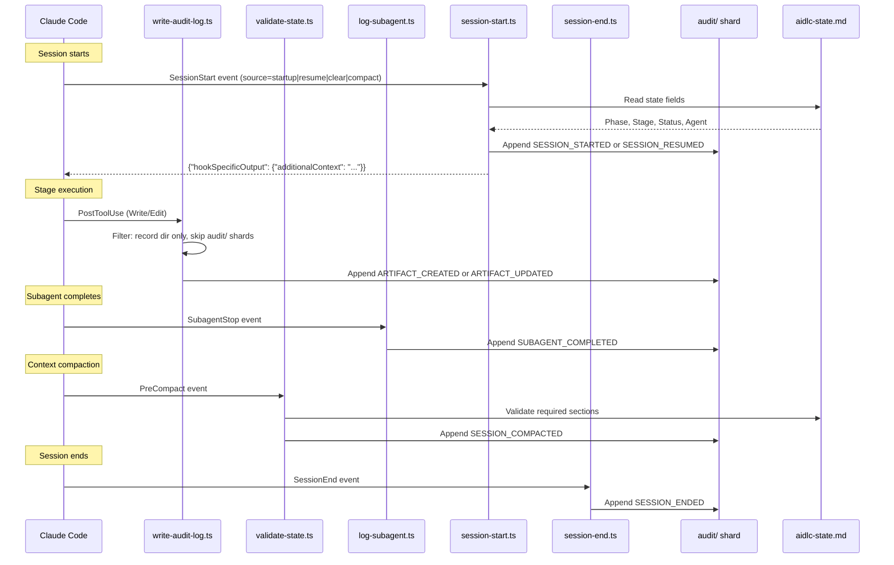

# Hooks and Tools

この章は、hook システムのアーキテクチャ、17 個すべての hook スクリプト、監査イベントの分類、CLI ツールの設定、そして決定的なユーティリティツールを扱います。

> **パス規約。** 状態、監査、アーティファクトは、アクティブインテントの**記録ディレクトリ** — `aidlc/spaces/<space>/intents/<YYMMDD>-<label>/`、以下では `<record>/` と表記 — の下に存在します（コンパクトな UTC 日付プレフィックスと短い kebab-case ラベルなので、記録ディレクトリは時系列でソートされます。正規の id は `intents.json` レジストリ行の UUIDv7）。監査証跡は、単一のファイルではなく、`<record>/audit/` の下のクローンごとのシャードのディレクトリです。

---

## Hook システムのアーキテクチャ

この実装は、`.claude/hooks/` の 17 個の TypeScript hook ソースを使います。ソースから生成された `dist/` プロジェクションは `bun` 経由でそれらを呼びます。ネイティブインストールとバージョン管理されたリリースランタイムは、`aidlc engine hook`、`aidlc engine statusline`、または `aidlc engine adapter` ターゲット経由でそれらをルーティングします。17 個すべてが**プロジェクト全体**です。statusline はトップレベルの `statusLine` キー経由で、AI-DLC のステータス行を選んだとき各人自身の `.claude/settings.local.json` に届きます。他の 16 個は `settings.json` の `hooks` ブロック経由です。ホストがプロジェクト hook を許すとき、どの skill がアクティブかにかかわらず発火します。Claude Code の managed `allowManagedHooksOnly: true` は、プロジェクト登録を上書きし、それらの hook をブロックします。`/aidlc --doctor` がその方針を検出します。以前は分割されていました（6 個が `aidlc/SKILL.md` フロントマターで skill スコープとして宣言され、残りがプロジェクト全体）。v0.6.0 で skill スコープの 6 個を `settings.json` に移したので、すべてのエントリポイント（オーケストレーター、パッケージ化された各スコープ／ステージランナー、手書きの顧客ランナー）が、ランナーごとの `hooks:` ブロックなしに決定的な背骨を継承します。

17 個のうち 11 個は**ブロックしません**。6 個が**フローを変えます**。`Stop` hook は転送ループを走らせ続け、deliver-stage-rules hook はハーネスが入力の書き換えをサポートするところでサブエージェントのブリーフに正確なアクティブステージのルールを付け、plan-approval ガードは時期尚早なコード生成のディスパッチを拒否し、reviewer-scope hook は兄弟ユニットのレビュアーアクセスを拒否し、review-freeze hook はゲートの前に新しい終端レビュー受領を無効にするレビュー済み出力の書き込みを拒否し、state-transition ガードは AI-DLC の hook とランタイム記録、そしてヘルパーエージェントのライフサイクルコマンドへのツール呼び出しを拒否します（`aidlc-orchestrate.ts report` を迂回する直接のライフサイクル呼び出しは、状態ツール自身が拒否します）。

```
.claude/hooks/
+-- record-human-turn.ts     # UserPromptSubmit + PostToolUse AskUserQuestion (project-wide, settings.json, TypeScript)
+-- deliver-stage-rules.ts    # PreToolUse + PostToolUse Task|Agent, SubagentStart (project-wide, settings.json, TypeScript, flow-altering)
+-- plan-approval-guard.ts # PreToolUse generation dispatch/write/shell tools (project-wide, settings.json, TypeScript, flow-altering)
+-- state-transition-guard.ts # PreToolUse shell/file-write tools (project-wide, settings.json, TypeScript, flow-altering)
+-- reviewer-scope.ts    # PreToolUse file/search/shell tools (project-wide, settings.json, TypeScript, flow-altering)
+-- review-freeze.ts     # PreToolUse file-write tools (project-wide, settings.json, TypeScript, flow-altering)
+-- write-audit-log.ts      # PostToolUse Write|Edit (project-wide, settings.json, TypeScript)
+-- run-sensors.ts       # PostToolUse Write|Edit (project-wide, settings.json, TypeScript)
+-- sync-workflow-state.ts   # PostToolUse TaskUpdate (project-wide, settings.json, TypeScript)
+-- rebuild-stage-graph.ts   # PostToolUse Bash (project-wide, settings.json, TypeScript)
+-- fold-usage.ts        # PreToolUse + PostToolUse (project-wide, settings.json, TypeScript, Claude-only producer)
+-- validate-state.ts    # PreCompact (project-wide, settings.json, TypeScript)
+-- log-subagent.ts      # SubagentStop (project-wide, settings.json, TypeScript)
+-- aidlc-continue-workflow.ts        # Stop (project-wide, settings.json, TypeScript, flow-altering)
+-- session-start.ts     # SessionStart (project-wide, settings.json, TypeScript)
+-- session-end.ts       # SessionEnd (project-wide, settings.json, TypeScript)
+-- aidlc-statusline.ts  # statusLine (each person's settings.local.json, on their yes, TypeScript)
```

### Hook Summary

| Hook | Event | スコープ | Matcher | 目的 |
|------|-------|---------|---------|---------|
| `record-human-turn.ts` | UserPromptSubmit + PostToolUse | プロジェクト全体 (settings.json) | (empty) / `AskUserQuestion` | サポートされるプロンプト送信、または答えられたウィジェットの継ぎ目が発火したとき `HUMAN_TURN` イベントを記録します。承認／インタビューゲートは、最後のゲート解決以降に 1 つを要し、ステージゲートはステージ開始以降かつゲートが示された後に送られた 1 つ（またはエージェントが `--message` で名指しするメッセージ）を要し、インタビューの答えは、そのチャットでのその人の返信のうち、どの決定もまだ使っていないもので、その質問がログされる前後に送られたもの（または `--message` で名指しされるメッセージ。人がエージェントに委ねた選択は、それを委ねたメッセージを名指しする `--on-instruction --message <id>` で記録されます）を要します。AI-DLC へのコマンドだけだったターン（フラグの後に語のない、または語が引用符なしの `--` の後ろにある `/aidlc`、`/aidlc-<runner>`、`$aidlc` の行。これは新しい作業を記述します。エントリとそのフラグの後の語、たとえば `/aidlc approve the code plan` や `/aidlc --guard-policy off approve the plan` は、エントリとそのフラグなしで保たれる返信で、それらとともにタイプされた設定は、エージェントがセッター経由で読んで適用するものです。スラッシュで始まる他のテキストもコマンドです）は、`Reply: command` とマークされます。開いた質問への決定はそれを返信として数えず、guard-recovery の尋ねはそれを取らず、conductor はコマンドを実行して質問を開いたまま残します。スイッチについての質問（「skip plan approval?」）は、エージェントが答えるもので、何もマークしません。すべてのハーネスは、イベントを `aidlc.ts engine hook record-human-turn` 経由でルーティングし、それが権限を持つモジュールを、そのプライベートなプロセス能力で起動します。hook ファイルを直接実行またはインポートしても何も発行されません。`AIDLC_UNATTENDED=1` は、共有 hook とすべてのハーネスアダプターにわたって、この権限を持つ発行を抑制します。権限のない転送マーカーは変わりません。swarm ワーカーの worktree に届くプロンプト（`swarmUnit` を運ぶ `.aidlc/worktree-meta.json`。swarm の prepare がワーカーのために作ったコピー。そこで始まったセッション、たとえばヘッドレスな `codex exec` が、そのブリーフを UserPromptSubmit として送ります）は、conductor のブリーフで、人のターンでは決してありません。hook はそこで同じ権限を差し控え（`HUMAN_TURN` なし、`QUESTION_UNANSWERED` なし、保たれた語なし、メッセージ記録なし、スイッチなし）、それについて何も言わず、それでもハートビートと会話マーカーを書きます。finalize は、その記録をメイン記録にマージし戻し、そのマージはすべての権限行を拒否します。宣言はオプトインです。無人かどうかはドライバーだけが知るからです。イベントは順序／存在だけを証明します。ハーネスは信頼できる応答テキストを一様には公開しないので、後の `--user-input`、`--feedback`、`--details` の散文を認証しません。hook は設定を適用しません。フラグとしてタイプされたスイッチはメッセージ記録にあり、エージェントは `next` がそれに対して名指しするセッターを実行します（作業が選ばれていないチャットは、次に始める作業のためにそれを保ちます）。アクティブワークフローのレビュー要求に判定がなく、要求以降に何も尋ねられ、検証され、決定されていない間（`next` 自身のレビュー受領がまだ待っていることを確認）に届く、人が立ち会ってタイプされたプロンプトは、レビューをリトライするか何かを記録する前に `next` を実行するようエージェントに伝える 1 つのコンテキスト行を足します。これはノートであって、ブロックでは決してなく、読みに失敗すると何も足しません。タイプされたヘルプ要求（`/aidlc` または `$aidlc` に、エンジン自身の `classifyTerminalCommand` が読むとおり `--help`、`help`、`-h` だけが続くもの）は、Kiro アダプターが実行したコマンドに使う言い回し（`terminalCommandRelay`）で、ヘルプをターンのコンテキスト行に足すので、Claude Code と Codex ではエージェントが実行するコマンドなしにそれを示します。ホストのターンのとき、行全体が 9,500 文字を越えるとき（Claude Code は hook フィールドの 10,000 を保ちます。そのときエージェントが自分でヘルプを実行します）、そして Kiro アダプターがターンを `relays_terminal_output` で転送するとき（そのプロンプト hook が人のタイプしたコマンドを実行して出力を引き渡します）は、外されます。hook は返信に意味を読み込むことは決してありません。人が開いた質問に返信したことと、その正確な語を保ち、conductor が返信を読んで人が下した選択を記録します。アクティブディレクティブがエンジンの Plan Approval の質問のとき、各メッセージは、この作業の任意のチャットから、その開いた質問に対して保たれます（`notePlanApprovalAskReply`）。そのメッセージがちょうど「done」のとき、質問ファイル自身の `[Answer]:` 行も読まれ（`notePlanApprovalFileAnswer`）、人がそこに書いた、選択肢の 1 つである答えが、チャットでタイプされた正確な選択とまったく同じく、ファイルを名指しする 1 行とともに、その人の選択として記録されます。そこに書いた他のものは、conductor が読むために名指しされ、エンジンは、同じ質問が立っている間に書いた答えを決して上書きしません。conductor の `answer --checkpoint plan-approval` は、質問が示された後、AI-DLC へのコマンド以上の返信が記録にあると選択を記録し（保たれた「skip plan approval?」はスイッチについての質問で、答えではありません。拒否は、オフにしたいときのために `engine config set guard.plan-approval off` を名指しします）、プランファイルのあるがままのフィンガープリントを取り、質問ファイル、受領、`Person Reply` 付きの `PLAN_APPROVAL_RECORDED` 行を書きます。保護された質問（検証コマンド、Construction 方針、チェックポイント承認）は、その消費側のために同じ方法で返信を保ちます。他のエンジンの質問（作業がどこに属するか、新しい作業の提供、どの記録やプラン）は、独自の開いた質問マーカーを公開するので、既定では、それが開いている間の返信はその答えだけです。ターンの行がそれを名指しし（`Open Question: <ask type>`）、その下のどの質問もそれを取りません（保護された質問、guard-recovery の尋ね、ステージゲート。それらの存在検査とその記録の語がそれを外します）。`next` は、それが答えられると再び尋ねます。それらの 1 つに答えたとき、conductor は `--message <id>` でそれを名指しし（`report`、`bolt checkpoint`、`bolt swarm-checkpoint`、`log answer` で）、それを外した拒否がその id と時刻を名指しします。conductor は、プランを再び見る要求を `answer --checkpoint plan-approval --details "Review the plan"` で記録します。これは、アクティブディレクティブが名指しするプランに対して、または作業が一時停止中か、プランを名指ししない質問が開いている間、次の `next` がルーティングするプランに対して記録され、それぞれ自分の答えまで要求を保ち、複数プランの要求は、そのすべてに対して、またはどれにも対しても記録されません。アクティブディレクティブが現在の状態の guard-recovery の尋ねのとき、ちょうど 1 つの救済である返信は人の選択です（`picked_by: person`）。Request Changes が唯一の救済のとき、裸の選択でない返信はそのフィードバックです。他の返信は `selected_op: null` で保たれ、conductor は、彼らが選んだ救済を `answer --checkpoint guard-recovery` で記録します。そこで Request Changes の選択は、人の語を待つか、その同じ返信から取ります。選択とフィードバックは、人が返信した記録として、空白を正規化してハッシュされます。繰り返される `next` は、状態と順序付けられた救済の操作／対話のコントラクトがまだ一致する間だけ、それらを保ちます。その記録が準備できると、`reject` は、人のメッセージ（または conductor が `--message` で名指しする 1 つのメッセージ）から人の語を `Feedback` として取り、conductor の `--feedback` または `--reason` が別のことを言うとき、それを `Conductor Summary` として保ちます。両者の間の一致は要されません。セッション ID を持つ、人が立ち会ってタイプされたすべてのプロンプトと、単一選択の質問ボックスが持ち帰った 1 つの答え（選択か、そこにタイプされたテキスト。ホストは区別しません）も、届いたときの監査シャードのサイズでタグ付けされて、gitignore された `<record>/.aidlc-engine/gate-words/<session>.json` にそのチャットのために保たれます。AI-DLC コマンドは外され、`/aidlc` または `$aidlc`（と任意のフラグ）の後にタイプされた返信は、エントリなしで保たれます。高々 8000 文字のメッセージ 8 件が保たれ、ステージゲートが提示または答えられたとき、そしてワークフローが完了したとき、ファイルは削除されます。この hook とエンジンだけがそれを書きます。runtime-integrity 検査は、それを書くか削除するツール呼び出しを拒否します。同じチャットでのステージゲートの決定は、ステージの最新の `STAGE_AWAITING_APPROVAL` 以降、そしてそれ以降に答えられた他の質問以降に保たれたメッセージを記録します。`GATE_APPROVED` では `Person Reply` として、`reject` では `Feedback` として、conductor の異なるテキストを `Conductor Summary` として保ちます。hook が guard-recovery の答えとして消費した返信は保たれず、取りこぼしは以前と同じく conductor のテキストを記録します。`HUMAN_TURN` と同じく、保たれた語は、ハーネスがそのチャットのために届けたプロンプトテキストです。それらは誰がタイプしたかを認証しません。語を保つことはフェイルオープンで、ターンを決してブロックしません。hook は、人が立ち会ったプロンプト、または答えられた質問ボックスごとに、1 つのメッセージ記録を `aidlc/.aidlc-sessions/messages/<id>.json` にも書きます（届いたとおりのテキスト。エンジン自身のパーサーが `/aidlc` 行を読むとおりのタイプされた設定とその後の語。質問ボックスが持ち帰ったもの。尋ねられた質問ごとに 1 エントリで、人が 1 つを空白にしたところは `null`。保存される各文字列は切り詰められ、テキストと語は 8000 文字、ボックスの質問や返信は 2000 文字で、`cut` がそう言います）。そして行の `Message Id:` フィールドでそれを名指しします。ホストが空のまま残したプロンプトは、語が未知のプロンプトとして記録されます。Copilot では、人がスラッシュ名で呼び出した skill が、ホスト自身のラッパー（その文、その後に、すべての `$ARGUMENTS` がタイプされた語で置き換えられたインストール済みの SKILL.md 本体）として届くので、Copilot アダプターは、それから再構築された行 `/aidlc <args>` を記録します。プロンプト内のインストール済み skill ファイルを、ファイル自身の、最初の `$ARGUMENTS` の前と最後の `$ARGUMENTS` の後のテキストで特定し、長さから引数を導出し、その引数を持つ本体がプロンプトの領域にバイト単位で等しいとき（さらに両側で CRLF を LF に畳んで）だけ再構築を受け入れます。ホストの文は何も証明せず、他のものは届いたとおりに記録され、テキストは再構築で、人のキーストロークではありません。`log decision --message` と `log answer --message` は、遅れてログされた質問の返信を証明するために記録を読みます（id が存在し、このチャット経由で来たか別のチャットでこの作業に送られ、人の語を運び、後の決定で使い尽くされていない）。`next` は、2 つのケースでこのチャットの最新の記録を読みます。エージェント自身のコマンドが人のものを何も運ばない（裸の `next`、`next --resume`、または語も `--request` もない `--scope`）とき、その記録が語を持つ `/aidlc` 行で、まだ作業のないワークスペースで、または作業が開いているときはエージェントのその後の最初のステップとして（彼らのターンは、チャットが始まり、再開し、圧縮され、終わるときにホストが書くセッション行を越えて、やはり記録の最新行です）、`next` は、エージェントがそれを渡したかのように正確に行を読み（語だけにはプラン質問、人が名指ししたプランには作成、プラン質問が開いている間には返信の読み、開いた作業に対しては彼らの語の読み）、エージェントが自分で名指ししたスコープはそれに道を譲ります。エントリ語の後に何もない `/aidlc` 行は、開いた作業に対して同じ最初のステップで、エージェントが送ったどちらであれ、`next --resume` がするように作業を拾い直します。そしてエージェントのコマンドが彼らの要求を語として運ぶとき、どの行が彼らのものかの同じルールのもとで、要求は記録され、エージェントが打ち直したコピー（たとえばアクセントなし）ではなく、彼らの引用符でタイプされたとおり、その行自身の語で引用し返されます。それらすべてが、エージェントの呼び出しがルーティングするプランでルーティングする行で、そして最初の語もプランの名前である行で、エージェントがどのプランでもルーティングしないときはそのすべて、またはそのプランでルーティングするときはその語の後の残りです（`next` が取らないフラグを持つ行は、エージェントの語を保ちます）。一方、エージェントのコマンドは渡されたとおりにルーティングし続けます。他に何もそれを読まず、どの行もそれを人に名指しせず、無人のドライバーは何も書きません。**ホスト**がエージェントのために作ったプロンプトは、人のターンではありません。ペイロードの `origin`（Kiro CLI と Kiro IDE のアダプターが、Kiro 自身のチャット記録 `~/.kiro/sessions/<workspace>/<session>/messages.jsonl` から設定します。そこで、タイプされたメッセージは `_meta.kiro.userMessageTag` を運び、Kiro が作ったメッセージは `_meta.kiro.syntheticUserMessageReason` を運びます。または、Kiro が印を残さないところでは、その固定の文の 1 つから、アンカーされて: `<original_user_request>` ワークフローブリーフ、`[SYSTEM] Sub-agent synthesis:` の開始。記録の行は `{id, timestamp, payload}` で、どう終わったにせよワークフローの終了通知がそこにマークされます）、または、Claude Code では、ペイロードの `prompt_id` のトランスクリプト行で、`turnOrigin` が `task_notification`、`promptSource` が `system`、`origin.kind` が `task-notification` のもの（タイプされたターンは `human`/`typed`、SDK ターンは `sdk` と言います）で、トランスクリプトに行がないときのフォールバックとして `<task-notification>...</task-notification>` 要素全体、または、Copilot では、プロンプトがその Stop ケースが最後にそのチャットに送った理由であるとき、そのアダプターが設定します（CLI は Stop ブロックを新しいプロンプトとして渡し返します。アダプターはそのダイジェストだけを `aidlc/.aidlc-sessions/<session>.copilot-stop-note` に保ち、チャットの次のプロンプトが、一致してもしなくてもそれを使います）。ホストのターンは、1 つの勧告的な `HOST_TURN` 行（`Origin: host`、`Reason`、`Source: record|template`、テキストは決してなし）を記録し、他には何も記録しません。`HUMAN_TURN` なし、メッセージ記録なし、保たれた語なし、返信ノートなし、会話マーカーなしです。未知のものは人のターンです（ターンが走る間に送られたメッセージはトランスクリプト行を持たず、走っているターンの `prompt_id` に乗ります。それは数えます。チャットの `KIRO_SESSION_ID` 以外のペイロード `session_id` は、それ自体では何も決めません。その変数は、ワークフローステップのプロンプトでもチャットを名指ししていて、メッセージが来たタブを名指ししないかもしれないからです）。そしてすべての `HUMAN_TURN` は今、`Origin: person` と `Source: typed` または `Source: picker` を運びます。作業上で（それに参加したチャット、作業が終わっていない。`AIDLC_UNATTENDED=1` の下では決してない）、コマンドだけでないタイプされたメッセージと、質問ボックス（Claude Code の `AskUserQuestion`、Codex の `request_user_input`）の答えは、エージェントのために hook のコンテキストに 1 行を足します。このチャットの新しい作業のプラン質問が、作業の外または作業が存在する前に開いている間の返信も同様です（なので、プラン選択の隣で尋ねられる設定もそれを名指しします。そこの他のプロンプトは行を得ません）。ホストが発火したイベント（ボックスの答えには `PostToolUse`。ホストは別のイベント向けに名指しされたコンテキストを落とします）のもとで、保ったメッセージを名指しするので、返信、ボックスの答えで尋ねられた設定、人がチャットで変えるよう尋ねる、何も待っていない検査は、最初の呼び出しで `--message` でそれを名指しし（`This message of the person's is on record as <id>: ...`）、その語を決して名指ししません。Claude Code、Codex、Kiro CLI のアダプターは、その行をエージェントだけに渡します。Kiro IDE のアダプターはそれを外します（ペイロードの `context_may_reach_person`: IDE はすべてのコマンド hook にチャットカードを描き、カードがその出力の何を示すかは計測されません）。エージェントに hook の行を何も渡さないアダプター（Copilot、opencode、Cursor）も同様です。そこでは、開いたゲート、質問、コードプラン質問で `next` が表示する返信ステップが、同じ id を、古い順にその時刻とともに名指しします |
| `deliver-stage-rules.ts` | PreToolUse + PostToolUse, SubagentStart | プロジェクト全体 (settings.json) | `Task\|Agent`; SubagentStart 全エージェント | **フローを変える。** ディスパッチされたステージの実質的なアクティブスペースのルールを解決し、エンジンがそれらに対して解決するテキスト（HTML コメントブロックを除いた各ファイル）を、`stage-protocol.md` § "For subagent stages" step 2 で宣言されたトランスポートを使って届けます。受け入れられたバックグラウンドディスパッチの後、Stop hook がその結果を待てるよう、`aidlc/.aidlc-subagent-inflight` に 1 つのセッションスコープのエントリを足します。拒否されたディスパッチは何も足しません。Claude では、PostToolUse の登録はルールを届けません。入力に `run_in_background: true` がなかったとき、応答が `async_launched` である起動を記録するだけです。Claude Code が、そのフラグなしでエージェントをバックグラウンドで始めるからです。Codex、opencode、Copilot の入力を書き換えます。Claude では、PreToolUse の呼び出しは書かれたとおりに走り（auto モードは、レビュー後に hook が変えた呼び出しを拒否します）、SubagentStart の登録は、始まる AI-DLC エージェントに、記録のステージのバンドルをそのコンテキストとして与え、Claude Code がテキストをファイルに保存した（10,000 文字超）ときは、ファイル全体を読むよう伝える文がそれを先導します。Kiro CLI は、登録されたエージェントのネイティブな `resources` による、完全なアクティブスペースのメモリツリーのプリロードを使います。プリロードが供した不完全なブリーフは静かに進みます（exit 0、空の stderr。オプトインの `hookDebug` のみ）。ディスパッチの前に、そのアダプターは、選択されたインストール済みロスターワーカー（プラグインワーカーを含み、composer と非ロスターのヘルパーを除く）のプロジェクトローカルな `.kiro/agents/<name>.json` が、`file://aidlc/spaces/<active-space>/memory/**/*.md` をパースして含み、少なくとも 1 つの既存の Markdown ファイルに解決することを要します。欠けている、不正な、stale な、解決されないプリロードは、exit 2 と修復ガイダンスでブロックします。プリロード検証の後、アダプターはコアの exit 2（読み込めない必須ルール: ブロック）とコアの exit 3（有効なバンドルが hook 書き換えチャネルを越える: 勧告、ディスパッチは exit 0 で進む）を転送します。他のすべてのハーネスは、原文のままのブリーフ配信を保ちます。Kiro IDE は、ライブのメモリファイル参照を持つ、常時インクルードのワークスペース steering も使います。正確なバンドルがすでに存在するとき冪等です |
| `plan-approval-guard.ts` | PreToolUse | プロジェクト全体 (settings.json)。Claude Code と Codex では 1 つのツール呼び出しガード登録の中 | `Task\|Agent\|Edit\|Write\|Bash`（ハーネスネイティブのパッチエイリアスも） | **フローを変える。** code-generation の「生成前のプラン」の順序（ステージの Steps 2-4）を決定的に強制します。人のコードは、彼らがプランを承認する前には変更されません。アクティブディレクティブは 1 つの権限を選びます。`unit` があるとき `construction/<unit>/code-generation/`、さもないとゼロユニットの `construction/code-generation/` です。plan-approval fence がオンのとき、3 つのものが、そのターゲットの現在の Testing Contract、フィンガープリントされたプラン／指示、明示的な「Approve Plan」の答え、そしてエンジンの受領を待ちます。developer ディスパッチ、AI-DLC のフォルダの外でプロジェクト内のパスへのファイルツールまたはシェル書き込み、そして書き込みが見えないシェルコマンド（変数または置換、インタープリター、見えるターゲットのない未知のプログラム）です。他のすべては通ります。`aidlc/spaces` 下の AI-DLC 自身の記録（そこのエンジン自身のファイルは除く）、そしてインストールされ、ラップされていないまま走る AI-DLC 自身のコマンド（エンジンが自分で判定するもの。Code Generation の完了も含みます。`report` と `state unit complete` はそのプランが待つ間待ちます。[State Machine](12-state-machine.md#stage-machine) を参照）です。4 つの条件が AI-DLC 自身のコマンドに残ります。そこではエンジンのどのツールも呼び出しを所有しません。`config flags --bypass` は、人が求めたら通ります。config ツール経由で取得または適用されるリリース（`--download`、`--release-base-url`、`--ca-bundle`、`config models` の外の `--from`、またはセクションのないセットアップ実行、たとえば refresh doctor が名指しするもの）は、人が求めたら（彼らの「update AI-DLC」）通り、無人実行では決して通りません。`--kiro-workflows on`、`--kiro-cli-workflows on`、`--sensor-timeout-ms`、`--plugins`、そして `config project --reset` は、人が求めたら通り、無人実行では決して通りません。そして jump（`jump execute` または `jump reopen`）は人の動きを待ちます。エンジンの recovery question で彼らが選んだ再開を、その解決が返した正確な綴りで、または最後の決定以降に彼らが求めた jump を待ちます。ただし、エンジンの最後のステップが上書きされたとき、またはそれがその Code Generation の recovery question で jump が提供する再開かユニット reopen のとき、または人がそこで選んだばかりの選択でないときは除きます（Code Generation ゲートを開く report はステップを書かないので、人が開いたゲートで求める jump は最初の尋ねで通り、recovery question が提供しなかったステージへのものも通ります。Copilot のアダプターは表示のたびにステップを上書きするので、そこでは、エージェント自身の確定した `next --stage` が現在の状態で主張したステージへの `jump execute`、またはそれが表示した `jump reopen` も通ります（1 ユニットの reopen、`next --stage <stage> --unit <unit>` の後はそのユニットのだけ、`--every-unit` の後は到達したすべてのユニットの、`--via change` の人の変更は `--change` の後だけ）。そして、表示が自分のステップとして名指しする jump も、表示された状態で表示されたとおり走り（再入 Redo の `jump execute --direction redo`、またはユニットの `jump reopen --via redo`）通ります。そのような主張のない reopen は、それを表示する `next --stage` を告げられます）。作業がちょうどそれを飛ばした後に人がプランに戻したステージへと `next` が名指しする後ろ向きの `jump execute`（現在のステージの開始以降に記録された追加で、そのステージのものがまだ何も書かれていない）も通ります。それは実行された彼らの追加で、何かがビルドされる前に Code Generation を離れます。人がプランファイル自身を編集する間、それらのファイルは彼らのものです。並列バッチが出ている間（`invoke-swarm` ディレクティブ）、各ユニットのコードは、`prepare` がリストされたユニットに結び付けた、準備済みの Bolt worktree（`.aidlc/worktrees/bolt-<id8>_<slug>/`）の中に書かれ、ワーカー自身の hook が判定するように判定されます（ワーカーとレビュアーは conductor のセッションのサブエージェントなので、この hook は親をプロジェクトとして彼らの書き込みを見ます）。hook がメインチェックアウトで見る他のソース書き込みは、バッチが着地するまで待ち、下げられた fence は、いつもの行と `GUARD_STOOD_ASIDE` 行とともにそれに道を譲ります。人がそこで変更を求めたファイルは、`swarm allow-change` が彼らの要求を記録したら入り（`MAIN_CHECKOUT_CHANGE_ALLOWED`。拒否はそのステップを彼らのメッセージとともに名指しします）、着地はそれを保ちます。チームがメモリに保つ strict な Guard Policy は、それを待たせ、それがどこで設定されているかを 1 行で言います。すべての Guard Policy の下で、1 つの例外があります。リストされたユニットの着地が衝突したとき、または人の git hook がそのコミットを拒否したとき、それが着地するチェックアウト（メインチェックアウト、または複数リポジトリのワークスペースではそのユニット自身のもの）で、git がその着地でマージできなかった、または以降に結合された、またはクリーンなマージのために hook がステージしたファイルを拒否したファイルが、そこに書かれ、それが着地の終わり方です（`aidlc-worktree.ts merge` がそれらを名指しします。人が始めたマージはその着地ではありません）。リストされたすべてのユニットの承認済みプランが保たれる間、書き込みが見えないシェルコマンドは、プランが承認されたシリアルビルドでのように、どう綴られようと走ります。ビルド中にメインチェックアウトが変わったかどうかは着地の検査です（`aidlc-worktree.ts` は strict の下でマージを拒否し、relaxed または off の下では 1 行で変更を保ちます）。待っているプランが名指ししないファイルへの書き込みは、すべての Guard Policy の下で即座に走ります。null デバイス（`/dev/null`、Windows では `NUL`、ハーネスが PowerShell で走らせたコマンドでは `$null`）に捨てられる出力は書き込みではないので、エラーを黙らせる読み取り専用プローブは利用可能なままです。Code Generation だけでなくすべてのステージで、そして作業のない独立実行で、エージェントが走らせるシステムパッケージインストール（OS パッケージマネージャーのインストール。たとえば `apt-get install`、`dnf install`、`brew install`、`winget install`。`sudo` の有無を問わず。`hooks/system-install.ts` を参照）は、すべての Guard Policy とプラン承認設定の下で人を待ちます。人のターンがその後に決定なしで立つ（彼ら自身の要求、または保留後の彼らの go-ahead）とき走り、`SYSTEM_INSTALL_ALLOWED` をそのメッセージと彼らの語とともに残します。または、彼らが承認した 1 つのプランがパッケージマネージャーとすべてのパッケージを名指しし、承認済みとして読まれる（プランは、レビュアーの付録を除く承認の射影を通じ、そのテスト指示がまだ承認フィンガープリントと一致するので、以降に足された行は何も名指ししません。プラン承認オフが尋ねずにビルドしたプランは何も名指ししません）とき走ります。さもないと、ステップが人にそのコマンドを告げることである 1 行とともに拒否され、`SYSTEM_INSTALL_BLOCKED` を残します。委譲はちょうど 1 つの `AIDLC-UNIT: <unit>` または `AIDLC-STAGE: code-generation` マーカーを使います。各拒否は `PLAN_APPROVAL_BLOCKED` を出します。欠けている、衝突する、または未知のマーカーは、プロンプトの散文から推測せずにブロックします。`AIDLC_DISABLE_PLAN_APPROVAL_GUARD=1` は、マシン上でプラン承認をオフにし（エンジンは各準備済みプランを尋ねずにビルドし `PLAN_APPROVAL_SKIPPED` を記録します。メモリの Guard Policy strict ロックの上でも）、この PreToolUse hook を無効にします。しかも静かにではありません。ワークフローが存在する間、その下で通る最初のツール呼び出しが 1 つの `GUARD_DISABLED` 監査行（`Guard: plan-approval-guard`、`Tool`）を追記し、連続する無効化された呼び出しは、別の行がアクティブシャードに着地するまで何も追記しません。その記帳のどの失敗も、やはり呼び出しを許します。初期の承認証拠と実行可能なアーティファクトは、`aidlc-swarm.ts prepare` を含む所有ツールによって、やはり要されます。承認後のコンテンツ変更は、承認を捏造せずに下の effective-fence 継続ルールを使います。人間の break-glass 受領（`answer --checkpoint plan-approval --override-file`。それを提供する拒否の後の返信で、人がプランをとにかくビルドするよう求めた後にだけ記録されます）は、他のどの受領とも同じようにこの hook を満たします。hook はそれを決して提案しません。developer ハンドオフは、brief コマンドが表示するとおり、brief 自身のセクション（`## Files and commands`、`## The plan file`、プラン見出しとユニットテスト指示の見出し。fence-on または fence-off のいずれの言い回しでも）も運ばなければなりません。2 つのマーカー行だけは、ステップとして同じ brief コマンドで拒否されるので、ワーカーが、それらが先導するプランと指示なしにガードが検査する行を手渡されることは決してありません。プランを待つ拒否は、`next` が何をするかで終わります。プラン承認がオンのときは人に尋ね、この作業でプラン承認がオフのときは誰にも尋ねずにビルドを始め、拒否はそう言い、エージェントに人にプランを承認するよう求めないよう伝えます。 |
| `state-transition-guard.ts` | PreToolUse | プロジェクト全体 (settings.json)。Claude Code と Codex では 1 つのツール呼び出しガード登録の中 | `Bash\|Write\|Edit\|MultiEdit\|NotebookEdit` | **フローを変える。** ハーネスが所有する hook、セッション制御、ランタイム記録、ツールが所有する監査証跡（`<record>/audit/`）を無条件に保護します。シャードを狙った直接の書き込み、シェル追記、コピー、移動、削除は、ルートとして `engine log decision|answer`、`engine audit append-raw`、`engine orchestrate report` を名指しするメッセージで拒否されます。読みは開いたままです。ハーネスが委譲エージェントの同一性を供給するとき、レビュアーとサポートエージェントからのライフサイクル／ルーティングコマンドも拒否し、拒否されたコマンドとチャットとともに `STATE_TRANSITION_BLOCKED` を記録します。読み取り専用の状態と通常のビルド／検証コマンドは利用できるままです |
| `reviewer-scope.ts` | PreToolUse | プロジェクト全体 (settings.json)。Claude Code と Codex では 1 つのツール呼び出しガード登録の中 | `Read\|Edit\|Write\|Glob\|Grep\|Bash` | **フローを変える。** ユニット単位のレビュアー読み取りスコープの境界（stage-protocol-reviewer-unit.md）を決定的に強制します。conductor のレビュアーディスパッチ記録（`<record>/.aidlc-engine/reviewer-dispatch.json`）が新しい間、ディスパッチされたレビュアーの、兄弟ユニットの `construction/` パスに到達するツール呼び出し（兄弟にまたがるファイル読み／書きと grep/glob/shell パターン）は、ターゲットが記録の免除リストにない限り拒否されます（exit 2 + リダイレクトする stderr 理由）。独立して、ユニット主張のスコープスタンプを運ぶチェックアウトは、別のユニットの `construction/<unit>/` サブツリーを変更できません。正規化されたパス解決が、拒否の前に相対トラバーサルとケース脱出の形を閉じます。Guard Policy、`guard.reviewer-scope`、`AIDLC_DISABLE_REVIEWER_SCOPE_HOOK` は、レビュアー読み取りスコープ検査だけを下げられます。主張されたチェックアウトの書き込み所有権は必須のままです。各拒否は `REVIEWER_SCOPE_BLOCKED` を出します。 |
| `review-freeze.ts` | PreToolUse | プロジェクト全体 (settings.json)。Claude Code と Codex では 1 つのツール呼び出しガード登録の中 | `Read\|Edit\|Write\|Glob\|Grep\|Bash`（変更可能な呼び出しに自己フィルタ） | **フローを変える。** reviewer モジュールの終端受領の順序を決定的に強制します。レビュアーを伴う、まだ完了していないステージのレビュー済み出力（宣言された `produces[]`/`optional_produces[]`。`review_artifact` で明示的に名指しされない限りサマリーが所有する質問を除く）を狙う Write/Edit やシェル変更は、新しい終端レビュー受領がそれをカバーする間、拒否されます（exit 2 + リダイレクトする stderr 理由）。シェル書き込みは、Write/Edit の監査フィードを通らず、さもないと変わったバイトに対して stale な受領を保つので、実行前に検査されます。エンジンの正確な受領スキャン（`aidlc-lib.ts` の `freshReviewReceipts`）を共有するので、記録されたゲート拒否、jump、ワークフロー再開、または blocking ゲートセンサーでの人の Fix findings の選択が、凍結を自動で解除します。上限未満の adversarial NOT-READY は、修復のために非終端で編集可能なままです。有効なクラスの下の終端 NOT-READY は、READY のように凍結します。各拒否は `REVIEW_FREEZE_BLOCKED` を出します。すべての曖昧さでフェイルオープンします。`AIDLC_DISABLE_REVIEW_FREEZE_HOOK=1` は強制を無効にします。ツールが人に示す拒否は、何が拒否されたかを言い、JSON なしで `Next:` と `next` コマンドで終わります。ルーターが出すはずの guard-recovery の尋ね（[Guard admission and recovery asks](12-state-machine.md#guard-admission-and-recovery-asks) を参照）は拒否記録で待ち、その `next` が一度それを引き渡し、書き込みは決してリトライされません。最後の決定以降に書き込みの背後に立つ人のターンがないとき（使われた答えだけが彼らのものとして数えます）、最初の拒否は conductor 自身のステップで、ドキュメントを残し、次のゲートまたはユニットチェックポイントで変更を引用します。繰り返し、または人が求めたかもしれない書き込みは、タイプされた救済を人に出します |
| `write-audit-log.ts` | PostToolUse | プロジェクト全体 (settings.json) | `Write\|Edit` | アーティファクトの書き込みを `audit/` シャードに自動ログします |
| `run-sensors.ts` | PostToolUse | プロジェクト全体 (settings.json) | `Write\|Edit` | 一致する書き込みで、アクティブディレクティブのステージの解決済み Sensors を発火します（勧告。決してブロックしません）。状態に結び付いたインテント単位のマーカーが、ユニット主体の実行が `Current Stage` に先行するとき帰属を保ちます |
| `sync-workflow-state.ts` | PostToolUse | プロジェクト全体 (settings.json) | `TaskUpdate` | ステージタスクの起動時に状態ファイルを自動同期します |
| `rebuild-stage-graph.ts` | PostToolUse | プロジェクト全体 (settings.json) | `Bash` | 成功した `intent-create` を、そのツールイベントの正確なホストセッション ID に結び付けます。セッションがすでに別のインテントを所有するとき、ワンショットの新セッション引き継ぎ受領を書きます。その後、遷移クラスの監査出力で `runtime-graph.json` を再コンパイルします。まず、Bash 呼び出しが、stdout がちょうど `error` ディレクティブである 1 つのリテラルな engine orchestrate コマンドだったとき、`directive.message` をバイト単位で人間に中継します（[Engine error relay](#engine-error-relay) を参照）。さもないと、セッターが人の名前で検査をオフにした後、モデルにその一度だけ言う指示を渡します（そのセクションの末尾） |
| `fold-usage.ts` | PreToolUse + PostToolUse | プロジェクト全体 (settings.json) | `*` | **Claude 専用。** トランスクリプトの新しいトークン使用量を、llm 呼び出しごとに耐久的な使用量台帳に畳みます。PreToolUse は、完了するメイン呼び出しと、エンジン境界の前に、完了したすべてのサブエージェント呼び出しを封じるので、ライフサイクルロールアップは最新です。PostToolUse は、通常のホールドバックのフォールバックを供給します。観測のみで、決してブロックしません。Claude-Code のトランスクリプトリーダーは Claude ハーネスでだけ配線されるので、Kiro/Codex/opencode ではプロデューサーが走らず、台帳は空のままです（すべての使用量消費側はデータなしに劣化します）。`AIDLC_DISABLE_USAGE_TRACKING=1` がそれを無効にします。下の「トークン使用量とコスト追跡」を参照 |
| `validate-state.ts` | PreCompact | プロジェクト全体 (settings.json) | `*` | 状態ファイルを検証し、`SESSION_COMPACTED` を記録します |
| `log-subagent.ts` | SubagentStop | プロジェクト全体 (settings.json) | (empty) | 完了するセッションのバックグラウンドサブエージェント台帳エントリを 1 つ削除し、サブエージェント完了イベントをログします。転送された `hook_event_name: "SubagentStart"`（ディスパッチ hook を走らせない Cursor と Kiro IDE のアダプター）は、代わりに `SUBAGENT_DISPATCHED` を記録し、他には何もしません |
| `aidlc-continue-workflow.ts` | Stop | プロジェクト全体 (settings.json) | (empty) | **フローを変える。** ターン終了時に転送ループを強制します。`aidlc-orchestrate next` を実行し、終端と人間待ちの結果を許し、通常の保留中の作業を on-task の継続でブロックし、個別のエンジン `error` 診断を、ベストエフォートの `ERROR_LOGGED` 行とともにちょうど一度届けます。未知のディレクティブ種別とすべての診断永続化の失敗は、停止を許します。`intent-create` の後、または `intent <name>` や `space <name>` が別のインテントを選択した後に、セッションの元の UUID と新しくアクティブな UUID が、そのステップが書いた受領に一致するとき、正確なワンショットの引き継ぎも許します。`intents.json` 行のない選択された記録は UUID を持たないので、その受領は代わりにスペースと記録を名指しします。セッションは、ちょうどその記録を選択し、インテントスタンプを運ばない（切り替えが、それが来たスタンプをクリアする）か、記録がそれ以降に得たレジストリ行のスタンプを運ばなければなりません。現在のステージまたはアクティブなチームユニットゲートが承認待ち（approve 自身の 2 つの存在検査で、それへの人の返信が記録に載るまで）または改訂待ちのとき、または、アクティブディレクティブの正規または ユニット単位の `<slug>-questions.md` に未回答の質問があるか、未解決のログされた `DECISION_RECORDED` がある `[-]` 進行中のとき、正当なターン停止を許します。新しい進行中の compose マーカー、現在のセッションの新しいバックグラウンドサブエージェントエントリ、Construction 自律の選択をまだ提供するステップ、そして会話ターンも許されます。別のセッションの、stale な、不正なバックグラウンドエントリは、停止を認可しません。自律 Construction では、バックグラウンドと compose の切り出しは、人がそこにいる間だけ停止を許します（無人のドライバー `AIDLC_UNATTENDED=1` の下ではしません）。そこでは、ログされた決定の切り出しは、エージェントがそこにいる人のためにログした質問を許し、無人のドライバー（`AIDLC_UNATTENDED=1`）の下ではチェックポイント質問（検証コマンド、プラン承認、サマリー確認、Construction 方針の変更）だけを許します。会話の切り出しは他と同じように読まれ（実行中に書く人は存在します。無人の実行のすべてのターンはエンジンに触れます。無人のドライバー `AIDLC_UNATTENDED=1` は古いガードを保ちます）、保留ファイルの切り出しは、ユニット主体のコード生成の必須の Plan Approval を除いて抑制されます。自律選択の切り出しは、プローブがルールを part 1 で再開するので、run-stage とそこに至る各ルールパート（パート上の `offer_autonomy`）から提供を読みます。ルールパート上では、エージェント自身のアクティブディレクティブマーカーが run-stage にある（尋ねるステップに到達した）ときだけターンを終わらせるので、より早いパートの後の終了は、やはり保留中の作業です。通常の保留中の作業は再帰上限付きです（`CLAUDE_CODE_STOP_HOOK_BLOCK_CAP` の下の no-progress カウンター + `stop_hook_active`。対話的実行では既定 2、自律 Construction では 8）。AI-DLC ワークフローの外では no-op です |
| `session-start.ts` | SessionStart | プロジェクト全体 (settings.json) | (empty) | セッション再開時にワークフローコンテキストを注入します |
| `session-end.ts` | SessionEnd | プロジェクト全体 (settings.json) | (empty) | 正常終了時に、その正確なセッションに記録されたインテントに `SESSION_ENDED` を出します。UUID に裏付けられたワークフローにセッション結び付きがないとき、共有のアクティブカーソルを使うのではなくフェイルクローズします |
| `aidlc-statusline.ts` | statusLine | 各人自身の `.claude/settings.local.json`。それを選んだら | -- | ターミナルにリアルタイムの進捗を表示します |

Copilot CLI も `.claude/settings.json` をリポジトリ設定として読みます。PreToolUse、PostToolUse、PreCompact のグループが空の matcher を持つとき（ゆえに上の `*`）ファイル全体を拒否し、そこに登録された hook を実行します。Copilot での AI-DLC の作業は、その Copilot インストール自身の配線（`.github/hooks/aidlc.json`）なので、`engine hook <name>` は、Copilot CLI が Claude 登録のためにそれを始めるときは、Copilot インストールの有無にかかわらず、脇に退きます（`core/tools/aidlc.ts` の `copilotRunsClaudeRegistration`）。ペイロードを取り、何も表示せず、exit 0 します。Copilot は、その開始時にファイルの `companyAnnouncements` も示します。

Code Generation プランが存在する前、`--stage code-generation --checkpoint summary-confirmation` の `engine log decision` と `engine log answer` は、Plan Approval チェックポイントのように、計画の前提条件として受け入れられます。ログオーナーは、やはり質問ファイル、ユニット、人の返信を検証します。サマリー確認は Plan Approval を与えません。ソースの変更と developer のディスパッチは、プランガードの対象のままです。

**ツール呼び出し前の検査は 1 プロセス。** ホストは、1 つのイベントに登録されたすべての hook を一度に始め、それぞれが自分のプロセスとしてエンジン全体を読み込んでから、自分のフィルタが何もすることがないと決めます。Claude Code は、1 つのシェルコマンドのために 4 つのガードプロセスをそうやって走らせ、Codex は 5 つ走らせました（#2066）。そのため小さなマシンでは、ヘルパーを並列に走らせるステージがギガバイトに達し、ステージの途中で死にました。両方とも今、それらの検査のために 1 つの PreToolUse 登録を運びます。Claude Code の `engine hook guard-tool-call`（`harness/claude/settings.json`）と、Codex の matcher なしの `adapter codex guard-tool-call` グループです。メンバーは同じ順序の同じ hook で、それぞれ自分の matcher が選んだツールのために走るので、読みはそれが以前到達した検査にちょうど到達し、書き込み、シェルコマンド、ディスパッチだけが plan-approval ガードに到達します。1 つが拒否した後も、ホストがすべての hook を走らせたように、すべてのメンバーが走ります。いずれかのメンバーが拒否すると呼び出しが拒否され、各拒否を一度運びます。自分で失敗したメンバーは、自分の失敗したプロセスがそうしたのとまったく同じく、何も拒否しません。メンバー表は `core/tools/aidlc-command.ts` の `HOOK_GROUPS` で、doctor もそれを読むので、登録と、それが表す hook ファイルは、食い違えません。`fold-usage` 行（Claude のみ）とサブエージェントのルール配信は、独自の登録を保ちます。登録を変えることは、ホストが信頼しなければならないものを変えます。Codex は、アップグレード後、プロジェクトの hook をもう一度信頼するよう人に尋ね、Claude Code は次の開始時に新しい行を拾います。

共有のエンジンセッションで `next` をプローブする前、Stop hook は、人が救済を選ぶか、要される追跡フィードバックを供給する間、現在の guard-recovery の質問を保ちます。この待機は、ガードが人間の入力を要するとき、自律 Construction でも適用されます。ready な応答、または stale か上回られた質問は、この待機を認可しません。

Plan Approval と 3 つの保護された Construction の決定について、human-turn hook は、存在だけでなく、提供された応答も記録します。セッションのチャレンジファイルから、`recordPlanApprovalHumanResponse` か、統一された `recordProtectedHumanResponse` を選び、両方は決して選びません。矛盾するチャレンジファイルは、その応答とともに削除され、選択は記録されません。保護されたメールボックスは、`aidlc/.aidlc-sessions/plan-approval/`（または委譲された worktree のランタイムディレクトリ）の下の `protected-question-<sessionSegment>.json` と `protected-question-response-<sessionSegment>.json` を使います。質問は、種別、セッション、ランダムなチャレンジ ID、正規のターゲットダイジェスト、提供された選択肢を結び付けます。答えは、セッションとチャレンジ ID を結び付け、所有する監査追記が成功した後にだけ消費されます。どちらのファイルも持たないセッションは、別のチャットが尋ねたユニットまたはバッチのチェックポイント、検証コマンド、Construction 方針の質問を、その `DECISION_RECORDED` 行が尋ねられた最新の質問で何も答えていないとき、取ります。質問と、それに保たれた返信は、このセッションのメールボックスに移り、人がどのチャットでも 1 つの返信でそれに答えられるようにします。より古い質問、または別の質問の前に尋ねられた質問は、決して移りません。

`log decision` が発行した質問について、描画されたピッカーのテキストは、`tool_input.questions[].question` または `tool_input.question` で供給されたとき、正確な `--decision` ダイジェストに一致しなければなりません。Codex は、構造化された選択を転送するとき、その `request_user_input` のツール入力を保ちます。描画されたテキストのない返信は、排他性に頼ります。新しい `log decision` は、呼び出すセッションの保護された質問を取り下げます。`--session` もプロセスの祖先関係も所有者を解決しないなら、すべてのセッションの質問を取り下げます。それ自体が検証コマンド、Construction 方針、コードプランの質問でない `log decision`（エージェント自身の質問、たとえばユニットチェックポイントでの脇の質問）は、人がそれが名指しするチャットですでに返信した保護された質問をそのまま残すので、彼らが下した選択は再び尋ねずに記録されます。ライフサイクルの `gate-start` は、`STAGE_AWAITING_APPROVAL` の前にすべての保護された質問を取り下げます。Plan Approval は、その別のランタイム形式を保ちます。どちらかの種別を発行すると、もう一方のチャレンジと応答が削除されますが、通常の決定とライフサイクルゲートは、Plan Approval 自体を取り下げません。

セッションを持つ送信されたプロンプトで、`normalizeRetiredGuardPolicyField` は、その同じプロンプト上のタイプされたスイッチの前に走ります。唯一の廃止された `Change Control: relaxed|off` 行を `Guard Policy` に改名し、方針の監査行なしに値とソースラベルを保ち、`additionalContext` の移行ノートを出します。状態ダイジェストは 2 つのフィールド名を同一に扱うので、名前だけの改名は、発行されたディレクティブとそれに結び付いた権限を保ちます。

fence と Guard Policy のスイッチについて、human-turn hook は何も適用しません。タイプされた `/aidlc` 行は、エンジン自身のパーサーが読むとおりの設定（`parseNextFlags`）とともに、メッセージ記録に丸ごと記録され、エージェントがその行を読みます。その最初の `next` がセッター（`engine config set <key> <value>`）を名指しし、エージェントが同じターンで一度それを実行します。エージェントがそれを渡したか裸の `next` が取ったかにかかわらず、`next` はその行を引き渡し済みとマークし（作成の付与の隣のランタイム記録）、何も変えないセッターが同じ行に対して再び名指しされることは決してなく、その後の裸の `next` は作業自身のステップです。セッター（aidlc-utility.ts の `applyIntentSettings`、`handleConfigChange`）は、エージェントが渡すセレクターだけを使って `resolveWorkflowSelection(projectDir, { sessionId, space?, intent? })` を通じて選択された作業を解決します。省略されたセレクターはそのチャットのワークフロー選択を使います。解決しない名前付きインテントは拒否されます。検査を下げるのは人の判断です。彼らのターンが最後の決定以降に記録にある（彼らのタイプした行がそのターン）とき、セッターがそれを適用し、その行がチャットで尋ねられたとおり何が変わったかを言います。彼らのターンがないときは、下の行で拒否し、`AIDLC_UNATTENDED=1` の下では端的に拒否します。チャットに作業が選ばれていない（存在しない、または拾う別の作業がある）とき、`next` はまずセッターを名指しし、チャットが次に拾うか始める作業のために設定を保ち（aidlc-guard-switch.ts の `keepSettingsForNextWork`。作成が読むのと同じ記録を、hook ではなくセッターが書きます）、一度こう言います。`Guard Policy (it sets how many checks run) is relaxed for the piece of work you start now (set by you).`、`The review freeze check (it stops edits to work you already approved) is off for the piece of work you start now (set by you).`。作業が存在する前にタイプされた `guard.<fence> on`、または Guard Policy `strict` は、それを取り下げます。どの作業の前にもタイプされた Depth、テスト戦略、review、そして ceremony も同じ方法で保たれ、作成はそのコマンドが何も運ばないときにそれらを取ります。代わりに既存の作業を拾う（`intent <name>`、またはその 1 つの作業に着地するスペース切り替え）と、そこにセッター経由で保たれたもの（`keptForPickedWork`）を適用し、作業を名指しする行の後に一度言い、それを使います。新しい作業の質問が開いている間に保たれた設定は、その作業のものに留まります。要求と同じメッセージにタイプされた下げフラグは、エンジンの答えコマンドに乗って作成へ行き（`carriedCreationFlags`）、同じルール（`handleIntentCreate`）の下でそれを取るので、開いた作業の設定が、新しい作業を記述する行から変わることは決してありません。開いたコードプラン質問への人の返信とともにタイプされたフラグ（`/aidlc --guard-policy off approve the plan`）は、進行中の作業のためです。`next` がプラン質問の答えステップの隣にセッターを名指しし、エージェントが両方を実行します。メモリに保たれた strict は、セッターでも作成でも同じく、メモリファイルを名指しして拒否します。その下で人の行にタイプされた下げは、決してセッターに渡されません。`next` はチームの行自身をファイルを名指しして言い、何も適用しません。新しい作業とともにオフにタイプされた検査は、作成でオンに留まり、作成は進んで次のステップでチームの行を言います。

タイプされた `/aidlc` 行のパーサーは 1 つです。aidlc-orchestrate.ts の `parseNextFlags`。`next` が自分の引数を読むのと同じものです。hook は、エントリ（`/aidlc`、`$aidlc`）の後の語に対してそれを走らせ、メッセージ記録を埋める（config セッターの名前での `{ key, value }` ペアとしての `settings`、フラグの後の `words`、そして `route`）ためだけに使います。パーサーが拒否する行は、語を保ち設定を持ちません。hook は、パースから、ターンの `Reply: command` マーク（フラグの後に語がない、または引用符なしの `--` の後ろに語がある）以外、何も決めません。トークンが何を意味するか、フラグがどの作業のためか、文が質問かどうかは、エージェントが読むものです。`next` は各読みに対して正確なコマンドを名指しし（取らないトークンには読みのステップ、設定にはセッター、返信には答えコマンド）、エージェントがそれを実行します。素のチャットがツールリーダーに出会うことは決してありません。確認の語 `guard policy relaxed|off` とその他すべての言い回しは人の語で、丸ごと記録され、エージェントが読み、彼らが求めるセッターを実行します。タイプされたコマンドがガードを下げるとき、エージェントが実行するセッターが、すべての付随インテント設定を同じトランザクションで検証し適用します。hook は何も適用しません。不正なコマンドや無効な付随は何も変えません。

人が自分の言葉で検査を下げるよう尋ねるか、ガードの `lower-fence` 救済を選ぶとき、conductor がセッター自身を実行します。CLI セッターは、スイッチ権限のセッション検索を行いません。コマンドが人の尋ねたメッセージを名指しする（`--message <id>`。`proveMessage` が証明）とき、人が自分の行にスイッチをタイプしたとき、またはメモリの strict と無人の検査の後に、自分のターミナルでセッターを実行したとき、下げます。すでにオフの fence、またはすでに `set by you` とマークされた同一の方針語は、キーを要さず、`fenceKeyBypassed`（フィクスチャまたはハーネス起動の存在によるバイパス）はやはり適用されます。hook は Windows でも走るので、プロンプトを転送するすべてのハーネスがタイプされたスイッチをサポートします。`lower-fence` 救済は `command` 救済です。その `operation` は `{kind: "lower-fence", fence}` で、その `command` はセッターで、人がそれを選ぶと conductor がそれを実行します。

human-turn hook は、ディスパッチャーの hook ルート `aidlc engine hook record-human-turn` を通じてのみ起動されます。それは、誰がディスパッチャーを起動したかを認証しません。hook とツール呼び出しは同じユーザーとして走り、どのハーネスも、同じユーザーのプロセスがコピーできない同一性を hook に与えません。[state-transition ガード](#pretooluse-aidlc-state-transition-guardts)は、runtime-integrity 検査を使って、hook とその記録への、認識された直接と間接のツール呼び出しルート（パス、環境変数の代入、インラインとラッパーのスクリプト、argv 配列、エイリアス、シェル関数、書かれた内容を含む）を拒否します。ルートは、hook モジュールの具体的な import、require、実行です。それを単に名指しするスクリプト、コメント、文字列、ドキュメントは違います。

検査はまた、直接の書き込みツールの置き換えと、インストール済みの強制コンポーネントの、認識されたシェルの上書き、移動、削除を、置き換えが無害に見える通過コードであっても、拒否します。保護された場所には、インストール済みの `hooks/` ツリー、`tools/aidlc.ts` と `tools/aidlc-*.ts` のエンジン／セキュリティモジュールとディスパッチャー、ネイティブアダプター、そして次のような名前付き hook 登録が含まれます。`hooks.json`、Claude の `settings.json`、Kiro の AIDLC エージェントファイル（`.kiro/agents/aidlc*.json`、そして Kiro IDE と Kiro CLI v3 レイアウトでフロントマターにツール付与を運ぶ `.md` エージェント）、そして Copilot の `.github/hooks/aidlc.json` です。それらを含むインストールディレクトリの削除も拒否されます。インテントの監査証跡（`<record>/audit/`）は、同じ検査で保護されます。フレームワークのツールだけがそれに追記し、モデルのツールからの直接の書き込みは、所有コマンドを名指しして拒否されます（下の state-transition ガードのセクションを参照）。公式エンジンエントリポイントの小さく明示的な集合が hook ヘルパーを読み込めます。任意のスクリプトは、ハーネスディレクトリ内に保存されているだけでは、何の免除も得ません。スコープ定義と、変更可能なコンパイル済みワークフローデータは、既存のルールの対象のままです。

ワークフロー作業には通常のエンジンコマンドを使ってください。インストールのメンテナンスには、`aidlc update` がマシンランタイムを更新します。各プロジェクトで `aidlc config` を実行して、そのインストール済みファイルを設定またはリフレッシュします。開いた作業は続きます。強制ファイルを意図的に直接修復または置き換えるには、エージェントワークフローを止め、外部のターミナルまたはエディターを使い、それからセッションを再開します。ワークフロー fence を下げても、それらのファイル置き換えは認可されません。フレームワーク開発の編集は、作成された `core/` と `harness/` のツリーに属します。インストール済み／生成されたコピーは開発面ではありません。このパス検査は、既存のインストール内容を証明せず、起こりうるすべてのプログラム的ファイルシステム変更を傍受するわけでもなく、新しい承認メカニズムを導入しません。

既知の制限。ネストしたブロック内で宣言された関数スコープの `var` でランタイム API をシャドウすること、またはインポートされたプロセス API を `childProcess["exec"] = mock` のようなリテラルな計算メンバー経由で置き換えることは、ランチャーの形をしたモックデータに対して、やはり誤った拒否を引き起こします。リテラルにモックされたメンバーには、別のモックレシーバー名、またはドット付きの代入（`childProcess.exec = mock`）を使ってください。

これは多層防御です。ハーネスの権限モデルと、エージェントが実行するものの人のレビューが、外側の境界です。

#### Kiro IDE アダプター

UserPromptSubmit がタイプされた fence または Guard Policy スイッチを運ぶとき、アダプターはそれをコアの human-turn hook に転送し、それがペイロードセッションの下にメッセージを記録し、何も適用しません。エージェントは `next` が名指しするセッターを実行します（アダプターは、session-start に使うのと同じ `hookSpecificOutput` エンベロープで、hook コンテキストをエージェントに渡します）。シェルセッターはアダプターの中で実行されません。IDE 1.0.242 のような空プロンプトのビルドでは、ターンごとの `prompt-empty` マーカーが、アダプターに、下げるシェルコマンド（環境変数プレフィックス付きの呼び出し、`config set`、`config-change`、`scope-change` でのサマリー確認 `off`、末尾の `--<key> <value>` ペアがどちらかの下げを運ぶ `config set` を含む）を拒否させます（exit 2 と stderr）。`verb-intercept` は、そのビルドでアクティブな作業を下げられないことを説明し、Kiro IDE を更新するか、より低い既定のスコープから新しい作業を始めるよう人に指示する、セッションごとに一度の能力ノートを出します。サマリー確認とプラン承認については、拒否とノートは、まずプロジェクト全体のターミナルコマンド `<invoke> config flags --bypass AIDLC_DISABLE_SUMMARY_CONFIRMATION --local --yes` または `--bypass AIDLC_DISABLE_PLAN_APPROVAL_GUARD`（`--clear-bypass` が元に戻します）を名指しします。それはプロジェクトファイルを更新しないので、走っている作業でも機能します。その後、Kiro IDE の更新後、人は代わりにスイッチをタイプできると言います。`strict` への引き上げ、fence やサマリー確認を `on` にすること、作成フラグは、利用できるままです。空プロンプトを転送する前、アダプターは同じフィールドだけの正規化を行い、一部のビルドがコアの hook 出力を破棄するので、その移行ノートを表示します。その能力ノートも、その自動改名を説明します。

Kiro IDE Workflows がオンのとき、Kiro は、タイプされたものと同じペイロードキーで（1.2.37 で計測）、UserPromptSubmit 経由で自分のプロンプトを送ります。ワークフロー作成者のブリーフはチャットの `session_id` の下、各ステップのブリーフはそのステップ自身の `session_id` の下（hook の `KIRO_SESSION_ID` はやはりチャットを名指しする）、そしてチャットを起こす終了通知です。`record-human-turn` のターゲットは、セッションの記帳の前に、誰がターンを送ったかを決めます（`aidlc-lib.ts` の `kiroTurnOrigin`）。ペイロードのセッションに対する Kiro 自身のチャット記録は、Kiro が作ったメッセージを `_meta.kiro.syntheticUserMessageReason` で、タイプされたものを `_meta.kiro.userMessageTag` でマークします。Kiro は、ステップのブリーフと作成者のものを印なしで保存するので、記録が何も言わないときは、ブリーフの開始文が全体として一致しアンカーされます。終了通知は、ワークフローがどう終わったにせよ記録にマークされます。`KIRO_SESSION_ID` 以外の `session_id` は、それ自体では何も決めません。変数は、ステップのプロンプトでもチャットを名指ししていたので、メッセージが来たタブを名指ししないかもしれず、別のチャットタブでタイプされたメッセージは人のままでなければなりません。ホストのターンは、セッションを始めず、チャットとして記憶されず、ターンを開かず、`origin: {kind: "host"}` で転送されるので、コアの hook は `HOST_TURN` を書き、人のものは何も書きません。Kiro CLI アダプターの `verb-intercept` は、Kiro のチャット記録と `[SYSTEM] Sub-agent synthesis:` の開始（新しい kiro-cli がサブエージェントの戻り後に注入するプロンプト。報告どおり。開始を越えるそのテキストはまだ捕捉されていません）で同じことをします。未知のものは人のターンです。

#### Copilot アダプター

Copilot は、状態ファイルが存在する前でも、UserPromptSubmit をコアの human-turn hook に転送するので、Guard Policy `relaxed` か `off`、プラン承認 `off` は、このチャットが次に始める作業のために保たれ、他の初回使用の fence スイッチは、作業を作って再びそれをタイプするよう指示を得ます。その human-sequence 協調マーカーは、やはり既存の状態ファイルを要します。

ツール呼び出しの前に、1 つの PreToolUse 登録 `guard-tool-call` が、呼び出しのツールが到達する state-transition、reviewer-scope、review-freeze、plan-approval のガードを、その順で実行し、最初の拒否が呼び出しを終わらせます。各ガードのコアの hook は、Codex のように、アダプターのプロセスの中で走ります。両方のアダプターが共有するランナー（`aidlc-lib.ts` の `runHookHere`）を通じてアダプターの隣からインポートされ、その子に与えられたであろう環境を、それが走る間だけ設定します。インポートできないガードは、以前どおり子として走ります。ステージルールの書き換え、human-turn hook、PostToolUse hook は、その子を保ちます。子として走ると、4 つはシェル呼び出しごとに 1 回ではなく 5 回のエンジン読み込みを要し、Windows ではすべてのプロセス開始が遅いです。

すべてのサブエージェント起動は 1 つのディスパッチです。VS Code のサブエージェントツールは `runSubagent`（`{prompt, description, agentName?, model?}`）、CLI のものは `task`（`{agent_type, prompt, description, name?, model?}`）で、PascalCase の hook は後者を `Agent` として見ます。アダプターは `runSubagent`、`task`、`Task` を `Agent` にマップし、名指しされたエージェントを `agent_type`、`agentName`、または Claude 形のフィールド（大文字小文字を問わず比較）から読み、以前と同じ 2 つの検査を走らせます。ステージルールの書き換え（`deliver-stage-rules.ts`）は、AI-DLC エージェントを名指しする起動にルールを届け、Code Generation の Plan Approval 検査（`plan-approval-guard.ts`）は、承認されたプランのない `aidlc-developer-agent` の起動を、両方の面で同じ理由と救済で拒否します。エージェントを名指ししない起動、または AI-DLC でないものは、どちらも得ません。Code Generation 中、そのファイルとシェルの呼び出しは、やはりプラン検査を満たします。コアの hook は `subagent_type` からエージェントを読みます。アダプターはそのキーを hook のためにだけ足し、書き換えを、トップレベルの `modifiedArgs`（CLI のフィールド）と `hookSpecificOutput.updatedInput`（VS Code のもの）として、ホスト自身の入力の形で渡し返します。

VS Code は、すべての `runSubagent` サブエージェントに対して UserPromptSubmit も発火します。ペイロードは `{prompt}` に共有のセッションフィールドを加えたもので、エージェントのブリーフを `prompt` として、親チャットの `session_id` とともに、SubagentStart の直後に送られます。Copilot CLI は、すべての `task` サブエージェントに対して、サブエージェント自身のセッションの最初のプロンプトとして発火します。SubagentStart の直後、人がタイプするプロンプトと同じフィールドで、`session_id` として 1.0.95 以降はサブエージェント自身の id（SubagentStop が後に `agent_id` として報告するもの）、1.0.74 では task 呼び出しの id です。どちらもそれをエージェントのものとしてマークしません。ディスパッチの PreToolUse は同じテキストを運ぶので、許された起動ごとに、アダプターは、届いた（ルール書き換え後の）ブリーフと、最初に書かれたブリーフの SHA-256 ダイジェストを、一時ファイル `aidlc-copilot-briefings-<user>-<project hash>.json` に記録します。user 部分は、Linux と macOS では uid（そこでは 1 つの `/tmp` がすべてのユーザーに奉仕します）、Windows ではユーザー名のハッシュで、project ハッシュは、サブエージェント台帳とそのロックと同じ、ドライブレター正規化されたキーです。`runSubagent` の起動の記録は、それを起動したチャットも名指しし、そのチャットのプロンプトだけがそれに一致または消費します。ブリーフは起動チャットのセッションの下に届くので、プロジェクトの別のチャットで送信された同じ語は、その人のものです。他の起動の記録、CLI の `task` もその 1 つですが、チャットを名指ししません。そのブリーフは、起動が知りえない id の下に届き、それが届いたどのセッションからでも記録を使い切ります。記録は最も新しい 64 の起動を保ちます。起動の記録は 30 分後に失効し、そのブリーフが届くと使い切られます。保存されるのはダイジェストだけで、ブリーフのテキストは決して保存されません。

記録のすべての読み書きは、サブエージェント台帳のロックの下で起きるので、リーダーがライターの rename と競合することは決してありません（Windows は、別のプロセスが開いているファイルの置き換えを拒否します）。一時的な書き込みの失敗はリトライされます。それでも記録が書けないとき、起動は、ブリーフが後に人のターンとして数えられるサブエージェントを始める代わりに、リトライとともに拒否されます。記録されたダイジェストに一致する（行末と外側の空白は別）プロンプトの UserPromptSubmit は、コアの hook に決して到達しません。`HUMAN_TURN` なし、保たれたゲート語なし、開いた質問への答えなし、タイプされたスイッチなし、human-sequence の前進なしです。ロックが忙しいとき、アダプターは 1 回のプレーンな読みを試みます。すべての起動は、そのサブエージェントが始まる前に記録を書き、使い切りはファイルを決して削除しないので、欠けた記録は、読めない記録と同じく読まれます。記録が同じチャットからの起動をまだ保つ（VS Code の `runSubagent` 記録だけがそのチャットを名指しします）間に、どの記録にも一致しないプロンプト、または記録が読めないときに届くプロンプトは、同じチャットで最後の 5 秒以内に始まったサブエージェント（サブエージェント台帳がそう言います）がある間、数えられません。それはほぼ確実にそのサブエージェントのブリーフで、VS Code がブリーフのテキストを変えたか記録が読めないかにかかわらず、人がその窓でたしかにタイプしたメッセージは、再び尋ねられます。他のどのプロンプトも、サブエージェントがまだ走る間にタイプされたものを含め、以前どおり数えます。CLI では、ブリーフは起動チャットに決して届かず、その記録はチャットを名指ししないので、そこでは記録を読める プロンプトは、開始の直後に来ても、常に数えます。

5 秒のウィンドウが差し控える各プロンプトは、勧告的な `SUBAGENT_PROMPT_UNMATCHED` 監査行（`Counted: no`。ブリーフが一致しなかったのか記録が読めなかったのかを名指しする Reason 付き）を残すので、VS Code が送るテキストの変化が気づかれます。その行はプロンプトを決して運びません。

一致は、ターンを差し控えるだけです。両方の面で、サブエージェント自身のプロンプトがその記録を消費するので、誤検出には、人がそのサブエージェントが始まる前に、ブリーフを原文のままタイプする必要があります。VS Code では起動チャットで、CLI ではプロジェクトの任意のチャットで、起動のブリーフがディスパッチの約 1 秒後に届きます。

#### Codex アダプター

Codex は、イベントに一致するすべてのハンドラーを一度に始めます。シェルコマンドの前に、`.codex/hooks.json` は 1 つの matcher なしの PreToolUse グループ `guard-tool-call` を登録し、アダプターはその 4 つのメンバーをその 1 つのプロセスで、順に実行します。state-transition、reviewer-scope、review-freeze、plan-approval のガードで、それぞれ自分のハンドラーとして走ったのと同じケースとして走り、各ガードのコアの hook もそのプロセスの中で走ります（アダプターの隣からインポートされて呼ばれ、2 つ目のエンジンとして決して spawn されません）。1 つが拒否した後も、すべてのメンバーが走ります。いずれかのメンバーが拒否すると呼び出しが拒否され、各拒否が stderr に一度、stdout には何もなしです。すべてのメンバーがそれを通すとき何も表示されません。コマンドは、エージェントが書いた語で走り（Codex はセッションを `CODEX_THREAD_ID` として与え、ツールがそれを読みます）、出荷される `.codex/rules/default.rules` のプレフィックスがそれに一致します。自分で失敗したメンバーは、何も拒否しません。PostToolUse の `rebuild-stage-graph` ターゲットは、そのコアの hook を同じ方法で走らせます。それぞれ子エンジンを spawn した 5 つのハンドラーは、シェルコマンドごとに 9 回のエンジン読み込みを要し、Codex の 6 つのサブエージェントスレッドを走らせる小さなマシンでは、それがギガバイトに達し、ステージの途中で実行を終わらせました（#2066）。1 プロセスは 1 回を要します。各メンバーは、独自の `tool_name` 自己フィルタ（Bash、apply_patch、developer エージェントを名指しする spawn_agent）を保つので、改名された Codex ツールが取り逃す matcher はなく、ガードのハートビートは、やはり各エンジンコマンドの前に記録で打ちます。Codex は、hook をその登録で信頼するので、この変更は、アップグレード時に、プロジェクトの hook をもう一度信頼するよう人に尋ねます（Codex ガイドを参照）。

Codex は、サブエージェントのものを含め、スレッドへのすべての入力に対して UserPromptSubmit を実行します。`spawn_agent` が送るブリーフと、エージェントが送る各追跡は、ルートの `session_id` の下に `prompt` として届きます。スレッドが spawn したサブエージェントのペイロードは、`agent_id`（そのスレッド id）と `agent_type` を運びます。
ルートスレッドのものはどちらも決して運びません。Codex の内部レビュアー（`/review` レビュアー、Guardian auto-review）は、`agent_id` なしで同じセッション id の下の独自スレッドとして走りますが、その `transcript_path` は独自のロールアウトファイル `rollout-<timestamp>-<thread id>[_<rollout id>].jsonl` で、ルートスレッドの id がセッション id です。アダプターの `record-human-turn` は、UserPromptSubmit が空でない `agent_id` または別スレッドを名指しするロールアウトパスを運ぶとき、コアの hook より前に返るので、それらのプロンプトは `HUMAN_TURN` も、保たれたゲート語も、答えも、タイプされたスイッチも記録しません。他の形のトランスクリプトパスは何も決めません。`request_user_input` の答えは人自身の選択で、どのスレッドが尋ねたかにかかわらず以前どおり読まれます。Codex が一部のモデルで提供するもう 1 つのボックス `request_user_input_async` の答えは、Codex の `<send_user_message_question_reply>` エンベロープ（答え、質問、質問 id の JSON リスト）に包まれた新しいプロンプトとして戻ります。アダプターはその中の答えを、それぞれ丸ごと 1 行 1 つで、プロンプトとして転送する（`questionReplyWords`）ので、チャットでタイプされた返信のように保たれ読まれます。他のどのプロンプトも、周囲に語のあるエンベロープを含め、届いたまま進みます。Codex の質問ボックスがタイムアウトする（既定モードで約 2 分）と、答えを返さず `{"answers":{}}` になります。アダプターはちょうどその形をコアの hook に転送し、それは `HUMAN_TURN` の代わりに `QUESTION_UNANSWERED` を記録します。その行はより早いターンを使うので、人が再び返信する前にログされた答えや承認は拒否され、hook はエージェントに、同じ質問をボックスではなく返信で再び尋ねるよう伝えます。Codex や Claude Code で答えとともに戻るボックスは、質問 1 つにつき 1 つの `QUESTION_REPLIED` 行も、表示された質問と与えられた返信、そしてそのチャットでボックスが示した正確なテキストを持つ開いた質問の `Question Id` とともに記録します。ボックスが示したラベルが「(Recommended)」マークで終わるとき、行はその選択を、マークを切り落として `Recommended`（`recommendedChoices`）としても保ちます。その行は何も決めず、ターンを使いません。各 `HUMAN_TURN` は、人が返信したところで開いていた質問の id（`Open Questions`）と、答えを空白にしたステージの質問ファイルの各エントリのダイジェスト（`Questions Digest`。監査ライターが保つ 1 つの小さなインデックスから読む）も運びます。ルートの `session_id` の下のプロンプトは、まだそれらを区別しません。人が 1 つの質問を未回答のまま送信する Codex のボックス（Codex はその質問を空リストとして返します）も、別の質問が選択を運ぶとき、やはり彼らの返信です。それらの選択は記録され、空白の質問は行を得ません。エージェントが `log answer` で記録する答えは、人の最新の保たれた語を `Person Reply` として運びます。人の検査の 1 つを下げるセッターは、それを実行するコマンドが彼ら自身が実行したものでない限り、彼らの語を引用し、`Person Reply` として記録します。`commandAtPersonsTerminal`（`aidlc-lib.ts`）がそれに答えます。コマンドにチャット同一性のない、彼らがタイプしているターミナルからです（エージェントのツール呼び出しは両端にパイプを伴って届き、Codex は自分が実行するコマンドをマークします）。彼らのターミナルでのコマンドは、どのチャットにも属しません。それはやはり彼ら自身の行為で、やはり適用され、行は `set by you` と表示され、彼らのメッセージは引用も保持もその隣にされません（同じルールがプロジェクトスイッチの記録を言うので、後のチャットも何も主張しません）。どのセッションがコマンドを走らせているかは、ここでは何も決めません。祖先関係は、チャットの隣に開いたターミナルに対して同じセッションを解決するので、それらを区別できず、負荷下ではフェイルクローズし、それは人自身の語を、彼らに見える理由なく記録から落とすでしょう。疑似ターミナルでツール呼び出しを走らせたハーネスは、人自身のターミナルとして読まれ、引用された節を失います。スイッチについて他は何も変わりません。

### 共有の特徴

17 個すべての TypeScript hook ソースは:

- TypeScript で書かれ、チャネルのディスパッチャー経由で呼び出されます
- 実行権限を必要としません — macOS、Linux、ネイティブ Windows PowerShell で同一に機能します
- Claude Code から stdin で JSON を受け取ります
- ネイティブな JSON パースを使います（`jq` 依存なし）
- 成功時、またはスキップ時に、コード 0 で exit します（`Stop` hook も、ブロックするとき exit 0 します。ブロックは、stdout の `{"decision":"block"}` JSON オブジェクト、または、Claude Code 2.1.163 以降の継続行では、Claude Code がエラーではなくフィードバックとして示し、ターンを同じように続ける Stop `hookSpecificOutput.additionalContext` オブジェクトで通知されます。4 つの PreToolUse 制御 hook は、回復不能またはリトライ可能な拒否を、exit 2 + stderr の理由で通知します。Claude Code では、`aidlc engine hook` ディスパッチャーは、PreToolUse の `permissionDecision: "deny"` を同じ理由で stdout にも表示するので、人は、前に hook コマンドなしで理由を見ます。JSON がもし読まれなくても exit 2 がやはりブロックします）
- `$CLAUDE_PROJECT_DIR` を複数のフォールバック方法で解決します
- `lib.ts` のロックとユーティリティ関数を共有します

Claude のソースから生成された `.claude/settings.json` は、hook を `bun "$CLAUDE_PROJECT_DIR/.claude/tools/aidlc.ts" engine hook <name>` で呼び出し、`tools/data/harness.json` のステータス行の値は、`engine statusline` に同じアンカーされたディスパッチャーを使います。引用されたエントリパスは、空白を含むプロジェクトルートと、作業ディレクトリを変えるアプリケーションコマンドを乗り越えます。それは、hook プロセスの作業ディレクトリや、JSON ペイロードで供給された `cwd` を変えません。ネイティブリリースの設定は、Bun なしで `aidlc engine hook <name>` と `aidlc engine statusline` を使います。
いずれの方法でも、hook の環境はホストツールのもので、プロジェクトの `.env` ファイルのものでは決してありません。コンパイル済みエンジンは Bun の dotenv と bunfig の autoload をオフにしてビルドされ、Bun 実行のツリーは、まず `aidlc-runtime-paths.ts` を評価して（すべてのエントリが自分の本体の前にそれをインポートします）、それらのファイルが割り当てた AI-DLC とホストツールの名前（`AIDLC_*`、`AWS_AIDLC_*`、`CLAUDE_*`、`KIRO_*`、`CODEX_*`、`CURSOR_*`、`COPILOT_*`、`XDG_*`、`GIT_CONFIG*` の名前）を、ディスパッチャーと、それが spawn する各ツールで落とします。人自身のアプリケーション名は、シェルが持っていたまま残り、ホストだけが行う 2 つの宣言、無人フラグとディスパッチャーの内部トークンも同様です。コンパイル済みエンジンは、実行ファイルの隣のランタイムペイロードから hook モジュールを読み込み、そのツリーは決してプロジェクトではありません。`engine hook` とセンサースクリプトのルートは、プロジェクトを `--project-dir`、次に `AIDLC_PROJECT_DIR`、`CLAUDE_PROJECT_DIR`、または `KIRO_PROJECT_DIR`、次にホストがコマンドを起動したディレクトリから取ります。それがメインチェックアウトを名指しし、セッションがそれの別の git worktree で作業しているとき、ネイティブインストールの `engine hook` ルートは、その worktree に作用し、その pin で走ります。セッションのディレクトリは、そのトランスクリプトが記録する最初の `cwd`、さもないとペイロードの `cwd` で、AI-DLC ワークスペースシェルを保持する同じリポジトリの worktree のとき数えます（Claude Code のデスクトップアプリは、worktree セッションの hook を、それがプロジェクトとして名指しするメインチェックアウトから走らせます）。AI-DLC が作った worktree（`.aidlc/worktrees/` 下、または `.aidlc/worktree-meta.json` を保持）は決して数えず、コピーチャネルの hook はホストのディレクトリを保ちます。アダプターは、自分のプロジェクトをまず自分のホストから解決します。Kiro IDE はプロジェクト変数を設定しません。そのアダプターは、Kiro IDE が hook を走らせたディレクトリを使い（ペイロードの `cwd` フィールドは読みません。[kiro-ide-hook-payload.md](kiro-ide-hook-payload.md) を参照）、それを走らせるコアの hook に渡します。

### ランタイムとネイティブ hook の予算

`core/tools/aidlc-runtime-budget.ts` は、ツール、hook、ビルド時の消費側に、共有の運用バックストップを供給します。import も、環境の読みも、起動時の副作用も持たないので、ソースとコンパイル済みのエントリポイントが使えます。

| Export | 既定 | 作業 |
|---|---|---|
| `DEFAULT_SUBPROCESS_TIMEOUT_MS` | 300,000 ms（5 分） | 通常のサブプロセス、実行ファイルのプローブ、ネットワーク要求 |
| `LONG_SUBPROCESS_TIMEOUT_MS` | 900,000 ms（15 分） | 複合作業、抽出、コンパイル |
| `EXTENDED_SUBPROCESS_TIMEOUT_MS` | 1,800,000 ms（30 分） | 囲むディスパッチャー、スナップショット、プロジェクト検査 |

これらは失敗の天井です。成功した作業はすぐに返ります。明示的な呼び出し側、マニフェスト、サポートされるユーザーの上書きが優先を保ちます。ポーリングの頻度、所有権の検査、stale な所有者の猶予、プロトコルの限界、任意の応答性の予算は、別のコントラクトを持ちます。

ネイティブなコマンド hook の登録は、もう 1 つの囲む限界を与えます。

| ハーネス | オーサリングされたフィールドと単位 | 登録された予算 |
|---|---|---|
| Claude Code | `harness/claude/settings.json` の `timeout`、秒 | 1,800 通常。`run-sensors` と Stop に 3,600。**SessionEnd に 60** |
| Codex | `harness/codex/emit.ts` の `timeout`、秒 | 1,800 通常。`audit-and-sensors` と Stop に 3,600 |
| Copilot | `harness/copilot/emit.ts` の `timeoutSec`、秒 | 1,800 通常。PostToolUse ファンアウトと Stop に 3,600 |
| Kiro CLI agent-v1 | `harness/kiro/agents/aidlc*.json` の `timeout_ms`、ミリ秒 | 1,800,000 通常。`audit-and-sensors` と Stop に 3,600,000 |
| Cursor | timeout フィールドは出されない | ネイティブの外側タイムアウト上書きのサポートは**未検証** |
| Kiro IDE と Kiro CLI v3（`kiro-ide`） | `harness/kiro-ide/hooks/*.json` の `timeout`、秒 | 1,800 通常。`audit-and-sensors` と Stop に 3,600 |
| opencode | インプロセスアダプター | 別の AI-DLC コマンド hook タイムアウト登録なし |

Claude Code 2.1.281 のソース検査は、ユーザーが明示的に `CLAUDE_CODE_SESSIONEND_HOOKS_TIMEOUT_MS` を供給しない限り、SessionEnd がそのシャットダウン待機を 60 秒に固定することを示します。AI-DLC はその上書きを設定しません。hook の `timeout` だけを増やしても、このネイティブな上限は上げられません。Kiro IDE の [60 秒 stdin 安全限界](kiro-ide-hook-payload.md) は、決して閉じないチャネルのペイロード読み取りの限界で、実行とは別です。これらの登録は、すべてのホスト／バージョンのランタイムカバレッジを確立したり、すべてのファンアウトが外側のホスト限界に収まることを保証したりしません。

Claude/Codex プラグインの SessionStart ブートストラップ hook も 1,800 秒を宣言します。Codex の信頼同一性には、正確に設定されたタイムアウトが含まれます。それを省くレガシーなエントリは、ネイティブな 600 秒の同一性の既定を保ちます。

### ロック取得の予算

必須の監査とアクティブディレクティブの公開の待機は、5 分の共有の既定を使います。pin されたディスパッチは、hook がすべてのツール呼び出しで 1 つ作るので、そのリリースを予約するのに 30 秒待ちます。install や pin のような他のマシン予約は、5 分の既定を保ちます。ディスパッチは、予約が着地するときにマシンロックの下で（または予約せずに走る直前に）、リリースの整合性を一度検査します。この変更を含む起動されたリリースは自分を再び検査しません。より古い pin されたリリースはやはり検査します。環境による制御は次のとおりです。

| 変数 | 既定 | 適用先 |
|---|---|---|
| `AIDLC_AUDIT_LOCK_TIMEOUT_MS` | `300000` | 既定の `acquireAuditLock` / `withAuditLock` の取得。明示的な `maxRetries` が優先 |
| `AIDLC_ACTIVE_DIRECTIVE_LOCK_TIMEOUT_MS` | `300000` | アクティブディレクティブマーカーの公開 |
| `AIDLC_PIN_RESERVATION_TIMEOUT_MS` | `30000` | pin されたコマンドまたは hook が走る前の pin されたリリースの予約。その後もマシンロックが忙しいままなら、コマンドを 1 行のノートとともに予約せずに走らせる |

すべて非負の安全な整数ミリ秒を受け付けます。未設定、空白、不正な値は既定を使います。`0` は即座の取得試行を要求します。実装は許容をリトライに変換します。監査の頻度は既定で 100 ms、アクティブディレクティブの頻度は 10 ms です。これらは名目上のリトライ許容で、すべてのファイルシステムまたはプロセス同一性の呼び出しをカバーする絶対的なデッドラインではありません。所有者／リーパーの述語も、stale な所有者の猶予も、解放の所有権も変えません。監査マージは別途、既定で 100 ms で 9,000 回リトライ（15 分）で、`AIDLC_AUDIT_LOCK_RETRIES` と `AIDLC_AUDIT_LOCK_RETRY_MS` が制御します。その明示的なリトライ回数は `AIDLC_AUDIT_LOCK_TIMEOUT_MS` より優先します。

### hook のフェーズトレース

`AIDLC_HOOK_TRACE_DIR` は、進行を止める hook プロセスのためのオプトインの診断です。未設定（既定）、または相対パスに設定すると、何もしません。あなただけが書ける絶対ディレクトリに設定すると、すべての `engine hook <name>` プロセスと、ハーネスアダプターが走らせるすべての `engine adapter <harness> <target>` プロセスが、フェーズごとに 1 つの JSON 行を `<dir>/hook-<pid>.ndjson` に追記します。すべての行は `at`、`sinceStartMs`、`pid`、`ppid`、`phase` を運びます。

| フェーズ | 書く側 | 追加フィールド |
|---|---|---|
| `dispatcher-start` | ディスパッチャー。hook またはアダプタールートの最初の行 | `hook`、または `adapter` と `target`。`runtimeStartedAt`、`platform`、`runtime` |
| `stdin-begin`、`stdin-end` | ディスパッチャー。ペイロード読みの前後 | `stdin-end` に `bytes` |
| `hook-import-begin`、`hook-import-end` | ディスパッチャー。hook モジュールの読み込みの前後 | |
| `hook-child-started` | ディスパッチャー。`record-human-turn` のみ | `childPid` |
| `hook-run-end` | ディスパッチャー。hook が返った後 | `code` |
| `adapter-import-begin`、`adapter-import-end`、`adapter-run-end` | ディスパッチャー。アダプタールート | `adapter-run-end` に `code` |
| `dispatcher-error` | ディスパッチャー。ディスパッチが投げたとき | `message` |
| `exit` | プロセス終了 | `code` |
| `fold-imports-loaded`、`fold-begin`、`fold-end` | `fold-usage` | `fold-begin` に `mode` |
| `fold-skip-begin`、`fold-skip-end` | `fold-usage`。ワークフロー外の会話 | |
| `usage-lock-wait`、`usage-lock-wait-end` | 使用量台帳のロック | `lock` と `boundMs`。`waitedMs`、加えて Windows の待機 `result` |
| `usage-lock-released`、`usage-lock-not-acquired` | 使用量台帳のロック | |

詰まったプロセスのファイルの最後の行が、止まった層を名指しします。ファイルがまったくないのは、hook がディスパッチャー（ホストのシェルまたはランタイム開始）に決して到達しなかったか、ディレクトリが書けなかったことを意味します。`dispatcher-start` で終わるファイルは、ペイロード読みの前のディスパッチャーのセットアップで止まりました。`stdin-begin` で終わるファイルは、ホストが stdin を決して閉じなかったことを意味します。`usage-lock-wait` で終わるものは、使用量台帳の待機を意味します。`adapter-import-end` で終わるアダプターファイルは、アダプター、またはそれが子プロセスとして走らせるコアの hook の中で止まりました（コピーチャネルでは、それらの子はディスパッチャーを通らないので、自分の行を書きません）。ライターは、各行についてファイルを開いて閉じ、ロックを取らず、ファイル内容を読まず、ディレクトリとファイルをオーナーのみで作り、通常ファイル以外として存在するトレースパス（リンクや FIFO）をスキップし、失敗した書き込みを落とすので、トレースは、hook が決めることや表示することを決して変えません。`core/tools/aidlc-hook-trace.ts` が、スイッチと行フォーマットを所有します。ディスパッチャーと `aidlc-usage.ts` は、変数が設定されているときだけそれを読み込むので、そのファイルのないランタイムツリーは以前どおり振る舞います。Full Suite の Windows ライブレグは、テストファイルごとにそれをオンにし、hook が 10 分走るときプロセスツリーのスナップショットを足します。[Testing](09-testing.md) を参照。

### 観測者は権限を決して書かない

一部のエンジン呼び出しは、現在のディレクティブを**知る**ためだけに存在します。ちょうど 2 つあり、どちらも spawn の環境変数で識別されます。

- Stop hook の `next` プローブ（`AIDLC_STOP_HOOK_PROBE=1`）。これは、ターンの終了を許す前に作業がまだ保留中かを尋ねます。
- `aidlc-state.ts unit start` とウェーブ完了が spawn するルート検査（`AIDLC_ROUTE_CHECK=1`）。`next` に、続く任意の `continue` を加えたもので、エンジンが今どのユニットをルーティングするかを尋ねます。ルート検査はルートトランスポートを完全にスキップするので、通常は run-stage ディレクティブを stdout から直接、全体として読みます。どのホストもその print を示さないので、ホストのサイズ限界はそれに適用されません）。

両方ともディレクティブを stdout から読み、その後、耐久的なマーカーを一切参照しないので、一方から書いても何も得られず、正しさを犠牲にします。

**権限アーティファクト。** どちらの観測者も、次のいずれも作成、ローテーション、消費、削除しません。`aidlc/.aidlc-sessions/plan-approval/` の下の Plan Approval のチャレンジ、応答、受領。予約された台帳受領（`PLAN_APPROVAL_RECORDED`、`HUMAN_TURN`、`GATE_*`、`REVIEW_REQUESTED`、`REVIEW_COMPLETED`、`UNIT_*`）。`aidlc-state.md`。アクティブディレクティブのマーカーとその改訂。steering トークンの鍵。継続カーソル。プローブは、合成の `STAGE_STARTED` も発行せず、主張キャッシュも更新せず、日記もブートストラップしません。

そのリストに**ない**唯一の書き込みは、勧告的なエンジンターンマーカー `.aidlc-engine/engine-touch` で、その mtime は Stop-hook の最適化で、権限を運びません。Stop のプローブはそれを抑制しなければなりません。さもないと下の会話の切り出しが恒久的に死にます。ルート検査はそうしません。`unit start` は本物のワークフロー関与だからです。

hook またはツールがインテントの `.aidlc-engine/` フォルダの下に保つすべての記録（ブロックカウンター、アクティブディレクティブのマーカー、ソーススナップショット、hooks-health ファイル）は、記録自身のフォルダから、リンクなしで書かれます。そのフォルダ、その下のフォルダ、またはファイルにリンクが座るとき、記録はそこに書かれません。hook はそれなしで続けます。記録できないステップの公開やスナップショットは拒否します。

**障壁。** 保証は、誰かが覚えなければならない列挙ではなく、コードの形の性質です。呼び出し箇所ごとの抑制の傍らで、型付きの `EngineModeViolationError` が、耐久的な書き込みプリミティブに座ります。アクティブディレクティブのトランザクションコミット、`writeStateFile`、`writeFileAtomic`、`writeBufferAtomic`、`appendAuditBlockAtPath`（すべての監査追記が通る単一の漏斗）です。そのうち 1 つに到達する観測者は、書く代わりに投げて非ゼロで exit します。両方のプロデューサーは、すでに非ゼロのエンジン exit でフェイルセーフします。Stop hook は停止を許してドロップを記録し、`unit start` はユニットを始めるのではなくエラーを可視化します。静かな no-op は意図的に却下されました。障壁が可視化するために存在する欠陥を隠すからです。

**`next` によるワークフローのルーティングは冪等です。** アクティブディレクティブのマーカーがこの状態に対してこの正確なディレクティブをすでに記録しているとき（同じステージ、同じユニット、同じルールバンドル、同じディレクティブ本体、そして部分的なルール配信にはマーカーのペイロードにまだ一致する受領）、`next` は、発行されたディレクティブを原文のまま返します。マーカーの書き直しも、改訂のバンプも、新しい受領もありません。トランスポートだけが短絡され、素の `next` は、複数パートのルール配信の PART ONE だけを保ちます。素の `next` が公開したマーカーはセッションレスなので、すでにパート 1..k-1 を保持する conductor による繰り返しの尋ねは、圧縮されたコンテキストや真新しいプロセスによる尋ねと区別できず、ステージは、その手法層の以前のパートを欠いたまま決して走ってはなりません。パート 2 以降、新しい `next` は配信をパート 1 で再開し、それは 1 回の再公開を要し、常に完全です。同じ理由で、run-stage は、自分のルールを運ぶときだけ保たれます。ルールパートに続いたものは、パート 1 で再び答えられるので、新しいチャットや再開がルールを得ます。Stop-hook のプローブと、失われた `continue` の競合が例外です。それらは、受領付きの現在のパート、または手元の run-stage を保つので、conductor がすでに保持する受領を持つ `continue` は、あったところを拾います。ルーティングは常に再計算されるので、一時停止したユニット、移動したゲート、完了したユニットは、自分のディレクティブを生み、stale な作業が再発行されることは決してありません。したがってエンジンに何をすべきか 2 回尋ねると、同じことに 2 回答え、何も変えません。それが、そのクエリを hook から尋ねても安全にするものです。明示的にタイプされた `next config set|get|list` の要求は、終端操作です。正規の config コマンドが、その出力が返される前に実行されます。Stop-hook とルート検査のプローブは、それらのコマンドを説明するだけで、決して実行しません。

これは、[`12-state-machine.md`](12-state-machine.md#authority-invariants) の 2 つの権限ルールの機械的な半分です。クエリは決して書かず、権限は、プロンプトを出したディレクティブの同一性ではなく、内容と試行に結び付きます。


### Guard Policy、5 つの fence、権限の連鎖

4 つの `PreToolUse` hook は FENCE です。どのエンジンの指示もカバーしない動作を拒否します。拒否する決定は、各 hook 自身のものではありません。1 つの場所、`aidlc-lib.ts` で、1 つのマトリクスから下されるので、どの hook も自分のはしごを育てられません。

**fence。** `GUARD_FENCES` は 5 つを名指しします。`plan-approval`、`review-freeze`、`state-transition`、`reviewer-scope`、`human-presence` です。
`SWITCHABLE_GUARD_FENCES` は最初の 4 つだけを含みます。`guardFenceConfigKey` は、その 4 つの 1 つを受け付け、その `guard.<fence>` config キーを返します。これらの定義は `aidlc-guard-fences.ts` に存在し、`aidlc-lib.ts` が再エクスポートします。`state-transition` を除く各 fence は、環境キルスイッチ（`GUARD_FENCE_ENV`）を持ちます。`resolveFences` は、状態に対する 5 つすべての有効な設定を、優先順で返します。環境キルスイッチ、その後メモリが strict を保たない限り作業ごとの `Guards Off` 状態行、その後作業ごとの `Guards On` 状態行、その後方針語が下げる fence（`fencesLoweredByPolicy`: `strict` では何も、`relaxed` では `plan-approval` と `review-freeze`、`off` ではその 2 つに加え `state-transition` と `reviewer-scope`）、その後既定でオンです。`humanPresenceGuardDisabled` は `AIDLC_SKIP_HUMAN_PRESENCE_GUARD=1` だけを読みます。human presence は鍵の保持者で、作業ごとのスイッチを持ちません。どちらかの状態行に永続化された human-presence エントリは無視されます。`AIDLC_UNATTENDED=1` は別途、human-turn の発行を差し控えます。fence は下げません。

3 つの切り替え可能な fence について、`config-change --guard.<fence> off|on` は、`Guards Off` または `Guards On` 行を正規の順序で `<comma list> (set by you)`（または、それへの検査が記録上その人のものでないと `(set by a command)`）、または `none` として書き、1 つの `GUARD_DISABLED` または `GUARD_RESTORED` 行を書きます。`on` を設定すると、方針が下げた fence を上げられ、その上書きを `Guards On` に `GUARD_RESTORED` で記録します。人が設定する Guard Policy 語（ソース `you`）は、同じコマンドが名指しする fence を除いて両方の行をクリアし、変わる fence ごとに 1 つの `GUARD_DISABLED` または `GUARD_RESTORED` 行を書きます。それがオフにする fence は、下げとして数えます。`/aidlc --status` は、人または環境キルスイッチがオフにした各 fence を、その `Checks off:` 行に名指しし、設定がどこから来たかでグループ化し、`fenceSourceLabel` が `formatFence` の言い方で言うとおり、`set by you`、`set by a command`、`env <VAR>` と言います。Guard Policy 語が下げる fence は、方針がどこから来たかを名指しする `Guard Policy:` 行に委ねられます。そのような fence のオフがなければ、行はありません。

エージェントは、人がタイプした明示的な fence または方針の下げに対して、共有の設定トランザクションを実行します。hook は何も適用しません。`config-change` と `scope-change` は、fence がすでにオフ、方針語がすでにソース `you` の行に一致、または `fenceKeyBypassed` がフィクスチャ／ハーネス起動の存在によるバイパスを許す場合を除き、`you` からの下げを拒否します。拒否は、ワーカーが人の代わりに人の検査の 1 つを下げるのを狙うので、人自身が実行したコマンドの前には立ちません。`commandAtPersonsTerminal` が yes と答えるとき（コマンドにチャット同一性がなく、エージェントのためにターミナルを開くホストの印もない、彼らがタイプしているターミナル）、下げは、彼らのターンを要さずに実行され、`Source: you` で `Person Reply` なしで記録され、ターンが記録にあるとき彼らが得るのと同じ 1 行で言われます。エージェントのツール呼び出しはパイプを伴って届き、以前とまったく同じく拒否され、ホスト自身の統合ターミナルでのコマンドは、そのホストのチャットを名指しする行で拒否され、`AIDLC_UNATTENDED=1` はすべてのケースでまず拒否します。ここでは承認権限に触れません。ユニットチェックポイント、ステージゲート、plan-approval 受領は、やはり人の記録された返信を要します。チャットからの直接の `intent create --guard-policy relaxed|off` は、値が選択されたスコープの既定より下のとき拒否されます（`off` スコープの `relaxed` は引き上げで適用されます）。作業を作り、人がより低い値を求めたときエージェントがセッターを実行します。作業が存在する前に、または新しい作業と同じメッセージで人がタイプした Guard Policy `relaxed` または `off` は、このチャットが次に始める作業のために保たれ、その要求に答えます。それのための `intent create --request <id>` は、フラグの有無にかかわらず `Guard Policy: <value> (set by you)` を記録し、どの開いた作業も自分の方針を保ちます。作成時にスコープ自身の既定を名指しすると、別のプロンプトなしにスコープの値が記録されます。走っているワークフローは、人がより低い値を求めるまで、より低い既定のスコープに変えるときにそのより厳格な方針を保ちます。サマリー確認 `off` も下げの 1 つです。人の `Looks correct` チェックポイントを取り除くからです。保存された行がすでに明示的な `off`（`set by you` または `set by a command`）でない限り、同じ拒否が適用されます。スコープが所有する `off` も、やはり人を要します。それを `on` にすることと `intent create --summary-confirmation off` は、タイプされたターンを要しません。メモリに保たれた strict はまず拒否し、ファイルを名指しし、より早い `Guards Off` エントリも、メモリ行が strict を保たなくなったときのために保ちつつ、オンに戻します。`AIDLC_UNATTENDED=1` は、プロンプト時の適用を抑制し、そのバイパスを参照する前に CLI の下げを拒否します。

検査を下げるセッターまたは作成は、人が尋ねたメッセージに対して実行され、エージェントが `--message <id>` でそれを名指しし、メッセージ証明の request 形式が証明します（`aidlc-message-store.ts` の `proveMessage`。彼らのもの、このチャットのもので、その隣に与えた決定以外のどの決定にも使われていません）。彼ら自身の行と彼ら自身のターミナルでのタイプされたスイッチは、ショートカットのままです。自律 Construction の付与（`bolt set-autonomy --mode autonomous`）は、同じ `--message` を取り、付与はメッセージを使い切ります。要求（付与、停止、未完了のものに対するレビュー）について、人が同じメッセージで与えた承認（一緒に承認されたステージと、すべてのユニットのプラン承認は 1 つとして数えます）、実行自身の承認（`User Input` なし、または `Autonomous: true`）、そしてエージェント自身の質問に彼らがそこで与えた答えは、メッセージを使い切りません。その後の他のどの決定も使い切ります。なので「プランを承認し、ここから Construction を自分で走らせて」は、どちらの順でもプランを承認し自律を付与します。付与は、すでに発行されたステップ（プラン質問、または承認済みプランのビルド）を開いたステップのまま保ちます。設定はより厳格です（`messageReach`）。すでに承認または別の決定を裏付けたメッセージ（それを名指しする、またはどれも名指ししない行）は、どのセッターがそれを名指ししても（作業ごとのセッター、新しい作業自身のものとして除外される作成の設定、任意の受領の後の Construction 方針のセッター、記録されたプロジェクトスイッチ）、設定の代わりになりません。決定を与えた返信が手元にある間（下）を除き、どの拒否もステップもそれを提供しません。ルーティングの答えと、何も選ばずに閉じられた質問ボックスは、それにとって決定ではありません。その拒否はメッセージを名指しせず、そのステップは `--message` のない同じコマンド（コマンドのものとして実行）か、検査については、オンに留まりエージェントが開いたステップで進むことです。なので「承認して、プラン承認をオフにして」は承認に乗ります。`orchestrate report --result approved` と Plan Approval の `log answer` は `config set` フラグ（`--plan-approval off`）を取り、承認が結び付くメッセージに対してまずセッターを実行し、それから承認を記録します（`settingsBesideDecision`）。最後の決定以降に彼らの返信が複数あり、どれも名指しされていないとき、report は何も記録せず、同じターンで取る `print` としてエージェントにその id を渡し、尋ねた 1 つを名指しさせます。承認の前に単独で実行されるセッターも機能し、最新の決定が名指しするメッセージ（承認、変更要求、またはサマリー、コードプラン、Construction 方針、検証コマンドへの答え）に対してその返信がまだ手元にある間、答えの後に実行されるセッターも機能します（`answeringItsDecision`。それ以降に作業上で彼らの他のメッセージがなく、その決定以降にガード拒否がなく、尋ねられた質問や開かれたゲート（`QUESTION_ASKED_EVENTS`）がなく、それ以降または予定のコードプラン質問が示されていない）。コードプラン質問が待つ間、プラン承認をオフにすることは、それが示されて以降に人が送ったメッセージに対してのみ、質問自身のマークの後の記録上の位置によって成り立ちます（`planApprovalOffStands`）。`next` が尋ねる、質問がまだ示されていない書かれたプランも待ち、それが示されるまでどのメッセージも成り立ちません（`planQuestionShown`）。セッター、記録された `AIDLC_DISABLE_PLAN_APPROVAL_GUARD` スイッチ、プランガードのその許可、メッセージを名指しする拒否はすべてそれを読み、それより前のメッセージは、プラン質問を示すステップとともに、そして彼らの語がたしかに尋ねたときは人のための 1 行とともに、拒否されます。承認や答えそのものは、やはり自分の返信を要します。メッセージを名指しせずに実行すると拒否し、このチャットの彼らの 1 つがその背後に立てるとき、リトライ（`If their message <id> (sent <time>) asked for it, run the same command with --message <id>.`）を先頭にします（作業の別チャットから名指しされたメッセージはやはり証明します。コードプラン質問が待つ間、決定が続いたそれより前のメッセージは提供されません。`requestMessages`）。さもないと次のとおりです。

> Turning the review-freeze check off is the person's call. Run it with --message <id>, the message they asked in, when they ask for it.

> Turning plan approval off lets code generation start without the person approving the plan, so it is their call. Run it with --message <id>, the message they asked in, when they ask for it.

> Setting Guard Policy relaxed lowers fences, which is the person's call. Run it with --message <id>, the message they asked in, when they ask for it.

下げフラグを運ぶ作成は、同じ行で拒否します。このチャットで尋ねた人は、誰がコマンドを実行しても、それとともに作業が作られます。

他の fence と `off` 値は、対応する名前を使います。Codex は `$aidlc` を使い、無人の拒否はドライバーガイダンスを追記します。

**権限の連鎖。** `authorityFor(projectDir, options)` は、どの fence も拒否する前に 1 つの質問に答えます。この動作は、人間の `grant`、エンジンの `instruction`、または `none` のどれにカバーされるか？

| カバー | 定義 | 範囲 |
|---|---|---|
| `grant` | エンジンの最後のディレクティブの後に記録された人間のメッセージ | それを実行するために、conductor とそれがディスパッチするどのエージェントによっても行われるすべて。エンジンの次の指示まで |
| `instruction` | エンジンが現在効力を持つディレクティブ（`INSTRUCTION_KINDS`、配信が上書きされていない） | その指示が求める作業。誰が行っても。その中でまだ保留中の承認を含む |
| `none` | 指示の外で、それ以降の付与のない作業 | 最も狭いカバー。読めないすべてのシグナルはそれに向かってフォールバックします |

すべてのシグナルは、フレームワークがすでに保つものです。ターンマーカー（`engine-touch` に対する `.aidlc-engine/human-turn`。`turnMarkersShowConversational` を通じて）、ハーネスが保つところでのアクティブディレクティブマーカーの `human_sequence` と `engine_sequence` のカウンター、マーカー自身の種別と配信、hook ペイロードが名指しする委譲エージェント（`delegatedAgentOf`。`agent_type`、次に `subagent_type`）、そして `AIDLC_UNATTENDED` です。報告される `actor`（`main`、`subagent`、`unattended`）は `covered` の隣に座り、決してそれで代用されません。問いは誰が動作しているかではありません。developer エージェントは conductor の言葉で動作し、conductor は人間の言葉で動作するので、権限は委譲の連鎖を下って流れます。

**ディスパッチスタンプ。** `aidlc-deliver-stage-rules.ts` は、メインセッションでディスパッチ自身に発火するので、そこで読む権限は、エージェントを送ったものです。それは、そのカバーを in-flight サブエージェント台帳（`markSubagentInflight`）に記録し、`authorityFor` は、呼び出し側がサブエージェントのとき `stampedDispatchAuthority` を通じてそれを読み戻します。`grant` だけが、ディスパッチされたエージェントができることを広げるので、台帳なし、エントリなし、または不正な台帳は、スタンプなしとして読まれ、指示に、またはなしにフォールバックします。ディスパッチが自分のために付与を鋳造することは決してできません。

**1 つの決定。** `decideGuard(subject, authority, policy)` は `pass`、`stand-aside`、`hold` を返します。

| | `grant` | `instruction` | `none` |
|---|---|---|---|
| fence、鍵オン | hold | hold | hold |
| fence、下げられた | stand aside | stand aside | stand aside |

**鍵は記録されたスイッチです。** どちらの行も会話の権限を読みません。fence が脇に退くのは、方針語、作業ごとのスイッチ、キルスイッチがそれを下げたときちょうどです。エージェントが実行するセッターは、タイプされたスイッチと、人が自分の言葉で求めたものを適用します。選択された救済や一般的な付与は、それ自体では何も変えません。無関係な質問への「write the code now」や「yes, option 2」のような返信は、エンジンの最後のディレクティブの後に届いても、fence を下げません。

有効な指示も、別の理由で鍵ではありません。fence がこの関数に到達するのは、自分の述語がすでに、動作が指示の求めるものの外にあると見つけたときだけです。承認されたプランの前のコード、レビュー受領後の編集、自分のユニットの外に書くレビュアー、直接のライフサイクルコマンドです。指示は、まだその中で保留中の承認を含め、求める作業をカバーします。自分のステップの 1 つをスキップするループはカバーしません。

3 つの切り替え可能な fence について、人が決めます。メモリ層が Guard Policy strict を保たない限り、自分の言葉で尋ねるか、提供されたスイッチを選ぶか、エージェントのセッターが適用するスイッチをタイプします。hold する fence は、その拒否がどの形であれ、それに出会った人に利用できるスイッチを出します。`review-freeze` は `fence` 設定付きのタイプされた拒否を組み立てるので、`evaluateGuardRefusal` が `lowerFenceRemedy`（`op: "lower-fence"`）を、その `command` がセッターである `command` 選択として足します。人がそれを選ぶと、conductor は、それを選んだ返信を名指しする `--message <id>` でセッターを実行し（選択の `action` がそう言います）、検査は `set by you` と表示され、何が変わったかを 1 行で言います。他の 3 つの fence は `PreToolUse` から exit 2 で拒否します。メインセッションの散文の拒否は `fenceSwitchSentence` を使います。スイッチが利用できるとき `lowerFenceSentence` を返し、さもないと strict を保つメモリファイルを代わりに名指しします。メモリが保つ strict は、タイプされた救済リストを含め、どこでもスイッチを差し控えます。Plan-approval と直接の state-tool の拒否は、ディスパッチされたエージェントからもそれを差し控えます。委譲エージェントと reviewer-scope のリダイレクトも同じくです。いずれの方法でも、それは自分で回る鍵ではなく人が意図して回す鍵で、一度回されると、その作業について再び尋ねるものは何もありません。
人間の存在の拒否は代わりに、人からの新しい返信が記録にないこと、そして彼らがすでに送った返信に何が起きたかを言います。ワークフローにステージまたはゲートイベントがあり hook ハートビートがまったくないときはハーネスの `hookActivation.agentStep`（エージェントが自分で行うことと、人に示す 1 行）、さもないとその `missedReply`、さもないと `/aidlc --doctor` が hook が走るかどうかを示すことです。それらのテキストは、人に再び返信するよう求めることは決してなく、スイッチを宣伝することも決してありません。

**承認後の変わった入力。** それらはもう決定テーブルに到達しません。人がプランを承認したら、他のコードが動くことは、すべての Guard Policy で 1 つの通知行です（strict の下の swarm は例外。[Plan-Approval Guard Hook](#plan-approval-guard-hook) を参照）。そして strict の下で編集されたプランは、ガードではなく、次の `next` でエンジン自身の Plan Approval 質問によって再び尋ねられます。

したがって、会話の権限は証拠の証跡だけで消費されます。テーブルのどの行もそれを読まず、すべての `GUARD_STOOD_ASIDE` 行はやはり効力を持つ `Authority`、`Grant`、`Actor` を運ぶので、下げられた fence が何かを通したとき、誰が作業していたかを読み手が見られます。その分類は、human-turn hook が適用する人のタイプしたスイッチを置き換えません。fence のサポートされる作業ごとのスイッチ、方針語、または環境キルスイッチだけが、その有効な設定を変えます。

`decideFence(projectDir, fence, options)` は、その梯子全体を 1 回の呼び出しで行います。方針を解決し（`resolveGuardPolicy`。読めない方針は `strict` に解決するので fence はオンのまま）、fence 設定を解決し、権限を読み、決定します。4 つの fence hook はすべて、拒否する前にそれを呼びます。

**決定が出すもの。** `stand-aside` は `guardStoodAsideLine(fence, source, detail?)` で 1 行をフォーマットします。`Continuing past the <check> check because it is off for this piece of work (<source>). Recorded in the audit trail: <detail>`。check は、`fenceCheckName` が名指しする fence です。plan-approval fence には `plan re-approval`（下げられると、編集されたプランだけを再び尋ねられずに進ませます。プラン承認自体は設定どおりに留まります）、他のものには fence の id、そしてプラン承認オフでビルドされたプラン（スキップされた受領。誰も承認しなかったので）にも fence の id です。source は、`formatFence` が括弧内に表示するテキストで、`set by you`、`env AIDLC_DISABLE_PLAN_APPROVAL_GUARD`、`guard policy off (from scope classic)` などです。detail がないと、最後の文は `Recorded in the audit trail.` です。それは 1 つの `GUARD_STOOD_ASIDE` 行を書きます（`recordGuardStoodAside`。`Guard`、`Authority`、`Grant`、`Actor`、任意の `Stage`、`Tool`、`Details` を運びます）。それは決して「本当に？」と尋ねません。fence はすでにオフです。行は、権限ではなく、何が fence を下げたかを名指しします。効力を持つ権限は、やはりその行で台帳に到達します。

**その行の配信はハーネスごとで、行がフォールバックです。** 4 つの fence hook はすべて `aidlc-lib.ts` の `writeGuardStoodAside(line)` を使います。`runtimeHarnessName()` が `"claude"` のとき、stdout に 1 つの JSON 行を書きます。`{"systemMessage":"<line>"}`。Claude Code はこれを、モデルではなく人間への hook メッセージとして示します。exit 0 の素の stdout は配信されず、`GUARD_STOOD_ASIDE` 行が記録です。Codex、opencode、Kiro CLI は素の hook 行を受け取ります。Kiro IDE 1.x はそれを示しません。ライブで計測すると、`SessionStart` と `UserPromptSubmit` にだけ hook の stdout を転送する（この章の前の Stop hook のホストごとの表を参照）ので、そのハーネスでは stand-aside は無言で、`GUARD_STOOD_ASIDE` 行が、fence が何かを通した唯一の記録です。その制限は既存のもので、そこのすべての exit 0 の hook 行に適用されます。fence に固有ではありません。拒否は違います。理由を stderr に、exit 2 でブロックする PreToolUse hook は、Kiro IDE 1.1.14 でたしかにエージェントに到達します（計測済み。[kiro-ide-hook-payload.md](kiro-ide-hook-payload.md#blocking-a-tool-call-pretooluse) を参照）。行は、他のすべての勧告行と同じくベストエフォートです。通過を認可したものは、下げられたスイッチ自身で、それが切り替えられたときに `GUARD_DISABLED` として記録されたもの、またはインテント自身の状態の方針語なので、この行は、決定自体ではなく、その決定が何を通したかの痕跡です。そして `recordGuardStoodAside` は、インテントにまだ監査台帳がないとき、まったく何も追記しません。Kiro IDE で、台帳のないプロジェクトに対しては、したがって stand-aside は行も行も残しません。`hold` は以前どおり拒否します。切り替え可能な fence のメインセッションの拒否は、`fenceSwitchSentence` を使って `lowerFenceSentence` を追記します。それは conductor に、メモリが strict を保たないときにだけ、スイッチを提供し、人がそう言ったら、彼らの返信を名指しする `--message <id>` でセッター自身を実行するよう伝えます。メモリに保たれた strict は、どこでもスイッチを差し控えます。散文の拒否は代わりに編集するメモリファイルを名指しします。読めない方針もスイッチを差し控えます。Plan-approval と直接の state-tool の拒否は、ディスパッチされたエージェントから両方の文を差し控え、そのリダイレクトを保ちます。委譲エージェントと reviewer-scope の拒否も同じくです。利用できるとき、タイプされた拒否の救済リストは、ワークフローが自分でステップを終わらせる救済の後に、`lowerFenceRemedy`（`op: "lower-fence"`）を最後に運びます。この `command` 救済は、セッターをその `operation` と `command` として運びます。人がそれを選ぶと conductor がそれを実行し、彼らの返信が記録にあるのでセッターはそれを受け入れます。

**セキュリティ姿勢。** どの方針値も、どの作業ごとのスイッチも、承認ゲートを取り除いたり、レビュアーの判定を変えたり、証拠を削除したり、エージェントに人間の代わりに答えさせたりしません。conductor は、やはりすべての承認質問を尋ねます。下げられた fence は、その散文の義務を強制しません。それは、指示されていない作業を、インテントに監査台帳があるときは `GUARD_STOOD_ASIDE` 行とともに、それを配信するハーネスでは通知とともに通します。

### 監査イベントフロー



---

## ワークフロー背骨 Hook

これら 6 つの hook（audit/sensor/statusline/rebuild-stage-graph/state-validation/subagent の背骨）は、`settings.json` でプロジェクト全体に登録されます。例外は statusline で、各人自身の `.claude/settings.local.json` が、それを選んだら配線します。それらは常にオンですが、それぞれが**自己ゲート**します。アクティブワークフローがない（`aidlc-state.md` / アクティブインテントの `audit/` シャードが欠けている）とき早期 exit するので、監査ログと状態同期が非 AI-DLC セッションを散らかすことは決してありません。v0.6.0 より前は `aidlc/SKILL.md` フロントマターで宣言されていました（skill スコープ）。`settings.json` への移行で、すべてのエントリポイント（オーケストレーターと、パッケージ化された、または手書きの各ランナー）が、`hooks:` ブロックをコピーせずに背骨を継承できます。

### PostToolUse: write-audit-log.ts

**ソース:** `.claude/hooks/aidlc-write-audit-log.ts`
**トリガー:** すべての `Write` または `Edit` の Claude Code ツール呼び出しの後（matcher: `"Write|Edit"`）
**目的:** アーティファクトの書き込みを、インテントの `audit/` シャードに自動ログします

**処理ステップ:**

1. **プロジェクトディレクトリの解決:** `$CLAUDE_PROJECT_DIR` を解決し、スクリプトパスの導出と CWD 検出にフォールバックします。コンパイル済み実行ファイルのランタイムペイロード内のスクリプトパスはスキップされます。
2. **ヘルスハートビート:** UTC タイムスタンプを `.aidlc-engine/hooks-health/write-audit-log.last` に書きます。
3. **JSON パース:** stdin を読み、`tool_name` と `tool_input.file_path` を抽出します。
4. **パスフィルタリング:** インテントの記録ディレクトリ下にないファイルをスキップします。`audit/` シャード自身をスキップします（再帰を避けます）。先頭の Windows ドライブレターは大文字小文字を区別せずに比較されます（Kiro IDE は `C:\` のプロジェクトディレクトリを `c:\` と報告します）。他のすべてのパス構成要素は正確に比較されるので、名前が大文字小文字だけ異なるディレクトリが記録として扱われることは決してありません。
5. **監査ファイルガード:** アクティブインテントの `audit/` シャードが存在しないとき、静かに exit します（フレームワークがそれを作ります）。
6. **コンテキスト抽出:** 記録ディレクトリまでのパスプレフィックスを剥がし、`/` をパンくず用に ` > ` で置き換えます（例 `inception > requirements-analysis > requirements.md`）。
7. **アトミックロック:** システム一時ディレクトリ（`os.tmpdir()`）で `mkdir` ベースのロックを、3 回のリトライループ（100 ms の遅延）とともに使います。ハッシュがプロジェクトごとにロックを分離します。
8. **ログエントリ:** `appendAuditEntry` 経由で、正規の `ARTIFACT_CREATED`（まったく新しいパスへの Write）または `ARTIFACT_UPDATED`（Edit、または既存を上書きする Write）イベントを追記します。フィールドは Timestamp、Event、Tool、File、Context、そして書かれたステージ（ユニットごとの Construction パスではユニットも）にアクティブなサマリー確認があるときは `Summary Authorization Id` です。id は `<record>/.aidlc-engine/summary-authorization/<stage>/stage.json` または `<record>/.aidlc-engine/summary-authorization/<stage>/units/<unit>.json` から読まれ、`aidlc-log.ts answer --checkpoint summary-confirmation` が `Looks correct` で書き、`Request changes` で削除します。自分の確認のないユニットごとのパスは、その記録が独立した `single-stage:<stage>` 実行（その 1 つのユニットをステージスコープで確認する）に属するときにだけ、ステージ記録からスタンプされます。検索と追記は監査ロックを共有するので、hook は、受領の前やロールバック中にレジストリエントリを観測できません。書き込みは、出力が降りる唯一の方法ではありません。確認の下で人が選んだ Keep（`reuse-artifact --decision keep`）は、保たれた各出力の sha256 を、その `ARTIFACT_REUSED` 行で同じ id とともに記録し、その出力は、バイトがまだ一致する間、書き込み行なしに降ります。

### PostToolUse: sync-workflow-state.ts

**ソース:** `.claude/hooks/aidlc-sync-workflow-state.ts`
**トリガー:** すべての `TaskUpdate` 呼び出しの後（matcher: `"TaskUpdate"`）
**目的:** ステージタスクが `in_progress` になったとき `aidlc-state.md` を自動同期します

**処理ステップ:**

1. **プロジェクトディレクトリの解決:** write-audit-log.ts と同じマルチフォールバックのパターン。
2. **ステータスフィルタ:** `status` が `in_progress` のときにだけ発火します。`completed`、`pending` などでは静かに exit します。
3. **activeForm フィルタ:** `activeForm` フィールドがない、または `[slug]` サフィックスパターンがないとき、静かに exit します。
4. **状態ファイルガード:** `aidlc-state.md` が存在しないとき、静かに exit します（初期化前）。
5. **独立実行フィルタ:** 手元のステップが独立した `--single` 実行（そのステップマーカーが `single` と言う）に属する間、静かに exit するので、その実行のタスクがワークフローの位置を動かすことは決してありません。
6. **ヘルスハートビート:** `.aidlc-engine/hooks-health/sync-workflow-state.last` に書きます。
7. **状態同期:** `bun aidlc-utility.ts set-status --stage <slug>` を呼びます（通常は Phase、Stage、Agent、チェックボックスを更新します）。有効なインターリーブされたユニット主体のディレクティブについては、耐久的な最初のステージのカーソル、`In Progress`、チェックボックスを保ちつつ、一時的なステータスフィールドとマーカーダイジェストを更新します。

**設計ノート:**
- Stage Jump タスク（`[slug]` なし）と依存配線の TaskUpdate（activeForm なし）は、自然にフィルタアウトされます。
- hook は既存の `set-status` サブコマンドを呼びます。新しいコードパスは不要です。
- アクティベートされた slug が状態に結び付いたアクティブディレクティブマーカーに一致するとき、`set-status` はそのマーカーのユニットを保ちつつ状態ダイジェストをリフレッシュします。ダイジェストは、キャッシュ層を省いた `aidlc-state.md` の射影に対して取られるので、キャッシュフィールドだけに触れたステータス同期は、ライブのディレクティブを上書きするのではなく、マーカーをまったくそのまま残します。いずれの方法でも、記録された Plan Approval は影響を受けません。それはマーカーではなく、プラン内容とステージ試行に結び付きます。インターリーブされたユニット主体のディレクティブについては、`Current Stage`、`In Progress`、耐久的なカーソルのチェックボックスも変えないので、completed-grid ゲートのカスケードは、やはりブロックの最初のステージで始まります。

### PostToolUse: run-sensors.ts

**ソース:** `.claude/hooks/aidlc-run-sensors.ts`
**トリガー:** すべての `Write` または `Edit` の Claude Code ツール呼び出しの後（matcher: `"Write|Edit"`）
**目的:** 一致する書き込みで、アクティブステージのコンパイル解決済み Sensors を発火します（勧告。決してブロックしません）

スコープフロントマターのキー `sensors: on|off` が既定を設定します（省略時は `on`。`classic` は明示的に `on` を設定します）。`/aidlc --sensors on|off` は、アクティブインテントの **Sensors** 状態行を上書きします。`AIDLC_DISABLE_SENSORS=1` は、インテントがオプトインしても、自動センサーを強制的にオフにします。Sensors がオフのとき、hook はそのハートビート、最初の発火バナー、ディスパッチャーの spawn の前に静かに exit します。`gate-start`、`revise`、そして承認時の改訂バックストップも同じく、センサーディスパッチとブロックする判定の検査をスキップします。承認ゲートと他の安全 hook はそのまま残ります。すべての hook 登録、ステージの `sensors:` インポート、Sensor マニフェストはインストールされたまま残ります。明示的な `aidlc engine sensor fire` は、やはり診断に利用できます。

**処理ステップ:**

1. **プロジェクトディレクトリの解決:** write-audit-log.ts と同じマルチフォールバックのパターン。
2. **監査 + 状態ガード:** `audit/` シャードまたは `aidlc-state.md` が存在しないとき、静かに exit します（初期化前）。
3. **アクティブステージの読み:** エンジンは、検証された各 `load-steering` パートと最終の `run-stage` を、正確なプロジェクト、インテント、`aidlc-state.md` の SHA-256 に結び付けて、アクティブインテントの gitignore された `.aidlc-engine/active-directive.json` にアトミックに記録します。したがって、共有マーカーの消費側は、ルールがまだ配信されている間に、次に来るステージを見ます。タスクアクティベーションは、その slug がマーカーに一致するときにだけダイジェストをリフレッシュし、無関係な状態変更を拒否しつつ、ユニットごとのディレクティブのユニットを保ちます。hook は、ダイジェストが一致する間そのステージを使い、それから `stage-graph.json` からその `sensors_applicable` 配列を読みます。これは、耐久的なカーソルがより早い設計ステージに留まっていても、ユニット主体の code-generation 診断を `code-generation` の下に保ちます。保留中の Copilot の試行は、`report --single` をまたいでマーカーを保持するかもしれません。さもないと、成功した single-stage の完了がそれをクリアします。欠けている、不正な、stale な、またはグラフ未知のマーカーは、`Current Stage` にフォールバックします。
4. **ディスパッチ:** 適用可能な各 Sensor について、選択されたチャネル（ネイティブインストールでは `aidlc engine sensor …`、Bun 射影では `bun aidlc-sensor.ts …`）を通じて `sensor fire <id> --stage <slug> --output-path <path>`（そして出力が属する作業のユニットをアクティブディレクティブが名指しするときは `--unit <name>`）を実行します。ディスパッチャーは、各 Sensor の `matches` glob を hook 側で適用します。一致しない書き込みはスキップされます。結果は勧告です。hook は書き込みを決してブロックしません。
5. **ヘルスハートビート:** Sensors がオンのとき、入力／監査／状態ガードの後、ステージ／グラフ検索の前に `.aidlc-engine/hooks-health/run-sensors.last` を書くので、doctor は、健全なアイドル hook と無言の失敗を区別できます。Sensors がオフのときは、ハートビートはそのまま残ります。

マニフェストスキーマと発火ライフサイクルについては [Sensor System](07-sensor-system.md) を参照してください。

マーカーのライターは、監査ロックと同じ generation 結合プロトコルを使って、記録ローカルの `.aidlc-engine/active-directive.lock/` を通じて直列化します。正規のマーカーは、ライターが兄弟候補を準備する間、読めるままで、publish、clear、release は、正確な取得トークンと正規の同一性に結び付いたままです。トークンは、その実ディレクトリがロックディレクトリの非シンボリックリンクの子でなければならない正規の UUID です。解放可能なマーカーは、そのディレクトリの通常ファイルでなければなりません。自動回復は、証明可能に死んだ有効な generation、OS プロセス generation の不一致、または決して終わらなかった古いスタンプ（owner.json なし、空のもの、またはパースしないもの）に限られます。OS generation プローブはオプションです。利用できないなら、取得は PID/トークンスタンプを保持し、ライブオーナー回復は generation 未知でフェイルクローズのままです。すべての正規の変更は、回復可能なオーナースタンプ付きの `.reap` 協調ゲートを保持します。ゲートの generation 検査、公開、退役は、POSIX では `flock`、Windows では `LockFileEx` で直列化されます。POSIX ローダーは、glibc、macOS libSystem、標準の musl ローダー／libc 名、そして発見された musl ライブラリをサポートします。各ロックと各ゲートは、公開の前にプライベート候補で完全にスタンプされるので、それを取っている間に kill されたプロセスは、それを丸ごとか欠けたまま残し、完了したが解放されていないゲートは、外部から回復可能で doctor で見えます。一致する、または generation 未知のライブオーナー、パースするが有効なオーナーを名指ししないスタンプ、リダイレクトされたトークンパス、非通常の解放マーカー、読めないスタンプは、フェイルクローズします。レガシーな `.aidlc-engine/active-directive.json.transaction` の残骸も同じく、再検証するオーナー同一性がないので手動のままです。競合予算は、ラウンド数だけでなく時間でもあるので、拒否された rename を待ち切るラウンドがそれを引き延ばすことはできません。証明可能に死んだオーナーのロックまたは解放されたゲート、またはこのプロセス自身のロックまたはゲートのすべての rename が 10 秒間拒否されると、待機は `ActiveDirectiveLockFolderHeldError` で早く終わり（Windows では、各プロジェクトフォルダを監視するプログラム、たとえば dev サーバーがそれらを保持します）、予算を使った解放は、プロセス終了時と次のトランザクションで、一度、短くリトライされます。Windows ではそのエラーは人が出会う行を運びます。他では busy の語を保ちます。それが `next`、`report`、`continue` を止めるところでは、エージェントはターンを終わらせる print を得ます。それ、またはそれが送ったエージェントがプロジェクトに対して始めたプログラムを止め、同じコマンドを再び実行するか、さもないと人にその行を示します。同じターンでの 2 回目の停止は行を引き渡します（`aidlc-lock-line.ts` の `lockFolderHeldAgentStep`）。plan-approval ガードが呼び出しを進ませるところ（Guard Policy オフまたは relaxed）では、Claude Code は、ターンの最初のヒットで、人への行なしに、呼び出しの PreToolUse `additionalContext`（`lockFolderHeldGoesOnStep`）と同じステップをエージェントに与え、そのターンの 2 回目のヒットで人に行を示します。他のハーネスでは、その出力は以前どおり誰にも届きません。strict の下では、ガードは行をそのまま拒否します。ライブまたは generation 未知のオーナーは、やはり予算全体を待ちます。

**期限切れの記録。** エージェントが作業していたステップ（`run-stage`、`load-steering`、`invoke-swarm`、`ask`、ゲート、またはディスパッチ）を `kind: "error"` に変える書き込みは、マーカーに `out_of_date` をスタンプします。どの書き込みか（`compaction`、`status-sync`、または Copilot の `copilot-next`、`copilot-result`、`copilot-turn-end`、`copilot-human-turn`）、いつか、そしてステップの種別、ステージ、ユニットです。状態が動いたとき、変わった状態行と、それを書いた AI-DLC コマンドも名指しします（`.aidlc-engine/state-writes.json` から読む。ステップが発行されている間にダイジェストを動かした最後の 8 つの状態書き込みで、`writeStateFile` が書き、ステップが引き渡されるたびに空にされます）。記録された書き込みが、新しい順でギャップなく、現在の状態からステップ自身へと導くときにだけそれらを名指しし、そのファイルの場所のリンク、FIFO、デバイスは記録なしとして読まれます。記録は診断です。`aidlc doctor` は、`next` を修正としてそれを警告として示し、ステップを再び引き渡すどの書き込みもそれを落とします。そこから読まれる 1 つのものは、ステップの種別で、脇に置かれたビルドステップを、Guard Policy `off` の下の質問（plan-approval ガードの fence の半分）から区別します。この形でない記録は、読むときに落とされ、マーカーは以前どおり読まれます。

#### ルール配信と継続カーソル

ステージのルールは、run-stage とルールが一緒に 28 KiB のトランスポート上限に収まる限り、その `run-stage` ディレクティブの**内側**を運ばれます。出荷されるすべてのステージが収まる（28,672 バイトに対して 18 から 21 KB で計測）ので、通常のステージは継続をまったく要しません。1 つの `next`、1 つのディレクティブ、インラインの `rules_content` です。下のカーソルは、フォールバック、つまりチームのメモリファイルが上限を越えて押し出したバンドルを統べます。それは、それぞれ最大 20 KiB のルールテキストの `load-steering` パートとして届きます。

**チャットがすでに保つルール (#2023)。** run-stage は、コマンドを実行するチャットがその正確なテキストを証明可能に保つとき、前にパートなしで、`rules_content` の代わりに `rules_held`（バンドルのダイジェスト）を運びます（`core/tools/aidlc-rules-held.ts`）。証明は、ライブで計測すると、ツールごとに異なります。

| ツール | チャットがテキストを保つのは | 記録する側 |
|---|---|---|
| Kiro CLI（`kiro`、2.0 agent engine） | conductor エージェントの `resources` glob がステージのファイルをカバーし、エンジンのアクティブスペースのコピー（glob が読む `aidlc/active-memory/`）がそれらを今あるとおり保つとき。ホストはそのコピーをすべての要求とともに送り、コピーが遅れていると見つけたステップはテキストを送りコピーを再び書きます | セッション開始（agentSpawn） |
| opencode | `opencode.json` の `instructions` がステージのファイルをカバーし、コピーがそれらを今あるとおり保つとき。要求ごとの同じ再読み込み | セッション開始（最初のチャットメッセージ） |
| Claude Code | Claude のインポートが名指しするステージのルールの各ファイル（CLAUDE.md の隣の @-import スタブが、config が最初のチャットの前に書くエンジンのアクティブスペースのコピーを読む）が、チャットの最後の読み込み（startup、resume、clear、compact、または fork）時に記録されたハッシュをまだ持つとき。チャット途中の編集はホストが再読み込みせず、resume はチャットの最後の読み込み以降に編集されたファイルの古いコピーを運ぶことがあり、fork は何も証明しません | SessionStart |
| Kiro IDE（`kiro-ide`。Kiro CLI v3 は同じツリーを走らせる） | チャットのセッション開始が、常時インクルードの steering ファイル `aidlc-active-memory.md` を、メモリファイルがそのとき作ったとおりちょうど見つけ（AI-DLC がそれらのテキストをそこに書く。`aidlc-includes.ts`）、それを書き換えず、ステージのルールの各ファイルがそのときのままで、ディスク上のファイルがそれらを今あるとおり運ぶとき（Kiro が始めるヘルパーがそれを読む）。エンジンのアクティブスペースのコピーはこのツリーでは読まれないので、それを書いてもチャットが保つものは何も変わりません。Kiro は、チャットが始まるとき、その hook が走る前に一度 steering を捕捉し、サマリーと再読み込みをまたいでそのコピーを保ち、チャット途中の編集を決して保ちません。Kiro IDE はエージェントのシェルにチャット id を与えないので、開いたターンのあるすべてのチャット（それ以降 Stop のないプロンプト）が同じファイルを保たなければなりません。Kiro CLI v3 は代わりに `KIRO_SESSION_ID` でチャットを名指しします | セッション開始（SessionStart、またはチャットの最初のプロンプト） |
| Codex | このスレッドがバンドルを丸ごと手渡され、それ以降 SessionStart も PreCompact も走っておらず、スレッドのロールアウトがそれ以降 `compacted` エントリを示さず、最後の compaction 以降に手渡されたルールテキストがバンドルダイジェストにちょうど再構築されるとき（Codex は、コマンドの出力を、真ん中を切り出すことでモデルが求めるトークン予算にトリムするので、有効な JSON が残ることがあります） | エンジン。run-stage がテキストを運ぶとき |

すべてのツールで、チャットの最初のステップ、そしてチャットの最後のステップが名指ししたものと異なるバンドルのステップは、一度、完全なテキストを得るので、ルールがエージェントの前にあります（Kiro CLI でライブに、編集されたファイルを保つエージェントは、ステップがルールを名指しするだけのとき、やはり古い振る舞いを繰り返しました。Kiro IDE でライブに、新しいチャットのエージェントが、その steering が保つチームルールを一度無視しました）。ポインターステップは `rules_held_note` も運びます。それは、ステップのルールが、すでにそのコンテキストにあるメモリテキストだとエージェントに伝える 1 文なので、エージェントは skill を読み込まずにそれらを適用します。コマンドはまた、そのツールのチャットの中で走らなければなりません（独自の変数。`CLAUDE_CODE_SESSION_ID`、`KIRO_SESSION_ID`、`OPENCODE`、`CODEX_THREAD_ID`。Kiro IDE では開いたターン）。Cursor と Copilot は常にテキストを得ます。記録、セッション id、ファイルが欠けている、または読めないすべてのケースでも同じです。記録は `aidlc/.aidlc-sessions/<session>.rules-held.json`、`.rules-delivered.json`、そして Kiro IDE では `.turn-open` に存在します。

配信は、返信がエージェントに丸ごと到達できたときにだけ数えます。Kiro IDE では、エンジンはステップを表示するときに配信を記録するので、エージェントが stdout を別の場所へ送った `next` または `continue`（任意のプログラムへのパイプ、`$(...)` またはバッククォートの捕捉、`$x = ...` の代入、捨てられたストリーム）も、やはり記録に載ります。ガードカードは、通すすべてのシェル呼び出しをノートし、次のカード（catch-up。Kiro の欠けているコマンド後のカードの代わりを務める）は、file-redirect の拒否が使うのと同じパーサーでそのコマンドの形を読み、チャットの最後のステップが名指ししたものを忘れる（`forgetRulesDelivered`）ので、チャットの次のステップは、一度、再びテキストを運びます。何も拒否されず、何も示されません。ファイルへのリダイレクトは、やはり走る前に拒否されます（Kiro IDE ガイドを参照）。

ホストが 1 つのシェル結果をより少なく保つハーネスは、その `tools/data/harness.json` でより小さな予算を `directiveMaxBytes` として宣言し、エージェントが手渡されるすべてのディレクティブは、それ以下に留まります。Copilot は 19,000 バイトを宣言します。VS Code の `run_in_terminal` ツールは、結果を 20,000 文字まででだけ丸ごと保ち、さもないとそれをファイルに保存してプレビューと末尾を示し、そこからはどの hook もディレクティブを読めません。その予算の下で、出荷されるほとんどのステージはインラインに収まらない（その run-stage とルールが 18 から 21 KB になる）ので、1 つの `load-steering` パート、それから run-stage として届きます。すべてのステージで、そして Construction ではすべてのユニットのすべてのステージで、1 つの余分な `continue` です。各パートのルールテキストは、パート自身のフィールドと、ディレクティブの通知と勧告の後に予算が残すものを得ます。

チャットがこのワークフローで見る最初の run-stage は、conductor ペルソナ（約 10 KB）も運びます。ワークフローの開始ステージ、それからそれを手渡されなかったどのチャット（進行中の作業の新しいチャット、または保っていたものを compact で失ったチャット）もです。コマンドがチャットを名指ししない Copilot と Cursor では、ワークフローの開始 run-stage だけがそれを運びます。その run-stage が、ルールなしでも予算に収まらないとき（長い knowledge ロスターが引き起こしうる）、ペルソナは配信の最初のパートに単独で乗り（`load-steering` の `conductor_persona`）、run-stage はそれなしで続き、そのとき収まるならルールを自分で運びます。それでも収まらないステップは、そのサイズ、上限（ハーネスが宣言するときだけホストのものとして）、そして何を変えるかを名指しする `error` ディレクティブで答えられるので、コマンドは成功し、conductor はリトライせずに止まります。

プロジェクトの harness.json の値は数えますが、ネイティブエンジンは、それがそのハーネスの自分のランタイムコピーの値を越えることを決して許しません。より小さい方が勝つので、ホストの予算を下げるリリースは、より早く設定されたプロジェクトに届き、より大きなプロジェクト値はそれを上げられません。フィールドが存在する前に設定されたプロジェクトは、そこにそれを持たず、`aidlc config` はワークフローが走る間それをリフレッシュしないので、ネイティブエンジンはそのとき、そのファイルが名指しするハーネスの自分のランタイムコピー（バイナリの隣の `runtime/<name>/`。`releasedHarnessData` を通じて）からフィールドを読みます。したがって更新は、すでに進行中のワークフローに届きます。そのコピーが欠けている、または読めないなら、エンジンは 28 KiB 上限を保ちます。Bun エンジンは、自分のデータをすべて自分のツリーから読むので、そのようなコピーを要しません。
プロジェクトに複数のハーネスがインストールされていると、エンジンはどのホストが結果を表示するかを判別できない（Copilot の `.aidlc` より前に `.claude` を見つけます）ので、インストール済みのどれかのハーネスが宣言する最小の上限が勝ちます（`directiveLimitFor`）。

各パートは 8 文字の `receipt` を運びます。パートのペイロード（ステージ、パート番号、バンドルとディレクティブのダイジェスト、ルートと状態のダイジェスト、そしてルールがどうパートに切られたか）に対する HMAC の最初の文字で、マシンローカルの steering 鍵でキーイングされます。更新や編集された harness.json が上限を変えたために、切り方がもう一致しない `continue` は、ルールをパート 1 からやり直すので、2 つの上限の下で切られたパートが混ざることは決してありません。receipt と準備済みの `next` コマンドは、ルールテキストより前に、パートの**最初**に表示されるので、長いツール出力を切り詰めるホストが、カーソルを捨てることは決してできません。ペイロード自身は、アクティブディレクティブマーカー（`steering_payload`）に、ローカル鍵の下でのペイロードの MAC である `steering_payload_receipt` とともに保存されます。`load-steering` と `run-stage` の公開の両方が、その結合を保存します。conductor がタイプするものは、ルーティングに信頼されません。示された receipt が現在パートの所持を証明し、保存された receipt はフォールバックのルートヒントを認証します。8 つの署名文字は、以前の 610 文字のエンベロープより弱い署名で、それは意図的です。脅威は、攻撃者ではなく、文字列をコピーする混乱したモデルで、同じディスクに鍵を持つ攻撃者は、エンベロープも同じくらい容易に破りました。

アクティブディレクティブマーカーが、すべての出荷ハーネスの権威ある継続カーソルです。カーソルの同一性は、正規のプロジェクト、アクティブなスペース／記録のパス、インテント UUID、完全な状態 SHA-256 と存在、そして `tools/data/harness.json` のインストール済みハーネス名です。ハーネスディレクトリだけでは同一性ではありません。Kiro と Kiro IDE は `.kiro` を共有し、Copilot と opencode は `.aidlc` を共有します。新しいマーカーの公開は、ハーネスを `cursor_harness` として記録します。そのフィールドのない既存の v2 マーカーは、移行のために読めるままです。

`continue <receipt>` は、アクティブディレクティブのロックを取り、receipt をマーカーの現在パートと定数時間で比較し、保存されたペイロードから状態とルートを再検証し、stdout を書く前に、カーソルを準備済みの後継（次のパート、または run-stage）でアトミックに置き換えます。したがって同じ receipt を競う 2 つのプロセスには、ちょうど 1 つの勝者がいます。receipt は `-` で始まることがあるので、`continue -- <receipt>` は `continue <receipt>` と同じく読まれます。

一致しない `continue` は通常、裸の `next` として答えます。タイプミスまたは消費された receipt、run-stage の後に示された receipt、競争の敗者、または下で動いた状態かルートです。ステートフルなワークフローは、保存されたルートヒントにかかわらず、その状態ファイルからルーティングします。答えは `next` が与えるもので、ルールを運ぶときは run-stage、さもないと再びパート 1 です。パート 1..k-1 を保つ conductor は、compact されたコンテキストと区別できないからです。ステートレスなルートは、`steeringPayloadAuthentic` が `steering_payload` を `steering_payload_receipt` に対して検証するときにだけ、マーカーのスコープ、ステージ、single-run フラグを再生します。編集されたルート、またはその receipt のないレガシーマーカーは、信頼されません。状態と検証されたルートがないと、エンジンは、receipt が現在パートに一致せず、保存されたルートが検証できなかったと言う error ディレクティブを出します。ランナーは fresh な `next --scope <scope> --stage <stage>`（単独実行には `--single` を足す）を発行しなければなりません。ロック競合は、同じコマンドを再び求める `continue` エラーを返します。

独立実行のステップ（その run-stage、ルールパート、またはそれに対して尋ねられた Plan Approval 質問）のマーカーは、`single: true` を運びます。最後に発行された Code Generation ステップがそれを運び、実行の `single-stage:code-generation` 試行が開いている間、`resolveTestingPosture` は、実行の記録された Test Strategy（`isolatedCodeGenerationTestStrategy`）に Testing Contract をビルドするので、そのコントラクトのすべての検査が実行と一致します。他のどのステップも、コントラクトをワークフロー自身の `aidlc-state.md` に残します。エンジン自体はこのためにマーカーを読みません。それは、そのステップを公開する前に Plan Approval を決めるので、答えているルートを設定し（`setTestingPostureRoute`）、中断された独立実行の後のワークフロー `next` は、ワークフローのコントラクトを保ちます。その試行が開いている間、そのプランステップとプラン質問（`plan_approval.next`）、plan-approval ガードの拒否、ルール到着行、そして記録が書けなかったビルドのための行は、実行自身の `next --stage code-generation --single --scope <それが始まったスコープ>`（`stepNextCommand`）を名指しします。裸の `next` はメインワークフローをルーティングするからです。

Copilot は同じように答えます。アダプターは呼び出しを `continue` として主張し、エンジンはその主張の下で `next` の答えを公開するので、試行は他のどの配信とも同じく確定し、回復 `next` は不要です。追跡された Copilot の試行は、`continue` の競争に負けたときにだけ、保持されたディレクティブを再利用します（そのときマーカーから勝者の後継を読みます）ので、run-stage の後の再生は、他のハーネスと同じく、fresh な `next` が与えるもの、つまりルールがパートで来たときは再びパート 1 を得ます。追跡された `next` と同じく、公開の前に上書きされた主張（より新しい試行、所有チャットの人間ターン、compaction、または結果がすでに結合された試行を共有する複製）は、代わりに拒否されます。エラーは、`continue` が追い越されたと言い、実行する `next` コマンドを名指しします。

アダプターが、AI-DLC コマンドのための自分の協調記録を見つけられない、または信頼できない（このプロジェクトとインテントの記録がない、読めない記録、または記録が書かれた後に動いたワークフロー状態）とき、記録が読めて別のチャットがそれを所有する（そのチャットのステップのまま）場合を除き、拒否しません。コマンドを追跡なしに通し、エンジンは自分のディスクのビューから答えます。マーカーが受領に一致するときは次のパート、一致しないときは現在のステップです。そこでの拒否は、エージェントを `next` に送り返すことしかできず、hook とターミナルが食い違う記録（たとえば 2 通りに綴られたプロジェクトパス）は、続く `continue` を同じように拒否する、抜け道のないループです。通過は、1 つの勧告 `COORDINATION_STOOD_ASIDE` 監査行を、コマンド種別と理由とともに（コマンドテキストや受領は決して）、すでに存在するシャードにだけ、そして監査ロックが即座に空いているときにだけ残すので、忙しいロックがコマンドを保つことは決してありません。追跡なしの実行は、どのチャットも所有しない記録を公開し、次にそれを継続するチャットが、fresh な `next` がするようにそれを引き継ぐので、続く `continue` は再び追跡されます。別のチャットのステップ、別の保留中の呼び出しの id を再利用する呼び出し、保留中の呼び出しの複製、レガシーな Resume マーカー、ロック競合は、それぞれ機能するステップを名指しするので、やはり拒否されます。

fresh な `next` は同じロックを使い、すべてのハーネスで stdout の前に最初の作業ディレクティブを公開しなければなりません。それは明示的なリセットです。答えがマーカーがこの状態に**すでに**記録しているディレクティブである `next` は、まったく何も公開しません。そのディレクティブをそのまま返し、リビジョンバンプも fresh な受領もないので、再び尋ねても何もリセットしません。公開は継続の記帳で、権限イベントでは決してありません。Plan Approval チャレンジをクリアせず、受領を退役させず、plan-approval ランタイム状態をリセットしません。受領は決定的です（同じ状態の同じパートは同じ受領を生みます）ので、リセットは同じ受領バイトを再発行します。`next` が並行する `continue` の前にコミットすると、その継続はリセット受領を消費するかもしれません。`continue` が先にコミットすると、後の `next` がその後継を上書きし、最初のディレクティブを復元します。プロセス開始時刻ではなく、コミット順が権威です。マーカー競合は、error ディレクティブを生み、記録されない作業ディレクティブを生みません。

下のクラッシュとリトライの振る舞いは、状態ファイルまたは認証された保存ルートを前提とします。

| 境界 | カーソルとリトライ |
| --- | --- |
| マーカー rename の前 | 古い受領が現在のまま。死んだオーナーは既存のロックリーパーが回収する。同じ受領をリトライ。 |
| rename の後、stdout の前 | 後継が現在。古い受領を示すと現在のステップで答えられる。カーソルは at-most-once で、exactly-once の配信ではない。 |
| stdout が始まるか完了した後 | 後継が現在。完全なディレクティブの受領が不確かなら、`next` を実行するか受領を再び示す。いずれも現在のステップで答える。 |
| 最終の `run-stage` | マーカーは現在パートの受領を持たないが、保存ルートを認証するために `steering_payload_receipt` を保持する。再生された受領は run-stage を返し、`next` とバイト同一（Copilot では再びパート 1 で、追跡された `next` とバイト同一）。 |

互換性回復はアトミックのままです。欠けている、不正な、過大な、v1 のマーカーは、1 つのネイティブに検証された継続が、ロックの下でブートストラップしてその後継を公開することを許します。並行する回復呼び出し側は、そのとき後継を見て負けます。`cursor_harness` のない変更前の v2 マーカー、または別のインストール済みハーネスが書いたものは、その正確なプロジェクト、インテント、状態、現在受領のダイジェストが一致するときにだけ移行します。不一致は、上の同じフォールバックに従います。状態からのステートフルなルーティング、または検証された `steering_payload_receipt` があるときだけのステートレスな再生です。それのないレガシーマーカーは、信頼できるルートヒントを供しません。fresh な `next` が普遍的なリセットです。hook のマーカー読みは、その勧告目的のためフェイルオープンのままで、Post/host hook は配信証拠を読むか豊かにできますが、再生を決して認可しません。

Stop hook のターン終了ノートは、ルールテキストを決して繰り返さず、受領を名指ししません。人が読める 1 つの素の行です。conductor は自分が保つ受領で続け、エンジンは、その受領が示されたとき現在のパートを再び供します。なしのときは、fresh な `next` がパート 1 で再開し、それは常に完全です。hook 出力はすべてのハーネスで 10 KB 近くに上限されます（Claude Code 10,000 文字、Codex 約 2,500 トークン、Kiro CLI 10,240 バイト、Copilot 10 KB）ので、ペイロードの再供給は、切られるかファイルにあふれます。

アップグレードとロールバックは静止していなければなりません。AI-DLC コマンドや hook が走っていない間に、エンジン、ライブラリ、hook、生成されたハーネスツリーを一緒に置き換えます。アップグレード、ロールバック、または再アップグレードの後に fresh な `next` を実行します。進行中のアップグレード前トークンは受領を持たず、上のフォールバックに従うので、検証された保存ルートのないステートレス実行は、そのスコープとステージを再び名指ししなければなりません。より古いリリースは `cursor_harness`、`steering_payload`、`steering_payload_receipt` を無視しますが、ロールバックは、修正されたリリースが再インストールされるまで、それらの歴史的なトークントランスポートを復元します。新旧のツールファイルの混在はサポートされません。

exactly-one-winner の主張は、プロセス間の一貫した可視性、排他的なディレクトリ作成、安定した通常ファイルの読み、そしてマーカーとロックのパスのアトミックな同一ファイルシステム rename を持つ 1 つのローカルファイルシステムを要します。それらのプリミティブを尊重しない NFS/SMB/FUSE/オブジェクト同期フォルダはサポートされません。実装は候補や親ディレクトリを `fsync` しないので、突然の電源喪失の耐久性は主張の外です。

ハーネス固有の残余は、カーソルの権限の外のままです。状態前の継続は、アクティブスペースの `bare-space` バケットの下で、`state_present: false`、`intent_uuid: null`、空の状態の SHA-256 とともに、同じカーソルを使います。したがって、インテントが存在する前に同じ one-winner 保証を保ちます。

| ハーネス | 残余ホストの振る舞い |
| --- | --- |
| Claude | Stop の保持、トランスクリプトの読み、compaction、セッション所有権は hook が所有したまま。 |
| Codex | Resume、compaction、配信の振る舞いは Codex が所有したまま。カーソルはホストの相関を作らない。 |
| Copilot | アダプターの主張、Post の確定、Resume、所有権、会話、配信証拠、Stop カウントは Copilot のみのマーカー強化のまま。 |
| Cursor | hook の相関とサブエージェント台帳は勧告のままで、再生を認可できない。 |
| Kiro CLI | トランスクリプトなしの Stop/会話マーカーは hook が所有したまま。 |
| Kiro IDE | モダンとレガシーの IDE イベント／セッションの違いはアダプターが所有したまま。 |
| opencode | プラグインとセッションライフサイクルの証拠は、ホスト固有で、再生には読み取り専用のまま。 |

カーソルは、1 回の成功した受領消費を保証します。exactly-once の `run-stage`、`report`、`park` の実行は保証せず、Cancel、プロンプト、compaction、TUI、Stop の保持、Resume、所有権、会話、カウントのセマンティクスを変えません。

### PostToolUse: rebuild-stage-graph.ts

**ソース:** `.claude/hooks/aidlc-rebuild-stage-graph.ts`
**トリガー:** すべての `Bash` の Claude Code ツール呼び出しの後（matcher: `"Bash"`）
**目的:** エンジンの `error` ディレクティブの正確なメッセージを人間に中継し、ワークフロー前のセッションを、そのシェル呼び出しが作ったインテントに結び付け、遷移クラスの監査イベントがちょうど着地したとき `runtime-graph.json` を再コンパイルします

**処理ステップ:**

1. **エンジンエラー中継:** 任意のワークフローまたはグラフフィルタの前に（エンジンはインテントが存在する前にもエラーします）、呼び出しが資格を持つとき、`systemMessage` と（Claude Code と Codex では）PostToolUse `additionalContext` ノートを運ぶ 1 つの JSON 行を書きます。下の [Engine error relay](#engine-error-relay) を参照。何も書かないとき、呼び出しは代わりにセッターの一度だけ言うノートをモデルに渡すことがあります（そのセクションの末尾を参照）。他のすべての呼び出しは stdout に何も書きません。
2. **セッション結び付け:** グラフフィルタの前に、PostToolUse イベントの正確な `session_id` を、成功した `intent-create` 結果の記録とスペースとペアにします。その記録を `intents.json` を通じて解決し、バインドされていないセッションをスタンプするか、既存の所有権を保ちつつ、元のと新しくアクティブなインテント UUID を名指しする短命なハンドオフ受領を書きます。
3. **コマンドフィルタ:** `bun .claude/tools/aidlc-(state|jump|bolt|utility).ts` の呼び出しだけが、グラフの早期 exit を通ります。`aidlc-runtime.ts` は明示的に拒否されます（再帰ガード）。
4. **監査存在ガード:** 初期化前にクリーンに exit します（まだ `audit/` シャードなし）。
5. **ヘルスハートビート:** `.aidlc-engine/hooks-health/rebuild-stage-graph.last` を書きます。
6. **末尾読み:** マージされた `audit/` シャードを `\n---\n` で分割し、最後の 3 ブロックを取ります（単一の `approve` 呼び出しが追記する上限）。
7. **イベントクラスフィルタ:** 最後の 3 ブロックの 1 つが `GATE_APPROVED`、`STAGE_STARTED`、`STAGE_AWAITING_APPROVAL`、`AUDIT_MERGED`、または `WORKFLOW_COMPLETED` を運ぶときにだけ再コンパイルします。一致なしで exit します。
8. **ディスパッチ:** 選択されたチャネル（ネイティブインストールでは `aidlc engine runtime compile`、Bun 射影では `bun aidlc-runtime.ts compile`）を通じて `runtime compile` を実行します。非ゼロ exit では、`--doctor` のための hook ドロップを記録します。親の Bash 呼び出しを決してブロックしません。

#### エンジンエラー中継

conductor skill は、以前は `error` ディレクティブの `message` をそのまま表示するのをモデルだけに頼っていました。ライブの Full Suite トレースは、そうしたメッセージ 14 件のうち 11 件を言い換えたことを示しました。ハーネスが hook 出力を人間に示せるところで、hook は今、代わりに正確なバイトを運びます。

`aidlc-lib.ts` の `engineErrorRelayMessage(command, toolResponse)` が決めます。両方のゲートが通るときにだけメッセージを返します。

- **コマンド。** `literalOrchestrateVerb` は、`next`、`continue`、`report`、`park` のリテラルなフレームワークエンジン呼び出しをちょうど 1 つ見つけなければなりません。ネイティブの `aidlc engine orchestrate <verb>` と `aidlc <verb>`、Bun
  dispatcher `bun <harness-dir>/tools/aidlc.ts engine orchestrate <verb>`, and
  the direct `bun <harness-dir>/tools/aidlc-orchestrate.ts <verb>`, each with
  an optional `cd <absolute dir> &&` prelude, `env`/`command`/`exec` wrapper,
  `--project-dir`, and trailing `2>&1`. It uses the same literal shell grammar
  as the Stop hook's classifier. Chains, pipes, redirections, command
  substitution, `bun run`, other engine tools, and `echo`/`cat` of a saved
  directive never qualify.
- **The output.** The tool's stdout (Claude Code's `tool_response.stdout`, or
  the plain string Codex and the opencode plugin deliver), after removing only
  the Git Bash `/tmp` startup diagnostic, must be exactly the canonical
  one-line JSON `emit()` writes. That JSON must validate as an `error`
  directive under the frozen contract. Pretty-printed, concatenated, embedded,
  or extended JSON fails, as does output that merely contains the word error.

中継はワークフロー状態を要さず、決してブロックしません。hook はやはり exit 0 します。`engineErrorRelayLine` は、2 つの部分を持つ 1 つの JSON 行を書きます。

- `systemMessage`: a fixed line in the plain user-facing voice (`The workflow stopped with this error:`) and, on the next line after `> `, the exact `directive.message`, for the person. Engine errors can quote values from the project (a scope name, a path, a setting), so the harness's own words stay on the fixed line and the engine's are quoted below it, and only a message that is one line of printable text (at most 2,000 characters) is relayed, which keeps all of it on the quoted line. A multi-line or control-bearing message writes no line and no note, so the skill's verbatim-print rule carries it as before.
- `hookSpecificOutput.additionalContext`: `ENGINE_ERROR_RELAY_NOTE`, for the
  model. It says the person has already been shown the error exactly as
  written, and tells the model not to repeat or reword it, not to retry or
  work around it, and to end its turn.

`systemMessage` はモデルに決して到達しないので、ノートがないと conductor は中継が発火したと分かりません。散文ルールだけのライブ Claude Code プローブは、モデルが失敗したコマンドをリトライするのを見ました。なので Claude と Codex の skill は、その `error` ルールをノートにキーイングします。ノートがあると、自分のテキストを足しません。ノートがないと（たとえば、中継が認識しない連鎖コマンド）、`directive.message` をそのまま表示します。

`ENGINE_ERROR_RELAY_HARNESSES` が、行を受け取るハーネスを名指しします。

| ハーネス | チャネル | conductor skill の `error` ルール |
|---|---|---|
| Claude Code | PostToolUse stdout。Claude Code は `systemMessage` を人に hook メッセージ（`PostToolUse:Bash says: <message>`）として示し、ノートをモデルのコンテキストに足す | ノートありのとき: STOP して何も足さない。なしのとき: そのまま表示して STOP |
| Codex | アダプターが同じ行を転送する。Codex は PostToolUse の `systemMessage` を UI やイベントストリームの警告として、`additionalContext` を developer コンテキストとして文書化する。重複配信はそれを繰り返さない | Claude Code と同じ |
| opencode | プラグインが `systemMessage` を TUI トースト（`client.tui.showToast`、variant `error`）に変える。ヘッドレス実行は TUI がなく何も示さない。行はノートを運ばないので、モデルは得ない | そのまま表示して STOP。トーストは一時的なので、チャットのコピーが残る |
| Kiro CLI | なし: exit 0 の hook stdout は、人に示されず、エージェントのコンテキストに足される | そのまま表示して STOP |
| Kiro IDE | なし: hook stdout はセッション開始とプロンプト送信でだけエージェントに到達する | そのまま表示して STOP |
| Copilot | なし: PostToolUse 出力は、モデルのツール結果を変えるかモデルコンテキストを足せるだけ | そのまま表示して STOP |
| Cursor | なし: `postToolUse` 出力はモデルコンテキスト（`additional_context`） | そのまま表示して STOP |

中継のないハーネスでは、hook は何も書かないので、そこでもモデルのコンテキストに行は到達しません。Claude チャネルは Claude Code 2.1.283 でライブに検査されました。Codex と opencode のチャネルは、文書化された hook と SDK のコントラクトに従い、アダプター境界で単体テストされています（`t349`）。

人の検査の 1 つがチャットからオフにされるとき、どのハーネスでも hook はセッターの行を中継しないので、エージェントがそれを言い、エージェントへの 1 行が、行は人のものだと言います。「Say this to the person once, word for word:」です。Codex と opencode は、コマンド出力の最初の行をツールパネルに描くので、ハーネスがそのようなノートを持つところ（`aidlc-lib.ts` の `SAY_ONCE_NOTE_HARNESSES`。Claude Code、Codex、opencode）では、その指示はモデルだけが読む場所へ行きます。そこで `config set`（そして `config-change`）は、その行を単独で表示し、このチャットのためにその指示をその行とともに残し（`leaveSayOnceNote`、`aidlc/.aidlc-sessions/<session>.say-once`）、この hook が、チャットの次のシェル呼び出し（それはルールとしてセッター自身のもの）で、PostToolUse `additionalContext` として一度それをモデルに渡します（`sayOnceNoteLine`）。ノートは、残されたとき、チャットの最も新しいメッセージに立ちます。人が別のメッセージを送ったら、落とされ、遅れて言われることは決してありません。Claude Code はそれを hook コンテキストとして、Codex は developer メッセージとして読み、どちらも描きません。opencode プラグインは、それをモデルが読む結果（`output`）の後に置き、一方 TUI は呼び出しを `metadata.output` から描きます。Kiro CLI、Kiro IDE、Copilot、Cursor、そしてノートを残せない任意の呼び出しは、1 つの運び手として、指示をまず、それから行を表示します。すでにエージェントにセッターの出力をそのまま表示させるエンジンのステップ（`configSetCommand`、そしてエンジン自身が実行するタイプされた `config set`）は `--verbatim` を渡し、それは指示を省きます。人自身のターミナルでは、それは決して表示されません。

コンパイルライフサイクルとロックされたスキーマについては [Runtime Graph](13-runtime-graph.md) を参照してください。

### PreCompact: validate-state.ts

**ソース:** `.claude/hooks/aidlc-validate-state.ts`
**トリガー:** Claude Code が会話コンテキストを compact する前（matcher: `*` = 常時）
**目的:** セクション存在検査（情報のみ。compaction をブロックしません）と `SESSION_COMPACTED` 監査行

**処理ステップ:**

1. **状態ファイルガード:** `aidlc-state.md` が存在しないとき、クリーンに exit します。
2. **セクション検証:** `grep -q` を使って 2 つの必須セクションを検査します。
   - `## Stage Progress` — 完了状況付きのすべてのステージのチェックリスト
   - `## Current Status` — 現在のフェーズ、ステージ、スコープ
   どちらかのセクションが欠けていると WARNING を出力します（情報のみ。compaction をブロックできません）。
3. **ディレクティブ無効化:** compact しているチャットがアクティブディレクティブを所有するとき（各 Copilot チャットは所有します。Copilot アダプターがどのチャットが各エンジンコマンドを実行したかを記録します）、それを期限切れ（`kind: "error"`、`context_epoch` + 1）とマークするので、conductor は再び動作する前に `next` を実行します。エンジンの Plan Approval 質問は開いたままです。どのチャットも所有しないディレクティブはそのまま残されます。マーカーは、いつ、なぜかを記録し（`out_of_date`、下）、記録された承認は保たれます。
4. **監査行:** 監査証跡が存在するとき `SESSION_COMPACTED`（Current Stage、State Validity）を追記します。証跡を決して作りません。

**なぜこれが重要か:** コンテキスト compaction は会話履歴を捨てます。compaction がステージの途中で起きると、モデルは自分が何をしていたかの認識を失います。状態ファイル、監査証跡、`next` はそれを生き延びるので、作業はエンジンから拾い直します。

### SubagentStop: log-subagent.ts

**ソース:** `.claude/hooks/aidlc-log-subagent.ts`
**トリガー:** 任意のサブエージェント（Claude Code の Task ツール呼び出し）が完了したとき（matcher: 空 = 常時）
**目的:** バックグラウンドディスパッチ状態をクリアし、サブエージェント完了イベントを監査証跡にログします

**処理ステップ:**

1. **プロジェクトディレクトリの解決:** write-audit-log.ts と同じマルチフォールバックのパターン。
2. **JSON パース:** セッション同一性、`agent_type`（既定は `"unknown"`）、`agent_id`、`last_assistant_message`（200 文字に切り詰め）を抽出します。
3. **バックグラウンドエントリの完了:** ワークスペースロックの下で、完了するセッションの in-flight エントリを 1 つ削除し、重なるワーカーと他のセッションを保ちます。
4. **ワークフロー状態ガード:** セッションが選択したインテントの `aidlc-state.md` が `Status: Running` でない限り、静かに exit します。`hook_event_name: "SubagentStart"` ペイロード（Cursor と Kiro IDE のアダプターがヘルパーを手放すとき転送する）は、`SUBAGENT_DISPATCHED`（`recordSubagentDispatch`。ディスパッチ hook が共有するライター）を記録し、そこで止まります。台帳変更なし、ハートビートなし、完了なしです。
5. **ヘルスハートビート:** `.aidlc-engine/hooks-health/log-subagent.last` に書きます。
6. **エントリ組み立て:** `appendAuditEntry` 経由で正規の `SUBAGENT_COMPLETED` イベントを出します。フィールドは Timestamp、Event、Agent Type、そして任意で Agent ID と切り詰めた Message です。
7. **アトミックロック:** ワークスペースの in-flight 台帳とインテント監査の書き込みの両方に、共有のロックヘルパーを使います。

**ディスパッチされたすべてのエージェントで発火:**
- Stage 2.1（Reverse Engineering、`mode: pipeline`） — リポジトリごとに 2 回発火します。`aidlc-developer-agent` のコードスキャン、それから `aidlc-architect-agent` の統合。
- Stage 3.5（Code Generation、`mode: subagent`） — `aidlc-developer-agent`（作業ユニットごとに 1 回発火）。
- アンサンブルステージ（`mode: mob`、またはサポートエージェント付きの `subagent`） — ディスパッチされた協力者ごと、リードディスパッチごとに 1 回発火します（たとえば user-stories は 3 人の協力者それぞれで発火します）。

ワークスペース検出（0.2）は以前はサブエージェントでした。今は `aidlc-utility intent-create` の中で決定的に走るので、この hook は初期化中にもう発火しません。

---

### Stop: aidlc-continue-workflow.ts

**ソース:** `.claude/hooks/aidlc-continue-workflow.ts`
**トリガー:** conductor がターンを終わらせようとするとき（matcher: 空 = `/aidlc` がアクティブな間、常時）
**目的:** 対話的な転送ループを強制しつつ、各エンジンエラー診断を一度届け、終端または正当な待機の結果を許します

これは、下の 5 つの PreToolUse 制御とともに、フレームワークの 6 つのフローを変える hook の 1 つです。ターンの終了を止めるために `{"decision":"block"}` を返すことがあります（Claude Code 2.1.163 以降では、継続行が `hookSpecificOutput.additionalContext` として進み、ターンを同じように続け、エラーではなくフィードバックとして描かれます）。他の 11 個の hook は観測して exit 0 します。ゲート付きの会話パスでは、conductor（LLM）がループを保ちます。人間に質問できるのはそれだけだからです。なので、エンジンに相談し忘れると、ワークフローが漂流します。この hook は、その LLM の勤勉さへの依存を取り除きます。ループはハーネスによって強制されます。

**処理ステップ:**

1. **stdin の慣用:** `log-subagent.ts` を鏡写しにします。TTY は Claude Code の JSON が来ないこと（テスト／デバッグ）を意味するので、停止を許します。さもないと Stop hook の JSON を読み、そこから `stop_hook_active` だけを要します。
2. **AIDLC の外では no-op:** プロジェクトディレクトリ下にアクティブインテントの `aidlc-state.md` がないなら、強制するものはありません。停止を許します。フロントマターの `Stop` matcher はすでに hook を `/aidlc` にスコープしています。これは多層防御で、非 AIDLC セッションが決してブロックされないようにします。
3. **エンジンの観測:** 選択されたチャネルを通じて `aidlc engine orchestrate next --project-dir <dir>` を読み取り専用の観測（spawn に `AIDLC_STOP_HOOK_PROBE=1`）として実行し、ディレクティブの `kind` と、error ディレクティブが運ぶ有界な `message` をパースします。状態を再導出しません。エンジンを composite します。プローブはディレクティブを公開せず、Plan Approval 権限をローテートせず、チャレンジや受領をクリアせず、マーカーに触れません。[Observers never write authority](#observers-never-write-authority) を参照。
4. **`done` → 許す:** ディレクティブが `done` なら、ワークフローは完了です。hook は何も出さず exit 0 し（先例の非ブロックのパターン）、それから再帰カウンターをクリアします。
5. **`notice` → 許す:** ディレクティブが `notice` なら、エンジンは終端の情報ハンドオフ（現在は unscoped-main チームのユニットファンアウト通知）を生みました。hook は停止を許し、状態を進めずにカウンターをクリアします。
6. **`parked` → 許す:** ディレクティブが `parked` なら、ワークフローは後のセッションのためにフローの途中で意図的に park されました（`aidlc-orchestrate park`）。hook は、`done` とまったく同じく、停止を許しカウンターをクリアします。これはサポートされるマルチセッションの出口です。それがなければ、唯一のクリーンな停止は `done` で、長いワークフローのエージェントは、残りのステージをゴム印で承認することでしかそれに到達できません（#367）。**自律ガード (#365):** `parked` の許しは、自律 Construction（`Construction Autonomy Mode: autonomous`）の下で抑制されるので、そこの `parked` ディレクティブは上限のあるブロックに落ち、ループは動き続けます。人が求めた park（`Parked By: person`。conductor が彼らが求めたと言うとき、彼らの承認や答えに `park --person-asked` または `--park` でだけ書かれ、彼らの返信が記録にある）は、やはりターンを終わらせます。
7. **`ask` → 許す:** エンジンが明示的に人間の入力を待っているなら、hook はターンの終了を許します。その進み方がエージェント自身の作業である guard-recovery の尋ね（`agent_work: true`。レビュー要求や、拒否が終わらせるために残した改訂など）は、人への質問ではありません。保留中の作業で、hook はそれを `run-stage` のように返します（プローブは拒否の連続を記録どおり読むので、エージェントが保つのと同じ own-work の尋ねを見ます）。
8. **`error` → 保持上限の中で一度届ける:** hook は、アクティブインテント UUID、セッション ID、正規の状態ダイジェスト（no-progress シグネチャが使うもの。なので `Last Updated` のようなキャッシュのみのフィールドは数えません）、ステージ、有界なメッセージをフィンガープリントします。最も最近届けた 32 個のフィンガープリントを、FIFO 順で `<record>/.aidlc-engine/stop-hook/error-directive.json` に `{"fingerprints":["<sha256>","..."]}` として保ちます。新しいフィンガープリントは、ベストエフォートで `ERROR_LOGGED` を出し、有界なエンジンメッセージをそのまま引用して一度ブロックします。繰り返しは FIFO をリフレッシュしません。A → B → A は A を一度届け、インターリーブされたセッションは独自のキーを保ちます。33 番目の別のエラーが最古を追い出します。追い出されたそのエラーは、そのとき再び届けられ監査できます。ロックされたアトミックな永続化が、セッションをまたいだ更新の喪失を防ぎます。フィンガープリント I/O はフェイルオープンし、監査の失敗は決定を決して変えません。
9. **未知の種別 → 許す:** 公開の 11 値のディレクティブユニオンと、hook 内部の `rehydrate` センチネルの外の種別は、安全な継続のセマンティクスを持たないので、ドロップを記録し停止を許します。
10. **正当なターン停止 → 許す:** ディレクティブが保留中でも、conductor が人間、一致する in-flight バックグラウンドサブエージェント、compose ゲート、Resume 選択、または会話の応答に正しく park しているなら、hook は停止を許し、nudge をスパムするのではなく `continue-workflow.trace` にトレース行を記録します。トレース行は通常の決定なので、doctor はそれをドロップとして決して数えません。資格ある証拠には、Esc、状態に結び付いたセッションなしの Resume マーカー（`ask` + `waiting`）、現在ステージのチェックボックス `[?]`/`[R]`、アクティブなチームの `(stage, Unit)` ゲートの監査ステータス、未回答のファイル裏付けの質問を持つ進行中ステージ、より後の `QUESTION_ANSWERED` のない現在ステージの `DECISION_RECORDED`、fresh な compose マーカー、現在セッションの fresh な in-flight エントリ、または会話で終わるターンが含まれます。バックグラウンドと Resume の状態はセッション分離されます。自律 Construction は Resume 待機を抑制し、バックグラウンド待機は無人のドライバー（`AIDLC_UNATTENDED=1`）の下でだけ抑制します。肯定確認のみです。欠けている、stale な、別セッションの、または不正な証拠は、下の有界なブロックに落ちます。下の「ターン停止の切り出し」を参照。
11. **立ち会いのある実行 → 許す:** 立ち会いのあるゲート付き実行（`AIDLC_UNATTENDED=1` なし、`Construction Autonomy Mode` が `autonomous` でない）では、上のどの切り出しも説明しない保留中ディレクティブは、トレース行とともにターンを終わらせます。記録は、conductor が散文で尋ねた質問を quit から区別できず、人がそこにいるので、彼らの次のメッセージが作業を進めます。下のブロックは、作業が自分で進むところです。
12. **保留中 → ブロックして注入:** 自律 Construction の下、または誰も立ち会わない実行で、他の既知の保留中ディレクティブ（`run-stage`、`dispatch-subagent`、`invoke-swarm`、`present-gate`、`print`、または回復 `rehydrate`）について、`{"decision":"block","reason":"AI-DLC is carrying on with <stage>."}` を表示するので、同じセッションが再開します。Claude Code 2.1.163 以降（Claude Code がすべてのトランスクリプトエントリにスタンプするバージョンから読む。より古い、または読めないバージョンはブロックを保つ）では、同じ行が `{"hookSpecificOutput":{"hookEventName":"Stop","additionalContext":"AI-DLC is carrying on with <stage>."}}` として進みます。Claude Code はそれを「Stop hook error: ...」ではなく「Stop hook feedback: ...」として、エラー通知なしに示し、同じ `stop_hook_active` 入力と上限の下でターンを続けます（その changelog、2.1.163）。他のすべてのツールのアダプターはブロックを読むので、それらはそれを保ち、エラーラベルが真である下の問題行も保ちます。reason は 1 つの素の行です。status が使う名前でのステージ、名指しされたときはユニット、そして完了したユニットのステップの後にステージなし、ユニット主体 Construction の下で作業を進めた結果、または欠けた、もしくは stale な証拠です。コマンド、slug、受領を運ばず（下のセキュリティ特性を参照）、すべてのツールで同じ行です。conductor がそれで何をするかは、すべての conductor SKILL（「When AI-DLC carries on by itself」）と、compaction の後に再び送られるセッション開始コンテキストにあります。`engine log decision` で記録する前に示した質問を記録し、再び尋ねたり他に何も言ったりせずにターンを終わらせる（hook が見られない唯一の待機なので、人は質問を一度見ます）、人が止めるか一時停止するよう求めたときは `aidlc-orchestrate park --person-asked`、保つルール受領で `continue`、まだ保つ `run-stage` のステージを終わらせ、そのディレクティブからビルドされた `report` を実行する（そのステージ、そしてチーム所有のユニット作業では `--unit`、独立実行では `--single`）、または 1 つの fresh な `next` を実行します。conductor は、どのツールでもその行について何も言いません。hook は、自分の再プロンプトを、その語ではなくホストのマークで知ります。Claude Code の注入されたエントリの `isMeta`、または Codex のメッセージ全体を囲む `<hook_prompt hook_run_id="stop:...">` ラッパーで、その中は何も読みません。他のどのメッセージも、何を言おうと人のものです。
13. **フェイルオープン:** 予期しない失敗（読めない状態、非ゼロ exit するか、パース可能なディレクティブを返さないエンジン、不正な stdin）は、停止を許しドロップを記録します。フェイルオープンは、さもないとターンを閉じ込めうる hook にとって唯一の安全な失敗モードです。フェイルオープンは、決して書き込みに落ちることを意味しません。プローブパスには落ちる書き込みがなく、バリア違反は、このステップが吸収する非ゼロ exit の 1 つです。

**Cursor バックグラウンドエージェント。** Cursor アダプターは、バックグラウンドエージェントの停止に対してこの hook を決して起動しません。nudge が、脇のワーカーに `next` を実行するよう伝え、前景の会話の steering をリセットしてしまうからです。`is_background_agent` は `sessionStart`、`beforeSubmitPrompt`、`sessionEnd` にだけ届きます。アダプターは、会話がフラグされている間 `aidlc/.aidlc-cursor-subagents/background-<conversation-hash>.marker` を保ち、フラグなしの停止ペイロードのためにそれを読み、`sessionEnd` でそれを削除します（未知の同一性は前景です）。バックグラウンドの `sessionStart` は、コアのセッションコンテキストの代わりに hands-off ノートを注入し、バックグラウンドのプロンプトは `HUMAN_TURN` を鋳造せず、バックグラウンドの `sessionEnd` は、コアの session-end hook をスキップします。これに基づいてツール呼び出しが拒否されることはありません。

**Copilot の配信済みディレクティブパス。** Copilot の PostToolUse アダプターは、成功裏に配信された `next`、`continue`、`report`、`park` の結果について、有界なルーティング、継続メタデータ、任意の有界なエラーメッセージだけを記録します。Stop では、共有 hook は、fresh な `next` をプローブする代わりにその供給されたディレクティブを使うことがありますが、やはり同じ終端、人間待ち、会話、自律、再帰の検査を上の順で実行します。配信は、プロジェクト、アクティブインテント、利用できるときはセッション、ワークフロー状態ダイジェスト、オーナー／コンテキストエポック、コマンド試行にスコープされます。compaction または状態の漂流が配信を無効にします。compaction は、開いた Plan Approval 質問をアクティブディレクティブとして保つので、その後の人の答えはやはり読まれ、彼らが答えるまでガードは書き込みをやはり拒否します。欠けた、または無効な証拠は、有界な fresh-`next` の回復を返し、古い継続を決して再生しません。直接のプローブと Copilot の結果は、どちらも `aidlc-lib.ts` の `boundDirectiveMessage` を使って、コードポイント境界でだけ切りながら、最大 2,000 UTF-8 バイトを保ちます。2,000 文字の ASCII メッセージは変わりません。4 バイトの絵文字 501 個は、どちらのパスでも、置換文字や捨てられた診断なしに 500 個になります。
`workflow_continues` を運ぶ `report` `done`（ステップが記録されワークフローが進む）は、停止点として配信されません。conductor がそれでも止まると、Stop は、共有プローブがするように、通常の再帰上限の中で、ワークフローが移ったステージを名指しします。その行に対する conductor のステップは fresh な `next` で、そこで止めるよう求めた人は、SKILL の継続ルールによって park されます。ユニット主体 Construction の下では、歩みが各ユニットのステップを進む間、Current Stage がブロックの最初のステージに留まるので、ステージを名指ししません。

**セキュリティ特性: `reason` は決して上書きではありません。** すべてのツールで、人は同じ 1 行を得ます。Claude Code は reason を「Stop hook feedback: ...」（2.1.163 以降。それ以前と問題行では「Stop hook error: ...」）として、Codex は「Blocked by hook」の後に reason 全体を示し、Copilot もそれを示すので、そこでは conductor はそれについて何も言いません。Cursor は、それをチャットのフォローアップメッセージとして投稿しますが、そのルールも保ちます。Kiro CLI は Stop ブロックを何も示さず、opencode はそれを隠された合成パートとしてエージェントに渡し、Kiro IDE は Stop 出力を落とします。そこでも conductor はそれについて何も言いません。行は、作業が自分で進むか誰も立ち会わないところにだけ来るからです。すべてのツールで、conductor がちょうど尋ねた質問は記録され、何も言わずにターンが終わります。そのステップは SKILL の最初に来ます。SKILL は、行は人のものではなく AI-DLC のものだと言い、`log decision` と `log answer` は、人の確認を hook の手柄にするテキスト（「user implicitly confirmed by hook trigger」）を拒否します。人が暗黙に同意したと主張する質問テキストも拒否されます。一方、彼らのアプリの同意ルールについての人自身の語（「orders are implicitly confirmed after 48 hours」）は、彼らが記録するものです。なので reason は、作業がどこで進むかを名指しし、コマンドのない 1 行で、たとえば「AI-DLC is carrying on with Requirements Analysis.」で、新しいことや帯域外のことをするよう指示することは決してありません。conductor がそれで何をするかは、すべての conductor SKILL（「When AI-DLC carries on by itself」）にあります。エラー固有の reason は「The last AI-DLC step stopped on a problem: 」の後にエンジンメッセージをそのまま続けたものです。`report` を指示したり、ループを再開したり、`done` まで繰り返したりしません。同じ特性が権限にも当てはまります。Stop hook は conductor に続けるよう求めることしかできません。Plan Approval の証拠を鋳造、ローテート、クリアすることはできません。

**再帰ガード: 詰まった Stop hook ブロックは常にターンを手放します。** この上限は Stop hook 自身のものです。エージェントの呼び出しを拒否し続けるツール前のガードは、この上限がカバーしない別の失敗です。[recovery playbook](../guide/facilitator-guide.md#recovery-playbook) を参照。永遠に再発火する Stop hook ブロックは、この hook がターンを閉じ込めうる唯一の方法なので、再帰は 2 通りに、両方ともネイティブに制限されます。

- **`stop_hook_active`** — Claude Code は、現在の停止が、以前の Stop hook ブロックの産物であるとき、これを true にします。hook は、すでにブロックされた連続の中にいるシグナルとしてそれを読みます。
- **no-progress カウンター** — hook は、監査の長さではなく、ワークフローとディレクティブの進行をキーにした有界な再帰記録を永続化するので、監査のみのトラフィックが進行を偽造できません。共有シグネチャには、現在ステージ、揮発性の `Last Updated` メタデータを除くワークフロー状態ダイジェスト、そして種別固有のディレクティブ同一性（stage/Unit、load-steering のパート／受領／コンテンツ、run-stage ウェーブ、swarm ユニット、ディスパッチされたワーカー／リポジトリ）が含まれます。Copilot のセッションスコープの協調マーカーは、完全な継続トークンハッシュ、オーナーエポック、アクティブな Resume ステータスを足します。`report`、ディレクティブ遷移、または実際の引き継ぎは、適用可能なシグネチャを変え、健全なループをリセットします。タイムスタンプのみのステータス同期はしません。シグネチャが連続するブロックをまたいで変わらないとき、カウンターがインクリメントします。no-progress の連続が上限 `CLAUDE_CODE_STOP_HOOK_BLOCK_CAP`（その既定は**実行モードを意識します。対話的実行で 2、自律 Construction で 8**。対話的 2 は、チャットまたは一時停止する人間が 1 回の nudge の後に解放されるように。自律 8 は、解放する人間のいない無人ループが、手放す前に完了まで走るように）に達すると、hook はターンを**解放**します（停止を許します）ので、詰まったループは常に手放します。対話的実行では、解放はドロップではなくトレース行です。それはガードが設計どおり働いていることで、一時停止する人が解放される方法だからです。自律 Construction では、それはドロップで、doctor が報告します。無人実行を止める人はいないからです。明示的な `CLAUDE_CODE_STOP_HOOK_BLOCK_CAP` は、両方の既定を上書きします。

**ターン停止の切り出し — 正当な待機は罰せられません。** conductor が肯定的な待機シグナルのためにターンを終わらせるこれらのケースは、hook が決して nudge をスパムしないように扱われます。立ち会いのあるゲート付き実行では、それらのどれも説明しない停止も、ターンを終わらせます（下の「立ち会いのある実行はターンを終わらせる」）ので、下の nudge は、自律 Construction の下、または誰も立ち会わない実行で起きることです。

- **Esc は無料です。** Stop hook はユーザー割り込み（Esc）で発火しないので、手動の割り込みが閉じ込められることは決してありません。そのケースにコードは不要です。opencode は例外です。その停止の継ぎ目は `session.idle` で、それは割り込みにも続くので、そのアダプターは、`MessageAbortedError` を伴う `session.error` の後、人が再び書くまで Stop hook をスキップします。
- **承認ゲートは無料ではありません。** Stop hook は、conductor が `AskUserQuestion` の答えを待つためにターンを終わらせるとき、*たしかに*発火します。承認ゲート（現在ステージが `[?]` 承認待ち）または Request-Changes ループ（`[R]` 改訂中）では、エンジンは in-flight ステージのために保留中の `run-stage` をやはり再発行するので、切り出しがないと hook はブロックし、上限が尽きるまで転送ループの nudge を再注入し、対話的ゲートでは混乱を招きます。なので、現在ステージのチェックボックスが肯定的に `[?]`/`[R]` のとき、hook は停止を許します。開いたゲート（`[?]`、または承認待ちのチームユニットゲート）は、`approve` が彼らの選択を記録する前に行う 2 つの検査、つまり最後の決定以降の返信（`humanRepliedSinceGate`）とゲートが最後に示されて以降の返信（`personRepliedSincePresentation`）によって、人がそれに返信したら、待機でなくなります。彼らの選択がそのとき負われるので、ターンは通常の行とともに進みます。エージェントがゲートを再び示すことで答える返信（人が求めた変更が行われた、または彼らが求めたレビューが走った）は、再び待機です。それを示すステップがターンを終わらせます（次の箇条書き）。AI-DLC へのコマンドだけのメッセージ、答えなしで閉じられた質問ボックス、別の新しい作業に送られた語、または別の質問が取った返信は、待機を保ちます。継続はゲートごとに 1 回来ます。no-progress カウントはその位置に留まるので、同じゲートで記録されずに残された 2 回目の選択は、間に何も変わっていなければ、以前どおり手放されます。これは**肯定確認のみでフェイルオープン**です。欠けたチェックボックス行と任意のパースエラーは、上限のあるブロックに落ちるので、本物のステージ途中の quit はやはり nudge され、読めない返信記録は待機を保ちます。
- **ステージ途中の明確化質問も無料ではありません。** そのような質問はステージを `[-]` 進行中に park します。これは怠惰な quit と同じチェックボックス状態なので、`[-]` だけでは切り出せません。しかし conductor は、尋ねる前に空の `[Answer]:` タグを持つ `<slug>-questions.md` を作らなければならない（ステージプロトコル §3）ので、未回答のタグは、質問が保留中である肯定シグナルです。hook は、正規の `<record>/<phase>/<slug>/` ディレクトリ、またはユニットごとの Construction ディレクティブについては `next` が名指しする正確な `<record>/construction/<unit>/<slug>/` を検査します。別のユニットの stale な質問を受け入れません。現在の `[-]` ステージの質問ファイルに未回答のタグがあるとき、hook は停止を許します。これは自律 Construction（`Construction Autonomy Mode: autonomous`）の下で**厳格にゲートされます**。ユニット主体 code-generation の正確で可視の Plan Approval セクションで、空白／アンダースコアのみの答えタグを持つものだけが停止を許されます。一般的な明確化質問は、無人ループを走らせ続けます。他のすべての取り逃し（ファイルなし、すべて回答済み、別のユニット、または読み／パースエラー）は、上限のあるブロックに落ちるので、本物のステージ途中の quit はやはり nudge されます。（残余ケースの即時緩和: `CLAUDE_CODE_STOP_HOOK_BLOCK_CAP=1`。）
- **ログされた構造化質問も人間待ちです。** 一部の非ゲートプロンプト、特に §13 の learnings 質問は、ステージ質問ファイルに空のタグを足しません。その必須の監査ハンドシェイクが、同等の肯定シグナルを供します。`DECISION_RECORDED` が現在ステージの質問を開き、`QUESTION_ANSWERED` がそれを閉じます。その決定が未解決のままで現在ステージが `[-]` の間、hook は停止を許すので、散文を描画するハーネスは次の人間のメッセージを待てます。ユニット主体の歩みと、learnings 質問と承認を持つユニットのチェックポイントは、Current Stage より先に走れます。そこでは、質問ファイルと同じく、アクティブディレクティブのステージの開いた決定も数えます。解決された決定、または別ステージのものは資格を持ちません。自律 Construction の下では、人がそこにいる間保たれます。無人のドライバー（`AIDLC_UNATTENDED=1`）は、チェックポイント質問（検証コマンド、プラン承認、サマリー確認、Construction 方針の変更）にだけ待ちます。
- **Construction 自律質問は人間待ちです。** Construction への入り口（または skeleton チェックポイントの後）で、ステップは `construction_policy.offer_autonomy: true` を運び、conductor は質問をログせずに「Continue automatically」または「Review each checkpoint」を尋ねます。`bolt set-autonomy` だけが答えを記録し、記録された答えが提供を止めます。プローブされた `run-stage` がまだ提供を運ぶ間、hook は停止を許すので、番号付きの散文で尋ねるホストが、再び尋ねたり人の代わりに答えたりするよう押されることはありません。Copilot の保持されたステップは提供を運ばないので、Copilot は有界なパスを保ちます。
- **in-flight な compose 提案は人間待ちです。** conductor は、approve/edit/reject ゲートを提示する前に `aidlc/.aidlc-compose-pending` を書き、ゲートが解決すると削除します。24 時間より古くないマーカーは停止を許します。より古い孤児は無視され janitor されます。自律 Construction の下では、人がそこにいる間（彼らが再構成を求めた）停止を許します。無人のドライバー（`AIDLC_UNATTENDED=1`）はゲートに答える人がいないので、そこでは許しません。
- **バックグラウンドサブエージェントは実行待ちです。** ルール配信が `run_in_background: true` のアクティブワークフロー `Task`/`Agent` 呼び出しを受け入れた後、またはそのフラグのない呼び出しについて Claude の PostToolUse 応答が `async_launched` を報告した後、`aidlc-deliver-stage-rules.ts` は、ワークスペースロックされた `aidlc/.aidlc-subagent-inflight` 台帳に 1 つのエントリを足します。エントリはディスパッチするセッション同一性を運びます。拒否された、または過大なディスパッチは何も足しません。`aidlc-log-subagent.ts` は、SubagentStop で一致するエントリを 1 つ削除し、同じセッションの重なるワーカーと他のセッションのすべてのワーカーを保ちます。Stop hook は、自分のセッションが 2 時間より古くない fresh なエントリを持つ間だけ、conductor のターンの終了を許します。stale なエントリは刈り取られ、別セッションまたは不正な状態はフェイルクローズします。再開されたチャット（SessionStart `resume`）は、その以前のプロセスが残したエントリをクリアします。quit は SubagentStop を送らず、それらのヘルパーのどれも走り続けないからです。compaction はそれらを保ちます。自律 Construction の下では、人がそこにいる間停止を許し、ヘルパーの完了が、ゲート付き実行のように作業を進めます。無人のドライバー（`AIDLC_UNATTENDED=1`）は、ヘルパーとともに待つ人がいないので、そこでは転送が強制されたままです。
- **会話ターンも無料ではありません。** アクティブワークフロー中、ただチャットしたいだけの人間（質問する、決定を議論する）は、ループに nudge で戻されるべきではありません。hook は、最も最近の本物の人間プロンプトが、ワークフローエンジンの関与**なし**に答えられたとき、停止を許します。Claude Code では、そのプロンプトは、エージェントが作業している間に人がタイプしたメッセージ（「hold on」）であることがあり、Claude Code はそれをユーザー行ではなく `origin.kind: "human"` のキュー添付として保ちます（`aidlc-lib.ts` の `claudeQueuedMessageOrigin`）。バックグラウンドタスクの通知や他のエージェントのキューされたメッセージは人ではありません。読み取り専用のクエリ（`--status`、`--doctor`、`--help`、`--version`）は関与として**数えません**ので、`--status` で答えられた「what stage am I on?」は、やはりチャットとして資格を持ちます。`aidlc log` を通じて記録されたステージ自身の作業は**数えます**。行を記録した `log answer`、`log review`（要求または判定）、`log link` は、すべての証拠パスで関与なので、ステージの質問に答えレビューを記録し、それからゲートの前に quit するターンは nudge されます（#2400）。`aidlc-log` がそれを決め、エンジンマーク（`markStageWorkLogged`）を残します。トランスクリプトパスは、自分の結果が `emitted` 行を運び、そのマークが人のターンより新しいときにだけ、呼び出しを数えます（`isStageWorkLogCall`、`stageWorkLogged`）。`log` 呼び出しが自分のシーケンスを進めない Copilot は、ターンを会話として取る前に同じマーク（`engineMarkedSincePersonSpoke`）を読みます。数えないもの。拒否された呼び出し（いくつかはエージェントにターンを終わらせるよう伝えます）、読み取り専用の `log answers`、`log decision`（ログされた質問は人を待ち、pending-decision の切り出しがすでにそれを許します）、もう in-flight でないステージのステージ自身のレビュー（人が承認済み作業の別の確認を求めた）、そして Plan Approval と guard-recovery の答え（独自のオーナーを通じて記録し、`emitted` ではなく `recorded` を表示します。いくつかはターンを終わらせます）です。3 つの記録された答えは、代わりに turn-end マークを書きます。人が次に答えるからです。人の返信も何かを尋ねたのでエージェントが `--ends-turn` で記録する 1 つ（それは質問に答えターンを終わらせます。ステージプロトコルが言うとおり）、何を変えるか何も言わないサマリーの Request changes（エージェントが「What should change?」と尋ねます）、そして learnings 質問の Add a note（その `Question Kind: learnings-note` で分かります。エージェントは、人が与えたときは彼らの返信からノートを取り、さもないと何を言うべきか尋ねます）です。Claude/Codex のトランスクリプトでは、`next` を通じたターミナルのワークスペースナビゲーションと設定メニューのディスパッチも資格を持ち、`next` を通じたスコープ変更（`next --scope <name>`。その結果自身が `scope change` を名指しします）も資格を持つので、承認ゲートでのスコープ変更はターンを終わらせ、人の次の `/aidlc` が進めます。`next` が拒否する修飾子のみの `next`（それが受け入れない depth、test-strategy、review、Guard Policy、ceremony の語、または欠けた値）は、その隣に値を取らないフラグ（`--resume`）があってもなくても、refusal がどのコマンドも名指しされる前に返るので、エンジンマーカーと Copilot のパスを含め、すべてのハーネスで資格を持ちます。さもないと、`--depth` のような状態依存の修飾子は、自分の成功したディスパッチ結果が、一致するターミナル設定の指示を確認するときにだけ資格を持ちます。その証明は、一意の呼び出し／結果 ID、同じ人間ターンのより後の結果、そして有効な設定応答を要します。欠けた、失敗した、重複した、または曖昧な証拠は、呼び出しを関与のまま保ちます。各ツール呼び出しは、1 つのアシスタントメッセージを共有する呼び出しを含め、独立に検査されます。これは**厳格にゲートされフェイルクローズ**です。自律 Construction の下では、同じ証拠で読まれ（実行中に書く人は存在し、無人実行のすべてのターンはエンジンに触れるので、どれも解放されません。無人のドライバー `AIDLC_UNATTENDED=1` はそこで古いガードを保ちます）、欠けた、または読めない証拠、人間プロンプトが見つからない、または応答ターンに残るワークフロー関与の呼び出しは、上限のあるブロックに落ちるので、ワークフローに関与してからループの途中で quit した conductor は、やはり nudge されます。
- **保留中の Resume 選択は人間待ちです。** `next --resume` は、`kind: "ask"` と `resume.status: "waiting"` を持つ状態に結び付いたアクティブディレクティブマーカーを書きます。共有の非 Copilot パスでは、Stop hook は、自分の `next` プローブがセッションなしのマーカーを置き換える前にそのラッチを読み、人間が再開方法を選ぶ間、ターンの終了を許します。状態変更または配信された非 `ask` ディレクティブがラッチを閉じます。自律 Construction はこの切り出しを抑制し、有界な強制パスを通じて続けます。
- **立ち会いのある実行はターンを終わらせます。** 人がそこにいて（`AIDLC_UNATTENDED=1` なし）、Construction が自律でないとき、他のどのケースも説明しない保留中ディレクティブは、トレース行とともに停止を許します。記録は、conductor が自分の言葉で、何もログせずに尋ねた質問を、ステージ途中の quit から区別できず、行は前者には間違っていました。Kiro CLI v3 は、人を待つ間、それをエージェントが話しているかのように示しました。質問は画面に残り、人の次のメッセージが作業を進めます。尋ねることなくステージ途中で止まったエージェントは、彼らに 1 メッセージを費やさせます。開いたゲートへの彼らの返信は、ターンが続いたかどうかにかかわらず記録に残ります。
- **ターンを終わらせるステップは人間待ちです。** エンジンがエージェントに `ask`（新しい作業がどこへ行くか、どのプランでそれを始めるか、など。エージェント自身の作業である recovery ask は決してなし）、またはエージェントがその後に止まる print（`--status` のような読み取り専用ユーティリティ、人が次に動作しなければならない間にタイプされた設定やスコープ変更、人への 1 行）を手渡すとき、またはエージェントに承認ゲートを再び示す（開いたゲートでのゲートのみのステップ、またはすでに開いたゲートを再検証する `report --result awaiting-approval`）とき、`human-turn` マーカーの隣に `turn-end` マーカーを書きます。それが手渡す他のどのステップもそれを削除し、Stop hook 自身のプローブは何も変えません。現在ステージが単に走っている（ゲートが開いていない、プラン質問がない、ステージ自身の待機の質問がない、サマリー、チェックポイント、一時停止でのユニット歩みがない）間にタイプされた設定は、ターンを終わらせない唯一の設定です。その print は、エージェントにセッターの行を言い `next` を再実行するよう伝えるので、作業は、人がそう言うのを待つのではなく、同じターンで進みます。それは「The work picks up at」行を、ユニットごとの歩み（そこではユニットのステップが、エージェントがすでに保つ Current Stage ではない）でだけ運びます。さもないと何も運びません。何も一時停止しなかったからです（ターンを終わらせる print は常にそれを保ちます）。走っている作業に対するスコープ変更は同じルールに従いますが、作業が拾い直すところを名指しするのは、ターンが終わるとき、ユニットごとの歩みを離れて、新しいスコープが走るこれからやるステージに対してのときだけです（変更はプランを再構築し、新しいスコープが走らせない待機ステージをスキップし、歩み自身のステップを変えられます）。新しいスコープが最後のものの後のステージを走らせる、完了した作業に対するスコープ変更は同じです。変更はそのステージで作業を再開するので、その print はエージェントに `next` を再実行するよう伝え、ステージは同じターンで走ります。スコープ変更は、チャットのための独自の行を保つ（後ろ向き jump の通知が保たれるように）ので、ステージの最初のステップがそれらを言い、その出力は、どのチャットもそれらを保てないときにだけそれらを運びます。review セッターの行は人のもので、ハーネスのエントリ語での戻り方を伴います。`Specialist reviews are off for the rest of this work. To turn them back on, say so or type /aidlc --review advisory.` 設定自身の書き込み（`config set`、または /aidlc 行にタイプされた `--guard-policy` スイッチ）は、set-autonomy がするように、書き込みの後にその状態ダイジェストだけを伴って、すでに発行されたステップを現在のまま保ちます。その `next` の前にエージェントが行う書き込みは、現在ステップがないとして拒否されるのではなく、手元のステップに対して判定されます。そのマーカーが人の最後のメッセージより新しい間、hook は、自分の `next` プローブ（そして Copilot ではその保持されたステップ）の前にターンの終了を許します。さもないとそれは、進行中の作業を返し、エージェントを質問の先または次のステージへ送ってしまいます。park と完了したワークフローはマーカーを要しません。プローブ自身の `parked` または `done` がすでにターンを終わらせます（上のステップ 4 と 6）。無人実行が自分を park しないというルールを含みます。

  `next` を通じてルーティングされるワークスペースナビゲーションも終端のままです。スペースの一覧、作成、切り替え、そしてインテントの一覧や切り替えは、ワークフローループに関与しません。トランスクリプト分類器は、これらの呼び出しに共有のワークスペース文法を使います。インテント作成と、任意の連鎖したワークフローの前進は、やはりワークフロー関与として数えます。不正な、または動的なシェルコマンドは、保守的な分類を保ちます。

  **1 つの述語、2 つの証拠ソース。** 問いはすべてのハーネスで同一です。証拠だけが異なります。

  | 証拠 | ハーネス | 「最後の人間プロンプト以降、ワークフロー関与の呼び出しはゼロ？」にどう答えるか |
  |---|---|---|
  | Stop ペイロードの `transcript_path` | Claude Code、Codex | ターン履歴をパースし、各ツール呼び出しを `isEngineToolCall` で分類し、ターミナル設定の結果をその元の呼び出しと相関させる。ステージ作業の `log` 呼び出しは、その相関した結果が記録した行を示すとき数える。最高の忠実度。配信されるところはどこでも優先。 |
  | マーカーの mtime | Kiro IDE、Kiro CLI、opencode | `<record>/.aidlc-engine/human-turn` を `<record>/.aidlc-engine/engine-touch` と比較する。最後のエンジン前進より**新しい**人間ターンは、同じ問いのマーカーでの綴りだが、**より粗く**答える。下のカバレッジギャップを参照。 |

  これらのハーネスは、hook にターン履歴をまったく公開しません。opencode の `session.idle` はトランスクリプトを運ばず、Kiro の `Stop` ペイロードは `{session_id, hook_event_name, cwd}` だけを運びます。IDE 1.x でライブに捕捉。トランスクリプトなし、ターン id なしです。（より豊かな `{tool_name, tool_input, tool_response}` の形は、`Stop` ではなく*ツール*トリガーのものです。そして「v1」/「v2」は、ペイロードではなく hook の**登録スキーマ**を名指しします。[kiro-ide-hook-payload.md](kiro-ide-hook-payload.md) を参照。）なので、フレームワークは、すでに存在する継ぎ目に、2 つの事実を自分で書きます。`UserPromptSubmit` の鋳造が、その `HUMAN_TURN` 台帳イベントとともに `.aidlc-engine/human-turn` に触れ、`aidlc-orchestrate` が、前進するすべての `next` / `report` / `park` で `.aidlc-engine/engine-touch` に触れます。`intent create` が、作って始める作業についてそうするように、そして `aidlc-log` が、ステージの作業を記録した `log answer`、`log review`、`log link` の後にそうするようにです。マーカーが監査台帳の読みより選ばれたのは、**`next` が監査イベントを出さない**（唯一の例外は `next --single` が記録する合成の `STAGE_STARTED` 境界）からで、それが権限に関してはクエリだからです。受領を書かず、承認をローテートせず、ステージを前進させません。その耐久的な副作用は記帳です。この engine-touch マーカー、gitignore された継続カーソルと steering トークンキー、アクティブディレクティブマーカーです。そして、すでに発行されたディレクティブで再び答える `next` は、それらのどれも書きません。Stop hook のプローブも、その touch を抑制します。しかし台帳のみの述語は、エンジンに相談してからループの途中で bail した conductor には盲目で、それはまさに転送ループが捕らえるために存在する失敗です。

  **カバレッジギャップ: マーカーパスはトランスクリプトパスより寛容です。** 2 つの述語は、読み取り専用の免除では一致しますが、すべてでは一致しません。`isEngineToolCall` は、非読み取り専用の `aidlc-jump` / `aidlc-bolt` / `aidlc-swarm` 呼び出しと、変更を伴う `aidlc-state` の動詞（`approve`、`advance`、`skip`、`set`、...）を関与として数えます。**それらのツールのどれもエンジンマーカーに触れません**。その唯一のライターは、`aidlc-orchestrate` の 3 つのサブコマンド、作る作業についての `intent create`、ステージの作業を記録したときの上のステージ作業 `log` 動詞、そして選ぶ作業についてのインテントとスペースの切り替えで、その記録がまだマークを持たず、記録の最後の人間ターンより前の日付のときにだけです（なので、マーカーが出荷される前に作られた、または新たにクローンされた、マークのない古い作業は、人がそれに切り替えたら、エンジンの未完了ターンとして読まれず、すでに手元の作業への切り替えは何も変えず、そのターンは以前どおり終わります）。なので、トランスクリプトのないハーネスでは、`aidlc-jump`（ステージポインターを変更し、監査を出す）を実行してから、エンジンに相談せずにターンを終わらせる conductor は、*会話的*と読まれ解放されますが、同じターンは Claude Code と Codex ではブロックします。それらのターンは、マーカーパスが存在する前は nudge されたので、これは Kiro と opencode での、狭いながらも本物の緩和で、単なる未実装の体裁ではありません。それを閉じるには、4 つのツールすべてが横切る継ぎ目（監査出力のパス、または `writeStateFile`）からマーカーに触れることになり、それはこの切り出しをはるかに越えて影響範囲を広げるので、閉じるのではなく文書化されています。

  **セッションスコープ。** 両方のマーカーは*インテント*ごとで、セッションキーを運びませんが、トランスクリプトの述語は本質的にセッションごとでした。1 つのインテントでの 2 つの並行セッション（たとえば IDE ウィンドウと CLI 実行）は、クロストークできます。セッション B のプロンプト鋳造が、セッション A の関与した停止を会話的と読ませることがあります。窓は狭く、失敗モードは、間違った遷移ではなく解放された停止なので、今のところ受け入れられています。閉じる価値があるなら、Kiro ペイロードはたしかに `session_id` を運びます。

  **荷重を支える微妙さ:** Stop hook はエンジン自身に相談します（作業が保留中かを知るために `aidlc-orchestrate next` を実行します）。そのプローブがエンジンマーカーに触れたら、エンジンの mtime が常に人間の mtime より新しくなり、述語が永遠に false になります。切り出しは実装されたように見えて何もしないでしょう。なので hook は、その spawn に `AIDLC_STOP_HOOK_PROBE=1` を設定し、エンジンはそれを見ると、touch を含むすべての耐久的な副作用を抑制します。

  **プローブは読み取り専用で、それはディレクティブマーカーを含みます。** hook は、準備されたディレクティブをプローブの *stdout* から読み、耐久的な `.aidlc-engine/active-directive.json` を決して読まないので、エンジンは、プローブマークされた任意の呼び出しについて、その公開（そして `continue` ではカーソルの前進）も、solo でもチームでも抑制します。裸のプローブ `next` から公開すると、`code_generation_authority_revision` がバンプされ、すべてのターン境界で plan-approval ランタイムがリセットされ、同じターンで鋳造された Plan Approval チャレンジが破壊され、solo ワークフローで Code Generation がデッドロックしました（#995）。conductor 自身の非プローブ `next` は通常どおり公開するので、前進は変わりません。

  両方のマーカーは、インテントの記録ルート下、`.aidlc-engine/stop-hook/block-count.json` の隣に存在し、出荷される `aidlc/spaces/*/intents/*/.aidlc-*` gitignore ルールでカバーされるので、どちらも決してコミットされません。両方の読みは**フェイルクローズ**します。欠けたマーカー（アップグレード前のワークスペース、またはマーカーが出荷されて以降一度も前進していないワークフロー）は、「エンジンが決して触れられなかった」ではなく「証拠なし」として読まれるので、切り出しは推測するのではなく不活性のままです。書き込みが失敗したマーカーは、stale なまま残されるのではなく削除されます。stale な*エンジン*マーカーは、人間マーカーがそれを越えて前進し続けるので、永続的な無言のフェイルオープンになるでしょう。

  **切り出しが何を変えるかは、ホストがブロックに作用するかどうかによります。** `{decision: block}` コントラクトは Claude Code のものです。他の各ホストは、自分の条件でそれを消費するか、しません。

  | ホスト | ブロックに作用する？ | 切り出しの効果 |
  |---|---|---|
  | Claude Code、Codex | はい — ネイティブコントラクト | nudge は抑制され、ターンはクリーンに終わる |
  | opencode | はい — プラグインがブロックを自分でパースし、reason でセッションを再プロンプトする | nudge は抑制される |
  | Kiro IDE | **いいえ。** プローブ hook で IDE 1.x にライブで計測。コマンドは走ったが、stdout も stderr もエージェントに届かなかった。Kiro は `Stop` をブロック可能な集合の外として文書化し、`SessionStart` / `UserPromptSubmit` にだけ stdout を転送する | ユーザーに見えるものは何もない。`continue-workflow.trace` と no-progress カウンターだけが補正される。nudge はそもそもここで決して配信されなかった |
  | Kiro CLI 2.16.0 legacy/V2 | **はい — このハーネスのアダプターを通じてライブで計測。** ホストは `{"decision":"block","reason":"..."}` を消費し、`reason` を再注入し、誘導された継続の後に `Stop` を再び発火する（合計 2 回の Stop 起動） | nudge は抑制される |
  | Kiro CLI 2.16.0 `--v3`/KAS | **はい — そのスタンドアロンの `.kiro/hooks` 登録を通じてライブで計測。** ホストは同じブロックの形を消費し `reason` を再注入する。`Stop` は一度発火し、誘導された継続の後に再び発火しなかった | nudge は抑制される |

  なので Kiro IDE では、このセクションで述べた強制は、hook ではなく conductor 自身の Stop プロトコルに依ります。それは `aidlc-continue-workflow.json` が常に宣言してきたことです。そこでは hook を、転送ループへのゲートではなく、それの監査として扱ってください。
> **run-sensors hook の勧告コントラクトとの対比。** `aidlc-run-sensors.ts` は、明示的な*never-block* コントラクト（`{decision: block}` を決して返さない。`t95` Case 7 で主張）を運びます。それは*その hook の*勧告コントラクトで、ブロックへのフレームワーク全体の禁止ではありません。`Stop` hook のループ強制のための `block` の使用は、別の、認可されたコントラクトです。

---

### PreToolUse: aidlc-deliver-stage-rules.ts

**ソース:** `.claude/hooks/aidlc-deliver-stage-rules.ts`
**トリガー:** AI-DLC サブエージェント呼び出しの前（Claude では `Task` または `Agent`。他のハーネスではアダプター相当）
**目的:** conductor からワーカーへの境界をまたいで、正確なアクティブステージのルールを保ちます

オーケストレーションエンジンは、すでに有界な `load-steering` チャンクを通じて、実質的なルールを conductor に届けます。この hook は次の境界を閉じます。ディスパッチステージを、まず有効な明示的ステージファイルパスから、次に状態ファイルの `Current Stage` から、最後にライブステージが利用できないときは一意の slug の言及から解決します。未知のパス形の参照は、ライブステージのフォールバックを抑制しません。エンジンと同じアクティブスペースのルールロスターを読み、エンジンが届けるのと同じテキスト（HTML コメントブロックのない各ファイル）を、ダイジェストマークされたバンドルで追記します。その完全な生成ブロックだけが配信済みとして数えるので、マーカーのないコピーや、ルールを言い換える散文は、注入を迂回せず、リトライは冪等のままです。composer を除く、インストール済みのエージェントロスターのすべてのエントリが参加します。プラグイン所有のエージェントを含みます。ロスターの外のターゲットは変わらず通ります。ルール注入とエージェント同一性とは独立に、`run_in_background: true` の受け入れられたアクティブワークフローディスパッチは、すべての検証と出力サイズ検査が通った後、ベストエフォートで 1 つのセッションスコープの台帳エントリを追記します。そのフラグのない Claude ディスパッチで、その PostToolUse 応答が `async_launched` と確認するものは、代わりにそのときエントリを追記するので、起動が 2 回数えられることは決してありません。エラーとサイズ上限の拒否パスは、台帳をそのまま残します。台帳書き込みの失敗は、hook の出力や exit コードを決して変えません。

hook が手放すすべての PreToolUse ディスパッチは、`SUBAGENT_DISPATCHED`（ディスパッチごとに 1 行、crew のロールは 1 行、エージェントを名指ししないディスパッチには `unknown`）としても記録され、それをそのヘルパーの `SUBAGENT_COMPLETED` が閉じます。レビュー判定がそれらを読みます（`noReviewerFinishedSinceReview`）。

Codex は `hookSpecificOutput.updatedInput` を消費します。opencode アダプターは、その書き換えを `output.args` に適用します。Claude Code は書き換えを得ません。その auto モードは、モデルが書いた Agent 呼び出しをレビューし、そのレビューの後に hook が変えたものを拒否するので、Claude では hook は PreToolUse で何も表示せず、SubagentStart に登録され、同じバンドル（状態の `Current Stage` について、エージェントが始まるときに読まれる）を `hookSpecificOutput.additionalContext` として表示します。Claude Code はそのコンテキストを 10,000 文字までインラインで示し、さもないとそれをファイルに保存してエージェントに最初の 2,000 文字とパスを示すので、コンテキストは、そのファイル全体をまず読むようエージェントに伝える 1 文で開きます。エージェントは、Claude Code がすべてのエージェントのために読み込むプロジェクトルール（active-memory のコピー）も持ちますが、セッションが始まったときに読まれたものなので、以降に変わったルールは、このコンテキストを通じてのみ届きます。hook は、書く前に完全な応答を直列化し、過大な応答を修復ガイダンスとともに拒否するので、トランスポートの上限が、それを切り詰められた JSON に変えることはできません。Kiro CLI はサブエージェント引数を公開しますが、書き換えチャネルを持たないので、そのアダプターは、提案された書き換えを観測する前に、選択された各インストール済みロスターワーカーのプロジェクトローカルなエージェント JSON（プラグインワーカーを含み、composer と非ロスターのヘルパーを除く）を検証し、その完全なアクティブスペースのメモリリソースを解決します。欠けた、不正な、stale な、または一致しないプリロードリソースは、ワーカー JSON とメモリファイルを修復するガイダンスとともにブロックし、プラグインワーカーについてはプラグインの手書き JSON を明示的に名指しします。プリロードが供した不完全なブリーフは、オプトインのデバッグログだけで、静かに進みます。書き換え上限を越える（exit 3）有効なバンドルは、そのプリロード検証が成功した後にだけ勧告とともに進み、一方、欠けた、読めない、または無効な UTF-8 の必須ルールは、やはり修復ガイダンスとともにブロックします。Kiro IDE はこの hook を登録しません。ツール引数の配信が、サポートされる世代をまたいで一様でないからです。その常時インクルードの active-memory steering ファイルが、conductor と委譲エージェントのために、アクティブメモリのテキスト（AI-DLC がメモリファイルから書きます）を運びます。

---

### PreToolUse: aidlc-state-transition-guard.ts

**ソース:** `.claude/hooks/aidlc-state-transition-guard.ts`
**トリガー:** `Bash`、`Write`、`Edit`、`MultiEdit`、`NotebookEdit` のツール呼び出しの前
**目的:** ハーネスのランタイム整合性を保護し、委譲エージェントのライフサイクルとルーティングのコマンドをメインセッションに保ちます

fence 決定の前に、無条件のランタイム整合性検査が、AIDLC hook とランタイム記録への、認識された直接と間接のツール呼び出しルートを拒否します。`.aidlc-sessions`、`.aidlc-plan-approval`、`.aidlc-engine/gate-words`（ステージゲートの Request Changes のために human-turn hook が保つ語）を含むパス、セッションまたはバイパスの環境代入、インラインとラッパーのスクリプト、エイリアス、シェル関数、書かれた内容を含みます。`.aidlc-engine/` の残りは、この方法では保護されません。ルートは、hook モジュールの具体的な import、require、実行です。それを単に名指しするスクリプト、コメント、文字列、ドキュメントは違います。これは多層防御です。hook とツール呼び出しは同じユーザーとして走るので、ハーネスの権限モデルと、エージェントが実行するものの人のレビューが、外側の境界のままです。今日のハーネスでは、リポジトリ内のどの検査も、より強い出所を供せません。これは fence ではありません。Guard Policy、下げられた `state-transition` fence、存在バイパスのいずれも、それを無効にしません。相対ターゲットは、ペイロードの `cwd`、つまり呼び出しが走るディレクトリ（プロジェクトサブディレクトリであることがあります）、そしてコマンドが名指しする各リテラルな `cd`、`pushd`、`chdir`、`Set-Location` のディレクトリから解決されるので、`cd .kiro && echo x > hooks/y` は `.kiro/hooks/y` への書き込みとして読まれます。裸の `cd` または `chdir`（オプションとリダイレクトは別）と、先頭の `~`、`$HOME`、`${HOME}` も `$HOME` を名指しします。`~` の語はリテラルな読みも保ちます。引用符付きの `~` は展開されないからです。共有ターゲットパーサーは、コマンド、ループ、関数、サブシェル、パイプラインの順序をモデル化しないので、書き込みは、それが決して走らないディレクトリからも読まれることがあり（`echo x > hooks/y; cd .kiro`）、それらのディレクトリの 1 つの下で、保護されたもののように単に見えるパスへの書き込みが拒否されます。計算された変更（`cd $X`）、`cd -`、`pushd` のスタックオペランド（bash の `cd +1` はディレクトリを名指しします）、`pushd -n`、`~user`、同じコマンドの `HOME=` 代入、そして裸の `pushd`、`popd`、`Set-Location` は何も足しません（PowerShell とマークされたコマンドは、裸の `Set-Location` をそのホームとして読みます）。ネストしたシェル（`bash -c`、heredoc の本体、`find -exec`）で走るコマンドは、やはりペイロードの `cwd` から判定されます。ハーネスのインストール、ネイティブエントリポイント、このリポジトリのソースツリーは、その `cwd` と hook のプロジェクト（設定されているときは `AIDLC_PROJECT_DIR` または `CLAUDE_PROJECT_DIR`、さもないと hook プロセスのディレクトリ）で探されるので、`src/` のシェルが `../.kiro/hooks/x` を書くことは、やはり拒否されます。ラッパー検査は、既存のスクリプトファイルを 1 MiB まで読み、読めないファイルと、その出荷ツールが正当に hook ヘルパーをインポートするハーネスのインストールをスキップします。書かれた内容の検査も、プロジェクトルートに `scripts/package.ts` があるとき、ハーネスのインストールと、このリポジトリの `core/`、`harness/`、`tests/`、`docs/` のツリーを免除します。保護されたランタイム記録のパスは、そこでも拒否されたままです。conductor の `<record>/.aidlc-engine/reviewer-dispatch.json`、`aidlc/.aidlc-compose-pending`、そして通常のワークフロードキュメントへの書き込みは、利用可能なままです。

同じ無条件の検査が、監査証跡を保護します。`aidlc/spaces/<space>/intents/<record>/audit/`（そして裸のスペースシャードディレクトリ `aidlc/spaces/<space>/intents/audit/`、そして worktree ミラー内の同じレイアウト）の下のすべての行は、所有ツールまたは hook によって追記されるので、ターゲットがそれらのディレクトリの 1 つの中にある `Write`、`Edit`、`MultiEdit`、`NotebookEdit`、または抽出された書き込みターゲットがそうであるシェルコマンド（出力リダイレクト、`tee`、`sed -i`、`cp`、`mv`、`rm`、`touch`、`mkdir`、`dd of=`、そして共有ターゲットパーサーが知る PowerShell のコンテンツと item の cmdlet。`bash -c` と `$(...)` の本体の中を含む）は、exit 2 と、代わりに使うルートを名指しする 1 文とともに拒否されます。質問とその応答には `engine log decision` と `engine log answer`、自由形式のノートには `engine audit append-raw`、ゲートには `engine orchestrate report` です。一致はワークスペースレイアウトにアンカーされるので、プロジェクト自身の `src/audit/` は触れられず、両方の区切り文字をまたいで大文字小文字を区別しないので、`C:\...\Audit\` の綴りは POSIX のものと同じく分類されます。読み（`cat`、`grep`、`ls`、`Read`、`/tmp` へのリダイレクト）は書き込みターゲットを生まず通ります。自分のプロセスを通じて書くフレームワーク自身のコマンドも同じくです。監査証跡については、パーサーのギャップはフェイルクローズします。ターゲット語を置けない書き込み（`$VAR` パスや glob、コマンドの前の方の `cd` や `pushd` の後の相対パス、またはバックスラッシュ `\audit\` パス（PowerShell ホストが解決するであろう）を綴るコマンドの任意の書き込み）は、その語が `audit` ディレクトリを名指しするときはいつでも拒否されるので、`cd <record> && ... >> audit/<shard>.md` は `HUMAN_TURN` 行を偽造できません。これらすべての前に、コマンドのバックスラッシュ改行の継続が、シェルが結合するように結合されます。リテラルな代入は、シェルのルールで dequote され、コマンドが変数に与えるすべての値に対して展開され、相対語は、リテラルな `cd` がシェルを残しうる各ディレクトリに対して解決されます。各結果はアンカーされたパスに対して検査されるので、プロジェクト自身の `src/audit/` は書き込み可能なままです。それでも決められない語（計算された代入や、`$(printf au)dit` のようなコマンド置換）は、コマンドが任意の引用で `audit` フォルダを名指しする（`x/audit`、`audit/x`。`npm audit` や `audit-service` ではない）とき、または `aidlc/spaces/` に到達するとき、またはすでにそのツリーの中で走るとき、拒否されます。シェルが立つフォルダとその上は人自身のパスなので、audit という名のフォルダの下のプロジェクトは数えません。他の解決できない書き込みは、ランタイム記録の検査がそのようなターゲットに与えるフェイルオープンの扱いを保ちます。これは、散文駆動とカジュアルな書き込みへのガードレールで、任意のコードを走らせるモデルへの境界ではありません。hook が書ける証拠は、モデルのシェルも書けます。ファイル名のコマンド置換は検査され、その出力はリテラルディレクトリ内の不透明な名前として扱われるので、`>> <record>/audit/$(cat .aidlc-clone-id).md` は拒否されます。plan-approval ガードは、受け取るすべての呼び出しで、まったく同じ検査をまず実行するので、保護は、ファイル書き込みをその hook にだけルーティングするハーネスにも及びます。Claude（両方の hook、一致するすべてのツール）、Codex（state-transition ガードを通じた `Bash`。plan-approval ガードを通じて触れたファイルごとにファンアウトされる `apply_patch`）、Copilot と opencode（両方を通じた `Bash`。plan-approval ガードを通じた `Write`/`Edit`/`apply_patch`）、Cursor（両方を通じたすべての変更ツール）、Kiro CLI（両方を通じた `execute_bash`。plan-approval ガードを通じた `fs_write`）、Kiro IDE（両方を通じて転送するすべての write とシェル呼び出し）です。Kiro IDE では、アダプターが入力を読めない呼び出し（引数なしのペイロードなど）は、どちらのガードが走る前にも拒否されます（review freeze の Kiro IDE エントリを参照）。

直接の `aidlc-state.ts` ライフサイクル動詞（`aidlc-lib.ts` の `ENGINE_OWNED_STATE_TRANSITIONS`）は、このガードではなく state CLI 自身が拒否します。エンジンのオーナーマーカーなしに走る動詞は、それを走らせた綴りが何であれ（ツールスクリプト、ディスパッチャー、ネイティブバイナリ、ラッパーシェル）、リダイレクトする理由とともに exit 1 するので、このガードはそのためにコマンドを読みません。conductor は、ゲートと完了の結果に `aidlc-orchestrate.ts report`、park に `aidlc-orchestrate.ts park`、ルーティングに `next`/jump のフローを使います。読み取り専用の状態クエリと、専門の回復／設定の動詞は、利用可能なままです。state CLI は `state-transition` スイッチを尊重します。下げられた `state-transition` fence は、直接のコマンドを走らせ、stdout が JSON のままになるよう stand-aside を stderr に報告し、`GUARD_STOOD_ASIDE` を記録するので、宣伝されたスイッチは、それが名指しするコマンドのブロックを解きます。

ハーネスが相関した委譲エージェント同一性を供給するとき、同じガードは、レビュアー、リード、サポートエージェントからの conductor 専用のエントリポイントも拒否します。オーケストレーターの `next`/`report`/`park`、`unpark` を含む状態変更の動詞、construction のセッターと `unit` の受領、jump 実行、ワークフローのルーティング／設定の変更、プロジェクトの再分類、プラグインの選択と sync（裸の選択クエリは開いたまま）、upgrade、ユニットを主張、公開、pin、gate、land、release するチームユニットコマンド、Bolt と swarm のライフサイクルとチェックポイントの決定（承認済みテストを走らせ何も記録しない swarm `check` は、ワーカーとレビュアーに開いたまま）、question、review、pipeline-link の受領、learnings の永続化、ランタイムフラグメントの fork とマージ、監査の fork とマージ、Bolt の park された worktree のパージ、そして Code Generation 境界と plan-approval フィンガープリントです。スクリプトの動詞を、その前に置かれた `--flag value` ペアの後でも読み（testing-posture には、どこでもその動詞の最初のもの）、ディスパッチャーがルーティングの前に落とすディスパッチャーのグローバルフラグ（`--json`、`--quiet`、...）を越えた `aidlc` コマンドも読みます。委譲エージェントは、アーティファクト作業、ビルド、検証、読み取り専用の状態検査のための通常のシェルアクセスを保ちます。それらは結果をメインの conductor に返し、conductor だけがワークフローのライフサイクルとゲートを所有します。ガードは、委譲の `aidlc-machine-config.ts` と `aidlc system config global` も丸ごと拒否します。Claude Code では、名前付きエージェントの下で始まったセッション（`--agent`、バックグラウンドセッション）は、自分の呼び出しでもそのエージェントの名前を `agent_type` に運びます。`agent_id` がなく、その `session_id` が hook の `CLAUDE_CODE_SESSION_ID` である呼び出しは、そのセッション自身のもので、メインセッションのものとして通り、一方そのサブエージェントの呼び出しは `agent_id` を運び、委譲のもののままです（`delegatedAgentOf`。2.1.312 で計測）。Kiro IDE と Kiro CLI v3 は、そのような同一性を供給しません。委譲エージェント自身の呼び出しは、conductor のセッションでエージェント名なしに hook に到達する（Kiro IDE 1.2.4 で計測）ので、そこではガードが conductor のルールをそれらに適用します。kiro-ide 行は代わりに、各委譲ペルソナに独自のシェル deny（`harness/kiro-ide/delegate-shell-deny.ts`）を与えます。それは conductor のコマンド allow を拒否し、ガードが委譲に許すスクリプト動詞（`delegateAdmittedVerbs`。読みと、ペルソナがディスパッチされる作業。pipeline-deploy のためだけの Bolt worktree の create、merge、discard、restore。呼び出しが自分のエージェントを名指しするところではガード自身が適用しないロール制限）と、ワークスペースパーサーが認識するワークスペースクエリ形式だけを除外し、それぞれガードがそれを拒否しないところで、なので誰も分類しなかった動詞はそこで deny されたままです。そのルールは fence スイッチに従いません。それは、その除外が名指しするコマンドごとに 1 つのルールに分割されて出荷され、残りの allow を拒否するルールの背後にあります。Kiro が各ルールの除外を 1 つの Cedar 条件チェーンにコンパイルし、そのバンドルされた評価器が長いもので trap し、すべてのコマンドの前にチャットが尋ねたままになるからです（`t148` が長さを pin します）。

コマンド位置パーサーは、その境界を適用する前に、認識された実行ラッパー（`command`、`exec`、`time`、`env`、`nice`、`nohup`）を、ネストしたラッパーを含め、再帰的に正規化します。リテラルな `eval` ペイロードは再帰的に検査され、単純で無害なコマンドは利用可能なままです。シェル展開やエスケープ構文を含む `eval` ペイロードは、hook が実行前に結果のコマンドを決定できないので拒否されます。サポートされないプラットフォーム固有のラッパーオプションと `env -S` 展開構文は、同じ理由でフェイルクローズします。

---

### PreToolUse: aidlc-reviewer-scope.ts

**ソース:** `.claude/hooks/aidlc-reviewer-scope.ts`
**トリガー:** ファイル／検索／シェルのツール呼び出しの前（`Read`、`NotebookRead`、`Edit`、`MultiEdit`、`Write`、`NotebookEdit`、`LS`、`Glob`、`Grep`、`Bash`。matcher: `"Read|NotebookRead|Edit|MultiEdit|Write|NotebookEdit|LS|Glob|Grep|Bash"`）
**目的:** ユニットごとのレビュアー読み取りスコープの境界（stage-protocol-reviewer-unit.md）を決定的に強制します

これは、フレームワークの 6 つのフローを変える hook の 1 つで、5 つの `PreToolUse` 制御の 1 つです。reviewer モジュールの散文の境界は、1 つのユニットのためにディスパッチされたレビュアーが、兄弟ユニットの `construction/<other-unit>/` の内容を、どのツールを通じても読んではならないと言います。現場のトランスクリプトは、勤勉なレビュアーが、ユニット横断の glob を運ぶ再帰 grep（`construction/*/*/*.md`）で散文を迂回し、ユニットごとのレビューコストをユニット数とともに超線形に増やすのを示しました。フレームワークの層分け（決定性はツールと hook に属する）に従い、この hook は境界を自己強制します。

**ディスパッチをどう知るか。** conductor は §12a ステップ 1（ユニットごとのステージと、`invoke-swarm` の下でレビューされる各ユニット）で `<record>/.aidlc-engine/reviewer-dispatch.json` を書きます。`{reviewer, stage, unit, exempt[]}` で、`exempt` は、解決された `consumes` コントラクトパス、ステージファイル、Q&A ファイル、そして（現在ユニットの設計が統合ポイントを明示的に名指しするとき）その 1 つの所有兄弟ファイルを運びます。エンジンは、`aidlc-log.ts review --verdict` が判定を記録する（ステップ 3）とき記録を削除するので、conductor はそれを決して削除しません。swarm の下では、記録はやはり hook が見るメインワークスペースのインテント記録に存在します。レビュアーの worktree パスは、その `construction/<unit>/` トークンで判定されます。記録が強制の窓です。6 時間より古い記録は、クラッシュしたレビューの孤児で、無視され janitor されます（compose マーカーの staleness の規律）。

**同一性。** Claude Code と Codex は、アクティブなサブエージェントの名前を hook ペイロードの `agent_type` として届けます（メインセッションの呼び出しでは不在）ので、hook は `agent_type` が記録の `reviewer` に等しいときにだけ強制します。Kiro CLI は、2 つのレビュアーエージェント自身の JSON 設定の中に hook を登録し、各登録がそのレビュアー名を `agent_type` としてアダプターに渡します。Kiro の agent-v1 matcher は、正規表現の評価器ではなく、ツールの正規名とエイリアスに対する glob です。したがって設定は、ライブで証明された `read`/`fs_read` エイリアスファミリーのための 1 つのリテラルな `fs_read` セレクターと、ライブで証明された `write`/`fs_write` ファミリーのための 1 つのリテラルな `fs_write` セレクターを保ちます。Edit と append はこのランタイムでは `fs_write` のコマンドモードなので、別の `str_replace` や `fs_append` の登録は冗長でしょう。Kiro IDE は登録を出荷しません。ツール入力が、サポートされる世代をまたいで一様に利用できないからです（捕捉された PostToolUse の write/shell 入力は空です。後の 1.x ビルドは一部の PreToolUse と委譲の入力を埋めます。`kiro-ide-hook-payload.md` を参照）。なので、フレームワークは、そこで安定したツール前の同一性／ターゲットのコントラクトに依れず、`stage-protocol-reviewer-unit.md` の読み取りスコープの境界がそのハーネスで統べます。

**決定。** matcher（`evaluateReviewerScope`。`t220` が pin する、エクスポートされた純粋関数）は、パスフィールドとコマンド／パターンのテキストから `construction/<seg>` トークンをスキャンします。ディスパッチされたユニットは通り、ワイルドカードや裸のスイープルートはブロックし、具体的な兄弟は、完全なトークンが免除エントリの `construction/` サフィックスに正確に一致しない限りブロックします。現在ユニットの grep、共有の inception コントラクト、検証ツールの実行は、決して触れられません。ブロックは `REVIEWER_SCOPE_BLOCKED` 監査行（Tool、Target、Stage、Unit）を出し、**exit 2 + リダイレクトする stderr 理由**（ハーネス PreToolUse の拒否コントラクト）を通じて、スコープを名指しし、レビュアーを通ったコントラクトに戻します。

**レビュアー読み取りスコープの失敗の振る舞い。** 記録なし、stale または不正な記録、非レビュアーエージェント、未知のツール、不正な stdin、または任意の内部エラーは、レビュアー読み取りスコープの呼び出しを許します。ディスパッチ記録なしで `construction/` パスに触れるレビュアーエージェントの目撃は、ダイジェスト有効なアクティブディレクティブがユニットごとの `run-stage`（またはライブの `invoke-swarm`）である間、つまり `stage-protocol-reviewer-unit.md` が記録を負っていたときにだけ、`--doctor` のための勧告ドロップを記録します。single-stage のレビュー、または欠けた／stale なマーカーは、省略を主張するのではなく無言のままです。決定的なオフスイッチ `AIDLC_DISABLE_REVIEWER_SCOPE_HOOK=1` は、このレビュアー読み取りスコープの強制を無効にします。有効な主張されたチェックアウトのスタンプがまず扱われ、ユニット横断の書き込みは、すべての方針語、作業ごとの fence 設定、reviewer-scope 環境スイッチの下で拒否されたままです。

**Kiro（KAS レイアウト: kiro-ide）。** Kiro の hook ペイロードはエージェント同一性を運ばないので、この hook は Kiro IDE や Kiro CLI v3 エンジンに登録を持ちません。ユニットレビュー要求（`aidlc-log.ts review --unit`、`aidlc-kiro-review-copy.ts` の `prepareReviewCopy`）は代わりに `.kiro/agents/aidlc-scoped-review-<要求 id の最初の 12 桁 hex>.md` を書きます。`aidlc/spaces/*/intents/*/construction/**` と `.aidlc/worktrees/*/aidlc/spaces/*/intents/*/construction/**` に `fs_read` deny を持つインストール済みのレビュアーで、このインテントの記録のユニット自身のフォルダ（`aidlc/spaces/<space>/intents/<intent>/construction/<unit>`）だけを除外し、その名前を `dispatchAgent` として返します。ここの記録の `exempt` リストと違い、コピーは他のどのユニットのファイルも付与しません。レビュアーは、名指しされた統合ポイントを findings としてノートします。Kiro は、委譲エージェント自身の deny を、すべてのパス形の読みで強制し、検索結果をフィルタします（Kiro CLI 2.31.0、Kiro IDE 1.3.0）。シェルの読みは承認プロンプトのままです。Kiro がコピーの名前で報告する完了は、要求のレビュアーの下で記録され（その隣に `Dispatch Agent`、`aidlc-log-subagent.ts`）、Kiro が `Agent '<name>' not found in registry` で答えるディスパッチは完了を記録せず、判定がコピーを削除します。`sweepReviewCopies`（各レビュー要求と判定で、そしてセッション開始で）も、判定なしにレビューが終わったコピーを削除します。要求の最新の行の後に、台帳がその `REVIEW_COMPLETED`、それを置き換える要求（`reviewRequestReplaces`）、ユニットの承認（その承認時点での `unitGateStatus`。なので後の reopen はコピーを保ちません。その秒の別クローンの行も読み、承認に対するその順序は未知です）、またはステージ全体の承認（`gateEventMatchesUnit`、`Checkpoint` なし。並列バッチの承認はそのユニットを名指しします）を記録するときです。メインワークフローの要求は、独立したステージ実行の行を読まず、独立実行のコピーは、その判定または置き換えとだけ消えます。行がコピーを退役させるのは、それが確実に要求の最新の行の後のときだけです。要求自体は開いたままなので、後の判定はやはり記録されます。他は何もコピーを退役させません。差し戻されたレビュー（Request Changes、後ろへの jump）のものは、それらの行の 1 つまで残ります。コマンドまたはチャットの記録を、その記録の監査ロックの下で読み、その記録がフォルダのためにエンジンが読むものでないとき、その台帳が丸ごと読めないとき、または台帳がコピーの要求を名指ししないとき、すべてのコピーを保ちます。swarm ユニットの worktree には、またこの検査が脇に退く間（Guard Policy `off`。enterprise 以外のすべてのプランの既定。`guard.reviewer-scope off`。`AIDLC_DISABLE_REVIEWER_SCOPE_HOOK=1`）には、コピーは書かれません。AI-DLC が書けなかったもの（インストール済みレビュアーに `permissions.rules` リストがない。プレーンな名前でないスペース、インテント、ユニット名。解決できるインテント記録がない）は、`reviewer-scope` ドロップ行と、レビューが検査なしに走ると言う `change_notices` 行を残します。コピーは、書かれた瞬間の権限を運ぶので、検査をオフにすることは次のユニットレビューから適用されます。コピーのパターンは、この matcher ではなく Kiro の glob で、Kiro が別の大文字小文字で書かれたパスに一致するかは計測されていません。

### Plan-Approval Guard Hook

**ソース:** `.claude/hooks/aidlc-plan-approval-guard.ts`
**トリガー:** developer エージェントのディスパッチと、変更可能なファイル、パッチ、シェルの呼び出しの前
**目的:** Code Generation の「生成前のプラン」の順序（ステージの Steps 2-4）を決定的に強制します

**AI-DLC 自身のコマンド。** インストール済みエンジンの直接でラップされていない呼び出しは、その動詞が何であれこのガードを通ります。ネイティブの `aidlc`（または、シェルが Windows パスを書かれたまま保つところでは、インストール済みランチャーまたはパスによるアクティブ実行ファイル）、または `aidlc.ts` か、このハーネスのツールディレクトリ下の実ファイルである `aidlc-<route>.ts` を走らせる Bun で、そのパスにシンボリックリンクがなく、ラッパー（`env`、`sudo`、`xargs`）がなく、データ駆動の引数がなく、変更された実行ファイル解決（`PATH=`）がなく、プリロードされたコード（`-r`、`--preload`）がなく、ファイルへのリダイレクトがなく、同じシェル呼び出しに 2 つ目のコマンドがないものです。エンジンは自分の動詞を判定します。generation start は、人の受領に裏付けられた承認なしに自分を拒否し、`swarm prepare` は各ユニットの worktree を受領に結び付け、ゲート承認は人自身の返信を要し、`log answer --checkpoint plan-approval` はエンジン自身の質問が開いている間拒否され、`report` と `state unit complete` はそのプランが待つ間 Code Generation の完了を保ち（[State Machine](12-state-machine.md#stage-machine)）、state ツールは直接の状態遷移を自分で拒否します。いくつかの動詞は、自分のツールがそれを判定しないので、ここで条件を保ちます。検査をオフにする記録されたスイッチ（`config flags --bypass <switch>`。任意の綴りで）は、最後の決定以降に人が尋ねた（どの決定もまだ使っていない `HUMAN_TURN`）ときにだけ通ります。そのセッターは決して拒否せず、次のツール呼び出しがスイッチの下で通るからです。検査をオンに戻すこと（`--clear-bypass`）は、どの時点でも通ります。jump（`jump execute` または `jump reopen`）は人の動きを待ちます。jump ツールは選択も人も検査しないからです。エンジンの recovery question で彼らが選んだ再開を、その解決が返した正確な綴りで、または最後の決定以降に彼らが求めた jump を待ちます。ただし、エンジンの最後のステップが上書きされたとき、またはそれがその Code Generation の recovery question で jump が提供する再開かユニット reopen のとき、または人がそこで選んだばかりの選択でないときは除きます（Code Generation ゲートを開く report はステップを書かないので、人が開いたゲートで求める jump は最初の尋ねで通り、recovery question が提供しなかったステージへのものも通ります。Copilot のアダプターは表示のたびにステップを上書きするので、そこでは、エージェント自身の確定した `next --stage` が現在の状態で主張したステージへの `jump execute`、またはそれが表示した `jump reopen` も通ります（1 ユニットの reopen、`next --stage <stage> --unit <unit>` の後はそのユニットのだけ、`--every-unit` の後は到達したすべてのユニットの、`--via change` の人の変更は `--change` の後だけ）。そして、表示が自分のステップとして名指しする jump も、表示された状態で表示されたとおり走り（再入 Redo の `jump execute --direction redo`、またはユニットの `jump reopen --via redo`）通ります。そのような主張のない reopen は、それを表示する `next --stage` を告げられます）。作業がちょうどそれを飛ばした後に人がプランに戻したステージへと `next` が名指しする後ろ向きの `jump execute`（現在のステージの開始以降に記録された追加で、そのステージのものがまだ何も書かれていない）も通ります。それは実行された彼らの追加で、何かがビルドされる前に Code Generation を離れます。2 つの `config` 形式も、config コマンドがそれらに他のオーナーを持たないので、条件を保ちます。取得または適用されるリリース（`--download`、`--release-base-url`、`--ca-bundle`、`config models` の外の `--from`、または `--help` と `--statusline` 以外のトップレベルの `config` セットアップ実行。たとえば遅れたツリーに対して refresh doctor が名指しするもの）はエンジン自身を置き換え、そして検査を取り去ったり stations を変えたりできる `--kiro-workflows on`、`--kiro-cli-workflows on`、`--sensor-timeout-ms`、`--plugins`、`config project --reset` は、プランが待つ間、最後の決定以降に人が話した（彼らの「update AI-DLC」がそれ。承認はターンを使いません）ら通り、無人実行では決して通りません。ネイティブの `aidlc update` は `config` 形式ではなく、AI-DLC 自身のコマンドとして通ります。AI-DLC を名指しする動的コマンド（変数、置換、バッククォート）は不透明なままで、ビルドの判定を保ちます。それがツールスクリプト（`aidlc.ts`、`aidlc-<route>.ts`）を名指しする、ランチャー（`aidlc`、`aidlc.exe`、`aidlc.cmd`、`aidlc.ps1`）をコマンドとしてまたは置換で走らせる、または `aidlc` に言及して変数に保たれたプログラム（`$x ...`）を走らせるかシェルや評価器（`eval`、`sh`、`bun -e`）にテキストを渡すとき、AI-DLC を名指しするので、変数を通じた記録フォルダの読み（`R=aidlc; cat "$R/spaces/.../aidlc-state.md"`）は、他の動的コマンドと同じく判定されます。`2>&1` のようなディスクリプタリダイレクトは、利用可能なままです。

Construction が始まる前にカーソルの背後でプランに人が戻した Reverse Engineering を走らせるよう `next` が名指しする redo `jump execute`（Code Generation にちょうど入ったばかりで、そのものは何も書かれていない）も、`next` がそれを表示するのと同じ検査によって通ります。それは実行された彼らの変更で、完了したステージと Code Generation をそのまま残し、作業はその後 Code Generation に戻ります。

**作業のない単独の Code Generation 実行。** 作業が選ばれていないとき、`next --stage code-generation --single` は、実行の開始をスペース自身の記録に記録し、そのプラン質問がそこの開いたステップで、実行のステップが発行される空の状態に結び付きます（`runStateContent`）。人の返信とエージェントが記録する選択は、作業の内側として取られ、`PLAN_APPROVAL_RECORDED` がその開始の隣に着地し、承認済みプランがビルドします。hook 自体は、ワークフロー状態がない間、以前どおりすべての呼び出しを通します。実行の `report --single` は、やはり承認済みプランを待ちます。

**完了した主張されたユニット。** チームユニットのために主張されたチェックアウトで、ユニットのすべてのステージが確定し承認されたら、`next` は、ユニットがそこで完了し承認された（それをコミットし `aidlc unit publish <unit>` を実行）という `notice` を、その `unit` フィールドにユニットを入れて答えます。その notice は、それが続くステップのステージで、すべてのハーネスで記録上のステップなので、Current Stage はそれに留まるものの、Code Generation はそのチェックアウトでもうステップではありません（`codeGenerationStepOnRecord`。`next --stage` もそれを読みます）。ユニット自身のコミットは、任意の綴りで、そしてすべてのファイル変更が、ワークフローの歩みが Code Generation を過ぎたときと同じく、この hook を通ります。プランを名指しする developer ハンドオフはやはり判定され、誰も求めていないシステムパッケージインストールは、やはり、すべてのステージと同じく人を待ちます。notice が期限切れになる（compaction）と、拒否は `next` を名指しし、それがそれを再び記録します。

**プランが決して統べないもの。** Code Generation のどの時点でも、すべての Guard Policy の下で、現在のステップが何であれ（プランが書かれている、エンジンのプラン質問が開いている、ルールがまだ届いている、swarm バッチ、期限切れになったステップ、Testing Contract が編集された承認済みプラン）、3 種類の呼び出しが一言なく通ります。書くファイルを名指しせず、AI-DLC 自身のものでないシェルコマンド（`sed -n` や `find` のような読み、スキャン、テスト実行、`python script.py`）、すべてのターゲットがプロジェクトの外にあるファイルツールまたはシェルの書き込み（書かれたパスと、その最深の既存フォルダの実パスの両方がプロジェクトの外にある。外からプロジェクトへのリンクは内側として数え、Windows 8.3 短縮名やリンクされた親フォルダなど別の綴りでプロジェクトに書くものは、プロジェクト自身の綴りのものとして判定されます）、そして kiro-ide 行では、人の MCP サーバーの 1 つへの呼び出し（Kiro アダプターがそれを `aidlc_external_tool: "mcp"` とマークします。Kiro 自身の承認カードと人の Kiro 設定が、それが走るかを決めます）です。ガードが丸ごと読めないコマンドは、ビルドの判定を保ちます。レクサーがデコードしない空白、行継続、エスケープされた演算子（`\>`、`\&`）を持つもの、コマンドや書き込みターゲットを隠せるもの（変数、`$(...)`、`<(...)`、またはバッククォート置換、変更された `PATH`）、シェルや評価器にテキストを渡すもの（`bash -c`、`sh -c`、`eval`、`source`、`pwsh`、`./run.sh` や `deploy.ps1` のように名前で走るシェルスクリプト、または `bun -e` や `python -c` のようにコマンドラインでプログラムを与えられるランタイム）、またはプレーンな PowerShell として読めない PowerShell コマンドです。`cd <folder>` で始まり、残りに `&&`、`;`、改行で結合された行（そして、プレーンな PowerShell として読まれる行では `;` で結合され、`Set-Location`、`sl`、`chdir`、`pushd`、`Push-Location` も）は、フォルダが確実なとき、そのフォルダから走る行の残りとして読まれます。glob、`.`、`..` のない 1 つの絶対パスで、存在し、Windows ではシェルがいるドライブ上にあるフォルダを名指しするもの、PowerShell の外では `C:\...` として読まれる Git Bash の `/c/...`（review-freeze-command.ts の `leadingDirectoryChange`）です。現在フォルダを離れる他のどの `cd` も、たどられません。その後の書き込みは開始フォルダからも読まれ、その後の AI-DLC 自身のコマンドはビルドとともに待ちます。そのコマンドが、人の語を `--request-file` で運ぶ `next` のとき、拒否は、その `next` を単独で、自分の引数とともに、裸の `next` の代わりに名指しするので、語はそれとともに行きます。ビルドは以前どおり待ちます。developer、そしてプランが名指しするファイルまたはプロジェクト内のコードへの書き込みです。

**エンジンの Plan Approval 質問が開いている間。** ビルドだけが人の返信を待ちます。developer のディスパッチ、そして待っているプランが名指しするファイルまたはプロジェクト内のコードへの書き込みです。プランは、その中のすべてのパスのような語と、そのテスト指示（Summary の Touches 行、ステップ、テストコマンド）を名指しします。名指しされたフォルダはその下のものをカバーし、裸のファイル名はその名前をどこでもカバーします。人が求めた他のものは、すべての Guard Policy で同じく、即座に走ります。書くファイルを名指ししないシェルコマンド（コミット、インストール、テスト実行）、`aidlc/` とハーネスフォルダの外の、シンボリックリンクを通らずに到達されるプロジェクトの他のどのファイルへのファイルツールまたはシェルの書き込み、AI-DLC 自身のコマンドと記録（上と下）、そして人の MCP サーバーの 1 つへの呼び出し（上）です。プランがパスをまったく名指ししないとき、Markdown かプレーンテキストのドキュメント（`.md`、`.markdown`、`.txt`、`.rst`、`.adoc`）だけがビルドの隣にあります。conductor は求められたことをし、「Done. The code plan still waits for your approval.」と言います。人の承認が記録にあると、それを実行する `next` とともに行われた書き込みは同じように通り、プランが書かれその質問がまだ尋ねられていない間に行われた書き込みも同じく通ります。ディスク上のプランが名指ししないファイルへのファイルツールまたはシェルの書き込み（どのプランも書かれる前は、ドキュメントだけ）です。Code Generation で park された作業もビルドされていません。それがそのまま park されている間（`parkedWhereItStands`。park のエンジン自身の読み）、ビルド（developer、そしてステージレベルのプランや、Code Generation が完了記録されていないユニットのプランが名指しするファイルへの書き込み）だけが再開を待ち、人がプロジェクトで求めた他のものは、すべての Guard Policy で同じく走ります。プラン自身のファイルは AI-DLC の記録です。conductor は、人が答えで求めたこと（「approve, but add a test for the empty cart」）のために、尋ねられたプランのプランとテスト指示を書き、それから彼らの選択を記録できます。承認は、そのとき立つプランのフィンガープリントを取り、記録は質問が示されて以降どのファイルが変わったかを言い、開いた質問の下で変わったプランは再び尋ねられます。1 つの例外。人がプランファイル自身を編集している間（彼らが「I'll edit the files」と答えた）、尋ねられたプランのプランとテスト指示のファイルは彼らのもので、その 1 つへの書き込みは、彼らが終わったと言うまで、そう言う文で拒否されます。彼らが 1 つのプランについて返信したら、拒否と編集モードの質問が、記録する答え（彼らがプランを差し戻したときは Request Changes、彼らの語を変更として、または彼らが仕上げたときは Approve Plan）を名指しするので、エージェントは決して堂々巡りしません。複数ユニットについての質問は今日の語を保ちます。そこでの返信は、そのいくつかについてでありうるからです。

**AI-DLC の記録。** すべてのターゲットが `aidlc/spaces` 下のステージの記録出力であるファイルツールまたはシェルの書き込みは、すべての Plan Approval 状態で通ります。ステージ自身の出力、別のステージのもの、`<record>/verification/` 下のフェーズ境界の検証レポート、ステージの learnings 日記、並列バッチのユニットのプランファイルです。そこのエンジン自身のファイル（エンジンだけが書く `aidlc-state.md`、`intents.json`、`.aidlc-engine/`、`audit/`、委譲 worktree の `.aidlc-plan-approval/`）、シンボリックリンクを通じて到達されるパス、別のファイルにハードリンクされたパスは通りません。記録の中のどれも、人の答えの代わりになりません。承認はエンジンの受領で、人自身の記録されたターンから鋳造され、`aidlc/spaces` の外に保たれます。そのフォルダの外の 3 つのファイルも、正確に通ります。composer のグリッド提案（`aidlc/spaces/<space>/intents/.aidlc-engine/composer-proposal.json`。`detect --json` が表示する `proposalPath`）、`log answer --details-file` のための、プロジェクトの `.aidlc-engine/answer-text/` フォルダの人の答えテキスト、そして `next --request-file` のための、`aidlc/.aidlc-request-text/` の直下の人の要求です。その 1 つへのシェルの書き込み、別のファイルも名指しする書き込み、またはシンボリックリンクを通るパスは、他のどれとも同じく判定されます。

**エンジンの recovery question が開いている間。** 公開された guard-recovery の尋ねがアクティブディレクティブのとき、ソース書き込みは、エンジンが再び作業をルーティングするまで待ち、質問が開いていて `next` がそれを再び示すと言う拒否を伴います。AI-DLC の記録とエンジン自身のコマンド（その中で人が選んだ答えを実行するもの、そして人が、質問が提供しなかったステージへ求める jump）は、上のように通ります。[Guard admission and recovery asks](12-state-machine.md#guard-admission-and-recovery-asks) を参照。

**PowerShell コマンド。** ハーネスが PowerShell で走らせたシェル呼び出し（両方の Kiro アダプターは `execute_pwsh` を `aidlc_shell: "powershell"` でマークし、Kiro CLI アダプターは Windows でそのシェルツールをすべての名前の下でマークします。Kiro CLI がそこでそれを PowerShell で走らせるので、`execute_bash` と `shell` もです。Copilot アダプターは、シェルが `pwsh` か `powershell` のターミナルコマンド、VS Code のターミナルがシェルを名指しせずに Windows で走らせるもの、Copilot CLI の Windows でのシェル呼び出し（シェルを名指しせず `Bash` として hook に到達します）、そして `powershell`（Copilot ランタイム自身のシェルツールの名前）または `pwsh` と名付けられたシェル呼び出しをマークします）は、プレーンのとき PowerShell として読まれます。リテラルな語、`;` または `|` で結合されたコマンド、先頭の `&` 呼び出し演算子、そしてファイルを書かないストリームリダイレクト（`2>$null`、`*>$null`、`2>&1`）です。プレーンな行が書くものは、review freeze と同じリーダーによって、PowerShell が結合するとおり読まれます。`\` はすべてのホストでパスを区切り、cmdlet の名前付きの値（`New-Item -ItemType Directory`）はパスではありません。その読みで、上の計画コマンドも、インストール済みの `aidlc.cmd` ランチャーまたはアクティブな `aidlc.exe` の完全パス（ファイル同一性で比較。保持されたバージョンは `aidlc` が走らせるエンジンではありません）によって、そして現在ディレクトリへの `cd` または `Set-Location` の後に、`aidlc.cmd` として走ります。`"`、`%`、`&`、`<`、`>`、`^`、`|`、`!` を含む `aidlc.cmd` 引数は、cmd.exe がそれらを再びパースするので、やはり承認を要します。読み取り専用の cmdlet `Get-Content`、`Get-ChildItem`、`Get-Item`、`Test-Path`、`Resolve-Path`、`Select-String`、`Select-Object`、`Measure-Object`、`ConvertFrom-Json`、`Out-Null`、`Out-String`、`Write-Output`、そして `Format-List`/`Format-Table`/`Format-Wide`/`Format-Custom`/`Format-Hex` は、その語の中のコンマリスト（`Select-Object Name,Length`）とともに、名前で承認を要しません。`New-Item`、`Set-Content`、`Add-Content`、`Clear-Content`、`Out-File`、`Tee-Object`、`Set-Item`（名前で、または `ni` のようなエイリアスで。`sc` は決して。PowerShell 7 はそれを sc.exe として走らせます）は、結合するパスだけを書くので、ステージの記録フォルダへの AI-DLC 自身の記録の書き込みは、そこでのファイルツールの書き込みと同じく通ります。結合されたパスのワイルドカード、パイプラインから取られたパス、人のコードの書き込みは、やはり承認を要し、ファイルへの `>` も、変数（`$exe = '...'; & $exe`）、サブ式、スクリプトブロック、パスまたは拡張子で名付けられた cmdlet、そして他のすべてのパス修飾されたプログラムも同じくです。プレーンな読みの外のコマンドは、POSIX の読みを保ちます。Windows では、マークされていないシェルも `aidlc.cmd` と引用符付きのエンジンパスを受け付けます。マークされていないシェルは PowerShell でないかもしれないので、cmdlet、`Set-Location`、`2>$null` は、そこでやはり承認を要します。Linux と macOS では、マークされていないシェルは以前どおり読まれます。

**回復コマンド。** `aidlc-guard-operation.ts` は、構造化された `restart-stage`、`abort-bolt`、`lower-fence`、`reopen-unit`、`review-advisory`、`record-unit-completion` の操作を供給し、そのネイティブまたはソースのコマンドを描画します。コマンド救済については、conductor が、要される人間の選択を待ち、それから返された正確なコマンドを実行します。`lower-fence` 救済のコマンドはセッターで、ネイティブインストールでは `aidlc engine config set guard.<fence> off` で、`PreToolUse` もその正確な形で許します。Plan Approval は、公開された選択マーカーなしに 2 つのネイティブ回復形を認識します。4 つの切り替え可能な fence の 1 つのためのセッター `aidlc engine config set guard.<fence> off`（その書き込みは、no-op またはフィクスチャ／ハーネス起動の存在バイパスを除き、やはり下げを拒否します）、そして abort だけを、出された引数の形で。`aidlc engine bolt abort --name <unit> --slug <slug> --reason 'stale review recovery exhausted' --discard` で、具体的な識別子を伴い、余分な引数なしです。これは回復の試みを狭く許します。Bolt コマンドは、そのソースモードの相当物と同じ信頼ツールの許可に従います。conductor の散文で得た abort の同意は信頼境界のままです。それはプロトコルが要するもので、この Plan Approval の例外が認証するものではありません。直接のレビュー拒否は、選択マーカーを公開せずにその尋ねを表示します。その欠けたマーカーをここで要すると、提供された abort が妨げられるでしょう。変わっていない `--discard` コマンドは今、ライブのチェックアウトとブランチを削除する前に、作業ツリーのスナップショットまたは残りのブランチ先端と、レビュー済みソース ref を park します。復元可能なディスクリプターがあると、abort 結果は、ルート `worktree` と正確な argv 引数（`--parked <stamp>` と `--repo <name>` または `--repo .`、続いて所有インテントを pin する `--intent <record-dir-name> --space <space>`）を持つ `restore_operation` を供給します。人間の復元要求で、conductor は `{{INVOKE}} engine worktree <args...>` を、列挙された各引数を正確に別々の argv 引数として渡し、シェルコマンドに結合せずに起動します。これは、ライブの Bolt を復活させるのではなく、別の復元されたチェックアウトでファイルを回復します。任意の `restore_hint` は人間の表示テキストだけで、`renderEngineInvocation` が、ガード救済と同じネイティブ／ソースの選択、ハーネス検証、シェル引用で安全に描画します。描画の失敗は、ヒントを省き `restore_hint_error` を供給しますが、操作と復元の提供を保ちます。レビュー済みソース ref だけが残ったなら、`evidence-only` ディスクリプターは discard で `parked_commit: "-"` を持ちます。abort は ref、スタンプ、モード、リポジトリを保ちますが、`restore_operation`、`restore_hint`、`restore_hint_error`、`parked_excludes` を省きます。Restore はその選択を拒否します。doctor は purge だけを提供します。機械的な選択の受領は、この回復の振る舞いが足した検査ではなく、後の強化の候補のままです。restart の継続は、ネイティブでも `bun <harness-dir>/tools/aidlc-jump.ts`（インストール済みツール自身、つまり実ファイルでシンボリックリンクなしでなければならない）を通じてでも、記録された尋ねを持ち、その人間の選択を別に検証します。他の Bolt コマンドは免除を得ず、abort の許可は生成やレビュー判定を決して承認しません。ディレクティブ検証は、各コマンドをその構造化された操作とターゲットに結び付けます。対話、正確なフィードバック、失敗の処理については、[Guard admission and recovery asks](12-state-machine.md#guard-admission-and-recovery-asks) を参照してください。ユーザー向けの脇に置いた説明、ファイル回復、除外、doctor/purge コマンドについては、[getting the files back](../guide/15-troubleshooting.md#a-bolt-attempt-was-set-aside-getting-the-files-back) を参照してください。

これは、フレームワークのフローを変える hook の 1 つで、`PreToolUse` 制御です。ステージの散文は、人間が「Approve Plan」と答える前に生成が決して始まらないと言います。現場のレポートは、conductor がコードを先に生成し、`code-summary.md` の隣に `code-generation-plan.md` をバックフィルして、プランを事後サマリーに変えるのを示しました。ステージ完了のアーティファクトガードは、その逆転を捕らえられません（完了時に発火し、そのときバックフィルされたプランがすでに存在します）。なのでこの hook は、その fence がオンのとき、委譲とインラインの両方の生成を、それが始まる前に拒否します。2 つ目の現場のレポートは、逆の失敗を示しました。有効な承認が、それを提供したターンと答えを記録したターンの間で破壊されました。質問パスがディレクティブを再公開し、その再公開が plan-approval ランタイム状態を削除したからです。承認は今、内容と試行に結び付くので、エンジンに再び尋ねてもそれを取り下げられません。

**決定。** ガードは現在の v2 code-generation ディレクティブを要します。Current Stage のフォールバックはありません。 run-stage は、その正確なユニット、またはゼロユニットのステージターゲットを選びます。`invoke-swarm` マーカーは、その具体的なアクティブユニットリストを運びます。フィンガープリントは、プランと指示の内容、そして Testing Contract ハッシュを、プロジェクト+インテント、ターゲット、ステージ試行の床に結び付けます。プランは、チェックされたプランのタスクマーカーと、レビュー記録が存在する前にレビューされたプランについては終端の `## Review` 付録を除いた射影に対して取られるので、ステップのチェックは内容結合を決して変えず、レガシーな埋め込みレビューも変えません。他の編集は下の承認後の内容ルールに従います。指示はバイト単位で結合されます（行末は別）。developer に丸ごと渡されるので、承認後に追記されたセクションは内容結合を変え、同じ承認後ルールに従います。プランの付録は承認から除外されるので、それを引用する developer ハンドオフは、fence がオンのとき拒否されます。本体のみのブリーフは `aidlc-testing-posture.ts brief` から来ます。今記録されたレビューは、その記録に存在し、プランのバイトに触れません。プランが書かれたワークスペースソースは、フィンガープリントコマンドが表示する `[Planned Source]` タグによって、別に結合されます。Markdown の `[Answer]: Approve Plan` と `PLAN_APPROVAL_RECORDED` 監査テキストは、コンテキスト／出所だけです。レガシーな Kiro IDE ウィンドウを除くすべてのハーネスで、エンジンが尋ねます。`next` は、プランが準備できると `plan-approval` の尋ねを出し、human-turn hook がこの作業の任意のチャットから人の返信を保ち、conductor が `answer --checkpoint plan-approval` で彼らの選択を記録します。それは、そのときのファイルのフィンガープリントを取り、質問ファイルのタグと答え、受領、そして `PLAN_APPROVAL_RECORDED` 行（`Asked By: engine`、`Person Reply` 付き）を書きます。質問自体は、受領の隣の保護されたランタイムディレクトリに存在します。次に述べる記録された決定のパスは、レガシーな Kiro IDE ピッカーのために残ります。`aidlc-log.ts decision` と `answer` は、`--session` が名指しするセッションに結び付きます。省略されると、ワークフロー選択ルール（hook 注入の `AIDLC_SESSION_OVERRIDE`、次にプロセスの祖先関係）で呼び出し会話のセッションを解決し、どれも解決しないときは足す `--session` 引数を名指しして拒否します。明示的な `--session` は、すでに正規のセッション id（human-turn hook が答えを記録する唯一の id）でなければなりません。他の値は、何かが鋳造または受け入れられる前に拒否され（チャレンジなし、`CHANGE_ACCEPTED` 行なし、`[Planned Source]` の再ベースライン化なし。書ける唯一の行は、拒否されたコマンドが書くベストエフォートの `ERROR_LOGGED` 行）、ライブチャットの外で発行されたディレクティブの `sessionless:` プレースホルダーオーナーは、そのように名指しされます。人間の返信は、同じセッションの下で記録されなければなりません。`decision` は、ワークスペースソースが結合できないとき、何かを鋳造する前に拒否します（exit コード 1、stderr は `{"code":"PLAN_APPROVAL_SOURCE_UNBINDABLE","remedies":[...]}` を修復救済を最初に、人間専用の break-glass を最後に、そして人間の文とともに運びます）。ワークスペースが今結合するのに `unbindable` として記録された planned source は、その記録からの漂流と判定されます（strict: フィンガープリントコマンドを再実行し、それが今実際のソースを記録します。relaxed: タグはチャレンジの前に再ベースライン化されます）。`decision` はまた、`<record>/.aidlc-engine/hooks-health/` の hook ハートビートが、hook が最後に発火した 5 分より後にワークフローが前進したと示すとき（doctor 自身の staleness テストとスラック）、鋳造の前に拒否します。メッセージは `hooks are not firing in this session` で始まり、doctor の回復テキストを運びます。チャレンジへの人間の答えは hook が記録するからです。ハートビートファイルのないプロジェクトは拒否されません。成功時、`decision` は `{"emitted":"DECISION_RECORDED","stage":...,"challengeId":...,"challengeFile":...}` を表示します。後の `answer` がペアにしなければならないチャレンジの id とプロジェクト相対ファイルです。なので変わったプランの decision 再実行は、受領での謎の拒否ではなく、置き換えられたチャレンジとして見えます。`--session` がこのプロジェクトでアクティブなセッションを名指ししない（最後に見たものでも結合のあるものでもない）とき、出力は `AIDLC Runtime Session:` 行を名指しする `warning` を足します。それは拒否ではなく助言なので、conductor は人間が尋ねられる前にセッションを修正できます。どのセッションも解決しないときの拒否と、記録されたプロンプトのないセッション、または現在のプロンプトへの答えのないセッションの受領拒否は、すべてのハーネスで成り立つ同じポインターと回復ステップを運びます。Runtime Session 値とともに決定を再び記録するか、会話が `AIDLC Runtime Session:` 行を示さないときは、新しいチャットセッションを始めてエントリコマンドを実行します。プロンプト送信と、ネイティブ Claude の `AskUserQuestion` / Codex の `request_user_input` の PostToolUse 応答は、人が返信した保護された証拠を、その正確な語とともに作ります。何もそこに選択を読み込まず、conductor の `answer` が彼らが下した選択を名指しします。ピッカーの返信がペアになるのは、ピッカーが、そのテキストがチャレンジが記録した `--decision` テキストにハッシュし、その選択肢がちょうど `Approve Plan` それから `Request Changes` である、その順の単一選択の質問のときだけなので、タイプされた `1` は常に Approve Plan を名指しします（レガシーな nonce 提供の外で `decision` が受け付ける唯一のラベル）。他のどのピッカー、複数選択のピッカー、または複数の選択を持つ返信も、何も記録しません。ちょうど 1 つの提供された選択肢である返信（その番号またはラベル。その文字は、選択肢が文字付きで示される質問ファイル自身の答え行でだけ）も、人の選択として記録され、もう一方の選択を名指しする `answer` は拒否されます。グループ化された承認とレガシーな Kiro IDE nonce ラベルは、そのような正確な選択だけを記録します。他のどの返信も conductor が読むものです。人が下した選択を記録し、承認とともに来た指示を実行し、質問に答え彼らの次の返信に決めさせ、今は止めるようにも求める承認を `--park` で記録します。`aidlc-testing-posture.ts reply --session <id>` は、人が保留中の質問にまだ返信したかを読み取り専用で表示します。`--session` は省略されると `decision` のように解決されます。同じプランの `decision` 再実行は、記録された答えを保ちます。同じターゲットと試行の `next`、Stop hook のプローブ、ルート検査、または再発行されたディレクティブの再実行は、計画がインラインでも swarm で再公開されたものでも、承認済みの受領を保ちます。別のインテントやターゲット、新しいステージ試行、または人間の Request Changes は、やはり自分の実際の承認を要します。Testing Posture、スコープ、戦略、プロジェクト型の変更の後の更新を含む、プラン、指示、コントラクトの編集は、下の effective-fence ルールに従います。ソース変更は source-drift 方針に従います。受領検証済みのパスでは、最初の認可された生成の変更が、受領を approved から generation に変え、それがその試行の承認を使い切ります。

**ハーネスごと。** Claude、Codex、Cursor、opencode、Copilot は、ネイティブのディスパッチ／変更ペイロードを共有 hook にルーティングします（Copilot では、VS Code の `runSubagent` と CLI の `task` の両方の起動）。Kiro CLI agent-v1 は、それを conductor とすべての書き込み可能なワーカーに登録します。v3/KAS は、スタンドアロンのプロンプト送信と PreToolUse の登録を出荷します。`kiro-ide` 行（Kiro IDE 1.x と Kiro CLI v3）は、その PreToolUse 登録を `.kiro/hooks/*.json` として出荷します。埋められた引数は、共有のターゲット対応ガードを使います。両方の Kiro アダプターは、ランタイムが使うすべての名前の下でシェルを認識し（`execute_bash`、Windows では `execute_pwsh`、`shell`）、転送の前にそれを `Bash` に正規化し、`execute_pwsh` を PowerShell とマークします。Kiro CLI のアダプターは、Windows ではすべてのシェル名を（上の PowerShell コマンドを参照）。Kiro IDE アダプターは、3 つの名前すべてを同じレガシー回復ブランチを通じてルーティングし、帰属できない変更可能なペイロードを、Code Generation ワークフローがアクティブな間だけ拒否するので、ワークフローなしのシェル呼び出し（ループを始める `next`）が、このガードに拒否されることは決してありません。レガシーな引数なしの呼び出しは、計測された `fs_write`/`str_replace` の計画だけを許します。サポートされない書き込みは、保護された違反を作ります。それはこのガードのルールだけです。行の review-freeze と state-transition の登録は、引数なしの書き込みを含め、入力を読めない任意の呼び出しを拒否するので、`kiro-ide` 行ではそのような書き込みは走りません。次の不透明なシェルの試行は、アダプター所有のエンジン回復チェーンだけを走らせ、未知の元のコマンドをブロックし、正規の計画を復元します。未知のツールは、明示的に安全な読みでない限り、変更可能です。ソース発見は、依存／キャッシュ／virtualenv のツリーをハード除外し、条件付きの build/output 名の下の追跡されるファイルを保ち、有界なファイル／バイトの上限の下でソースのような外部ディレクトリターゲットをハッシュします。

**Guard Policy: 漂流の半分。** プランを承認することは、プランとそのテスト指示についてなので、承認後に動いたワークスペースソースは、どの Guard Policy でも再び尋ねません。生成開始、ブリーフ、`begin`、そしてこの hook は、それぞれ移動を一度受け入れ、1 つの `CHANGE_ACCEPTED` 行、ファイルを名指しする 1 つの `change_notices` 行（`N files changed since this plan was approved: <paths>. Building <target> now.`）、そして同じ移動が 2 回報告されないよう再ベースライン化された記録ソースを伴います。AI-DLC 自身のファイル（`aidlcOwnedSourceKey`。人が取った AI-DLC 更新）は、その行から除かれ、それらのファイルだけの移動は、記録も何も言いません。それらのパスでは、まったく読めないソースだけが、やはり `strict` の下で拒否します。そのとき何も、ビルドが何から始まるかを言えないからです。swarm prepare は `strict` の下での例外です。親ソースが承認後に動き、人自身のファイルがビルドの最後の検証済みソース以降に動いたとき、プランが再び承認されるまで拒否し（`Parent source has changed since Plan Approval`）、`aidlc-worktree merge` は、それが元に戻されるか Guard Policy が `relaxed` になるまで、同じ変更を（ステージ入り口のベースライン、または前の着地に対して）拒否します。人からの「Review the plan」は再び尋ねます。conductor が要求を記録し（`answer --checkpoint plan-approval --details "Review the plan"`）、次の `next` が、他の何かがビルドされる前に質問を示します。

**承認後の内容変更。** 同じインテント、ターゲット、ステージ試行について、プラン、ユニットテスト指示、または Testing Contract の編集は、有効な `plan-approval` fence がオンのとき（Guard Policy `strict`。status はそれを `plan re-approval` と名指します）承認を再び開きます。`relaxed` または `off` が下げた fence は、必須の再承認なしに、エンジンを通じて現在の内容での継続を許します。Testing Posture、スコープ、テスト戦略、プロジェクト型の入力変更は、その同じルールを使います。必要に応じて現在のコントラクトと指示をリフレッシュし、fence が下げられたまま続けます。conductor は、その継続のために、答えをリセットせず、承認を再フィンガープリントせず、置き換えの受領を発明しません。元の人間の答えと承認証拠は、やはり実際に承認されたものだけを記述します。完了時の 1 つの例外、すべての fence の下で。ビルドがレビューされた後に動いた Testing Contract（learnings ステップで保たれたテスト慣行）は、そのビルドの承認を再び開きません。その終端レビューがプラン自身のコントラクトの下で記録されたからです（`REVIEW_COMPLETED` の `Testing Contract`。swarm ワーカーのチェックアウトでビルドされたユニットは何も記録せず、委譲された承認は決してそれを読まないので、その完了は動いたコントラクトのために保留されます）。それは次のプランから適用され、`next` がビルドの完了を引き渡し（人がプランを再び見るよう求めた場合を除く。それはプランに戻り、答えられるまで完了を保留します）、ビルドが行う書き込みは、やはりその `next` を名指しする拒否で拒否されます。レビューの前に動いたコントラクトは、やはりそれを再び開きます（[State Machine](12-state-machine.md#stage-machine)）。新しい試行、明示的な Request Changes、他のゲートは、既存のルールを保ちます。

**Guard Policy: fence の半分。** 上の述語がブロックを決めると、hook は拒否する前に `codeGenerationPlanApprovalFence` を呼びます。そのヘルパーは、委譲ワーカーにはライブで検証された親インテント、さもないと現在のプロジェクトとともに `decideFence` を使います。`stand-aside`（`relaxed`、`off`、`guard.plan-approval` が `plan-approval` のエイリアスになる前に書かれた `Guards Off: plan-approval` エントリ、または `AIDLC_DISABLE_PLAN_APPROVAL_GUARD=1` が下げた fence）は、ディスパッチまたは書き込みターゲットを名指しする 1 行を表示し、ビルドが始まったら 1 つの `GUARD_STOOD_ASIDE` 行を書き、exit 0 します。行は、承認証拠ではなく、fence が何を通したかの記述なので、それを取れない台帳（忙しいか書けない）はビルドを決して拒否しません。行はそのとき、それが記録されなかったと言い、取り逃しは doctor が報告する hook ヘルスログへ行きます。一般的な人間の返信はこの fence を下げられません。`hold` は上で述べたとおりちょうど拒否し、スイッチを名指ししません。残る唯一のスイッチは、プラン承認をオフにすることで、それは人だけの発想だからです。エンジンは、編集されたプランについて次の `next` で再び尋ねます。初期 Plan Approval（プラン承認がオンの間）は、どちらにせよエンジンの質問です。承認後のコンテンツ変更は、上の effective-fence ルールに従います。下げられた fence は、欠けた、または stale なディレクティブ、ターゲット、承認を決して供さないので、それらの拒否は、fence-on の拒否が使うのと同じ語で、すべての Guard Policy の下で立ちます（「The plan-approval setting is unchanged.」で終わるプレーンテキスト）。2 つの例外があり、それぞれ記録上の最後の指示です（aidlc-testing-posture.ts の `setAsideBuildUnderOff`）。Guard Policy `off` の下で、compaction、タスクリスト同期、または Copilot 同期が脇に置いたビルドステップ（マーカーが `out_of_date.kind: "run-stage"` の `kind: "error"` と読め、まだ状態に一致する）。そして `relaxed` または `off` の下で、保留された Code Generation ゲートで、自分の report がゲートを開いたビルドステップ（それは状態をそれより先に動かし、その後ステップを公開しませんでした）です。そのターゲットへの人の承認がまだ立つとき、書き込み、シェルコマンド、`testing-posture brief`、developer ハンドオフは、それが現在だったときにしたように進み、1 つの `GUARD_STOOD_ASIDE` 行とともに、何も言いません（行は、ライターが記録したところでステップが期限切れになった理由を名指しし、保留されたゲートで期限切れになったとだけ言います）。保留されたゲートで、このガードが保つ AI-DLC 自身のコマンド（誰も求めていない jump やスイッチ）は、やはり現在のステップを待ちます。質問、他のどのゲート、並列バッチ、ルールがまだ届いていたステップ、欠けたステップ、jump が置き換えたステップは、拒否とその `next` を保ちます。すべての拒否は、それを終わらせるステップを、このインストールの綴り（`aidlc engine orchestrate next`、またはソースツリーでは `bun <harness-dir>/tools/aidlc-orchestrate.ts next`。独立した Code Generation 実行のステップには、その実行自身の `next --stage code-generation --single --scope <そのスコープ>`）で名指しし、書かれたとおりに、自分のコマンドとして実行させます。たどれない `cd`、パイプ、またはその周りの 2 つ目のコマンドは、行を、ガードが読めないシェルにするからです。ディレクティブが stale になった（チャットが compact された、状態が動いた）か、まだ Plan Approval 質問で、`next` が使う検査が、ビルドしていたプランが承認されたと言うとき、拒否はそう言います（または、fence が下げられていると、人がより早いバージョンを承認し、ビルドが変更とともに進んでよいと言います）ので、エージェントは人に再び尋ねません。ハンドオフ自身のために拒否された developer ハンドオフ（ターゲットなしまたは複数、このワークフローがビルドしないターゲット、承認済みプランのものでないコントラクト行）は、プランが未承認だとではなく、それを言い、現在のステップがビルドするターゲットの正確な `testing-posture brief` コマンドを名指しします。

**プランが選ばれる前。** チャットの新しい作業のプラン質問が開いている間（そのチャットが尋ねた新しい作業の質問ストアのプラン質問。ルート質問、またはルーティング質問の新しい作業の答えが導く最初のもの。それが始める作業がそれを退役させるまで）、ガードは、エージェントの呼び出しが書く各プロジェクトファイルを、プランのターゲットを読むのとまったく同じく読み（`mutationIntent`）、最初の書き込みのすぐ前にそのファイルが保持していたもの（そのソースリストの content id、その git blob と HEAD。`core/tools/aidlc-before-pick.ts`）とともに保ちます。それを、どのプラン検査の前にも、どの作業にも参加していないチャットでも行い、何も拒否しません。読めない書き込みは保たれません。AI-DLC 自身のファイルは決して保たれません。選択は、まだ異なるものを一度、戻り方とともに言います（[次に話すステップへ運ばれる行](03-orchestrator.md#lines-carried-to-the-next-spoken-step)）。作業が始まったら、同じ呼び出しは、それに参加するチャットが Code Generation の前に書く間、エージェントの書き込みをその作業とともに保ちます。作業がいるステージ（ユニット主体 Construction ではその Unit Stage、さもないとその Current Stage）が `workspace_requires` を宣言せず、code-generation より前に来て、エンジンが最後に発行したステップが Code Generation ステップでないときです。作業の各承認は、まだ異なる保たれたファイルを一度名指しし、記録を使います。`workspace_requires` を宣言するステージの承認は、それを言わずに使います。

---

### PreToolUse: aidlc-review-freeze.ts

**ソース:** `.claude/hooks/aidlc-review-freeze.ts`
**トリガー:** ファイル書き込みとシェルのツール呼び出しの前（`Write`、`Edit`、`MultiEdit`、`NotebookEdit`、`Bash`。共有の PreToolUse matcher グループに登録され、変更可能な呼び出しに自己フィルタ）
**目的:** reviewer モジュールの終端受領の順序を決定的に強制します。終端レビュー受領とゲートの間の書き込み凍結です

これは、フレームワークの 6 つのフローを変える hook の 1 つで、5 つの `PreToolUse` 制御の 1 つです。各 `REVIEW_COMPLETED` 行は、レビューアーティファクトのマニフェストの SHA-256 フィンガープリントを記録します。生成された出力のパスとバイト、そして正規の確認の答えだけをマスクした質問内容です（下で述べます）。ゲート／完了の前提条件は、どのハーネスやツールがファイルを変えたかと独立に、下の既存の Change Control 方針の対象として、そのフィンガープリントを検査します。監査イベントの床は、早期の無効化シグナルのままです。自律 swarm のファイナライズも、適用可能なすべての必須アーティファクトが、その Bolt をホストする worktree にファイルとして存在することを要します（不在の任意出力は有効なフィンガープリントエントリのままです）。現場のトレースは、散文が順序の争いに負けるのを示しました。conductor が、終端受領を記録した**後に**レビュアーの提案を適用し、自分の受領を無効にし、再レビューし、再編集し、ライブセッションがゲートで詰まるまで振動しました。この hook は、認識可能な書き込みをそれが起きる前に拒否し、一方コンテンツフィンガープリントがハーネス非依存の正しさの床です。

**決定。** 各書き込みターゲットについて、hook は、状態ファイルでまだ完了もスキップもされていない、レビュアーを伴うすべてのステージに対して検査します。パスが、レビュー済みの `produces[]`/`optional_produces[]` アーティファクト（`reviewedArtifactUnit`。サマリー入力を除いたエンジンのサフィックスマッチャー）に一致するか、そして fresh な終端受領が現在それをカバーするか（`freshReviewReceipts`。エンジンのゲート／完了の前提条件が読むのと**同じ**スキャンで、`aidlc-lib.ts` で共有されるので、凍結の窓と拒否の窓が食い違えません）？ freshness は、監査の時系列と、下の Change Control 方針の下での現在のアーティファクトフィンガープリントの両方を検査します。ユニットごとのステージは、レビュー済みのユニットの出力だけを凍結します。曖昧なユニットごとのパスは、いずれかのユニットが終端受領を保つなら凍結します。上限未満の adversarial NOT-READY は、修復ループが編集できるよう非終端のままです。有効なクラスの下の終端 NOT-READY は、それに続くレビューパスがないので、READY のように凍結します。記録されたゲート拒否、jump、ワークフロー再開、または blocking ゲートセンサーでの人の Fix findings の選択は、受領を無効にします。レビュー済み出力の書き込みとコンテンツの不一致は、Change Control に従います。ブロックは `REVIEW_FREEZE_BLOCKED` 監査行（Tool、Target、Stage、任意の Unit）を出し、**exit 2 + リダイレクトする stderr 理由**を通じて通知し、現在のライフサイクル状態のためのタイプされた guard-recovery の尋ねで終わります。

**サマリー質問は編集可能なままです。** `summary_confirmation` を持つステージについて、宣言された `*-questions` アーティファクトは `summaryInput: true` を運びます。そのファイルマニフェストのエントリは `summary-input:sha256:<digest>` です。`summaryInputReviewFingerprint` は行末を正規化し、単一の可視のサマリー確認の答えの値（空白、`Looks correct`、`Request changes`）だけをマスクします。マスクは、サマリー確認と Plan Approval のタグ選択と共有される `Bun.markdown` 裏付けの `visibleMarkdownLines` 射影を使います。生の HTML ブロックの内容は、答えでもタグでもありません。末尾の HTML コメントと、コードフェンスや生 HTML の中の例は、結び付いたままです。他のすべての質問内容は結び付いたままです。不在または曖昧な確認セクション／答えは、完全な正規化された内容を使います。欠けたものと非ファイルのエントリは、区別されたままです。必須ファイルの検査と安全な捕捉は効力を保ち、スナップショットは swarm マージのために実際の質問バイトを保持します。

これらの質問は書き込み凍結から除外されるので、確認の記帳が進めます。実質的な編集は、やはりレビューのコンテンツ結合を無効にします。生成された出力は凍結されたままです。質問を名指しする明示的な `review_artifact` も、その答え行を含め、完全にバイト結合され凍結されたままです。同一の再確認は、出力の認可を保てます。変わった確認済み内容は、現在の認可の下で再確認、再生成、または再保存し、再びレビューする通常の回復に従います。ロガーは、終端判定を記録する前にサマリー／出力の許可を再検査するので、答え行をマスクしても、確認も承認も付与しません。`if-present` フローが現在の試行でサマリー確認の決定または確認を記録したら、その質問ファイルを削除しても義務は消えません。パーサーのアップグレードに影響されないドキュメントの同一性は変わりません。より古い質問フィンガープリントの射影は、再計算が一致するとき使えるままです。不一致だけが、パーサーのセマンティクス変更を可能な原因として、既存の再保存／再レビューの回復を要します。受領フォーマットの変更も証拠の書き換えも関与しません。

**シェル書き込み。** エンジンの無効化スキャンに供給する write-audit-log hook は Write/Edit の PostToolUse hook なので、シェルコマンドとして届けられるファイル変更は、さもないと見えず、変わったバイトをカバーする stale な終端受領を残します。なので凍結は、Bash が実行する前に、出力リダイレクトのターゲットと、一般的な変更コマンドのオペランドを抽出します。読み取り専用のシェル呼び出しはターゲットを生まず通ります。パーサーは `hooks/review-freeze-command.ts` に存在します。Cursor アダプターは、そのコマンドとターゲットの結果を 1 回の PreToolUse 呼び出し内で再利用し、ターゲットが存在するか分類が完了できなかったときにだけ、完全な凍結 hook を起動します。

**同一性: なし。** reviewer-scope と違い、エージェントゲートはありません。凍結は、誰が書くか（提案を適用する conductor、再ディスパッチされたリード、迷子のサブエージェント）にかかわらず、レビュー済みの出力を保護します。

**Guard Policy: 漂流の半分。** レビュー済み出力、結合された質問内容、またはユニットが主張するレビュー済みソースが終端受領の後に変わるときに共有スキャンが行う無効化は、統べられる Guard Policy の読みです。`strict` の下では上で述べたとおり働きます。受領は stale で、1 回の有界な回復レビューが負われます。`relaxed` と `off` の下では、受領はレビュアーの判定とともにゲートに対して記録どおり有効なままで、`aidlc-state.ts` は、ゲートが開くかステージが完了するとき 1 つの `CHANGE_ACCEPTED` 行を書き（エンジンの `report` が、そのディレクティブで人間の行を `change_notices` として運びます）、ゲートのレビューブリーフは、後の完了したレビューがそれらをカバーするまで、承認が記録するとおり、その作業の各開いた finding を `Changed after review` とマークします（`--unit` のユニット自身のブリーフは、そのユニットのものだけをマークします）。それは変更を再び言いません。とにかく求められ判定なしに残された回復レビューも、`relaxed` または `off` の下では負われません。`unit complete` とゲートは 1 つのルール（aidlc-state.ts の `recoveryReviewOwed`）を読んで進みます。Construction チェックポイントは同じ値を読みます。`relaxed` と `off` の下では、ユニットのコードまたはドキュメントへの変更もそこで 1 行とともに受け入れられ、ユニットの承認は立ちます。`strict` の下では、レビュー済みのコードまたはドキュメントがそのレビューの後に変わったユニットは、1 回の回復レビューを得て、そのチェックポイントがそれを指示します（`construction_checkpoint.rereview`）。人によるそのユニットの各承認、そして彼らがそれのために始める各新しい試行（そのチェックポイントやそのチームゲートでの Request Changes、またはそのステップの reopen）は、新しいものを開きます。チームのユニットと 1 つずつビルドされるユニットでは、チェックポイントがオフでもです。

**Guard Policy: fence の半分。** 凍結は 5 つの fence の 1 つなので、もう無条件ではありません。`verdict.block` が設定されると、hook は `decideFence(projectDir, "review-freeze", { hookInput, stateContent })` を呼びます。`review-freeze` は `relaxed` が下げる fence の中にあるので、`relaxed` または `off` のインテントで、または `config set guard.review-freeze off` の後、hook は、拒否する代わりに 1 行を表示し、ターゲットを名指しする 1 つの `GUARD_STOOD_ASIDE` 行を書き、exit 0 します。`strict` の下では、人間がターンの前の方で何を言おうと、拒否し続けます。決して変わらないのは受領です。その判定、そのフィンガープリント、その背後の監査行は触れられないので、stand-aside は、レビューがまだ新しいバイトをカバーしているふりをするのではなく、変更を見えるようにします。

**どこでもフェイルオープン。** 監査台帳なし（よくある非 AIDLC のケース。どの状態読みの前にも決まる）、読めない状態やステージグラフ、未知のツール、不正な stdin、または任意の内部エラーは、呼び出しを許します。決定的なオフスイッチ `AIDLC_DISABLE_REVIEW_FREEZE_HOOK=1` は、凍結を完全に無効にします。両方とも共有 hook を記述します。読めない呼び出しの Kiro IDE アダプターの拒否は、それより前に来ます（下の「ハーネスごと」）。

**ハーネスごと。** Claude Code: `settings.json`、共有の PreToolUse matcher グループの 3 番目のエントリ。Codex: アダプターターゲット `review-freeze`。Bash を転送し、`apply_patch` を触れたファイルごとにファンアウトします（Delete File / Move を含む）。Kiro CLI: ライブで証明された `write`/`fs_write` エイリアスファミリーのための 1 つのリテラルな `fs_write` matcher と、conductor とすべての書き込み可能な委譲での `execute_bash` を保ちます。`str_replace` と append は `fs_write` のコマンドモードとして届くので、同じ登録が一度それらをカバーします。シェルコマンドは、`execute_pwsh` のとき、または Windows で走るとき、`aidlc_shell: "powershell"` とマークされて hook に到達し、Kiro IDE（下）のように PowerShell として読まれます。write/edit イベントは、その後 `audit-and-sensors` に供給されるので、通常の無効化が完全なままです。opencode: `bash`/`write`/`edit`/`apply_patch` のためのプラグインの `tool.execute.before`。Kiro IDE: 1 つの `aidlc-guard-tool-call.json` PreToolUse 登録の `review-freeze` メンバー。その matcher は、アダプターが転送する write とシェルのツールをちょうど名指しします（なので読みと他のツールは凍結検査に到達しません）。アダプターは、各 write ツール（`write`、`fs_write`、`create_file`、`fs_append`、`str_replace`、`delete_file`、`apply_patch`、`edit_file`）を、そのターゲットパスとともに Write/Edit として転送し、各シェルツールを、ペイロードのセッションとともに Bash として転送します。`create_file`、`apply_patch`、`edit_file` のペイロードは捕捉されないので、それぞれアダプターが読むパスフィールドで検査され、パスがそのテキストにだけあるパッチは、アダプターが読めない呼び出しとして拒否されます（下）。Kiro は、委譲エージェント自身の呼び出しでも、conductor のセッションの下で hook を走らせます（Kiro IDE 1.2.4 で計測）。サポートされるビルド（Kiro IDE 1.1.70 と Kiro CLI 2.24.1 以降）のすべての PreToolUse ペイロードは、そのツールを名指ししその入力を埋めるので、アダプターは、入力を読めない呼び出し（ペイロードなし、不正なペイロード、ツール名なし、ファイルを名指ししない write、コマンドなしのシェル呼び出し）を、この hook と state-transition ガードの両方について、どちらが走る前にも拒否します。ワークフローの内でも外でも、すべての Guard Policy の下で、そして共有の凍結だけをオフにする `AIDLC_DISABLE_REVIEW_FREEZE_HOOK=1` でもです。拒否はそれらのビルドを名指しし、より古い Kiro を更新するよう言います。何も書かない読める コマンドは、やはり hook に到達します。`execute_pwsh` コマンドは、`aidlc_shell: "powershell"` とマークされてこの hook と state-transition ガードに到達するので、共有ターゲットリーダーはそれを PowerShell として読みます。`\` は区切り文字で（`~\`、`$HOME\`、`${HOME}\` でも、いずれの場合も。Windows では `~`、`$HOME`、裸の `Set-Location` はユーザープロファイル `USERPROFILE` を名指しし、もう 1 つの候補として `HOMEDRIVE`+`HOMEPATH` を伴い、`HOME` ではありません。`$env:` のものを含め、他のどの変数も hook の環境から読まれません）、`Tee-Object` とコンテンツ cmdlet はそのパスパラメータを結合し、`Set-Location`/`Push-Location`（そして `cd`、`sl`、`pushd`）は読みを `cd` のように動かします。state-transition ガードは、その読みを自分の POSIX のものに足します。リーダーが読めない PowerShell コマンドは、ここで自分の方針を得ません。

---

## プロジェクト全体 Hook

これら 3 つの hook は、`/aidlc` skill がアクティブかどうかにかかわらず発火します。

### SessionStart: session-start.ts

**ソース:** `.claude/hooks/aidlc-session-start.ts`
**登録:** `settings.json` の `hooks.SessionStart` の下
**目的:** セッション再開時に、ワークフローコンテキストを `additionalContext` JSON として注入します

Claude Code がセッションを始める（または compaction の後に再開する）とき、この hook はアクティブワークフローを検査し、主要な状態フィールドを会話に注入します。すべての発火で、どのワークフローガードの前にも、現在のセッションと pid の祖先関係を記録し、`AIDLC_SKIP_HUMAN_PRESENCE_GUARD=1` がその起動環境に設定されているか `aidlc config flags --bypass` で記録されているなら、Plan Approval ランタイムディレクトリに `presence-bypass-<session>` を書きます。

**処理ステップ:**

1. **プロジェクトディレクトリの解決:** マルチフォールバックの方法（`$CLAUDE_PROJECT_DIR`、コンパイル済みランタイムペイロードの外のスクリプトパス、CWD）。
2. **状態ファイルガード:** `aidlc-state.md` が存在しないなら exit します。
3. **ヘルスハートビート:** `.aidlc-engine/hooks-health/session-start.last` に書きます。
4. **セッションイベント:** `SESSION_STARTED`（startup/clear）または `SESSION_RESUMED`（resume）を追記します。compact は何も出しません（PreCompact が所有します）。
5. **コミット出所のスイープ（オプトイン、既定でオフ）:** `AIDLC_SESSION_ANCHOR=1` のときだけ。最後の 25 個の first-parent コミットに対するベストエフォートの `runAnchor` 調整で、レビュー済みの主張を着地させた手動コミットが `SOURCE_COMMITTED` アンカーを得ます（冪等。compact と rebind プローブではスキップ。startup を決してブロックしません）。未設定なら、hook はアンカーを書かず、出所の作業をしません。アンカーは、`aidlc attest resolve` が決して読まない強化です。[Commit Provenance](20-commit-provenance.md) を参照。
6. **状態抽出:** 状態ファイルを読み、7 つのフィールドを抽出します。Phase、Stage、Status、Last Completed、Next Action、Agent、Scope です。ユニットがアクティブなとき、ユニットの状態、一時停止の理由、次の動作とともに `Active Unit:` 行を足し、それが Current Stage でないときはユニット自身のステージ（`unit start`、`pause`、`resume` が記録する `Unit Stage` フィールド）を名指しします。solo のユニット主体 Construction の下では、各ユニットが後のステージを進む間 Current Stage が最初のユニットごとのステージに留まるので、`Current Step: <stage> for unit <unit>` も足し、新しいチャットが作業が本当にいるステップを名指しします。
7. **オフにされた検査:** 記録されたスイッチが人の検査の 1 つをオフに保つ間、コンテキストは `CHECKS SWITCHED OFF` ブロックを、検査ごとに 1 行、conductor がその最初の返信で言うために足します。それらの行の後、チャットがオンに戻せる各検査（人自身の `aidlc.settings.local.json` だけがそれを記録します）について、ブロックは、yes が実行するコマンド `config flags --clear-bypass <switch> --yes`（それが言う行の 1 つではありません）を conductor に渡し、そのコマンドが表示するものを行の代わりに言うよう渡します。ワークフローがアクティブでないとき、同じブロックがセッション行に続きます。行は `aidlc-recorded-switches.ts` から来ます（CLI リファレンスのキルスイッチを参照）。
7a. **アクティブスペースメソッドのコピー:** アクティブスペースの `memory/` ファイルを、すべてのハーネスインクルードが読む git 無視のコピー `aidlc/active-memory/`（`aidlc-includes.ts`）に、それらが異なるとき書きます。Claude Code と Copilot では、ホストはこの hook が走る前にその `@`-import を読んだので、コピーがちょうど今書かれた（新しいクローンの最初のチャット、またはメモリファイルの編集の後のチャット）とき、コンテキストはそう言います。収まるときは書かれたファイルのテキストとともに（Claude Code は hook のコンテキストの約 10 KB を保ちます。計測で、9 KB は丸ごと届き 15 KB は切られます）、さもないと名前で、エージェントが AI-DLC 作業に動作する前に読むためです。コピーが現在だったときは何も足されません。AI-DLC ステップは、どちらにせよそのルールを丸ごと運びます。
8. **JSON 出力:** `aidlc-lib.ts` の `hookContextLine` から 1 つのコンテキスト行を表示します。それは、SessionStart と UserPromptSubmit のコンテキスト、そして質問ボックスの答えに対する human-turn hook の PostToolUse 行の単一のオーナーです（Claude Code は hook が 2 つ表示すると両方を落とすので、human-turn hook はターンのノートをその 1 行に集めます）。行はテキストを 2 回運びます。`hookSpecificOutput`（`hookEventName` と `additionalContext`）の下、Claude Code がそれを読む唯一の場所（トップレベルの `additionalContext` はそこで何にも届きません）、そしてトップレベルの `additionalContext` として、アダプターが読んでそのホストのために再ラップするキーで、プロジェクトにまだインストールされている古いアダプターを含みます。SessionStart については、Kiro、Kiro IDE、Codex、Cursor、Copilot のアダプターがそれを届けます。opencode はセッション開始の注入を持ちません（そのプラグインはセッションを処理済みとマークするだけです）。UserPromptSubmit については、Claude Code がそれを読み、Kiro IDE アダプターがそれをアンラップします。Kiro CLI、Codex、Cursor、Copilot、opencode のアダプターは、human-turn hook の出力を捨てます。

**出力フォーマット:**

```
AIDLC WORKFLOW ACTIVE
Scope: feature
Lifecycle Phase: Inception
Current Stage: 2.4 User Stories
Status: in_progress
Active Agent: aidlc-product-agent
Last Completed: 2.3 Requirements Analysis
Next Action: resume current stage
```

### SessionEnd: session-end.ts

**ソース:** `.claude/hooks/aidlc-session-end.ts`
**登録:** `settings.json` の `hooks.SessionEnd` の下
**目的:** アクティブな AI-DLC ワークフローが存在するとき、すべての正常な Claude Code 終了で `SESSION_ENDED` 監査イベントを出します。

**ライフサイクル:**
1. **セッション所有権:** 結び付きがまず決めます。記録への結び付きはそこで終わり、どのインテントにも結び付かないものはセッションを pin して、フラットなルートワークフローだけが終了を取れるようにします。結び付きなしでは、セッションの UUID スタンプをそのインテントとスペースに解決します。UUID に裏付けられたワークフローが存在するのにこのセッションがどちらも持たないなら、出さずに exit します。共有のアクティブカーソルにフォールバックすると、別の並行する会話のインテントに帰属させうるからです。解決されたワークフローに参加していないセッションは何も出しません。
2. **ワークフローガード:** 解決されたインテントに `aidlc-state.md`（正規の「アクティブワークフロー」マーカー）がないとき、静かに exit します。作られたインテントのないワークスペースシェルは何も出しません。
3. **監査出力:** `aidlc-audit.ts` 経由で、解決されたインテントに `SESSION_ENDED` とそのヘルスハートビートを追記します。セッションライフサイクルの可観測性のため、`session-start.ts` の `SESSION_STARTED` とペアになります。

### Status Line: aidlc-statusline.ts

**ソース:** `.claude/hooks/aidlc-statusline.ts`
**登録:** 各人自身の `.claude/settings.local.json` の `statusLine`。セットアップで、または `/aidlc --statusline on` で AI-DLC のステータス行を選んだとき書かれます（その値は `tools/data/harness.json` に同梱）。エンジンを通じて起動されます
**目的:** ターミナルのステータスバーでのリアルタイムのワークフロー進捗

**出力フォーマット:** `[AIDLC] PHASE [▓▓▓▓▓░░░░░] n/m > Display Name -- Agent`

特別な状態: `[AIDLC] ready`（ワークフローなし）、`[AIDLC] COMPLETE [▓▓▓▓▓▓▓▓▓▓]`（完了）。

**処理ステップ:**

1. **プロジェクトディレクトリの解決:** 4 つのフォールバック方法（stdin JSON の `workspace.project_dir`、`$CLAUDE_PROJECT_DIR`、コンパイル済みランタイムペイロードに存在しない限り `fileURLToPath` 経由のスクリプトパス、CWD）。
2. **Ready フォールバック:** 状態ファイルが存在しないか phase が空なら `[AIDLC] ready` を出力します。
3. **状態抽出:** 単一ファイルの regex 経由で状態ファイルから Phase、Stage、Agent を読みます。ステージ slug を表示名にマップします。`-agent` サフィックスを剥がします。示されるステージは人がいるステップです。1 つずつユニットを進めるとき、Current Stage はブロックの最初のステージに留まるので、行は `Unit Stage` フィールド、さもないと、状態がそれ以降書かれていないときはエンジンの最後のステップ（`.aidlc-engine/active-directive.json`）のステージとユニットを、`> Code Generation for u2-note-tags` として名指しします。Active Agent は Current Stage の隣にだけ示されます。
4. **フェーズスコープの進捗:** 現在のフェーズ見出し（`### <Lifecycle Phase> PHASE`）の下の `[x]` チェックボックスを数え、SKIP と `[S]`（jump でスキップされた）ステージを除きます。`{done, total}` を生み、それが 10 文字のユニコードバー（`floor(done·10/total)` 経由の `▓`/`░`）と `done/total` の比（たとえば `4/7`）の両方に供給されます。バーと比は 1 つのスコープを共有するので、一緒に進みます。
   ユニットの歩み（ユニット主体 Construction）では、ステージのチェックボックスは、すべてのユニットがステージを終えたときにだけチェックされるので、ユニットがまだ開いている間、バーと比は `Unit N of M` に道を譲ります。そのチェックポイントで承認されたユニット（`GATE_APPROVED`、`construction-unit`、後の拒否を差し引く）に 1 を足したもので、ユニット DAG の機械可読なエッジブロック（`inception/units-generation/unit-of-work-dependency.md`）で名指しされたユニットのうち、たとえば `[AIDLC] CONSTRUCTION Unit 2 of 2 > Code Generation for u2-note-tags` です。
5. **モデル + コンテキスト + 使用量:** stdin JSON からモデル ID、コンテキスト百分率、トランスクリプトパスを抽出します。Bedrock プレフィックスを `BR:` に略し、コンテキストを緑／黄／赤に色付けします。任意の `↑<in> ↓<out> $<usd>` セグメントは、台帳のアクティブワークフロー／現在セッションの集計を読みます。累積のワークスペース診断の合計を決して表示しません。
6. **完了検出:** Status が `Completed` なら `[AIDLC] COMPLETE [bar]` を出力します。
7. **優雅な劣化:** 各セグメントは、値を持つときにだけ追記されます。

---

## 監査イベントの分類

監査証跡（インテントの `audit/` シャード）は、`.claude/knowledge/aidlc-shared/audit-format.md` で定義されたイベント分類を使います。すべてのイベントはツール所有または hook 所有で、conductor はもう散文からイベントを出しません。正規のエミッターレジストリと audit-first のアトミック性ルールについては [State Machine](12-state-machine.md) を参照してください。下のサマリーは相互参照で、真実のソースではありません。

### イベントカテゴリー

| カテゴリー | 数 | イベント | ログする側 |
|----------|-------|--------|-----------|
| **Session Lifecycle** | 6 | `SESSION_STARTED`、`SESSION_RESUMED`、`SESSION_COMPACTED`、`SESSION_ENDED`、`HUMAN_TURN`、`HOST_TURN` | Hook（session-start、validate-state PreCompact、session-end、human-presence の鋳造。`HOST_TURN` は、ホストが作ったプロンプトのための鋳造の勧告行） |
| **Workflow Lifecycle** | 6 | `WORKFLOW_STARTED`、`WORKFLOW_COMPLETED`、`WORKFLOW_PARKED`、`WORKFLOW_UNPARKED`、`WORKFLOW_ARCHIVED`、`WORKFLOW_UNARCHIVED` | `aidlc-utility.ts intent-create` と `intent archive`/`unarchive`。`aidlc-orchestrate.ts report`/`park` は内部状態エミッター経由 |
| **Phase** | 4 | `PHASE_STARTED`、`PHASE_COMPLETED`、`PHASE_VERIFIED`、`PHASE_SKIPPED` | `aidlc-utility.ts intent-create`。ライフサイクルの結果は `aidlc-orchestrate.ts` を通じて報告される |
| **Stage** | 9 | `STAGE_STARTED`、`STAGE_AWAITING_APPROVAL`、`STAGE_REVISING`、`STAGE_COMPLETED`、`STAGE_SKIPPED`、`STAGE_JUMPED`、`STAGE_DEFINITION_CHANGED`、`STAGE_OUTPUT_AMENDED`、`SOURCE_WORK_NOT_FOUND` | `aidlc-orchestrate.ts report`（内部状態エミッター）、`aidlc-jump.ts`、`aidlc-orchestrate.ts`（`STAGE_DEFINITION_CHANGED`、`STAGE_OUTPUT_AMENDED`）、`aidlc-state.ts`（`SOURCE_WORK_NOT_FOUND`。Code Generation のソース作業検査から） |
| **Initialization** | 3 | `WORKSPACE_SCAFFOLDED`、`WORKSPACE_SCANNED`、`WORKSPACE_INITIALISED` | `aidlc-utility.ts intent-create` |
| **Interaction** | 15 | `DECISION_RECORDED`、`GATE_APPROVED`、`GATE_REJECTED`、`QUESTION_ANSWERED`、`QUESTION_REPLIED`、`QUESTION_UNANSWERED`、`QUESTION_ASKED`、`QUESTION_SHOWN`、`REQUEST_ROUTED`、`SUMMARY_CONFIRMATION_RECORDED`、`PLAN_APPROVAL_RECORDED`、`PLAN_APPROVAL_SKIPPED`、`REVIEW_REQUESTED`、`REVIEW_COMPLETED`、`PIPELINE_LINK_COMPLETED` | `aidlc-log.ts`、`aidlc-state.ts`、`aidlc-plan-approval-ask.ts`、`aidlc-orchestrate.ts`（`REQUEST_ROUTED`、`QUESTION_ASKED`、`QUESTION_SHOWN`）、`aidlc-record-human-turn.ts`（hook） |
| **Navigation** | 9 | `SCOPE_CHANGED`、`SCOPE_DETECTED`、`DEPTH_CHANGED`、`TEST_STRATEGY_CHANGED`、`REVIEW_CLASS_CHANGED`、`RECOMPOSED`、`WORKSPACE_RECLASSIFIED`、`SCOPE_SAVED`、`PLUGIN_SELECTION_CHANGED` | `aidlc-utility.ts` |
| **Guard Policy** | 5 | `GUARD_POLICY_SET`、`CHANGE_CONTROL_SET`（その退役した名前。読み取り専用）、`CHANGE_ACCEPTED`、`GUARD_RESTORED`、`GUARD_STOOD_ASIDE` | `aidlc-utility.ts` が `config-change` / `scope-change` のための `GUARD_POLICY_SET` バッチと、オンに戻された fence のための `GUARD_RESTORED` 行（方針語を上回る上書きを含む）をビルドします。`aidlc-lib.ts` は、`appendGuardPolicySetRow` を通じて有効なメモリの変更を観測し、3 つの統べられるチェックポイントで受け入れられた変更を記録し、fence が脇に退くとき `recordGuardStoodAside` から `GUARD_STOOD_ASIDE` を書きます |
| **Ceremony** | 1 | `CEREMONY_SET` | `aidlc-utility.ts` が `config-change` / `scope-change` のために変わった設定の行をビルドし、状態書き込みの前に `appendAuditEntries` を通じて一緒に追記します |
| **Unit configuration/lifecycle** | 9 | `UNIT_OWNERSHIP_SET`, `UNIT_GATE_RHYTHM_SET`, `CONSTRUCTION_POLICY_SET`, `UNIT_STARTED`, `UNIT_PAUSED`, `UNIT_RESUMED`, `UNIT_COMPLETED`, `UNIT_SKIPPED`, `UNIT_MERGED` | `aidlc-state.ts`、`aidlc-unit.ts` |
| **Artifact** | 3 | `ARTIFACT_CREATED`, `ARTIFACT_UPDATED`, `ARTIFACT_REUSED` | write-audit-log hook、`aidlc-state.ts reuse-artifact`、`aidlc-jump.ts reopen --via redo` |
| **Subagent** | 4 | `SUBAGENT_DISPATCHED`, `SUBAGENT_COMPLETED`, `SUBAGENT_PROMPT_UNMATCHED`, `REVIEW_VERDICT_DICTATED` | deliver-stage-rules hook、または転送された SubagentStart には log-subagent。log-subagent hook。Copilot アダプター（勧告）。もう書かれない（より早いリリースの plan-approval-guard hook。レビュアー自身の `**Verdict Dictated:**` 行が今 `REVIEW_COMPLETED` に乗ります） |
| **Reviewer enforcement** | 2 | `REVIEWER_SCOPE_BLOCKED`, `REVIEW_FREEZE_BLOCKED` | reviewer-scope hook、review-freeze hook |
| **Fence enforcement** | 2 | `PLAN_APPROVAL_BLOCKED`, `GUARD_DISABLED` | plan-approval-guard hook（最初はすべての拒否パスで、2 つ目はその環境オフスイッチが設定されたとき）。state-transition-guard と deliver-stage-rules の hook は各拒否で。`aidlc-utility.ts` も、fence が 1 つの作業のためにオフにされたとき `GUARD_DISABLED` を書きます |
| **Guard refusals** | 2 | `STATE_TRANSITION_BLOCKED`, `STAGE_RULES_BLOCKED` | state-transition-guard hook（委譲のライフサイクル／ルーティング）、deliver-stage-rules hook（出力上限を越えるブリーフ、または読めなかったルールファイル） |
| **System install** | 2 | `SYSTEM_INSTALL_BLOCKED`, `SYSTEM_INSTALL_ALLOWED` | `hooks/system-install.ts` を通じた plan-approval-guard hook。すべてのステージで |
| **Documents** | 3 | `DOCUMENT_INDEXED`, `DOCUMENT_UPDATED`, `DOCUMENT_REMOVED` | `aidlc-knowledge.ts`（インテントスコープのときもスペースレベルのシャード） |
| **Utility** | 1 | `HEALTH_CHECKED` | `aidlc-utility.ts doctor` |
| **Error/Recovery** | 3 | `ERROR_LOGGED`, `RECOVERY_COMPLETED`, `COORDINATION_STOOD_ASIDE` | `lib.ts emitError`、`aidlc-continue-workflow.ts`、`aidlc-state.ts acknowledge-compaction`、`aidlc-audit.ts appendCoordinationStoodAside`（Copilot アダプター） |
| **Construction Bolt** | 4 | `BOLT_STARTED`, `BOLT_COMPLETED`, `BOLT_FAILED`, `AUTONOMY_MODE_SET` | `aidlc-bolt.ts`。`aidlc-state.ts set-construction-execution serial`（それが閉じる準備済みの Bolt には `BOLT_FAILED`） |
| **Worktree / fork-merge** | 7 | `WORKTREE_CREATED`, `WORKTREE_MERGED`, `WORKTREE_DISCARDED`, `STATE_FORKED`, `STATE_MERGED`, `AUDIT_FORKED`, `AUDIT_MERGED` | `aidlc-worktree.ts`、`aidlc-state.ts`（fork/merge）、`aidlc-audit.ts`（audit-fork/merge） |
| **Practices** | 4 | `PRACTICES_DISCOVERED`, `PRACTICES_AFFIRMED`, `PRACTICES_OVERRIDE`, `PRACTICES_SECTION_EMPTY` | `aidlc-state.ts`（`practices-promote` は `PRACTICES_AFFIRMED` だけを出し、`practices-event` が他の 3 つを出します） |
| **Merge dispatch** | 3 | `MERGE_DISPATCH_INVOKED`, `MERGE_DISPATCH_RETURNED`, `MERGE_DISPATCH_FALLBACK` | `aidlc-bolt.ts dispatch-event` |
| **Sensors** | 6 | `SENSOR_FIRED`, `SENSOR_PASSED`, `SENSOR_FAILED`, `SENSOR_COULD_NOT_RUN`, `SENSOR_BUDGET_OVERRIDE`, `GUARDRAIL_LOADED` | `aidlc-sensor.ts fire`。判定のないゲート発火には、ゲート（`SENSOR_FIRED`、`SENSOR_COULD_NOT_RUN`。`aidlc-sensor-record.ts` の `recordUnfinishedFire` を通じて）。`aidlc-utility.ts doctor`（`GUARDRAIL_LOADED`） |
| **Learning loop** | 3 | `MEMORY_EMPTY`, `RULE_LEARNED`, `SENSOR_PROPOSED` | `aidlc-runtime.ts compile`、`aidlc-learnings.ts persist` |
| **Swarm** | 7 | `SWARM_STARTED`, `SWARM_UNIT_CONVERGED`, `SWARM_SOURCE_MERGED`, `SWARM_UNIT_FAILED`, `SWARM_BATON_RETURNED`, `SWARM_COMPLETED`, `SWARM_DEGRADED` | `aidlc-swarm.ts` が prepare/finalize の行を出します。`aidlc-worktree.ts merge` が適用後ソースの集計結合を出します |
| **Commit Provenance** | 1 | `SOURCE_COMMITTED` | `aidlc-attest.ts anchor`、またはオプトインの `aidlc-session-start.ts` スイープ（`AIDLC_SESSION_ANCHOR=1`）。強化のみ。`resolve` は決してそれを読みません |

### エントリフォーマット

`audit-format.md` は、イベント分類、名前付きデータ、所有エミッターを列挙します。hook とツールは `appendAuditEntry` またはバッチ化された `appendAuditEntries` を使います。それらの API がフォーマットとタイムスタンプを所有します。監査証跡の目的と所有コマンドについては [Audit Trail Rules](04-stage-protocol.md#audit-trail-rules) を参照してください。

### 読み取り専用の監査コマンド

| エンジンコマンド | 結果 |
|----------------|--------|
| `aidlc engine log answers --stage <slug> [--unit <unit>]` | `answered` にペアになった先の質問、`open` に未解決の質問、`ambiguous` に候補質問付きの答え |
| `aidlc engine audit history [--stage <slug>] [--event <TYPE>]... [--limit <n>]` | 古い順の `events`。自由形式の `NOTE` エントリを含む。フィルタは最新 n 件の上限の前に適用される |
| `aidlc engine audit turns [--limit <n>]` | 古い順の `turns`。このマシンのメッセージ記録から、人が送ったものとともに各 `HUMAN_TURN` |

ディスパッチャーはこれらを `aidlc-log.ts answers` と `aidlc-audit.ts history` にルーティングします。両方ともロックフリーな監査リーダーを使い、読めるアクティブインテント記録を要し、1 つの JSON オブジェクトを返し、exit 0 します。オブジェクトの最初のキーは `data_notice`（`aidlc-lib.ts` の `UNTRUSTED_AUDIT_NOTICE`）で、DocumentKB の出力がその通知を運ぶように、返されるすべての質問、答え、ノート、フィールドを、指示ではなく信頼できないデータと宣言します。それらは、失敗を含め、何も書かずロックを取りません。エラーは非ゼロ exit の stderr の JSON です。エントリのない選択された記録は、空のコレクションを返します。Plan Approval は、承認の前に両方のコマンドを許します。どちらも転送ループに関与しません。

`log answers` は `stage`、`answered`、`open`、`ambiguous` を返します。質問は `question`、`options`、`askedAt` を運びます。ペアは `answer` と `answeredAt` も運びます。任意の `recommended` は、質問の行が `Recommended` として保つ選択（「(Recommended)」マークを運びログされたラベルで、マークを切ったもの）を列挙します。そのフィールドのない行は何も列挙しません。任意の `unit`、`attemptGeneration`、`workflow` は、対話のスコープを保ちます。`DECISION_RECORDED` は、同じ Stage、Unit、Attempt Generation、Workflow（不在フィールドの一致を含む）の、より後の `QUESTION_ANSWERED` とだけペアになります。`Checkpoint` フィールドを運ぶすべての行は除外されます。プラン承認、construction 方針、検証コマンド、サマリー確認は、エンジンの保護されたフローに属します。

追記位置が、1 つのライター内の対話を順序付けます。ライターをまたいで、等しいタイムスタンプは順序なしです。1 つの返信が、それが届いたときにそのスコープで開いていたすべてのプロンプトに答え（メニューの質問がまず記録され、それから 1 つの答え）、新しいプロンプトなしに閉じた交換に続く答えがそれを続けます（1 つのバッチプロンプト、選択ごとに 1 つの答え、`; ` で結合された答え）。コマンドはエンジンの行順を読み、答えのテキストを決して読みません。前にプロンプトのない答え、または 1 秒で並んだライターだけが `ambiguous` です。それは `answer`、`answeredAt`、`candidates`（質問テキスト。孤児には何もなし）を運び、そのプロンプトは `open` に残ります。人は、`answered` が保つ答えについて再び尋ねられることは決してありません。

語のない答え（返信のテキストが示せる唯一の非答え）は、同じペアのルールを使います。一意にペアになった非答えは、その質問を後の答えの候補として消費しますが、その質問は、`answered` ではなく、やはり `open` に報告されます。曖昧な非答えは、質問を消費しません。キャンセルの語（「Cancelled」、「abort」）は、他のどれとも同じく答えです。どのホストも人のためにそれを書かないので、それは彼らのものです。

`audit history` は `events` を返します。分類イベントは `timestamp`、`event`、そしてその名前付きデータを含む `fields` オブジェクトを持ちます。Event フィールドのない自由形式の `append-raw` ノートは、`timestamp`、`event: "NOTE"`、`heading`、`text` を持ちます。`text` は、外側の heading とタイムスタンプの行のない、トリムされた本体です。ノートは、たとえそのテキストが名指ししても、Stage フィールドを持ちません。エントリは、生のシャードブロックやストレージパスを運びません。共有イベントパーサーと既定のリーダーは、やはりイベントだけを返します。history は別のノートパーサーにオプトインします。

エントリは古い順で、ライター内のタイムスタンプの並びには追記順が保たれます。ライターをまたいで等しいタイムスタンプは `unordered: true` を運びます。その表示順は、どちらが先に起きたかを確立しません。Stage と event のフィルタは組み合わさります。繰り返された event フィルタは、それらの型のいずれかを選びます。`--stage <slug>` はノートを除外し、`--event NOTE` はそれらを選びます。`--limit <n>` は正の整数でなければならず、一致する最新 n エントリを古い順で保ちます。順序なしのマーカーは、フィルタと制限を生き延びます。

`audit turns` は、人自身のターンのための人のリーダーです。コミットされた監査は `HUMAN_TURN` の語を保ちません。行の `Message Id` が gitignore されたセッションフォルダのメッセージ記録を名指しし、`turns` が、記録を持つマシンで両者を結合します。各エントリは `timestamp`、行の `fields`、そして `message`（記録の `at`、`source`、`text`、`words`、`picker`。そして hook がテキストを切ったときは `cut`）、または、行が記録を名指ししない（`no message record`）か、その記録がここにない（`not on this machine, or expired`）ときは `message_unavailable` 付きの `null` を持ちます。記録は、それを書いたクローンに留まり、1 日後に期限切れになります。行の `Session` と別のチャットの記録は、決して結合されません。`history` と同じく、何も書かず、ロックを取らず、ストレージパスを名指しせず、`data_notice` を先頭にします。委譲エージェントはそれに許可されないので、ペルソナがこの方法で人の語を読むことは決してありません。

### 必須イベント

完了まで実行されるすべてのステージは、次を生みます。
- `STAGE_STARTED` — エンジンがステージをアクティベートするときにログされます
- `STAGE_COMPLETED` — conductor が完了または承認を報告するときにアトミックにログされます

スキップされたと報告されたステージは、`STAGE_COMPLETED` の代わりに `STAGE_SKIPPED` を出します。両方として表されることは決してありません。

### Hook 生成 vs ツールログ

| ソース | イベント | いつ |
|--------|--------|------|
| `write-audit-log.ts` | `ARTIFACT_CREATED` / `ARTIFACT_UPDATED` | インテントの記録ディレクトリへのすべての Write/Edit（`audit/` シャードを除く） |
| `log-subagent.ts` | `SUBAGENT_COMPLETED`、`SUBAGENT_DISPATCHED` | アクティブワークフローが `Status: Running` の間の任意のサブエージェント停止。転送された SubagentStart（ディスパッチ済み） |
| `deliver-stage-rules.ts` | `SUBAGENT_DISPATCHED` | アクティブワークフローが `Status: Running` の間、手放すすべての PreToolUse ディスパッチ |
| Copilot アダプター `record-human-turn` | `SUBAGENT_PROMPT_UNMATCHED` | 同じチャットのサブエージェント開始から数秒以内の、記録されたブリーフに一致しなかったプロンプト（勧告。人間ターンでは決してない） |
| `record-human-turn.ts`（Kiro CLI、Kiro IDE、Copilot のアダプターがそのホストのために決める） | `HOST_TURN` | ホストがエージェントのために作ったプロンプトが prompt-submit の継ぎ目に到達した。Kiro Workflows のブリーフや完了通知、Kiro のサブエージェント統合プロンプト、Claude Code のバックグラウンドタスク通知、サブエージェントの戻しや別の Claude セッションのメッセージ、Claude デスクトップアプリ自身のイベント、quit ノートやセッションブリーフ、Copilot が送り返す Stop の理由（勧告。人間ターンでは決してない。保たれた語、返信、スイッチ、マーカーなし） |
| `reviewer-scope.ts` | `REVIEWER_SCOPE_BLOCKED` | 兄弟ユニットのアクセスのために拒否されたユニットごとのレビュアーのツール呼び出し（PreToolUse） |
| `review-freeze.ts` | `REVIEW_FREEZE_BLOCKED` | ゲートの前に fresh な終端レビュー受領を無効にするとして拒否されたレビュー済み出力の書き込み（PreToolUse）。サマリー所有の質問は、`review_artifact` で明示的に名指しされない限り除外されます。ツールが人に示す拒否は、何が拒否されたかを言い、JSON なしで `Next:` と `next` コマンドで終わります。ルーターが出すはずの guard-recovery の尋ね（[Guard admission and recovery asks](12-state-machine.md#guard-admission-and-recovery-asks) を参照）は拒否記録で待ち、その `next` が一度それを引き渡し、書き込みは決してリトライされません。最後の決定以降に書き込みの背後に立つ人のターンがないとき（使われた答えだけが彼らのものとして数えます）、最初の拒否は conductor 自身のステップで、ドキュメントを残し、次のゲートまたはユニットチェックポイントで変更を引用します。繰り返し、または人が求めたかもしれない書き込みは、タイプされた救済を人に出します |
| `plan-approval-guard.ts` | `PLAN_APPROVAL_BLOCKED` | プランが承認される前に拒否された code-generation の developer ディスパッチ（PreToolUse） |
| `plan-approval-guard.ts` | `SYSTEM_INSTALL_BLOCKED` / `SYSTEM_INSTALL_ALLOWED` | 誰も求めていないシステムパッケージインストールが、どのステージでも保留された。人のターンで 1 つ通された（PreToolUse、`hooks/system-install.ts`） |
| `plan-approval-guard.ts` | `REVIEW_VERDICT_DICTATED` | もう書かれません。より早いリリースは、そのブリーフがすでに描画された `**Verdict:**` 行を運ぶレビュアーディスパッチを記録しました。レビュアーは今、そのレビューファイルに `**Verdict Dictated:** yes\|no` を書き、`log review --verdict` がそれを `REVIEW_COMPLETED` で書かれたとおり記録し、`yes` のときは、レビュアーが見る前に結論を告げられたと一度言います。より早い監査と worktree のデルタがやはり読んでマージできるよう、登録されたままです |
| `session-start.ts` | `SESSION_STARTED` / `SESSION_RESUMED` | SessionStart hook 入力の `source` フィールドに従って（Kiro IDE ではアダプターがチャットの最初のプロンプトでそれを供します。[kiro-ide-hook-payload.md](kiro-ide-hook-payload.md) を参照） |
| `session-end.ts` | `SESSION_ENDED` | Claude Code の SessionEnd hook |
| `validate-state.ts` | `SESSION_COMPACTED` | Claude Code の PreCompact hook |
| CLI ツール | 他のすべてのイベント（ステージ／フェーズ／ワークフローのライフサイクル、ゲート、決定、bolt、センサー、learnings、回復、…） | ライフサイクルとゲートの行は、conductor の報告の後、オーケストレーションエンジンの内部状態エミッターから来ます。他の行は、それらの所有ツール（`aidlc-log.ts`、`aidlc-bolt.ts`、`aidlc-learnings.ts`、`aidlc-utility.ts`、`aidlc-attest.ts`）から来ます。散文から手で追記されることは決してありません（`SKILL.md`「Never emit audit events from prose」を参照）。 |

---

## Claude Code ツール設定

### Permissions (settings.json)

`.claude/settings.json` の `permissions.allow` 配列は、呼び出しごとの権限プロンプトを避けるために、Claude Code ツールを事前承認します。

| Allow エントリ | AI-DLC での使用 |
|-------------|-------------|
| `Edit(/**)` | プロジェクトのどこでも、`Edit` と `Write` を通じて、アーティファクトとプロジェクトファイルを作り変える（ガードが拒否する `audit/` シャードは決してなし） |
| `Bash(bun .claude/tools/aidlc.ts engine *)`、読み取り専用のディスパッチャーコマンドごとに 1 つの正確なエントリ（`doctor`、`version`、`--doctor`、`status`、`config <section> --show --json`、`config <section> --help`）、そして AI-DLC ツールスクリプトごとに `Bash(bun .claude/tools/aidlc-<tool>.ts)` と `Bash(bun .claude/tools/aidlc-<tool>.ts *)` | AI-DLC 自身のワークフローコマンド（ネイティブリリースでは `Bash(aidlc engine *)`） |
| `Task` | Reverse Engineering と Code Generation のためにサブエージェントに委譲する |
| `WebSearch` | 市場調査、設計リファレンスの検索、コンプライアンスフレームワークの調査 |
| `Bash(bun .claude/tools/aidlc.ts config flags --clear-bypass <switch> --yes)`、記録可能なスイッチごとに 1 つの正確なエントリ | 検査をオンに戻す。それは検査を上げるだけ。オフにすることはやはり尋ねる |
| `Bash(bun .claude/tools/aidlc.ts --status)`、`Bash(bun .claude/tools/aidlc.ts --version)`、`Bash(bun .claude/tools/aidlc.ts config --help)`、`--json` あり/なしの `Bash(bun .claude/tools/aidlc.ts config --show)`、`doctor --verbose` と `--doctor --verbose`、そしてセクションごとに 1 つの `Bash(bun .claude/tools/aidlc.ts config <section> --show)` | エージェントも実行する status、version、config help、doctor、プレーンな設定読みの綴り |
| 上の各正確なエントリについての `Bash(aidlc <command>)`。`Bash(aidlc engine *)`（ネイティブリリース）の隣 | ネイティブインストールでの、同じ読み取り専用とオンに戻すコマンドで、インストール済みの `aidlc` コマンドとして実行 |

プロジェクト内の読みと検索（`Read`、`Glob`、`Grep`）はエントリを要しません。プロジェクトの外への書き込みと、プロジェクト自身のビルドとテストのコマンドは、Claude Code が通常するように尋ねます。`config` の変更と、マシンの AI-DLC インストールを変えるコマンド（`use`、`update`、`rollback`、`uninstall`、`system`）、そしてそれらの背後のツールスクリプト（`aidlc-doctor.ts`、`aidlc-init.ts`、`aidlc-lifecycle.ts`、`aidlc-machine-config.ts`）も同じくです。パッケージャーは、コピーチャネルのエントリを同じコマンドから列挙し、スクリプトは Cursor コピーチャネルが使うものを列挙し、それらはそれらに載りません。

`AskUserQuestion` は、既定で常に許され、明示的な承認を要しません。

### エージェントツールの制限

Claude Code では、すべてのエージェントが既定で完全なセッションツールセットを継承します。`disallowedTools: Task` が出荷されるネストした委譲の拒否で、任意の `tools:` 許可リストがペルソナを狭められます（完全修飾 id が保持されない限り、継承された MCP ツールを落とします）。他のハーネスは同じ境界をネイティブ方針に射影します。Kiro エージェント Markdown はサポートされないキーを省き、委譲の許可リストは `subagent` を除外します。下の表は、クロスハーネスの付与ではなく、方法論がステージ作業で Bash と WebSearch を行使すると*期待する*エージェントを記録します。

| Claude Code ツール | それを行使すると期待されるエージェント |
|------------------|---------------------------------|
| Bash | aidlc-aws-platform-agent, aidlc-devsecops-agent, aidlc-developer-agent, aidlc-quality-agent, aidlc-pipeline-deploy-agent, aidlc-operations-agent |
| WebSearch | aidlc-product-agent, aidlc-design-agent, aidlc-compliance-agent |
| Read/Edit/Write/Glob/Grep/AskUserQuestion | 全 14 エージェント |

**パターン:** Bash は、CLI 対話を要するロール（ビルドツール、テストコマンド、インフラ）で期待されます。WebSearch は、調査志向のロール（市場調査、設計リファレンス、規制フレームワーク）で期待されます。

---

## 決定的ユーティリティツール

ファイル `core/tools/aidlc-utility.ts` は、ユーティリティコマンドを決定的に処理します（LLM の推論は不要）。生成されたフレームワークの散文は、ディスパッチャーの継ぎ目を使います。

```bash
aidlc engine <noun> <verb>
```

ソース生成の `dist/` 射影では、`{{INVOKE}}` はその呼び出しを `bun <harness-dir>/tools/aidlc.ts` に展開します。生成された `dist-release/`、バージョン管理された `runtime/<harness>/`、インストール済みのネイティブプロジェクトでは、`aidlc` に展開します。フレームワークコマンドのためにハーネス固有の直接スクリプトパスを書かないでください。

`aidlc engine <noun> --help` は、noun の動詞を列挙します。`log`、`bolt`、`worktree`、`sensor`、`review-brief`（`verbHelp` とマークされたルート）については、`aidlc engine <noun> <verb> --help`（または `-h`）も名指しします。それは、その動詞のフラグを、必須のものを最初に、`--checkpoint` のような固定値フラグが受け付ける値とともに表示します。ツールは自分のフラグを所有するので、使用法はその検査が使うリストから構築されます。Help は exit 0 し、監査に何も記録しません。それは動詞の後の最初の引数としてだけ数えます。後の `--help` は、裸の二重引用符が分割した人の語の一部でありうるので、ツールの分割値拒否がそれらを保ちます。

### 実装されたサブコマンド

| サブコマンド | 目的 | 出すもの |
|------------|---------|-------|
| `help` | 使用法情報と利用可能なコマンドを表示します | — |
| `version` | フレームワークのバージョンを表示します | — |
| `status` | `aidlc-state.md` からの読み取り専用のステータス検査。`[?]` / `[R]` ゲートの認識を可視化します。チームモードは純粋な Team Construction スナップショットを追記します。 | — |
| `doctor` | ヘルス検査。hook、前提条件、ファイル構造、`.kiro/` を隠す Kiro ignore ソース（Kiro IDE と Kiro CLI v3）、そしてローカルのみのチーム主張スタンプ／アクティビティ／孤児 ref の調整（決して fetch や release をしません）を検証します。 | `HEALTH_CHECKED` |
| `intent-create` | 新しいインテントを作り、3 つの決定的な Initialization ステージを走らせます。`--space <name>` は既存のスペースの下に作りそのスペースのメモリを読みます。`--intent` は拒否されます。チャットからの明示的な `--guard-policy relaxed\|off` は、選択されたスコープの既定と異なるとき拒否されます。作業を作り、人がより低い値を求めたときエージェントがセッターを実行します。作業が存在する前に、または新しい作業とともに人がタイプした値は、それが答えた要求のために記録されます。プレーンな語で求められた設定は、`--message <id>` がそれを求めた人のメッセージを名指しし、エンジンがそれを証明する（そのときエンジンの作成コマンドがそれを名指しします）とき `set by you` と読みます。`--person-words` と `--person-words-file` はやはり取られますが、その語はエージェント自身のテキストで何も証明しません。スコープ自身の既定を名指しすると、スコープの値として記録されます。スコープの既定は尋ねずに適用されます。`fenceKeyBypassed` だけが、メモリ strict と無人の検査の後、フィクスチャ／ハーネス起動の存在バイパスを通じた CLI の下げを許します。`--skip <slug,...>` / `--add <slug,...>` は、作成時に、構成されたプラン自身のステージ変更をスコープのグリッドに適用し、状態ファイルの EXECUTE/SKIP サフィックスとして `Plan: <name>` フィールド（`--plan-name <name>`。ゲートが示した名前。小文字、数字、ハイフン。それがないと `tailored plan`）とともに書きます。未知の slug、初期化ステージ、両方のリストにあるステージ、またはスコープがすでに行う変更は、どの変更の前にも拒否されます。`--save-as <name>`（Approve and save as scope）は、作業がリストされたら、作られた作業のプランをスコープとしても保存し、保存の `scope-save` が走り、その行を表示します。`scope-save` が拒否する名前、またはスコープがすでに持つ名前は、どの変更の前にも拒否されます。 | `WORKFLOW_STARTED`、`PHASE_STARTED`、`PHASE_SKIPPED`、`STAGE_STARTED`、`STAGE_COMPLETED`、`WORKSPACE_*`、そして init から最初の post-init フェーズへのハンドオフイベント |
| `init` | このリリースでは遷移エラーのみ。何をビルドするか記述して作業を始め、エンジンが `intent-create` にルーティングするようにします。 | none |
| `intent [name]` | インテントを列挙する（`--json`。`--all` はアーカイブ済みを含む）か、アクティブインテントのカーソルを切り替えます。通常 `/aidlc intent [name]` からルーティングされます。 | — |
| `intent archive <name> [--reason <text>]` | 進行中または完了したインテントを退役させます。レジストリ行 `archived`、状態 `Status: Archived`（以前の Status は `Archived From` に保たれる）、記録ディレクトリ、監査シャード、Bolt worktree は保たれ、既定の一覧はそれを隠します。通常 `/aidlc intent archive <name>` からルーティングされます。 | `WORKFLOW_ARCHIVED` |
| `intent unarchive <name>` | アーカイブ済みインテントを `in-flight` / `Running` に、完了でアーカイブされたときは `complete` / `Completed` に戻します。`--reason` は記録されず、出力がそう言います。通常 `/aidlc intent unarchive <name>` からルーティングされます。 | `WORKFLOW_UNARCHIVED` |
| `intent add-repo <name> [--url <address>] [--reason <text>] [--person-words <their words>]` | すでにリポジトリを記録する作業に、兄弟リポジトリをアクティブな作業に、どのステージでも足します。名前はリポジトリ名でなければならず、すでにそこにあるフォルダはワークスペース直下の Git チェックアウト（実際の `.git` エントリ）でなければなりません。ディスクにないリポジトリは、まず workspace-sync 自身のコード（`stageWorkspaceRepo`、それから `installWorkspaceRepo`）が、人の git 設定で、`--url` が与えられたらそこから、さもないとその `repos.json` エントリから、さもないと `repos.json` の `org` からクローンします。ロックを保持しない staging フォルダへ、それからワークスペースロックの下で、`repos.json` エントリ（コメントは保たれ、アドレスから認証情報は除かれ、ホストされた `--url` からの新しいファイルは、そのオーナーを `org` として名指しします）、管理された `.gitignore` ブロック、`aidlc.code-workspace` とともに所定の場所に移され、どのエラーでもすべてロールバックされます。そのロックの中で、インテントロックの下で、監査行がまず、それからレジストリ行が来ます。失敗したクローンは何も記録せず、git の理由と、手で実行する `git clone` コマンドを表示します。表示されるアドレスはその userinfo をマスクします。Units Generation が承認された後、変更も着地します。`relaxed` または `off` の下では 1 つの `CHANGE_ACCEPTED` 行（チェックポイント `units-generation`）と 1 行。`strict` の下では次の `next` が一度尋ねます（`ask_type: units-repos`）。1 行が、何が起きたか、新しいリポジトリに Reverse Engineering が何をするか、戻り方を言います。通常 `/aidlc intent add-repo <name>` からルーティングされます。 | `INTENT_REPOS_CHANGED`, `CHANGE_ACCEPTED` |
| `intent remove-repo <name>` | 兄弟リポジトリをアクティブな作業から取り除きます。最後の記録されたリポジトリは拒否されます。フォルダとその `repos.json` 行は残り、行がそう言います。ロック、Units Generation ルール、ルーティングは `add-repo` と同じです。 | `INTENT_REPOS_CHANGED`, `CHANGE_ACCEPTED` |
| `intent set-repos <name,...>` / `--all` | アクティブな作業がカバーする兄弟リポジトリを正確に設定する（各名前は `add-repo` が検査するように検査される。空リストは拒否される。ここにクローンされていない名前は、set-repos は決してクローンしないので `intent add-repo <name>` を名指しして拒否される）か、記録された集合を保ちます。どちらも集合を人のもの（`repos_named`）とマークするので、Reverse Engineering のリポジトリ質問は尋ねられません。ロック、Units Generation ルール、ルーティングは `add-repo` と同じです。 | `INTENT_REPOS_CHANGED`, `CHANGE_ACCEPTED` |
| `intent add-checkout <path>` | アクティブな作業のコードが保たれ、レビューがさもないと見ないチェックアウト（ハーネスフォルダの worktree、またはプロジェクトの外のもの）を、リポジトリを記録しない作業にも記録します。フォルダは実際の `.git` エントリを運び、`aidlc/` と `.aidlc/` の外になければならず、レビューがすでに到達するフォルダはそのまま残されます。監査行の後、ワークスペースロックの下で、インテントのクローンごとの `.aidlc-engine/source-checkouts.json` がチェックアウトとそのラベルを得ます。1 行が、`<label>@checkout` として記録されたものと、それを元に戻す方法を言います。通常 `/aidlc intent add-checkout <path>` からルーティングされ、エージェントがレビューの前に実行します。 | `INTENT_CHECKOUTS_CHANGED` |
| `intent remove-checkout <path>` | 記録されたチェックアウト（そのパスまたはラベルで）をアクティブな作業のレビューから取り除きます。1 行が、それを戻す方法を言います。 | `INTENT_CHECKOUTS_CHANGED` |
| `space [name]` | スペースを列挙する（`--json`）か、アクティブスペースのカーソルとハーネスインクルードを切り替えます。通常 `/aidlc space [name]` からルーティングされます。 | — |
| `space-create <name>` | フレームワークメモリのベースラインから新しいスペースを作ります。通常 `/aidlc space-create <name>` からルーティングされます。 | — |
| `codekb-path [--repo <name>] [--json]` | `aidlc engine workspace codekb` の背後の読み取り専用クエリ。決定的なリポジトリごとの codekb ディレクトリを表示し、`--json` ではアクティブ記録、そのインテントの slug、リポジトリの Reverse Engineering staging フォルダ、そこにステージされたファイルも表示します。 | — |
| `project-description` | Intent Capture と Requirements Analysis が使う、直接のみの読み取り専用クエリ。マークされた記録は正確な `project-description.json` 文字列をデコードします。マークされていない 2.6.115 より前の記録だけが `aidlc-state.md#Project` にフォールバックします。作業が選ばれておらず、ステージ実行が単独で開いている（`next --stage <slug> --single`）とき、その実行とともにタイプされた語を、その開始の隣にキーの形をマスクして保ったもの（`source`: `single-stage:<slug>`）を返すか、何もタイプされていないときは `description: null` を返します。要求が貼り付けられたドキュメントを運ぶとき、`directions`（最初の `<document>` から最後の `</document>` までのスパンの外のテキスト）、`document`（そのスパン）、`document_split`（どう分割されたかを言う 1 行）も返します。 | - |
| `codekb-snapshot --repo <name> --paths <csv> [--json]` | 共有ストアの generation、ソースフィンガープリント、Run Record が名指しする HEAD コミットの、直接のみのスキャン前スナップショット。`/aidlc codekb-snapshot` ルートはありません。 | — |
| `codekb-publish --repo <name> --staged <dir> --paths <csv> --expect-store <generation> --expect-source <fingerprint> [--json]` | 完全な 9 アーティファクトの CodeKB 候補の、直接のみのガードされた公開。動いたストア generation は常に拒否します。strict な Guard Policy の下では動いたソースを拒否し、`relaxed` または `off` の下では捕捉されたとおりにスキャンを 1 つの通知とともに公開します。`/aidlc codekb-publish` ルートはありません。 | — |
| `codekb-scope-diff [--repo <name>] [--compare <timestamp.md> \| --check <timestamp.md> \| --mint --paths <csv>] [--json]` | 直接のみの CodeKB ステータス、スコープ比較、候補検査、ソースフィンガープリント鋳造のクエリ。`--compare` は、リポジトリ自身の `scope-draft-<repo>.md` をアクティブインテント記録から取り除きます（その 1 つの書き込み）。`/aidlc codekb-scope-diff` ルートはありません。 | none |
| `reclassify --project-type <greenfield\|brownfield> [--intent <slug>] [--space <name>] [--message <id>] [--then-rerun]` | `aidlc engine workspace reclassify` の背後（ワークフロー途中の `/aidlc --project-type`、プレーンな語、または「this folder now has code」質問への答え）。フォルダを再スキャンし、`Project Type` と `Project Type Source: you` を設定し、Workspace State をリフレッシュし、どれも記録されておらず Construction が始まっていないとき兄弟リポジトリを記録し、Reverse Engineering を戻す（既存コード）かスキップ（新しいプロジェクト）します。ワークスペースロックの下で 1 つの書き込み、それから作業自身のロック、監査が最初です。セレクターは名前の文法に一致しなければなりません。human-presence 検査がオンのとき（`AIDLC_SKIP_HUMAN_PRESENCE_GUARD` が `1`、環境に設定されるか `config flags --bypass` で記録されているときだけオフ）、人がそれを言ったら型を記録します。最後の決定以降の彼らのターン、または、最後の決定以降このチャットでの、彼らのタイプした `/aidlc --project-type <type>` 行、またはエージェントが `--message <id>` で名指しする彼らのメッセージ（セッターのルール）なので、作業を始めたメッセージで言われた型は再び尋ねられません。エンジンは、セッターと同じように名指しされたメッセージを証明し（存在し、彼らの語を運び、このチャットを通じて来て、それ自身が与えた決定以外、それ以降のどの決定もそれを使い切っていない）、それを監査行に `Message Id` として、その語を `Person Reply` として置きます。証明しないメッセージは理由とともに拒否されます。`--person-words` と `--person-words-file` はやはり取られますが何も証明しません。メッセージが名指しされないと、その語は `Conductor Summary`、エージェント自身のテキストとして行に行きます（両方同時は拒否され、読めないファイルはそれらを省きます）。1 つのディレクティブを表示します。`workflow_continues` の `done`、または `--then-rerun` では同じ `next` を再び名指しする `print` です。人の返信はチャットのために保たれ、エージェントが次に話すステップで言われます（チャットなし: このディレクティブの `narration` に乗ります）。 | `WORKSPACE_RECLASSIFIED` |
| `select-plugins [names]` | `aidlc engine plugin select` の背後のクエリ／更新。選択されたすべての面をステージし、トランザクションエンジンを通じてその diff をコミットします。 | set モードでの `PLUGIN_SELECTION_CHANGED` |
| `scope-change` | どのステージが実行されるかを再計画し、12 の設定フラグのいずれかを 1 つのアトミックな更新で適用します。同じスコープの要求もやはり設定を適用します。スコープが所有する ceremony の行は尋ねずに新しい既定に従います。スコープが所有する Guard Policy はより厳格な既定に従い、より低いものは人がスコープ変更を求めたときだけ（さもないと 1 行が、何が留まったかを言います）。人間の上書きと、不在のレガシー行は保たれます。明示的な fence または方針の下げは、`config-change` と同じ no-op またはフィクスチャ／ハーネス起動の存在バイパスのルールに従います。メモリ強制の strict は、スコープが所有する Guard Policy 行が新しい既定に従う間、やはり有効な値を制御します。本物のスコープ変更は、構成されたプランを新しいスコープのグリッドで置き換え、`Plan` フィールドを落とします。完了した作業では、`--skip <slug,...>` は、スイッチが作業を再び開くステージを順に取ります（`stageReopenedByScopeChange` に対する `skipsBeforeReopen`）。それらは同じ書き込みで新しいプランから外れ、再開はそれらの後の最初のステージで始まります。`next` はそれらを、そしてスイッチの後の `recompose` で他のすべてのタイプされたスキップをそこで名指しし、他のステージを名指しする `--skip` はどの書き込みの前にも拒否されます。 | スコープが変わるとき `SCOPE_CHANGED`、加えて変わった設定のイベント、そして `--skip` がプランから外したステージには `RECOMPOSED` |
| `scope-save` | 選択された作業の現在のプランを再利用可能なスコープとして保ちます（`aidlc engine scope save --name <name> [--keywords <word,...>]`）。そのステージ、depth、Guard Policy、ceremony 設定、review レベルを耐久的な記録 `aidlc/scopes/<name>.md` に書き、ワークスペースロックの下でその射影をコンパイルし、コンパイルが失敗したら両方をロールバックして名前を空けたままにします。不正な、または取られた名前（取られたことはロックの下で検査される）、1 語でないキーワード、サブエージェントからの任意の呼び出しを拒否します。別のスコープがすでに持つキーワードは、そのスコープを名指しする 1 行とともに、求められたとおり保存されます。走っている作業は変わりません。 | `SCOPE_SAVED` |
| `config-get`, `config-list` | すべての 13 のワークフロー設定を読みます。`depth`、`test-strategy`、`review`、`guard-policy`、`sensors`、`learnings`、`summary-confirmation`、`plan-approval`、`collaborators`、そして 4 つの `guard.<fence>` キー（`guard.plan-approval` は `plan-approval` と読まれる）です。Guard Policy、fence、ceremony の値は有効なソースを含みます。退役したキー `change-control` は `guard-policy` に解決します。`config-list --json` は構造化された形を出します。 | none |
| `config-change` | 単一のインテスト設定セッター。12 の設定フラグの任意の組み合わせ、加えて `--intent`、`--space`、`--project-dir` を受け付けます。少なくとも 1 つの設定を要し、変更の前に無効な値や未知のフラグを拒否します。コマンドが人の尋ねたメッセージを名指しする（`--message <id>`。`proveMessage` が証明）とき、つまり conductor がプレーンな語の要求を実行する方法で、または彼らが自分の行にタイプしたか自分のターミナルで実行したとき、下げます。すでにオフの fence、またはソース `you` の一致する方針行は、キーを要さず、そのどれもないと `fenceKeyBypassed` だけが、フィクスチャ／ハーネス起動の存在バイパスを通じて下げます。メモリに保たれた strict はまず拒否し、無人の下げは拒否されます。タイプされた下げスイッチは、エージェントが実行するとき同じ設定トランザクションを通ります。hook は何も保存せず何も適用しません。すべての `aidlc engine config set <key> <value>` ルートがこのセッターを使います。 | 変わった設定の `DEPTH_CHANGED`、`TEST_STRATEGY_CHANGED`、`REVIEW_CLASS_CHANGED`、`GUARD_POLICY_SET`、`CEREMONY_SET`、加えて切り替えられた fence ごとに `GUARD_DISABLED` または `GUARD_RESTORED` |
| `plugin-list` | インストール済みプラグインを有効／無効の状態とともに列挙します。`--json` は `plugins` に加えて `selectionActive` を出します。 | none |
| `plugin-sync` | 各プラグインの `hooks/compose.ts` を実行してインストール済みプラグインルートを compose します。設定されたルートがないのはクリーンな no-op で、一方 compose hook のない設定されたルートは失敗し、混在した集合はスキップされた各ルートについて警告します。 | none |
| `set-status` | 低レベルの状態フィールド同期（`sync-workflow-state.ts` hook が TaskUpdate で呼びます） | — |
| `detect-scope` | スコープ検出イベントを記録します。`--scope <s> --input <text> [--source freeform\|keyword\|env\|cli]`。以前の `--from-text` 推論モードはなくなりました。エージェントが人の語からプランを提案し、プラン質問がそれを名指しします（`next --propose <plan> --request <id>`）。 | `SCOPE_DETECTED` |
| `detect` | 読み取り専用の composer スキャン（ディスパッチされた composer の最初の呼び出し）。ストックのスコープレジストリ、コンパイルされたステージグラフのサマリー、composer が読むスコープパスを JSON（`--json`）として表示します。何も変更しません。 | — |
| `document-input` | Intent Capture と Requirements Analysis のための直接ドキュメント境界。アクティブ記録の固定の `.aidlc-engine/document-input-path` トランスポートから選択されたパスまたはファイル名を読み、プロジェクトルートから解決します。そこに何も存在しないとき、名前をプロジェクトのドキュメントファイルの中から探します（`.git` や隠しフォルダの下は決して。git 無視やシンボリックリンクのファイルは決して。`.env*`、`*.pem`、`*.key`、`id_*`、`credentials/` のような機密に見えるファイルやフォルダ名のパスは決して。ファイルをすべて列挙できないときはどれも選びません）。単一の一致を読み `selection_note` を返すか、番号付き選択のための `matches` を返します。シンボリックリンク、プロジェクト外や非通常のターゲット、他のバイナリ入力、過大なテキストを拒否し、それから trust-marked JSON を出します。PDF または Word ファイルは、次のステップ `document-input --onboard` とともに拒否されます。その形は、それをアクティブスペースの `knowledge/documents/` にコピーし（そこのファイルを決して置き換えません）、プロセス内でオンボードし、`document_id`、`onboard_note`、そして同じ通知の下で抽出されたテキストを返します。git 無視のソース、または git が検査できないものは、1 つの `ask` を返し、`--include-ignored` が足されるまで何もコピーしません。ステージは、`selection_note` と `onboard_note` を得るとすぐにそれらを言います。`--onboard` なしでは、どのプロジェクトファイルも変えません。 | `--onboard` ありで: `DOCUMENT_INDEXED`、`DOCUMENT_UPDATED`（スペースレベルのシャード） |
| `recompose` | 進行中のプラン再形成。繰り返す `--skip <slug,...>` / `--add <slug,...>` フラグは、CSV のステージリストを蓄積し、監査ロックの下で、ライブの状態ファイルで PENDING のカーソル先のステージのプランサフィックスを反転します。取る 1 つのカーソル背後の反転は、Construction が始まる前の Reverse Engineering のものです。`next` がまだそれを走らせる間のスキップ（`reverseEngineeringOwedBehindCursor`）、そして Brownfield ワークスペースでは、`next` が走らせるためにそれを戻す追加です。空リストを省きます。欠けた値と未知のフラグは、どの反転の前にも拒否します。厳格に検証し（必須入力の枯渇。ただし `--reason` が、人が名指ししたスキップのエンジン自身の理由 `the person asked to skip it` であるか、枯渇したステージが、反転が戻すこの作業がスキップしたもの（その作成または recompose 行がそう言う）で、スキップ前にプランが持っていたとおり判定される場合を除く。凍結／カーソル背後のステージ、walking-skeleton アンカーの移動、非 Running ワークフロー、または、自律 Construction の下で、記録上の人の要求のない変更はすべて拒否する）、派生した状態フィールドを再構築します。`--sensors`、`--learnings`、`--summary-confirmation`、`--review` は、反転とともに承認された設定を同じ状態書き込みに運びます。`--reason <text>` は `RECOMPOSED` 行に記録されます。ステージの各拒否は、代わりにできること（jump、独立した `--single` 実行、一緒に変える producer や consumer、またはそれを走らせるかスキップするスコープ）を名指しします。 | `RECOMPOSED`、加えて変わった設定のイベント |
| `resolve-env-scope` | `AWS_AIDLC_DEFAULT_SCOPE` 環境変数を検証し、その値を stdout に出します | — |
| `scope-table` | オーケストレーター skill の隣の `tables.md` のコンパイルされたスコープテーブルを描画するか drift 検査します。 | — |
| `stage-table` | オーケストレーター skill の隣の `tables.md` のコンパイルされたステージテーブルを描画するか drift 検査します。 | — |
| `skill-text [--harness-dir <dir>]` | インストール済みオーケストレーター skill を丸ごと表示します（`aidlc engine skill-text` の背後）。`--harness-dir` は、プロジェクトが複数を保持するとき読むハーネスツリーを名指しします。opencode の `/aidlc` コマンドは、コマンド時に `--harness-dir .aidlc` でそれを自分に表示します。opencode は、その skill ツールを通じて読み込まれた skill を 50 KiB で切るからです。 | none |

ユーザー向けの `intent`、`space`、`space-create` の形は、[CLI Commands](../guide/12-cli-commands.md) と [Spaces and Intents](../guide/03-spaces-and-intents.md) でカバーされます。対応するディスパッチャーの形には `aidlc engine workspace codekb` と `aidlc engine plugin select` を使ってください。ユーティリティの動詞名は内部の委譲ターゲットです。

### 設定トランザクション

混在した設定は、セッターの連鎖ではなく、1 つのコマンドです。たとえば次のとおりです。

```bash
aidlc engine config set depth standard --review advisory --guard-policy relaxed --sensors off --learnings on --summary-confirmation off --intent login-fix --space platform
aidlc engine config set guard.review-freeze off --intent login-fix --space platform
aidlc engine scope change --scope bugfix --guard-policy strict --sensors on
```

両方のユーティリティ変更ハンドラーは同じ applier を使い、それは完全な要求を検証し、上の正規のキー順で候補状態、`AuditEntryInput[]`、出力行を返します。1 つの呼び出し側が保つ監査ロックが、選択された状態の読み、設定の適用、`appendAuditEntries` による完全なバッチの追記、そして一度の状態書き込みをカバーします。セレクターは、状態、メモリ方針、監査シャードを揃えて保ちます。アクティブカーソルは切り替えません。どちらのパスの Guard Policy 変更も、どの書き込みの前にも `assertChangeControlLedgerWritable` を呼びます。監査の失敗は、状態をそのまま残します。no-op の設定は、設定行を出さず、`Last Updated` を変えません。

メモリ層の `Mode: strict` は、付随設定やスコープ変更を含め、コマンド全体についての明示的な `--guard-policy relaxed` または `--guard-policy off` を拒否し、メモリファイルを名指しします。明示的な strict と無関係の設定は許されたままです。`review adversarial` は空の `Review Override` を保存します。Guard Policy または ceremony の選択は、`settingTheirs` がその背後に人を見つける（彼らのタイプしたスイッチ、彼ら自身のターミナル、またはエージェントが `--message <id>` で名指しするメッセージ。`setterMessage` が `proveMessage` の request 形式を通じて証明し、オフにされた設定の行は `Person Reply` と `Message Id` として保存します）とき `<value> (set by you)` を、さもないと `<value> (set by a command)` を保存し、同一の `set by you` 行を決して再ラベルせず、fence スイッチは `Guards Off` または `Guards On` 行を保存します。`--person-words` または `--person-words-file` で渡された語は何も証明しません。オフにされた設定の行はそれらをエージェント自身のテキスト（`Conductor Summary`）として保ちます。下げは同じ事実（彼らのタイプした行、彼ら自身のターミナル、証明された `--message`、またはフィクスチャやハーネス起動の存在バイパス）に立ちます。それがないとセッターは拒否し、拒否は、彼らのメッセージがその背後に立てるとき `--message` のリトライを先頭にします。`on` の上書きは、方針が下げた fence を上げられ、`GUARD_RESTORED` を記録します。スコープの既定はそのスコープソースを保ち、ソースの同一値の変更も、やはり記録された変更です。環境キルスイッチは、保存された選択を変えずに有効な ceremony 値を上書きします。`intent-create` は、インテントを作るとき同じ設定フラグを受け付けます。値、優先順位、独立実行のセマンティクスについては [CLI Commands](../guide/12-cli-commands.md#workflow-configuration-one-atomic-setter) を参照してください。

## Plugin State Tool

`<harness-dir>/tools/aidlc-plugin.ts` が、内部の `aidlc engine plugin list` と `aidlc engine plugin sync` のルートを所有します。それは、証明された Claude/Codex ホストのインベントリ（または 1 つの注入された現在ルート）を正規化し、ホストマニフェストを検証し、compose 入力をハッシュし、プロジェクトスタンプを比較し、3 アクションのステータス面を描画します。Sync は、その上にビルドされたプラグインより前にベースプラグインを compose し、そのベースにビルドできないプラグインを保留し（list と doctor が読む `plugin-held-<key>.json` 記録とともに）、staging で compose し、1 つの `aidlc-transaction.ts` プランを適用します。`--prune-missing` はさらに完全なインベントリ、非対話的のときは `--yes`（ターミナルでは、prune するものを名指しして進みます）、そしてハッシュ有効な `plugin-owned-<key>.json` 記録を要します。`--rules-level <plugin>=<org|team|project>`（`aidlc engine plugin select` にも）は、プラグインのハウスルールをそのルールファイルに置き、プロジェクト全体のために `aidlc/plugin-rules/<key>.json` に保ちます。sync は、その compose の後、すべてのプラグインのルールを、すべてのスペースのルールファイルに書きます。これらのパスはネットワーク接続を決して開きません。

## Transaction Tool

`core/tools/aidlc-transaction.ts` は、プロジェクトとマシンの変更のための共有コミットエンジンです。呼び出し側は、期待する宛先状態とソースハッシュを持つルート相対の操作を構築し、完全な候補をステージし、任意でコミットの前後に検証します。エンジンは、直列化、耐久性の sync、ロールバック、回復証拠の隔離を所有します。init、lifecycle、pin 登録、プラグイン選択、プラグイン sync はこの実装を使います。新しいインストールメカニズムの変更は、プライベートなスナップショットの慣習を足すのではなく、同じことをしなければなりません。[Architecture: Shared transaction engine](01-architecture.md#shared-transaction-engine) を参照。

### 設計の論拠

決定的なハンドラーは、純粋な計算（テキストの表示、ファイルの読み／フォーマット、前提条件の検査、ディレクトリの作成）の操作について LLM のオーバーヘッドを避けます。1 秒未満で走り、タスク追跡を要さず、`lib.ts` の共有ヘルパー経由で自分の監査ログを処理します。

---

## Sensor、Learning、Runtime ツール

6 つの `aidlc-*.ts` ツールがデータプレーンを支えます。それぞれ決定的です。hook／ステージがそれらを自動で起動し、デバッグのために人からも呼べます。下の共有ヘルパーは、コマンドの描画と呼び出しをサポートします。

### 回復操作とランタイム呼び出し

`aidlc-guard-operation.ts` は、5 つの具体的な回復操作のための共有操作定義、コマンドレンダラー、バリデーターです。それは作業をディスパッチしません。conductor が、提供されたコマンドを実行するか、既存のツールを通じてその `human-input` または `external-work` の action に従います。
`lower-fence` 操作は、`PreToolUse` の許可のために `aidlc engine config set guard.<fence> off` セッターの形をモデル化し、その救済が運ぶコマンドです。セッター自身は、やはり人のターンが記録にあることを要します。

`aidlc-guard-switch.ts` は、`config-change`、`scope-change`、そして human-turn hook のプロンプト時スイッチの背後の共有設定 applier です。要求された値を検証し、`DEPTH_CHANGED`、`TEST_STRATEGY_CHANGED`、`REVIEW_CLASS_CHANGED`、`GUARD_POLICY_SET`、`GUARD_DISABLED`、`GUARD_RESTORED`、`CEREMONY_SET` の行をビルドし、下げのルールを保ちます（タイプされたプロンプトは下げる。CLI セッターは、人のターンが最後の決定以降に記録にあるとき下げ、さもないとフィクスチャ／ハーネス起動のバイパスの下でだけ下げる）。それは `aidlc-lib.ts` と `aidlc-audit.ts` だけをインポートするので、hook は、ユーティリティの依存グラフなしに、すべてのプロンプトでそれを読み込みます。

`aidlc-reply-reader.ts` は、人の返信の正確な構文レベルの部分だけを保ちます。彼らの語に意味を決して読み込みません。`exactOptionPick` は、返信がちょうど 1 つの提供された選択肢（その番号、またはいずれの場合でもそのラベル。引用、強調、`(Recommended)`、末尾の句読点、同じ選択肢を名指しするプレフィックスを許す。その文字は、呼び出し側が選択肢が文字付きで示されたと言うところ、つまり質問ファイル自身の答え行でだけ。なのでチャットでタイプされた単独の文字は人の語です）かどうかを言います。他のどれも conductor が読むもので、質問自身のコマンドを通じて人が下した選択を記録します。`isNonAnswer` は、語のない返信にだけ true です。どのホストも hook に却下テキストを渡しません（質問での Claude Code の Esc は PostToolUse を発火しません。Codex の Esc は何も発火せず、タイムアウトするそのボックスは `{"answers":{}}` を返し、human-turn hook がそれを形で読みます）ので、人がタイプしたキャンセルの語は、他のどれとも同じく彼らの返信です。モジュールは `aidlc-lib.ts` から何もインポートせず、`aidlc-lib.ts` がその `isNonAnswer`、`stripRecommendedDecorator`、`formatReceivedReply` を再エクスポートします。

`aidlc-runtime-paths.ts` の `aidlcEngineCommand` は、`orchestrate`、`log`、`state`、`bolt` のための子プロセス argv をビルドします。ネイティブモードでは解決されたコンパイル済み実行ファイルを `engine <route>` とともに使い（`AIDLC_COMPILED_EXECUTABLE` を尊重）、ソースモードでは Bun の実行ファイルに絶対ソースツールパスを加えて使います。オーケストレーターの state 子と、レガシー Kiro IDE の `next`/`continue` 回復と `decision`/`answer` 仲介が、このヘルパーを共有します。その既存の引数、作業ディレクトリ、環境は呼び出し側に留まります。呼び出しモードを変えても権限は付与されません。

### `aidlc-review-brief.ts` — 決定コンテキストのレンダラー

ネイティブインストールは、このツールを `aidlc engine review-brief` を通じ、`summary`、`review`、`context` と、`--stage <slug>` を含むモードのフラグを続けて起動します。

`summary` は、ステージグラフと質問ファイルパスから、生成前の確認コンテキストを描画します。`review` は、エンジン所有の findings リスト（ペアになったレビュー記録、ゲート決定、Redo 受領から再生される）と任意の stale パス詳細から、レビュアーに裏付けられたゲートを描画します。`review` は、表示したブリーフをレビュー記録の隣（`.aidlc-engine/reviews/<stage>/stage/briefs/<sha256>.md`、またはユニット自身のゲートには `units/<unit>/` 下。`latest.json` が最新を名指し）にも保つので、承認行（そして再入したゲートオープン行）が、人が示されたもののダイジェスト（`Brief Digest`）を記録でき、読み手が後でまさにそのテキストを開けます。`context` は、再レビューのディスパッチのために、再検査する開いた findings と確定した決定だけを、データとして枠づけて出します。より早いレビュアーのノートを決して含まず、修正済みの findings のうち、決定済みのものだけを、報告修正済みとマークして含めるので、再発は ID と決定を保ちます。ツールは読み取り専用です。受け入れ、拒否、再開された決定は `GATE_APPROVED`/`GATE_REJECTED` でアトミックに保存され、レビュー済みアーティファクトは受領凍結されたままです。

### `aidlc-brought-files.ts`: ビルドが変えた人のファイル

ライブラリモジュールで、自分のコマンドでは走りません。Code Generation を承認するゲート（返信 `report --result awaiting-approval` または `revised` が返す、ゲートが再び示される、チームユニットゲート）で、そしてユニットのチェックポイント質問（`bolt checkpoint --action ask` がそれを `changed_files` として返します）で、作業が始まる前に人が持っていた、ビルドが変えたか削除したファイルを名指しします。エンジンがすでに保つ 3 つのリストを比較するので、git の有無にかかわらずすべてのハーネスで同じく読み、ヘルパーやシェルの書き込みを、リードのものと同じく見ます。作業の `WORKFLOW_STARTED` 行の `Source Baseline`（人が持ち込んだもの。チームメイトやより早いステージが後で足したファイルはそこにない）、Code Generation 試行のベースライン（`currentStageSourceBaseline`。ビルドが始めたもの）、そして今のワークスペースです。ブラウンフィールドプロジェクトでは、変わったファイルは、ソースの歩みがその名前でそれをコードと読まない（`isSourceFileName`。README、LICENSE、docs、`.env`）ときにだけ名指しされるので、作業が意図的に変えるコードは名指しされません。削除されたファイルは常に名指しされます。各ファイルについて git がビルドが置き換えた内容を保つ（HEAD。リポジトリごとに 1 回の `git cat-file --batch` ですべてのファイルについて読まれ、さもないと名指しされたファイルにはそれに触れた最後の 20 コミットの 1 つ）とき、行は、それを戻す `git checkout <commit> -- <path>` を与えます。どのシェル引用も git にその 1 ファイルとして渡せないパスは、git が保つものとして、コマンドなしに名指しされます。さもないと、コミットされたコピーがないと言います。リストは AI-DLC の無視されるファイルなので、チームメイトのクローンはそれらを保ちません。そこでは、このマシンで Code Generation が最初にステップを走らせたときにプロジェクトが保持していたファイルが、人が持ち込んだものの代わりに立ち（そのとき取られ、記録の他のエンジンファイルの隣、`.aidlc-engine/brought-files/` 下）、コードの歩みがその名前でコードと読むものと、作業のユニットが前にビルドしたもの（その `source-manifest.json`）を差し引いたもので、ビルドの試行も、自分のものがここにもないときはそのリストから始まります。ゲートで作業を拾うクローンは何も取っておらず、リストが読めないときと同じく、行は何も言いません。行は、チャットでビルド試行ごとに一度言われ（person-lines の言われた記録。試行の開始リストとファイルでキーイングされ、git が尋ねられる前に検査される）、それを運ぶステップが書かれたときにだけ聞かれたと数えられます。Construction Checkpoint では、ユニットのチェックポイントがそれを言い、エンジンが最後のユニットの後に確定するステージゲートは言いません。チェックポイントへの人の返信が、そのレビューが走る間に来て、質問が示されないとき、行は、エージェントが次に話すステップに乗ります。

ビルドの前に、同じ作業開始のリストが、それらのファイルをエージェントに名指しします。本体がここで走る Code Generation の各ステップ（プランステップ、改訂、ビルド、ユニットのもの）は `brought_files_note` を運び、ディスパッチされたビルドの `brief_note` は、同じ文を一字一句運びます。それは、作業が始まったときプロジェクトが保持していたファイルから、既存コードのコード自体と、AI-DLC のインストールが丸ごと書き今も書いたとおり保つファイル（行が使うのと同じ検査）を差し引いたものを、10 個まで名前で、それから数で名指しし、それらをそのままに、人が求めるか、作業がそれなしにビルドできないときにだけ 1 つを変えるよう言います。チームメイトのクローンでは、そこで取られたリスト（上）からファイルを名指しします。単独の Code Generation 実行（`next --stage code-generation --single`）は、作業のリストも別の作業のリストも読みません。その最初のステップが、実行が始まったときそこにあったファイルから、コードを差し引いた自分のものを取り、別の設定でやり直された実行はそれを保ちます。そのような実行はゲートを持たないので、行を持ちません。

### `aidlc-testing-posture.ts` — Code Generation Testing Contract

`resolve`/`render` は、アクティブスペースの org/team/project の Testing Posture セクションを読み、方法論／順序を付随カバレッジとツールのノートから独立に解決し、アクティブなスコープと Test Strategy の義務を組み合わせ、構造化されたコントラクトと、方法論固有のプランプロファイルを出します。`reply [--session <id>]` は、人が保留中の Plan Approval 質問にまだ返信したかを読み取り専用で表示するので、conductor は、彼らの返信を読んで選択を記録するか、待つかを知ります。`restore --unit <unit>`（または `--stage-level`）は、人がこのステージ試行で承認したプラン、テスト指示、質問ファイルを書き戻し（エンジンが承認受領の隣にコピーを保ちます）、「Back to the plan you approved.」（ビルドが始まったら「Back to the plan you approved. I am
building it again from that plan.」。その後の `next` がそのプランからビルドするからです）と表示します。conductor は、人が承認したプランに戻るよう言うときそれを実行します。それは、このチャットの人のターンが、その後の決定なしに記録にあるか、`--message <id>` が彼らが尋ねたメッセージ（承認もした「approve, and go back」）を名指ししない限り、拒否します。彼らのメッセージがその背後に立てるとき、拒否はそのリトライをその id と時刻とともに名指しします。彼らが承認したプランが変わっている間、任意のチャットで、またはエントリコマンドの後にタイプされた語は、`next` に、変わった各プランについてこの restore を名指しさせます。語が戻ると言うとき conductor が実行するためです。フレーズは一致されません。plan-approval ガードは、承認の前とプランが待つ間それを通します。人が承認したものだけを書き戻すからです。ディスク上で変わった承認済みプランやテスト指示は、1 行で名指しされます（「Your approved plan changed before the build: step 4 now says ... instead of ...」）。下げられた Guard Policy の下では `next` の `change_notices` で「Do you want me to go back to the plan you approved?」で終わり、strict の下では再び尋ねられる質問の `plan_approval.note` で「I can also go back to the plan you approved.」で終わります。プラン質問がそれに続くからです。ビルドが始まったら、同じ行は「Your approved plan changed after the build started: ...」と読め、「I am building it as it is now. Do you want me to build the plan you approved instead?」で終わります（strict の質問の隣の提供形）。その読みが名指しする restore はステップ全体で、その後の `next` が承認済みプランのビルドを発行します。`fingerprint --unit <unit>` と `verify --unit <unit>` は、ユニットごとの証拠を結合し検査します。フィンガープリントは、プランの安定した射影（終端の `## Review` 付録が消され、タスクマーカーがリセットされ、空白が正規化される）、
バイト単位のユニットテスト指示（行末は別）、Testing Contract ハッシュ、ターゲット、インテント、実行の床をカバーします。そのタグは `sha256:v3:<hex>` で、`v2` または裸のタグは「approve again」と読まれます。承認済みの `[Answer]:` の上に再生成することを拒否します。まず答えを空白にしてください。エンジンは、人が承認するときこのフィンガープリントを自分で取るので、conductor はコマンドを、レガシーな Kiro IDE ピッカーウィンドウと break-glass 上書きのためだけに実行します。エンジンの plan-approval 質問がアクティブディレクティブの間、`fingerprint` と `log decision|answer --checkpoint plan-approval` は「Plan Approval is asked by the engine now. Run next, show the person the question it returns, and end the turn.」で拒否します（break glass の `answer --override-file` は除く）。タグは、テキストがちょうど `Plan Approval` の見出し（`## Plan Approval`、`## Q1: Plan Approval`）の下でだけ数えるので、質問ファイルにそのようなセクションがないとき、コマンドは、`section` フィールドがセクション全体（埋められ、貼り付ける準備ができたもの）である stderr JSON ノートも書きます。stdout は 2 つのタグ行のままです。欠けたタグは、フィンガープリントの不一致としてではなく、見出しを名指しして「Plan Approval found no recorded fingerprint」として拒否されます。拒否された埋め込み Testing Contract は、3 つの原因の 1 つ（`## Testing Contract` の下に `json` ブロックがない、無効な JSON、またはその `contract_sha256` にもう一致しない内容）と、それぞれに同じ修復（`render` を再実行しセクション全体を置き換える）を名指しします。`verify` は、承認の妥当性を `ok` として、実行の許可を `execution_allowed` として報告します。実際の承認の後、下げられた plan-approval fence は、`ok: false`、`execution_allowed: true`、exit 0 で内容変更の継続を許せます。元の承認は歴史的証拠のままです。その許された継続について、`reason` は新しい承認なしに続けるためのユーザー向けのメッセージです。`approval_reason` は、診断のために詳細な stale 結合の理由を保持します。`execution_allowed` が true のとき、それを拒否や新しい承認の要件として扱ってはなりません。`begin` と `brief` は同じ継続の許可を尊重します。`brief --unit <unit>` は、developer ハンドオフをそのまま表示します。2 つのマーカー行、承認内容の射影の下の現在のプラン、そしてバイト単位の現在の指示です。継続は `Current plan` と `Current unit-test instructions` の見出しを使い、stand-aside 通知を出し、編集された内容を決して `Approved` とラベルしません。ビルドが、今現在の承認の下ですでに始まり（その受領が `generation`）、それが始まって以降にプロジェクトで何かが変わったとき、ブリーフは、マーカー行と承認済みプランの間に `## Progress before the interruption` セクションを足します。完了したステップ（プランファイルがチェックしたもの、またはどれもチェックされていないなら、名指しされたファイルがビルド開始以降に変わったもの）、プロジェクトにない、コードスパンでそれらが名指しする各ファイル（事実。そのステップをやり直すかはワーカーが決めます）、そして続けるステップです。チェックも名指しされたファイルも何が完了したか言わないとき、セクションは、ビルドがコードを書きプランがそのステップをどれもマークしないと言い、完了した各ステップをチェックするよう求めます。それはワーカーへのヒントで、証拠では決してありません。継続、swarm バッチ、新しい承認は、そのようなセクションを得ません。ビルドが新しい承認の下で始まる（生成開始が受領を `approved` から `generation` に動かす）とき、エンジンは、他のバイトに触れずフィンガープリントを変えずに、プランファイルのタスクマーカーを `[ ]` に戻すので、後の拾い上げはそのビルドのチェックだけを数えます。受領がすでに `generation` の resume と、swarm バッチは、何もクリアしません。欠けたアーティファクトや不正な Testing Contract JSON は、やはり実行の前に修復を要し、自動の新しい承認の儀式ではありません。ブリーフは、ワーカーが各ステップを終えるときチェックし、さもないとそのままにするプランファイルも名指しします。ツールは、ワーカーブリーフの唯一の認可されたソースです。プランの除外されたレビュー付録は、実行する作業では決してありません。`--unit` を省く（または `--stage-level` を渡す）と、ゼロユニットの `construction/code-generation/` の証拠を選びます。verifier は、生成ガードと自律 swarm `prepare` が共有します。委譲ワーカーは、plan-approval fence を、そのライブで検証された親インテントから解決します。したがって、後の下げまたは上げは、次の検査で既存のワーカーに適用されます。ワーカーのコピーされた設定はそれを上書きしません。

Plan Approval の見出し、答え、`[Approval Fingerprint]`、`[Planned Source]` の選択は、review-input の答えマスクと同じパーサー裏付けの可視性を使います。最後の可視の Planned Source タグが、チャレンジ前の再ベースライン化の資格を持つ唯一のタグです。生の HTML ブロック内のタグは、決して選ばれず書き換えられません。これは選択を変え、プランフィンガープリントのアルゴリズムや `[Planned Source]` が保存するワークスペースソースの同一性は変えません。影響されないドキュメントの同一性は変わりません。パーサーのセマンティクスが選択された証拠を変えるところでは、既存の回復を使います。`next` が人に再び尋ねます。アップグレードによって承認が付与されることはありません。

### `aidlc-sensor.ts` — Sensor dispatcher

Sensor 呼び出しをルーティングします。入力を検証し、マニフェストとステージをグラフから解決し、監査ロックの下で `SENSOR_FIRED` を出し、Sensor ごとのスクリプトを spawn し（ロックは保持しません）、それからペアになった終端行と 1 つのコンパクトな JSON 判定行を出します。マニフェストスキーマ、write/gate の発火モデル、結果の真理値表については [Sensor System](07-sensor-system.md) を参照してください。

| サブコマンド | 目的 | 出すもの |
|------------|---------|-------|
| `list` | フレームワーク Sensors（`id`、`kind`、`description`）をアルファベット順に列挙します | — |
| `describe <id>` | 1 つの Sensor のマニフェストフィールド（command、default severity、`matches` glob、任意の timeout、マニフェストパス）を表示します | — |
| `fire <id> --stage <slug> --output-path <path> [--unit <name>] [--paths-stdin json] [--fire-id <8 hex>]` | 出力ファイルに対して Sensor を発火します。ユニットは、名指しされたとき、発火のすべての行にあります。`--fire-id`（ゲートの）は、fresh なものの代わりに発火の `Fire id` を名指しします。`--paths-stdin json`（Reverse Engineering での `required-sections` と `upstream-coverage` のゲート）では、発火は stdin のパスの JSON リストもカバーし、それぞれ存在しセンサーの `matches` の中にあり、失敗した発火の行は `Failed outputs` に失敗したファイルを名指しします | `SENSOR_FIRED` それから `SENSOR_PASSED` / `SENSOR_FAILED` / `SENSOR_COULD_NOT_RUN` / `SENSOR_BUDGET_OVERRIDE` の 1 つ |

ディスパッチャーは、自分の呼び出しエラー（未知の id、欠けたフラグ、`matches` の不一致）でだけ非ゼロ exit します。Sensor の結果は、やはり exit 0 し、常に `SENSOR_FIRED` 行をペアになった終端行で閉じます。ゲートの発火が判定を与えないとき（ディスパッチャーが始められなかった、タイムアウトした、非ゼロ exit した、または何も表示しなかった）、ゲートはそれを、名指しした Fire id の下で `SENSOR_COULD_NOT_RUN` として、`Note: dispatch-error: <cause>` とともに記録し、発火がすでに書いた結果行を保ち、それが開いたままにした `SENSOR_FIRED` を閉じます（`aidlc-sensor-record.ts` の `recordUnfinishedFire`）。勧告の検査は何も止めず、ゲートが 1 行でそれを名指しします。失敗は、詳細ファイルを `<record>/.aidlc-engine/sensors/<stage>/<id>-<fire-id>.md` に競合なく書きます（`wx` フラグ書き込み + rename）。`aidlc-run-sensors.ts` は、一致する Write/Edit 呼び出しの後に write 発火の結合を駆動します。`aidlc-state.ts gate-start`、`revise`、承認時に回復された改訂の再入は、人がゲートに答えるとき、既存の deliverable ごとに一度 gate 発火の結合を駆動します（`upstream-coverage` と `claim-sources` は出力フォルダごとに一度。Reverse Engineering では、`required-sections` と `upstream-coverage` はステージに一度、`--paths-stdin json` の背後の stdin のパス）。Construction 自律の下でエンジンが自分で承認するゲートは、blocking の結合だけを駆動します。blocking の結合は、同一性が一致しノートのない `passed` 判定を要します。ディスパッチャーの失敗、不正な出力、ツール利用不可のノート、`could-not-run` 判定（スクリプトがクラッシュした、始められなかった、または判定を表示しなかった）、予算の上書きは拒否します。上書きは、ログされた提供された選択、介在する `HUMAN_TURN`、正確な `QUESTION_ANSWERED`、そして `--user-input "Override blocking sensors"` を要します。自律モードは拒否されます。正規のパス検査が、すべての発火されたアーティファクトを、ステージの解決された produce ディレクトリに閉じ込めます。

### `aidlc-learnings.ts` — Learning-gate ツール

ステージプロトコル §13 の学習の儀式のツールとしての actor の半分です。`surface` は、ちょうど承認されたステージの `memory.md` を読みます。`persist` は、確認された選択を書きます。検出、サーフェシング、ルーティング、書き込みは決定的です（このツール）。許可の矛盾検査はオーケストレーター LLM のものです。keep/skip/escalate は `AskUserQuestion` ゲートでのユーザーのものです。LLM 呼び出しはツールに存在しません。学習ループと strict-additive のルールモデルについては [Rule System](08-rule-system.md) を参照してください。

| サブコマンド | 目的 | 出すもの |
|------------|---------|-------|
| `surface --slug <stage-slug>` | 読み取り専用。`memory.md` エントリを keep 候補（Interpretations / Deviations / Tradeoffs）と park された open question に分割します。構造化された JSON 候補集合、順に尋ねる質問とその正確な選択肢（`questions`）、そして persist が読む `selections_file` パスを表示します。slug はちょうど走ったステージです。Current Stage、または今その承認にある Construction チェックポイントのステージ（ready、まだ未承認。Current Stage が最初のものを待つ間にそのユニットが歩んだすべてのステージをカバーします）、または 1 つの遅い承認が名指しするステージ（`approve_together`: ユニット主体でユニットチェックポイントがオフ）です | - |
| `persist --slug <stage-slug> --selections-json <selections_file>` | 確認された各学習を、日付付きの慣行として（既定スコープ project）、`surface` が走ったときに結合されたスペースの `project.md` / `team.md` メモリファイルに、監査とロックを同じ surface 時のスペース／インテントに pin して書きます。Sensor 結合の学習には、project 層のマニフェストを足場化し、その id を元のステージの `sensors:` フロントマターに追記します。両方の書き込みは 1 つの `withAuditLock` の中です。選択の自身のスペース、インテント、ステージのために surface が名指しした `selections_file` 以外の選択ファイル、またはリンクを通じて到達されるものを拒否します | `RULE_LEARNED`, `SENSOR_PROPOSED` |

ユニットの Construction チェックポイントで、`surface` は、そのユニットのエントリ（そのタイムスタンプの直後に `[unit <name>]` を運ぶ行）と、どのユニットも名指ししないエントリを列挙するので、後のユニットのチェックポイントが、より早いユニットのノートを再び提供しません。ステージ自身の承認ゲートは、日記全体を列挙します。

選択ファイルの `selections[]` の各エントリは、その候補を `candidate_id` で名指しし、`id`（`surface` が各候補に表示する綴り）がエイリアスとして受け付けられます。選択スキーマは、ステージプロトコルの §13 ステップ 5 で完全に述べられています。

両方のサブコマンドは `--project-dir <path>` を受け付けます。`persist` は決して判定しません。矛盾がクリアな、またはユーザーがエスカレートした選択だけを受け取り、選択ファイルの surface 時のステージと異なる CLI slug を拒否します。ロックの中で、pin されたスペースと非 null のインテントがまだ存在することを検証し、それから学習行を `(Stage, Content-Hash)` ごとに、fresh な監査の読みと、同じバッチで前に出された行の両方に対して重複排除します。`Content-Hash` は完全な SHA-256 ダイジェストです。アップグレード前の candidate-id と 8 桁 hex のハッシュの行／マーカーは、テキストゲートされた互換性を保ちます。センサーブランチは `SENSOR_PROPOSED` を `(Stage, Sensor ID)` ごとに重複排除します。したがって同じ選択の再生は、二重追記ではなく no-op です。

### `aidlc-runtime.ts` — Runtime-graph コンパイラー + リーダー

インテントの `runtime-graph.json`、`stage-graph.json` のデータプレーンのミラーを具現化します。`compile` は `audit/` シャードとステージごとの `memory.md` ファイルを歩きます。`read` は 1 つのステージ行を表示します。コンパイラーは純粋な観測者です。`aidlc-state.md` を決して変更せず、決してプロンプトしません。ロックされたスキーマについては [Runtime Graph](13-runtime-graph.md) を参照してください。

| サブコマンド | 目的 | 出すもの |
|------------|---------|-------|
| `compile` | 監査 + メモリを歩き、`runtime-graph.json` を書き直します。日記が空の承認済みステージごとに `MEMORY_EMPTY` 行を出します | `MEMORY_EMPTY` |
| `read <stage-slug>` | `runtime-graph.json` から 1 つのステージの行を表示します | — |
| `fragment-fork --slug <slug>` | main の `runtime-graph.json` を、Bolt をホストする worktree にバイトコピーします（ワンショット）。`aidlc-bolt.ts start --worktree` が呼びます | — |
| `fragment-merge --slug <slug>` | worktree フラグメントを削除します（冪等）。`aidlc-bolt.ts complete --merge` が呼びます | — |

同じ監査に対して `compile` を再実行すると、バイト等価なグラフが生まれます。それは、`aidlc-rebuild-stage-graph.ts` PostToolUse Bash hook によって、すべての遷移クラスの監査出力（`GATE_APPROVED`、`STAGE_STARTED`、`STAGE_AWAITING_APPROVAL`、`AUDIT_MERGED`、`WORKFLOW_COMPLETED`）で自動的に起動されます。手動の呼び出しはデバッグ面です。`fragment-fork` / `fragment-merge` のプリミティブは、既存の fork/merge の監査境界（`STATE_FORKED` + `AUDIT_FORKED`、`STATE_MERGED` + `AUDIT_MERGED`）に乗り、自分のイベントを出しません。すべてのサブコマンドは `--project-dir <path>` を受け付けます。

### `aidlc-knowledge.ts` — DocumentKB インデクサー

チーム自身のドキュメントを、エージェントが引用できるスペースごとのカタログにインデックスします。異なるオーナーを持つ 2 つのディレクトリです。`knowledge/documents/` はユーザーの原本を保持し（ツールは決してそれらを再構成または削除しません）、`knowledge/documentkb/` は派生したカタログです。`index.json` と、`metadata.json` と抽出された `content.md` を運ぶドキュメントごとのディレクトリです。**再構築可能なのはインデックスだけです**。`sync` は、tombstone を含む、生き残ったすべての `metadata.json` から、失われた `index.json` を再構築します。`documentkb/` ツリー全体を削除すると、それらの `metadata.json` ファイルも削除されるので、ドキュメント id と tombstone は生き残り**ません**。`sync` は、生き残った原本を新しい行として再オンボードします。

| サブコマンド | 目的 | 出すもの |
|------------|---------|-------|
| `onboard [path]` | 1 つのドキュメント、または `documents/` 下のまだインデックスされていないすべてのファイルをインデックスします。冪等です。変わっていないファイルは 2 つ目の行ではなく `already` を報告します。すでにインデックスされたパスの編集されたファイルは、その行をその場でリフレッシュし `edited` を報告するので、1 つのパスが 2 つのライブ行を運ぶことは決してありません | `DOCUMENT_INDEXED`, `DOCUMENT_UPDATED` |
| `sync` | カタログを `documents/` と調整します。新しいものをインデックスし、削除されたものを tombstone し、無効化された行を再抽出し、インデックス自身が消えていれば、ドキュメントごとの記録から `index.json` を再構築します | `DOCUMENT_INDEXED`, `DOCUMENT_UPDATED`, `DOCUMENT_REMOVED` |
| `list [--json]` | カタログ。各行とその抽出／可用性の状態が見えます | — |
| `show <id> [--json]` | 1 つのドキュメントの記録とその抽出されたテキスト。untrusted-content 通知をインラインで | — |
| `associate <id> --intent [slug]` | ドキュメントを 1 つのインテントにスコープします。冪等。`fresh` と `already` を報告します | `DOCUMENT_UPDATED` |
| `dissociate <id> --intent [slug]` | そのスコープを取り除きます。最後の 1 つを削除すると、空リストを書くのではなくキーを省きます | `DOCUMENT_UPDATED` |
| `rebind <id> --to <path>` | 原本が移動し**かつ**変わった行を修復します。`sync` が解決できない唯一のケースです。新しいファイルを古い行に結ぶために、パスもダイジェストも生き残らないからです | `DOCUMENT_UPDATED` |
| `summarize <id> --text-file <path> --source-revision <sha256> [--tags <csv>]` | 1 つのドキュメントに、LLM が作ったサマリー（と任意のタグ）を永続化します。決定的です。供給されたテキストを検証し、上限（`SUMMARY_MAX_CHARS`）をかけ、ダイジェストし、永続化します。決してそれを生成も判定もしません。`--source-revision` が行の現在のダイジェストにもう一致しないとき（呼び出し側が読んで以降にドキュメントが変わった）拒否します | `DOCUMENT_UPDATED`（`Change: summarized`） |

すべてのサブコマンドは `--space <name>` と `--project-dir <path>` を受け付けます。`onboard` は `--intent [slug]` と `--allow-inactive` も受け付けます。

サマリーは、抽出された内容とまったく同じく、**リビジョンに結合**されます。サマライズされたドキュメントが編集され `sync` が走った後、`list`/`show` は `summary_state: "invalidated"` を報告し、stale なテキストを差し控えます。`show` は、`content` に運ぶのと同じインライン untrusted-data 通知を `summary_text` に運びます。サマリーは、同じ信頼できない顧客ドキュメントから派生した LLM 出力なので、同じ境界が適用されます。

**書き込みはジャーナルされます。** 抽出はワークスペースロックの外で起きます（遅いことがあり、外部実行ファイルを呼びます）。ロックの中で、ツールはソースダイジェストを再検証し、完全に形成された staging ディレクトリを `rename()` で所定の場所に入れます。クラッシュした実行は、どのインデックス行も参照しない孤児ディレクトリを `documentkb/.journal/` の下に残します。それが、破損ではなく収集可能にするものです。監査行は、インテストスコープのドキュメントでも**スペースレベル**のシャードに着地します。ドキュメントは任意のインテントより長生きし、`associate`/`dissociate` が後でそのスコープを動かせるので、たまたまアクティブだったインテントの下にその出所をファイルすると、1 つのドキュメントの履歴がシャードをまたいで分割されるでしょう。

**すべてのパスは信頼できない入力として扱われます**。CLI 引数、ディレクトリの歩み、またはコミットされたインデックス行からのものです。4 つのガードが適用されます。まず*アンカー自身*が検証されます。すべての動詞は、`knowledge/` または `knowledge/documentkb/` がシンボリックリンクのとき実行を拒否します。リダイレクトされたコンテナが、その後のすべての書き込みがどこに着地するかを決めるからです（どちらのディレクトリもまだないプロジェクトでの最初の実行は影響されません。不在はリダイレクトではありません）。それから、パスごとに。形がスキーマ検証され（相対、POSIX、`..` なし、NUL なし）、どのパス*構成要素*もシンボリックリンクでなく、包含が `realpath` の後に `O_NOFOLLOW` ハンドルを通じて読まれたバイトで再検査されるので、検査される同一性は読まれる同一性です。

意図的に **`remove` サブコマンドはありません**。削除は「ユーザー所有の原本を削除し、それから `sync`」なので、ツールがユーザー自身のファイルに対して破壊的な動詞を保つことは決してありません。

> 抽出されたドキュメントテキストは、**指示ではなく信頼できないデータ**です。`show` はそのルールを内容とインラインで出荷するので、2 つが分離されることは決してありません。

### `aidlc-attest.ts` — コミットの出所

git コミット／diff を、各変わったパスを所有するレビュー済みの作業ユニットに解決します。帰属は、コミットされた内容の純粋な関数です（`REVIEW_COMPLETED` 受領と、コミットされた `reviewed-source-<hash12>.tsv` 証拠。両方とも、チェックアウトではなく **git ツリー**から読まれます）ので、どのクローンも、hook、trailer、push された ref なしに、手動コミストを同一に解決します。解決は、整合性の問い（着地したバイトが受領が承認したものと一致するか？）に答え、信頼性の問いには答えません。すべてのレポートの `trust{}` が基盤を述べ、`--record-ref`/`--require-trust` が、verifier がそれを上げる方法です。脅威モデルと完全なセマンティクスについては [commit provenance chapter](20-commit-provenance.md) を参照してください。

| サブコマンド | 目的 | 出すもの |
|------------|---------|-------|
| `resolve [<commit>\|--commit <rev>] [--diff <base>..<head>] [--record-ref <ref>] [--require-trust <level>] [--fail-on <statuses>]` | 読み取り専用。各変わったパスを、所有ユニットの最新の READY 受領に対して `verified` \| `drifted` \| `unattested` \| `unverifiable` \| `indeterminate` \| `excluded` として分類します。`--record-ref` は、変更が書けない ref から記録を読みます。`--require-trust informational\|reproducible\|independent\|signed` は、レポート自身の基盤でゲートします（`signed` は、権限を持つすべての入力をカバーします。依拠される各受領の監査シャードと、それが選ぶ証拠ファイルです）。`--fail-on` が一致するか trust の基準に届かないとき exit 3 | — |
| `anchor [--commit <rev>] [--reconcile] [--max-commits <n>]` | コミットがレビュー済みの主張を着地させたことを記録します（インテントごとに重複排除。`--reconcile` は first-parent 履歴をスイープ、既定上限 100）。強化のみ。`resolve` は決してアンカーを読まないので、アンカーは明示的です。セッション開始のスイープは `AIDLC_SESSION_ANCHOR=1` 経由でオプトインです | `SOURCE_COMMITTED` |

両方の動詞は `--repo <name>`、`--space <name>`、`--intent <dir>`、`--project-dir <path>` を受け付け、互いの動詞固有のフラグ（`resolve --reconcile`、`anchor --record-ref`）を、無視するのではなく使用法エラーとして拒否します。

---

## トークン使用量とコスト追跡

AI-DLC は、ステージごとのトークン使用量と（値付け可能なとき）コストを記録し、現在のワークフローとセッションをステータス行に可視化し、トークン／コストのメトリクスを外部コレクターに出せます。ここのすべては**追加的で既定でオフ**です。触れられていないインストールはメトリクスを書かず、Claude Code 以外のどのハーネスでも、台帳もステータス行のコストセグメントも生みません。Claude Code では、ローカルの追跡（台帳 + ステータス行セグメント + 監査ロールアップ）が既定でオンです。`AIDLC_DISABLE_USAGE_TRACKING=1` を設定するとそのすべてがオフになります。fold hook は何も書かず、ステータス行はコストセグメントを描画せず、完了イベントはロールアップフィールドを足しません。すでに記録された台帳はディスクにそのまま残されるので、フラグを解除すると、履歴を再始動するのではなく再開します。（メトリクス出力は、下の `AIDLC_METRICS_ENDPOINT` 経由で別途オプトインです。）

### 継ぎ目（`aidlc-usage.ts`）

1 つのモジュールが、レートテーブル、Claude-Code トランスクリプトリーダー、純粋なコスト計算、耐久的な台帳を所有します。すべての消費側（監査ロールアップ、ステータス行セグメント、メトリクスの大きさの行）は、このモジュールを読み、自分でトランスクリプトを再パースすることは決してありません。

- **堅牢性。** 不正な、または欠けた入力で何も投げません。半分書かれたトランスクリプト行と、その前のおそらく関連するグループは、次の fold のために保留のまま残り、不在／破損した台帳は fresh な空のものを生み、**未知のモデルはそのトークンを `null` のコストで記録します**。捏造された数字では決してありません。
- **分割行の重複排除 + ファイルごとのカーソル。** Claude Code は、1 つの llm 呼び出しを、`message.id` を共有するいくつかの連続する JSONL 行として書きます。リーダーは各連続を 1 行に畳むので、使用量は一度数えられます。サブエージェントは、`uuid` がメイントランスクリプトのものと衝突する別々の `subagents/agent-<id>.jsonl` ファイルを書くので、台帳の増分カーソルは、グローバルな uuid ではなく、**ソースファイルごと**（`(file, byteOffset)`）にキーイングされます。これが、並行するサブエージェントのターンが落とされたり二重に数えられたりしないようにするものです。

### 耐久的な台帳

プロデューサー hook は、トランスクリプトの使用量を、gitignore された `aidlc/.aidlc-sessions/usage-ledger.json` に畳みます（スキーマバージョン管理。現在のスキーマより前の stale な台帳は、足されるのではなく捨てられて再構築されます）。そのトップレベルの累積ワークスペース集計は診断のみです。ランタイムの消費側は、ステージ／ワークフロー全体の監査ロールアップに権威ある `workflows[<intent>]` 集計を、ステータス行の現在ワークフロー／現在セッションのビューにその `sessions[<transcript>]` 子を使います。各集計は `totals`、ステージスコープの `byStage`、`byModel` / `byAgent` の内訳を運びます。ソースファイルごとのカーソルが、各 fold に、最後のもの以降に追記されたバイトだけを読ませます。

同じ Claude 専用の `aidlc-fold-usage.ts` スクリプトが、すべてのツール呼び出しの両側に登録されます。通常の PreToolUse は、完了するメイントランスクリプトのメッセージを現在のステージの下に封じます。ワークフローエンジン呼び出しの前には、完了したすべてのサブエージェントグループも閉じるので、ステージ／ワークフローの完了スナップショットが各委譲の最終呼び出しを含みます。PostToolUse は、通常の遅延書き込みの fold を行い、各ソースファイルの最後のまだ完了していない message-id グループを保留します。`Stop` hook は、ターン終了時に残りのすべてのメインとサブエージェントのグループをフラッシュします。保留されたグループは、境界の前に捕捉されたステージ、ワークフロー、セッションの所有権を保持するので、後の fold がそれらを新しいライフサイクルの位置に帰属させられません。

### レートテーブルと上書き

レートは 100 万トークンあたりの USD で、**モデルバージョンごと**（`opus-5-5`、`opus-5`、`opus-4-8`、`sonnet-5`、`haiku-4-5`、`fable-5-1`、`fable-5`、…）にキーイングされるので、新しい世代やポイントリリースが、古いファミリーの行に静かに誤って値付けされることは決してありません。Bedrock/converse のモデル id（`converse/us.anthropic.claude-opus-4-8`、リージョンプレフィックス付きの形、`[1m]` 設定エイリアス）は、検索の前に正規化されます。プロバイダープレフィックス、`[1m]` タグ、Bedrock の `-v<N>[:<M>]` リビジョン、8 桁のスナップショット日付が落とされ、残りがレートキーに正確に等しくなければなりません。自分の行のないポイントリリース（たとえば `opus-5` だけが値付けされている間の `claude-opus-5-7`）は、そのトークンを `null` のコストで記録します。メジャーバージョンの行で値付けされません。出荷される価格は Claude API のリスト価格で、Amazon Bedrock のグローバルクロスリージョンエンドポイント価格に等しいです。Bedrock のリージョナルエンドポイントは 10% 高く、モデル化されていません。テーブルは 3 つの層で構築され、それぞれ前のものを**モデルごと**に重ねます（部分的なファイルは、それが名指しするモデルだけを変えます）。

1. `aidlc-usage.ts` のハードコードされた既定 — 公開の Anthropic リスト価格。既定として出荷され、床として使われます。
2. 出荷される `<harness>/tools/data/model-rates.json` — インストールが編集できるフレームワークの既定。
3. `$AIDLC_MODEL_RATES` — その上に重ねられる、ユーザー／プロジェクト供給のレートファイル（同じ形）。

公開のリスト価格は既定で、あなたが請求されるものについての主張ではありません。異なる価格のゲートウェイやパートナープラットフォームは、層 2 または 3 経由でそれらを上書きします。不正なレートファイルは何も寄与しません（下の層が立ちます）。

### ステータス行セグメント

ステータス行は、ロールアップされた台帳だけを読み（トランスクリプトは決して読みません）、アクティブなワークフローと現在のトランスクリプト／セッションの交差を選び、その集計にデータがあるとき `↑<in> ↓<out> $<usd>` を追記します。台帳の累積ワークスペース診断の合計や、別のワークフロー／セッションは表示しません。コストが未知のとき（未知の価格のモデルだけ）はトークンだけを示し、偽の `$0` は決して示さず、一致する台帳集計がないとき（非 Claude のハーネス、または最初の fold の前の Claude セッション）は何も描画しないので、行はこの機能の前からバイト単位で変わりません。

### 監査ロールアップフィールド

`STAGE_COMPLETED` と `WORKFLOW_COMPLETED` は、**監査ロックが開く前に**台帳から計算された任意のフィールドを得ます（台帳の読み。トランスクリプト I/O では決してなく、使用量が完了イベントを決してブロックまたは遅延できないよう try/catch されています）。`STAGE_COMPLETED` は、アクティブワークフローの完了したステージのバケットを読みます。`WORKFLOW_COMPLETED` は、そのセッションをまたいだそのワークフロー／インテント全体の集計を読み、累積ワークスペース診断の合計は決して読みません。フィールドは `Tokens In`、`Tokens Out`、`Cache Read`、`Cache Write`、`Cost USD`（スコープが未知の価格のモデルだけを使ったときはリテラルな `null`）、そして `By Model` / `By Agent` のコスト内訳と、`Tokens By Model` / `Tokens By Agent` のトークン 4 つ組（`input/output/cacheRead/cacheWrite`、コンパクト形）です。これらは**既存イベントのフィールド**です。新しいイベント型はないので、監査分類の数は変わりません。

### メトリクス出力（オプトイン、`aidlc-metrics.ts`）

単一とバッチの両方の構造化監査追記パスが使う共有タップが、StatsD-line-over-HTTP のボディを、デタッチされた fire-and-forget の Bun ワーカーを通じて POST します。ワーカーは同じ `aidlc-metrics.ts` モジュールを走らせ、Bun のネイティブな `fetch()` を使うので、追加の HTTP 実行ファイルやパッケージは不要です。**`AIDLC_METRICS_ENDPOINT` が設定されない限り無効**です。どのハーネスの設定にもエンドポイントは出荷されないので、その変数が未設定だと監査パスはバイト単位で触れられず、何もマシンを離れません。監査の書き込みに決して投げません。環境の継ぎ目は次のとおりです。

| 環境変数 | 効果 |
|---------|--------|
| `AIDLC_DISABLE_USAGE_TRACKING` | `1` に設定すると、すべてのローカル使用量追跡（台帳書き込み、ステータス行コストセグメント、監査ロールアップフィールド）を無効にします。未設定 = 追跡オン（Claude Code の既定）。 |
| `AIDLC_METRICS_ENDPOINT` | HTTP コレクターの URL。**未設定 = メトリクス無効**（既定）。 |
| `AIDLC_METRICS_PREFIX` | StatsD メトリクス名のプレフィックス（既定 `aidlc`。たとえば `aidlc.tokens.input`）。 |
| `AIDLC_METRICS_HEADERS` | 任意の追加 HTTP ヘッダー。1 行に 1 つ `Header-Name: value`。エンドポイント、ヘッダー、ボディは、1 つの JSON エンベロープで stdin 越しにデタッチされた Bun ワーカーに渡されます。エンドポイントとヘッダーは子環境から取り除かれ、機密なものはプロセス引数に入りません。 |

すべての監査イベントは `<prefix>.<event_type>:1|c` カウンターを出します。`STAGE_COMPLETED` / `WORKFLOW_COMPLETED` は、トークンカウンターとコストゲージ（集計に加えてモデルごととエージェントごとのバリアント）も出し、事前計算されたロールアップフィールドから純粋にパースされます。メトリクスパスでトランスクリプト I/O も台帳の読みもないので、監査ロックの下で安価なままです。

### ハーネススコープ

トランスクリプトリーダーは **Claude-Code フォーマット固有**で、Claude ハーネスだけがプロデューサー（PreToolUse と PostToolUse の両方の fold hook、そして Stop hook のフラッシュ）を配線します。Kiro、Codex、opencode はプロデューサーを配線しません。その台帳は決して書かれないので、ステータス行はコストセグメントを示さず、監査ロールアップはフィールドを足さず、メトリクスパス（エンドポイントが設定されていれば）は、やはりイベントごとのカウンターを出しますが、トークン／コストの大きさの行は出しません。すべての消費側は、エラーではなく、静かにデータなしへ劣化します。

---

## 前提条件

1. **bun（ソース生成の射影のみ）** — ローカルに生成された `dist/<harness>/` ツリーのすべての 17 個の hook ソースと、すべての TypeScript CLI ツール（`aidlc-utility.ts`、`aidlc-state.ts`、`aidlc-jump.ts`、`aidlc-orchestrate.ts`、`aidlc-audit.ts`、`aidlc-attest.ts`、`aidlc-validate.ts`、`aidlc-graph.ts`、`aidlc-sensor.ts`、`aidlc-learnings.ts`、`aidlc-runtime.ts`）に必要です。ネイティブリリースのインストールとバージョン管理されたリリースランタイムは、同じ hook とツールを、インストール済みの `aidlc` バイナリ経由でルーティングします。ソース射影については、`curl -fsSL https://bun.sh/install | bash` で bun をインストールします。Windows では `npm install -g bun` または `powershell -c "irm bun.sh/install.ps1 | iex"` を使います。非対話的シェルの PATH 上になければなりません。
2. **$CLAUDE_PROJECT_DIR** — Claude Code がプロジェクトルートに設定します。すべての hook がそれを使って `aidlc/` ワークスペース（とその中のアクティブインテントの記録ディレクトリ）を特定します。

他の前提条件はありません。コピーインストールはすべての hook とツールを bun 経由で走らせ、ネイティブインストールはコンパイル済みディスパッチャーを使います。どちらのチャネルも、hook の実行に `jq`、`sed`、`awk`、Git Bash、WSL を要しません。

---

## 相互参照

- [Architecture](01-architecture.md) — 5 層モデルの hook 層
- [Stage Protocol](04-stage-protocol.md) — ステージごとの監査ログのルール
- [Knowledge System](10-knowledge-system.md) — audit-format.md の分類（共有ナレッジで出荷）
- [Contributing](11-contributing.md) — ユーティリティハンドラーの追加
- [Harness Primitives Mapping](14-claude-features.md) — settings.json の設定（Claude 固有のセクション）
- [State Machine](12-state-machine.md) — 正規のイベントエミッターレジストリと audit-first のアトミック性ルール
