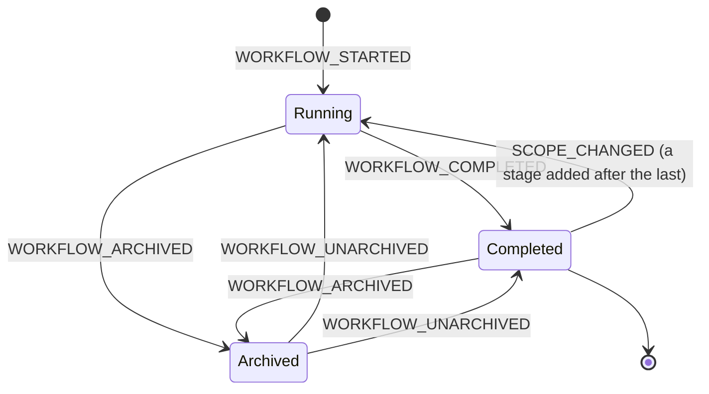
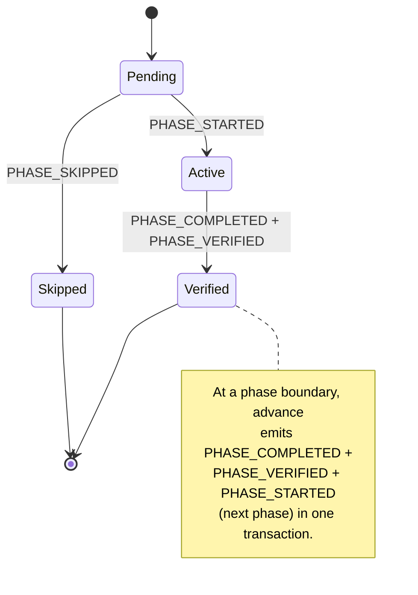
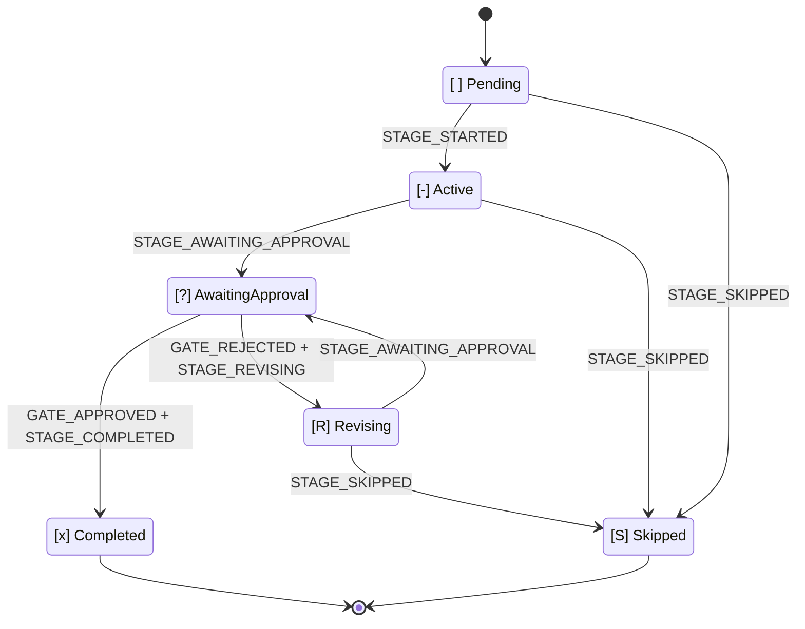

# ステートマシン

この章は、AI-DLC のステートマシン、監査イベントの分類体系、そしてそれらをつなぐルール、すなわち **すべての状態遷移はツールが所有するエミッターを持つ** ことについての、正典となるリファレンスです。遷移はそれを所有するミューテーションパスによって記録され、コンダクターが重複して記録することはありません。この章の表をコードと同期させることは、`tests/integration/t48-audit-event-emitters.test.ts` のドリフトテストによって強制されます。ドキュメントとコードが食い違えば、t48 が失敗します。

AI-DLC は 3 つの入れ子になったステートマシンで動きます。すなわち **workflow**、**phase**、そして **stage** です。4 つ目の独立したストリームは、Claude Code のフックが発行する **session** イベントを記録します。これら 4 つのストリームはインテントの監査証跡（記録ディレクトリ配下の `audit/` シャードディレクトリ。`<record>/` = `aidlc/spaces/<active-space>/intents/<YYMMDD>-<label>/`）を共有しますが、所有するコードパスは異なります。そのため、別々の関心事として読み、それぞれのタイムラインが交錯することを覚えておくのが最も分かりやすいでしょう。

> **North-star invariant（北極星となる不変条件）:** TypeScript が決定的な記帳を所有し、LLM が判断を所有します。すべての監査発行はツールまたはフックに由来し、LLM の散文を発行パスから締め出します。もし MD ファイルを読んでいて `aidlc-audit.ts append <EVENT>` が散文の指示として書かれているのを見かけたら、それはバグです。
>
> **Authority binding（権限の束縛）:** クエリは決して書き込まず、ガードは決して証拠を削除しません。権限はコンテンツと試行に束縛され、発行者のアイデンティティやイベントの順序に束縛されることはありません。[「Authority invariants」セクション](#authority-invariants)が両方のルールを述べ、それぞれが何を扱うかを示します。
>
> **Audit-first atomicity（監査優先のアトミック性）:** ツールは状態をミューテートする *前に* 監査エントリを発行します。監査発行が失敗した場合、ツールは状態に触れる前に例外を投げます。そのため `audit.md` と状態ファイルが食い違うことはありません。この章の末尾近くの[「Audit-first atomicity」セクション](#audit-first-atomicity)が、その失敗モードと、2 つの例外を詳しく述べます。例外とは、audit-of-intent（`WORKTREE_*`、`AUDIT_*`、`MERGE_DISPATCH_INVOKED`）と、アーティファクトが導出され再構築可能な audit-**last** の DocumentKB カタログイベントです。

---

## なぜ 3 つのステートマシンなのか

workflow はフェーズを通過することで完了し、phase はスコープ内のステージを通過することで完了し、stage は承認ゲートが閉じたときに完了します。各レイヤーは、それぞれ異なる判断を所有します。

- **Workflow** — 全体のジョブは実行中か、それとも完了したか？
- **Phase** — このライフサイクルフェーズは進行中か、検証済みか、それともスコープが除外したためにスキップされたか？
- **Stage** — このステージは作業中か、ユーザー待ちか、却下後に修正中か、それとも完了か？

これらを 1 つの状態フィールドに平坦化すると、それぞれの判断が混同されます。分離しておくことで、`/aidlc --status` は「このワークフローをブロックしているのは何か？」を 1 回の読み取りで答えられます。workflow が `Running`、phase が `Active`、stage が `[?]` → 「\<stage\> についてあなたの承認待ち」です。

---

## Workflow マシン



<!-- Text fallback: initial state transitions to Running on WORKFLOW_STARTED; Running transitions to Completed on WORKFLOW_COMPLETED; Running or Completed transitions to Archived on WORKFLOW_ARCHIVED; Archived transitions back to the status it came from (Running or Completed) on WORKFLOW_UNARCHIVED; Completed transitions back to Running on SCOPE_CHANGED when the new scope runs a stage after the last one (the work reopens at that stage); Completed is otherwise terminal. -->

**Status 値:** `Running`、`Completed`、`Archived`。

ワークフローは最初のインテントが作られたとき（`aidlc-utility intent-create`。最初の `/aidlc` で自動呼び出し、または `/aidlc-init` 経由）に始まり、スコープ内の最後のステージの承認ゲートが閉じたときに終わります。`Paused` ステータスも `Waiting for Approval` ステータスもありません。承認はステージレベルの関心事であり、一時停止には UX がありません。

ワークフローの `Running` 状態は、Claude Code のセッションをまたいで保たれます。月曜日にワークフローを始め、セッションを止め、火曜日に再開する。ワークフローは依然として `Running` です。終わったのは *セッション* で、新しいセッションが始まっただけです。

| 遷移 | トリガー | エミッター |
|---|---|---|
| `[*] -> Running` | `aidlc-utility intent-create` | `tools/aidlc-utility.ts` |
| `Running -> Completed` | 最終ステージの結果が `aidlc-orchestrate.ts report` を通じて報告される | `tools/aidlc-state.ts`（内部エミッター） |
| `Running -> Archived`、`Completed -> Archived` | `aidlc-utility intent archive <name>`（人間の判断。クレーム済みのチーム Unit に対してのみ拒否される） | `tools/aidlc-utility.ts` |
| `Archived -> Running`、`Archived -> Completed` | `aidlc-utility intent unarchive <name>`（`Archived From` に記録されたステータスへ戻る） | `tools/aidlc-utility.ts` |
| `Completed -> Running` | 最後のステージより後のステージを実行するスコープへの `aidlc-utility scope-change`。作業はそのステージで再開します（`[-]`、1 件の `STAGE_STARTED`、レジストリ行は `in-flight`）。スイッチ（`--skip`、1 件の `RECOMPOSED` 行でプランから外す）でスキップされたステージはすべて飛び越します。`doctor` は `WORKFLOW_COMPLETED` の後により後の `STAGE_STARTED` が続くのを、ドリフトではなく再開された実行として読み取ります | `tools/aidlc-utility.ts` |

---

## Phase マシン



<!-- Text fallback: initial state transitions to Pending; Pending transitions to Active on PHASE_STARTED; Pending transitions to Skipped on PHASE_SKIPPED; Active transitions to Verified on PHASE_COMPLETED + PHASE_VERIFIED. At a phase boundary, advance emits PHASE_COMPLETED + PHASE_VERIFIED + PHASE_STARTED (next phase) atomically, chaining Verified back to the next phase's Pending-to-Active transition. -->

**Status 値:** `Pending`、`Active`、`Verified`、`Skipped`。

Phase の状態は `aidlc-state.md` の `## Phase Progress` セクションで追跡されます。インテント作成がこのセクションをシードします。`Initialization` は `Verified` になり（作成はハンドオフの前にすべての init ステージを完了させます）、最初のポスト init ステージのフェーズは `Active` になり、それ以降の各フェーズは、スコープがそこに EXECUTE ステージを残さない場合は `Skipped`（それぞれ 1 件の `PHASE_SKIPPED` 監査行）に、そうでなければ `Pending` になります。フェーズの完了は、フェーズ境界で `PHASE_COMPLETED` と `PHASE_VERIFIED` の両方を発行し、続いて次のフェーズの `PHASE_STARTED` を発行し、各行は同じ状態書き込みで切り替わります。このセクションは表示専用です。ルーティングは `Lifecycle Phase` と Stage Progress のチェックボックスを読み、`/aidlc --status` は自身のフェーズブロックをその場で再計算します。

| 遷移 | トリガー | エミッター |
|---|---|---|
| シード（`Verified`/`Active`/`Pending`/`Skipped`） | `aidlc-utility intent-create` | `tools/aidlc-utility.ts` |
| `Active -> Verified` | ステージの完了／スキップがフェーズ境界で `aidlc-orchestrate.ts` を通じて報告される。前方への `aidlc-jump execute` | `tools/aidlc-state.ts`（内部エミッター）、`tools/aidlc-jump.ts` |
| `Pending -> Active`（境界） | 報告された結果の後にエンジンがルーティングする、または `aidlc-jump execute` | `tools/aidlc-state.ts`（内部エミッター）、`tools/aidlc-jump.ts` |
| `Pending -> Skipped`（飛び越された） | フェーズ全体を飛び越す前方への `aidlc-jump execute` | `tools/aidlc-jump.ts` |
| `Verified/Active -> Pending` リセット | 後方への `aidlc-jump execute`（EXECUTE ステージを持つフェーズをリセット） | `tools/aidlc-jump.ts` |
| `Pending <-> Skipped` 再導出 | `aidlc-utility scope-change` / `recompose`（まだ到達していない行のみ） | `tools/aidlc-utility.ts` |

init→ポスト init のハンドオフでは、`aidlc-utility intent-create` 自身が最終の init ステージの後に `PHASE_COMPLETED + PHASE_VERIFIED + PHASE_STARTED + STAGE_STARTED` を発行します。これにより、作成から最初の `advance` までの間が無言にならず、監査証跡がその遷移を捉えます。

---

## Stage マシン



<!-- Text fallback: [ ] Pending transitions to [-] Active on STAGE_STARTED. [-] Active transitions to [?] AwaitingApproval on STAGE_AWAITING_APPROVAL. [?] AwaitingApproval transitions to [x] Completed on GATE_APPROVED + STAGE_COMPLETED, or to [R] Revising on GATE_REJECTED + STAGE_REVISING. [R] Revising transitions back to [?] AwaitingApproval on STAGE_AWAITING_APPROVAL (re-entry). Any of Pending / Active / Revising can transition to [S] Skipped via STAGE_SKIPPED. -->

**チェックボックスの凡例（`aidlc-state.md` 内）:**

| チェックボックス | 状態 | 意味 |
|---|---|---|
| `[ ]` | `Pending` | 未着手 |
| `[-]` | `Active` | 進行中 |
| `[?]` | `AwaitingApproval` | ステージ作業は完了し、ゲートは開いている — ブロッカーはユーザー |
| `[R]` | `Revising` | ユーザーがゲートを却下した — 再入前にステージを修正中 |
| `[x]` | `Completed` | 承認され、完了済み |
| `[S]` | `Skipped` | スコープによる除外、ジャンプによるスキップ、または作業途中での打ち切り |

`[?]` と `[R]` は、そうでなければどちらも `[-]` に見えてしまう 2 つの状況を区別します。再開時、`[R]` はコンダクターに対し、ステージを最初から再実行するのではなく、ゲートに再入する前に以前のアーティファクトとフィードバックを提示するよう伝えます。

`[?]` では、`orchestrate next` はまず `present-approval-gate` ガードのプリフライトを実行します。拒否はそれでも優先されます。ゲートのレビュー済み作業がそのレビューの後に変更され、その変更がまだ記録に残っていない場合（ゲートで人が求めた変更で、relaxed または off の Guard Policy のもとでそのレビューとともに保持されたもの）、まず `report --stage <slug> --result awaiting-approval` を指す `print` を渡します。その report は変更を記録してそれを述べ、チェックを受ける申し出を添えます。そしてゲートはその後に一度だけ示されます。Unit 単位のステージのゲートでは、その print はゲートの Unit について生成された行を運びますが、その行を report は示しません。遅れての共同承認は下記のゲート専用ステップを保ちます。それ以外の場合は、ステージ本体やレビュアーのもう一度の実行ではなく、現在のゲートを `gate_only: true` と `gate: true` を付けた `run-stage` として再提示します。ディレクティブは、存在していた場合は `reviewer`、`review_artifact`、`review_class` を保持します。`reviewer` と `review_artifact` は、Review ブリーフがどの既存レビューを読むかを示します。ブリーフは記録済みのレビューファイルと判定から提示します。レビュアーをディスパッチせず、新しいレビューを要求してはいけません。`none` を含む後の Review Override も、そのブリーフを消しません。ゲートの再入は、現在の試行の対になったレビュー完了と、そのレビューに対して有効な設定を使います。より前の試行のレビューは、レビューなしのゲートに対してブリーフを作りません。このメタデータは承認を与えず、編集されたコンテンツをレビュー済みにもしません。レビュアーの反復設定と `reviewer` および `ensemble` のプロトコルモジュールは存在しません。Construction ポリシーは、存在する場合は `completion_only` とマークされます。
`gate_only` は汎用的な completion-only の記帳より優先され、人間の承認を与えません。チーム所有のゲートは `unit` と `unit_gate` を保持し、自律 swarm の決着は `swarm_settled` とその完了ポリシーを保持します。同じゲート専用の形は、rule-delivery の `continue` 呼び出しを越えても残ります。`next` を繰り返してもステージは変わらず、通常のディレクティブ再発行ルールに従います。

Unit 単位のステージのグリッドが覆われ、それが適用されるすべての Unit が現在の試行で `UNIT_COMPLETED` レシートを持つとき、最後の Unit でのゲートのビートは `build_settled: true` を運びます。そこでは何もプランもビルドもしないため、Code Generation はそれを Plan Approval を通してルーティングせず、それらの Unit がビルドされた元のプランについて再び尋ねません。このフラグは rule-delivery の `continue` 呼び出しに同乗します。それらのレシートを持たない覆われたグリッド（アーティファクトのみを対象とした Build-and-Test のループバック）はマークされません。そのビートはまだ修正を適用できるからです。

unit-major のもとで Unit checkpoint がオフ（そのフィールドが無効または不在）のとき、グリッド全体が覆われた時点でなお残る Unit 単位のステージ承認は、1 つの質問になります。最初の覆われたゲートは `approve_together` を運びます。すなわち `directive.stage` 以降の実行順の未処理ブロックステージ、Unit 群、そしてその両方を示すエンジンの質問です。これは、少なくとも 2 つのステージが残っている最初の未処理ブロックステージにおける単独作業に対してのみ設定されます。checkpoint 有効、stage-major、チーム所有、自律のゲートはそれぞれ独自のフローを保ちます。そのゲートを開くと、`STAGE_AWAITING_APPROVAL` にリストが `Approves Together` として記録され、応答の `next_stage` はリストの最後のステージの次のステージになります。同じ行は、同じ計算から、そのステージのスラッグを `Next Stage` として、`Brief Digest`、`Sensor State`、`Open Decisions`（ゲートが人に決めるよう求めたもの、#2098）とともに記録します。`GATE_APPROVED` は `Brief Digest`（人が決めたブリーフ）と `Decisions Accepted Open` を運びます。`report --result approved` はその後、リスト内の各ステージを順に承認します。最初の `GATE_APPROVED` は `Approves Together` を運び、以降の各ステージは `Approved Together With: <first stage>` に加えて同じ `User Input` と人の言葉を運びます。各ステージはなお、それぞれのアーティファクト、サマリー、レビュアー、センサーのチェックを通過します。最初に拒否したステージがそこで実行を止め、それより前のステージは承認済みになります。そのステージの後の承認は、それをリストに載せた承認以降に応答・却下・回答が記録されていないかぎり、新たな人のターンを必要としません。却下は何も承認しません。その質問で、リスト内の 1 つのステージについて人が求める変更は `next --stage <stage> --unit <unit> --change`（または `--every-unit`）です。print は `aidlc-jump.ts reopen ... --via change` を指し、その Unit スコープの `GATE_REJECTED` は `Reopen: change`、`User Input: Request Changes`、そして質問以降の人の言葉を `Feedback` として運びます。ゲートが開いている間、`next` はまず再オープンされた Unit のステップをルーティングし、次に learnings モジュールなしで同じ 1 つの質問を再び示します。修正中のステージは learnings モジュールを二度とリストに載せず、それに対する `report --result awaiting-approval` は `report --result revised` を指します。開いたゲートでは、`report --result revised` は `report --result awaiting-approval`、すなわち開いたゲートが変更の後に取る再チェックを指し、人のブロッキングセンサーのオーバーライドは保たれます。共同承認されたステージのための唯一の遅れたゲートでは、`report --result revised` は `next` を指し、`next` がその 1 つの質問を再び示します。いずれの場合も記録には何も変更を加えません。

| 遷移 | トリガー | エミッター |
|---|---|---|
| `Pending → Active` | 直前の報告結果の後にエンジンがルーティングする | `tools/aidlc-state.ts`（内部エミッター） |
| `Active → AwaitingApproval` | `aidlc-orchestrate.ts report --stage <slug> --result awaiting-approval`。レビュアーを持つステージは、ゲートを開く前に新しい終端レシートを必要とする | `tools/aidlc-state.ts`（内部エミッター） |
| `AwaitingApproval → Completed` | `aidlc-orchestrate.ts report --stage <slug> --result approved --user-input "Approve"` | `tools/aidlc-state.ts`（内部エミッター） |
| `AwaitingApproval → Revising` | `aidlc-orchestrate.ts report --stage <slug> --result rejected --user-input <text>` | `tools/aidlc-state.ts`（内部エミッター） |
| `Active → Revising` | ゲートが開いた状態での回復が必要な場合の、同じ却下報告 | `tools/aidlc-state.ts`（内部エミッター） |
| `Revising → AwaitingApproval` | `aidlc-orchestrate.ts report --stage <slug> --result revised`。レビュアーを持つステージは、ゲートの再入前に却下後の新しい終端レシートを必要とする | `tools/aidlc-state.ts`（内部エミッター） |
| `{Active,Revising} → Skipped` | `aidlc-orchestrate.ts report --stage <slug> --result skipped --reason <text>` | `tools/aidlc-state.ts`（内部のルーティング済みスキップエミッター） |
| `AwaitingApproval -> Skipped`（プラン行が SKIP） | 同じスキップ報告。ただしステージのプラン行が今 SKIP を示す場合のみ（Reverse Engineering がそのゲートで待っている間に、人がその作業は新規プロジェクトだと述べた）。ゲートはスキップとして閉じ、承認として閉じることは決してない | `tools/aidlc-state.ts`（内部のルーティング済みスキップエミッター） |
| `Pending → Skipped` | スコープ構成、または `aidlc-jump execute` | `tools/aidlc-utility.ts`、`tools/aidlc-jump.ts` |
| `{Pending,Active,Revising} -> Skipped`（unit-major の歩行） | `aidlc-orchestrate.ts report --stage <directive.stage> --unit <directive.unit> --result skipped --reason <text>`（歩行の最初のステージでは、`--unit` を付けない人自身のスキップが、ビートの unit とそのステージをまだ負っている各 unit に対してそれを実行する）、または飛行中の unit を進める前方ジャンプ（`aidlc-jump.ts execute --units <unit> --stages <steps>`）。いずれも、どの unit もそのステージを負わなくなった（各 unit がスキップ済みまたは kind 的に空）時点で | `tools/aidlc-state.ts`（内部の `skip --unit` エミッター。unit ごとに 1 件の `UNIT_SKIPPED`） |

`approved` 報告は、ゲート後の遷移全体を所有します。`GATE_APPROVED + STAGE_COMPLETED` を発行し、次にスコープ内の次のステージへルーティングし、`STAGE_STARTED` に加えて境界で任意の `PHASE_*` イベントを発行します。スコープ内の最後のステージでは `PHASE_COMPLETED + PHASE_VERIFIED + WORKFLOW_COMPLETED` を発行し、Status=Completed を設定します。コンダクターは報告の前後に状態のライフサイクル動詞を呼び出しません。

**ルーティング済みスキップ。** `report --result skipped` は、メインワークフロー上で明示的な非空の `--stage` と `--reason` を伴う場合にのみ受け付けられます。条件は、名指しされたステージが `execution: CONDITIONAL` と宣言されていること（reason が、人がスキップを求めたステージに対してエンジンのスキップステップが名づけるもの、`the person asked to skip it`、であればあらゆる種類のステージ）、`Current Stage` に等しいこと、そして Active か Revising であるか、またはプラン行が今 SKIP を示すか reason がそのトークンであるとき（人自身の判断が無意味にしたゲート。Unit 単位の Construction のもとでは、そのための Unit のファイルはそのまま残ります）の AwaitingApproval であることです。再利用のみに支えられるパイプラインステージ（各リポジトリが現在の試行の `ARTIFACT_REUSED` 行のまま、スキャンレシートなし）のスキップは、人自身のスキップと無人実行を除いて、ステージの質問への人の回答が記録されていること（ステージ開始以降の `QUESTION_ANSWERED`）も必要とします。その質問が開いている間、ステップはそれを示し、回答の後は keep に対して同じスキップ報告を、scan に対してステージのスキャンを名指します。記録に回答がなければ、ステップはそれを記録する方法を述べます。それまでは何もスキップされません。これはアーティファクト、unit 単位、アンサンブル証拠の各ガードより前に実行されます。正当なスキップは完了証拠を負わないからです。エンジンは内部スキップ遷移をそのルーティングマーカーとともに呼び出します。トランザクションは `[S]` を保ち、ちょうど 1 件の `STAGE_SKIPPED` を発行し、`STAGE_COMPLETED` を決して発行せず、次のステージを開始する（境界イベントを含む）か、ワークフローを完了させます。先へのルーティングが失敗した場合、回復はスキップマーカーとカーソルを同じステージに残すため、スキップイベントを重複させることなくルートを再試行できます。`report --single --result skipped` は拒否されます。

`Construction Iteration: unit-major`（単独 Unit 所有）のもとでは、歩行が一度に 1 つの `(stage, unit)` ビートを指示する間、`Current Stage` は最初の unit 単位のブロックステージに留まり、ステージの条件はその unit について判断されます。歩行がビート上にある間、スキップはそのビートのステージと unit を名指さねばならず（`--unit` が必須）、同じ CONDITIONAL と reason のルール（人がスキップを求めたときのあらゆる種類のステージ）のもとで、その unit のみを対象とします。unit を名指さない唯一のスキップは、歩行の最初のステージ、すなわち Current Stage そのものに対する人自身のスキップ（エンジンの reason）です。それはここから先のすべての unit に対する人のスキップなので、`report` はビートの unit に対して、続いてそのステージをまだ負っている各 unit に対して同じ遷移を実行し、すでにそのステージをこなした unit はその作業をステージの承認のために保ちます。内部の `skip --unit` 遷移は unit の `Run floor` で 1 件の `UNIT_SKIPPED` レシートを発行するため、その unit はこの試行でそのステージに何も負いません（出力、レビュー、サマリー、そしてその Construction checkpoint も同様に。kind 的に空の unit と同じ）。歩行は先へ進み、他のすべての unit はなおそのステージを受けます。自身のコードを書くすべてのステップをスキップした unit は、Construction checkpoint をまったく負いません。歩行は次の unit へ進み、ステージ承認はそれを待ちません。unit が作業を終えた後、unit 単位のステップ内の前方ジャンプは、飛行中の unit だけを同じやり方で進めます。`aidlc-jump.ts execute --units` は、歩行がターゲットの前でその unit を止めるであろう各ステップに対して、またそのステージ承認の裏で再オープンされたステップ（そのチェックボックスと Current Stage はそのまま）に対しても、この遷移を実行します。一部の unit がステージをこなし、他がスキップした場合、ステージは通常のゲートを通じて完了し、作業をこなした最後の unit で提示され、スキップされた各 unit とその reason が 1 行ずつ添えられます。どの unit もそのステージをもはや負わないときにのみ `[S]` とマークされます。すなわち、1 件の条件付き `STAGE_SKIPPED` を伴うその場の後続ブロックステージとして、または上記のルーティング済みスキップを通じた Current Stage としてです。Construction checkpoint がある場合、Unit checkpoint はそのようなステージを自身の `Stages` に保つため、最後のスキップより前に与えられた承認はなお一致しますが、その `GATE_APPROVED` / `GATE_REJECTED` 行はステージを `Gate Stages` から外すため、checkpoint での Request Changes は、すべての unit にとって `[S]` であるステージを再オープンしません。ステージのファイルがすでに書かれている unit はスキップできず、unit-major のもとでは、いずれかの unit がそのステージのファイルを持った時点で、ビート外の Current Stage スキップは拒否されます。ただしプランがそのステージをもはや実行しない場合（人がスコープを変えた）は別で、そのスキップは通る一方で unit のファイルはそのまま残ります。それ以外のスキップは、拒否の中でスキップできるステップ（と unit）を名指し、それに従っても unit の書かれた作業が失われない場合にのみスキップコマンドを提示します。そうでなければ、ワークフローのエントリーコマンドで続けるよう述べます。

チーム所有の Unit（`Unit Ownership: team`）も同じやり方で、チームの歩行が渡すステップ上でスキップします。ビートはクレーム済み Unit の最初の未決着ブロックステージで、`unit start` の前後を問わず、唯一の歩行が `next` でルーティングするものから読まれます。遷移は Unit の `UNIT_SKIPPED` レシートのみを書きます（そのクレームの `Attempt Generation` を伴って）。ステージのチェックボックスはあらゆるチームの Unit から導出されるため、クレーム済みのチェックアウトでマークやルーティングが行われることは決してありません。歩行はそのステップについてサマリー、レビュー、ゲートを求めません（unit-end リズムでクレームされた Unit は、それを自身の唯一のゲートのチェックから外し、Code Generation（そこにそのゲートが座ります）でないかぎり `Gate Stages` からも外します。Code Generation の場合、その行は `Skipped Stages` にそれを名指すため、そこでの Request Changes はそれをスキップのままにします）。Unit の行は、その kind が何も書かないステージと同じように `[x]` を示し、レシートは公開された作業とともに移動し、pin はそのステージを Unit が何も負わないものと見なします。すなわちドキュメント、レビュー、レシート、ステージ単位のゲートはなし（Code Generation の場合はプランも Plan Approval もなし）です。Pin の証拠はそれを reason とともに `stages_skipped` の下にリストし（`stages_completed` からは外し）、マージゲートステップの `skipped_steps` 行は、エージェントにそれをマージの質問の中で述べさせます。

**Artifact ガード（issue #366）。** ステージを `[x]` とマークするすべての報告結果は、それを完了させる前に決定的なアーティファクトチェックを実行します。これにより、ディスク上の作業の証拠なしにステージを完了とマークすることはできません。`produces[]` を宣言するステージは、それらのアーティファクトのうち少なくとも 1 つがアクティブなインテントの記録ディレクトリまたはその unit 単位の Construction ディレクトリ配下に存在しなければなりません。codekb ステージはより厳格です。登録済みの各リポジトリディレクトリが、宣言された `produces[]` のセット全体を含まねばなりません。単一／未記録のインテントは、解決された 1 つの codekb ディレクトリを使います。`workspace_requires: true` はまた、`aidlc/` とハーネスディレクトリの外のソース作業の証拠も探します。すなわち、ワークスペース内、インテントの記録済みリポジトリ内、チェック実行時に見つかる子リポジトリとワークツリー内、それらそれぞれのリンク済みワークツリー内、ワークスペースの git が追跡しないチェックアウト内（チェック実行時に見つかるものは、レビューがそのコード変更を見られる場所でのみ数えられるため、ハーネスフォルダー内やプロジェクト外は対象外）、そしてステージの試行開始以降に変更されたソース内です。何も見つからない場合、Guard Policy が off なら 1 行の記録とともに作業を続けさせます。そうでなければエージェント自身の最初の報告は拒否され、2 回目はその行（`SOURCE_WORK_NOT_FOUND`）とともに承認の質問を人に突きつけます。ただし、ゲートの後で人の応答が不承認にならないであろう場合は別です。失敗は他に何も書きません。オプションの出力は関与しません。`produces_kinds` については、kind が必須セットをゼロに刈り込む unit はアーティファクトを負いません。該当するいずれの unit も厳格なままです。`AIDLC_SKIP_ARTIFACT_GUARD=1` でバイパスします。同じスイッチはレビューロガーの必須出力の存在チェックもバイパスします。それがなければ、unit 単位のステージのステージレベルレビューは、権威を持つあらゆる Unit の該当する必須出力を必要とします。オーサリングされた Unit DAG が存在せず、現在の試行にマージ済みの Bolt 行がある場合、ステージレベルのレビューフィンガープリントは、代わりにそれらのマージ済み Unit をちょうど列挙します。Bolt のマージは主張ではなく証明されます。`aidlc-bolt complete --merge` は状態と監査のマージが走る前に `BOLT_COMPLETED` を発行するため、スラッグに裏打ちされた（ワークツリーの）試行は、対応する後の `AUDIT_MERGED` レシートがマージ列が main に着地したことを確認してはじめてマージ済みと数えられます。名前のみの非ワークツリー Bolt の `BOLT_COMPLETED` は終端のままです。なおマージ証拠を待つ完了はオープンパスに留まり、スラッグなしの完了はスラッグに裏打ちされた試行を閉じられず、後のフラグメントクリーンアップの `BOLT_FAILED` は確認済みのマージを消せません。`AUDIT_MERGED` 自身はレビュアー権限を運びません。別の監査シャードの同一秒の行が、レビュー要求・判定・レシートを曖昧にすることは決してありません。オープンな Bolt は、その Unit アーティファクトがなお main ツリーの外に存在するため、通常のステージレベルのフォールバックパスに留まります。その Bolt をマージするとフィンガープリントのドメインが変わり、`--retry-pending` でその正確な保留中の序数が再束縛されるまで、意図的により前のステージレベルのレシートを無効化します。unit 単位のレシートフィルタリングは、オープンな Unit とマージ済みの Unit の両方を依然として認識します。古い試行がマージされた一方で新しい試行がオープンのままのとき、Unit は両方のセットに属することがあります。マージ済みのメンバーシップがゲートの要求とステージレベルのフィンガープリンティングを駆動し、両者の和集合がレシートフィルタリングを駆動します。

**Reviewer ゲートガード（issue #551）。** レビュアーを持つステージは、設定されたレビュアーが新しい終端の `REVIEW_COMPLETED` レシートを持つまで、`gate-start` や `revise` を通じて `AwaitingApproval` に入れません。同じレシートは 4 つの完了パスすべてで必須のままですが、1 つの例外があります。すなわち、人自身の承認（質問以降の応答とともに報告されたもの）は、現在の試行で要求されたがまだ判定のないレビューを越えて通ります（Code Generation でも、そのレビューが変更されたソースの回復パスであるとき）。そして `GATE_APPROVED` は `Review: not finished` を運びます。レビュアーモジュールの NOT-READY フォールバック（どのレビュアーも与えていない判定）を越える人の承認も同様です。そのフォールバックは、従来どおり、あらゆる Guard Policy のもとでレシートを満たします。その承認のために報告がバックフィルするゲート（`gate-start --recovered --person-approves`）も、そのような応答の後にのみ、同じように開きます。要求されたことのないレビュー、飛行中の回復レビュー、検証できなかった結果、判定後に内容が変わったレビュー、そしてメモリが Guard Policy を strict にロックしているプロジェクトは、レビューを必須のままにします。すでに開いているゲートを再報告すると、これらのガードが再実行されますが、重複する遷移は書かれません。`Active` から直接報告された却下は、`STAGE_AWAITING_APPROVAL` 行をでっち上げることなく `Revising` へ移ります。別のガードを意図的に分離する合成遷移テストは `AIDLC_SKIP_REVIEWER_GATE_GUARD=1` を設定できます。このバイパスはゲートの開放にのみ適用され、`approve`、`advance`、`finalize`、`complete-workflow` には決して適用されません。隣接するサマリー確認のテストバイパスは `AIDLC_SKIP_SUMMARY_CONFIRMATION_GUARD=1` です。

**サマリー入力とレビュー済み出力。** ステージが `summary_confirmation`（`required` または `if-present`）を宣言するとき、`-questions` で終わる宣言済みアーティファクト名は、書き込み可能な人間の入力です。ファイルのレビューマニフェストエントリは `summary-input:sha256:<digest>` で、`summaryInputReviewFingerprint` によって計算されます。すなわち、改行コードを正規化した後、空、`Looks correct`、または `Request changes` である正典のサマリー確認 `[Answer]:` の値のみをマスクします。末尾の HTML コメントは保持されます。回答のマスキングは、サマリー確認および Plan Approval のタグ選択と共有されるパーサー裏打ちの `visibleMarkdownLines` 投影を使います。コード例・コメント・生 HTML ブロック内の回答に見えるテキストは決してマスクされず、生 HTML コンテンツは決してコントロールタグを供給しません。確認セクションがちょうど 1 つ、対応する回答行がちょうど 1 つなければなりません。一致が不在または曖昧な場合は、正規化されたコンテンツ全体が束縛されたままになります。他のすべての質問回答、サマリーの散文、コメント、セクションは束縛されたままです。`missing` と `not-file` は別個のマニフェストエントリのままです。必須ファイルの存在と安全なキャプチャのチェックは依然として適用され、スナップショットは swarm レコードのマージのために実際の質問バイトを保持します。

レビュー凍結フックは、人間の Q&A プロトコルが進められるよう、これらの質問書き込みを許可します。確認の記帳のみがレビューフィンガープリントを保ちます。実質的な変更はレビューのコンテンツ束縛を無効化します。他の生成済みアーティファクトは、そのレビュー済みバイトに束縛されたまま、終端レシートの凍結によって保護されます。questions アーティファクトを名指す明示的な `review_artifact` は例外です。そのアーティファクトは、その確認回答を含めて、完全にバイト束縛され凍結されたままになります。

同じ試行で同一のコンテンツを再確認すると、サマリーの承認が保たれ、すでに承認済みの出力を書き直す必要はありません。ゲートの却下だけでも、その承認と出力の継承が保たれます。レビューレシートは依然としてそれ自身の却下境界に従います。サマリーチェックポイントでの `Request changes` 回答は、アクティブなサマリーの承認を取り下げます。変更された確認済みコンテンツは、依然として通常の回復シーケンスを必要とします。すなわち、人間の確認を得て、その承認のもとで出力を再生成または再保存し、必要な新しいレビューを得ることです。凍結された出力を再オープンするには、提示されたライフサイクルの救済手段を使ってください。questions ファイルを編集しても、それらの出力の編集が承認されるわけでも、プランが承認されるわけでもありません。既存の Change Control ルールは、引き続き該当するドリフトを別途制御します。

終端レビューの記録は、レビュー要求と同様に、現在のサマリー確認と出力の受理を再チェックします。人間が確認を取り下げた後や、出力に必要な承認が欠けている間は、フィンガープリントが一致するだけでレビューを認証することはできません。`if-present` については、いったんサマリー確認の判断または確認が現在の試行に参加すると、questions ファイルを削除してもその義務は取り除かれません。欠落ファイルのチェックが拒否します。

`Bun.markdown` の CommonMark/GFM パーサーが変えるのは可視性であって、生コンテンツのダイジェストアルゴリズムやレビューレシートの形式ではありません。影響を受けないドキュメントのアイデンティティは変わりません。古いレビューレシートは、再計算が一致すれば使えるままです。異なるフィンガープリントだけが、既存の再保存／再レビューの回復を必要とし、その原因としてパーサーのセマンティクス変更があり得ます。保存済みの証拠は書き直されません。この移行は承認も追加のレビュー許容も与えません。

**Code Generation の完了はそのプランを待つ。** Code Generation の背後のプランがビルドを許さない間（プランがまだない、承認されていない、差し戻された、または strict のもとで承認以降に変わった）、ゲートが開いていない状態での `awaiting-approval`、`revised`、`completed`、`approved` を伴う `report --stage code-generation` は、ステップで応答し、何も変更しません。「コードプランはまだ承認されていません。`next` を実行し、表示されるステップに従ってください」。自身のプランが待っている Unit に対する `unit complete --stage code-generation` も、そしてプランが待っている孤立実行を閉じる `report --single --stage code-generation` も同様です。後者のステップは、その実行自身の `next --stage code-generation --single --scope <the scope it started with>` を名指します。これは、裸の `next` はメインワークフローをルーティングし、ワークフローがなければ `next` はデフォルトスコープを取るためです。プランの承認は、ビルドが判断するのと同じように判断されます（`codeGenerationCompletionPlanWaits`、`codeGenerationExecutionAllowed` を介して）。すなわち、現在のレシート、プラン承認がオフ（スコープ、人、またはマシンスイッチ `AIDLC_DISABLE_PLAN_APPROVAL_GUARD=1` が信頼される場所で、`next` が読むとおりに読まれる）、または変わった承認済みプランをビルドする引き下げられた Guard Policy です。これは報告が対象とする各ターゲット（ゼロ Unit のターゲット、名指しされた Unit、または Code Generation 作業を持つ Unit 群）について読まれ、ステップマーカーから読まれることは決してありません。そのため、ビルドステップがその開放によって退いた後、レビューの後に再び示されるゲートは通ります。完了またはスキップが記録された Unit は再び判断されないため、それ以降に（更新によって）古く読まれる Testing Contract がゲートを止めることは決してありません。ビルドがレビューされた後に動いた Testing Contract、たとえば人が learnings ステップで保ったテスト慣行も同様です。Code Generation の `REVIEW_COMPLETED` 行は有効な契約を記録します（`Testing Contract`。swarm ワーカーのチェックアウトにはなく、委譲された承認はそれを決して読まないため、そのような Unit の完了は動いた契約のために止められます）。そして、ターゲットの終端レビュー（鮮度チェックが保つもの）がなおその作業を覆い、プラン自身の契約のもとで記録されていた間、完了はその契約に対して承認を読みます。`next` はその後、ビルドではなく仕上げを渡します。すなわちゼロ Unit のターゲットにはレビューの後のステップを、Unit にはその Unit の完了をです。ビルドが行うであろう書き込みは依然として拒否され、拒否はその `next` を名指します。ゲートの前に人が求める「プランをレビューする」は、依然としてプランへ戻り、完了はそれを待ちます。そのステップは、人がコードプランを再び見たいと求めたこと（未承認だとは言わず）を述べ、同じ `next` を名指します。レビューより前に動いた契約は、ビルドが走っている間に動いたのであり、strict のもとではそのビルドは依然としてプランを待ちます。開いたゲートでの人の回答と、回復の質問で彼らが選んだ救済手段は彼らのものであり、止められません。このチェックはステージ自身の完了チェックの後に実行されるため、彼らの不承認は彼らの言葉を保ちます。

**Ensemble 証拠ゲート。** `mob` または `subagent`-with-supports のステージでは、宣言された支援エージェントのコントリビューションファイル（`<stage>/contributions/<agent-slug>.md`）が欠落しているか、その `**Collaborator:**` アイデンティティマーカーの先頭行を欠く間、報告パスは `awaiting-approval`、`revised`、`approved` を拒否します。これはアンサンブルが実際に集結したことの決定的な証明です。決着した自律 swarm は免除されます（その unit 単位の収束台帳が証拠です）。`report --single` はステージレベルの証拠のみをチェックします。`mode: pipeline` では、同じ報告結果とすべての直接の完了遷移が、すべての lead/support リンクについて順序付けられた現在の試行の `PIPELINE_LINK_COMPLETED` レシートを必要とします。マルチリポジトリのリバースエンジニアリングは、スキャンされたリポジトリごとに完全なチェーンを必要とします。`Decision=keep` を伴う現在の試行のリポジトリスコープの `ARTIFACT_REUSED` 行は、再利用されたリポジトリを免除します。孤立行は `Workflow: single-stage:<slug>` を運び、グラフ宣言された Reverse Engineering アーティファクトセット全体が有効なままで、ストアが `CURRENT` のままである間にのみ受け付けられます。一方、`modify`/`redo` 行は受け付けられません。却下、ジャンプ、または後のステージ開始はメインワークフローの証拠をリセットし、孤立した `--single` リンク行はそれを決して満たしません。`AIDLC_DISABLE_ENSEMBLE_EVIDENCE=1` でバイパスします。これは、コントリビューションファイルや飛行中のリンクレシートが失われた、正当に実行されたステージを回復するためだけを意図しています。

**ソースの鮮度と unit 単位の帰属（#629/#646/#662）。** `workspace_requires` ステージでは、すべての終端レビューが依然としてワークスペース全体の `Source Fingerprint` を運びます。最新のモダンな束縛は通常、4 つの完了ルートすべてにおける外側のレビュー後ミューテーション境界です。レシートはまた、レビュアーが見たリスティング（`Source Listing`）も名指すため、それ以降に AI-DLC 自身のファイルのみが動いた場合（AI-DLC の更新。`aidlcOwnedSourceKey` が名づけるセット）、レビューは依然として有効で何も述べられず、relaxed または off の行はそのセットの外のファイルのみを名指します。その歩行が読む `.aidlc-source-paths.json`（リポジトリルートのもの、または記録済みチェックアウト自身のもの）の `exclude` リストが今や歩行から外すパスは、下記のベースライン比較から外されるのと同様にその比較からも外されます。そのため、レビューの後に除外されたキャッシュは、1 回の回復レビューの前でも後でも変更ではありません。strict の拒否は、実際に動いたパスを名指します。そのフィールドのないレシート、またはリスティングがこのマシンにないレシートは、従来どおりフィンガープリントで比較されます。unit 単位のレシートは `Unit Source Fingerprint` を追加し、これは unit の strict な `source-manifest.json` のバイトと、すべての exact/directory クレームの現在の内容を束縛します（CRLF テキストは LF として読まれます。ステージプロトコルの改行コードルールを参照）。ディレクトリの受理は、リポジトリルートの `.aidlc-source-paths.json` の `exclude` リストが明示的に外す Git 無視の子孫を、完了と同じ境界を使って無視します。登録済みの `paths` エントリは `exclude` より優先されます。その境界内になお含まれる無視された子孫は、既存の拒否を保ちます。読めないレジストリは免除を与えず、exact な無視ファイルのクレームは既存の受理ルールを保ちます。レシートは新しいものから評価されるため、より新しい検証済みのクレーム者が、意図的な共有パスについて古いレシートを庇うことがあります。exact/directory クレームの中の、覆われていない編集・削除・新規パスは、所有する unit のみを無効化し、その unit の 1 回の有界な `stale-receipt` 回復に入ります。Construction checkpoint は同じレシートを読みます。Unit のレビュー以降に動いたすべてのクレーム済みパスが、試行内のより新しいレビューがクレームするパスについて記録したバイトをちょうど今保持するとき（`unitSourceAttributed`）、checkpoint はその Unit のレビュー済みソースを束縛します。そのため、別の Unit 自身のレビュー済みビルドは承認済みの checkpoint を承認済みのまま保ち、それ以外の変更は再び尋ねます。そのような変更、どのレビューも記録しなかった変更は、あらゆる Guard Policy のもとで Unit を `unitSourceMoved` にします。checkpoint がオンのとき、ロガーはその Unit にそのための 1 回の `stale-receipt` 回復を与え、`strict` のもとでは checkpoint は要求を `rereview` として運ぶため、人が一度尋ねられる前にコードが再チェックされます（レビュー後に編集されたドキュメントも同じやり方で再チェックされます）。`relaxed` と `off`（レシートスキャンがそうするように、checkpoint は `guardPolicyAcceptsChanges` を通じてこれを読みます）のもとでは、動いたパスや編集されたレビュー済みドキュメントは受理される変更です。checkpoint は Unit のレビュー済みソースとドキュメントを束縛し、その承認または準備状態を保ち、1 件の `CHANGE_ACCEPTED` 行が何が変わったかを名指します。変更を記録する最初の後続ステップがそれを書きます。すなわち、そのステージのレビュー要求か完了、またはその Unit の checkpoint `verify`（これはその行を `change_notices` として返します）です。Unit に束縛されたレシートについては、スキャンは Unit 自身のパスのみを名指し、ワークスペース全体の `Reviewed source` 行を外します。ワークスペース全体は別の Unit 自身のビルドでも動くからです。再チェックの後の人の checkpoint 承認、または彼らが Unit のために始める新しい試行（その checkpoint やチーム gate での Request Changes、または Unit のステップの再開始）は、新しいものを 1 つ開きます（`unitRecheckReopened`。Unit の進捗は回復を再び未使用として報告します）。そのため、後のあらゆる編集は再チェックされ一度尋ねられ、あらゆる redo の変更されたコードはレビューされます。新しい試行は checkpoint がオフでもそうします。Unit の試行がそれ自身のものであるところ（チームの Unit、または 1 つずつビルドされる Unit）ならどこでもです。そこでは、自身の再チェックを持たない Unit は、それを使っていないということです。レビューがオフでも同じことが成り立ちます。Unit の `GATE_APPROVED` 行は `Approved Evidence`（各ステージのアーティファクトとソースのフィンガープリント、および最大 50 のクレーム済みパスとそのエントリ）を記録し、`relaxed` と `off` のもとでは、どのレビューも再チェックしないステージはそれらの値を checkpoint フィンガープリントに保つため、承認は維持されます。その 1 件の `CHANGE_ACCEPTED` 行（Checkpoint `construction-unit`）は、次の checkpoint の `verify` または Construction ステージ自身のチェックによって書かれ、保たれたリスティングが依然として承認済みのソースフィンガープリントを再現するとき、変更されたパスを名指します。承認の質問の `DECISION_RECORDED` 行は同じ値を `Asked Evidence` として記録するため、質問の後かつ人が回答する前に加えられた変更は、彼らに示されたものを保ちます。`relaxed` と `off` のもとでは、彼らの `approve` がそれを記録し、1 件の `CHANGE_ACCEPTED` 行を書き、それを `change_notices` の中で述べます。`strict` のもとでは、または `Approved Evidence` が存在する前に記録された承認については、Unit について再び尋ねられます。Unit の承認の後のスコープ変更も、あらゆる Guard Policy のもとでそれを保ちます。新しいプランのステージリスト、レビューキャップ、または walking skeleton は checkpoint のアイデンティティを変えるため、Unit は、その最新の checkpoint 行がその `GATE_APPROVED` であり、`SCOPE_CHANGED` 行がそれに続き、その Unit に対するジャンプや Unit start、一時停止、スキップ、却下がそれに続かず、プランが Unit に対して依然として実行する各ステージが、その `Approved Evidence` が記録したアーティファクト・ソース・run floor を保持する間、承認済みのまま留まります。同じルールが、変更より前に尋ねられた checkpoint 質問のフィンガープリント（その `DECISION_RECORDED` 行の `Asked Evidence`）を、同じ種類の checkpoint について保ちます。その検証と開いた質問が依然として一致するため、人の 1 回の回答が承認を記録します。Unit とバッチの checkpoint フィンガープリントは、記録フォルダーをプロジェクトからのパスとしてフォワードスラッシュで保持するため、Linux や macOS でなされた承認は Windows でも、またその逆でも有効です。Windows が以前バックスラッシュで記録した承認も、依然として有効です。

`WORKFLOW_STARTED`、`STAGE_JUMPED`、そして `workspace_requires` の `STAGE_STARTED` は、コンテンツアドレス指定のソースリスティングのベースラインを記録します。該当するすべての unit が新しいモダンな証拠を持った後、完了はベースラインを現在のリスティングと比較します。Guard Policy が strict のもとでは、新しいクレームの和集合の外の変更されたアプリケーションソースパスをすべて拒否します。relaxed または off のもとでは、それらのパスを一度 `CHANGE_ACCEPTED`（checkpoint `review-receipt`）として記録し、1 行で人に名指します。Git が無視するパスで、HEAD で追跡されておらず `.aidlc-source-paths.json` にも登録されていないものは、その比較から外されます。ソースマニフェストはそれをレビュー証拠として拒否するため、どの Unit もそれをクレームできません（プロジェクトの `.gitignore` が Git から締め出すビルド出力やテスト実行の記録です）。それはフィンガープリントとリスティングには残ります。リポジトリルートの `.aidlc-source-paths.json` の `exclude` リストが歩行から外すパスも、登録済みのパスがそれを名指すかその下に位置しないかぎり、パスだけによって（入れ子リポジトリ自身のエントリを含めて）その比較から外されます。そのため、ステージ開始後に書かれた exclude が削除として読まれることはありません。各リポジトリルートは自身のレジストリを読み、レジストリファイル自体は AI-DLC 自身のものであって、どの Unit がクレームするものでもありません。unit-major の Construction は常にワークフロー／ジャンプの境界を使います。ソース作業がその遅い `STAGE_STARTED` に先行し得るからです。境界や最新のクレーム者を決める、秒単位で等しいシャードをまたいだ行は、シャードのファイル名順を信頼する代わりに、フェイルクローズします。

却下はレビューと run-floor の勘定をリセットしますが、その完了ベースラインを置き換えることは決してありません。そうしなければ、却下時に存在するクレームされていないパスが、次の試行に既得権として引き継がれてしまうからです。前の試行が検証済みの `SWARM_SOURCE_MERGED` チェーンを持つとき、`GATE_REJECTED` はその最終的な `Prior Accepted Source Fingerprint` のみを運び、着地がリスティングを持つ場合は `Prior Accepted Source Listing` を伴います。次の試行の最初のソースマージはその集約から始まらねばならず、一方で完了は引き続き元のステージ入口のベースラインに対して比較します。リスティングがあれば、それ以降の AI-DLC 自身のファイルのみへの変更（AI-DLC の更新）はそのマージを止めず、人のソースへの変更は彼らのファイルを名指します。リスティングのない却下は、フィンガープリントで比較されます。

グローバル境界には、狭く限定された調整が 1 つあります。クレームされていないベースラインの変更（追加・変更・削除）が完全に元に戻された場合、完了は、有効なベースラインスナップショットが存在して有効であり、該当するすべての unit がなお新しいモダンな unit 束縛を持ち、ベースラインから現在までの差分にクレームされていないパスが 1 つもない場合にのみ進めます。これは一時的なクレームされていない変更が消えたことを証明します。通常のレビュー後の編集、古いまたはレガシーな unit 束縛、欠落した証拠、残っているクレームされていない差分のいずれも、依然として通常のグローバル優先の拒否パスを取ります。

フィンガープリントと正典のパスごとのリスティングは、リポジトリメタデータや Git 実行ファイルの可用性に依存しない、1 つの有界なファイルシステム歩行から得られます。通常および無視されたアプリケーションバイト、外部ソースシンボリックリンクのターゲット、ワークスペースルーフのファイルは束縛されたままですが、そこにある AI-DLC 自身の `aidlc.settings.json` と `aidlc.settings.local.json` は別です。フレームワーク状態、exact なセンサーキャッシュ、VCS メタデータ、依存関係／キャッシュのディレクトリまたはシンボリックリンク、未登録の `build/`・`coverage/`・`dist/`・`logs/`・`target/`・`tmp/` のディレクトリまたはシンボリックリンク、`.csproj`・`.fsproj`・`.vbproj` ファイルの隣にある未登録の `bin/`・`obj/`・`out/` のディレクトリまたはシンボリックリンク（.NET のビルド出力）、そしてパッケージマネージャーがそのマニフェストの隣に満たす未登録のディレクトリまたはシンボリックリンク（`composer.json` や `go.mod` の隣の `vendor/`、`Podfile` の隣の `Pods/`、`mix.exs` の隣の `deps/` と `_build/`、`pubspec.yaml` の隣の `.dart_tool/`、`bower.json` の隣の `bower_components/`、`Gemfile` の隣の `.bundle/`、`stack.yaml` の隣の `.stack-work/`）は、ソース境界の外に留まります。それ以外の場所ではこれらの名前は束縛されたままです。Node や Rails の `bin/` スクリプト、ヘキサゴナルの `adapter/out/` パッケージ、C プロジェクトが `vendor/` の下に保つサブモジュールは、本物のソースだからです。Bundler の `vendor/bundle` は除外されません。Rails は本物のソースを `vendor/assets` に保つため、`Gemfile` の隣の `vendor/` は束縛されたままです。.NET の出力が境界を離れる前に記録された証拠は、ソースまたはそれらの出力が変わるまで依然として一致します。

条件付きの生成出力ディレクトリの下にある本物のソース（バイナリや拡張子なしのソースを含む）は、ルートの `.aidlc-source-paths.json` で宣言でき、同梱の名前のどれにも覆われないマシンローカルなツリーやファイル（ローカルインデクサーのキャッシュ、ツリー内のビルド出力）は、そこで除外できます。

```json
{"version":1,"paths":["dist/worker.js","build/source"],"exclude":["tools/.indexer"]}
```

どちらのリストも任意です。除外されたパスとその下のすべては境界を離れ、swarm の Source Commit はその HEAD のコピーを保ち、その下の登録済みパスは依然として勝ちます（それは束縛され、その除外された兄弟は束縛されません）。登録済みパスはエンコーディングに関わらずコンテンツ束縛され、正典のリスティングと自律 swarm の Source Commit に含まれます。絶対パス、トラバースするパス、フレームワーク、センサーキャッシュ、依存関係／キャッシュのパスは拒否されます。欠落した登録済みリポジトリは明示的なマーカーを提供します。歩行の実行中に消えるファイルは、次の歩行が外すのと同様に外され、まだ書き込み中のファイルは数回読み直されます。それを過ぎてもなお、読めない・不安定・予算超過・不正な境界は `unbindable` のまま留まり、Guard Policy が strict のもとでフェイルクローズします。relaxed または off のもとでは、今束縛も読み取りもできないソース、このマシンに欠けている Unit のレビュー済みソーススナップショットまたは書かれたレビュー、そしてレビューの後にパスをクレームする Unit マニフェストは、記録された判定を保ちます。レビューは有効で、人は 1 行を聞き、変更は一度 `CHANGE_ACCEPTED` として記録されます。

移行は意図的です。ベースラインのないアップグレード前のワークフローは、クレームされていないチェックをスキップし、フィールドのない unit 単位のレシートは #629 のグローバルポリシーを保ちます。存在するが `unbindable` または破損したモダンなベースライン／unit スナップショット、および欠落した unit スナップショットは、strict のもとでフェイルクローズします。このマシンに欠けているステージ入口ベースライン（新しいクローン）は、あらゆる Guard Policy のもとで 1 行とともにクレームされていないチェックをスキップします。relaxed または off のもとでは破損したものも同様にし、欠落した unit スナップショットは unit の判定を保ちます。`AIDLC_SKIP_SOURCE_FRESHNESS=1` はグローバルと unit 単位の両方のチェックをバイパスします。欠落／不正なマニフェストのレシートは明示的に `Unit Source Binding Bypass: true` を記録するため、完了時にそのスイッチが再び存在しなければなりません。モダンな Bolt では、finalize は決着した swarm のステージレベルの免除が適用される前に、証明されたベースからワークツリーへのフットプリントが、レビュー済みマニフェストのクレームの部分集合であることも検証します。relaxed または off の Guard Policy のもとでは、レビューの後に変わった Unit のマニフェスト、および Unit がマニフェストの外で変えたファイルは、レビューを保ちます。finalize はそれぞれを一度 `CHANGE_ACCEPTED` として記録し、その行を Unit の `change_notices` で返します。swarm の prepare も同様に、Plan Approval の後に動いた親ソースを保ちます（生成開始がそれを記録してそれを述べます）。単一エージェントのビルドと同じです。あらゆる Guard Policy で prepare は AI-DLC 自身のファイルを外し（人が取り入れた AI-DLC の更新）、それらを保持するチェックアウトで Git が無視して追跡しないファイルも、そのような無視されたリンクの行き先（`aidlc-swarm-source.ts`。着地と完了の比較が読む唯一のルールでもあります）とともに外します。それらはワークツリーが分岐する前にコミットされている必要はなく、`strict` のもとでもプランを再び承認する理由にはなりません。prepare が拒否するのは、人自身のファイルが承認以降かつビルドの最後の検証済みソース以降に、着地が比較するように比較して動いたとき、または判断するためのリスティングが記録にないとき（より前のリリースが書いた却下）だけです。

swarm のフットプリント検証と不変の Source Commit の作成は、同じ境界を適用します。クリーンフィルターの生バイト置換は、exact にファイルシステムに含まれる通常のパスに限定されるため、除外された生成ファイルやフレームワークファイルは整形の後に再入できません。Bolt ワークツリーでは、Source Commit はベースコミットの `aidlc.settings.json` と `aidlc.settings.local.json` を保つため、レビューの後にそこで変更またはコミットされた設定が未レビューのまま着地することは決してありません。マージはそのような各ファイルをノート（および JSON の `notices`）で名指し、設定は人自身のチェックアウトに記録するよう述べます。新規サブモジュールの回復は、`finalize` 呼び出し全体で 1 つの 30 分の累積デッドラインと 32 プルーフの上限を共有し、各回復コマンドは 15 分と残りの累積時間に上限が設けられます。これらの制限は、ref 数・refspec サイズ・再帰・マテリアライズ済みチェックアウトの各境界とともに適用されます。`AIDLC_SKIP_SOURCE_FRESHNESS=1` はこのチェックを無効化します。バイパスされた finalize は `Source Freshness Bypass: true` を記録し、マージは同じスイッチを繰り返さねばなりません。

**ゲート修正のバックストップ。** コンダクターが却下を先に報告せずに開いたゲートでアーティファクトを修正した場合、`approved` 報告は、監査証拠がゲート後の人間のターンの後かつその人の後の承認ターンの前にアーティファクト書き込みがあったことを証明するとき、完了の前に欠けている `GATE_REJECTED` + `STAGE_REVISING` のペアを調整します。バックフィルされた行は `Recovered: true` を運びます。人間のターンより前のレビュアーの書き込みは数えられず、承認ターンの後の書き込みは承認を実行するため、修正ではありません。レビュアーを持つステージは、その回復された却下の後も `[R]` を保持し、ゲートが再オープンできる前に新しいレビューと通常の `revised` 報告を必要とします。`AIDLC_SKIP_REVISION_BACKSTOP=1` でバイパスします。

**Archive（issue #980）。** `aidlc-utility intent archive <name> [--reason <text>]` は、チームが完了させない飛行中のインテントを退役させるか、完了したインテントをデフォルトのリスティングから隠します。ワークスペースロックのもとで、まずそのインテント自身の監査シャードに `WORKFLOW_ARCHIVED` を発行し、次に状態ファイルの `Status` を `Archived` に切り替え（置き換えた Status を `Archived From` に保ちます）、`intents.json` の行を `archived` にします。記録ディレクトリ、そのアーティファクト、その監査シャード、そして任意の Bolt ワークツリーが移動または削除されることは決してありません。その記録に対する後続の `next`（古いユーザー単位のカーソルまたはセッション束縛）は、`intent unarchive` を名指す終端の `done` を発行するため、退役したステージが誤って再開されることは決してありません。`park` は、完了したワークフローを拒否するのと同じやり方で、アーカイブ済みのワークフローを拒否します。アーカイブが拒否されるのは、クレーム済みの Unit を持つチーム所有のインテントに対してのみです。Bolt ワークツリーを持つインテントはアーカイブされ、出力はそれらを名指します。それらの `Bolt Refs` は状態ファイルに残り、Bolt の start・complete・merge は unarchive まで拒否され、doctor は依然としてそれらをアクティブなフォークとして数えます。`intent unarchive <name>` はフィールドの書き込みを元に戻し、`Archived From` が `Completed` を示すときは `Completed` / `complete` を、そうでなければ `Running` / `in-flight` を復元し、`WORKFLOW_UNARCHIVED` を発行します。それに与えられた `--reason` は記録されず、出力がそう述べます。デフォルトの `intent` リスティングはアーカイブ済みの行を隠し（`--all` がそれらを表示します。`--json` は常にすべての行を運びます）、作成ゲートはそれらを無視し、単一レコードのフォールバックがそれを暗黙に解決することは決してありません。

**リポジトリセット。** `aidlc-utility intent add-repo <name>` と `intent remove-repo <name>` は、1 つの作業がどの兄弟リポジトリを記録するかを変えます（`intent set-repos <name,...>` はリスト全体を設定し、`--all` を付けるとそれを保ち、`intent create --repos` がそうするように、行を `repos_named`、すなわち人のセットとしてマークします）。これは、すでに少なくとも 1 つ記録している作業に対してです（何も記録していない作業は、ワークスペースフォルダー自体をそのリポジトリとして扱います。`workspace reclassify` が最初のリポジトリを記録します）。`add-repo` が名指すリポジトリでまだディスク上にないものは、まず workspace-sync 自身のクローンとインストールによってクローンされます。すなわち、ロックを保持せずに `.aidlc-workspace-sync-txn-*` ステージングフォルダー（管理された `.gitignore` ブロックによって無視されます）へ、次にワークスペースロックのもとで、その `repos.json` エントリと更新された `.gitignore` ブロックおよび `aidlc.code-workspace` とともに所定の位置へ移されます。失敗したクローンは何も記録しません（set-repos はクローンせず、`add-repo` を名指します）。ワークスペースロック、次にインテントロックのもとで、コマンドはまずそのインテント自身のシャードに `INTENT_REPOS_CHANGED` を発行し（フィールドは `Added` または `Removed`、`Repos`、変更後のセット、そして add の場合は任意の `Cloned From`、`Reason`、`Person Words`、`Source Baseline Addition`）、次に `intents.json` の行を書き直します。名前はリポジトリ名ルールを通過せねばならず、フォルダーは本物の `.git` エントリを持たねばなりません（リポジトリの形をしたコミット済みフォルダーは拒否され、その config は決して読まれません）。最後に記録されたリポジトリは削除できません。Units Generation のカットオフはありません。`unitsRepoChange` は、Units Generation が最後に承認されたセット（それ以降のすべての `INTENT_REPOS_CHANGED` 行を取り消した現在のセット）を現在のセットと比較します。`relaxed` または `off` のもとでは、コマンドはその差分を `CHANGE_ACCEPTED`（checkpoint `units-generation`）として記録し 1 行を述べ、`strict` のもとでは次の `next` が一度尋ね（`ask_type: units-repos`）、応答があればそれを記録します。`Source Baseline Addition` は、add の時点での追加リポジトリのファイルのスナップショットを名指します。その行より前に取られたステージ入口の `Source Baseline`（リポジトリのファイルを 1 つも列挙していないもの）は、それらを得ます（リポジトリについては最新の追加が勝ちます）。そのため、リポジトリの既存ファイルがステージのクレームされていない変更になることは決してなく、作業からなくなったリポジトリは、歩行から外れるようにベースラインを外れます。このマシンに欠けているスナップショットは、欠落したベースラインとして読まれます。リポジトリセットのすべての読み手（`intentRepos`）はその行にただちに従います。Reverse Engineering の必須アーティファクトは記録済みリポジトリごとに解決されるため、CodeKB のないリポジトリについては終わった実行が古いと読まれ、そのリポジトリを名指す Unit ソースマニフェストは受け付けられます。

**記録済みチェックアウト。** `aidlc-utility intent add-checkout <path>` は、作業のコードが保たれるがソース歩行が届かないチェックアウト（ハーネスフォルダー内のワークツリー、たとえば Claude Code の `.claude/worktrees/`、またはプロジェクト外のもの）を記録し、`intent remove-checkout <path>` はそれを再び取り除きます。`add-repo` と違い、リポジトリを記録しない作業に対しても機能します。パスはプロジェクトからの相対または絶対です。フォルダーは本物の `.git` エントリを持たねばならず、`aidlc/` や `.aidlc/` の中のフォルダーは拒否され、レビューがすでに届くフォルダーはそのまま残されます。ワークスペースロック、次にインテントロックのもとで、コマンドはまず `INTENT_CHECKOUTS_CHANGED` を発行し（フィールドは `Added` または `Removed`、`Path`、`Checkouts`）、次にインテントのクローン単位の `.aidlc-engine/source-checkouts.json` を書きます。すなわち、各チェックアウトのラベル（そのフォルダー名。番号で一意にされます）、タイプされたとおりのパス、そして実際のパスです。Unit のレビュー要求は、Unit のクレームの 1 つが存在するチェックアウトを同じやり方で、その束縛の前に記録し、それを `Checkouts Recorded` フィールドで述べます。読まれるのは記録だけです。監査行はパスをテキストとして運び、記録のないチームメイトのクローンは従来どおり歩行します。唯一のソースアイデンティティは、記録された各チェックアウトをそれ自身のルートとして歩行し（ルートと同様に、AI-DLC 自身の記録とその中のハーネスフォルダーは外します）、そのファイルを `<label>@checkout/<path>` としてリストします。そのためレビューはそれを束縛し、レビューの後のそこでの変更は古いレビューとなり、ソース作業チェックはそこでコードを見つけます。空の記録は、すべてのフィンガープリントをそのまま残します。

**Park（issue #365/#367）。** `aidlc-orchestrate park` は、どのステージも進めることなく `Parked` / `Parked At Stage` のランタイムマーカーを書きます（`aidlc-state.ts park` 経由。これは `WORKFLOW_PARKED` を発行します）。後続の素の `next` は終端の `parked` ディレクティブを再発行し、Stop フックがターンを終わらせます。そのため、`done` に到達するために残りのステージを形式的に承認する代わりに、長いワークフローをセッションをまたいで一時停止できます。人が park された作業の上に打ち込む変更（別のスコープ、`--skip` や `--add`、設定、または `compose`）は作業が park されたまま行われ、彼らが読む 1 行は、それが依然として一時停止中で、`/aidlc --resume` がそれを拾い直すことを述べます。`/aidlc --resume` は続行の前にマーカーをクリアします（`unpark` が `WORKFLOW_UNPARKED` を発行します）。無人の自律 Construction 実行（`Construction Autonomy Mode: autonomous`）は park を拒否します。ツールと Stop フックの `parked` allow のどちらも自律モードのもとでは拒否するため、ループはそれを再開する人間なしで動き続けます。唯一の例外は、人が求める停止です。誰が求めたかは、コンダクターによる彼らの言葉の読み取りです。`park --person-asked`（または彼らが与えた承認や回答への `--park`）がそう述べ、ツールは、最後の判断以降に彼らからの応答が記録にあることだけを証明します。すると park は有人になります（`aidlc-state.ts` の `parkWorkflow`）。すなわち `Parked By: person`（Stop フックが自律のもとでもこれを尊重します）と、park 行に彼らの言葉を記録します。`unpark` がそれをクリアします。彼らのメッセージの後の実行自身の承認、すべての回答、そしてそのメッセージ（または同じチャットの後のメッセージ）に記録された彼らの 1 つの判断は、それを使い切りません。2 つ目の判断は使い切ります。エンジンとターンの両方が 1 つを名指すとき、読まれるターンはこのチャットのものです。フックが応答を取り逃し得るホスト（その `hookActivation` が 1 つを名指します）、またはエンジンがどのメッセージも記録に届いたと名指せないチャット（そのフックがオフ、またはそのプロンプトフックが決して走らない）では、有人セッションで人が求めた park は、記録に応答がなくても彼らのものとして記録され、その結果はそう述べるノートを運びます。シェルがどのチャットも名指さないホスト（Cursor、opencode、Copilot）ですべてのフックがオフの場合、エンジンはそれを名指せず、停止は依然として拒否されます。`--person-asked` のない park はコンダクター自身のものです。ゲートされた作業は `Parked By` も行の言葉もなしに一時停止されるため、`--status` が人がそれを止めたと述べることは決してなく、自律 Construction のもとでは何も park されず、コンダクターは次のステップを `print` として受け取ります（続行、または人が実際に求めたときはフラグ付きで park）。`AIDLC_UNATTENDED=1` は常に拒否します。

人が戻ってくる park は続行します。park の後に彼らが発言すると（最新の `WORKFLOW_PARKED` の後の `HUMAN_TURN`）、素の `next`、たとえば同じチャットでの素の `/aidlc` は、`parked` を再発行する代わりに unpark を名指して続行し、`next` に渡される言葉はアクティブな作業に対するものとして読まれます。park より前の応答から停止が来たエージェント自身のループと、Stop フックのプローブは、依然として `parked` を受け取ります。

### Construction checkpoint の検証タイムアウト

`aidlc engine bolt checkpoint --unit <unit> --kind unit --action verify --timeout-ms <milliseconds>` は、この呼び出しの実行予算を設定します。デフォルトは 1,800,000 ミリ秒（30 分）です。オーバーライドは 1 から 2,147,483,647 までの整数でなければならず、検証が自身の証拠を更新したチェックを再実行するとき、各実行に適用されます。これは `--action verify` でのみ受け付けられ、承認済みのコマンドや証拠のアイデンティティを変えません。

タイムアウト時、検証は POSIX では所有するプロセスグループを、Windows では `taskkill /T /F` を使って自身のプロセスツリーを kill し、出力を読んで失敗した証明を記録する前に、有界のクリーンアップを待ちます。クリーンアップの完了を報告するか、または明示的に不完全なクリーンアップを報告します。どちらの結果も合格の検証とは数えられません。所有する POSIX グループ内のウォッチャーも、検証器が SIGKILL で kill されたときにそれを退役させます。その開始された証明は未完了かつ未検証のままです。独立にデタッチされたプロセスは POSIX プロセスグループの外です。POSIX 検証器が受け取る SIGINT、SIGTERM、SIGHUP は、そのグループに転送されます。停止を無視する子プロセスは短い猶予期間の後に強制的に退役させられ、証明は中断された失敗の検証を記録します。シグナルハンドラーは実行とクリーンアップの後に取り除かれます。クリーンアップは実行予算を超えて最大 4 秒を加えることがあります。

### 修正ループ

```
report awaiting-approval  →  [?] AwaitingApproval
          ↘ report rejected  →  [R] Revising  (Revision Count += 1)
                   ↓ report revised
                   [?] AwaitingApproval
                   ↘ report approved  →  [x] Completed
```

`Revision Count` は状態ファイルに存在し、ワークフロー全体を通じて、却下報告ごとに増加します。一方、修正ループの脱出口はステージごとに数えます。コンダクターは、ゲートを示す応答（`report --result awaiting-approval` または `revised`）が、同じステージのゲートでの 3 回の変更要求の後に `accept_as_is: "offered"` を運ぶとき（その 1 回前の要求では `"next-revision"` を、その事前ノートとともに運びます。stage-protocol.md 参照）、そのまま受け入れる（Accept as-is）ことを提示し、人の選択を彼らが行ったとおりに報告します。その応答はステージ自身のカウントを `revision_cycle` として運び、`/aidlc --status` はそれを `revision N of 3` として示します。すなわち、それが最後に承認されたか新たに再オープンされて以降の、そのゲートでの `GATE_REJECTED` 行（Unit gate では 1 つの Unit のもの）です（`aidlc-lib.ts` の `stageRevisionCycles`。監査証跡から読まれるため、park はカウントを保ちます）。

ディレクティブがレビュアーを運ぶステージで、修正がレビュー済みの出力または束縛された質問コンテンツを変えるとき、コンダクターは `revised` を報告する前に `stage-protocol-reviewer.md` §12a のステップを再実行します（stage-protocol Part 0）。エンジンは、`revised` 報告を受け付けてゲートを再オープンする前に、新しい終端レシートを検証します。

---

## Session ストリーム（フック所有、独立）

Session イベントは、AI-DLC ツールではなく Claude Code のフックによって発行されます。セッションは単一の Claude Code の会話であり、ワークフローは長命なディレクトリ状態です。両者の関係は多対多です。1 つのワークフローが複数のセッションにまたがることも、1 つのセッションが複数のワークフローに触れることもあります。そのため、これらのストリームは設計上独立しています。

| イベント | エミッター | トリガー |
|---|---|---|
| `SESSION_STARTED` | `hooks/aidlc-session-start.ts` | `source=startup` または `clear` を伴う `SessionStart` |
| `SESSION_RESUMED` | `hooks/aidlc-session-start.ts` | `source=resume` を伴う `SessionStart` |
| `SESSION_COMPACTED` | `hooks/aidlc-validate-state.ts` | `PreCompact` — 確実に捕捉されるよう、コンパクション時に発火する |
| `SESSION_ENDED` | `hooks/aidlc-session-end.ts` | `SessionEnd` |

Kiro IDE 1.1.14 は新しいチャットで `SessionStart` フックを実行しないため、そのアダプターは同じ session-start フックをチャットのプロンプトから実行します。すなわち、チャットの最初のプロンプトでは `source=startup`、より前のチャットに戻るプロンプトでは `source=resume` です。[kiro-ide-hook-payload.md](kiro-ide-hook-payload.md) を参照してください。

Session フックは、発行の前にアクティブなインテントの `aidlc-state.md`（`aidlc/spaces/<space>/intents/<YYMMDD>-<label>/` 配下）をチェックします。そのようなファイルが存在しない場合（cwd にアクティブな AI-DLC ワークフローがない）、フックはどの監査ログにも書き込まず、静かに終了します。Session イベントは、アクティブなワークフローのタイムラインに注釈を付けるために存在します。ワークフローのないディレクトリのセッションには、注釈を付けるものがありません。

### コンパクション認識

`aidlc-state.ts resume` は、監査の末尾を最新の `SESSION_COMPACTED` についてスキャンします。それに続くステージのアクティビティ（`STAGE_STARTED`、`STAGE_COMPLETED`、`GATE_APPROVED`、`SESSION_RESUMED`、`RECOVERY_COMPLETED`）がない場合、resume は `compaction_pending: true` を返し、コンダクターは続行の前に 3 択のプロンプト（continue / review / restart）を提示します。`RECOVERY_COMPLETED` は、ユーザーがオプションを選ぶと `acknowledge-compaction` によって発行され、アクティビティゲートを満たすため、以降のコンパクションは新しい境界を検出します。

---

## 監査イベントの分類体系

**132 イベント** を、以下で 20 のカテゴリにグループ分けします（正典の `audit-format.md` レジストリは同じ 132 を 27 に分割します。グループ分けは提示上のものであり、イベントセットが不変条件です）。各イベントで許可されるツールまたはフックのエミッターを以下に列挙します。`GUARD_POLICY_SET` は別個のミューテーションパスと有効メモリ観測パスを持ち、どちらも他方の発行を重複させません。今後のリリースに向けて事前登録されたイベントは、`Reserved (v0.4.0 PR N)`、`Reserved (v0.5.0 PR N)`、または `Reserved (v0.6.0 PR N)` と書かれた Emitter セルを持ち、依然として読まれるが決して書かれない退役済みのイベント名は `Reserved (retired name)` と書かれます。どちらもドリフトテストの前方チェックでスキップされます。ドリフトテスト `tests/integration/t48-audit-event-emitters.test.ts` は、この章の表とコードとの間の forward/reverse/tertiary/pairing/MD-MD の一貫性を強制します。

### Workflow ライフサイクル

| イベント | エミッター | 備考 |
|---|---|---|
| `WORKFLOW_STARTED` | `tools/aidlc-utility.ts` | すべてのインテント作成で必須の最初のイベント |
| `WORKFLOW_COMPLETED` | `tools/aidlc-state.ts` |  |
| `WORKFLOW_PARKED` | `tools/aidlc-state.ts` | `park` - 後のセッションのためにワークフローを途中で park。ステージは進めない |
| `WORKFLOW_UNPARKED` | `tools/aidlc-state.ts` | `unpark` - 明示的な `--resume` 再入で park マーカーをクリア |
| `WORKFLOW_ARCHIVED` | `tools/aidlc-utility.ts` | `intent archive <name>` - 飛行中または完了したインテントを `Archived` / `archived` に退役。記録と監査シャードは保持。そのインテント自身のシャードに書かれる |
| `WORKFLOW_UNARCHIVED` | `tools/aidlc-utility.ts` | `intent unarchive <name>` - アーカイブ済みインテントを `Running` / `in-flight` へ、完了状態でアーカイブされていた場合は `Completed` / `complete` へ戻す |
| `STATE_UPGRADED` | `tools/aidlc-state-upgrade.ts` | エンジンの状態読み取り - より前の State Version が書いたレコード（7、2.1.x から 2.3.0 へ）をその場で現行のものに引き上げる。すなわち、名称変更されたステージ、その記録フォルダー、その隣に保たれていた状態 |
| `INTENT_REPOS_CHANGED` | `tools/aidlc-utility.ts` | `intent add-repo <name>` / `intent remove-repo <name>` / `intent set-repos <name,...>`（`Added` と `Removed` はすべての名前を列挙し、`Named` はそのセットが人のものだと述べる） - すでにリポジトリを記録している 1 つの作業に、任意のステージで兄弟リポジトリを追加または削除（add は `Cloned From`、`Reason`、`Person Words`、`Source Baseline Addition` を運ぶことがある）。そのインテント自身のシャードに書かれる |
| `INTENT_CHECKOUTS_CHANGED` | `tools/aidlc-utility.ts` | `intent add-checkout <path>` / `intent remove-checkout <path>` - 作業のレビューのために記録された、または再び取り除かれたチェックアウト。そのインテント自身のシャードに書かれる |

### Phase ライフサイクル

| イベント | エミッター | 備考 |
|---|---|---|
| `PHASE_STARTED` | `tools/aidlc-utility.ts`、`tools/aidlc-state.ts`、`tools/aidlc-jump.ts` | init での最初の発火。以降はステージツールのフェーズ境界で発火 |
| `PHASE_COMPLETED` | `tools/aidlc-utility.ts`、`tools/aidlc-state.ts`、`tools/aidlc-jump.ts` | すべての前方境界で `PHASE_VERIFIED` と対になる。後方ジャンプは `PHASE_STARTED` のみを書く |
| `PHASE_VERIFIED` | `tools/aidlc-utility.ts`、`tools/aidlc-state.ts`、`tools/aidlc-jump.ts` | 常に `PHASE_COMPLETED` と対になる |
| `PHASE_SKIPPED` | `tools/aidlc-utility.ts`、`tools/aidlc-jump.ts` | スコープ除外されたフェーズごとに 1 件、インテント作成時に発行。プランが実行するフェーズを前方ジャンプが飛び越すごとに 1 件 |

### Stage ライフサイクル

| イベント | エミッター | 備考 |
|---|---|---|
| `STAGE_STARTED` | `tools/aidlc-state.ts`、`tools/aidlc-utility.ts`、`tools/aidlc-jump.ts`、`tools/aidlc-orchestrate.ts` | 内部ルートが `[ ]` → `[-]` をマーク。孤立した `next --single` 行は `Workflow=single-stage:<slug>` と `Scope` を運ぶため、完了はメインワークフローのではなくその試行のサマリー確認ポリシーを使う。また `Kept Copy`、すなわちその開始がステージの既存ファイルをコピーした記録フォルダー `<record>/archive/<time>-<slug>`、または作業の記録に何もなかったときは `none` を運ぶ。開始に `Kept Copy` のないオープンな試行（より前のバージョンで開始された、またはそのコピーが失敗した）は、次の `next --single` でその開始の名を付けたフォルダーにコピーを作り、何も追記しない。作業が選ばれていないとき、実行とともに打ち込まれた言葉は、キーの形をマスクして、スペース自身の記録内の `single-stage-request/<slug>.json` に保たれ（1 つの作業の `project-description.json` と同様にコミットされる）、行はその `Request SHA-256` を運ぶ。その実行が開いている間は `project-description` がそれらを返し、同じステージとともに打ち込まれた別の言葉は、設定が別に打ち込まれたときと同様に、それらとともにそれをやり直す。Scope のないレガシーな孤立行は、confirmation-on の挙動を保つ。 |
| `STAGE_AWAITING_APPROVAL` | `tools/aidlc-state.ts` | `report --result awaiting-approval` / `revised` の内部エミッター。回復された行は `Recovered=true` を運ぶ。承認されたブロッキングセンサーのオーバーライドは、センサー id、任意の詳細パス、評価理由を記録する。`revised` の再入は、人の Request Changes がステージの何も変えなかったとき（それ以降にレビューを求めも記録もしておらず、それが行われたレビューが依然としてドキュメントとソースをバイト単位で覆う、`unchangedChangeRequest`）、`Review Kept: <the rejection's timestamp>` を運ぶ。ゲートはそのレビューをそのまま伴って戻り、却下は新しいレビュー試行を始めない（`keptReviewRejections`。レビューウィンドウ、その勘定、ブリーフの無効化ビューが読む）。何かを変えた変更要求は従来どおり新しい試行を始めるため、そのレビューはゲートの前に走る。 |
| `STAGE_COMPLETED` | `tools/aidlc-state.ts`、`tools/aidlc-utility.ts` | completed/approved 報告の内部エミッター。スキップ報告と対になることは決してない |
| `STAGE_REVISING` | `tools/aidlc-state.ts` | 却下報告の後に `GATE_REJECTED` と対になる内部エミッター |
| `STAGE_SKIPPED` | `tools/aidlc-state.ts`、`tools/aidlc-jump.ts`、`tools/aidlc-utility.ts` | `[S]` 遷移ごとにちょうど 1 件。メインワークフローの報告パスはアトミックに先へルーティングする。現在のステージをその開始前にスキップするスコープ変更、または承認待ちのステージは、`Skip Kind: scope-change` を伴う `[S]` を書く。次の `next` は `report --result skipped` を通じて現在のものを飛び越し、2 つ目の行は追加しない |
| `STAGE_JUMPED` | `tools/aidlc-jump.ts` | `--stage`/`--phase` ジャンプで宛先のスラッグを記録する。後方ジャンプは、変更された具体的な上流アーティファクトパスと、リセットによって無効化された下流のアーティファクト／レビューパスも束縛する。これは、その `Target` とステージグラフでそれより後のすべてのステージ、すなわちそれがリセットするステージに対して、新しい試行（run floor、レビューとサマリーの試行、Unit checkpoint 承認、ソースベースライン）を始める。`Target` より前のステージはその試行を保つため、Code Generation への後方ジャンプは各 Unit の Functional Design を保つ（`stageJumpReaches`）。グラフが知る `Target` のない行は、すべてのステージに到達する。リセットされたステージの questions ファイルはその回答を保つ。その中のより前の試行のサマリー回答は、そのステージの次のステップが発行されるときにクリアされるため、サマリーは再び一度確認される。 |
| `STAGE_DEFINITION_CHANGED` | `tools/aidlc-orchestrate.ts` | 人の作業の何も変わっていない間に、終わったステージを AI-DLC 自身が今は別のやり方で行う（更新、プラグインの有効化、チーム自身のステージ編集）。次のステップが述べられた時点で書かれる（ルールパートや読み取り専用のプローブによることは決してない）。そのステップが `change_notices` 行を運ぶのは、ステージが今、実行時には必要としなかった入力を必要とするときのみ。`Validation Basis` はその新しい定義に対するステージのレシートで、それ以降はその完了レシートの代わりとなる。`Details` は述べられた行、または何も述べられなかったことを示す。 |
| `STAGE_OUTPUT_AMENDED` | `tools/aidlc-orchestrate.ts` | 唯一の変更がそれ自身のドキュメントの内容であり、その承認が名指すメッセージ（`Message Id`）の後の人の次のメッセージより前になされ、それ以降に別のメッセージを名指すかどれも名指さない判断のない、終わったステージ。次のステップが述べられた時点で、それについて何も述べずに書かれる（ルールパートや読み取り専用のプローブによることは決してない）。あらゆる Guard Policy のもとで。`Validation Basis` はファイルを現状のまま扱うステージのレシートで、それ以降はその完了レシートの代わりとなるため、後の編集は通常どおり提起される。`Details` はレシートが更新されたことを述べる。 |
| `SOURCE_WORK_NOT_FOUND` | `tools/aidlc-state.ts` | Code Generation のソース作業チェック（`workspace_requires`）が、探した場所に新しいコードを見つけなかった。行はどこを（`Looked In`）、そしてチェックが何をしたかを（`Outcome`）名指す。`told the agent`（この試行でのエージェントの最初の報告が拒否された）、`put to the person`（承認の質問がそのノートとともに人に渡された）、または `stood aside`（Guard Policy が off）。試行（`Run floor`）ごとに結果ごとに 1 行。エンジンの読み取り専用プローブによって書かれることは決してない。 |

### Gate の決定

| イベント | エミッター | 備考 |
|---|---|---|
| `GATE_APPROVED` | `tools/aidlc-state.ts`、`tools/aidlc-unit.ts gate` | `User Input` は、コンダクターが人の応答から読み取った選択を、それが渡したとおりに記録する。ステージ承認（`tools/aidlc-state.ts`）では、エンジンがどのチャットがコマンドを実行したかを知るとき、`Person Reply` は彼ら自身の言葉、すなわち最後の判断以降かつステージ開始以降の彼らのすべての応答（記録に残る回答がすでに名指すものは、それが最新でないかぎり除く）を、メッセージ記録が保つとおりに運び、`Message Id` はそれらのメッセージの最新のもの（または `report --message` が名指したもの）を名指し、複数ある場合は `Message Ids` が古い順にそれらのすべてを名指す。知らないときは、応答した 1 つのチャットの `Message Id` のみを、このマシン自身のシャードに記録する（複数が応答したときは何も記録しない）。Unit マージゲートはどちらも運ばない。レビュアー裏打ちのゲートでは、同じアトミックな行が、人が承認したときはエンジン所有のリスト内のすべての未処理の finding について `Accepted risk` を、Construction が独自に承認したときは `Approved autonomously` を、またはそれ以降に終わったレビューがなくそのレビューの後にレビュー済み作業が変わったものには `Changed after review` を、そして `report` の `--fix-finding <review-artifact>#R-NN` または checkpoint の `--action approve` で承認が名指したもの（人がそれを修正するよう求めた）には `Fix requested` を、他に何が成り立とうと保存する。`Accepted risk` 以外はすべて判断ではないため、その finding は次のレビューのために未処理のまま残る。求められた修正は最初のステージのものである。それと共に承認されたステージは、フラグなしの承認がそうするように、自身の finding を記録する。Unit の checkpoint 承認と swarm バッチの承認は、それぞれ自身の Unit の finding を記録する。誰も与えなかったステージの承認は、Unit 自身の承認が記録したものを記録せず、何も記録しない Unit 承認（より前のリリースがそれを書いた、または何も未処理でなかった）は、そのレビューがそれより前に終わった finding についてのみ自身の判断を表し、その後にレビューが提起したもの、たとえば人が Unit を現状のまま承認した後に終わったレビュアーのものは、`Approved autonomously` として記録される。各 version 1 の処分は、その既存のアーティファクト・ID・フィンガープリント・ステータスの各フィールドを保ち、判断を対になるレビューに結び付ける、任意の判断時の重大度とレビュー済みレコードのパス／ダイジェストの追加を伴う。Unit マージゲートは、Pinned OID、Attempt Generation、Strategy、Target branch も束縛する。 |
| `GATE_REJECTED` | `tools/aidlc-state.ts`、`tools/aidlc-unit.ts gate`、`tools/aidlc-jump.ts reopen` | ステージゲートでは、`Feedback` は、却下したチャットの、最後の判断以降かつステージ開始以降のすべての応答（記録に残る回答がすでに名指すものは、それが最新でないかぎり除く）を、メッセージ記録が保つとおりに保持する。すなわち、各メッセージをそのまま、順に、裸の選択（`Request Changes`、`2`）と質問も含めて保持し、`Message Id` はそれらの最新のもの（または `report --message` が名指したもの）を名指し、複数ある場合は `Message Ids` が古い順にそれらのすべてを名指す。`HUMAN_TURN` と同様に、これはハーネスがそのチャットのためにフックに渡したプロンプトテキストであり、誰が打ち込んだかを認証しない。コンダクターの `--feedback`/`--reason` が別のことを述べるときは `Conductor Summary` に保たれ、`STAGE_REVISING` は同じ `Feedback` を運ぶ。記録された言葉がないとき（プロンプトテキストやセッションを渡さないハーネス、保つには長すぎるメッセージ、自律 Construction）、`--feedback` が却下理由を捕捉する。却下報告または checkpoint の `--action reject` での明示的な `--reject-finding <review-artifact>#R-NN=<reason>` の値は、未処理の finding について `Rejected: <reason>` を保存する。明示的な `--reopen-finding <review-artifact>#R-NN=<reason>` の値は `Resolved (reviewer)` の finding のみを再オープンし、1 つの ID が両方のフラグに現れることはできない。swarm バッチの却下は、それらをその各 Unit の行に記録する。version 1 の処分の追加は、判断時の重大度と、利用できる場合はレビュー済みレコードを記録する。汎用の修正フィードバックはどの finding の判断も変えない。処分のないゲート行はどの finding も変えない。Unit マージゲートは同じピン留めされたトランザクションのフィールドを束縛する。`aidlc-jump.ts reopen` が書く行は `Reopen` を運ぶ。すなわち `jump`、再入時の Redo には `redo`（人がその Unit のステップをやり直すよう求めた。ゲートでそれを変えるのではなく）、または彼らが求めた変更には `change`（`--via change`。`next --stage <stage> --unit <unit> --change` から。唯一の遅れた質問で、1 つの Unit のステップに対する回復の質問の Request Changes、またはコンダクターが変更と読んだ再入ジャンプ）。Feedback は彼らの言葉を、`Message Id`（複数ある場合は `Message Ids`）はそれらが届いたメッセージを保持し、User Input は Request Changes。再オープンが Current Stage をより後のステージ（たとえば Build and Test）から戻したとき、その各行は `Moved From` とそのステージも運ぶ。この移動は `STAGE_STARTED` を書かず、Kiro IDE の audit-sync フックはこのフィールドによって Current Stage を再オープンされたステップに保つ。 |

`Unit Ownership: team` のもとでは、これらの行はさらに `Unit`、`Gate Scope`、`Gate Stages` を運びます。ステージ単位の承認はその `(stage, Unit)` のみを決着させ、unit-end 承認は Unit チェーンを決着させます。Unit タグの付いた却下は、その Unit についてのみライフサイクルとレビューのレシートを最下層まで戻します（unit-end についてはすべての Gate Stages。ただし行が `Skipped Stages` に名指すステージは除く）。レガシーな Unit なしの行は、ステージグローバルな挙動を保ちます。

### ユーザーインタラクション

| Event | Emitter | Notes |
|---|---|---|
| `DECISION_RECORDED` | `tools/aidlc-log.ts` | オプションを捕捉するため、ゲート以外の `AskUserQuestion` の前に発火する。質問の `Question Id`、`Question Type`、`Question Shows`、`Question Chat` を運ぶ（`STAGE_AWAITING_APPROVAL` がゲートについてそうするように） |
| `QUESTION_ASKED` | `tools/aidlc-orchestrate.ts`、`tools/aidlc-plan-approval-ask.ts`、`hooks/system-install.ts` | エンジンが、尋ねられた時点で自身の行を持たない自分自身の質問の 1 つ（コードプランの質問、`next` が尋ねる質問、ガードが保持したシステムインストールの go-ahead）を、質問ごとに 1 回、その `Question Id` とともに手渡した。記録のみ。まだ何もそれを決めない |
| `QUESTION_SHOWN` | `tools/aidlc-state.ts`、`tools/aidlc-orchestrate.ts`、`tools/aidlc-plan-approval-ask.ts` | まだ開いている質問が、それを見ていなかったチャットに示された（ゲートが報告または再表示された、エンジンの質問が再び手渡された、エージェントが尋ねた質問が再表示された）、またはプランが変わったコードプランの質問。記録のみ |
| `QUESTION_ANSWERED` | `tools/aidlc-log.ts` | ゲート以外の質問への応答の後に発火する。承認の選択は `report` が所有するライフサイクルイベント |
| `QUESTION_REPLIED` | `hooks/aidlc-record-human-turn.ts` | ハーネスの質問ボックス（Claude Code の `AskUserQuestion`、Codex の `request_user_input`）が人の回答を伴って戻ってきた。質問ごとに 1 行、示されたとおりの質問と与えられたとおりの応答を伴う。これは何も決めずターンも消費しないため、それに対して `QUESTION_ANSWERED` がログされていなくても回答は記録に残る。これを書くのはこのフックだけ。公開の `append` CLI はそれを拒否し、ワークツリーの監査マージがそれをコピーすることは決してない |
| `QUESTION_UNANSWERED` | `hooks/aidlc-record-human-turn.ts`（Codex アダプター） | ハーネスの質問ボックスが回答なしで戻ってきた（Codex のボックスは約 2 分で切れる）。人間のターンを記録せず、それ以前のものを消費するため、人が再び応答するまで回答も承認も記録されない。エージェントは質問を再び尋ねる。これを書くのはこのフックだけ。公開の `append` CLI はそれを拒否し、ワークツリーの監査マージがそれをコピーすることは決してない |
| `REQUEST_ROUTED` | `tools/aidlc-orchestrate.ts` | 人が、ルーティングの質問が尋ねた言葉を、新しい作業を分けるため、またはプランを作り直すために送った（`Request` がその質問を名指す）。その言葉は、進行中の作業が開いているどの質問にも回答しない。checkpoint、verification コマンド、コードプランの質問はどれもそれらを保たず、ゲートもそれらを自身の言葉として保たず、それらの質問に対する判断はこの行の後の応答を必要とする。それらを通じてなされた要求（新しい作業の作成）は依然として維持される。要求ごとに 1 回書かれる。 |
| `SUMMARY_CONFIRMATION_RECORDED` | `tools/aidlc-log.ts` | 人間裏打ちの統合サマリーレシート。新しい行は `Hash Scope: confirmed-content-v2` を運ぶ（スコープとレガシー移行は以下）。`Looks correct` レシートは `Summary Authorization Id`、すなわち確認が鋳造した承認（試行、ステージ、Unit、ワークフロー、questions パス、確認済みコンテンツ、選択のダイジェスト）も運ぶ。同じ id が `<record>/.aidlc-engine/summary-authorization/` 配下のスコープのアクティブな承認となり、`Request changes` の応答がそれを取り下げる。何を変えるかを応答が述べた `Request changes` レシートは `Feedback`、すなわち人の言葉も運ぶ。公開の監査 append からは予約されている。 |
| `VERIFICATION_COMMAND_RECORDED` | `tools/aidlc-log.ts` | 現在のインテントワークフローのための、人間が承認したプロジェクトチェックコマンド。`Checkpoint: Construction Verification Command`、正典の単一行コマンドの `Command SHA-256`、完全な正典の `Command Label`（最大 1024 の制御文字を含まない文字）、そして正確な `User Input: Approve` を、対応する保留中の判断のワンショットのチャレンジと提示された選択に束縛する。すなわち、それに対する人自身の応答で、尋ねたチャット内か、それが最新の質問である間は新しいチャット内のもの（`Session` が回答したチャットを名指す）。無関係な人間のターンはそれを承認できない。タイプされた状態セッターと Unit の検証は最新のレシートを必要とする。コマンドの変更には新しいレシートと再検証が必要。公開の監査 append とワークツリーの監査マージからは予約されている。 |
| `CONSTRUCTION_POLICY_RECORDED` | `tools/aidlc-log.ts` | それを尋ねたワークフローにおける、Construction ポリシー質問での人の選択。それに対する人の応答に束縛される（`Session` が回答したチャットを名指す）。すなわち `Field`（Construction Checkpoints、Execution、または Iteration）、`Value`、そして正確な `User Input: Approve`。コンダクターはこの質問をもはや尋ねない（タイプされたセッターが、人が求めたときに動く。`CONSTRUCTION_POLICY_SET` を参照）。現在のレシートは依然としてその 1 つの値を承認し、それを適用するとレシートが消費される。公開の監査 append とワークツリーの監査マージからは予約されている。 |
| `CHECKPOINT_VERIFICATION_RECORDED` | `tools/aidlc-construction-checkpoints.ts` | コマンドの最終的な証明が書かれた後、監査ロックのもとで `verifyConstructionCheckpoint` によって発行される。`Unit`、`Kind`、最後の `Stage`、`Stages`、`Verification Id`、`Fingerprint`、`Command SHA-256`、`Exit Code`、`Verified`、`Run floor`、そしてクレーム試行のフィールドを運ぶ。検証は、最新の現在の試行のレシートが、証明 id、証拠フィンガープリント、承認済みコマンドのダイジェスト、そして `Verified: true` の現在の run floor と一致することを必要とする。手書きの証明 JSON は承認を承認できない。証明ファイルがまったくないチェックアウトでは、レシートが、証拠が変わっていないすでに承認済みの Unit の証明の代わりとなる。公開の監査 append とワークツリーの監査マージからは予約されている。 |
| `PLAN_APPROVAL_RECORDED` | `tools/aidlc-log.ts` | 人間裏打ちの Code Generation プランレシート。それが記録する権限は、インテント、ステージまたは Unit のターゲット、ステージの試行（run floor）、コンテンツフィンガープリント（投影されたプランと指示に加えて Testing Contract のハッシュ）、プロンプト（回答を空白にした questions ファイル）、そしてセッションの応答に束縛され、質問を提示したディレクティブのアイデンティティにも行順にも束縛されることはない。行はまた、ディレクティブのエポックと生の questions ファイルのダイジェスト（`Questions SHA-256`）を来歴として運ぶ。どちらも記録され決して比較されないため、承認の後に questions ファイルに追記されたノートは判断を維持し、人間が見たプロンプトへの変更はそれを退役させる。人が questions ファイルの `[Answer]:` 行に回答を書いたとき、行はエンジンがそこに自身のマークを書く前にその行を見つかったまま（`Answer Line In File`。`Person Reply` の隣）保つ。Request Changes 回答の `QUESTION_ANSWERED` 行も同じやり方でそれを保つ。保護されたランタイム状態が権限であり、この行は来歴のみ。 |
| `PLAN_APPROVAL_SKIPPED` | `tools/aidlc-plan-approval-ask.ts` | この作業についてプラン承認がオフで、エンジンが尋ねずに準備済みプランのビルドを手渡すときに、エンジンによって書かれる。すなわち、ビルドが 1 メッセージに収まるときは `next` によって、またはビルドの最後のルールパートを届ける `continue` によって。ルールパート単独では何も書かない。その書き込みが失敗した場合、同じビルドの次の手渡しがそれを書く。新しい `next` がビルドを再び渡し、パートで届いた場合はそのルールをパート 1 から再び渡した後に。`PLAN_APPROVAL_RECORDED` と同じターゲット・試行・フィンガープリントのフィールドに加えて `Source`（オフ設定がどこから来たか）を運ぶ。questions ファイルは `[Answer]: Plan approval off` と読め、保護されたレシートはスキップとマークされるため、どの読み手もそれを人の承認と取り違えない。チームマージはそれを Unit のプラン記録として受け付ける |
| `PLAN_APPROVAL_OVERRIDDEN` | `tools/aidlc-log.ts` | Plan Approval のための、人間のみのブレークグラス（緊急脱出）の出口。発火するのは、人がそれを提示する拒否が示された後の応答で、自分自身の言葉または選択によって、プランをそれでもビルドするよう求めたとき（エンジンは作業の記録 `.aidlc-engine/plan-approval-override-offered.json` に初めてそれを提示した時点を保ち、応答はそれ以降にどの承認も他の判断も使っていないものでなければならない）、コンダクターがその理由をそのファイルに書いて `answer --checkpoint plan-approval --override-file <file>` を実行し（古い `--override '<reason>'` の書き方も依然として読まれる）、通常のレシートパスが拒否したときだけ。`Reason`、`Failed Checks`（通常のパスが何を拒否したか）、`Session`、`Unit` または `stage-level`、`Fingerprint`、そして `Person Reply`（ホストが彼らの言葉を渡したときの、提示以降の彼らの最新の応答。タイプされたテキストを渡さない Kiro IDE ビルドはそれを外す）を運ぶ。対になる `PLAN_APPROVAL_RECORDED` 行は `Override: yes` と同じ `Person Reply` を運ぶ。それが伴うレシートはプランのコンテンツとステージの試行のみに束縛されるため、後のどのチェックもそのソースを比較しない。1 つの応答が 1 つのオーバーライドを記録し、無人実行（`AIDLC_UNATTENDED=1`）は何も記録せず、コンダクターがそれを提案または開始することは決してない |
| `REVIEW_REQUESTED` | `tools/aidlc-log.ts` | コンダクターが `stage-protocol-reviewer.md` §12a で定義されたレビュアーをディスパッチするときに発火する。試行の最初の要求（`--person-asked`、`--retry-pending`、`--single` のいずれでもない）は、スコープの出力がすべて書かれた時点で、それらに対してステージのアドバイザリーゲートチェックを実行する（`aidlc-state.ts` の `completionChecksStep`。`aidlc-state.ts completion-checks` 経由）。あるチェックが finding を報告すると、`REVIEW_REQUESTED` 行は書かれず、コマンドは `print`、すなわちエージェントのステップを返し、それらと同じ要求を名指す。ステージの必須 `review_artifact` スカラーは、レビューの対象となる Markdown 出力を名指す。プラグインが追加した出力や produces の順序はそれを変えられない。新しい `--unit` 要求は、権威を持つ DAG のメンバーか、現在の DAG なし試行における、一致するオープンまたはマージ確認済みのツール所有 Bolt 試行によって証明される Unit を名指さねばならない。履歴のない Unit と同様に、なお `AUDIT_MERGED` マージ証拠を待つ完了は拒否する。単一の安定したファイルアイデンティティのスナップショットが、宣言されたアーティファクトを捕捉し、レビュー済み出力のバイト（`Artifact Fingerprint`）と、`workspace_requires` ステージの要求時のワークスペースソースを束縛する。サマリー所有の質問は上述の `summary-input:sha256:<digest>` 投影を使い、`review_artifact` で明示的に名指されないかぎり正典の確認回答のみをマスクする。行は、完了行とレビュー記録が反響する `Request Id` を鋳造する。コマンドの JSON は `requestId` と `reviewFile`、すなわちレビュアーがそのレビューを書く `<record>/.aidlc-engine/reviews/` 配下のスロットを、要求 id ごとに 1 つ返す（リトライはそれを再利用する。差し替えは自身のものを得るため、差し替えた要求の遅れたレビューがそれを埋めることは決してない）。要求はそのスロットを開き、同じ要求の以前の不完全なディスパッチが残したドラフトを取り除く。それはまた `recordVerdict`、すなわち `--verdict <READY|NOT-READY>` を加えた同じコマンドも返す。それが終端レシートを記録するものである。`--retry-pending` は、アーティファクトとソースが依然として一致するとき、元の束縛と要求 id で一致しなかった要求 1 件を再発行する。要求 id やソース束縛より前に記録された要求は、その 1 回のリトライを通じてそれらを得て、`Upgrade: legacy-request` とマークされる。判定の前に出力またはソースが変わった保留中の要求（すべての出力とあらゆる unit ソースマニフェストが依然として読める）は、リトライも記録もできない。それは同じパス番号での新しい要求によって差し替えられ、その要求は `Replaces Request Id`（差し替えられた要求の id、または要求 id より前に記録されたものには `none`）を運び、差し替えられた要求が stale-receipt 回復だった場合は同じ `Recovery` と `Recovery Cause` を運ぶ。差し替えは差し替えられた要求のパスを引き継ぐため、レビュー予算にカウントされず、自身のリトライで始まる。それが差し替えであるのは、そのスコープとパスで保留中の要求を名指すときだけで、そうでなければ通常の要求としてカウントされる。順に中断された差し替えは、同じやり方で差し替えられる。読み手は差し替え可能な要求をそのパスで `outstanding` として投影する。すなわち、ウェーブエントリは `review_state: "outstanding"` を運び、ゲートの拒否はそのパスを名指し、ガードの回復は `request-review` を提示し、リトライや別パスの要求は正確なコマンドとともに拒否される。JSON は `replaces` を返す。`--person-asked` は、コンダクターが人の言葉をこのレビューを求めるものとして読んだことを述べる。レビューが最後に要求されて以降に彼らのターンが記録にあれば、ステージのパスまたはその消費された回復を越えたパスが記録され、彼らの保たれた言葉を `Person Reply` として `Person Asked: true` とマークされる。欠落または読めない出力は差し替えのケースではない。それを復元すれば元の要求が再び現行になり得る。退役した appendix プロトコルのもとで書かれた行は `Review Appendix Artifact`、`Review Appendix Offset`、`Review Appendix Prior Digest`、`Review Appendix Prior Length`、`Review Challenge` も運ぶ。それらは読める状態を保ち、そのような要求の完了はそれらを変えずに反響する。Kiro（kiro-ide）では、レビュアーの読み取りスコープチェックが作業について成り立つ間、`--unit` 要求はレビュアーのコピー `.kiro/agents/aidlc-scoped-review-<first 12 hex of the request id>.md` も書き（インストールされたレビュアーは他のすべての Unit のフォルダーでの読み取りを拒否される）、その名前をコンダクターがディスパッチするエージェントとして `dispatchAgent` で返す。判定がそれを削除し、判定なしにレビューが終わったコピーは、次の要求・判定・セッション開始の時点で処理される（[reviewer-scope フック、Kiro](06-hooks-and-tools.md#pretooluse-aidlc-reviewer-scopets)）。 |
| `REVIEW_COMPLETED` | `tools/aidlc-log.ts` | 一致する正の反復の要求と、現在のサマリー確認および出力受理の新しいチェックの後にのみ発火する。1 つの整合したアーティファクトスナップショットが、正確なレビュー済み出力のバイトと上述のサマリー入力投影を含めて、要求のレビューフィンガープリントを再現せねばならない。レビュアーはアーティファクトを書かないため、`Request Fingerprint` と `Artifact Fingerprint` は同じアイデンティティである。レビューは要求のレビューファイル（その `Review File` フィールドが名指すファイル、またはそのフィールドなしに、要求ごとのレビューファイル以前に記録された要求については、パスの共有 `<iteration>.review.md` のみ。`--review-file` は同じファイルを名指さねばならない）から読まれ、Bun の Markdown パーサーで検証され（`--verdict` に一致するレンダリング済み Verdict が 1 つ、Reviewer が 1 つ、Iteration が 1 つ、より後の Markdown または生 HTML の H1/H2 はなし。レビューファイルのプレーンなトップレベルの `#` または `##` の行は `###` として記録され（それらのマーカーだけが変わり、`Review Headings Made Level 3` が各行を名指す）、再びチェックされる。フェンス付き／インラインコードと HTML コメント内の字句どおりの例は権限を持たず、リスト／ブロッククオート／テーブルのコンテナは所有権を鋳造できない）、version 1 のレビュー記録として `<record>/.aidlc-engine/reviews/<stage>/stage/<attempt>/<iteration>.json` または Unit パスに書かれる。行はそれを名指し、そのダイジェストをピン留めする。記録の互換性 `findings` 配列は `New`、`Unresolved`、`Resolved` のみを保持する。任意の導出された finding スナップショットが、エンジン所有のリスト全体を保存する。その配列を読む古いリリースは、次のレビューまで、後に修正済みと報告された判断済みの finding をその以前の判断とともに、再オープンされた finding を resolved として示す。孤立した `--single` 記録は、レビュー自身の finding を書かれたまま、導出スナップショットなしで保つ。エンジンは新しい Prior findings と New findings の報告を読み、新しい ID を割り当て、判断済みの行を保護する。古い 6 列の表とレガシーの埋め込み `## Review` は、移行中も読める状態を保つ。不正な報告は一度拒否され、書き直しのガイダンスの隣に、問題のルール・行・セルを名指す。`--retry-pending` の後、未知の prior ID は新しい finding になり、最初以降の重複する prior 行はノートになり、new-table の ID は無視され、まったく読めない報告は prior リストを保持しつつ `R-00` を加える。要求時と完了時のソースフィンガープリントは、同じ Git 非依存の有界ファイルシステムアイデンティティを使い、一致せねばならない。リトライされた不完全なレビュー（レビューファイルがない、またはどちらの verdict についても全体のレビューでないもの）は、ファイルのテキストを何も保たない空のレビュー記録とともに `NOT-READY` を記録できる。ファイルがある場合は、レビュアーが終わった時点で記録する。そのため、リトライ以降にレビュアーの `SUBAGENT_COMPLETED` 行がなく、リトライ以降にバックグラウンドで送られたエージェントがなお in-flight 台帳にある間、verdict はそれが戻るのを待ち、人が書くまで待つ（リトライ以降に彼らが書くと、彼らの言葉が優先され、フォールバックが記録する）。その行は `Review Finished: no` を運び、読み手は空の記録を持つ古い行を同じやり方で扱う。どのレビュアーも verdict を与えなかったため、Unit checkpoint はそれを終わらなかったレビューとして尋ね、それに対する承認は `Review: not finished` を記録する。このフィールドはどのフィンガープリント・エポック・レシートアイデンティティにも供給されない。レビュアー自身の `**Verdict Dictated:** yes\|no` 行（他の権限行と同じレンダラーで読まれる。1 つの値、または何もなし）は、書かれたまま `Review Verdict Dictated` として記録される。`yes` ではコマンドの `change_notices` が人の言葉で 1 行を運び、レビュアーが見る前に何を結論すべきかを告げられたことを述べ、ステージゲート、チーム Unit ゲート、Construction Unit checkpoint は strict のもとでそれをもう一度述べる。`no` は書かれたまま記録され、何も述べられない。行がない、またはレンダラーが単一の `yes` または `no` として読めない行は、フィールドを書かず、何も拒否しない。ハーネスが `agentFinishRecorded` を宣言するホスト（Claude Code、その自身のシェル内）では、要求以降に要求のレビュアーの `SUBAGENT_COMPLETED` 行（そのレビュアーを名指し、要求のレビューファイルの `Review File Digest` を運ぶ行。別のエージェントの行はそれではない）なしに記録された verdict は、`Reviewer Finished Before Verdict: no` とマークされ、同じやり方で述べられる（verdict とともに 1 行、strict のもとでそれらのゲートでもう一度）。どのレビュアーも終わっていなかったのである。他のすべてのホストでは、同じマークはディスパッチ記録（`SUBAGENT_DISPATCHED`）がそれを示すことを必要とする。すなわち、要求以降に送られたヘルパーがあり、それ以降に送られたすべてのヘルパーがそれ自身の `SUBAGENT_COMPLETED` で閉じられ（同じエージェント、大小文字を無視して比較、ディスパッチごとに 1 完了）、そのどれもレビュアーでないこと。要求以降に何も送られていない、ヘルパーがまだ出たまま（失敗またはキャンセルされたタスク、まだ着地しない行）、レビュアーがそもそも送られた、または名前なしで送られたヘルパーや複数の場合は、何も書かない。あらゆる疑わしさは何も書かない。すなわち、ディスパッチ記録がそれを示さない別のホスト、委譲されたワークツリー、フックが記録に書き込まないチャット、要求以降に送られたまたは終わったバックグラウンドエージェント（エージェントを名指さない in-flight 台帳）、要求以降のエージェントを名指さない完了行（`unknown`）、要求以降のそれ以降のすべての完了行より新しい `log-subagent` ハートビート（行を残さなかったフック実行）、要求以降の `log-subagent.drops` 行、または同じ秒の別シャードのレビュアー行。verdict はいずれの場合も記録される。 |
| `PIPELINE_LINK_COMPLETED` | `tools/aidlc-log.ts` | 宣言された 1 つのパイプラインリンクが戻った後に発火する。`Stage`、`Link`、`Position k/N` を運ぶ。マルチリポジトリのチェーンは `Repo` も運び、孤立実行は `Workflow=single-stage:<slug>` を運ぶ。登録済みリポジトリのないプロジェクトでは、プロジェクトルートのストアを名指す `--repo`（`codekb-path` が印字する名前）がルートを `Repo` フィールドなしに記録し、開発者へのハンドオフは `developer-scan.md` または `developer-scan-<that name>.md` となり得る。ツールは、そのレシートスコープ内で宣言されていないリンクや順序外のリンクを拒否し、そのスコープがすでに保持するリンクを 2 つ目のレシートなしに答える。メインワークフローの gate-start、承認、advance、finalize、ワークフロー完了は孤立行を無視し、スキャンされた各リポジトリの現在の試行のリンクレシートを必要とする。 |

**サマリー確認のハッシュスコープ。** `confirmed-content-v2` は生コンテンツの SHA-256 アルゴリズムを保ちます。すなわち、CRLF／単独の CR を LF に正規化し、前置き部分と保持されるセクションをファイル順に保ち、結果から末尾の空白を一度トリムします。保持されるコンテンツ内のコメント、コード、HTML、先頭の BOM は束縛されたままです。見出し／回答の認識は今や、`markdownBlocks` / `visibleMarkdownLines` を通じて組み込みの `Bun.markdown` パーサーを使います。生 HTML ブロックのコンテンツが見出し、回答、タグを供給することは決してありません。すべての可視の Q<n> とフィードバックのセクションは、assumption 判断の後のフォローアップ質問を含めて、束縛されたままです。サマリー後の `Assumption Confirmation` セクションちょうど 1 つとその内容は、トップレベルの `## Q<n>` またはフィードバック見出しとして綴られた行まで（生 HTML やコードの中でも）除外されます。同名のサマリー前セクションはハッシュされたままです。`Q<n>` または `Assumption Confirmation` の見出しは、claim-sources センサーのルールにより、先頭の絵文字装飾の有無を問わずカウントされます。サマリー後の他の認識された見出しはフェイルクローズします。ステージ固有のサマリー前見出しは有効なままです。

`confirmed-content-v1` は、同じダイジェストアルゴリズムと以前の手書きの可視性ルールを持つ、サポートされたレガシースコープです。v1 レシートは、その記録されたダイジェストが現在の v2 ダイジェストと等しいときに受け付けられます。影響を受けないドキュメントはバイト同一であり、再確認を必要としません。v1 の不一致は `SUMMARY_CONTENT_SEMANTICS_CHANGED` で拒否します。レシートが Markdown パーサーのアップグレードより前であるため、確認済みコンテンツが確認の後に変わったか、または v1 が確認済みテキストとして扱った生 HTML コンテンツがもはやその一部ではないかのいずれかです。生 HTML の見出しとコントロールタグは今や Markdown 認識から除外されます。v2 を記録するにはサマリーを再提示して再確認してください。この拒否は編集を主張しません。v2 の不一致は `SUMMARY_CONTENT_STALE` と既存の「確認後に変わった」拒否を保ちます。スコープなしのレシートは、許可された append の後の再確認を含めて、ファイル全体の SHA-256 と既存の回復を保ちます。未知のスコープは依然として `SUMMARY_HASH_SCOPE_INVALID` で拒否します。より前の同一の確認も、v2 ハッシュ関数を通じて v1 を解決します。保存されたレシートが書き直されることはありません。

### Unit ライフサイクル（インラインの unit 単位 Construction ステージ）

| イベント | エミッター | 備考 |
|---|---|---|
| `UNIT_STARTED` | `tools/aidlc-state.ts` | `unit start` — エンジンが現在ルーティングしている正確なステージ／Unit のペア、権威を持つ DAG からの安全な Unit 識別子（安全なレガシー綴りを含む）、そしてこの Unit のために脇に置かれたものを除いて他に開いた Unit がないことを必要とする |
| `UNIT_PAUSED` | `tools/aidlc-state.ts` | `unit pause` — `--reason` と `--next-action` を必要とする。エンジンはポーズされた unit を最初にルーティングし、明示的な resume まで強制停止する。`--set-aside-for <unit>` は `Set Aside For` を記録する。すなわち、その間に人がその Unit の作業を求めた（unit-major の再オープン）ため、歩行はその Unit を先に取り、次にこちらを resume するよう尋ねる。`--set-aside-for` を付けると、すでにポーズされた unit は、reason と next action が与えられないときはそれ自身のものを保つ |
| `UNIT_RESUMED` | `tools/aidlc-state.ts` | `unit resume` — ポーズされた unit のみが resume でき、そのステージの他の unit が進行中でない間のみ |
| `UNIT_COMPLETED` | `tools/aidlc-state.ts` | 直列の `unit complete` は、アクティブな unit の必須アーティファクトを検証し、Unit のレビュー要求が verdict なしに開いている間は、verdict（またはリトライ）コマンドを名指して拒否する。最後の質問以降の人の言葉、または回復の尋ねでのレシートの選択が、それを記録させる（その後、彼らの承認がレビューを越える）。記録が検証できなかった verdict、古いレシート、そして他のすべての鮮度の質問は、ゲートのもののまま。一方、ウェーブの `unit complete --wave` は、エンジンが依然としてそのエントリを build-complete／review-settled として公開していることを検証し、レシートを最終アーティファクトフィンガープリントに束縛し、次に single-active な checkpoint を開かずにコミットする。すべてのライフサイクル行は、正確な境界イベント／タイムスタンプ／序数の `Run floor`（またはフェイルクローズのシャードまたぎ曖昧性トークン）を運ぶ。レシートモードは試行をまたいで有効なままなので、古い・変わった・曖昧・再オープン・まだファンインされていない Unit は、再び完了するまでゲートをブロックする。Construction Checkpoints がオンのとき、出力がその後に変わったウェーブレシートは、すべての出力がそこにある間レシートのまま。Unit の checkpoint がその変更を再チェックする（`strict`）か、1 行とともに受理する（`relaxed`、`off`）。Guard Policy `relaxed` または `off` のもとでは、checkpoint なしでもレシートのままで、ステージのゲートが変更を一度述べる。 |
| `UNIT_SKIPPED` | `tools/aidlc-state.ts` | `skip --unit`。unit-major の歩行のライブな (stage, unit) ビートに対する `aidlc-orchestrate.ts report --result skipped --unit`（チーム所有の Unit のものを含む。そして、`--unit` なしの歩行の最初のステージの人自身のスキップについては、ビートの unit に対して 1 回、そのステージをまだ負う各 unit に対して 1 回ずつ）、または前方ジャンプがその unit を進めるときの `aidlc-jump.ts execute --units <unit> --stages <steps>`（ジャンプツールが自身の PID に束縛されたトークンで状態ツールを実行する。他のすべての直接の `skip` は拒否される）を通じてのみ到達する。その unit は現在の試行でそのステージに何も負わない（`UNIT_COMPLETED` と同じ `Run floor`）ため、他の unit がまだそのステージを負う間、歩行は先へ進む。ステージ自体が `[S]` になるのは、どの unit もそれを負わなくなった時点のみ。ステージ承認の裏で再オープンされた unit のステップ（Current Stage より前の `[x]` ステージ）は、その unit に対してのみスキップされ、そのチェックボックスと Current Stage はそのまま残される。 |
| `UNIT_MERGED` | `tools/aidlc-state.ts` | main がピン留めされた候補コンテンツを着地させ、チームの監査シャードを受け取り、この Unit の導出された行を畳み込んだ。フィールドは行を Unit、所有者、ピン留めされた候補 OID、マージコミット OID、試行世代に束縛する。 |

チーム所有の unit-major 実行は、状態に導出された `## Unit Progress` 表を追加します。エンジンは各 `next` で、これらのレシート、アーティファクト、レビュー、Unit gate 行、`UNIT_MERGED` レシートからそれを書き直します。それは権威ではなく、手動のセルは無視されます。ピン留めされたマージトランザクションまたは `UNIT_MERGED` レシートが存在するようになると、`merged` 列が、すべてのマージに束縛された行が着地するまで、unit 単位のブロックが決着するのを防ぎます。クレーム単独は、この列なしに increment-2 の投影を保ちます。

### スコープと設定

| イベント | エミッター | 備考 |
|---|---|---|
| `SCOPE_DETECTED` | `tools/aidlc-utility.ts` | `detect-scope` サブコマンド。`Source` フィールドが来歴を記録する（freeform / keyword / env / cli） |
| `SCOPE_CHANGED` | `tools/aidlc-utility.ts` | アクティブなワークフローに対する `scope-change` サブコマンド |
| `PLUGIN_SELECTION_CHANGED` | `tools/aidlc-utility.ts` | `select-plugins` の set-mode。フィールド: `Previous Selection`、`New Selection` |
| `DEPTH_CHANGED` | `tools/aidlc-guard-switch.ts` | `config set depth <value>` / `config-change --depth` |
| `TEST_STRATEGY_CHANGED` | `tools/aidlc-guard-switch.ts` | `config set test-strategy <value>` / `config-change --test-strategy` |
| `UNIT_OWNERSHIP_SET` | `tools/aidlc-state.ts` | `set-unit-ownership team|solo`。team はまず stage-major プランを unit-major に切り替える（`CONSTRUCTION_POLICY_SET`） |
| `UNIT_GATE_RHYTHM_SET` | `tools/aidlc-state.ts` | `set-unit-gate-rhythm per-stage|unit-end`。team モードのみ |
| `CONSTRUCTION_POLICY_SET` | `tools/aidlc-state.ts` | `set-construction-iteration`、`set-construction-checkpoints`、または `set-construction-execution` が変更された値を適用した。フィールドは `Field`、`Value`、`Previous Value`、そして有効なまま残った `Construction Iteration` / `Construction Checkpoints`。加えて、Construction 中にその変更が人のものだったときの `Person Reply`（それを求めた人のターンの言葉、または質問ボックスで彼らが選んだオプション）。Construction 中、セッターは最後の判断以降の人のターンが記録にある（または現在の `CONSTRUCTION_POLICY_RECORDED` レシートがある）ときにのみ変更を適用し、無人実行では決して適用しない。Unit のレシート floor はそれを読むため、stage-major の flooring のもとで記録されたステージ開始は、unit-major の iteration または checkpoint への切り替えの後も境界のまま留まり、unit-major の flooring のもとで記録されたものは、checkpoint オフの stage-major への切り替えの後も Unit レシートの floor から外れたまま留まる。各 Unit のレシート floor は、どのモードでもその Unit 自身の再オープン（Unit タグの `GATE_REJECTED`）を保ち、unit-major の歩行でその Unit が終わった後に記録されたステージの最初の開始（遅れたゲートのカスケード）は再起動ではない |
| `REVIEW_CLASS_CHANGED` | `tools/aidlc-guard-switch.ts`、`tools/aidlc-utility.ts` | `config set review <value>` / `config-change --review` / 組み合わせた `scope-change --review` が、実行単位のレビューオーバーライドを設定またはクリアした |
| `RECOMPOSED` | `tools/aidlc-utility.ts` | `recompose` サブコマンド - 適応的コンポーザーの飛行中プラン再形成（保留中ステージのサフィックスが監査ロックのもとで反転する）。終わった作業に対する `scope-change --skip`。その再オープンの前にプランから外すステージについて |
| `SCOPE_SAVED` | `tools/aidlc-utility.ts` | `scope-save` サブコマンド - 人が 1 つの作業の現在のプランを再利用可能なスコープとして保った |
| `GUARD_POLICY_SET` | `tools/aidlc-guard-switch.ts`、`tools/aidlc-lib.ts` | ユーティリティのアプライアーが `config-change --guard-policy <strict\|relaxed\|off>` または `scope-change` でのスコープ所有のデフォルトの変更に対する行を作る。lib の `appendGuardPolicySetRow`（`governedGuardPolicy` 経由）が、ガバナンス下の checkpoint で観測された有効なメモリレイヤーの変更を記録する。フィールド: `Old Value`、`New Value`、`Source`（`you`、`scope <name>`、`<layer>.md`）。ユーティリティ行は `Old Value` にメモリ有効値ではなく以前に永続化されたインテントの値を使う（不正なら生テキスト、不在なら `strict`）。checkpoint 行は有効な old/new の値を保持する。 |
| `CHANGE_CONTROL_SET` | `Reserved (retired name)` | `GUARD_POLICY_SET` が置き換えた名前。改名より前のリリースによって書かれ、依然として同じ設定履歴として読まれる。同梱のどのエミッターもそれを書かない。同じフィールド: `Old Value`、`New Value`、`Source` |
| `CHANGE_ACCEPTED` | `tools/aidlc-lib.ts` | ガバナンス下の checkpoint（plan-approval のソースドリフト、review-receipt のコンテンツ変更、summary-confirmation の承認、レビューオフで承認済み Unit の作業への construction-unit の変更、units-generation: Units Generation が承認された後に作業のリポジトリが変わった）が、`relaxed` または `off` のもとで入力の変更を受理して続行した（プラン承認後に動いたワークスペースソース、およびこのマシンに欠けているステージ入口ソース記録については、あらゆるポリシーのもとで。`units-generation` については `strict` のもとでも、人が次のステップの質問に応答したか実行が無人のとき）。フィールド: `Stage`、任意の `Unit`、`Checkpoint`、`Changed`、`Recorded`、`Current`、`Details`（人間が聞く 1 行）。別個の変更ごとに 1 行。同じ値が 2 つ目の行を生むことは決してない |
| `GUARD_RESTORED` | `tools/aidlc-guard-switch.ts` | `config-change --guard.<fence> on` が、作業単位の `off` の後にこの作業についてフェンスを再びオンにしたか、それを引き下げるポリシーワードを越えて強制的にオンにした。フィールド: `Guard`（切り替え可能なフェンス）、`Scope`、`Source`（`you`）。対応する `off` は `GUARD_DISABLED` を書く |
| `CEREMONY_SET` | `tools/aidlc-guard-switch.ts` | 共有の `config-change` / `scope-change` アプライアーが、他の設定や任意のスコープイベントと同じ監査バッチで追記される、設定変更の行を作る。フィールド: `Key`（`sensors`、`learnings`、`summary_confirmation`、`plan_approval`、`collaborators`）、`Old`、`New`、`Source`（明示的な設定には `you`、継承されたデフォルトには `scope <name>`）。`Old` は環境有効値ではなく以前に保存された値（不正なら生テキスト、不在ならスコープのデフォルト）。`--intent` / `--space` は状態と監査シャードを一緒にピン留めする。公開の `append` / `append-batch` は設定行を偽造できない。 |

9 つのインテント設定はすべて `config-change` を共有します。すなわち `depth`、`test-strategy`、`review`、`guard-policy`、`sensors`、`learnings`、`summary-confirmation`、`plan-approval`、`collaborators` の順です。3 つのフェンス単位のキー `guard.review-freeze`、`guard.state-transition`、`guard.reviewer-scope` は同じセッターを使い、`on` または `off` を取ります。`guard.plan-approval` は `plan-approval` のエイリアスです（1 つのスイッチ、`Guards Off` エントリなし）。対応するスラッシュフラグとすべての `config set <key> <value>` のルートは、1 つのトランザクションで設定を組み合わせられます。`config get` と `config list` は 13 のキーすべてを公開します。Guard Policy、フェンス、セレモニーの値は有効なソースを含み、退役したキー `change-control` は `guard-policy` に解決されます。`config-change` はそれらの設定フラグに加えて `--intent`、`--space`、`--project-dir` のみを受け付け、少なくとも 1 つの設定を必要とし、未知のフラグを名指して拒否します。検証は完全なミューテーションに先立つため、不正な値が付随設定を部分的に適用することはできません。タイプされたプロンプトに引き下げスイッチが含まれるとき、human-turn フックは、1 つのロックのもとですべての付随インテント設定に同じ設定アプライアーを使います。Human presence には作業単位のスイッチがありません。それを引き下げるのは、マシン全体で設定するか `aidlc config flags --bypass` で記録する `AIDLC_SKIP_HUMAN_PRESENCE_GUARD=1` のみです。`guard.human-presence` の設定は、それやどの付随設定も変える代わりに、更新全体を拒否します。

Guard Policy（`strict`、`relaxed`、`off`）は 2 つのことを決めます。第一に、人間の承認または確認の後の入力変更の結果です。`strict` は既存の救済手段とともに承認を再オープンし、`relaxed` と `off` は変更を記録して続行します。プランが承認された後に動いたワークスペースソースは、あらゆるポリシーのもとで記録され続行されます。`strict` のもとでは、編集されたプランまたはテスト指示のみが Plan Approval を再オープンします。第二に、この作業についてどの権限フェンスが脇に退くかです。`strict` はどれも引き下げず、`relaxed` は `plan-approval` と `review-freeze` を引き下げ、`off` はその 2 つに加えて `state-transition` と `reviewer-scope` を引き下げます。クレーム済みチェックアウトの Unit 書き込み所有権は必須のまま残ります。どの値も、最初の Plan Approval や他のゲートを除去したり、レビュアーの verdict を変えたり、証拠を削除したり、エージェントに人間の代わりに回答させたり、`human-presence` を引き下げたりしません。ガバナンス下の checkpoint は、そのような変更に出会ったときにのみ設定を読みます。Plan Approval の後、同じターゲットと試行についてのプラン、テスト指示、Testing Contract の編集は、有効な `plan-approval` フェンスが `relaxed`、`off`、または明示的な作業単位のオフ設定によって引き下げられたとき、再承認なしで続行します。有効なフェンスオンの設定は承認を再オープンします。継続は元の人間の承認証拠を保ち、編集を承認済みとして認証しません。
設定の読み書き、`intent-create`、status も、関連するポリシーを解決します。不正なメモリ `Mode:` は、読まれたときにファイルと 3 つの許可された値を名指す検証エラーです。入力の変更に出会わないガバナンス下のチェックは何も読みません。

メモリレイヤーの `Mode: strict` のもとでの明示的な `--guard-policy relaxed`、`--guard-policy off`、`--guard.<fence> off` は、他の設定フラグやあらゆるスコープ変更を含めてコマンド全体を拒否し、メモリファイルを名指します。明示的な strict、フェンスを `on` にすること、無関係な設定は許可されたままです。メモリ保持の strict はまた、マシン全体のキルスイッチが優先しないかぎり、その行が立っている間、以前に引き下げられたフェンスを強制的に再びオンにします。永続化された `Guards Off` エントリは残り、メモリ行がもはや strict を保持しなくなった後にのみ再び有効になります。スコープ所有の Guard Policy は、より厳格な新しいスコープのデフォルトに従います。より低いデフォルトは、コマンドが人がスコープ変更を求めたメッセージを名指すとき（`--message <id>`）に従います。そうでなければ保存された値が留まり、出力がそれを 1 行で述べます。セレモニーの値は、有効な Guard Policy を制御するメモリポリシーのもとで、依然として新しいスコープに従います。変更された保存値またはソースは、スコープの来歴とともに監査されます。明示的なオーバーライドと不在のレガシー行は保たれます。明示的な Guard Policy とセレモニーのフラグは、記録が人が求めたことを示すとき（`settingTheirs`: 彼らのタイプされた行、彼ら自身のターミナル、またはエージェントが `--message <id>` で名指すメッセージで、セッターがこのチャットを通じて彼らから来て後の判断に使い切られていないことを証明するもの）は `<value> (set by you)` を、そうでなければ `<value> (set by a command)` を保存します。エージェントがそのような設定を `next` を通じて送り、人の行がそれを運ばなかったとき、`next` が名指す `config set` ステップは `--message '<id>'` で終わり、エージェントがそれを求めた人のメッセージの id を埋めます（ステップは、自身が名指せるメッセージの id と時刻を名指します）。同じ値のソース変更も変更としてカウントされます。`review adversarial` は `Review Override` を空文字列にクリアします。

タイプされたフェンスまたは Guard Policy のスイッチは、エージェントが最初の `next` から実行するセッター（`config set`）によって、人ターンのルールのもとで適用されます。human-turn フックはメッセージを記録し、何も適用しません。
受け付けられる引き下げの形式には `/aidlc --guard-policy relaxed|off` と `/aidlc config set guard.<fence> off` があります。Codex は、拒否の中でも含めて、`/aidlc` の代わりに `$aidlc` を使います。config とフラグ優先のどちらの形式も、付随インテント設定に加えて `--intent <name>` と `--space <name>` を受け付けます。省略されたセレクターは、フックペイロードのセッションのワークフロー選択を使います。各セレクターは最大 1 回許可されます。存在しない名前のインテントは拒否されます。状態ファイルがない場合、このチャットが次に始める作業のために 2 つのスイッチが保たれます。すなわち、後の `strict` が取り下げる Guard Policy `relaxed` または `off`（単独で、または新しい作業の説明のフラグとして）と、後の `plan-approval on` が取り下げるプラン承認 `off`（`guard.plan-approval off` も同様）です。他のどのフェンススイッチも、作業を作成して再び打ち込むよう述べます。フックは行を丸ごと記録し、何も適用しません。エンジンの `next` は行をセッターに一度渡し（`next` は、エージェントが行を渡したか裸の `next` がそれを取ったかを問わずマークを保つため、何も変えないセッターが同じ行について再び名指されることは決してない）、セッターはメモリ保持の strict をチェックし、次に `typedByPerson: true` を付けた共有の設定トランザクションを使って、監査ロックのもとで監査行を追記し状態を書きます。その行はステップ自身の出力なので、人はあらゆるハーネスでそれを聞きます。メモリ保持の strict が拒否する引き下げはセッターに渡されません。`next` がチームの行自体を述べます。次の作業のためのそれら 2 つの付与を除いて、スイッチが後のために保存されることはなく、CLI はスイッチ権限のセッションルックアップを行いません。フックは Windows でも走るため、プロンプトを転送するすべてのハーネスがこのパスをサポートします。

メモリ strict のチェックの後、`config-change` と `scope-change` は、コマンドが人が求めたメッセージを名指すとき（`--message <id>`。`proveMessage` で証明される）、彼らがそれを自身の行で打ち込んだとき、または彼らが自身のターミナルでそれを実行したときに、明示的な引き下げを実行します。コンダクターは、人が自分自身の言葉で求めるか `lower-fence` の救済手段を選ぶときに、それらを実行します。それがなければ拒否し、変更が no-op である、または `fenceKeyBypassed` がフィクスチャやハーネス起動の presence バイパスを許可するのでないかぎり、`--message` のリトライを先頭に置きます。この作業についてすでにオフのフェンス、そしてソース `you` で現在の行とすでに等しいポリシーワードは、キーを必要としません。チャットからの直接の `intent create --guard-policy relaxed|off` は、値がスコープのデフォルトを下回るときに拒否されます。作業を作成し、人がより低い値を求めたときにエージェントがセッターを実行します。スコープ自身のデフォルトは作成時に尋ねずに適用され、スコープ変更時には、人がその変更を求めたときにより低いデフォルトが適用されます。作業が存在する前に、または新しい作業と同じメッセージの中で人がタイプした Guard Policy `relaxed` または `off` は、このチャットが次に始める作業のために保たれ、その要求に答えます。そのための `intent create --request <id>` は、フラグの有無に関わらず `Guard Policy: <value> (set by you)` を記録し、開いているどの作業もそれ自身のポリシーを保ちます。`AIDLC_UNATTENDED=1` はプロンプト時の適用を抑制し、presence バイパスが適用され得る前に CLI の引き下げを拒否します。session-start フックは、`AIDLC_SKIP_HUMAN_PRESENCE_GUARD=1` で起動された有人ハーネスのために、その `presence-bypass-<session>` スタンプを Plan Approval ランタイムディレクトリに保ちます。インラインの環境変数割り当てはバイパスを確立しません。`lower-fence` の救済手段は、その `command` がセッターである `command` 救済手段です。人がそれを選ぶと、コンダクターがそれを実行し、何が変わったかを 1 行で述べます。モデルツールは、[state-transition ガード](06-hooks-and-tools.md#pretooluse-aidlc-state-transition-guardts) によって強制されるとおり、フックを呼び出すことも、`aidlc/.aidlc-sessions/` やどの `.aidlc-plan-approval/` や `<record>/.aidlc-engine/gate-words/` ディレクトリに書くこともできません。

退役した綴りは 1 リリースの間解決され、決して書かれません。すなわち、スコープキー `change_control`、状態フィールド `Change Control`（`setGuardPolicyLine` はポリシー書き込みのたびに退役した行を取り除き、`Guard Policy` のみを保持する）、メモリ見出し `## Change Control`、フラグ `--change-control`、config キー `change-control` です。退役したフラグや config キー（または `validate-grid --change-control`）を渡した呼び出し元は、プロセスごとに stderr に 1 行の廃止予定行（`GUARD_POLICY_RENAME_NOTICE`。`noteGuardPolicyRename` が発行する）を受け取り、次のマイナーバージョンでの除去を名指します。両方の綴りを異なる値で名指すことは、1 つのコマンドの `--guard-policy` と `--change-control` としてであれ、1 つのスコープファイルの `guard_policy` と `change_control` としてであれ、拒否されます。両方の名前のもとで同じ値は受け付けられます。

状態ファイルが `Guard Policy` と `Change Control` の両方を異なるポリシーワードで運ぶ場合、`resolveGuardPolicy` は `value: "strict"` と `source: "conflicting state lines"` を返し、`conflict: { guardPolicy: <raw>, changeControl: <raw> }` が両方の生の値を保持します。Status は `strict (from conflicting state lines)` をレンダリングします。メモリ保持の strict は従来どおり依然として勝ちます。両方のワードが一致すれば `Guard Policy` 行が使われ、次のポリシー書き込みが退役した行を取り除きます。`next` は状態を読む前に衝突を解決します（aidlc-guard-switch.ts の `settleGuardPolicyConflict`。読み取り専用プローブとメモリ保持の strict のもとではスキップされる）。それは、値とソースが最新の `GUARD_POLICY_SET` または `CHANGE_CONTROL_SET` 行に一致する行を保ち、なければ `set by you` とラベル付けされた唯一の行を、なければスコープの同梱デフォルトに等しい唯一の行を、なければより厳格なものを保ちます。`setGuardPolicyLine` でそれを書き、1 件の `GUARD_POLICY_SET` 行（`Old Value: strict`、`Source: command`、`Settled`: 両方の生の行、`Kept By`: `set last`・`set by you`・`scope default`・`stricter`・`readable`）を追記し、設定の書き込みと同様にアクティブなディレクティブを保ちます。最初の 2 つは何も述べません。他はステップの `change_notices` に 1 行を加えます。たとえば次のとおりです。

> この作業には、AI-DLC がどれだけ厳密に変更をチェックするかについて 2 つの設定があり、それらが食い違っていました。記録はどちらが最後に設定されたかを述べていないため、AI-DLC はより厳格な方を保ちます。すなわち、すべてをチェックします。いつでも変更できます。

行が記録できない場合、何も書かれず、`next` が衝突を文として述べます（「…、そのため AI-DLC は今はすべてをチェックします。」）。

`guard policy relaxed|off` とタイプすると、human-turn フックを通じてその選択がただちに適用されます。`guard policy strict` はコンダクターを通じて strict セッターを実行します。いずれのポリシー書き込みも、退役した行を取り除き、通知を止めます。

セレモニー設定は、sensors、learnings、統合サマリー確認を独立に制御します。すべての同梱スコープは 3 つすべてを明示的に宣言します。`classic` は sensors と learnings を `on`、サマリー確認を `off` に設定し、`bugfix` は sensors を `on`、learnings とサマリー確認を `off` に設定し、`express` は 3 つすべてを `off` に設定し、他の 8 つは 3 つすべてを `on` に設定します。キーを省くスコープファイルは依然として `on` にフォールバックします。明示的な設定は、人がタイプしたときは選択されたインテントに `<value> (set by you)` を、エージェントやスクリプトが実行したときは `<value> (set by a command)` を書きます。実行中の作業でサマリー確認をオフにすることは、フェンスと同様に人の判断です。すなわち、彼らのタイプされたスイッチ、または彼らが自分自身の言葉で求めたときにエージェントが実行するセッターです。`summary_confirmation: off` は、ステージのフロントマターが宣言する統合サマリーの「Looks correct」チェックポイントのみをスキップします。intent-capture の別個の Assumption Confirmation の判断は残ります。後で（スコープ変更または設定で）オンにされると、それはそれ以降のステージ作業に適用されます。per-Unit ステージのための作業が、それをオンにした最新の `CEREMONY_SET` より前に終わった Unit は、その Unit がステージを再び開始するまで、そのステージにサマリーを負いません。セレモニーをオフにしても、ライフサイクルフックや自律の単一マージ前レビュアーは取り除かれません。

セレモニーの優先順位は、環境キルスイッチ（`1`）→ 有効なインテント単位のフィールド → スコープのデフォルト → `on` です。キルスイッチは保存されたオーバーライドを決して書き直しません。孤立した `--single` 試行は、メインインテントのセレモニーオーバーライドではなく、その合成ステージ開始イベントに記録された、その選択されたスコープのポリシーを使います。そのスコープは完了まで固定されます。異なるスコープでの resume は拒否されます。記録されたスコープのないレガシーな孤立開始は、サマリー確認を保持し、そのスコープ比較を強制しません。

### アーティファクト

| イベント | エミッター | 備考 |
|---|---|---|
| `ARTIFACT_CREATED` | `hooks/aidlc-write-audit-log.ts` | まったく新しいパスへの書き込み。`mtimeMs == birthtimeMs` の stat チェックによって UPDATED と区別される。書かれたステージと Unit がアクティブなサマリー確認を持つとき `Summary Authorization Id` を運ぶため、完了は出力が現在の確認から派生しているかを尋ねられる |
| `ARTIFACT_UPDATED` | `hooks/aidlc-write-audit-log.ts` | 既存ファイルを上書きする Edit ツールまたは Write。`ARTIFACT_CREATED` と同じ `Summary Authorization Id` スタンプ |
| `ARTIFACT_REUSED` | `tools/aidlc-state.ts`、`tools/aidlc-jump.ts` | `reuse-artifact` サブコマンドが keep/modify/redo の判断を記録する。`jump reopen --via redo` は、再入時の人の Redo を、その Unit のステップに対する redo 判断（Unit、Source）として記録するため、その Unit とステップに対する次の run-stage は `artifact_reuse` を運び、コンダクターは再び尋ねない。そのステップに対する Unit の `unit start`、または後の再オープンやジャンプがそれを消費する。keep と modify はステージスコープのエンジン所有の finding と人間の判断を保持する。Redo は継承された判断なしに `R-01` から新しいリストを始める。任意の `Repo` は証拠を 1 つの登録済みリポジトリにスコープし、任意の `--single` はそれをオープンな合成試行に束縛するが、完全な権威あるアーティファクトセットとなお `CURRENT` の孤立 Reverse Engineering ストアを伴う `keep` のみが、そのパイプライン免除を与える。サマリーを負うステージに対する `keep` で、そのスコープについてサマリー確認がアクティブなとき（そのステージ、または per-Unit ステージで `--unit` が名指す Unit。それなしでは、プランがそのステージをステージレベルで一度実行するのでないかぎりなし。孤立した `--single` 実行では、その確認自身が名指す questions ファイルであり、per-Unit ステージでは `--unit` が不要なその Unit、`{unit-name}` は none として数える）、その確認の `Summary Authorization Id` と `Kept Outputs`（ディスク上の summary 制御の各出力について `<sha256> <record-relative path>`、改行コードは LF として読まれる、`keptSummaryOutputs`）も運ぶ。リストされた各出力は、そのバイトがなお一致する間、書き込み行なしでその確認から派生する。そのため、新しい確認の後にドキュメントを保つことは、ホストが記録しないかもしれない保存を必要としない（Kiro IDE は変わらないバイトについて何も記録しない）。これは書き込み行がまったくない保たれた出力も扱う。 |

### Construction Bolt

| イベント | エミッター | 備考 |
|---|---|---|
| `BOLT_STARTED` | `tools/aidlc-bolt.ts` | 並列バッチのための CSV の bolt 名を受け付ける。モダンな `--worktree` 行は、ワークツリー作成時に証明された不変の Base コミットと、コンテンツアドレス指定の生対応 Base Source Listing を伝播する |
| `BOLT_COMPLETED` | `tools/aidlc-bolt.ts` | 先行する `BOLT_STARTED` と対になる |
| `BOLT_FAILED` | `tools/aidlc-bolt.ts`（`fail` + `abort`）、`tools/aidlc-state.ts`（`set-construction-execution serial`） | `--succeeded-siblings` は並列バッチの生存者を捕捉する。`abort` はサブ分類のために `Reason: aborted` フィールドを加え、serial への切り替えは、並行ビルドが準備して着地しなかった各 Bolt について同じ行を書く |
| `AUTONOMY_MODE_SET` | `tools/aidlc-bolt.ts` | `Construction Autonomy Mode` フィールドをアトミックに更新する。まずフィールドの存在を検証する（監査優先） |

### Session

| イベント | エミッター | 備考 |
|---|---|---|
| `SESSION_STARTED` | `hooks/aidlc-session-start.ts` | `source=startup` または `clear` |
| `SESSION_RESUMED` | `hooks/aidlc-session-start.ts` | `source=resume` |
| `SESSION_COMPACTED` | `hooks/aidlc-validate-state.ts` | 重複を避けるため、次の SessionStart ではなく PreCompact で発行される |
| `SESSION_ENDED` | `hooks/aidlc-session-end.ts` | Claude Code からの `Reason` フィールドを含む |
| `HUMAN_TURN` | `hooks/aidlc-record-human-turn.ts`（＋ハーネスごとの prompt-submit アダプター） | ドライバーが `AIDLC_UNATTENDED=1` を宣言するか、プロンプトが swarm ワーカーのワークツリーに届くのでないかぎり、観測された prompt-submit または回答済みウィジェットの継ぎ目ごとに 1 件（ワーカーのブリーフはコンダクターのものであって人のターンではなく、ワークツリー記録は、マージがすべての権限行を拒否するメイン記録にマージし戻される）。承認／インタビューのゲートは最後のゲート解決以降に 1 件を必要とし、ステージゲートはステージ開始以降かつゲートが示された後に送られた 1 件（またはエージェントが `--message` で名指すメッセージ）を必要とする。AIDLC へのコマンドだけだったターン（AIDLC コマンド（`next` が読むフラグ・スコープ・動詞・名詞を伴う `/aidlc ...`、`/aidlc-<runner> ...`、`$aidlc ...`。`/aidlc approve the code plan` のような `/aidlc` や `$aidlc` の後の言葉だけは、エントリなしに保たれる応答であり、スラッシュで始まる他のテキストも同様）、またはタイプされたスイッチ）は `Reply: command` を運ぶ。それはコマンドが求めるものに対する presence だが、開いた質問（ステージゲート、回答、Plan Approval の訂正、回復の尋ね）に対する判断はそれを応答として数えず、拒否はコンダクターにコマンドを実行して質問を開いたままにするよう告げる。スイッチについての質問（「プラン承認をスキップ？」）はエージェントが答えるものでマークを運ばない。それに対する古い記録の `Reply: question` は、コマンドのターンと同じやり方で読まれる。別のエンジンの質問（作業がどこに属するか、新作業の申し出、どの記録か）が画面にある間に送られたターンは `Open Question: <ask type>` を運ぶ。デフォルトでは、その下の質問に対する判断はそれを除外し、コンダクターは 1 つに答えたとき `--message <id>` でそのメッセージを名指す。これは presence／鮮度の証拠であって、認証されたトランスクリプトや、後で呼び出し元が供給した判断テキストが人間によって書かれたことの証明ではない。行の任意の `Message Id:` は、フックがそのターンのために書いたメッセージ記録（`aidlc/.aidlc-sessions/messages/<id>.json`: 届いたとおりの言葉とタイプされた設定）を名指す。それのない行は従来どおり読まれる。その任意の `Open Questions` と `Questions Digest` は、人が応答した場所でどの質問が開いていたか、そしてステージの questions ファイルの各エントリがそのとき何を述べたかを述べる。監査ライターが保つ開いた質問のインデックス（`tools/aidlc-questions.ts` の `noteQuestionRow`）から読まれる。まだ何もそれらを決めない。 |
| `HOST_TURN` | `hooks/aidlc-record-human-turn.ts`（Kiro CLI、Kiro IDE、Copilot のアダプターがそれぞれのホストのために決める） | アドバイザリーで、決して人間のターンではない。ホストがエージェントのために作ったプロンプト（Kiro Workflows のブリーフや終了通知、Kiro のサブエージェント合成プロンプト、Claude Code のバックグラウンドタスク通知、サブエージェントのハンドバック、別の Claude セッションのメッセージ、Claude デスクトップアプリ自身のイベント・終了ノート・セッションブリーフ、Copilot が送り返す Stop reason）が prompt-submit の継ぎ目に届き、人のターンとして数えられなかった。ホスト自身の記録、アダプター自身が送ったものの記録（Copilot の Stop reason）、またはホスト文全体によって見分けられる。未知のものはすべて人のターン。フィールド: 任意の Session、`Origin: host`、Reason、Source（`record`、`template`）。プロンプトテキストは決して含まれず、それに対してメッセージ記録は書かれない。`HUMAN_TURN` 行は `Origin: person` と `Source: typed` または `picker` を運ぶ |
| `SUBAGENT_COMPLETED` | `hooks/aidlc-log-subagent.ts` | SubagentStop フック経由でサブエージェントの完了を記録する。公開の監査 CLI からは予約されているため、ホストの完了を見たフックのみがそれを書く。開いたレビュー要求を持つレビュアーについては、`Review File Digest` が要求ごとに `<review file>=<sha256 or absent>` を運ぶ。すなわち、レビュアーが終わったときに残したもの。並行する Unit のレビューは、そのレビュアーがメインフォルダーから走る間に Unit のワークツリーに記録されるため、メインフォルダーの行も、そのレビュアーに対する各 Unit の開いた要求のダイジェストを、Unit の記録で読んで運び、Unit の verdict は、自身のものに加えてメインフォルダーの行、in-flight 台帳、フックの健全性を読む。`log review --verdict` はそれを、それが記録するバイトと比較する。差があれば verdict 行を `Review Edited After Reviewer: yes` とマークし（verdict はファイルが読むとおりに維持される）、承認ゲートは、レビュアーが終わった後にレビューファイルが編集されたことを 1 行で人に告げる（relaxed または off のもとでは、verdict とともに一度述べられる受理された変更として）。要求以降にそのダイジェストを持つ要求のレビュアーの行がないことが、`agentFinishRecorded` を宣言するホストで verdict を `Reviewer Finished Before Verdict: no` とマークするもの（`REVIEW_COMPLETED` を参照） |
| `SUBAGENT_DISPATCHED` | `hooks/aidlc-log-subagent.ts`（`recordSubagentDispatch`。deliver-stage-rules フックと転送された SubagentStart のために呼ばれる） | ディスパッチフックが通すすべてのディスパッチ（Claude Code、Codex、Copilot、Kiro CLI、opencode）について、そして Cursor と Kiro IDE のアダプターが通す各 Task または delegate について、ヘルパーが送られたことを記録する。公開の監査 CLI からは予約されている。`Agent Type` はディスパッチされたエージェント（クルーのロールは 1 行として、ディスパッチがどれも名指さないときは `unknown`。Kiro のレビュアーコピーはその要求のレビュアーのもとで `Dispatch Agent` とともに記録される）。ヘルパーの `SUBAGENT_COMPLETED` がそれを閉じる。開いたまま残されたものは、戻ってきていないヘルパー。レビューの verdict は Claude Code でそれらを読む（`REVIEW_COMPLETED` を参照） |
| `SUBAGENT_PROMPT_UNMATCHED` | `tools/aidlc-audit.ts` | アドバイザリーで、決して人間のターンではない。Copilot アダプターの `record-human-turn` が、同じチャットでサブエージェント開始の数秒以内に、記録されたどのサブエージェントブリーフにも一致しないプロンプトを見た。プロンプトは人のターンとして数えられない（`Counted: no`）。Reason は、どのブリーフも一致しなかったか、ブリーフ記録が読めなかったかを述べる |
| `REVIEW_VERDICT_DICTATED` | 予約（もはや書かれない。履歴行のみ） | もはや書かれない。より前のリリースは、plan-approval ガードに、ブリーフがレンダリング済みの `**Verdict:**` 行を運ぶレビュアーのディスパッチを記録させていた。レビュアーが今は自分でそう述べる。そのレビューファイルは 1 つのレンダリング済み `**Verdict Dictated:** yes\|no` 行を運び、`log review --verdict` がそれを `REVIEW_COMPLETED`（`Review Verdict Dictated`）に書かれたまま記録する。`yes` では verdict コマンドが、レビュアーが見る前に何を結論すべきかを告げられたことを 1 行で述べ、承認ゲートは strict のもとでそれをもう一度述べる。履歴行のフィールド: `Agent Type`、`Verdict`、`Tool`、`Request Id`。以前に書かれた監査やワークツリーのデルタが依然として読まれマージされるよう、登録されたまま保たれている |
| `REVIEWER_SCOPE_BLOCKED` | `hooks/aidlc-reviewer-scope.ts` | unit 単位のレビュアーのツール呼び出しが、兄弟 unit の `construction/` パスに手を伸ばしたために拒否された（レビュアーモジュールの読み取りスコープ境界）。拒否ごとに 1 行 |
| `REVIEW_FREEZE_BLOCKED` | `hooks/aidlc-review-freeze.ts` | ファイルツールまたはシェルのレビュー済み出力への書き込みが、ゲートの前に新しい終端レビューレシート（有効なクラスのもとでの READY または終端 NOT-READY）を無効化するために拒否された。summary 所有の質問は、`review_artifact` で明示的に名指されないかぎり除外される。拒否ごとに 1 行 |
| `PLAN_APPROVAL_BLOCKED` | `hooks/aidlc-plan-approval-guard.ts` | code-generation の開発者エージェントのディスパッチまたはワークスペースのミューテーションが、アクティブな unit またはゼロ Unit のステージターゲットに、現在のフィンガープリント付きプラン、テスト指示、Testing Contract、明示的な承認、または一致する worker-brief マーカーが欠けていたために拒否された。そのガードのすべての拒否パスがそれを書き、拒否ごとに 1 行、原因を名指す `Reason`（`plan-approval`、`rules-arriving`、`start-record`）と、メインブロックが運ぶ `Tool`・`Target`・`Unit` を伴う。ワークフローに参加していない会話からのディスパッチは行なしで拒否される。それは自身のシャードを持たない |
| `STATE_TRANSITION_BLOCKED` | `hooks/aidlc-state-transition-guard.ts` | 委譲されたエージェントのライフサイクルまたはルーティングのコマンドが、ステージのステータスやルーティングを変えられるのはメインワークフローのセッションだけであるために拒否された。`Guard`、`Reason`（`delegated-lifecycle`）、`Tool`、拒否された `Target` コマンド、それが来た `Session` を運ぶ。拒否ごとに 1 行 |
| `STAGE_RULES_BLOCKED` | `hooks/aidlc-deliver-stage-rules.ts` | ステージルールがサブエージェントに届けられなかった。組み立てられたブリーフがフック出力制限を超えたため（`Reason: oversize`）、または必須のルールファイルが読めなかったため（`Reason: rules-unreadable`）。`Session` を伴う。拒否ごとに 1 行 |
| `SYSTEM_INSTALL_BLOCKED` | `hooks/system-install.ts`（plan-approval ガードによって呼ばれる） | OS パッケージマネージャーのインストール（`apt-get install`、`dnf install`、`brew install`、`winget install` など、`sudo` の有無を問わず）が、任意のステージで、または孤立実行で、あらゆる Guard Policy のもとで止められた。最後の判断以降に人のターンが立っておらず、彼らが承認した 1 つのプランもそれを名指さない（プラン承認オフでビルドされたプランは何も名指さない）。`Guard`、`Reason`（`system-install`）、`Tool`、`Target` としてのコマンド（1 行、160 文字で切られる）、`Stage`、そしてホストがチャットを名指すときの `Session` を運ぶ。保留ごとに 1 行 |
| `SYSTEM_INSTALL_ALLOWED` | `hooks/system-install.ts`（plan-approval ガードによって呼ばれる） | 同じ種類のインストールが、人のターンがそれを支えたために通された（ホスト自身のプロンプトや `sudo` は依然としてコマンドを止められる）（彼ら自身の要求、または保留の後の彼らの go-ahead）。`Stage`、`Command`、ターンの `Message Id`、`Person Reply` としての彼らの言葉、そして `Session` を運ぶ。ターンが立ったことを述べ、彼らが承認したとは決して述べない。公開の監査 CLI からは予約されている |
| `GUARD_DISABLED` | `hooks/aidlc-plan-approval-guard.ts`、`tools/aidlc-guard-switch.ts` | ツール呼び出しが、ワークフローが存在する間にその決定的なオフスイッチ環境変数が設定されていたために Plan Approval ガードを通ったか（フック行は `Guard` = `plan-approval-guard` と `Tool` を運ぶ。連続ごとに 1 行で、アクティブなシャードの最新行が同じガードについてすでにこのイベントでないときにのみ追記される）、または `config-change --guard.<fence> off` がこの作業について 1 つのフェンスを引き下げた（スイッチ行は `Guard` = フェンス、`Scope`、`Source` を運ぶ）かのいずれか。人が自分で設定したオフは、自身のプランがすでにそのフェンスを引き下げているときでも作業について記録される。そのため、作業は誰の判断だったかを述べ（status は、プランの手柄にするのではなく `(set by you)` と読む）、彼らのスイッチを裏に何もなく残すことがない。後の Guard Policy ワードは、従来どおり依然として per-check エントリをクリアする。`Person Reply` は、それを実行するコマンドが彼らの言葉がタイプされたチャットで走るときにのみ書かれる |
| `GUARD_STOOD_ASIDE` | `tools/aidlc-lib.ts` | ポリシーワード、実行単位のスイッチ、または環境キルスイッチがそれを引き下げていたために、フェンスがアクションを拒否する代わりに通した。この行は拒否の代わりとなる証拠であり、人間はその隣に 1 行を聞く。権限フィールドはその時点で誰が作業していたかを記録する。それらはフェンスを開けたものではない。`Guard`（フェンス）、`Authority`（`grant`、`instruction`、`none`）、`Grant`（`turn-marker`、`marker-sequence`、`dispatch-stamp`、`none`）、`Actor`（`main`、`subagent`、`unattended`）、そして任意の `Stage`・`Tool`・`Details` を運ぶ。フェンスフックによって呼ばれる `recordGuardStoodAside` によって書かれる |

human-turn フックは、ディスパッチャーのフックルートを通じてのみ起動されます。それはディスパッチャーを誰が起動したかを認証しません。フックとツール呼び出しは同じユーザーとして走り、どのハーネスも、同じユーザーのプロセスがコピーできないアイデンティティをフックに与えません。ランタイム整合性チェックは、多層防御として、認識されたツール呼び出しルートがフックとその記録に至ることを拒否します。ハーネスの権限モデルと、エージェントが実行するものに対する人のレビューが、外側の境界です。認識されるルートについては [フックリファレンス](06-hooks-and-tools.md#hook-summary) を参照してください。

### 診断とワークスペース

| イベント | エミッター | 備考 |
|---|---|---|
| `HEALTH_CHECKED` | `tools/aidlc-utility.ts` | `--doctor` 実行 |
| `WORKSPACE_SCAFFOLDED` | `tools/aidlc-utility.ts` | init によって作られたまったく新しいディレクトリツリー |
| `WORKSPACE_SCANNED` | `tools/aidlc-utility.ts` | ブラウンフィールドのワークスペース検出が完了 |
| `WORKSPACE_INITIALISED` | `tools/aidlc-utility.ts` | 状態ファイルが実体化された。`Project Type Source`（`workspace scan`、または作成に `--project-type` があったときは `you`）を運ぶ |
| `WORKSPACE_RECLASSIFIED` | `tools/aidlc-utility.ts` | `workspace reclassify --project-type <t>`: 人が作業は新規プロジェクトか既存コードかを述べた。`Old Project Type` と `New Project Type`（それぞれ誰が設定したかを伴う）、任意の `Message Id` と `Person Reply`（エージェントが `--message` で、タイプが述べられたものとして名指した人のメッセージとその言葉）、または `Conductor Summary`（`--message` より前のフォームで渡された言葉。エージェント自身のもの）、`Scanned As` と再スキャンされたスタック、任意の `Repos Recorded`、そして `Reverse Engineering`（`back on the plan`、`skipped`、または `plan unchanged`）を運ぶ |

### ドキュメント

DocumentKB はスペースレベルであるため、インテントスコープのドキュメントであっても、3 つすべてが 1 つのスペースレベルのシャードに着地します。インテント UUID は、シャードのセレクターではなく、イベント上のフィールドです。

そのシャードは `spaces/<space>/audit/` ではなく、**`spaces/<space>/intents/audit/`** です。`intents/` のセグメントは `intentsDir()` から継承されます。それはスペース内のすべてのシャードが存在する場所です。スペースレベルのシャードは、1 つ上のディレクトリではなく、インテント単位の記録ディレクトリの兄弟です。この行の以前のバージョンは、ディスク上に存在しない、より短いパスを記載していました。ドキュメントをオンボードして書かれたシャードを見つけることで測定されました。

ワークフロー権限の読み手は、解決されたインテントのシャードのみを列挙します。スペースレベルの来歴を必要とする消費者は、それを明示的に要求します。`--doctor --export` がそうし、解決されたインテントのシャードより前にスペースシャードを読むことで、ライフサイクル権限をインテント台帳を越えて広げることなく、ドキュメントイベントを可視に保ちます。

3 つすべては `tools/aidlc-knowledge.ts`（DocumentKB S1）で提供されます。イベントごとの発行する動詞を以下の各行に列挙します。`onboard`、`sync`、`associate`、`dissociate`、`rebind`、`summarize` のすべてが発行します。

| イベント | エミッター | 備考 |
|---|---|---|
| `DOCUMENT_INDEXED` | `tools/aidlc-knowledge.ts` | `onboard` から、および `sync` の新規ドキュメントブランチから。顧客ドキュメントが初めて DocumentKB に入った。**監査最後（Audit-last）**（「導出カタログの監査最後」を参照）: すべてのカタログ書き込みが成功した後にのみ発行される。 |
| `DOCUMENT_UPDATED` | `tools/aidlc-knowledge.ts` | `associate`、`dissociate`、`rebind`、`summarize`（`Change: summarized`）、`onboard` の編集行ブランチ、`sync` の移動／変更／リトライのブランチから。新しいリビジョン、再抽出、移動、サマリーの公開、またはインテント関連付けの変更。通常の no-op は何も発行しない。冪等なリトライは、以前の audit-last の呼び出しがカタログをコミットしたが来歴の前に失敗したことを検出したとき、`Change: audit-repair` または欠落した関連付けの差分を発行することがある。これは新しいユーザーのミューテーションではなく、すでにコミットされた状態を記録する。**監査最後**（「導出カタログの監査最後」を参照）: すべてのカタログ書き込みが成功した後にのみ発行される。 |
| `DOCUMENT_REMOVED` | `tools/aidlc-knowledge.ts` | `sync` から。原本がなくなったため、行は tombstone され、抽出されたコンテンツが削除される。`metadata.json` の tombstone は保たれるため、後のインデックス再構築が行を不在として復活させることはない。**監査最後**（「導出カタログの監査最後」を参照）: すべてのカタログ書き込みが成功した後にのみ発行される。 |

ドキュメントがインテントにスコープされているときでも、3 つすべては **スペースレベル** の監査シャードに着地します。ドキュメントはどのインテントよりも長生きし、そのスコープは後で移動し得るため、その来歴を、たまたまアクティブだったインテントのもとに綴じると、1 つのドキュメントの履歴がシャードをまたいで分割され、再構築不能になってしまうからです。

### エラーと回復

| イベント | エミッター | トリガー |
|---|---|---|
| `ERROR_LOGGED` | `tools/aidlc-lib.ts`（各ツールの `error()` からの `emitError` 経由）、`hooks/aidlc-continue-workflow.ts` | 非ゼロで終了するために `error(msg)` を呼ぶ任意のツール CLI、または Stop フックによる別個のエンジンエラーディレクティブの最初の配信。どちらもベストエフォートで、監査の失敗が呼び出し元の結果を置き換えることはない |
| `RECOVERY_COMPLETED` | `tools/aidlc-state.ts` | ユーザーがコンパクション認識の AskUserQuestion に回答した後にコンダクターが呼ぶ `acknowledge-compaction --choice <continue|review|restart>` |
| `COORDINATION_STOOD_ASIDE` | `tools/aidlc-audit.ts`（`appendCoordinationStoodAside`。Copilot アダプターの `guard-tool-call` によって呼ばれる） | アドバイザリー: アダプターが AI-DLC コマンドのための調整記録を見つけられなかったか信頼できなかったため、コマンドを拒否する代わりにエンジンに届かせた |

### Worktree

v0.4.0 向けに事前登録されています。3 つの `WORKTREE_*` 行は `aidlc-worktree.ts`（マイルストーン 7）で提供されます。`STATE_*` はマイルストーン 9（state の fork/merge）で、`AUDIT_*` はマイルストーン 10（audit の fork/merge）で着地します。t48 の前方チェックは、Emitter セルが依然として `Reserved` と読む行をスキップします。

新しい `Worktree path` の値は `.aidlc/worktrees/bolt-<id8>_<slug>` を使い、`Branch name` は `bolt-<id8>_<slug>` をそのまま記録します。`<id8>` は Unit クレームと共有されるインテントレジストリの UUID サフィックスです。`Bolt slug` は変わりません。保持されるソース ref は `refs/aidlc/reviewed-source/<id8>/<slug>/<commit>` を使います。命名、UUID 欠落の拒否、来歴ゲートのレガシー完了については [Bolt identity](../../core/knowledge/aidlc-shared/worktree-info-schema.md#bolt-identity) を参照してください。

| イベント | エミッター | トリガー |
|---|---|---|
| `WORKTREE_CREATED` | `tools/aidlc-worktree.ts` | 監査優先の Bolt 単位の作成が、インテントスコープの Worktree path と Branch name、不変の Base コミット、`Base Source Listing`、そしてポータブルな作成リポジトリセレクター（`Repo`。ルートには `-`）を記録する。プライベートなワークツリーメタデータは、正典の Git common-dir も束縛し、version 1 を変えずに `intentId8` と `branch` を加える。swarm prepare はさらに intent/Unit/batch/stage/floor の来歴をスタンプする（サブコマンド: `create`） |
| `WORKTREE_MERGED` | `tools/aidlc-worktree.ts` | ゲート承認時に Bolt のワークツリーが main にマージし戻された（サブコマンド: `merge`） |
| `WORKTREE_DISCARDED` | `tools/aidlc-worktree.ts` | Bolt の回復可能なワーキングツリースナップショット（または残りのブランチ tip）とレビュー済みソース ref が、監査発行の前に `refs/aidlc/parked/<id8>/<slug>/<stamp>/` の下に park された。`Repo` は作成と同じポータブルなリポジトリセレクター（ルートには `-`）を記録し、`Parked ref` はそのネームスペースのプレフィックスを、`Parked commit` はスナップショットコミットまたはブランチ tip（レビュー済み ref のみが残るときは `-`）を記録する。その後、ライブなチェックアウトとブランチが取り除かれる（サブコマンド: `discard`） |
| `STATE_FORKED` | `tools/aidlc-state.ts` | Bolt 開始時に状態ファイルがワークツリーへ fork された（サブコマンド: `fork`） |
| `STATE_MERGED` | `tools/aidlc-state.ts` | ゲート承認時にワークツリーの状態が main にマージし戻された。多層防御としてアルファベット順のスラッグによるタイブレーク（サブコマンド: `merge`） |
| `AUDIT_FORKED` | `tools/aidlc-audit.ts`（`audit-fork`） | Bolt 開始時に監査ログがワークツリーへ fork された。audit-of-intent — 発行がバイトコピーに先立つ |
| `AUDIT_MERGED` | `tools/aidlc-audit.ts`（`audit-merge`） | ゲート承認時にワークツリーの監査エントリが main の監査に追記された。Bolt 単位のエントリ順は保たれ、Bolt 間の順序はマージ完了の順序を反映する。同じロックのもとで、どの行も着地する前に、デルタの `REVIEW_COMPLETED` 行が名指すレビュー記録がメインのインテント記録に運ばれる。すなわち、同じデルタの `REVIEW_REQUESTED` 行から派生する完了についてのみで、シンボリックリンクをたどらずに読まれ、ハードリンクされている・予算超過・ピン留めされたダイジェストにハッシュしないときは拒否され、すでに存在する記録を異なるバイトで上書きすることは決してない。記録を運べないマージは拒否する。 |

アップグレード前のレガシー `bolt-<slug>` Bolt は、マージ・破棄・パージを通じて古いパス・ブランチ・ref プレフィックスを保ちます。新しい Bolt はその形を決して使いません。`doctor` は両方を報告します。レガシーの解決は、選択されたインテントのそのスラッグに対する `WORKTREE_CREATED`・`WORKTREE_MERGED`・`WORKTREE_DISCARDED` 行の中で、ちょうど 1 つの因果フロンティア行を必要とします。その行はレガシーのワークツリーパスを、作成についてはレガシーのブランチも名指さねばなりません。順序はシャードのファイル名ではなく、タイムスタンプと同一シャードの追記順を使います。読めないシャードや曖昧なフロンティアは、レガシーの解決を承認しません。

ライブなレガシーチェックアウトは、読めるメタデータも必要とします。一致する `intentRecord` は、merge/discard 行が完了した Git 操作ではなくインテントを記録するため、それらのフロンティアイベントのいずれも許可します。`intentRecord` のない P7 以前のメタデータは、フロンティアに開いた作成を必要とします。欠落・読めない・異なるインテントのメタデータは、そのチェックアウトを決して承認しません。レガシーディレクトリがない場合、一致する任意のフロンティアイベントがクリーンアップのみの解決を許可しますが、破壊的な動詞は依然として Git 状態を検証します。クリーンアップのみの swarm マージは、その解決されたパスに一致する作成行を必要とします。discard は、残りのレガシーブランチ tip を、このインテントの最新の discard の park された `/branch-tip`（`/head` にフォールバック）と照合し、不一致を拒否します。フロンティアが作成であれば、discard は始まっておらず、通常の Git チェックが適用されます。

レガシーディレクトリも永続的な Git 証拠も残っていない場合、作成はネームスペース付きのアイデンティティを使います。残存するブランチや保持された ref は、代わりに作成の前にそのインテントのもとでの discard を必要とします。選択されたアイデンティティについて証拠がない場合、別のアイデンティティがこのチェックアウトに同じスラッグの Bolt ディレクトリを持つなら discard は拒否されます。同じスラッグのディレクトリが不在のときのみ `already-discarded` が許可されます。正確な拒否については [Bolt identity](../../core/knowledge/aidlc-shared/worktree-info-schema.md#bolt-identity) を参照してください。クリーンアップは、ブランチがそれ自身の Bolt ディレクトリの外でチェックアウトされている場合、Bolt ブランチやその保持／park された ref を削除することを拒否します。Stderr は所有者のパスを名指し、監査は `(checked out in another worktree of this repository)` を記録します。正しい形の保持されたレビュー済みソースと park されたソースの ref のみがクリーンアップの対象です。無関係な入れ子や不正な ref が削除されることは決してありません。

ネームスペース付きとレガシーの restore/purge は、どちらも選択されたインテント自身の `WORKTREE_DISCARDED` 行が正確な `Parked ref` とスタンプを記録していることを必要とします。記録されていない要求されたスタンプは `parked attempt <stamp> is not recorded by intent <record>` で拒否されます。他の記録されていない park は無視されます。

### 慣行（Practices）

v0.4.0 向けに事前登録されています。エミッターはマイルストーン 8（ステージ 2.2 の practices-discovery）とマイルストーン 13（Construction オーケストレーターのランタイム）で着地します。

| イベント | エミッター | トリガー |
|---|---|---|
| `PRACTICES_DISCOVERED` | `tools/aidlc-state.ts` `practices-event --type discovered` | グリーンフィールドまたはブラウンフィールドの lead のドラフト＋3 つの spoke ＋人間のインタビュー＋lead の統合が完了した。ドラフトは承認を待つ |
| `PRACTICES_AFFIRMED` | `tools/aidlc-state.ts` `practices-promote` | チームが慣行を承認した。コンテンツがインテントの `inception/practices-discovery/` から `aidlc/spaces/<active-space>/memory/team.md` と `project.md` に昇格された |
| `PRACTICES_OVERRIDE` | `tools/aidlc-state.ts` `practices-promote`（書き込み失敗パス）、`tools/aidlc-state.ts` `practices-event --type override`（bolt-plan-marker-conflict パス） | 昇格が失敗してステージが承認待ちのままか、またはアクティブスペースの walking-skeleton のスタンスが現在の Bolt のマーカーをオーバーライドしたかのいずれか |
| `PRACTICES_SECTION_EMPTY` | `tools/aidlc-state.ts` `practices-event --type empty` | コンダクターが空を返した慣行セクションを読んだ。アドバイザリーのみで、組織のデフォルトにフォールバックする |

### マージディスパッチ

v0.4.0 のマイルストーン 1 で事前登録されています。エミッターは、新しい `aidlc-bolt dispatch-event` サブコマンド経由でマイルストーン 13 で着地します。コンダクターは各 aidlc-pipeline-deploy-agent のディスパッチを挟みます。呼び出し前は INVOKED、呼び出し後に YAML パースが成功すれば RETURNED、タイムアウト／不正な YAML／低信頼度では FALLBACK です。

| イベント | エミッター | トリガー |
|---|---|---|
| `MERGE_DISPATCH_INVOKED` | `tools/aidlc-bolt.ts` `dispatch-event --event MERGE_DISPATCH_INVOKED` | コンダクターが、チームの慣行の散文からマージ戦略を決めるために Task 経由で aidlc-pipeline-deploy-agent をディスパッチした |
| `MERGE_DISPATCH_RETURNED` | `tools/aidlc-bolt.ts` `dispatch-event --event MERGE_DISPATCH_RETURNED` | エージェントが戦略・ターゲットブランチ・信頼度・ノートを伴うパース済み YAML を返した |
| `MERGE_DISPATCH_FALLBACK` | `tools/aidlc-bolt.ts` `dispatch-event --event MERGE_DISPATCH_FALLBACK` | エージェントがタイムアウトしたか不正な YAML を返した。コンダクターは組織のデフォルトにフォールバックした — 重要な可観測性フック |

### Sensors

センサーディスパッチャーは 5 つの `SENSOR_*` イベントを発行します。ゲートの発火が verdict を与えず結果行も持たない場合、ゲートは、ディスパッチャーが何も書かなければ自身の `SENSOR_FIRED` の後に、`SENSOR_COULD_NOT_RUN` でそれを閉じます。Doctor は対のカバレッジの `GUARDRAIL_LOADED` 行を発行します。書き込み発火のセンサーは、一致するパスで PostToolUse からディスパッチします。ゲート発火のセンサーは、人がゲートに答えるとき、初回・改訂・approve-backstop の回復ゲート入口の前に、既存の宣言された成果物ごとに一度ディスパッチします（`upstream-coverage` と `claim-sources` は出力フォルダーごとに一度。Reverse Engineering では `required-sections` と `upstream-coverage` が、すべてのリポジトリのファイルにわたってステージについて一度）。エンジンが Construction 自律のもとで自分で承認するゲートは、ブロッキングセンサーのみをディスパッチします。ブロッキングの束縛は、検証された合格でのみ進みます。finding、実行不可、実行できなかったチェック、不正／不一致の verdict、予算超過は拒否します。オーバーライドには、ログされた提示された選択、人間のターン、正確な回答レシート、一致する `--user-input` が必要です。自律モードはオーバーライドできません。明示的な、そして発見されたアーティファクトパスは、正典的にステージの produce ディレクトリに限定されます。書き込み発火のセンサーに対するブロッキング宣言は、このリリースではアドバイザリーのままです。

| イベント | エミッター | トリガー |
|---|---|---|
| `SENSOR_FIRED` | `tools/aidlc-sensor.ts` `fire`。ゲート（aidlc-state.ts の `fireGateSensors`）、`tools/aidlc-sensor-record.ts` の `recordUnfinishedFire` 経由 | ディスパッチャーが、一致する Write/Edit またはゲート境界のディスパッチから、ステージ出力に対してセンサーを呼び出した。ディスパッチャーが行を書かず verdict も与えなかったゲート発火については、ゲートが対の `SENSOR_COULD_NOT_RUN` とともにそれを書く |
| `SENSOR_PASSED` | `tools/aidlc-sensor.ts` `fire` | センサーが完了し、finding を報告しなかった（ツール利用不可、および詳細ファイルを書けなかった失敗も含む。`Note` フィールドが区別する） |
| `SENSOR_FAILED` | `tools/aidlc-sensor.ts` `fire` | センサーが完了し、finding を報告した。詳細ファイルが `<record>/.aidlc-engine/sensors/<stage-slug>/<sensor-id>-<fire-id>.md`（インテントの記録ディレクトリ内）に書かれる |
| `SENSOR_COULD_NOT_RUN` | `tools/aidlc-sensor.ts` `fire`。ゲート（aidlc-state.ts の `fireGateSensors`）、`tools/aidlc-sensor-record.ts` の `recordUnfinishedFire` 経由 | チェックが実行できなかった。そのスクリプトが開始できなかった、非ゼロ（127 ではない）で終了した、シグナルで停止された、または verdict を出力しなかった。`Note` が理由を運ぶ。ディスパッチャーが verdict を与えず結果行を残さなかったゲート発火は、ゲートによってこの形で閉じられる（`Note: dispatch-error: <reason>`）。発火がすでに書いた結果行は保たれる。決して合格でも失敗でもない。ゲートがそれを 1 行で名指す |
| `SENSOR_BUDGET_OVERRIDE` | `tools/aidlc-sensor.ts` `fire` | センサーが設定された上限（3 層の上限モデルによるレジストリ／束縛／深さ由来）を超え、終了またはスキップされた |
| `GUARDRAIL_LOADED` | `tools/aidlc-utility.ts` | ガードレールローダーが、アクティブなワークフローのスコープ階層的なガードレールセット（org → project → phase → stage）を解決した。doctor の対のカバレッジチェックはこのイベントから読む |

### 学習ループ（Learning loop）

v0.5.0 のマイルストーン 4 で事前登録されています。`MEMORY_EMPTY` のエミッターはマイルストーン 8（`aidlc-runtime.ts compile`）で着地します。§13 の Learnings Ritual は、実行中にステージ単位の memory.md を書きます。ステージ承認時、runtime-graph の compile が memory.md を読み、4 つの標準見出しのもとで非空のエントリがゼロのステージについて `MEMORY_EMPTY` を発行します。マイルストーン 12 の learning-gate ツール（`aidlc-learnings.ts persist`）は、保たれた learning が `aidlc/spaces/<active-space>/memory/{project,team}.md` に日付付きの慣行エントリとして着地したときに `RULE_LEARNED` を、learning がセンサー束縛（マニフェスト＋発生元ステージの `sensors:` フロントマター）をインストールしたときに `SENSOR_PROPOSED` を発行します。Doctor は日記の規律の可観測性のためにこれらの行を読みます。

| イベント | エミッター | トリガー |
|---|---|---|
| `MEMORY_EMPTY` | `tools/aidlc-runtime.ts` | ステージ承認の runtime-graph compile が、memory.md が欠落しているか、§13 の 4 つの見出しのもとで非空のエントリがゼロであることを見つけた |
| `RULE_LEARNED` | `tools/aidlc-learnings.ts` | learning ゲートが、保たれた learning を日付付きの慣行エントリとして `aidlc/spaces/<active-space>/memory/{project,team}.md` に永続化した |
| `SENSOR_PROPOSED` | `tools/aidlc-learnings.ts` | learning ゲートが、プロジェクト層のセンサーマニフェストをスキャフォールドし、それを発生元ステージの `sensors:` フロントマターに束縛した |

### Swarm

swarm の分類体系には 7 つのイベントがあります。6 つはステートレスなレフェリー `aidlc-swarm.ts` から発行します。`prepare` は正確なステージ試行トークンを捕捉し、それをワークツリー作成メタデータにスタンプし、バッチを fork します。`finalize` はそのトークンが現行のまま残ることを必要とし、クレームされたすべての Unit を再検証し、その正確な宣言済み記録アーティファクトと束縛されたソースマニフェストをスナップショットし、それらの記録と AIDLC メタデータをマージし、収束／失敗・baton・バッチの各行を発行します。`SWARM_SOURCE_MERGED` は後で `aidlc-worktree.ts merge` から、不変のレビュー済みアプリケーションソースが main に着地した後に発行します。それは、永続的なワークツリーの来歴を正確な現在の Bolt・バッチ・ステージ・run floor と相関させ、次にステージベースライン、前の試行の受理された却下フィンガープリント、または前の現在の試行の集約から、メインチェックアウトをリンクします。権限パスの比較はファイルシステムのエイリアスを正典化します。束縛前のフィールドなしの収束は、歴史的なブランチマージの挙動を保ちます。モダンな収束は、そのソースマージの権限が存在するまでルーティングを進めません。`check` サブコマンドはアドバイザリーのままで、何も発行しません。コンダクターは `invoke-swarm` を、ステージの `mode` enum の隣の直交するディレクティブ種別として扱います。それは予約された `agent-team` モードを起動しません。

swarm コマンドはセッションのアクティブなワークフローを使います。明示的な `--intent`/`--space` はそのワークフローを名指さねばならず、不一致はミューテーションや監査発行の前に拒否します。finalize 後のソースマージは、インテントではなく永続的な権限から作成リポジトリを回復します。すなわち、選択されたワークフローのインテントを使います。セレクターの拒否については [Bolt identity](../../core/knowledge/aidlc-shared/worktree-info-schema.md#bolt-identity) を参照してください。

新しい `SWARM_STARTED` の resume 行は、各 Unit が resume したコンテンツに `Resume execution fingerprints` を使います。これは新たに承認されたものでないかもしれません（古い行はそれを `Resume approvals` と名指します）。どちらのフィールドも新しい人間の承認を供給しません。resume の後に再び承認されたプランは、`prepare` が同じ試行で準備されたビルドにそれを手渡すように、`prepare --resume-existing` によって resume されたビルドに手渡されます。行は Unit が resume したコンテンツを保ちます。

| イベント | エミッター | トリガー |
|---|---|---|
| `SWARM_STARTED` | `tools/aidlc-swarm.ts` | swarm レフェリーの `prepare` が、正確な試行、試行に束縛された完全な Unit 義務セットを捕捉し、依存関係でリンクされた Unit の 1 バッチを fork した |
| `SWARM_UNIT_CONVERGED` | `tools/aidlc-swarm.ts` | swarm Unit がグリーンかつ改ざんなしと再検証され、その正確な宣言済み記録アーティファクトと束縛された `source-manifest.json` をメイン記録にコピーし、ワーカーのインテント記録への他の編集をメイン記録のコピーに行単位でマージし（state、audit、`runtime-graph.json`、`.aidlc-*` ファイル、どの Unit 自身のステージフォルダーも決してマージしない。マージできないファイルはメインのコピーを保ち、Unit のバージョンはそのステージフォルダーの `not-merged/` の下に保存され、finalize は Unit を失敗させずにそれについて 1 行の `change_notices` を返す）、その AIDLC メタデータをマージし戻した。行が明示的に `Source Freshness Bypass: true` を運ぶのでないかぎり、finalize は不変の `Source Commit` を記録する前に、設定された Bolt 後のレビュアーレシート、現在の `Source Fingerprint` と `Unit Source Fingerprint`、そして証明された生対応のベースからワークツリーへのフットプリントを、レビュー済みマニフェストのクレームに対しても検証した。バイパス行はそれらの鮮度保証を省き、ソースマージ時に再び `AIDLC_SKIP_SOURCE_FRESHNESS=1` を必要とする。 |
| `SWARM_SOURCE_MERGED` | `tools/aidlc-worktree.ts` | 正確な現在の試行の不変のレビュー済みソースが作成リポジトリに着地し、集約ソースフィンガープリントチェーンを拡張した。行はその不変の `Source Commit` とポータブルな `Repo` セレクターを運ぶ。決着した完了は、それが Unit の最新の収束に一致することを必要とし、収束した Unit ごとに 1 行を必要とし、最終のメインチェックアウトを検証する。 |
| `SWARM_UNIT_FAILED` | `tools/aidlc-swarm.ts` | swarm Unit が `finalize` の再検証に失敗した（未クレーム、クレーム済みだがレッド、改ざん、または設定されたレビュアーレシートの欠落） |
| `SWARM_BATON_RETURNED` | `tools/aidlc-swarm.ts` | swarm Unit が、オーケストレーター仲介の調整のために baton をコンダクターに返した |
| `SWARM_COMPLETED` | `tools/aidlc-swarm.ts` | バッチ内のすべての Unit が終わった（収束または失敗）。バッチが閉じた |
| `SWARM_DEGRADED` | `tools/aidlc-swarm.ts` | `AIDLC_USE_SWARM=1` が要求されたが Workflow ツールが利用できなかった。コンダクターがサブエージェントのフロアを実行した |
| `MAIN_CHECKOUT_CHANGE_ALLOWED` | `tools/aidlc-swarm.ts` | strict な Guard Policy のもとで、Unit が並列にビルドされる間、`allow-change` が、彼らが求めたメッセージとともに、メインチェックアウトのファイルに対する人の要求を記録した。ガードはそれらの書き込みを通し、着地はそれらを保つ |

### コミットの来歴（Commit provenance）

1 つのエンリッチメントイベントです。`aidlc attest anchor` は、コミットがレビュー済みソースのクレームを着地させたと観測されたことを記録します。すなわち、関与する各インテントごとに (commit, repo) ごとに 1 行で、再 anchor 時に重複排除され、`SWARM_SOURCE_MERGED` レシートが同じ (commit, repo) をすでに束縛しているときはスキップされます。`aidlc attest resolve` はこれらの行を決して読みません。帰属はコミットされたコンテンツの純粋な関数であるため、anchor されていないコミットも同一に解決されます。[コミットの来歴の章](20-commit-provenance.md) を参照してください。

| イベント | エミッター | トリガー |
|---|---|---|
| `SOURCE_COMMITTED` | `tools/aidlc-attest.ts`（runAnchor — 明示的な `anchor` 動詞、または `AIDLC_SESSION_ANCHOR=1` のもとでのオプトインの session-start スイープ） | コミットの変更されたパスが、`anchor` の呼び出し（またはオプトインの session-start スイープ）によってレビュー済み unit に帰属された |

分類体系のすべてのイベントは、実際のエミッターに裏打ちされているか、または事前登録された今後の消費者のために `Reserved (v0.4.0 PR N)` / `Reserved (v0.5.0 PR N)` / `Reserved (v0.6.0 PR N)` とマークされています。ドリフトテストは両方の側面を強制します。`Reserved` の早期スキップは、セルが字句どおり「Reserved」を含む間のみ適用されます。消費者の PR は、emit 呼び出しを提供するのと同じコミットで、それを実際のエミッターファイルパスに置き換えます。

---

## Audit-first atomicity（監査優先のアトミック性）

状態をミューテートするコマンドは、状態ファイルをミューテートする **前に** 監査エントリを発行します。2 つの記載された例外があります。すなわち、下記の audit-of-intent グループ（発行前にチェックできない結果のため、監査が先、副作用が後）と、DocumentKB カタログイベント（監査が **最後**。「導出カタログの監査最後」を参照）です。2 つの帰結があります。

1. 監査発行が失敗した場合（ロックのタイムアウト、ディスクエラー、不正なイベントタイプ）、ツールは状態に触れる前に例外を投げます。状態は以前の値のまま、audit.md はクリーンのままです。
2. 状態の書き込みが監査発行の *後に* 失敗した場合、監査には「intent」エントリがあるが状態は動いていません。そのドリフトは可視かつ診断可能で、`--doctor` がそれを表面化させます。

`config-change` と、`scope-change` の異なるスコープと同じスコープの両方のパスは、1 つの共有された設定アプライアーを使います。1 つの `withAuditLock` のもとで、呼び出し元は選択された状態を読み、候補全体を検証して計算し、呼び出し元がロックを保持したモードで `appendAuditEntries` を通じてその `AuditEntryInput[]` を追記し、状態を一度書きます。いずれのパスも Guard Policy の値を動かすとき、`assertChangeControlLedgerWritable` がどの書き込みよりも前に走ります。両者はチェックを、`GUARD_POLICY_SET` 行がバッチにあることにキー付けして保ちます。`GUARD_POLICY_SET`、`GUARD_DISABLED`、`GUARD_RESTORED` のフェンススイッチ行、そして `CEREMONY_SET` 行は、別個のセッターラッパーではなくユーティリティアプライアーによって作られます。lib の `appendGuardPolicySetRow` は、有効なメモリ観測のためのエミッターのままです。実際の保存されたフィールド／ソースの変更のみが設定行を生むか `Last Updated` を更新します。no-op コマンドはどちらも行いません。他の監査優先のミューテーションと同様に、成功したバッチの後の状態書き込みの失敗は、設定書き込みの黙って部分的なシーケンスではなく、可視の監査／状態ドリフトを残します。

`tests/unit/t17.test.ts` のケース `test("65: approve is audit-first ...")` は、`approve` についてこれを証明します。audit.md を chmod で読み取り専用にすると監査の失敗が強制され、状態ファイルが（`[x]` ではなく）`[?]` のまま留まることをアサートします。同じ不変条件は、`gate-start`、`reject`、`revise`、`skip`、`advance`、`complete-workflow`、`reuse-artifact`、`aidlc-bolt.ts set-autonomy`、そして `aidlc-state.ts fork` / `aidlc-state.ts merge`（v0.4.0 マイルストーン 9 の state fork/merge サブコマンド。同等の、ロックディレクトリを chmod する Part A と、発行後にターゲットを chmod する Part B の証明については `tests/unit/t76.test.ts` を参照）についても成り立ちます。

state fork/merge は、意図的に下記の audit-of-intent 例外には **含まれません**。状態ファイルの再読み取りと再書き込みは冪等だからです（`git worktree add` とは異なり、これは発行と git の間の kill-9 の後にワークツリーを残します）。そのため、厳格な不変条件がきれいに適用されます。成功した監査発行の後の失敗した状態書き込みは、幻の `STATE_FORKED` 行となり、doctor（v0.4.0 マイルストーン 15）がそれをワークツリーの記録ディレクトリの `aidlc-state.md` の存在と照合します。

### 導出カタログの監査最後（`DOCUMENT_INDEXED`、`DOCUMENT_UPDATED`、`DOCUMENT_REMOVED`）

DocumentKB イベントは順序を反転させます。`aidlc-knowledge.ts` はコミット中にそれらを集め、`index.json`、すべての `metadata.json`、すべての `content.md` の書き込みが成功した **後にのみ** それらを発行します。これはフレームワークで監査が状態に続く唯一の場所であり、カタログが **導出される** ことの意図的な帰結です。

ワークフロー状態は権威です。`aidlc-state.md` を再構築できるものは何もないため、失敗した書き込みに先立って記録された監査行は、`--doctor` が状態ファイルと照合できる幻のエントリを残し、その診断可能なドリフトの方が良いトレードです。DocumentKB カタログはその逆です。それはディスクから再構築可能です。`sync` が、tombstone を含む、生き残ったドキュメント単位の `metadata.json` 記録から、失われた `index.json` を再構築するからです。そのため、2 つの失敗モードはここでは対称ではありません。

- **状態より前の監査**（却下）: カタログが決して取らなかったリビジョンをアサートする `DOCUMENT_UPDATED` 行。台帳のその後のすべての読み手（`--doctor`、エクスポート、来歴を引用するエージェント）は、起きなかった変更に誤導され、どの再構築もその偽の行を取り除きません。
- **状態より後の監査**（選択）: 台帳の行のない、コミットされたカタログの変更。カタログ自体は権威のままです。冪等なリトライが、欠落した導出メタデータを書き直し、すでにコミットされたソース／ダイジェスト／スコープを記述する修復行を発行します。したがって欠落した行は、起きなかった状態遷移をでっち上げることなく回復可能です。

欠落したエントリは起きたことを過小に述べ、幻のエントリは真実でないことをアサートします。再構築できる導出アーティファクトにとっては、過小に述べる方が安全な失敗です。同じ論法はどの権威ある状態ファイルにも及びません。それがこの例外がこれら 3 つのイベントにスコープされ、一般化されない理由です。

### audit-of-intent のセマンティクス（`WORKTREE_*`、`AUDIT_*`、マージディスパッチの `MERGE_DISPATCH_INVOKED`）

audit-of-intent のセマンティクスは、発行前に結果をチェックできない副作用に適用されます。ディスク操作（ワークツリーの作成／削除、監査のバイトコピー）と LLM Task ディスパッチ（aidlc-pipeline-deploy-agent）を含みます。発行するツールはまず監査エントリを書き、次に副作用を実行します。発行の後に副作用が失敗した場合、ツールはメッセージにスラッグを埋め込んで（`[slug=<slug>]`）`emitError` を呼びます。audit-fork / audit-merge のハンドラーはさらに、`--doctor`（v0.4.0 マイルストーン 15）が「intent は記録されたが副作用が決して着地しなかった」をより前の失敗モードと区別できるよう、失敗を `[fork-emitted:<timestamp>]` でタグ付けします。`MERGE_DISPATCH_INVOKED` については、doctor の調整が、孤児の INVOKED 行を、欠落した `MERGE_DISPATCH_RETURNED` または `MERGE_DISPATCH_FALLBACK` のパートナーに、スラッグ＋タイムスタンプのウィンドウによってマッチさせます（LLM Task 呼び出しには順序付けの対象となるディスクアーティファクトがないため、相関タグは不要）。`appendAuditEntry` はディスク副作用の失敗時に `ERROR_LOGGED` エントリを記録します。doctor は観測時に監査ドリフトを調整します。

| イベントグループ | エミッター | 順序と効果 |
|---|---|---|
| `WORKTREE_CREATED`、`WORKTREE_MERGED` | `tools/aidlc-worktree.ts` | 監査発行、次に `git worktree add` または `git merge` ＋クリーンアップ |
| `WORKTREE_DISCARDED` | `tools/aidlc-worktree.ts` | まず head とすべてのレビュー済みソース ref をスナップショットして park。次に監査行を発行。最後にライブなチェックアウトを強制削除し、そのブランチを削除し、元のレビュー済みソース ref を比較削除 |
| `AUDIT_FORKED`、`AUDIT_MERGED` | `tools/aidlc-audit.ts` | 監査発行、次にメイン監査の `mkdir -p` ＋ `copyFileSync`、またはワークツリー監査デルタのメイン監査への `appendFileSync` |
| `MERGE_DISPATCH_INVOKED` | `tools/aidlc-bolt.ts` `dispatch-event` | 監査発行、次に `Task(aidlc-pipeline-deploy-agent, ...)` の LLM ディスパッチ — 副作用は LLM 呼び出し自体。成功は、対応する `MERGE_DISPATCH_RETURNED` または `MERGE_DISPATCH_FALLBACK` の呼び出し後の発行によって観測される |

discard は、追跡済みと未追跡の、無視されていないワーキングツリーのコンテンツを、一時的な Git インデックスと `commit-tree` で脇に置きます。設定されたクリーンフィルターまたは `working-tree-encoding` を持つ通常ファイルは、それらの変換をバイパスして生バイトを保ちます。名前が有効な UTF-8 でなく、`filter`、`text`、`eol`、`ident`、`working-tree-encoding` の属性（未指定でも unset でもない）を持つ通常ファイルは park できません。discard は teardown の前に拒否し、ライブな試行をそのまま残し、この属性固有のメッセージを出します。

```text
cannot park file with a non-UTF-8 name and a content-transforming attribute (<attr>=<value>): <name>; rename the file or unset its <attr> attribute
```

それらの属性のないそのような名前は、通常どおり保存できます。`WORKTREE_DISCARDED` が発行できる前に、すべての park されたコピーが存在していなければなりません。park または監査発行が失敗した場合、teardown は始まりません。行の `Parked ref` は `refs/aidlc/parked/<id8>/<slug>/<UTC-YYYYMMDDTHHMMSSZ[-N]>` を名指し、その `/head` は `Parked commit` を指し、その `/reviewed-source/<commit>` ref はレビュー済みソースの証拠を保ちます。ブランチのみが残るとき、`/head` はその通常のコミット済みブロブを保ち、対応する `/branch-tip` マーカーが作られます。スナップショットの park は、`/head` と同じコミットを指す `/snapshot` を持ち、クリーンアップのみのリトライチェックのために、元のブランチ OID も `/branch-tip` に保持します。discard の JSON は `parked_ref` と `parked_commit` を保持し、`parked_stamp`（正確なスタンプ）、`parked_mode`（`snapshot`、`branch-tip`、または `evidence-only`）、`parked_repo`（プロジェクトルートには `null`、そうでなければ兄弟リポジトリ名）を加えます。レビュー済みソース ref のみが残るとき、記述子は `parked_mode: "evidence-only"`、`parked_commit: "-"`、そして保持された ref・スタンプ・リポジトリを報告します。復元する `/head` はありません。`aidlc engine worktree restore --slug <slug> --parked <stamp> --repo <name|.> --intent <record-dir-name> --space <space>` は、保存された head を孤立した復元チェックアウトに回復します。最新の保存された head を選ぶには `--parked` を省きます。evidence-only の試行を選ぶと、`--raw` を付けても `no restorable files were parked for <slug> <stamp>; only review evidence was kept` で拒否されます。保存された head については、まず裸の `--raw` フラグ、次に `/snapshot`、次に `/branch-tip` をチェックします。レガシーの park は、どちらの形についてもどちらのマーカーも持ちません。マークのない head がスナップショットであるのは、そのコミットの author がちょうど `AI-DLC`、その email が `aidlc@localhost`、そのレガシーの subject が `aidlc: parked bolt-<slug> at ` で始まるときだけです。アイデンティティチェックは Git の置換オブジェクトを無視します。他のすべてのマークのない head はブランチ tip です。スナップショットと明示的な `--raw` は、smudge/process フィルターや working-tree-encoding の変換なしに、park されたブロブをバイト正確に書きます。通常ファイルのブロブは直接ディスクにストリームされ、シンボリックリンクのターゲットのみがバッファされます。ブランチ tip は Git の通常のチェックアウトを使い、フィルターとエンコーディング変換を適用します。必須の失敗するフィルターは、Git のメッセージとともに復元を失敗させます。JSON の `restore_mode` は、それぞれ `raw-requested`、`snapshot`、`branch-tip`、`legacy-snapshot`、`legacy-branch-tip` を報告します。`raw_bytes` は、バイト正確な実体化には `true`、通常の Git チェックアウトには `false` です。`materialized` は raw モードでのみ通常ファイルとシンボリックリンクを数え、通常のチェックアウトでは不在です。raw 復元されたフィルター済みパスは、それ自身のフィルターのもとで変更済みと表示されることがあります。サブモジュールの gitlink は空のディレクトリになります。サブモジュールのチェックアウトは復元されません。無視された未追跡ファイルはバックアップされません。無視パターンに一致する追跡済みファイルは含まれたままです。park 中の Git の eol/`text=auto` 正規化は、もう 1 つの明示的な除外です。park 時に正規化された CRLF バイトは、`--raw` を付けても回復できません。

`aidlc engine worktree purge --slug <slug> [--parked <stamp> | --older-than <days>]` は、`/head`、`/snapshot`、`/branch-tip` を含む一致する park された ref と、レビュー済みソース ref を明示的に取り除きます。セレクターなしでは、選択されたインテントの Bolt のすべてのスタンプを取り除きます。`--parked` は正確な 1 つのスタンプを選びます。`--older-than` は、分数を含む非負の有限の日数を受け付け、しきい値より厳密に古い試行のみを選びます。年齢は、`-N` の衝突サフィックスやコミット日付とは独立に、スタンプ内の UTC `YYYYMMDDTHHMMSSZ` タイムスタンプから来ます。しきい値ちょうどの試行は保持されます。厳格な共有カレンダーパーサーは、不可能な日付と時刻を正規化する代わりに拒否します。年齢でフィルタされた purge は、パースできないスタンプを保ち、それらを `skipped_unparseable` に列挙します。成功の JSON は常にその配列を含み、`--older-than` がパースできないスタンプをスキップするのでないかぎり空です。正確なスタンプまたは全スタンプの purge はそれらを取り除けます。`--parked` と `--older-than` は相互排他的です。purge は、対応する復元チェックアウトが存在するか、移動されたチェックアウトを含めて Git に登録されている間は拒否します。restore と purge は、現在のインテントのリポジトリリストとは独立に、既存の兄弟 Git リポジトリには `--repo <name>` を、プロジェクトルートには `--repo .` を受け付けます。1 つのリポジトリでのみ見つかる正確な復元スタンプは、汎用のスラッグの曖昧さより前にそれを選びます。`WORKTREE_CREATED` と `WORKTREE_DISCARDED` はどちらも `Repo`、すなわち記録された兄弟名、またはプロジェクトルートには `-` を発行します。discard 行は、その作成行が利用できないときでもこの来歴を保ちます。回復は、それらの兄弟名がシンボリックリンクであるときでも、同じスラッグの作成または discard の監査 `Repo` フィールドに名指された有効な Git リポジトリを受理します。フレームワークは、試行のワークツリーや park を記録したまさにその場所で回復できます。その受理はスラッグスコープです。他のスラッグの記録がこのスラッグのリポジトリセットを広げることは決してありません。現在または歴史的なインテントのリポジトリリストのメンバーシップだけでは、シンボリックリンクを受理できません。インテントリストの候補と記録されていない発見された兄弟は、正典パスが正典のワークスペースルートの直下に留まる、実在する直接の子ディレクトリでなければなりません（`isWorkspaceRepoDir`）。同じスラッグの監査来歴のない任意のパスやシンボリックリンクのエイリアスは拒否されます。両方のコマンドは、選択やミューテーションの前に未知および重複のフラグを拒否します。`--raw` は裸の restore 専用フラグです。これはライブな create/discard のセレクターを変えません。どちらのコマンドも監査イベントを加えず、ライブな Bolt のパスやブランチを転用しません。

成功した `bolt abort` の JSON は `reason: "aborted"` を保持し、供給された `--reason` を追加の `abort_reason` フィールドに反響します。その監査行は依然として `Reason: aborted` を記録します。結果は常に `parked_ref` を含み、それは `--discard` なしを含めて何も park されなかったとき `null` です。非 null の `parked_ref` のみが、保存された記述子の `parked_stamp`、`parked_mode`、`parked_repo` を加えます。復元可能な試行については、`restore_operation` はルート `worktree` と引数 `["restore", "--slug", slug, "--parked", stamp, "--repo", repo ?? ".", "--intent", recordDirName, "--space", space]` を持つ `EngineInvocation` です。リポジトリセレクターは常に存在します。すなわち兄弟名、または `parked_repo` が `null` のときは `.` です。追記された `recordDirName` と `space` のセレクターは、アクティブなインテントが変わった後でも、オペレーションをその所有インテントに束縛します。`restore_hint` は、`renderEngineInvocation` がそのオペレーションから、インストールされたチャンネルのネイティブ／ソースのプレフィックス、ハーネス検証、シェル安全な引数の引用でレンダリングする、任意の人間表示テキストです。レンダリングが例外を投げた場合、abort はヒントを省き、理由を `restore_hint_error` で返します。タイプ付きのオペレーションは残ります。ヒントの欠落は evidence-only の分類ではありません。スナップショットモードは `parked_excludes: ["ignored files", "eol/text=auto normalization"]` を報告します。branch-tip モードは代わりに `["uncommitted files (no working tree existed)"]` を報告します。evidence-only モードは、4 つの記述子フィールドすべてを保ちますが、作業ファイルを何も保存できなかったため、`restore_operation`、`restore_hint`、`restore_hint_error`、`parked_excludes` を省きます。

保存されたネームスペースは分かるがその discard 記述子が欠けている場合、フォールバックは `parked_ref` を保持し、スタンプが厳密にパースされるときのみそのネームスペースから `parked_stamp` を導出します。そうでなければ `parked_stamp` は `null` です。それは `parked_mode` と `parked_repo` を `null` に設定します。レガシーの出力はどちらも確立しません。それは、リポジトリを推測したり、後の試行を選んだり、evidence-only の ref の復元を提示したりするのではなく、`restore_operation`、`restore_hint`、`restore_hint_error`、`parked_excludes` を省きます。代わりに `recovery_hint` が、脇に置かれた試行とその正確な復元コマンドを列挙するために doctor を実行するよう人間に求めます。ヒントは、実行可能なオペレーションではなく、単なるガイダンスです。未知のモードはどのファイルが保存されたかを確立しないため、コンダクターはその主張をしたり復元を提示したりしてはなりません。ネームスペースが何も保存されなかった場合、`parked_ref` は `null` で、`parked_stamp`、`parked_mode`、`parked_repo`、`restore_operation`、`restore_hint`、`restore_hint_error`、`parked_excludes`、`recovery_hint` は不在です。復元を提示するのは `restore_operation` が存在するときだけです。人間が試行を取り戻すよう求めたとき、その `worktree` ルートを、列挙された各引数をちょうど別個の argv 引数として渡して、`{{INVOKE}} engine worktree <args...>` を通じて呼び出します。引数をシェルコマンドに結合したり、表示専用のヒントを実行したり、最新試行の選択を再構築したりしてはなりません。レンダリングエラーは復元の提示を取り下げません。これは abort の引数、コマンドの受理、人間の同意の要件を変えません。後でファイルを復元しても、abort されたライフサイクルやそのレビュー権限が復活することは決してありません。

Doctor は、保存された `/head` エントリと実際のレビュー済みソース ref を、スラッグ、正確なスタンプ、日数での年齢、モード（`snapshot`、`branch-tip`、`legacy`、または `evidence-only`）、復元チェックアウトの所有権、そして正確な `--parked <stamp>` と明示的な `--repo <name>` または `--repo .` の引数に続く `--intent <record-dir-name> --space <space>` を伴うタイプ付きの回復オペレーションとともに、情報として列挙します。すべてのエントリは `purge_operation` を持ちます。復元可能なエントリのみが `restore_operation` を持ちます。両者はルート `worktree` と正確な argv 引数を使い、シェルプログラムを決して使いません。任意の `restore_command` と `purge_command` は安全な人間表示テキストです。レンダリングが例外を投げた場合、対応するコマンドは省かれ、`restore_command_error` または `purge_command_error` が理由を運ぶ一方で、オペレーションは残ります。evidence-only のエントリは purge オペレーションとその command-or-error フィールドのみを持ちます。これらのエントリは警告でも失敗でもありません。Doctor は上記と同じスラッグスコープの回復リポジトリ候補セットを使います。チェックアウトが復元済みとして数えられるのは、所有リポジトリの Git ワークツリー登録が正典の復元パスに解決し、正確な `restore/bolt-<id8>_<slug>-<stamp>` ブランチ（レガシー: `restore/bolt-<slug>-<stamp>`）を名指すときだけです。このインベントリの `legacy` は、コミットアイデンティティの分類を restore に委ねます。移動されたチェックアウトはインベントリに復元済みとして現れないかもしれませんが、purge は依然としてその Git 登録をチェックします。Doctor と年齢でフィルタされた purge は、同じ厳格なスタンプパーサーを使います。不可能な日付や時刻は、正規化された年齢ではなく、doctor の JSON では `age_days: null`、人間向け出力では `unknown` を生みます。

Doctor はネームスペース付きとレガシーの両方の試行をインベントリします。ネームスペース付きの試行は、レジストリ UUID サフィックスを通じてその所有インテントを解決します。レガシーの試行は、所有者の正確な `WORKTREE_DISCARDED` の `Parked ref` 来歴を必要とします。未知または曖昧な所有者と、帰属されていないレガシーの park は省かれ、アクティブなインテントを通じて承認されることは決してありません。保存された各オペレーションは、所有インテントの記録ディレクトリ名とスペースを運びます。

これは、ロールバックの発行も `ERROR_LOGGED` も保証できない kill-9／OS クラッシュのウィンドウに動機付けられた、ステージ遷移の厳格な監査優先の不変条件からの意図的な逸脱です。このパターンは上記に列挙されたイベントに限定されます。`STATE_FORKED` / `STATE_MERGED`（マイルストーン 9）は、意図的にこの例外を取りません。strict-first の根拠については前のセクションを参照してください（状態の書き込みは冪等なので、失敗した書き込みは回復不能な孤児状態ではなく回復可能なドリフトとして表面化します）。`MERGE_DISPATCH_RETURNED` / `MERGE_DISPATCH_FALLBACK` は呼び出し後の発行（intent ではなく audit-of-result。strict-first）であり、例外を取りません。他のすべての状態をミューテートするコマンドは、上記のセクションのとおり strict-first のままです。

`SWARM_SOURCE_MERGED` は、audit-of-intent 行ではなく、結果後の権限です。着地は人自身の git で走ります。すなわち彼らのフック、フィルター、マージドライバーが走り、着地したソースがレビュー済みのワークツリーと異なるとき、行はファイルを `Landed changes` の下に（設定されたドライバーがマージしたパスには `Driver merges` に）記録し、一方でマージは `notices` で人に 1 行を返します。コミットを拒否するフックは、フック自身の出力とともに `status: "commit-refused"` を返し、名指された問題が直されたら同じマージが仕上げられるよう、着地をステージされたまま残します。行はまた、着地が残したリスティング（`Source Listing`）も名指すため、次の着地とステージの完了が、AI-DLC の更新をソースへの変更と見分けられます。すなわち、それ以降に AI-DLC 自身のファイルのみが動いたとき（`aidlcOwnedSourceKey` が名指すセット。Unit ソース勘定が外すのと同じもの）、または 2 回目の着地以降では `exclude` リストが今や歩行から外すパス、そして最初の着地ではステージ入口ベースライン以降に AI-DLC 自身のファイルのみが動いたとき、人のものは何も変わっておらず、何も止まりません。そのフィールドのない行は、従来どおりフィンガープリントで比較されます。walking skeleton がある場合、最初の着地は skeleton のファイルを、人がそれ自身の checkpoint で承認したまま（`afterApprovedSkeleton`）読み、決して彼らの変更としては読みません。一方、それが記録するリンクは依然としてステージ入口ベースラインで開きます。Git のマージコミットが着地したがこの行が追記できない場合、ツールはワークツリーを保ち、リトライ不可の救済手段とともに `[merge-succeeded:<sha>]` を返します。再実行はソースを二重にマージするため禁止されます。ステージの試行を再起動するか、または明示的な人間の承認の後にのみ `AIDLC_SKIP_SOURCE_FRESHNESS=1` を使ってください。行が実際に着地し、後のクリーンアップだけが失敗した場合、同じ `aidlc-worktree merge` を再実行するとその権限を検出してクリーンアップのみを実行します。それはソースを再適用したり、2 つ目の権限行を発行したりすることは決してありません。

### Authority invariants（権限の不変条件）

2 つのルールが、エンジンが承認として読むすべてのアーティファクトを制御します。すなわち、Plan Approval のチャレンジ・応答・レシート、レビュアーレシート、gate と Unit のライフサイクルレシート、そしてアクティブディレクティブのマーカーです。

**クエリは決して書かず、ガードは決して証拠を削除しません。** `next`、Stop フックの `next` プローブ、`unit start` のルートチェック、`/aidlc --status`、`--doctor`、`team-board` はクエリです。`next` は、返すディレクティブと、Plan Approval については人が尋ねられる質問を公開しますが、回答は決して公開しません。回答は、正確な選択については human-turn フックによって、コンダクターが読んだ選択については `log answer` によって、人の応答からのみ記録されます。エンジンが書く唯一のレシートは、その作業についてプラン承認がオフのときのスキップ記録です。すなわち、スキップとマークされたレシート、`[Answer]: Plan approval off`、そしてビルドが手渡されるとき（`next` によって、またはその最後のルールパートを届ける `continue` によって）に書かれる `PLAN_APPROVAL_SKIPPED` 行です。その権限は設定（人、スコープ、またはマシンスイッチのみが設定する）であって回答ではなく、どの読み手もそれを回答と取りません。2 つのエンジンオブザーバー（Stop プローブとルートチェック）はまったく何も書きません。永続的な書き込みプリミティブのタイプ付きバリアが、1 つに至るオブザーバーを、権限を破損させるのではなく大声で失敗させます。ガードの唯一の動きは拒否することです。それは拒否を表現するためにレシート、チャレンジ、マーカーをクリアしません。明示的な人間の判断（Request Changes）のみが記録された判断を取り下げ、所有するツールのみがそれを退役させます。

**権限はコンテンツと試行に束縛され、発行者のアイデンティティやイベントの順序に束縛されることは決してありません。** レシートは、そのターゲット、そのコンテンツフィンガープリント、そのステージの試行がライブな状態に一致するとき有効です。どのディレクティブが質問を提示したか、そのディレクティブが何回再発行されたか、マーカーがどのリビジョンにあったか、どの監査シャードが最初に書かれたかは問題ではありません。この章がかつて記述していた 2 つの反例は、どちらも除去されました。すなわち、ディレクティブが再発行されたときに権限エポックをローテーションさせ、そのためエンジンに何をすべきか再び尋ねると誰も変えていない承認が無効化されたこと。そして、公開パスから Plan Approval ランタイムディレクトリをクリアし、そのためクエリが読みに来た証拠を破壊したことです。

エンジンが状態を比較するときに無視するフィールドは、見落としではなく意図的な分類です。アクティブディレクティブが束縛するキャッシュ層の投影、そして [`11-contributing.md`](11-contributing.md#authority-policy) のコントリビューターの質問を参照してください。

**継続ルートのヒントは認証されます。** `steering_payload` を保存する各 `load-steering` または `run-stage` マーカーは、`steering_payload_receipt`、すなわちローカルキーのもとでのペイロードの MAC も記録します。`continue` がどの現在のパートにも一致しないとき、ステートフルなワークフローは、保存されたヒントに関わらず、新しい `next` がそうするようにその状態ファイルからルーティングします。Copilot では、その回答はアダプターが `continue` としてクレームした試行のもとで公開されます。ステートレスな実行は、その記録されたレシートが検証されるときにのみ、保存されたスコープ・ステージ・単一実行フラグをリプレイします。編集されたルートフィールドや、レシートのないレガシーマーカーは、信頼されたルートを供給しません。状態ファイルがなく検証されたルートもない場合、エラーディレクティブが、レシートがどの現在のパートにも一致せず保存されたルートが検証できなかったことを述べ、単一実行だった場合は `--single` を付けた新しい `next --scope <scope> --stage <stage>` を求めます。

### ガードの受理と回復の尋ね

共有のガード受理によって処理される拒否は、タイプ付きの契約を返します。すなわち、コード、ブロックされたアクション、それが保護する不変条件、人間のための 1 文、そして現在のライフサイクル状態（`in-progress`、`awaiting-approval`、`revising`、`completed`、`pending`、`skipped`。チーム Unit については、Unit 自身の gate ステータス）から実行可能な救済手段です。各救済手段は、`aidlc-lib.ts` の `GUARD_REMEDY_OPS` からの閉じた `op`（`present-approval-gate`、`present-findings-at-gate`、`request-review`、`start-recovery-review`、`apply-repairs-then-request`、`record-verdict`、`retry-pending`、`request-changes`、`finish-revision`、`redo-jump`、`restore-or-jump`、`restart-stage`、`redo-unit-step`、`reopen-unit-step`、`review-advisory-gate`、`change-scope`、`restore-scope`、`abort-bolt`、`record-unit-completion`、`finish-unit-step`、`dispatch-pipeline-links`、`produce-stage-output`、`ask-stage-questions`、`repair-source-boundary`、`reconfirm-summary`、`lower-fence`）を運びます。ルーティングの決定は `op` を比較し、救済手段の文を決して比較しません。ディレクティブ契約は未知の `op` を拒否します。これらの拒否はコンダクター自身のステップです。欠落したパイプラインのハンドオフ（`PIPELINE_EVIDENCE_MISSING`）は `dispatch-pipeline-links` を提示し、そのアクションはリンクを名指す拒否自身の文です（開いたゲートでは、まずそれらが記録され、次に `next` がゲートを再び示します。拒否されたステップが人の承認だった場合、同じ承認が再び走るため、二度尋ねられることはありません）。出力やコードが存在する前に報告されたステージ（`REQUIRED_ARTIFACTS_MISSING`、`REQUIRED_SOURCE_WORK_MISSING`）は `produce-stage-output` を提示し、拒否自身の文は同じ報告を再び行うことで終わります（コードが欠落している場合、2 回目の報告は AI-DLC が探した場所とともに承認の質問を人に突きつけます）。出力を現状のまま覆うレビューがなく、どれも進行中でなくどれも古くない間に、人の現在のサマリー確認より前に保存された出力（`SUMMARY_ARTIFACT_UNAUTHORIZED`。strict のもと、またはどのポリシーでも記録された書き込みがない）も `produce-stage-output` を提示し、拒否自身の文がそのような各出力を名指し、繰り返しのときのみ人に尋ねます。人がその質問を尋ねられる前に出力が来たステージ（`SUMMARY_QUESTIONS_MISSING`。並列ウェーブのビルダーがそれを残すように）は `ask-stage-questions` を提示します。すなわち、それが名指す questions ファイルで、その質問フローを通じてステージの質問を人に尋ね、彼らとサマリーを確認し、次に各ドキュメントを再び保存します（同じ拒否が戻ってきたとき、`reconfirm-summary` がこれを「その質問に答える」として人に突きつけます）。レビューの後に変わったソース（`SOURCE_REVIEW_STALE`。ソースはなお読める）は、変わった出力がそうするように唯一の `start-recovery-review` を提示し、その救済手段は正確な要求を名指します。そのレビューより前に完了と報告された改訂（ステージが改訂中の `REVIEW_EVIDENCE_MISSING`）は、欠けているレビュー（`request-review`、`start-recovery-review`、またはレビュアーの次のパスより前の修復）を提示し、次に同じ報告を再び行います。そして誰も求めていないのに上限が拒否するレビューパス（`REVIEW_BUDGET_EXHAUSTED`）は、`present-approval-gate` より前に `present-findings-at-gate`、すなわち finding を伴う同じゲート（この作業がレビューなしで実行するステージでは、レビューが走らなかったのでゲートのみ）を提示するか、または Unit を 1 つずつ歩く途中では、同じ finish と人に突きつけられる redo より前に `finish-unit-step`（持っているレビューで Unit のステップを仕上げ、次に `next`）を提示します。そして、レビューが最終のドキュメントへの書き込みに対するレビュー凍結の拒否（`REVIEW_FREEZE_ACTIVE`）は、最後の判断以降の人のターンがその裏に立っていないとき（使われた回答のみは彼らのものとして数える）、まず `present-findings-at-gate` を提示します。すなわち、ドキュメントを残し、次の承認ゲートまたは Unit checkpoint で変更を引用し、次に `next`。`lower-fence` は、拒否が最後に加える唯一の救済手段であり、拒否がフェンスの保持であるときだけです。それは `command` の選択で、その `operation` は `{kind: "lower-fence", fence}`、その `command` はセッターです。そのため、フェンスを越える道が人を止めたものの隣に提示され、それを選ぶだけでコンダクターがそれを実行するのに十分です。

**unit-major の歩行における 1 つの Unit のステップ。** 単独 unit-major Construction（新しいソース生成作業のデフォルト）は、Current Stage が最初のステージに留まる間、1 つの Unit をすべての unit 単位のステージに通します。そのため、Unit がそれに取り組む間、後のステージのチェックボックスは pending と読めます。そこでの再起動は、より前のステージをすべての Unit についてスキップ済みとマークする前方ジャンプになり、ジャンプの `STAGE_JUMPED` は、そのターゲット以降のすべての Unit の終わったステップに対して新しい試行を始めます。そのような歩行（チーム所有でない）のブロックステージでの拒否は、それが名指す Unit について、または `Unit Stage` がそのステージであるときの記録された `Active Unit` についてです。`pending` 状態では `redo-unit-step` を提示します。これはオペレーションのない `external-work` 救済手段で、`/aidlc` で続行し、他の Unit が終わった作業・レビュー・Plan Approval・checkpoint 承認を保つ間、その Unit のステップを再び行いますが、2 つのことが成り立つときだけです。ステップは歩行が乗っているものでなければなりません。記録された `Active Unit` と `Unit Stage` は、存在するとき、それを名指さねばなりません。そして、それをやり直すことが拒否をクリアできなければなりません。すなわち、飛行中のレビューがなく、レビュー予算が残り、レビューが存在するようになったら唯一の stale-review 回復が使われていないことです。それはどの試行もリセットしないため、レビュー試行自体についての拒否には redo が出ません。後のブロックステージは代わりに、その同じ Unit について `reopen-unit-step` を提示します。すなわち、オペレーション `{kind: "reopen-unit", stage, unit}` が `aidlc engine jump reopen --target <stage> --units <unit>` をレンダリングする `command` 救済手段です。人がそれを選ぶと、Unit checkpoint の Request Changes が書く Unit スコープの `GATE_REJECTED`、その Unit とステージのみに対する新しい試行を書き、他のすべての Unit はその終わった作業を保ちます。そこでステージの再起動が提示されることは決してありません。それは同じステップに戻り着くか、ジャンプしてすべての Unit の終わった作業をやり直させるかのどちらかだからです。この作業がレビューをまったく許さないとき（レビュー予算が 0）、新しい試行は何もクリアしないため、何も提示されず、繰り返される拒否は人が決める終端の尋ねに至ります。散文の回復ガイダンスは同じ reopen を名指すか、または記録に Unit がないとき、`/aidlc --stage <stage> --unit <name>` でどの Unit がステップを再び行うかを人に尋ねます。最初のブロックステージは、前方ジャンプではない `restart-stage` を、そのコストとともに依然として提示します。進行中のブロックステージまたはその開いたゲートでの、Unit を名指す拒否は、そのステージでのその Unit のステップがまだ開いている（進行中、脇に置かれた、またはポーズ）のでないかぎり、その Unit のステップのみについて `request-changes` を提示します。それを実行すると `next --stage <stage> --unit <unit> --change`、すなわち人の言葉を変更とする reopen が走ります。記録された選択（`answer --checkpoint guard-recovery`）が名指す同じステップで、他のすべての Unit はその終わった作業を保ちます（`requestChangesUnit`）。他の状態で提示されるステージ全体のリセット（Unit を名指さない拒否、またはステップがまだ開いている Unit に対する `request-changes`、`redo-jump`、`restore-or-jump`）は、そのアクションの中で、すべての Unit の終わった作業を捨て、各 Unit がそれからそれをやり直して再び承認を必要とすることを述べます。歩行が決してルーティングしない `skipped` ステージ、stage-major、そしてチームの歩行は、それぞれの救済手段を保ちます。

エージェントが実行するセッターは、メッセージまたはチャットのセッションによって選択された作業に、人のタイプされたスイッチを適用します。選ばれた `lower-fence` の選択は、人の応答が記録にあって承認するセッターをコンダクターが実行することで実行されます。メモリ保持の strict はまず拒否し（そして救済手段を差し控え）、無人実行はこのパスを通じて引き下げられません。人のターンが記録にない場合、CLI セッターは、すでに設定された no-op やフィクスチャ／ハーネス起動の presence バイパスを除いて、引き下げを拒否します。保存されたスイッチがセッターによって消費されることはありません。

ランタイム整合性チェックは、パス、環境変数割り当て、インラインおよびラッパースクリプト、エイリアス、シェル関数、書かれたコンテンツを含めて、フックとその記録に至る、認識された直接および間接のツール呼び出しルートを拒否します。
ルートとは、フックモジュールの具体的な import、require、または実行です。単にそれを名指すだけのスクリプト・コメント・文字列・ドキュメントはルートではありません。これは多層防御です。フックとツール呼び出しは同じユーザーとして走るため、ハーネスの権限モデルと、エージェントが実行するものに対する人のレビューが、外側の境界のままです。リポジトリ内のどのチェックも、今日のハーネスでこれより強い来歴を提供できません。

**オペレーションとインタラクション。** 発行される救済手段は、`interaction`、コンダクターに指示する `action`、`requiresHuman`、`executableNow` を運びます。人に突きつけられる救済手段は、彼らの言葉で `label` と `description` も運びます（`aidlc-lib.ts` の `GUARD_REMEDY_WORDING`）。拒否が実行可能な `external-work` 救済手段を持つ最初のとき、尋ねはコンダクター自身の作業です（`agent_work: true`、それらの救済手段のみ、決して公開されない）。それは、尋ねずに最初に当てはまるものを実行し、ターンはそれで終わりません（コンダクターが止まると Stop フックが作業を渡し戻します）。`request-review` または `start-recovery-review` はその正確な要求コマンドを名指し、次に、それが返す `reviewFile` を書くためにサブエージェントとしてディスパッチされるレビュアー（決してコンダクター自身ではない）、そしてそれが返す `recordVerdict` を名指します。`record-verdict` が自身のコマンドを名指すのと同様です。そのため、チャットにレビュアープロトコルを持たないコンダクターでもそれを取れます。同じ拒否が戻ってきたとき、またはそれがないとき、人は他の実行可能な救済手段のみで尋ねられます。コンダクターはそれらを label と description で提示し、人間の選択を待ち、選択されたインタラクションに従います。

| `interaction` | 選択後の契約 |
|---|---|
| `command` | 構造化された `operation` からレンダリングされた、正確な返された `command` を実行する。すべてのオペレーション（リセット類、`lower-fence` のセッター、`reopen-unit`、`review-advisory`、`record-unit-completion`）は人間の選択を必要とするため、その `requiresHuman` は true。選択はコマンドを試みるのに十分。 |
| `human-input` | アクションのフォローアップを提示してターンを終える。Request Changes は「何を変えるべきか？」への別個の回答を必要とする。コンダクターは読んだ救済手段を記録し、人の次の応答、すなわち何を変えるべきかが、もう一度記録される。Scope 救済手段は人間の具体的な Scope を必要とする。 |
| `external-work` | 記述された作業を、その既存のプロトコルとツールを通じて実行する。選択は追加のフィードバックターンを必要としないが、作業が成功したことを証明したり、欠けている引数を供給したりはしない。 |

`aidlc-guard-operation.ts` は 6 つのオペレーションを定義します。`{kind: "restart-stage", stage}`、`{kind: "abort-bolt", unit, slug}`、`{kind: "lower-fence", fence}`、`{kind: "reopen-unit", stage, unit}`（unit-major の歩行の 1 つの Unit のステップが再び始まる、上記）、`{kind: "review-advisory"}`、`{kind: "record-unit-completion", stage, unit}` です。`review-advisory` は `aidlc engine config set review advisory` をレンダリングし、`apply-repairs-then-request` の隣に `review-advisory-gate` として提示されます。すなわち、人が別のレビューパスの代わりに今決めたいとき、この作業のレビューはアドバイザリーになり、レビュアーの NOT-READY が最終となり、その開いた finding は承認ゲートに渡ります。`record-unit-completion` は `aidlc engine state unit complete --stage <stage> --unit <unit>` をレンダリングし、チーム Unit のゲートがその作業の開いている間に `UNIT_COMPLETION_MISSING` で拒否されたときに、まず提示されます。すなわち、Unit のアーティファクトはディスク上にあり、レシートだけが欠けています。`unit complete` はそのとき、より前の `unit start` なしにレシートを記録しますが、人が同じステージと Unit のアクティブな尋ねでその救済手段を選んだ後にのみであり、必須のアーティファクトが欠けているときは依然として拒否します。
単独 unit-major の歩行では、そのステップの途中の Unit について残りのレビューパスがない拒否（記録された `Active Unit`、そのステージの `Unit Stage`、進行中の `Unit State`）は、どの状態でも、その Unit 自身の進み方をまず提示します。すなわち `record-unit-completion`（持っているレビューでステップを仕上げる。その開いた finding は、その Unit の作業が承認に上がるときに人に渡る）と `reopen-unit-step` です。そのステップが済む前にゲートは開けないため、そこで present-approval-gate は提示されず、承認済みのステージでは `restore-or-jump` がそれらに続きます。`lower-fence` のオペレーションはセッター、すなわちその救済手段が運ぶコマンドをレンダリングします。`PreToolUse` は同じ正確な形を受理し、セッターは依然として人のターンが記録にあることを必要とします。

ステージの再起動は、まずその宛先を解決します。記録上のステップが Code Generation のところでは、正確な `jump execute` の継続を返します。それ以外では、その `next --stage` がジャンプ自体を行い、着地するステップを返します。未承認の Code Generation 中、その継続（ネイティブ、またはソースインストールでは `bun <harness-dir>/tools/aidlc-jump.ts execute ...`）は、現在の回復の尋ねの記録された人間の選択に対してのみ受理されます。そのターゲットと Scope は、選択されたオペレーションと現在の状態に一致せねばならず、その `redo` または `backward` の方向は有効なプランに対してチェックされます。チーム Unit をクレームしたチェックアウトでは、その Unit のステージの 1 つの再起動は、代わりに Unit 自身の `jump reopen --target <stage> --stages <list> --units <unit> --scope <scope>` を返し、尋ねがクレームされた Unit を名指し、リストがちょうどそのステージとその後の per-Unit ステージであるとき、同じやり方で受理されます。前方への移動、追加の引数、シェルラッパー、追加の作業は、この例外を受けません。リセットは Plan Approval レシートを生みません。Copilot では、選択された `next --stage` コマンドのクレームは一時的に再水和を必要とします。その tool 後の決着は、一致するクレーム、変わらない状態、正確な成功の再起動指示に対してのみ、消費された選択を保ちます。返されたジャンプは、その配信が完了するまでブロックされたままです。無関係な print や変わった状態が選択を継承することはできません。再起動は、ネイティブインストールでは `aidlc engine orchestrate next --stage <stage>` をレンダリングします。abort は `aidlc engine bolt abort --name <unit> --slug <slug> --reason 'stale review recovery exhausted' --discard` をレンダリングします。ソースインストールは同じ引数で `bun <harness-dir>/tools/aidlc-orchestrate.ts` または `bun <harness-dir>/tools/aidlc-bolt.ts` を使います。これらはドキュメント用のテンプレートです。発行されるコマンドは具体的なターゲットを含み、未解決のプレースホルダーを含みません。

**回復の尋ねが開いている間。** Plan Approval フックは、エンジン自身の質問への回答を決して拒否しません。公開されたガード回復の尋ねがアクティブディレクティブで、人が救済手段を選んだ間、それは、尋ね自身のステージ・Unit・プロジェクト（他の `--project-dir`、`--intent`、`--space` はなし）について、その救済手段の正確な `operation` コマンド、またはその回答を実行するエンジンルートを、それぞれそのプロトコルフェーズで受理します（`aidlc-lib.ts` の `GUARD_REMEDY_ANSWER_ROUTES`）。選択時: finish-revision には `--result revised`、present-approval-gate には `--result awaiting-approval`、レビュー救済手段には `log review`、reconfirm-summary にはサマリープロンプト（`log decision --checkpoint summary-confirmation`）。人がフォローアップに回答した後: Request Changes には彼らの言葉を伴う `orchestrate report --result rejected`、彼らの確認には `log answer --checkpoint summary-confirmation`。Scope の救済手段はルートを開きません。人が `/aidlc --scope <scope>` をタイプし、それは `next` を通じて走ります。`redo-unit-step` もルートを開きません。`next` が Unit のステップを再びルーティングします。Construction checkpoint がオンのとき、Unit の checkpoint がそのゲートであり、すべての checkpoint が承認されるまでステージは承認のために報告できないため、present-approval-gate はそこで `next` を名指し、`next` がその Unit の checkpoint を finding とともに再び示します。`reopen-unit-step` と `review-advisory-gate` は `command` 救済手段です。選ばれると、その正確なコマンドが受理されます。人が選ぶ前は、提示だけでは何も受理しません。選ばれた救済手段の作業が質問の開いている間に起きるとき（選択時の `apply-repairs-then-request` と `finish-revision`、人が確認した後の `reconfirm-summary`）、尋ね自身の code-generation 記録フォルダー内の書き込みは通ります。Request Changes の改訂は、却下の後、エンジンの次のディレクティブのもとで起きます。すべてのルートはそれぞれのチェックを保ちます（却下は依然として人の言葉を再チェックします）。ソース書き込みは、質問が開いており `next` がそれを再び示すと述べる拒否とともに待ちます。

`PreToolUse` の受理については、`lower-fence` のオペレーションがフェンスセッターを、ネイティブインストールでは `aidlc engine config set guard.<fence> off` として、ソースインストールでは `bun <harness-dir>/tools/aidlc-utility.ts config-change --guard.<fence> off` としてモデル化します。ネイティブの `config` ルートは `aidlc-utility.ts` へのディスパッチャー変換だからです。`lower-fence` 救済手段は、その `command` と同じ形を運びます。

コンダクターは Bolt を abort する前に人間の同意を得なければなりません。このコンダクターの散文で得られた同意が、abort の信頼境界のままです。Plan Approval フックの正確な abort とフェンススイッチの例外は、ソース／ネイティブの信頼されたツールのパリティを保ちます。それら自体が同意を認証するわけではありません。フェンスセッターは、no-op やフィクスチャ／ハーネス起動の presence バイパスを除いて、依然として引き下げを拒否します。人のタイプされたプロンプトのみが human-turn フックにスイッチを適用させます。変わらない `--discard` argv を伴う誤った abort は、今は利用可能なファイルとレビュー証拠を、取り返しがつかないほどに削除するのではなく park します。復元可能な記述子があれば、返される `restore_operation` が正確な保存済みのスラッグ・スタンプ・リポジトリを選び、次に `--intent <record-dir-name> --space <space>` を追記して、回復を、abort されたライフサイクルやそのレビュー権限ではなく、別のチェックアウトの所有インテントに束縛します。人間の復元要求では、その `worktree` ルートを、列挙された各引数をちょうど argv として、決してシェルコマンドに結合せずに、`{{INVOKE}} engine worktree <args...>` を通じて呼び出します。`restore_hint` は任意の人間表示テキストのみです。レンダリング失敗はそれを省き、オペレーションや復元の提示を取り除かずに `restore_hint_error` を供給します。evidence-only の試行は、その記述子を保ちますが、復元オペレーション・ヒント・ヒントエラー・除外を省きます。doctor は purge のみを提示します。機械的な選択レシートは、後の強化の候補のままです。回復可能な discard はコマンドの受理を変えません。

ディレクティブ検証は、すべての引数を含むオペレーションの正確なレンダリングを必要とし、その救済手段とターゲットをチェックします。restart は尋ねのステージと `restart-stage`・`redo-jump`・`restore-or-jump` に一致し、abort は尋ねの Unit と `abort-bolt` に、その具体的なスラッグをオペレーションが運んで一致します。ラッパー、追加されたフラグ、リダイレクト、末尾のコマンドは、有効な救済手段コマンドではありません。コンダクターは散文からコマンドを再構築したり、欠けている引数をでっち上げたりしてはなりません。返されるオーケストレーターディレクティブは、ネイティブとソースの両モードで通常のディレクティブループに従います。オペレーションモジュールがこれらのオペレーションを定義しレンダリングします。既存の所有ツールは依然としてライフサイクルの受理と証拠を強制します。回復コマンドを認識することが、Plan Approval を与えたり、レビュー verdict を記録したり、人間のフィードバックを供給したりすることは決してありません。

**ガードごとに 1 つの述語、共有。** ライフサイクルアクションのためのガードの連鎖は一度列挙され（`aidlc-state.ts` の `admitStageAction`）、強制ハンドラーとルーターの両方によって呼ばれます。`report` と `next` は、状態ツールをスポーンする前に同じ状態スナップショットでそれを実行するため、ルーターとツールが拒否について食い違うことはありません。ガードが見る試行（予算、唯一の回復スロット、保留中のレビュー、そしてサマリー・レビュー・ソースの証拠が依然として現在のバイトを覆うか）は、1 か所、共有の試行リデューサーからの `guardAttemptState` で構築されます。

レビュー要求と終端 verdict は `aidlc-log.ts` の `admitReviewSummary` を共有します。両者は、拒否を構築するとき、Unit の解決されたゲートと保留中要求の状態を使います。両者はガバナンス下の checkpoint で Change Control を解決し、relaxed の受理を一度記録し、その人間向け通知を返します。不正なポリシー値や失敗した受理の書き込みは、レビューアクションを妨げます。受理が記録された後に verdict が失敗した場合、その JSON エラーは `change_notices` を運び、それらの行をエラーテキストに含めます。人間はその失敗時に永続化された受理通知を受け取ります。後のリトライはそれを繰り返しません。改訂中のステージまたは Unit は、取り下げられたサマリーを、その通常の質問フローを通じて再確認できます。回復の尋ねは、redo に加えてそのインタラクションを提示します。有効な再確認は、別の却下や新しいステージ試行なしに、変わっていない保留中のレビューを仕上げられます。

**初回発生の 1 つのルール、両方の場所で。** 拒否は、初めて起きたときにガード回復の `ask` としてレンダリングされます。その質問は人の言葉で 1 行で、彼らが知るとおりにステージ（と Unit）を名指します。「現状のまま alpha の Functional Design を進められません。どの方向に進めたいですか？」で、同じ状態が繰り返すときは「still（依然として）」を伴います。オプションが詳細を運び、理由コードは尋ねのフィールドに留まります。ルーターはそれをディレクティブとして発行します。強制ツールは人間向けの文を印字し、次に同じ尋ねをその拒否の最後の行として印字し、ルーターはそれを、自身が発行したであろうディレクティブへとパースし戻します。レビュー凍結フック（その出力をツールが人に示す）は、代わりに人間向けの文と `next` コマンドを伴う `Next:` を印字し、尋ねをその拒否記録に残します。次の `next` は、開いたゲートやエンジンの質問の後に、ステップがまだ開いて未承認で、同じリセット境界が成り立ち、チェックが依然として拒否する間、それを一度尋ねます。読み取り専用プローブはそれを取らずに読みます。他の gitignore されたランタイムファイルの隣の `.aidlc-engine/guard-refusals/` 記録は、1 つのガード状態（ステージ、Unit、ライフサイクル状態、試行フィールド、最新の session/workflow/jump/rejection 境界、リソースフィンガープリント）の繰り返しを数えます。それは権限を運ばず、オブザーバーは書かずにそれを読みます。実行可能な救済手段のない拒否も依然として質問です。すなわち、状況を名指す空の救済手段リストを持つ終端の尋ねと、繰り返し上限を過ぎればエスカレーションのためのガード状態シグネチャです。ツール自身のメッセージは、質問の中ではなく、コンダクターのためにその `detail` にあります。この共有されたガード拒否のパスは尋ねを発行します。そのタイプ付きの尋ねのない通常のツール失敗は、その実際のエラーとともに表面化されねばなりません。それは回復ディレクティブでも成功した操作でもありません。拒否の連続は、すべてのツール失敗ではなく、これらのガード状態を数えます。

**人間の選択は再尋ねを生き延びます。** エンジンが公開したガード回復の尋ねは、アクティブディレクティブのマーカー（`kind: "ask"`、`ask_type: "guard-recovery"`）として保存されます。ツールが印字した尋ね単独はそれを公開せず、`next` がそれを尋ねるときのレビュー凍結フックの尋ねも公開しないため、拒否に至った要求からの人自身の言葉が依然として彼らの Request Changes を運びます。マーカーは、`remedies`、提示された `op`、`label`（示されたとき）、`action`、`operation`（存在するとき）、そして `interaction` のエントリを表示順に運びます。human-turn フックは人が応答したこと（`delivery: consumed`、彼らの言葉にわたる `selection_sha256`、`selected_op: null`）を記録します。コンダクターは応答を読み、彼らが選んだ救済手段を `answer --checkpoint guard-recovery --details '<the op of the remedy>'`（`recordGuardRecoveryChoice`）で記録し、それが `selected_op` を設定します。それは安定した `op` を渡し、シェルが実行するバッククォートで囲まれたコマンドを保持し得るアクションテキストを決して渡しません。command と external-work の選択は、フィードバックハッシュなしに、ただちに `guard_recovery_response.status: ready` になります。応答がすでに何を変えるかを述べた Request Changes の選択（`--details 'request-changes: <what>'`）は、その応答をフィードバックとして ready です。他の人間入力の選択は、人の次の応答が `feedback_sha256` を供給してステータスを `ready` に変えるまで `awaiting-feedback` のままです。ちょうど別の救済手段である次の応答は、代わりに新しい選択です。それは選択を置き換え、フィードバックとして取られません。同じ救済手段を再びでは何も変わりません。記録された選択のない応答はどの救済手段も承認しません。`lower-fence` については、選択はただちに ready です（`command` インタラクション）。コンダクターがセッターを実行します。人が自分でタイプするコマンドは human-turn フックによって丸ごと記録され、エージェントは、任意の検証済みの付随インテント設定とともに、それのためにセッターを一度実行します。記録された選択は次の人間の応答までのみ承認します。選ばれた救済手段が走る前の後のプロンプトは選択を取り下げ、コンダクターが新しい応答を読むようにします。一方、同一の再記録された応答は冪等です。

繰り返しの `next` は、状態、ゲート、そして順序付けられた救済手段の `op`・`label`・`action`・構造化された `operation`・`interaction` が依然として一致するときにのみ、その応答を保ちます。したがって、変わったターゲットやインタラクションは古い選択を継承できません。Stop フックは尋ねでターンを解放します。`reject` は、`selected_op` が `request-changes` を記録し回復記録が `ready` になった後にのみ許可されます。却下はそのとき、彼らのメッセージからの人の言葉（最後の判断以降かつステージ開始以降の彼らの応答。記録に残る回答がすでに名指すものは、それが最新でないかぎり除く。またはエージェントが `--message <id>` で名指す 1 つのメッセージ）をその `Feedback` として保ち、エージェントの `--feedback` または `--reason` のテキストが別のことを述べるときはそれを `Conductor Summary` として保ちます。両者の間の一致は要求されません。選択とフィードバックのダイジェストは、人が応答したことのフックの記録のままです。選択単独は「何を変えるべきか尋ねる」で拒否されます。`selected_op` のないレガシーな消費済み応答は、承認として扱われるのではなく拒否されます。

回復マーカーが `op` と `action` のみを保存していたランタイムからのアップグレードの後、飛行中の尋ねは、構造化されたオペレーションとインタラクションを得るために一度再発行されます。選択と要求されたフィードバックを繰り返してください。古い選択は、新しい契約の権限としては扱われません。

尋ねはブロックされたターゲットを名指すため、Unit を運ぶことがあります。却下は、report パスが許可するゲートを名指します。それは Unit Ownership: team のもとでは `--unit <name>` で、単独所有のもとでは（`--unit` が拒否される）ステージ単独です。束縛も同じルールに従います。team はステージと Unit を比較し、solo はステージを比較します。ゲートの「Request Changes」の選択は、大小文字、オプションのプレフィックス、引用符、末尾の句読点に寛容にマッチされ、1 つの `(Recommended)` ラベル装飾がそれらの引用符や句読点の内側でも外側でも受け付けられます。Approve、Request Changes、Accept as-is の各ラベルは、大小文字を無視して 1 つの末尾 `(Recommended)` 装飾を受け付けます。Approve と Accept as-is は、それ以外では周囲の空白を除いて正確にマッチされます。エンジンの Plan Approval の質問については、コンダクターが人の応答を読み、彼らの選択を `answer --checkpoint plan-approval --details "Approve Plan"`（または `Request Changes`、`I'll edit the files`、`Review the plan`）で記録します。これには、質問が提示されて以降、開いたその質問に保たれた応答が必要です。レガシーの Kiro IDE パスの `answer --checkpoint plan-approval --details` は、依然として `Approve Plan` または `Request Changes` を必要とします。


### 禁止パターン

LLM の散文から監査イベントを発行しないでください。以下のアンチパターンが、このリファクタリングが存在する理由です。

- SKILL.md のステップとしての `bun .claude/tools/aidlc-audit.ts append WORKFLOW_STARTED ...` — ツールが内部でそれを発行するように置き換えられた
- ステージファイルが書く `**Event**: STAGE_COMPLETED` の markdown ブロック — イベントはツールまたはフックの `appendAuditEntry` からのみ来る
- フックが書くフリーフォームの `## Artifact Update` セクション — 正典の `ARTIFACT_CREATED` / `ARTIFACT_UPDATED` に置き換えられた
- ステージの散文からの `cat >> <record>/audit/<host>-<clone>.md`（またはシャードの Write/Edit）: state-transition と plan-approval のガードが、モデルのツールからの `<record>/audit/` へのいかなる書き込みも拒否する。フリーフォームのノートは `aidlc engine audit append-raw` を通す

公開 CLI は、これの最も鋭い部分を機械的に強制します。`append` / `append-batch` は、エンジンのガードが承認証拠として読む権限を持つレシート（`aidlc-audit.ts` の `CLI_PROTECTED_EVENT_TYPES` セット。各イベントをそれを所有するツールとともに名指す。gate、question、plan-approval とレビューのレシート、Unit と Bolt のライフサイクル、監査と状態の fork/merge、worktree ライフサイクル、ドキュメントとコミットの来歴、設定と guard-policy の来歴）を拒否し、すべてのフィールド名は厳格な印字可能な単一行ラベルの文法に一致せねばならず（`Event` は予約のまま）、値は行終端がエスケープされ、`append-raw` は分類体系のイベント行（先頭の `-` 箇条書きの有無を問わず）、値のない `**Event**:` 行、または行を分断する見出しを拒否します。`findAllEvents`、`exactAuditField`、ステージグラフ再構築トリガー、コミット済み walking-skeleton リーダーは、`**Event**:` の値をそれ自身の行からのみ取ります。構造化レンダラーは `Timestamp` と `Event` を排他的に所有するため、それが書くすべてのブロックはそれぞれちょうど 1 つを含みます。フリーフォームの `append-raw` ブロックはその保証の外です（それらはエミッターの `**Timestamp**:` 行を運び、`**Event**:` 行を持たず、そのままの本文を持ちます）。`Timestamp` は互換性のために汎用 `--field` パースによって受け付けられたままですが、供給された値は意図的に無視されます。park/unpark や他の所有ツールはそれを渡しません。歴史的なシャードは書き直されません。ブロック認識リーダーは移行を必要とせず、一方フラットリーダーは `---` で分割し、各ブロックの最初のエミッター所有のタイムスタンプを使うか、より古い重複タイムスタンプフィールドを重複排除せねばなりません。所有ツールとフックは、フロアが触れないライブラリインポート（`appendAuditEntry`）を通じて発行します。所有エミッターをシミュレートするテストフィクスチャは `AIDLC_ALLOW_DIRECT_AUDIT_EVENTS=1` を設定します。

`tests/integration/t48-audit-event-emitters.test.ts` のドリフトテストは、この章の表とコードとの間のドリフトを捉えます。表のすべてのイベントは、`appendAuditEntries` のために作られた行を含めて、宣言されたエミッターファイルに一致する正典の発行を持たねばならず、コードベースのすべての発行呼び出し箇所が表に現れねばなりません。このテストはまた、削除されたイベントが復活することと、対の不変条件（たとえば `handleApprove` は `GATE_APPROVED` と `STAGE_COMPLETED` の両方を発行せねばならない）に対しても守ります。

---

## 同一コミットのルール

ステートマシンの挙動を変えるときは、コードとこの章の両方を **同じコミット** で更新してください。このルールはドリフトテストを通じて自分自身を捉えますが、事後にドリフトを直すコスト（3 つのファイルにわたってどのイベントを誰が所有するかを追い回す）は、1 つの表を更新するよりもはるかに高くつきます。

具体的には次のとおりです。
- イベントの追加 → `aidlc-audit.ts` の `VALID_EVENT_TYPES` に追加し、エミッターを追加し、上記の適切な表に追加する。
- イベントの削除 → `VALID_EVENT_TYPES` から除去し、エミッターを除去し、ここの行を除去し、古い散文やテストがないかコードベースを grep する。
- エミッターファイルの名称変更 → それを指すすべての表の行の Emitter 列を更新する。
- フィンガープリント、エポック、またはレシートアイデンティティへの入力の追加 → その入力が検出する人間に見える変更を、ここの表の行と [`11-contributing.md`](11-contributing.md#authority-policy) の Authority Policy チェックリストに名指す。どの人間のアクションも変えない入力は、アイデンティティに属しません。

---

## 既知の制約

- **複数プロジェクトのセッション。** Claude Code はセッション内の `cd` でフックを発火しないため、ユーザーがプロジェクト A で `/aidlc` を実行してからプロジェクト B に `cd` した場合、セッションフックは B の audit.md に対して再発火しません。セッションイベントは、すべてのワークスペース切り替えを完全には反映しないかもしれません。これは Claude Code の制約であり、AI-DLC の設計上の欠陥ではありません。

---

## 関連リファレンス

- [Orchestrator](03-orchestrator.md) — `/aidlc --status`、セッションチェック、resume パスが、どのようにステートマシンのシグナルを消費するか。
- [Stage Protocol](04-stage-protocol.md) — `[?]` / `[R]` の遷移を駆動する承認ゲートの UX を含む、ステージレベルの挙動契約。
- [Hooks and Tools](06-hooks-and-tools.md) — フックのライフサイクル、CLI ツールリファレンス、監査イベントのカタログ。
- [Testing](09-testing.md) — ドリフトテストがどう動くか、いつ実行するか。

## ステージ結果の有効性の投影

完了したチェックボックスは実行履歴を記録します。それは、結果が完了時に捕捉されたランタイムアーティファクトのインスタンスに依然として一致することを証明しません。したがって、実行状態と結果の有効性は別個の概念です。

各メインワークフローの `STAGE_COMPLETED` イベントは、schema-3 の `Validation Basis` を運ぶことがあります。ランタイムの解決は、具体的でインスタンスを意識したものであり続けます。すなわち、アクティブな Bolt DAG が unit 単位のアーティファクトを展開し、`produces_kinds` が unit の kind をフィルタし、アーティファクト語彙のファイル名マッピングが `build-test-results` -> `test-results.md` のような衝突安全な名前を解決します。

現在の投影が Unit レベルではなくステージレベルであるため、監査レシートはコンパクトなままです。レシートが記録する各正典アーティファクトについて、それはプロデューサー、required フラグ、インスタンス／存在のカウント、解決された path/unit/kind のタプルにわたる構造ハッシュ、そして対応するファイル状態にわたるコンテンツハッシュを記録します。

通常の `next` ルーティングの前に、オーケストレーターは追跡される各 basis を再計算します。不一致は、完了したステージを `stale` として投影します。下流への伝播は、あらゆる可能な静的オプション `consumes` 宣言ではなく、完了した消費者が実際に記録したアーティファクト入力を使います。したがって、欠落したオプション入力はエッジを作りません。それが後で現れると、消費者自身の集約 basis が変わり、stale になります。

basis は `STAGE_COMPLETED` が報告されたときに捕捉されます。それは、ステージが実行中にどのバイトを読んだかを証明しません。「観測された依存」とは、完了レシートに記録された入力を意味します。捕捉より前の変更はベースラインになり、一方で後の変更は検出できます。

schema-2 以前のレシートは、通常の再完了まで追跡されないままです。schema 2 は、その以前のゼロインスタンス解決を、ステージレベルのゼロ Unit 解決と区別できないため、それをアドバイザリーとして扱うことで、アップグレードの後に変わっていない飛行中のワークフローを stale と報告することを避けます。

`requires_stage` は無効化エッジとして扱われません。現在の v2 スキーマがそれを意味的依存と順序付けの両方に使うからです。それが有効性の伝播に安全に参加できる前には、明示的なエッジ種別が必要になるでしょう。

投影は読み取り専用でアドバイザリーのままです。`next` はその通常のディレクティブ種別を保ち、stale・再検証・利用不可の結果のために機械可読の `stage_validity` フィールドを加えます。`/aidlc --status` は `next` と同じ期限切れの行を述べます。追跡されていないだけの履歴は示されません。警告は、最も早く影響を受けたステージと、それをやり直す言葉（`/aidlc --stage <earliest-affected-stage>` と同じ動き）を名指しますが、このリリースはそれを強制しません。schema-1、レシートなし、捕捉失敗の履歴は、通常の再完了が schema 2 を書くまで、追跡されない／フェイルオープンのままです。スコープは AI-DLC Markdown アーティファクトの有効性です。ソースコード、Git ツリー、CI、デプロイ、外部システムの有効性は、別個の所有と観測の契約を必要とします。

レシートのルックアップは、選択されたインテントの監査における最新の `WORKFLOW_STARTED` イベントから始まります。強制再 init をサポートしたリリースからの歴史的な台帳は、それらのリリースでの強制再 init からの新しい境界を含むことがあります。その境界より前の完了は、追跡されないと読まれ、それらのステージが再び完了するまでフェイルオープンします。

アーティファクトの解決は、per-Unit ステージについて承認済みのワークフロープランに従います。express と recompose されたゼロ Unit プランを含めて、Units Generation がスキップされるとき、有効性は `<record>/construction/<stage>/` の下の 1 つのステージレベルのアーティファクトインスタンスを解決し、Bolt DAG や古い per-Unit ディレクトリを検査しません。すでに完了した Units Generation は例外です。それをスキップする後のスコープ変更や recompose はその Unit を保つため、per-Unit ステージは Unit ごとに解決し続けます（#1401）。カーソルがすでに、決して走らなかった Units Generation を過ぎている作業（それを実行するスコープへのスコープ変更、またはそれを飛び越すジャンプ）も Unit を持たず、後方へのジャンプが Units Generation を実行するまで、同じやり方でステージレベルに解決します。Units Generation が実行されるとき、通常の Bolt DAG の展開とレガシーの DAG なしディレクトリのフォールバックは変わりません。欠落または曖昧なプラン状態は、偽のドリフトを報告するのではなく、ブロックしない警告とともにレシートの捕捉や検査を利用不可にします。
