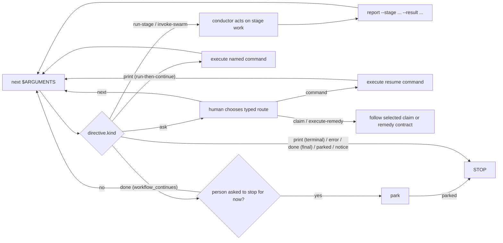

# オーケストレーションエンジンとスキルシステム

> 対象読者: Tier 2/3（チーム導入者、フレームワーク貢献者）。

> **パスの規約。** 以下の `<record>/` は、アクティブな intent のレコードディレクトリ `aidlc/spaces/<space>/intents/<YYMMDD>-<label>/` を指します。intent ごとの状態ファイルとランタイムファイルはここに置かれます。

この章は、すべての `/aidlc` 実行を駆動するオーケストレーションアーキテクチャの正式なリファレンスです。「次は何か」に答える決定論的な **engine**（`aidlc-orchestrate.ts`）、engine の答えに基づいて動く薄い **conductor**（`skills/aidlc/SKILL.md`）、両者をつなぐ **typed directive contract**、runner ジェネレーターが生成する **plural skill** のセット、どの stage を実行するかを決める **scope shape**、並列の Construction 作業を収束させる **swarm** のレフェリーを扱います。これは、`SKILL.md` の本体そのものがすべてのルーティングロジックを持っていた、以前の散文オーケストレーターモデルを置き換えるものです。関連リンク: [Orchestrator](03-orchestrator.md)（conductor 自身の章）、[Runtime Graph](13-runtime-graph.md)（engine と swarm が読む実行真実のミラー）、[State Machine](12-state-machine.md)（`report` がコミットする遷移）、[Hooks and Tools](06-hooks-and-tools.md)（Stop hook を含む決定論的な背骨）。

---

## 1. engine と conductor

この切り替えは、1つの関心事を2つに分けます。**engine** は *stage 間のルーティング* を担います。scope の解決、フラグの優先順位の階段、ジャンプ方向の計算、resume と init のガード、stage の順序付け、gate の状態、ワークフローの完了です。**conductor** は *engine が指名した動きの中での実行品質* を担います。ペルソナの枠組み作り、良い質問をすること、stage の日誌の記録、stage 内の Keep/Modify/Redo ループ、gate で人間に判断を委ねることです。

engine は `core/tools/aidlc-orchestrate.ts` で書かれ、各ハーネスには `<harness-dir>/tools/aidlc-orchestrate.ts`（例: `.claude/tools/`）として配布されます。これは Bun CLI で、サブコマンドはちょうど6つです。`next`、`continue`、`report`、`park`、`team-board`、`wait` です。`continue` は内部的なステアリングの搬送路です。`team-board` は読み取り専用の Team Construction クエリです。`wait` はディスパッチされた作業を対象にした、上限付きで読み取り専用の待機です。

| サブコマンド | 役割 | 状態を変更するか |
|------------|------|----------------|
| `next` | ワークフローの状態（アクティブな intent の `aidlc-state.md`、`aidlc/spaces/<space>/intents/<YYMMDD>-<label>/` 配下）とコンパイル済みの stage グラフ（`tools/data/stage-graph.json`）を読み、scope と位置を解決し、**ちょうど1つ** の typed directive（JSON）を stdout に出力します。 | ワークフローのルーティングはワークフロー状態の変更も権限の変更も行いません。`next` は Plan Approval のレシート、チャレンジ、フィンガープリントを発行・ローテーション・クリアすることはありません。また冪等です。アクティブ directive のマーカーがこの状態に対するこの directive そのものをすでに記録しているとき、その directive をそのまま返して何も書きません。したがって問い直しが承認を動かすことはありません。ルール配信だけが例外です。stage のルールが `load-steering` のパートで一度届いたあと、パート2以降から、またはそのパートが導いた run-stage のあとに問い直すと、パート1を再配信します。呼び出し元が、以前のパートを持たない新規の、あるいはコンパクト化されたチャットである可能性があるためです（`06-hooks-and-tools.md` を参照）。`next --single` は、作業を出力する前に、合成された `STAGE_STARTED` の監査境界だけを記録します。通常のチーム dispatcher の読み取りは、gitignore 対象のローカルな claim-observation キャッシュと世代スタンプを更新することがあります。一方、Stop-hook とルートチェックのプローブは、アドバイザリーな engine-turn マーカー以外は一切書き込みません。どちらからの永続的な書き込みも、処理を進める代わりに大きく失敗します。Request の ask は question のコピーを保持しますが、ワークフローの権限は保持しません。カーソルが選択されていない場合、既存の選択可能な intent に加えて保留中の作業があると、どのハーネスでも `new-work-routing` が生成されます。保留中の作業がない場合は `intent-pick` が生成され、重複する intent は作られません。明示的な `next config set`、`next config get`、`next config list` のリクエストは終端操作です。出力が返される前に正規の config コマンドが実行されるため、`set` は intent の設定を更新することがあります。Stop とルートチェックのプローブは、そのコマンドを説明するだけで実行は決してしません。 |
| `report` | conductor が directive に基づいて動いたあと、遷移をコミットします。stage を意識した dispatcher です。`--stage <slug>` は動作した directive を固定するので、復元された `Current Stage` によってレポート対象がずれることはありません。承認、却下、修正、完了、スキップの結果を担い、内部の状態遷移をアトミックにディスパッチし、明示的にレポートされた stage がまだ `[-]` のときは承認の前に欠けている gate を開きます。 | はい。 |
| `team-board` | 端末のメイン dispatcher と `/aidlc --status` が使う、純粋な Team Construction ボードを描画します。内部的なクエリ面であり、フェッチも状態・キャッシュの変更もありません。 | いいえ。 |
| `wait` | ディスパッチされた作業を対象にした、上限付きで読み取り専用の待機です。コラボレーターの貢献ファイル、stage の必須アーティファクト、またはレビュアーのレビューファイル（`--for collaborators|artifacts|review`）をポーリングし、上限内で `status: settled|waiting` を返します。これにより conductor はシェルループを書く代わりに、事前承認された1つのコマンドを再実行します。 | いいえ |
| `park` | アクティブなワークフローを、stage 間のきれいな境界で一時停止します。`Parked` マーカーを書き込み、これにより人が再び発言するまで、以降の `next` 呼び出しは終端の `parked` directive を出します（park のあとに素の `/aidlc` を打つと続行します）。`/aidlc --resume` はルーティング再開の前にマーカーをクリアします。`--person-asked` は人が停止を求めたことを示します。そのときにのみ、park は本人のものとして記録されます。 | はい。 |

`report --result skipped` はメインワークフローのライフサイクルの結果であり、単独実行の結果ではありません。これは空でない明示的な `--stage`、空でない `--reason`、名前付き stage が `Current Stage` と等しいこと、そしてその stage がアクティブまたは修正中であることを必要とします。engine は `STAGE_SKIPPED` を1つ記録し、`[S]` を保ち、`STAGE_COMPLETED` を出さずに次の stage を開始します（またはワークフローを完了します）。unit を主軸とする反復では、ウォークが `(stage, unit)` のビートを実行している間、スキップはそのビートの stage と `--unit` を名指しし、その unit だけを対象とします。stage は、どの unit もそれを負わなくなった時点で `[S]` とマークされます（[State Machine](12-state-machine.md) を参照）。`report --single --result skipped` は拒否されます。conductor が対応する `aidlc-state.ts` のライフサイクル動詞を直接呼び出すことは決してありません。

`next --stage <slug> --single` はまず `single-stage:<slug>` のもとで `STAGE_STARTED` を記録し、次に `single: true`、`gate: false`、`next_stage: null` を持つ `run-stage` を出します。その typed マーカーは通常の gate 処理を上書きします。conductor は本体、設定済みのトポロジーとレビュアーを実行し、その後 `report --single --stage <slug> --result completed` をちょうど1回呼びます。report は開いた開始境界を必要とし、対応する `STAGE_COMPLETED` を記録します。両方の行をでっち上げることはしません。この隔離されたパスは日誌を保持せず、workflow learnings の実行、承認 gate のオープン、メインワークフローの `next` の呼び出し、park のいずれも行いません。返される `done` が隔離実行を終了させます。typed の `--depth` や `--test-strategy` はその実行自身のものです。`next --single` はそれを合成された `STAGE_STARTED`（`Depth`、`Test Strategy`）に記録し、run-stage は `depth` / `test_strategy` としてそれを運び、ワークフローの設定は変更しません。typed の depth は knowledge のロスターも選びます。開いた試行の再実行は記録済みの値を保ちます。異なるものは新しい試行（新しい `STAGE_STARTED`）を開始し、未完了のものは脇に置かれ、完了として記録されることはありません。作業のレコードがその stage のファイルをすでに保持しているときは、開始時にまずそれらを `<record>/archive/<time>-<slug>/` にコピーし、そのフォルダを `Kept Copy` として記録します（コピーするものがなければ `none`）。run-stage の `change_notices` がそれを名指しし、再開された試行は最初のコピーを保ちます。開始時に `Kept Copy` を持たない開いた試行は、次のステップでコピーを作ります。隔離された Code Generation 実行では、Testing Contract も実行の記録済み Test Strategy に従いますが、ワークフロー自身の contract と plan approval はワークフローのものを保ちます（[Hooks and Tools](06-hooks-and-tools.md) を参照）。Review、Guard Policy、fence スイッチ、ceremony スイッチは `error` で拒否されます。hook はそれらをワークフローから読むため、隔離実行は自前のものを取れません。

engine は設計上、決定論的なコードです。ルーティングは決定論の関心事なので、それはツールの中に置かれ、LLM の散文に置かれることは決してありません（ルート文字列の組み立てを LLM に渡すことは、tool/agent/human のテーゼを逆転させます）。engine は既存の決定論的ライブラリを **組み合わせます**。コンパイル済みグラフには `loadGraph()`、順序付けには `nextInScopeStage()` / `firstInScopeStageOfPhase()`、scope 名の集合には `validScopes()`、状態の読み取りには `getField` / `parseCheckboxes` です。ハッピーパス以外の分岐（ジャンプ、intent の作成、scope/config の変更、env-scope の検証）は、兄弟の CLI ツールをシェル経由で呼び出し、その stderr をそのまま中継して組み合わせるため、ユーザー向けのエラー文言が再構築されることはありません。明示的な resume は、parked/no-state のガードのあと、通常の継続へ落ちます。engine が組み合わせではなく *追加する* ものは2つだけです。`(観測状態 + グラフ) → directive の種類` を対応付ける決定規則と、グラフノードの語彙名を正規のレコードディレクトリパス（`aidlc/spaces/<space>/intents/<YYMMDD>-<label>/<phase>/<stage>/...`）に変換するアーティファクトパスのリゾルバです。

すべての directive は、出力される前に `aidlc-directive.ts` の凍結された contract に照らして検証されます。不正な directive は、conductor が動作してしまう嘘を出す代わりに、非ゼロで終了します。

---

## 2. typed directive contract

`aidlc-directive.ts` は、`kind` フィールドをキーとする **11種類** の directive にまたがる判別可能なユニオンを定義します。各 directive はその種類が必要とするフィールドだけを運び、種類ごとに許可されたキーの集合によって強制されます（その種類の集合にないフィールドは未知のキーとして拒否されます）。engine は **現在9種類を出します**。残り2つは文書化されたプレースホルダーで、後続のウェーブが配線するまでループを完全な形に保ちます。

| `kind` | 現在出力されるか | conductor が行うこと |
|--------|----------------|--------------------------|
| `print` | はい | `directive.message` が言うことを正確に行います。これは権威的です。2つの形があります。**terminal**（status/help/doctor/version のような読み取り専用ユーティリティの実行を名指しするか、完了した typed-config の出力を運ぶ。実際の出力をそのまま表示して STOP）と **run-then-continue**（scope 変更、ジャンプの `execute`、新しいワークスペースのための `intent-create`、確認済みの `--new-intent` 作成のような変更を伴うツールを名指しする。それを実行してからステップ1に戻るので、新しい作業は同じチャットで続行し、そのナレーションはクリーンなチャットを一度だけ提案する）。ワークフローのディスパッチでは、変更は名指しされたツールの中にあります。明示的な typed config リクエストは、`next` の中でその正規の config ツールを実行します。拒否された `report` からの `print` は conductor の次のステップです（state ツールはそれらの拒否を `agent_guidance` とマークし、複数の返信のうちどれが設定を求めたかを名指しする report 自身のステップもその1つです）。`question-open` は人がまだ決めていないことを意味するので、conductor は質問を開いたままにし、本人に代わって答えることは決してしません。`person-decided` はその選択が記録されていることを意味するので、conductor はその選択を記録します。 |
| `error` | はい | 復旧も再試行もせずに STOP します。メッセージはユーザー向けのエラーです。Claude Code と Codex では、rebuild-stage-graph の PostToolUse hook が `directive.message` をバイト単位でそのまま人に見せ、conductor にそう伝えるノートを渡します（[Engine error relay](06-hooks-and-tools.md#engine-error-relay) を参照）。そのノートがあれば conductor は自前のコピーを加えません。なければ conductor はメッセージをそのまま表示します。それ以外の場所では conductor は `directive.message` をそのまま表示します。opencode は一時的なトーストとしても表示します。 |
| `done` | はい | `workflow_continues: true` の場合、`report` が1ステップを記録し、ワークフローは続きます（承認、スキップ、または最後ではない完了したステップ）。完了サマリーを出さずに、ただちに素の `next` を実行します。ただし、同じ返信の中で人がワークフローをここでいったん止めるよう求めた場合は `park` を実行します。それ以外の場合、ワークフロー（または単一 stage の実行）は完了です。完了サマリーを提示して STOP します。 |
| `parked` | はい | ワークフローは、後のセッションのために、途中の stage 間のきれいな境界（`directive.stage`）で park されました。park されたことと再開の方法（`/aidlc --resume`）をユーザーに伝え、STOP します。`Parked` マーカー（`aidlc-orchestrate park` が書き込む）がセットされている間、素の `next` で出力されます。stage は進みません。`report` は、返信がワークフローをここでいったん止めるよう求めた承認を記録したあと、`parked` を返します。Stop hook は `parked` を終端の許可として扱うので、conductor は `done` に到達するために stage を機械的に承認するのではなく、park します（#367）。 |
| `notice` | はい | `directive.message` をそのまま表示して STOP します。これは終端の情報的な引き継ぎで、チームが所有する Unit が他所でクレームされている間の scope なしの main で、またクレームされたチェックアウトでその Unit がそこで完了し承認されたとき（その notice は `unit` で Unit を名指しします）に使われます。ワークフローを進めることも変更することもありません。 |
| `load-steering` | はい | まれですが、directive の予算が小さい Copilot では通常の形です。stage のルールが `run-stage` の横に収まらなかったので、パートに分かれて届きます。`rules_content` を順に適用し、それをアクティブな stage のルールバンドルとして保持し、最初のパートが `conductor_persona` を運ぶとき（ワークフローの最初の stage で、その run-stage がそれと一緒に収まらないとき）はそれを採用し、パート上の `offer_autonomy` は Stop hook に委ね（run-stage のオートノミーの選択がまだ開いていることを示す。質問自体は run-stage のもの）、`stage_validity` と `change_notices` はパートではなく run-stage から示し、パートの先頭に表示された8文字の `receipt` を付けて `aidlc-orchestrate continue <receipt>` をただちに呼び出します（または、用意された `next` コマンドを実行します）。engine が一致させられない receipt には、現在のステップで応答します。チャンクの進捗をレポートしたりナレーションしたりしないでください。 |
| `run-stage` | はい | 実質的なアクティブ space のルールはすべて content として届きます。バンドルが横に収まるとき（ほとんどのハーネスのほとんどの stage）はこの directive の `rules_content` に、収まらないとき（Copilot のほとんどの stage）は先行する `load-steering` のパートを通じて届きます。`rules_content` があるときはまずそれを適用します。代わりに `rules_held` がある場合、チャットはすでにそのバンドルそのものを保持しています（06-hooks-and-tools.md の Rule delivery を参照）。ファイルを再読み込みせずにそれを適用します。`inline_context_paths` は配信された content ではなく、ブロッキングのロードリストとして扱います。必須の各エントリを明示的に読み、その内容を待ってから、stage ファイル/consumes の読み込み、日誌の初期化、本体の実行、mob サポートのディスパッチ、アーティファクトの書き込みを行います。lead のペルソナは `lead_persona` の content として届きます（ステップの横に収まらないときは、まず `inline_context_paths` に）。`context_warnings` があれば示し、読み込めたペルソナ/knowledge のロスターで続行します。ディスパッチされたトポロジーでは、stage のルールを `stage-protocol.md` の § "For subagent stages" のステップ2に従って配信します。すべての brief は依然として `directive.ceremony`、`directive.protocol_modules`、日誌の規律をそのまま運びます。ロードできない必須ルールは、修復のガイダンスとともにディスパッチをブロックします。プリロードで提供された不完全な brief は静かに進みます（[rule-delivery hook](06-hooks-and-tools.md) を参照）。通常の `directive.gate` の前に、任意の `directive.single`、次に任意の `directive.wave`、次に任意の `directive.unit_gate` で分岐します。Unit gate は、本体/レビュアーがすでに決着し、レポートに `--unit` を含む gate のみの作業です。wave は engine が解決した完全な Unit エントリを含み、ペアのレビュー証拠に加えて `unit complete --wave` を通じて各々を決着させます。directive は、解決済みのルーティングフィールドをグラフノードから直接運びます。 |
| `ask` | はい | engine のすべての ask は `ask_type` と `response_route`、その `question`、その `numbered_prose_question`（プロンプト、番号付きの選択肢、Other、返信のヒント。散文を表示するハーネスがレンダリングするもの。`aidlc-directive.ts` の `numberedProseQuestion`）、その `choices`（`label`、任意の `detail`、その選択肢が選ばれたときに質問に答える `command`。選択がもう1つの回答を必要とする場合、例えばどのレコードかを問う場合にのみ欠けます）を運びます。conductor は質問とその選択肢を、与えられたとおりにハーネスの質問面を通じて示し、ターンを終え、選択があればその選択肢のコマンドを実行します（その `question_note` がそう言います）。以下の typed フィールドは、JSON の読者のための同じルートです。`scope-confirm` は `proposed_scope`、`confirm_command`、`compose_command`、`scope_commands`、`choices`（提案された回答を人が見るとおり、質問の順で: 提案されたプランで進める、別のプランを使う、1つを調整する。最初と最後は `command` を運び、真ん中は運びません。選択はプラン名を必要とするためです。ステップの `question_note` により conductor はステップが列挙するプランをその長さとともに示し、名指しされたものを実行します）を運び、conductor はそれらの意味・順序・コマンドを変えず、会話の言語で提示します。`compose-offer` は `compose_command` と `scope_commands` を運びます。どちらも、リクエストのテキストではなく `--request <8hex id>` を伴う完全でシェル安全な呼び出しを使って `next` を経由します。`scope_commands` は有効な scope ごとに完全なコマンドを1つ保持するので、別のプランはシェルテキストの編集ではなく名前で選ばれます。`intent-pick` は正確な `available_intents` のセレクターと `select_commands: Array<{selector: string; command: string}>` を運びます。作業が1件でも質問を示して人の回答を待ち、その後セレクターでエントリを選んでそのコマンドをそのまま実行します。セレクターを文字列補間することは決してしません。それはそのレコードを選び、それで続行します。`unit-paused` は `response_route: "command"` で `stage`、`unit`、`resume_command` を運びます。人が再開を選んだときにのみ実行し、その後 `next` を再実行します。`project-type` は `response_route: "command"` で `existing_code_command` と `new_project_command` を運びます。スキャンがこの作業を新規プロジェクトとして設定したのに、フォルダに今やコードがあるので、人の回答に対応するコマンドを実行し、その後 `next` を再実行します。どちらもその種別を本人のものとして記録します。`construction-staffing` は `response_route: "command"` で `choices`（Just me、Several teams）を運びます。Inception が2つ以上の Unit で終わり、誰がそれらを作るか誰も言っていないとき、選ばれた選択肢のコマンド（`state set-unit-ownership solo` または `team`）を実行し、その後 `next` を再実行します。`unit-plan-change` は `response_route: "command"` で `choices`（Go back to Units Generation、Run it as separate work）を運びます。Units Generation を過ぎて求められた Unit 変更（`next compose --unit-plan`）は、選ばれた選択肢のコマンドを実行し、それが返すステップに従います。`new-work-routing` は `response_route: "next"`、`new_work_description`、`proposed_scope`、`numbered_prose_question` と、そのルートを `new_intent_command`、`scope_commands`（修正された scope。プランを提案しないときはなく、その別作業の回答が次にプランを選ぶ）、`compose_command`、そしてアクティブなワークフローについて問うときは `continue_command`、または選ぶレコードがあるときはレコードごとの `select_commands` と `reshape_commands` として運びます。`available_intents` があるときはレコードごとの `select_commands` も運びます。その continue / 別作業 / reshape の回答はそれらのコマンドを実行し、`report` を経由することは決してありません。人向けの質問テキストにそれらが含まれることもありません。`ask_type: "unit-claim"` は `response_route: "claim"` に加えて、クレーム可能・クレーム済み・依存でブロックされた Unit の行を運びます。Unit を選ぶと `/aidlc --claim <unit>` を実行し、そのコマンドの結果で停止します。レガシーの Plan Approval 復旧は明示的な素の `next` 選択肢を保持します。`ask_type: "guard-recovery"` は `response_route: "execute-remedy"`、拒否している stage と Unit、`reason_codes`、`remedies`（それぞれが閉じた `op` と `interaction` を持つ）を運びます。`agent_work` が true のとき、remedy は conductor 自身の作業であり、適用できる最初のものを尋ねずに実行します。そうでなければ conductor は `executableNow` が true の remedy を `label` と `description` で提示し（remedy の `action` は conductor に指示するもので、決して表示されません）、人の選択を待ち、その後、下の interaction contract に従います。空の `remedies` リストは終端で、人が答えるまで engine のアクションなしでそのままレンダリングされます。繰り返しの上限を超えると `state_signature` も運びます（[Guard admission and recovery asks](12-state-machine.md#guard-admission-and-recovery-asks) を参照）。engine の ask の回答を汎用の `report` で送らないでください。明示的な remedy stage のレポートは remedy contract の一部のままです。再入時の redo、ジャンプ、やり直しのリクエストは、唯一の stage 以外のレポートの往復で、`report --result resumed --choice <redo|jump|fresh>` を使います。engine は人のターンを conductor に委ねます。 |
| `invoke-swarm` | はい | engine が、適格な Construction バッチを swarm に付与しました。conductor は `directive.units` の unit をファンアウトし、swarm レフェリーに相談しながら収束ループを実行します（セクション6を参照）。stage を主軸とするウォーク上で、適格な Construction バッチに対してのみ出力されます。`Construction Execution` が `swarm` のとき（[Construction Execution](03-orchestrator.md#construction-execution) を参照。これはガイド付き承認のもとでも動きます）、または、Construction チェックポイントのない作業で `autonomous` の付与のもとです。 |
| `dispatch-subagent` | いいえ（engine の将来のプレースホルダー） | 名指しされた stage をインラインではなく `Task` 呼び出しで実行 *する予定* です。現在は出力されません。先回りして実装しないでください。 |
| `present-gate` | いいえ（engine の将来のプレースホルダー） | gate の儀式を独自の directive として実行 *する予定* です。現在、gate の判断は `run-stage` の `gate` フィールドに畳み込まれています。 |

conductor スキルの「Acting on a step」の行は、エージェントが各種類で何をするかだけを述べます。この表のフィールドは JSON のもので、その読者向けです。エージェントがそれらで行っていた分岐は、ステップの中にエージェント向けノート（下記）として乗ります。

**エージェント向けノート。** ホストは、AI-DLC のスキルやプロトコルを一切ロードせずにエージェントを実行できます。これは Kiro IDE で1つのジャーニー全体にわたって実際に見られました。人自身の編集が余計なものと呼ばれ、エージェントが本人に代わって redo の質問に答え、Construction の最初のステップで止まりました。そこで、エージェントが引き継がなければならないフィールドと、止まってしまったステップには、その横にエージェント向けの1文が付いています。`aidlc-directive.ts` の `withAgentNotes` が出力時にそれらを加えます。この1文はエージェント向けで、決して口に出されません。同じ継ぎ目が、スキルの行がフィールドで行っていたあらゆる分岐（answer mode、まず何を読むか、欠けている入力、再度示される gate、Code Generation プランの状態、ディスパッチされた brief、summary confirmation）を運びます。実際の入力コーパスの実行では、エージェントがそれらの条件を人に読み上げていました（「answer_mode.ask が true なので、interaction-mode の選択を提示します」）。そこで engine が分岐を行い、指示を引き渡します。どのノートも JSON フィールドを名指ししません（名指しするノートはそのまま読み返されてしまうためです）。

| ノート | 横に付く対象 | 内容 |
|---|---|---|
| `stage_validity_note` | `stage_validity` | 警告を一度だけ一字一句そのまま、前に何も付けずに言い、続行する。誰がドキュメントを変えたかを言ったり、余計なものと呼んだりは決してしない。次の返信での yes は `next --stage <earliest_affected_stage>` を実行する |
| `change_notices_note` | 空でない `change_notices` | 各行を一度だけ書かれたとおりに言う（動詞の時制だけ変えてよい）。人が返信する前に書かれる最後のメッセージで（ターンが質問で終わるときは質問の前に）。切り替えでオフにされたチェックを再びオンに戻すことを提案する行の横には、それへの yes が実行するコマンドと、その行の代わりに何を表示するかを言う |
| `question_note` | guard-recovery の ask でエージェント自身の作業であるものを除く、すべての `ask` | 質問は人のもの。選択肢を与えられたとおりに付けて示し（選択肢が1つの質問: 番号付きの質問を与えられたとおりに言う。Claude Code のようなピッカーは2つ以上の選択肢を取るため）、ターンを終え、返信に基づいて動く。選択はその選択肢のコマンドを実行し、次にそれが返すステップを、何も返さないときは `next` を実行する。`plan-approval` の ask では `log answer --stage code-generation --checkpoint plan-approval --details '<their choice>'` を名指しし、その後 `next` を実行する。レコードが選択されていない状態で求められるルーティングの ask では、continue や reshape の回答にはまず作業を名指しする必要があることを言う。プランの提案では、「Use a different plan」の回答にはプランを名指しする必要があることを言う。ステップが列挙するプランをそれぞれの長さとともに示し、名指しされたものを実行する |
| `answer_mode_note` | 本体がここで実行される `run-stage`。ステップの外に置かれる stage の answer mode から作られる | `ask: true` のとき: mode の質問を一度だけ尋ね（そのテキスト、3つの選択肢、この stage 向けの正確な `log decision` と `log answer` のコマンド）、その後 notice を言う。`ask: false` のとき: notice を言い、以前に選ばれた方法で質問を受け、mode については何も記録しない。どちらも、stage が人に質問を出す場合にのみ、その最初の質問の直前で（尋ねるものがない stage には mode の行は付かない） |
| `context_note` | 本体がここで実行される `run-stage` | ステップが運ぶペルソナ（`lead_persona`）を持つ lead として stage を進め、次にこのステップがまず列挙するファイル（サポートのペルソナと knowledge）を、一度に1つずつ列挙順に読み、その後 stage ファイルとそれが名指しする入力を読む。ステップが代わりに lead のペルソナファイルを列挙するときは、それが列挙するペルソナと knowledge のファイルをまず読む。ディスパッチされたトポロジーでは、エージェントが自前のペルソナと knowledge をロードするため、stage ファイルと入力のみ。このノートはステップのリストを意味で指し、決して繰り返さない。大きなステップは搬送の上限に近い |
| `inputs_note` | 本体がここで実行されるステップ上の、`expected: false` を持つ `consumes_absent` エントリ | 人に言う1行（どの入力がここにないか、そしてあるものだけで作業は進むこと）、その後 stage-protocol-recovery.md。`expected: true` のエントリは何も運ばない |
| `estimate_note` | repo-scope の `ask` 上の `repo_facts`（リポジトリ、すべてを数えられたときの git の行数、1リポジトリにかかる分）、または、質問が出されなかったときに10以上のリポジトリにまたがる Reverse Engineering の `run-stage` | それらを読むのにかかる時間を、自分の言葉で一度だけ言う。質問があるときはその質問とともに、より狭い集合ならどれだけかかるかとともに。そうでなければ分析を始める前に |
| `plan_note` | 本体がここで実行される Code Generation の `run-stage` 上の `plan_approval` | plan: プランとそのテスト指示を書き、その後 `next`。revise: 人の言葉から修正し、その後 `next`。repair: プランのノートが名指しするものを直し、その後 `next`（`plan_approval.next` がそれを運ぶときは、それぞれ隔離実行自身の `next --stage code-generation --single --scope <its scope>`。プラン質問の `question_note` がそうするように）。approved: そのまま作る。approved and skipped: まず notice を言い、尋ねずに作る |
| `other_work_note` | 本体がここで実行される、ワークスペースで作る stage（Code Generation）の `run-stage`。このチェックアウトの別の開いた作業（どの space でも、完了でもアーカイブでもないもの）がその Unit のソースマニフェストにファイルを列挙しているとき | それらのファイルはその作業のもので、その作業の名前とともに示される（1作業あたり最大20、その後は残りがどこに列挙されているか）。この作業のプランがそのうちの1つを変更しない限り、そのままにする。完了チェックとレビュー依頼（そのレビュアーの brief 行）は同じ集合を読む（`aidlc-lib.ts` の `otherOpenWorkClaims`）ので、どちらもそれらのファイルの1つをこの作業の変更とは数えない |
| `brought_files_note` | 本体がここで実行される Code Generation の `run-stage`（plan のステップ、修正、ビルド、Unit のもの、単独実行） | 作業が始まったときにプロジェクトが保持していたファイル（作業の開始時リストを持たないクローン上、または単独実行では、その Code Generation が最初にここで実行されたときのもの、コードを除く）。既存コード上ではコードそのものを除き、AI-DLC 自身のファイルはインストールが書き込んだ全体を除く（`aidlc-brought-files.ts` の `broughtFileNames`。gate の brought-files 行が比較するリストから）。名前で最大10、その後は件数。それらは人のもので、そのままにする。人が求めるとき、またはそれなしでは作業を作れないとき（stage の Critical Rules）にのみ変更する |
| `brief_note` | ディスパッチされたトポロジー（`mode` が subagent、pipeline、mob、または `wave`）の `run-stage` | すべてのエージェント brief が一字一句運ぶ行。各 ceremony スイッチをその表示名と値で、protocol modules、そしてステップがそれらを運ぶときは `other_work_note` と `brought_files_note` の文 |
| `ceremony_note` | 本体がここで実行される `run-stage`、`ceremony.summary_confirmation` から | on: 何かを書く前に、答えのサマリーを人と確認する（プロトコルの Consolidated summary のステップ）。off: stage が質問するとき、その答えが questions ファイルに入ったら出力を書き、stage ファイルの Consolidated Summary のステップを飛ばして何も記録しない。設定を名指ししないステップとして言う（off は以前は欠如であり、stage ファイル自身の `summary_confirmation: required` が ask として読まれていた） |
| `protocol_note` | すべての `run-stage` | チャットがそれらを保持していない限り、`stage-protocol.md` と各 `protocol_modules` エントリの `stage-protocol-<module>.md` を読む。ステップ自身の `stage_file` から名指しされる |
| `gate_note` | `gate: "unresolved"` | チームの `## Walking Skeleton` がそれについて何と言っているかを読み（常に1つ実行するなら on、しないと言うなら off、どちらでもなければ scope-dependent）、`report --skeleton-stance` でレポートし、その後 `next` |
| `gate_note` | `gate: false` を持つ Unit の `run-stage`（チェックポイント、wave、settle なし） | レポートも承認依頼もしない。その作業が終わったら `next` を実行する |
| `gate_note` | `gate_only: true` | stage の作業とレビューは完了している。承認の質問を再び示してターンを終える。stage を再び実行したり、作ったものを変えたりしない |

本体は、通常の stage のステップと隔離実行ではここで実行されます。再度示される gate（`gate_only`）、決着した swarm、Unit またはバッチのチェックポイント、team gate（`unit_gate`）、完了のみのビート、wave（そのビルダーが実行する）では実行されず、それらのステップはそれについてのノートを一切運びません。

ルールのパート（`load-steering`）はノートを運びません。その `run-stage` がアドバイザリーと notices を繰り返し、それらはそこから言われます。`error` はノートを運びません。conductor は上の行が言うようにそこで停止し、hook がすでにメッセージを示しているときはコピーを加えず、そうでなければそのまま表示します。ソロのウォークでは、判断（`approved`、`rejected`、`revised`）を伴う `report --unit` は、`--unit` なしの同じレポートと同じく、stage に対して記録されます。それ以外の結果には、エラーではなくエージェントの次のステップ（`next` を実行）で応答します。

**Kiro の conductor は自身のスキルをリソースとして運びます。** Kiro のエージェント（Kiro IDE と Kiro CLI v3）は 30,000 文字を超えるツール結果を切り詰め、両方の Kiro スキルはそのおよそ2倍なので、自身のスキルをファイルツールで読まなければならない conductor はそれをパートで受け取りました。Kiro IDE 1.2.37 での計測では、エージェントは10パートのうち4つを読んで動作したので、390行のうち230行が典型的なチャットに届きませんでした。両方の Kiro conductor（`harness/kiro-ide/agents/aidlc-aidlc.md`、`harness/kiro/agents/aidlc.json`）は `SKILL.md`、`question-rendering.md`、`composer.md` を `file://` リソースとして列挙しており、Kiro はチャット開始時にそれをそのエージェントのコンテキストへ丸ごと入れます（Kiro IDE 1.2.37 での計測: 3ファイルすべて、読み取りなし）。両方のプロンプトの最初の項目がそう言っています。スキルの中に読んでほしいと求めるものはありません。スキルがエージェントを送る protocol modules、stage ファイル、agent ファイルは依然としてファイルツールで読まれ、同じように切り詰められます（Construction モジュールは 90,000 文字を超え、その Unit receipt のルールと Kiro binding のセクションは切り詰めの先にあります）。そこでスキルの Routing セクションと両方のプロンプトは、各々を最大200行のパートで最後の行まで読むよう言い、`t-kiro-skill-read-in-parts` がすべての protocol module、stage ファイル、agent ファイルのすべての200行パートを切り詰めより下に保ちます。directive は常に収まります。engine 自身の 28 KiB の上限は Kiro のそれより下です。

**Guard-recovery のインタラクション。** 人が実行可能な remedy を選んだあと:

- `command`: 構造化された `operation` からレンダリングされた、返されたネイティブまたはソースの正確な `command` を実行します。選択はそれを試みるのに十分です。所有するツールは依然としてライフサイクルと証拠を強制します。返されたオーケストレーターの directive は通常のループで処理します。
- `human-input`: アクションのフォローアップをレンダリングしてターンを終えます。Request Changes では、何を変えるべきかをすでに述べている返信がフィードバックであり、人の直前の返信が変更を求めて内容を述べていたときは、remedy はすでに選ばれていて ask は提示されません。そうでなければ「What should change?」と尋ね、別個の回答を待ちます。そのフィードバックを変えずに、`--user-input "Request Changes"` とは別に、レポートの `--reason` として保持します。必要なときは人の具体的な Scope を取得します。
- `external-work`: `action` を既存のプロトコルとツールを通じて実行します。選択は追加のフィードバックのターンを必要とせず、完了を証明するものでもありません。

コマンド、欠けている引数、フィードバック、レシートを決してでっち上げないでください。typed の guard-recovery ask で終わるツールの拒否も、この同じ contract に従います。そうでなければ、実際のツールのエラーを表面化してその復旧の試みを止めます。通常の失敗は復旧の directive でも成功でもありません。

**Question の搬送。** Scope/compose の ask はリクエストを id だけで名指しします（貼り付けられた `<document>` ブロックはデータとして question ストアに残り、決して ask に入りません）。その `question` には最大240文字のプレビューだけが含まれ、切り詰められたときは `...` で終わり、加えて、貼り付けられたドキュメントがリクエストからどう分離されたかを示す1行があります。`new-work-routing` の ask は、それらを `new_work_description` に一度だけ、そのルートコマンドを専用フィールドに運びます。engine は各 question のリクエストのコピーを、`aidlc/.aidlc-sessions/questions/` 配下の gitignore された自前のファイルに保持するので、1つのクローン内の同時実行セッションが互いの ask を共有したり無効化したりすることは決してありません。再び尋ねるのは新しい id を持つ新しい question であり、以前のものは答えられるままです。コマンドは `--request <8hex id>` をそのストアから解決します。完全なリクエストと提案された scope は composer のディスパッチと作成の出力を通じて移動します（`new-work-routing` の ask は、`scope-confirm` のあとの2番目のホップを含め、自前の question を保存します）。intent の作成は、完成したレコードを最後に列挙し、question id をその `intents.json` の行に記録してからコピーを削除します。未回答のコピーは、`question-retention-days` が設定されていない限り保持されます。繰り返しの回答は、それが始めた作業で続行し、アーカイブ済みまたは完了済みの作業を再び始める前には尋ねます。他の作業がアクティブになったあとに与えられた開始の回答は、それと並行して新しい作業を始めます。ルーティングの ask の `continue_command` と `compose_command` は、それが名指しするワークフローにのみ作用し、別のものが選ばれると再び尋ねます。コピーはワークスペースのオペレーティングシステムの権限に従います。コピーが失われた question は、作業をもう一度説明してというメッセージでエラーになります。conductor は、リクエストのテキストを付け加えたりランタイムファイルを編集したりせずに、与えられたコマンドを実行します。

**gate のセンチネル。** `run-stage` の `gate` は、すべての決定論的なケースではブール値です（自動で進むブートストラップの initialization stage、stage の最後の Unit が決着する前の Unit のステップ、隔離された `--single` 実行では `false`。それ以外のすべての EXECUTE stage では `true`）。1つだけ決定論的でないケースがあります。最初の Construction Bolt の gate は、チームの自由形式の `## Walking Skeleton` の慣行の散文に依存し、どのパーサーもそれを導けません。engine は文字列センチネル `GATE_UNRESOLVED`（`"unresolved"`）を出し、分類を conductor の知識作業に委ね、conductor は `report --skeleton-stance <on|off|scope-dependent>` でそのスタンスを返します。次の `next` は、今や確定したブール値の gate とともに同じ stage を再び出します。

**conductor のペルソナ配信。** conductor の実行品質の憲章は `aidlc-common/conductor.md` に一度だけ存在します。どのスキルもそれをパスで参照しません。代わりに engine がそれを読み、その内容を **各チャットがそのワークフローで見る最初の `run-stage` directive** の `conductor_persona` フィールドに、あるいはその run-stage がそれと一緒にホストの上限に収まらないときは、その手前の最初の `load-steering` パートの同フィールドに焼き込みます。チャットは、コマンドの環境にあるホスト自身の識別子から分かり、何が渡されたかはチャットごとに保持されます（`aidlc/.aidlc-sessions/<chat>.rules-delivered.json`）。そのため、すでに進行中の作業に対する新しいチャットや、コンテキストがコンパクト化されたチャットには、ペルソナが再び渡されます。Copilot と Cursor はコマンドでチャットを名指ししないので、そこではワークフローの最初の run-stage にのみ乗ります。conductor がそのフィールドを受け取ると、実行全体にわたってそのペルソナを採用します。これにより、フレームワークの runner も手書きのものも含め、すべてのエントリポイントが、スキルごとの手間なしに1つのペルソナで統一されます。

---

## 3. 転送ループと Stop hook

stage の作業の前に、名指しされた `directive.protocol_modules` を読みます。`reviewer` → `stage-protocol-reviewer.md`、`ensemble` → `stage-protocol-ensemble.md`、`construction` → `stage-protocol-construction.md`、`swarm` → `stage-protocol-swarm.md`、`learnings` → `stage-protocol-learnings.md`、そして `checkpoint`、`loopback`、`wave`、`collaborators`、`reviewer-unit`、`reviewer-repair`、`summary`、`sensors` → `stage-protocol-<name>.md` です。すでにロード済みのモジュールを再び読む必要はありませんが、適用されるのは現在の directive が列挙するモジュールだけです。`learnings` モジュールは日誌と §13 の儀式を担います。ない場合は両方を飛ばし、完了から承認 gate へ直接進みます。

`directive.ceremony` は、この intent の `sensors`、`learnings`、`summary_confirmation` を解決します。各々は scope の設定（なければ `on`）をデフォルトとし、その上に intent ごとのオーバーライドと env のキルスイッチがあります。`/aidlc --sensors on|off`、`--learnings on|off`、`--summary-confirmation on|off` が intent のオーバーライドを設定します。`summary_confirmation: off` は、統合サマリーのチェックポイントやレシートなしに、答えから直接生成します。必須の質問、Assumption Confirmation、Plan Approval、承認 gate は残ります。`sensors: off` は `sensors_applicable` を空にし、自動チェックとその修正・再実行の指示を飛ばします。17個の hook 登録はすべて残ります。

`skills/aidlc/SKILL.md` が **conductor** です。engine の directive に基づいて動く薄い転送ループです。その制御構造の全体は次のとおりです。

```
Loop:
  1. directive = `aidlc engine orchestrate next $ARGUMENTS`
  2. act on directive.kind
  3. After stage work, `aidlc engine orchestrate report --stage <directive.stage> --result <outcome> [--user-input '<text>']`. Ask answers follow next/command/claim/execute-remedy instead; only a redo, jump, or start-fresh request on re-entry uses non-stage `report --result resumed`.
  4. Repeat only when the directive calls for continuation; otherwise stop or wait for the human as it directs.
```

終端のワークスペースナビゲーションは、ループの繰り返しに優先します。例えば `/aidlc space default` は space を切り替え、ユーティリティの出力を表示し、宛先に未完了の intent があってもターンを終えます。その intent を選んでも、その再開を求めることにはなりません。conductor は `next` や `report` を呼んだり stage を実行したりする前に、人からの新しいワークフローのリクエストを待ちます。セッション開始時のガイダンスが同じ境界を補強します。



図のテキストによる説明: `next`（`$ARGUMENTS` をそのまま渡す）は1つの directive を返します。stage の作業はその結果をレポートし、その後 `next` へループバックします。engine のすべての ask は代わりに、人が答えたあと、宣言された `next`、`command`、`claim`、`execute-remedy` のルートに従います。guard の remedy は、名指しされた stage のレポートを含め、明示的な command/action の意味を保ちます。汎用の ask-to-report のフォールバックはありません。run-then-continue の `print` はそのコマンドを実行し、直接 `next` に戻ります。再入時の redo、ジャンプ、やり直しのリクエストだけが、stage 以外の `report --result resumed` を使います。終端の `print`、`error`、`parked`、`notice` はループを止め、`workflow_continues` のない `done` も同様です。それを運ぶ `done` はまっすぐ `next` に戻り、同じ返信の中で人がワークフローをここでいったん止めるよう求めたときは `park` に戻ります。

`$ARGUMENTS` は最初の `next` にそのまま通ります。engine がフラグ（`--status`、`--stage`、`--scope`、`--depth`、自由形式のテキスト）を解析するので、conductor がそれらを事前に解析したり取り除いたりすることは決してありません。ワークフローのルーティングは stage の作業を実行しません。`report` が遷移をコミットするので、次の `next` は新鮮な状態を読みます。明示的な typed config のリクエストは、終端のレスポンスを返す前に正規の config 操作を終え、ワークフローを進めません。Request の ask は、ワークフローの状態や承認の権限を変えずに question のコピーを保持することがあります。

インタラクティブなパスでは、人に質問できるのは conductor だけなので、conductor がループを保持します。作業が自力で続く場面でループが LLM の良い振る舞いに頼らないように、**Stop hook**（`hooks/aidlc-continue-workflow.ts`）がそれを決定論的に強制します。これはフローを変える6つの hook の1つです。deliver-stage-rules、plan-approval、state-transition、reviewer-scope、review-freeze が5つの PreToolUse のコントロールで、残りの11個の hook はアドバイザリーです。conductor がターンを終えようとすると、Stop hook は `aidlc-orchestrate next` を実行します。directive がまだ保留中なら、人が読める1行の素の `reason` で停止をブロックします。「AI-DLC is carrying on with <stage>.」です。これは **タスク継続** であり、conductor の安全訓練が拒否するようなオーバーライド型の指示では決してありません。その行に対する conductor のステップ（たった今尋ねた質問を記録する、人が停止を求めたら park する、保持しているルールレシートで続行する、`run-stage` を保持している stage を終えてその directive から作った `report` を実行する、または `next` を実行する）は、スキルとセッション開始時のコンテキストにあります。プローブの `next` 呼び出しは何も書きません。directive の公開も、claim-observation のリフレッシュも、Plan Approval の状態もありません。`done`、`parked`、または情報的な `notice` の directive は停止を許します。`parked` は後のセッションのためのサポートされた途中の一時停止で、`notice` は書き込みのないチーム fan-out の引き継ぎです。いくつかの保留中のケースも *ブロックされません*。**human-wait の除外** は、conductor が人の上で正しく park している（または単に会話している）とき停止を許します。現在の stage が、記録上まだ人からの返信のない `[?]` 承認待ち、`[R]` 修正中、`[-]` 進行中で、その正規または正確なアクティブ unit の `<slug>-questions.md` に未回答の `[Answer]:` タグがあるか、あるいは現在の stage に `DECISION_RECORDED` があってそれより後に `QUESTION_ANSWERED` がない、または終わるターンが会話的だった（人の直前のプロンプトがワークフローエンジンの関与なしに答えられた。ハーネスのトランスクリプトから読む。読み取り専用のクエリと終端のワークスペース/設定のディスパッチは除外され、状態依存の設定呼び出しは [hook reference](06-hooks-and-tools.md) に記すとおり一意に一致する終端結果を必要とする）ときです。autonomous Construction のもとでは、記録された判断と会話的なターンは、人がいる間はターンを解放します（無人のドライバー `AIDLC_UNATTENDED=1` は、記録された判断をチェックポイントの質問に保ち、会話的なガードを保ちます）。ファイルに裏打ちされた質問は抑制されますが、unit を主軸とする code-generation の正確な必須の Plan Approval 質問だけは依然としてターンを解放します。会話的なケースは、トランスクリプトを配信しない Kiro では不活性で、そこでは代わりにインタラクティブの上限が解放のパスになります。そこでブロックすると nudge を連発するだけになります（肯定的な確認のみ。human-wait のチェックは fail open、会話的なチェックは fail closed）。有人でゲートのある実行（`AIDLC_UNATTENDED=1` なし、Construction が autonomous でない）では、これらのいずれでも説明できない停止もターンを終えます。記録は散文で尋ねられた質問と終了を区別できず、人の次のメッセージが作業を続けます。autonomous Construction のもと、または誰も立ち会わない実行では、状態のないケースと本当の stage 途中の終了は依然としてブロックされます。詰まったループがセッションを閉じ込めないように、2つの上限があります。Claude Code の `stop_hook_active` シグナルと、`<record>/.aidlc-engine/stop-hook/`（アクティブな intent のレコードディレクトリ内）に永続化される no-progress カウンターです。連続した no-progress のブロックが上限（`CLAUDE_CODE_STOP_HOOK_BLOCK_CAP`。デフォルトは実行モードに応じて、**誰も立ち会わないゲートのある実行では 2、autonomous Construction では 8** です）に達すると、hook は手を離します。ワークフローの前進は位置のシグネチャを変えてカウンターを 0 にリセットするので、健全なループがスロットルされることは決してありません。アクティブなワークフローがないとき、または何か予期しないエラーのとき、hook は fail open します。AIDLC 以外のセッションをブロックすることは決してありません。

---

## 4. 複数スキル、runner、共有の背骨

オーケストレーターは多くのスキルの1つです。各ハーネスは、インストール済みのスキルディレクトリ（`<harness-dir>/skills/`、例: `.claude/skills/`。Codex は `.agents/skills/`、Copilot は `.github/skills/` を使い、そこでそれらのホストはプロジェクトスキルを見つけます）配下に複数のセットを配布します。ベースの `aidlc` オーケストレーター、実行可能な stage ごとに1つの **stage-runner**（コアの stage は `aidlc-<slug>`。プラグイン所有の stage はそのプラグインを前置した素の slug を使う）、`runner: true` の scope ごとに1つの **scope-runner**（コアの scope は `aidlc-<scope>`。プラグイン所有の scope はその素の名前を使う）、読み取り専用のセッションスキル（`aidlc-session-cost`、`aidlc-replay`、`aidlc-outcomes-pack`）、チーム自身のドキュメントを索引する `aidlc-knowledge` スキル、そして `aidlc-init` です。ルーティングと実行の知識はすべて、`core/aidlc-common/`（`<harness-dir>/aidlc-common/` として配布）で書かれた **共有の背骨** に一度だけ存在します。`conductor.md` のペルソナ、`protocols/`、そして `stages/{initialization,ideation,inception,construction,operation}/` 配下の33個の stage ファイルです。

runner スキルは手書きではなく、`tools/aidlc-runner-gen.ts` が生成します。

- **stage-runner** はオプトインの糖衣です。各コアの `/aidlc-<slug>`（またはプラグイン所有の `/<plugin>-<slug>`）は、`/aidlc --stage <slug> --single`（それなしでも動く）を、engine の `--single` モードを通じて1つの stage を隔離して実行し、メインワークフローの `Current Stage` を決して進めない、タイプ可能なコマンドにまとめます。`next --single` が合成された開始を担い、出力される `single: true` の directive が workflow learnings と承認 gate をバイパスし、`report --single` が、runner が `done` で停止する前に対応する完了を担います。slug のリストは、唯一のコンパイル済みの真実のソースである `loadGraph()` から来るので、グラフに追加された stage はここを編集せずに runner に流れ込みます。ブートストラップの initialization stage は除外されます（それらに単独の `--single` の意味はありません。`--single` はそれらを拒否します）。そして initialization フェーズ全体は1つの `/aidlc-init` runner として配布されます。`--scope` と説明があるときは engine の `intent-create` の動きをまとめ、`--scope` だけのときはそのプランでの新しい作業を engine に求め（`next --new-intent --scope <name>`。これはまず作業が何のためかを尋ねる）、説明だけのときは engine に新しい作業を求めます（`next --new-intent`。これはまずプランの提案を示す）。
- **scope-runner** は、すでに実行可能なコマンドをまとめます。scope ファイルが定義を保持し、`runner: true` でデフォルトの生成セットにオプトインします。各々は、固定された scope で検出なしに `aidlc-orchestrate next --scope <scope>` を `done` まで駆動する短いシェルです。全 scope のセットは `/aidlc --scope <name>` で引き続き到達できます。runner は、往来の多いものと、オプトインするプラグイン scope に対するタイプ可能な糖衣です。

2つのドリフトガードが、ディスク上の runner のセットをそのソースに固定し続けます。stage-runner には `aidlc-runner-gen.ts check`、scope-runner には `scopes --check` で、どちらも CI で実行されます。runner は **`hooks:` ブロックを持ちません**。ワークフローの背骨の hook はプロジェクト全体で `settings.json` に存在するので、決定論的な背骨はコピーなしに継承されます。そしてどの runner も `conductor.md` を手でロードしません。engine が最初の `next` でペルソナを配信します。

---

## 5. scope shape

scope はファイルで書かれるプリミティブで、sensor や agent を書くのと同じ身体感覚です。**`scope-mapping.json` はありません**。配布ツリーから削除されました。scope の同一性と stage のメンバーシップは、2つのファイルで書かれる面に分かれており、コンパイル済みのグリッドに転置されます。

1. **同一性** は、scope ごとに1ファイル `core/scopes/aidlc-<name>.md` で書かれ、`<harness-dir>/scopes/` に射影されます。frontmatter（必須の `name` と `depth`、加えて任意の `keywords`、`description`、`testStrategy`、`skeleton`、`review_cap`、`guard_policy`（廃止された綴りは `change_control`）、`sensors`、`learnings`、`summary_confirmation`、`plan_approval`、`collaborators`、`runner`、`freeform_default`、`existing_code`。全リストは `docs/harness-engineering/04-scopes.md` のフィールド表）に、scope を説明する散文が加わります。配布セットは `bugfix`、`classic`、`enterprise`、`express`、`feature`、`infra`、`mvp`、`poc`、`refactor`、`security-patch`、`workshop` です。
2. **メンバーシップ** は各 stage の `scopes:` frontmatter にあります。その stage が EXECUTE となる scope のリストです。classic は Initialization に加え、Inception と Construction を Build and Test まで含みます（33 stage のうち 18）。CI Pipeline と Operation はその実行可能なメンバーシップの外に留まります。classic はアドバイザリーなレビュー、sensors、learnings の儀式を実行し、summary confirmation と collaborators を無効にします（各 stage はその lead agent だけで実行されます）。明示的なオートノミーは、マージ前の単一のレビューを保ちます。

`aidlc engine graph compile`（`stage-graph.json` を生成するのと同じコンパイルパス）は、これらを `tools/data/scope-grid.json` のグリッドに転置します。これは engine がすべての scope レベルのルーティングで読む `scope → {stages: {slug: EXECUTE|SKIP}}` のマップです。engine の `validScopes()` は、そのコンパイル済みグリッドから正規の scope 名の集合を導きます。

この転置は、frontmatter で宣言された（ストックの）scope だけを対象とします。composed なプランから保存された scope には、それを宣言する stage がないので、コンパイルはその列を、`aidlc/scopes/<name>.md` にある永続的なレコードから畳み戻し、一致する同一性ファイルを `<harness-dir>/scopes/` に射影します（[Where a saved scope is stored](../guide/05-scopes-and-depth.md#where-a-saved-scope-is-stored) を参照）。

scope の追加は純粋に加算的です。`.claude/scopes/aidlc-<name>.md` を置き、メンバーの stage の `scopes:` リストにタグを付け、再コンパイルし、`SKILL.md` の横の `tables.md` にある人間が読めるサマリー表を再生成します。ディスパッチロジックの編集は不要で、ドリフトガードがディスク上のセットの乖離を防ぎます。

---

## 6. swarm レフェリー、driver の継ぎ目、Bolt-DAG

**swarm** は、人がそれを選んだとき（`Construction Execution: swarm`、または Construction チェックポイントのない作業へのオートノミーの付与。セクション2を参照）に、並列の Construction 作業が収束する仕組みです。これは生きた `/aidlc` セッションの中でのみ発火するので、conductor（そのセッション）がファンアウトとリトライループを担います。`tools/aidlc-swarm.ts` は、conductor がループ自体を担いながら相談する、決定論的な **レフェリー** です。これは、収束に適用された3つの関心事の分割です。conductor がファンアウトとリトライの判断（知識）を担い、ツールが収束の判定、マージ、監査（決定論）を担い、人が swarm を選び、失敗のエンベロープでバトンを取り戻します（判断）。

レフェリーは **ステートレス** です（反復カウンターも永続化された進捗もありません）。4つのサブコマンドがあります。

| サブコマンド | 役割 | 出力するイベント |
|------------|------|-------|
| `prepare --batch <n> --units <a,b,c> [--base <branch>] [--degraded-from <subagent\|ultracode>] [--resume-existing]` | 保護された Code Generation は、レガシーのオートノミーまたは新しいチェックポイントのもとで、各 Unit の現在の Plan Approval または許可された承認後の継続に加えて、コミット済みで再現可能な承認済みの親アプリケーションソースを必要とします。同じ intent、ターゲット、試行に対して、`execution_allowed: true`（exit 0）を伴う `testing-posture verify` は、`ok: false` が現在の内容は承認されていないと報告していても、下げられた fence のもとで継続を許可します。読み取り専用のプリフライトは、最初の子が作られる前にすべての Unit をカバーします。コミットされていないソースは orphan なしに commit-and-retry を返し、自動でコミットされることはありません。却下が以前の承認を引退させた場合は、`--resume-existing` の前にその版の新しい Plan Approval を取得します。以降のリトライはその実際の承認の証拠を保持し、許可された継続を使えます。生き残った子のソースとアーカイブのメタデータを保持するか、ネイティブのランディング証拠が許すときは、すでにランディングした親ソースから削除された子を再作成します。どの継続も、古い試行の承認を蘇らせることはありません。その出力と `SWARM_STARTED` の行は `landing_branch`（`Landing branch`）を名指しします。これはそのリポジトリのメインチェックアウトでチェックアウトされたブランチで、Unit はどの base から分岐しようともここにランディングします。 | `SWARM_STARTED`（大きなダウングレードが報告されたときは `SWARM_DEGRADED` も）。 |
| `check <unit> [--check-cmd <cmd>] [--test-file <path>] [--show-output]` | 単一 unit の判定です。intent の、人が認可した Construction Verification Command を実行し（与えられた `--check-cmd` はそれと一致しなければなりません。exit 0 = green が権威的なシグナルで、worker の自己申告は決して信用されません）、加えて、保護されたファイルをその fork-git のベースラインと照合する改ざん防止の比較を行います。`{converged, tampered, reason}` を表示し、本当に収束したときにのみ exit 0 します。`--show-output` では、コマンド自身の出力が実行時に stderr に流れます。worker の brief とレビュアーの依頼がその形を名指しするので、それらは承認済みのテストをそれを通じて実行します。 | なし（アドバイザリー。conductor のリトライの判断に情報を与える）。 |
| `finalize --batch <n> --units <a,b,c> --claimed <a,b> [--check-cmd <cmd>] [--test-file <path>] [--reasons <unit>=<reason>,…]` | 権威的な gate です。**クレームされたすべての unit でチェックを再実行** し、現在の stage がレビュアーを宣言するときは、その Bolt が始まったあとのその unit の対応する終端レシートを必要とします。モダンなソースを含む worktree では、現在のグローバル `Source Fingerprint`、現在の `Unit Source Fingerprint` とマニフェストバイトの束縛、証明された raw 対応の `Base Source Listing`、そして base から worktree へのすべてのソース変更がレビュー済みのマニフェストのクレームに包含されていることも必要とします。`AIDLC_SKIP_SOURCE_FRESHNESS=1` はそれらのソースチェックだけを明示的にバイパスします。収束の行がそのバイパスを記録し、ソースマージはそのスイッチを繰り返さなければなりません。red、改ざん済み、未レビュー、stale、またはレビュー済みのフットプリントの外にあるクレームされた unit は、マージの前に拒否されます（嘘をつく conductor のガード）。Guard Policy が relaxed または off のとき、unit のコード、Code Generation のドキュメントやファイルリストがそのあとに変わったか、計画外のファイルが変わったときは、実際のレビューが有効です。finalize は unit を今の状態でランディングし、`CHANGE_ACCEPTED` の行を1つ記録し（チェックポイント `review-receipt`）、人向けに1行を返します。バッチのチェックポイントはそれを再び言う代わりにその行を読みます。strict のもとでは、unit は新しいレビューのために拒否されます。その後、本物の pass は、serial HOLD-MERGE ロックのもとで AIDLC のメタデータをマージする前に、宣言された正確なレコードのアーティファクトと束縛されたソースマニフェストをスナップショットしてランディングします。conductor は次に、`--target` をその行の `landing_branch` に設定した、相関する `aidlc-worktree merge` を実行しなければなりません。それは不変の `Source Commit` を消費し、`SWARM_SOURCE_MERGED` を出し、その権限がランディングしたあとはクリーンアップが冪等です。モダンなバッチのルーティングと決着した承認は、完全な集約チェーンを必要とします。exit 0（レコード/メタデータの収束）または 2（失敗のエンベロープ）します。 | `SWARM_UNIT_CONVERGED` / `SWARM_UNIT_FAILED` / `SWARM_BATON_RETURNED` / `SWARM_COMPLETED`。後のソースマージは `SWARM_SOURCE_MERGED` を出す。 |
| `allow-change <file>... --message <id>` | strict な Guard Policy のもとで、Unit が並列に作られている間、メインチェックアウトのファイルに対する人の要求を記録し（本人が尋ねたメッセージで証明される）、plan-approval ガードがそれらの書き込みを通し、ランディングがそれらを保ちます。AI-DLC 自身のファイル、作られている Unit がそのプランで名指しするファイル、チームがメモリに保持する strict は拒否します | `MAIN_CHECKOUT_CHANGE_ALLOWED` |

したがって、インラインの skeleton から swarm への切り替えには、並列バッチを準備する前の、承認済み skeleton ソースの明示的で認可されたコミットが含まれます。成功したネイティブのマージはその子を削除することがあります。`--resume-existing` は却下の版を保持するのであって、元の子ディレクトリが存在するという無条件の約束ではありません。[prepare and resume commands](../guide/12-cli-commands.md#aidlc-engine-swarm-prepare-prepare-a-reproducible-batch) を参照してください。

これら7つの `SWARM_*` イベントは、132イベントの監査分類法の一部です（[State Machine](12-state-machine.md) を参照）。exit 2 のエンベロープでは conductor がバトンを取り戻します。失敗は、オートノミーのモードに関わらず、常に止まって人に再び関与します。

**driver の継ぎ目。** `AIDLC_USE_SWARM=1` はインラインの Dynamic Workflow ドライバーを選びます（conductor が、その JS が unit ごとのパイプラインと反復の上限を担う `Workflow` を書きます）。未設定だと subagent のフロア（1つのメッセージ内の N 個の並列 `Task` 呼び出し、unit ごとに1つ）を選びます。`=1` だが Workflow ツールが使えない場合、conductor はフロアへ **大きくダウングレード** し、`--degraded-from ultracode` を渡すので、レフェリーが `SWARM_DEGRADED` を出します。暴走の歯止めは、ツール内部に上限を設ける代わりにハーネスの Stop-hook の上限が担い、autonomous Construction では 8 ブロック、それ以外では 2 です（セクション3）。

すべての Code Generation の worker は、通常のパスと同じ承認済みの contract を受け取ります。`AIDLC-UNIT`、`AIDLC-TESTING-CONTRACT`、完全なプラン、完全な unit のテスト指示です。worker が Testing Posture を独自に再解決することは決してありません。

**Bolt-DAG。** swarm がファンアウトするバッチは、`runtime-graph.json` の `bolt_dag` ノード（[Runtime Graph](13-runtime-graph.md) を参照）から来ます。units-generation の `unit-of-work-dependency.md` のエッジブロックから解析されます。このノードは `units`（各々がその `depends_on` リストを持つ）と `batches`（すべての unit の依存が先行するバッチで満たされるトポロジカルなレベル。したがってバッチの unit は並列にファンアウトできる）を運びます。このノードは、有効なエッジブロックがディスク上に存在して初めて現れます。欠けている、不正な、または循環したブロックは、ノードを完全に省きます（gate 時の required-sections sensor がそれらを上流でフラグします）。

---

## 次のステップ

- **conductor 自身の章** — 転送ループ、gate の儀式、learnings の儀式の全容。[Orchestrator](03-orchestrator.md) を参照してください。
- **engine と swarm が読む実行真実のアーティファクト** — `runtime-graph.json` とその `bolt_dag` ノード。[Runtime Graph](13-runtime-graph.md) を参照してください。
- **`report` がコミットする遷移** — workflow / phase / stage のマシンと、132イベントの監査分類法。[State Machine](12-state-machine.md) を参照してください。
- **決定論的な背骨** — Stop hook とその他のフレームワークの hook とツール。[Hooks and Tools](06-hooks-and-tools.md) を参照してください。
- **runner を日々使う** — タイプ可能な `/aidlc-<stage>` と `/aidlc-<scope>` のコマンド。User Guide の [Skills and Runner Commands](../guide/17-skills.md) を参照してください。
