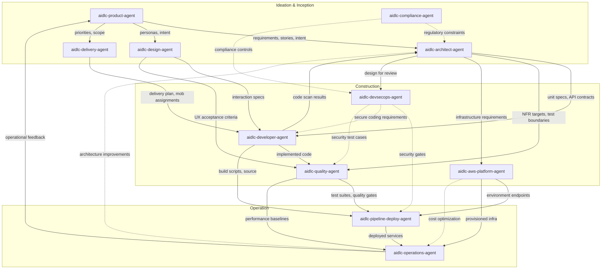

# Agent リファレンス

AI-DLC の14 agent の陣容の技術リファレンスです。11のドメインエキスパート、2つのレビュー専用 agent、そして adaptive-workflows の composer です。

設計思想と根拠については、[User Guide の Agents の章](../../guide/06-agents.md) を参照してください。

---

## 14の Agent（11のドメインエキスパート + 2つのレビュアー + composer）

| # | Agent | ドメイン |
|---|-------|--------|
| 1 | [aidlc-product-agent](product-agent.md) | 要件、scope、ユーザーストーリー、市場調査 |
| 2 | [aidlc-design-agent](design-agent.md) | UX/UI、ワイヤーフレーム、インタラクションデザイン、アクセシビリティ |
| 3 | [aidlc-delivery-agent](delivery-agent.md) | チーム編成、キャパシティ計画、デリバリーの順序付け |
| 4 | [aidlc-architect-agent](architect-agent.md) | ドメイン設計、ドメインモデリング、NFR、分解 |
| 5 | [aidlc-aws-platform-agent](aws-platform-agent.md) | AWS インフラ、IaC、FinOps、環境のプロビジョニング |
| 6 | [aidlc-compliance-agent](compliance-agent.md) | GRC、規制マッピング、データ分類、リスク |
| 7 | [aidlc-devsecops-agent](devsecops-agent.md) | 脅威モデリング、セキュリティパイプライン、セキュアな設計レビュー |
| 8 | [aidlc-developer-agent](developer-agent.md) | コード生成、リバースエンジニアリング、実装ガイダンス |
| 9 | [aidlc-quality-agent](quality-agent.md) | テスト戦略、受け入れ基準、パフォーマンス検証 |
| 10 | [aidlc-pipeline-deploy-agent](pipeline-deploy-agent.md) | CI/CD パイプライン、デプロイ戦略、リリースの実行 |
| 11 | [aidlc-operations-agent](operations-agent.md) | 可観測性、インシデント対応、フィードバックループ |
| 12 | aidlc-product-lead-agent | レビュー専用: 要件 / ユーザーストーリー / UX の品質ゲート（balanced tier） |
| 13 | aidlc-architecture-reviewer-agent | レビュー専用: 技術設計の健全性 / 実装可能性のゲート（balanced tier） |
| 14 | aidlc-composer-agent | 適応的なワークフロー合成: 仕立てられた stage プランと保留中の stage の再形成を提案する |

---

## 共有の設定

14の書かれた agent は、共通の frontmatter のベースラインを共有します。Claude Code では、どれも `tools:` の許可リストを宣言しないので、各 agent は **フルのセッションツールセット** に加えてプロビジョンされた MCP ツールを継承し、ネストした委譲の拒否として `disallowedTools: Task` を持ちます。他のハーネスはその意図をネイティブのポリシーに射影します。Kiro の agent Markdown はサポートされないキーを省き、Kiro CLI の JSON と Kiro IDE の `tools:` の許可は委譲先から `subagent` を除外します。2つのレビュー専用 agent はさらに `maxTurns: 60` を持ちます。ハーネスにレバーがあるところではネイティブに強制される、ハードなターンの歯止めです。Claude Code では frontmatter のキーが拘束力を持ち（サブエージェントはタスクの途中で止められ、最終メッセージはありません）、opencode では packager がそれをネイティブの agent ごとの `steps: 60` に射影します（runner はテキストのみの最終ターンを1回許します。サマリーは返せますが、どのツール呼び出しもレビューを書けません）。Codex の TOML ペルソナはその数を散文としてのみ運び（TOML ペルソナには frontmatter がないので、出力が引用を書き直します）、Cursor、Copilot、Kiro は agent ごとの上限キーを公開しません（不活性な `maxTurns:` キーは、未知のキーを許容する .md の面には依然として配布されます。kiro の agent JSON はそれを決して受け取りません）。セクション 12a の不完全な試行のガードは、上限で打ち切られたレビューを、暗黙に欠けた判定ではなく、1回の再試行のディスパッチと、その後の NOT-READY の検出に変えます。そして各レビュー依頼は、`<record>/.aidlc-engine/reviews/` 配下に自身のレビューファイルを開くので（同じパスの不完全なディスパッチからの以前のドラフトを削除します）、古い判定が欠けた判定の代わりに立つことは決してありません。

### Claude Code のセッションツールセット

すべての Claude Code の agent は、次を含む組み込みツールを継承します。

| Claude Code のツール | 目的 |
|------------------|---------|
| Read | ファイルシステムからファイルを読む |
| Edit | ファイルで正確な文字列置換を行う |
| Write | ファイルシステムにファイルを書く |
| Glob | 高速なファイルパターンマッチング |
| Grep | ripgrep を使った内容検索 |
| AskUserQuestion | 対話的なユーザープロンプト（メインスレッドの stage のみ） |

### 共通の Disallowed な Claude Code のツール

| Claude Code のツール | 理由 |
|------------------|--------|
| Task | agent は委譲されたワーカーとして動作します。conductor が `Task` 呼び出しを行います。Claude は `disallowedTools: Task` を強制し、他のハーネスはそのネイティブな deny/許可リストの相当物を使います。 |

### 各ペルソナが使うと期待されるツール

Claude Code では、各 agent は継承により Bash と WebSearch に *到達できます*。この表は、どのペルソナがそれらを使うとメソドロジーが **期待する** かを記録するのであって、agent ごとの許可ではありません。Claude のペルソナを本当に制限するには、任意の `tools:` 許可リストを加えます（`mcp__<server>__<tool>` の id も列挙しない限り、継承された MCP を落とします）。

| Claude Code のツール | 使うと期待される agent |
|------------------|---------------------|
| Bash | aidlc-aws-platform-agent、aidlc-devsecops-agent、aidlc-developer-agent、aidlc-quality-agent、aidlc-pipeline-deploy-agent、aidlc-operations-agent |
| WebSearch | aidlc-product-agent、aidlc-design-agent、aidlc-compliance-agent |

### Agent の tier

| Tier | Agent |
|------|--------|
| judgment | aidlc-architect-agent, aidlc-product-agent, aidlc-design-agent, aidlc-developer-agent, aidlc-quality-agent, aidlc-devsecops-agent, aidlc-compliance-agent, aidlc-aws-platform-agent, aidlc-composer-agent |
| balanced | aidlc-architecture-reviewer-agent, aidlc-product-lead-agent |
| templated | aidlc-delivery-agent, aidlc-pipeline-deploy-agent, aidlc-operations-agent |

配布される各 agent は、書かれた frontmatter で `tier:` を宣言します。packager はそれを各ハーネスのネイティブな model/effort のキーに射影します（Claude Code では、judgment → effort のピンなしの `model: inherit`、balanced → `model: sonnet` + `effort: medium`、templated → effort のピンなしの `model: inherit`）。したがって judgment と templated の agent は、セッション自身の model と effort を継承します。agent が templated になるのは、その出力が主にパターンに従うもの（デリバリープラン、CI/CD の YAML、可観測性と runbook のスキャフォールディング）で、メソドロジーがすでに agent の knowledge ファイルにエンコードされているときだけです。tier は `aidlc config models` の Writing up グループのままで、そこでプロジェクトは、かつてのダウングレードを明示的な install ごとの選択として記録できます。

9つの judgment agent は1つの性質を共有します。その作業は、判断が下流に連鎖する多制約の推論を必要とします。アーキテクチャの境界、曖昧な intent の解釈、UX のトレードオフ、密なコンテキスト下でのコード合成、リスクに基づくテスト戦略、脅威の優先順位付け、規制のエッジケース、クラウドアーキテクチャのトレードオフは、すべてこのカテゴリに入ります。2つの balanced レビュアーは、新規の入力を明示的な基準に照らして評価します。配布される balanced のベースラインは、Claude Code では Sonnet を medium effort で使います。Codex と opencode はセッションの model を継承し、medium の推論 effort を適用します。Kiro、Cursor、Copilot では、すべての tier がセッションの model と effort を継承します。[Agent System](../05-agent-system.md) の射影表と `tier_cap` のオーバーライドを参照してください。

---

## Agent サマリー表

| Agent | Lead Stage | Support Stage | Tier | 使うと期待されるツール |
|-------|-------------|----------------|-------|------------------------------|
| [aidlc-product-agent](product-agent.md) | intent-capture, market-research, scope-definition, requirements-analysis, user-stories | rough-mockups, approval-handoff, refined-mockups | judgment | WebSearch |
| [aidlc-design-agent](design-agent.md) | rough-mockups, refined-mockups | user-stories, domain-design | judgment | WebSearch |
| [aidlc-delivery-agent](delivery-agent.md) | team-formation, approval-handoff, delivery-planning | scope-definition, units-generation | templated | -- |
| [aidlc-architect-agent](architect-agent.md) | feasibility, domain-design, units-generation, contract-design, functional-design, nfr-requirements, nfr-design | intent-capture, reverse-engineering（合成）, delivery-planning | judgment | -- |
| [aidlc-aws-platform-agent](aws-platform-agent.md) | infrastructure-design, environment-provisioning | feasibility, domain-design, contract-design, nfr-design, feedback-optimization | judgment | Bash |
| [aidlc-compliance-agent](compliance-agent.md) | （なし） | feasibility, nfr-requirements, infrastructure-design, environment-provisioning | judgment | WebSearch |
| [aidlc-devsecops-agent](devsecops-agent.md) | （なし） | practices-discovery, nfr-requirements, infrastructure-design, build-and-test, environment-provisioning | judgment | Bash |
| [aidlc-developer-agent](developer-agent.md) | reverse-engineering（コードスキャン）, code-generation | practices-discovery, user-stories, functional-design, deployment-execution | judgment | Bash |
| [aidlc-quality-agent](quality-agent.md) | build-and-test, performance-validation | practices-discovery, user-stories, nfr-requirements | judgment | Bash |
| [aidlc-pipeline-deploy-agent](pipeline-deploy-agent.md) | practices-discovery, ci-pipeline, deployment-pipeline, deployment-execution | （なし） | templated | Bash |
| [aidlc-operations-agent](operations-agent.md) | observability-setup, incident-response, feedback-optimization | （なし） | templated | Bash |

---

## Agent 比較マトリクス

次の2列の `Yes` は、その継承されたツールをペルソナが使うとメソドロジーが期待することを意味します。アクセスを許可したり差し控えたりするものではありません。

| Agent | Bash の期待される使用 | WebSearch の期待される使用 | Tier | Lead Stage | Support Stage | Stage 関与の合計 |
|-------|-------------------|------------------------|------|-------------|----------------|-------------------------|
| aidlc-product-agent | No | Yes | judgment | 5 | 3 | 8 |
| aidlc-design-agent | No | Yes | judgment | 2 | 2 | 4 |
| aidlc-delivery-agent | No | No | templated | 3 | 2 | 5 |
| aidlc-architect-agent | No | No | judgment | 7 | 3 | 10 |
| aidlc-aws-platform-agent | Yes | No | judgment | 2 | 5 | 7 |
| aidlc-compliance-agent | No | Yes | judgment | 0 | 4 | 4 |
| aidlc-devsecops-agent | Yes | No | judgment | 0 | 5 | 5 |
| aidlc-developer-agent | Yes | No | judgment | 2 | 4 | 6 |
| aidlc-quality-agent | Yes | No | judgment | 2 | 3 | 5 |
| aidlc-pipeline-deploy-agent | Yes | No | templated | 4 | 0 | 4 |
| aidlc-operations-agent | Yes | No | templated | 3 | 0 | 3 |

**観察:**
- aidlc-architect-agent は最も広い stage 関与（3つの phase にまたがる 10 stage）を持ち、中心的な設計権限としての役割を反映しています。
- 14 agent の陣容全体で、9つの agent が `judgment` tier、3つが継承する `templated` tier を持ち、2つの `balanced` レビュアーだけが Claude Code、Codex、opencode で段を下げます。Kiro、Cursor、Copilot では、すべての tier がセッションの model と effort を継承します。上のマトリクスは、11のドメインエキスパート agent をカバーします。
- aidlc-compliance-agent は純粋にアドバイザリーの立場で動作します（Ideation、Construction、Operation にまたがる 4 つの support stage。lead stage なし）。
- 11 agent のうち6つが、CLI の操作のために Bash を使うと期待されます（インフラ、セキュリティ、開発、テスト、デプロイ、運用）。
- 3つの agent が、調査タスクのために WebSearch を使うと期待されます（product、design、compliance）。

---

## Phase への参加

この表は、どの agent がどの phase でアクティブか、そしてその phase で lead（L）と support（S）のどちらを務めるかを示します。

| Agent | Initialization（Phase 0） | Ideation（Phase 1） | Inception（Phase 2） | Construction（Phase 3） | Operation（Phase 4） |
|-------|--------------------------|---------------------|---------------------|------------------------|---------------------|
| aidlc-product-agent | -- | L (intent-capture, market-research, scope-definition), S (rough-mockups, approval-handoff) | L (requirements-analysis, user-stories), S (refined-mockups) | -- | -- |
| aidlc-design-agent | -- | L (rough-mockups) | L (refined-mockups), S (user-stories, domain-design) | -- | -- |
| aidlc-delivery-agent | -- | L (team-formation, approval-handoff), S (scope-definition) | L (delivery-planning), S (units-generation) | -- | -- |
| aidlc-architect-agent | -- | L (feasibility), S (intent-capture) | L (domain-design, units-generation, contract-design), S (reverse-engineering, delivery-planning) | L (functional-design, nfr-requirements, nfr-design) | -- |
| aidlc-aws-platform-agent | -- | S (feasibility) | S (domain-design, contract-design) | L (infrastructure-design), S (nfr-design) | L (environment-provisioning), S (feedback-optimization) |
| aidlc-compliance-agent | -- | S (feasibility) | -- | S (nfr-requirements, infrastructure-design) | S (environment-provisioning) |
| aidlc-devsecops-agent | -- | -- | S (practices-discovery) | S (nfr-requirements, infrastructure-design, build-and-test) | S (environment-provisioning) |
| aidlc-developer-agent | -- | -- | L (reverse-engineering), S (practices-discovery, user-stories) | L (code-generation), S (functional-design) | S (deployment-execution) |
| aidlc-quality-agent | -- | -- | S (practices-discovery, user-stories) | L (build-and-test), S (nfr-requirements) | L (performance-validation) |
| aidlc-pipeline-deploy-agent | -- | -- | L (practices-discovery) | L (ci-pipeline) | L (deployment-pipeline, deployment-execution) |
| aidlc-operations-agent | -- | -- | -- | -- | L (observability-setup, incident-response, feedback-optimization) |

---

## Agent 協働マップ



### テキストによる代替

```
aidlc-product-agent
  |-- requirements, stories --> aidlc-architect-agent
  |-- personas, intent -------> aidlc-design-agent
  |-- priorities, scope ------> aidlc-delivery-agent

aidlc-design-agent
  |-- interaction specs ------> aidlc-developer-agent
  |-- UX acceptance criteria -> aidlc-quality-agent

aidlc-architect-agent
  |-- unit specs, API contracts --> aidlc-developer-agent
  |-- NFR targets, test boundaries --> aidlc-quality-agent
  |-- infrastructure requirements --> aidlc-aws-platform-agent
  |-- design for review -----------> aidlc-devsecops-agent

aidlc-compliance-agent
  |-- regulatory constraints ....> aidlc-architect-agent
  |-- compliance controls .......> aidlc-devsecops-agent

aidlc-devsecops-agent
  |-- security gates ............> aidlc-pipeline-deploy-agent
  |-- secure coding requirements > aidlc-developer-agent
  |-- security test cases .......> aidlc-quality-agent

aidlc-delivery-agent
  |-- delivery plan, mob assignments --> aidlc-developer-agent

aidlc-developer-agent
  |-- code scan results --> aidlc-architect-agent
  |-- implemented code ---> aidlc-quality-agent
  |-- build scripts ------> aidlc-pipeline-deploy-agent

aidlc-quality-agent
  |-- test suites, quality gates --> aidlc-pipeline-deploy-agent
  |-- performance baselines ------> aidlc-operations-agent

aidlc-aws-platform-agent
  |-- environment endpoints --> aidlc-pipeline-deploy-agent
  |-- provisioned infra -----> aidlc-operations-agent

aidlc-pipeline-deploy-agent
  |-- deployed services --> aidlc-operations-agent

aidlc-operations-agent
  |-- operational feedback -------> aidlc-product-agent  (CLOSES THE LOOP)
  |-- architecture improvements .> aidlc-architect-agent
```

---

## 相互参照

- [Architecture Overview](../01-architecture.md)
- [Orchestrator](../03-orchestrator.md)
- [Agent System](../05-agent-system.md)
- [Stage Documentation](../04-stages/)
- [User Guide の Agents の章（思想と根拠）](../../guide/06-agents.md)
- [SKILL.md（Conductor の書かれたソース）](../../../harness/claude/skills/aidlc/SKILL.md) — engine の directive に基づいて動く転送ループ。その人間が読める stage-graph のミラーは、横にある [tables.md](../../../harness/claude/skills/aidlc/tables.md) です
