# AI-DLC ワークフロー図

このドキュメントには、AI-DLC（AI-Driven Development Life Cycle）方法論を視覚化したすべての Mermaid 図を収めています。各セクションでは、簡単な説明の後にレンダリング済みの図を示します。これらの図は、エンジンとコンダクター（`aidlc-orchestrate.ts` + `SKILL.md`）、ステージプロトコル（`stage-protocol.md`）、ステージファイル、エージェント定義から導かれています。

> **Note:** これらの図は、関連するリファレンス章にもインラインで埋め込まれています。このファイルは、すべての図を 1 か所にまとめたインデックスとして機能します。以下の図の `<record>/` は、アクティブな intent のレコードディレクトリ `aidlc/spaces/<space>/intents/<YYMMDD>-<label>/` を指します。
>
> - 図 1 と 7: [Architecture](01-architecture.md)
> - 図 8: [Orchestrator](03-orchestrator.md) -- Session Management セクション
> - 図 9: [Orchestrator](03-orchestrator.md) -- Scope-to-Stage Mapping セクション
> - 図 10: [Knowledge System](10-knowledge-system.md)
> - 図 11: [Stage Protocol](04-stage-protocol.md) -- Approval Gates セクション
> - 図 12: [Orchestrator](03-orchestrator.md) -- State File Schema セクション

---

## 1. エンドツーエンドのライフサイクル

AI-DLC 方法論は、作業を 5 つの連続したフェーズに整理します。Ideation、Inception、Construction の後の各境界には検証チェックが入り、プランがそれを実行するときに、フェーズを終えるステージ（Approval & Handoff、Delivery Planning、CI Pipeline）が書きます。Initialization はチェックなしで最初のフェーズへ引き渡します。ライフサイクル全体は 5 つのフェーズにまたがる 33 ステージにおよび、どのステージが実際に実行されるかはスコープによって決まります。

```mermaid
graph LR
    subgraph INITIALIZATION["INITIALIZATION (0.1-0.3)"]
        Z1["Workspace Scaffold"]
        Z4["State Init"]
        Z1 -.->|"3 stages"| Z4
    end

    subgraph IDEATION["IDEATION (1.1-1.7)"]
        I1["Intent Capture"]
        I7["Approval & Handoff"]
        I1 -.->|"7 stages"| I7
    end

    subgraph INCEPTION["INCEPTION (2.1-2.9)"]
        N1["Reverse Engineering"]
        N7["Delivery Planning"]
        N1 -.->|"9 stages"| N7
    end

    subgraph CONSTRUCTION["CONSTRUCTION (3.1-3.7)"]
        C1["Functional Design"]
        C7["CI Pipeline"]
        C1 -.->|"3.1–3.5 per Unit in the recorded order; 3.6–3.7 once after all Units"| C7
    end

    subgraph OPERATION["OPERATION (4.1-4.7)"]
        O1["Deployment Pipeline"]
        O7["Feedback & Optimization"]
        O1 -.->|"7 stages"| O7
    end

    Z4 -->|"auto-proceed"| I1
    I7 -->|"Verification Gate 1"| N1
    N7 -->|"Verification Gate 2"| C1
    C7 -->|"Verification Gate 3"| O1
    O7 -.->|"Feedback Loop"| I1

    style INITIALIZATION fill:#f3e5f5,stroke:#9c27b0,color:#000
    style IDEATION fill:#e8f5e9,stroke:#4caf50,color:#000
    style INCEPTION fill:#e3f2fd,stroke:#2196f3,color:#000
    style CONSTRUCTION fill:#fff3e0,stroke:#ff9800,color:#000
    style OPERATION fill:#fce4ec,stroke:#e91e63,color:#000
```

---

## 2. Ideation のフロー

Ideation フェーズでは、ビジネス上の意図を捉え、実現可能性を検証し、スコープを定め、チームを編成し、ラフモックアップを作成し、承認用のイニシアチブブリーフを作ります。ALWAYS と記されたステージは、それを含むすべてのスコープで実行されます。あるスコープがどのステージを含むかは、そのプランで決まります。bugfix、refactor、infra、security-patch、classic、workshop、express は Ideation を実行しません。poc は Intent Capture のみを実行します。mvp は Market Research、Team Formation、Approval & Handoff を省きます。mvp と poc は、Approval & Handoff だけがフェーズチェックを書くため、チェックなしで Ideation を終えます。実線の矢印は ALWAYS のルーティングを、破線の矢印は CONDITIONAL のルーティングを表します。

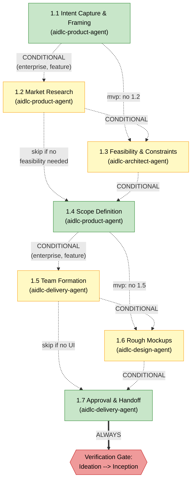

---

## 3. Inception のフロー

Inception フェーズでは、（brownfield プロジェクトの場合）コードベースを分析し、チームの実践を発見し、要件を引き出し、ユーザーストーリーとモックアップを作成し、アプリケーションのアーキテクチャを設計し、実装ユニットへ分解し、デリバリーを計画します。ステージ 2.1（Reverse Engineering）はパイプライン（2 リンクのチェーン）として実行され、六角形で示されます。まず developer サブエージェントがコードをスキャンし、次に architect サブエージェントが結果を統合して成果物を書きます。

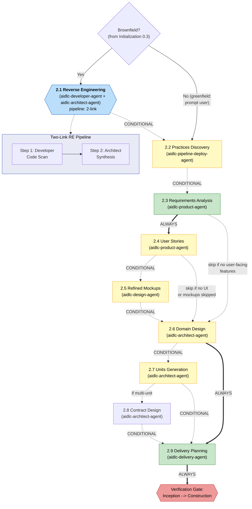

---

## 4. Construction のフロー

次の図は、**新規にソースを生み出す単独 Unit のワークフロー**のデフォルトを示します。ユニットメジャーで、検証済みチェックポイントを伴う直列実行です。最初の DAG Unit は、skeleton-on のとき、動作する統合済みスライスを形成し、後続の Unit の前に本物のエンドツーエンドのチェックと人間の承認を通過しなければなりません。これは、以前の Construction 最初のステージレビューとは異なります。design-only、no-Unit、existing、team-owned の各パスは、記録済みのポリシーを保ちます。明示的な stage-major の選択も引き続き有効です。ランタイムの順序は `unit-of-work-dependency.md` に由来し、`bolt-plan.md` は計画のためのコンテンツです。

対象となる skeleton-off のワークフローは、Construction 入口で **Continue automatically** ／ **Review each checkpoint** を提示します。skeleton-on では、すでに選択が存在しない限り、本物の skeleton チェックポイントの後にそれを提示します。この承認の設定が swarm 実行を選ぶわけではありません。Plan Approval と、有効化されたサマリー確認は人間の停止点のままです。サマリー確認は `directive.ceremony.summary_confirmation === "on"` のときにのみ適用されます。Build and Test とオプションの CI Pipeline は、結果全体に対して一度だけ実行されます。

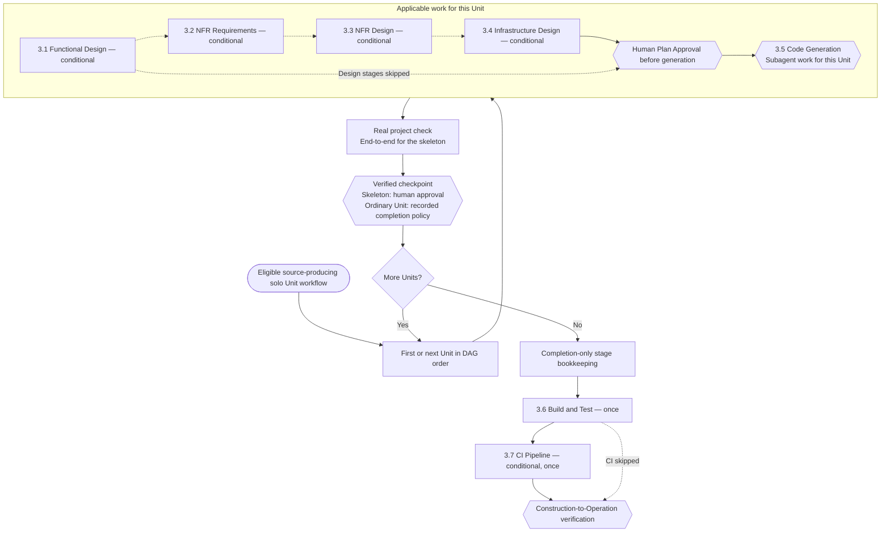

<!-- Text fallback: For an eligible new solo workflow, complete each Unit's applicable design and Code Generation stages in DAG order, preserving human Plan Approval and any enabled summary confirmation. Verify the working result and approve its checkpoint: always human for the skeleton, according to recorded policy for ordinary Units. After all Units, settle bookkeeping and run Build and Test plus optional CI Pipeline. Other workflow paths retain their existing policy. -->

---

## 5. Operation のフロー

Operation フェーズは、デプロイ、環境のプロビジョニング、可観測性、インシデント対応、パフォーマンス検証、フィードバックをカバーします。7 つのステージはすべて CONDITIONAL です（mvp と poc のスコープでは、フェーズ全体がスキップされることがあります）。すべてのステージはインラインで実行されます。ステージ 4.7 は終端のステージで、承認されるとワークフローは完了します。

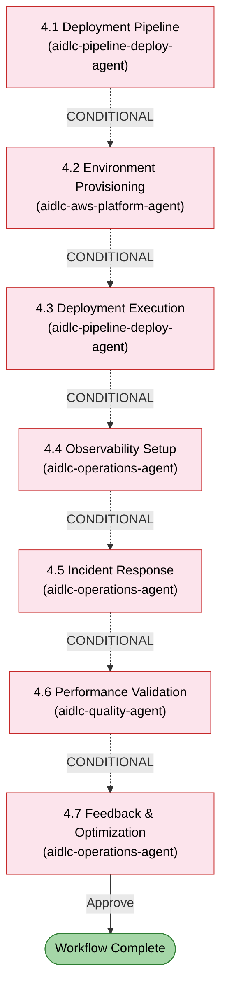

---

## 6. エージェント協調マップ

14 エージェントの全ロースターは、11 のドメインエージェント、2 つのレビュー専用エージェント、そして adaptive-workflows のコンポーザーで構成されます。この図は、11 のドメインエージェントとその主要な成果物の流れを意図的に扱っています。レビュー専用のエージェントは独立したプロダクトとアーキテクチャのチェックを行い、コンポーザーは適応的なステージプランを提案して再構成します。[Agent Reference](agents/README.md) と [Reviewer Invocation](04-stage-protocol.md#reviewer-invocation) を参照してください。

コンダクター（SKILL.md）は、エンジンの指示どおりに各エージェントの呼び出しを行います。エージェントどうしが直接呼び出すことはありません。情報は、intent のレコードディレクトリ（`aidlc/spaces/<space>/intents/<YYMMDD>-<label>/`）に保存される成果物を通じてエージェント間を流れます。この図は、aidlc-operations-agent から aidlc-product-agent へ戻るフィードバックループで締めくくられます。

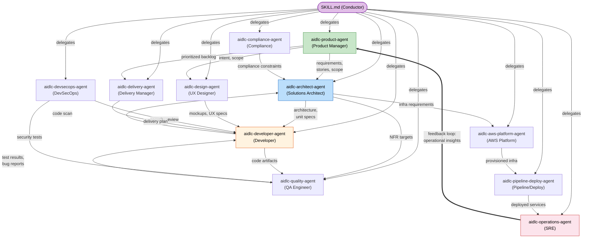

---

## 7. 実行モデル

この実装では、ステージに対して 4 つのアクティブな実行モードを使います。**Inline** のステージは、オーケストレーターの会話内で直接実行されます（ユーザーが対話できます）。**Subagent** のステージは、ハーネスのサブエージェントツール（Claude Code では Task ツール）を通じて単一のエージェントへ委譲し、ステージが支援エージェントを宣言している場合はハブアンドスポークになります。**Pipeline** のステージはエージェントを順に連結し、各リンクが作業成果物を前進させます（Reverse Engineering が出荷済みの例です）。**Mob** のステージは、支援エージェントを区切られたラウンドで集め、各貢献は互いに見えません（ハーネスが一度に複数をディスパッチできるところでは並列に、できないところでは順番に実行します）。User Stories が出荷済みの例です。

```mermaid
flowchart LR
    subgraph INLINE["Mode 1: Inline"]
        direction TB
        IN1["Orchestrator reads\nstage file"]
        IN2["Load agent persona\n+ knowledge"]
        IN3["Execute stage steps\ndirectly in conversation"]
        IN4["User interaction\navailable"]
        IN5["Approval gate\n(AskUserQuestion)"]
        IN1 --> IN2 --> IN3 --> IN4 --> IN5
    end

    subgraph SUBAGENT["Mode 2: Subagent (simple)"]
        direction TB
        SA1["Orchestrator reads\nstage file"]
        SA2["Prepare context:\nartifacts + persona"]
        SA3["Task tool call\n(subagent_type specified)"]
        SA4["Subagent executes\n(no user interaction)"]
        SA5["Return structured\nsummary to orchestrator"]
        SA6["Orchestrator presents\ncompletion + approval"]
        SA1 --> SA2 --> SA3 --> SA4 --> SA5 --> SA6
    end

    subgraph TWOSTEP["Mode 3: Pipeline (2-link RE chain)"]
        direction TB
        TS1["Orchestrator reads\nRE stage file"]
        TS2["Task: aidlc-developer-agent\ncode scan"]
        TS3["Developer returns\nscan results"]
        TS4["Task: aidlc-architect-agent\nsynthesis"]
        TS5["Architect produces\n9 artifacts"]
        TS6["Orchestrator presents\ncompletion + approval"]
        TS1 --> TS2 --> TS3 --> TS4 --> TS5 --> TS6
    end

    subgraph MOB["Mode 4: Mob (parallel rounds)"]
        direction TB
        MB1["Orchestrator reads\nstage file"]
        MB2["Lead drafts the\nartifacts inline"]
        MB3["Parallel Tasks: all\nsupport agents, blind"]
        MB4["Each writes its\ncontribution file"]
        MB5["Lead integrates;\nobjection triage\n(judgment -> human,\nknowledge -> round 2)"]
        MB6["Orchestrator presents\ncompletion + approval"]
        MB1 --> MB2 --> MB3 --> MB4 --> MB5 --> MB6
    end

    style INLINE fill:#e8f5e9,stroke:#4caf50,color:#000
    style SUBAGENT fill:#e3f2fd,stroke:#2196f3,color:#000
    style TWOSTEP fill:#fff3e0,stroke:#ff9800,color:#000
    style MOB fill:#f3e5f5,stroke:#9c27b0,color:#000
```

---

## 8. セッション再開のフロー

ユーザーが `/aidlc` を呼び出すと、オーケストレーターはアクティブな intent の `aidlc-state.md` を確認します。見つかれば、チェックポイントから続行します（最初の呼び出しは `next --resume` です）。やり直し、特定のステージへのジャンプ、最初からのやり直しは、いつでも依頼できます。見つからなければ、最初の intent を作成します。

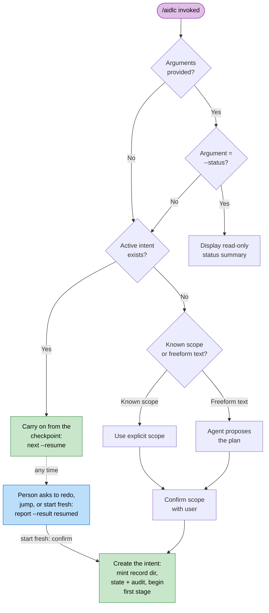

---

## 9. スコープのルーティング

> スコープルーティングの表: [Orchestrator Reference -- Scope Mapping](03-orchestrator.md#scope-to-stage-mapping) を参照してください。

---

## 10. 知識のロード順序

各ステージは、厳密な 6 ステップの順序で知識をロードします。これにより、ガードレールが最優先され、続いて共有の方法論、次にエージェント固有の知識、次にチームのカスタマイズ、最後に以前のステージの成果物という順序が確保されます。下のシーケンス図は、任意のステージ起動におけるロード順序を示します。

> **Note:** ステップ 1〜5 は `stage-protocol.md` のセクション 5 で定義されるエージェント知識のロードです。ステップ 6（以前のステージの成果物）は、ファイルのロードステップではなく、ランタイムにオーケストレーターが追加するコンテキストです。インラインのステージ、および mob のインラインリードでは、このステップはリード自身のペルソナ（`lead_persona`）を運び、`inline_context_paths` は支援ペルソナの直後、共有とエージェントの方法論（ステップ 2〜3）の前に、チーム知識（ステップ 4〜5）を並べます。サイズ上限は方法論から先にトリムします。ディスパッチされたエージェントは、下の順序でロードします。

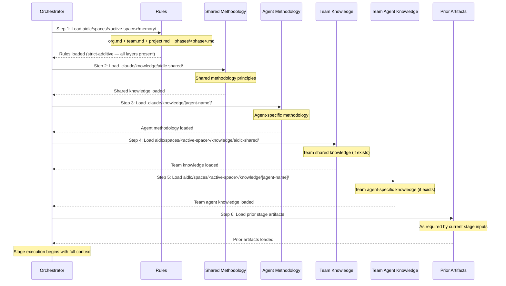

---

## 11. 承認ゲートのフロー

各ステージ（3 つの Initialization ステージを除く）は、承認ゲートで終わります。ゲートの監査証跡はレポートが所有します。`report --result awaiting-approval` は、質問が提示される前に保留されたゲート（`STAGE_AWAITING_APPROVAL`）を記録し、`report --result approved|rejected` は応答をそのまま記録します（`GATE_APPROVED`／`GATE_REJECTED`）。決して `aidlc-log.ts decision`／`answer` ではありません。3 回の修正サイクルの後、「Accept as-is」の脱出口が使えるようになります。Ideation と Inception のステージには、以前スキップしたステージを追加するための条件付きの第 3 の選択肢が含まれることもあります。

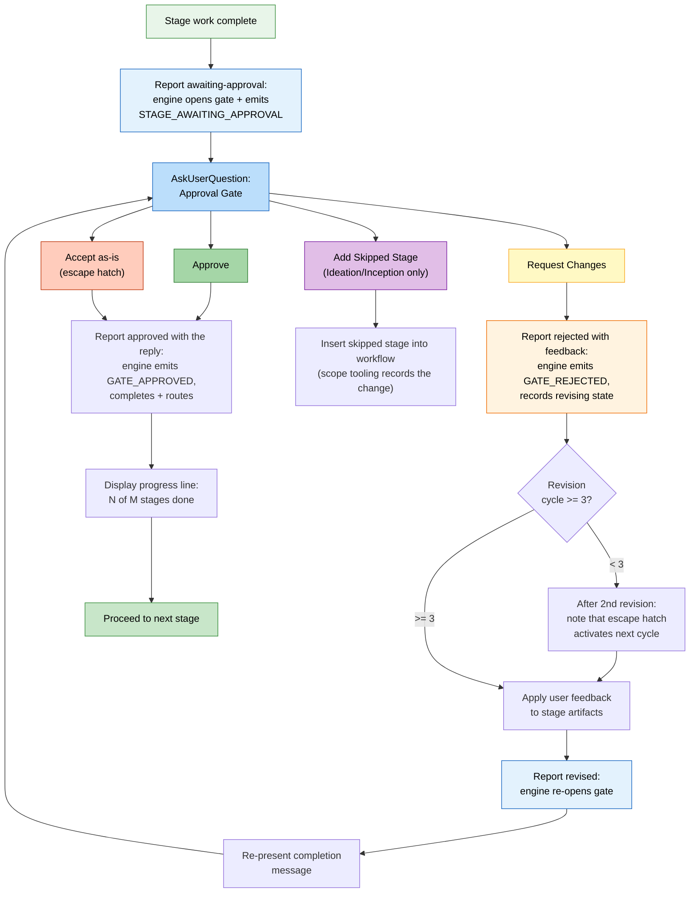

---

## 12. 状態の追跡

`aidlc-state.md` ファイルは、各ステージをチェックボックス記法で追跡します。`[ ]`（未開始）、`[-]`（進行中）、`[?]`（承認待ち）、`[R]`（修正中）、`[x]`（完了）、`[S]`（スキップ）です。これらの遷移はエンジンが所有します。コンダクターはチェックボックスの状態を編集するのではなく、結果を報告します。この図は、skip、redo、jump の各操作の側方フローも示します。

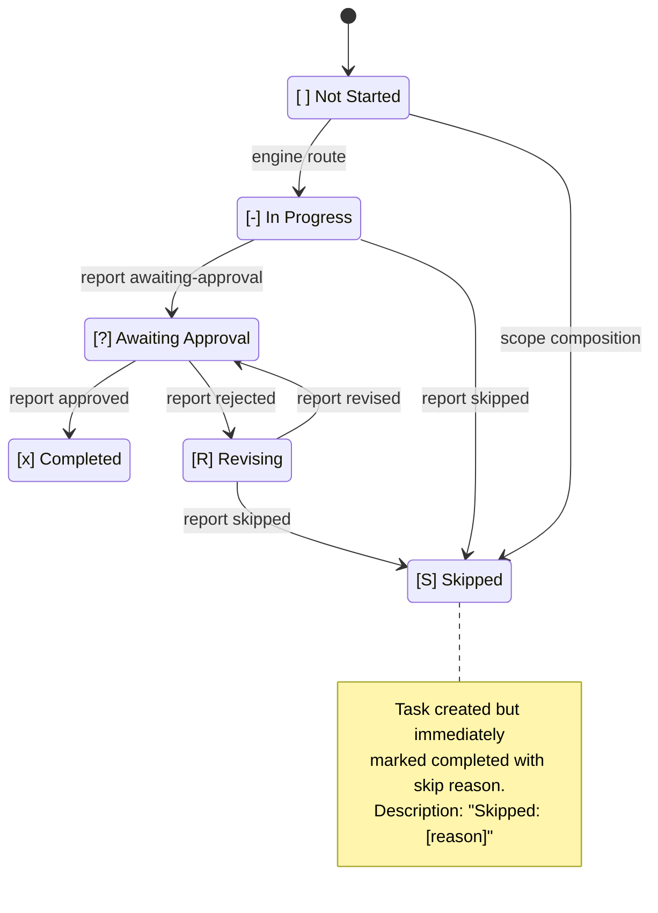

```mermaid
flowchart TD
    subgraph NORMAL["Normal Flow"]
        direction LR
        NS1["[ ] Not Started"]
        IP1["[-] In Progress"]
        AW1["[?] Awaiting Approval"]
        CO1["[x] Completed"]
        NS1 -->|"engine route"| IP1
        IP1 -->|"report gate open"| AW1
        AW1 -->|"report approved"| CO1
    end

    subgraph SKIP["Skip Flow"]
        direction LR
        NS2["[ ] Not Started"]
        SK2["[S] Skipped"]
        NS2 -->|"scope composition"| SK2
    end

    subgraph REDO["Redo Flow"]
        direction LR
        CO3["[x] Completed\nor [-] In Progress"]
        NS3["[ ] Not Started"]
        IP3["[-] In Progress"]
        CO3 -->|"user requests redo\n(state reset, files kept)"| NS3
        NS3 -->|"re-execute stage"| IP3
    end

    subgraph JUMP["Jump Flow"]
        direction LR
        IP4["[-] In Progress\n(stage A)"]
        NS4["[ ] Not Started\n(stage B)"]
        IP4B["[-] In Progress\n(stage B)"]
        IP4 -->|"user requests jump\n(warn about skipped stages)"| NS4
        NS4 -->|"begin target stage"| IP4B
    end

    style NORMAL fill:#e8f5e9,stroke:#4caf50,color:#000
    style SKIP fill:#fff9c4,stroke:#f9a825,color:#000
    style REDO fill:#e3f2fd,stroke:#2196f3,color:#000
    style JUMP fill:#fce4ec,stroke:#e91e63,color:#000
```

---

## ステージ別の実行モード一覧

このリファレンス表は、各ステージを実行モードとリードエージェントに対応づけ、すばやく参照できるようにしたものです。

| ステージ | 名前 | モード | リードエージェント |
|-------|------|------|------------|
| 0.1 | Workspace Scaffold | inline (auto-proceed) | orchestrator |
| 0.2 | Workspace Detection | inline (auto-proceed, deterministic scanner) | orchestrator |
| 0.3 | State Init | inline (auto-proceed) | orchestrator |
| 1.1 | Intent Capture | inline | aidlc-product-agent |
| 1.2 | Market Research | inline | aidlc-product-agent |
| 1.3 | Feasibility | inline | aidlc-architect-agent |
| 1.4 | Scope Definition | inline | aidlc-product-agent |
| 1.5 | Team Formation | inline | aidlc-delivery-agent |
| 1.6 | Rough Mockups | inline | aidlc-design-agent |
| 1.7 | Approval & Handoff | inline | aidlc-delivery-agent |
| 2.1 | Reverse Engineering | pipeline (2-link) | aidlc-developer-agent + aidlc-architect-agent |
| 2.2 | Practices Discovery | subagent | aidlc-pipeline-deploy-agent |
| 2.3 | Requirements Analysis | inline | aidlc-product-agent |
| 2.4 | User Stories | mob | aidlc-product-agent |
| 2.5 | Refined Mockups | inline | aidlc-design-agent |
| 2.6 | Domain Design | inline | aidlc-architect-agent |
| 2.7 | Units Generation | inline | aidlc-architect-agent |
| 2.8 | Contract Design | inline | aidlc-architect-agent |
| 2.9 | Delivery Planning | inline | aidlc-delivery-agent |
| 3.1 | Functional Design | inline | aidlc-architect-agent |
| 3.2 | NFR Requirements | inline | aidlc-architect-agent |
| 3.3 | NFR Design | inline | aidlc-architect-agent |
| 3.4 | Infrastructure Design | inline | aidlc-aws-platform-agent |
| 3.5 | Code Generation | subagent (aidlc-developer-agent) | aidlc-developer-agent |
| 3.6 | Build and Test | inline | aidlc-quality-agent |
| 3.7 | CI Pipeline | inline | aidlc-pipeline-deploy-agent |
| 4.1 | Deployment Pipeline | inline | aidlc-pipeline-deploy-agent |
| 4.2 | Environment Provisioning | inline | aidlc-aws-platform-agent |
| 4.3 | Deployment Execution | inline | aidlc-pipeline-deploy-agent |
| 4.4 | Observability Setup | inline | aidlc-operations-agent |
| 4.5 | Incident Response | inline | aidlc-operations-agent |
| 4.6 | Performance Validation | inline | aidlc-quality-agent |
| 4.7 | Feedback & Optimization | inline | aidlc-operations-agent |
