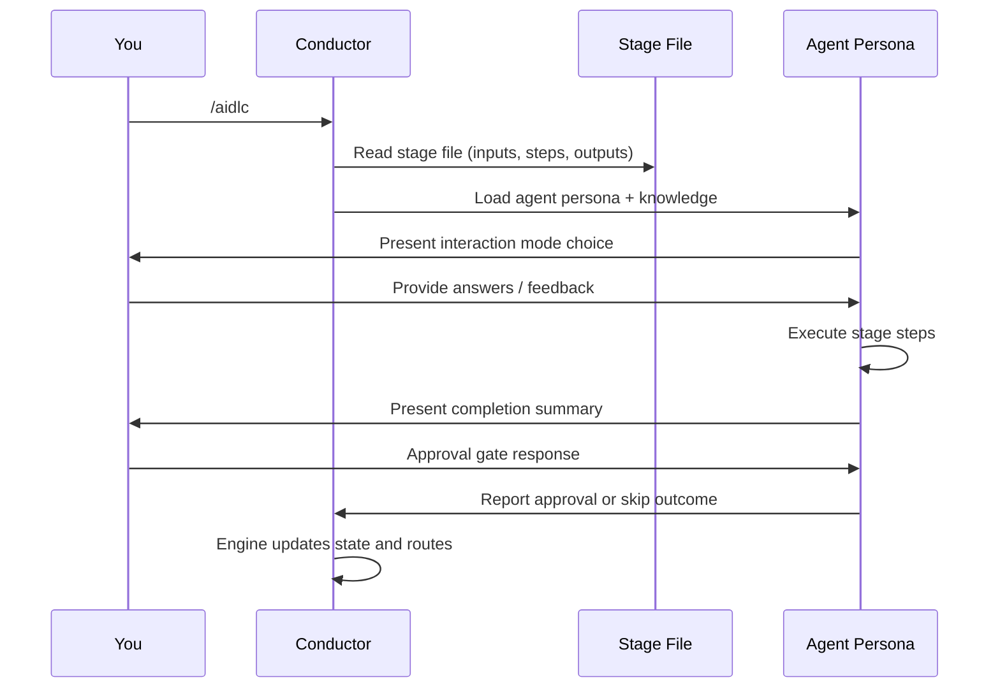
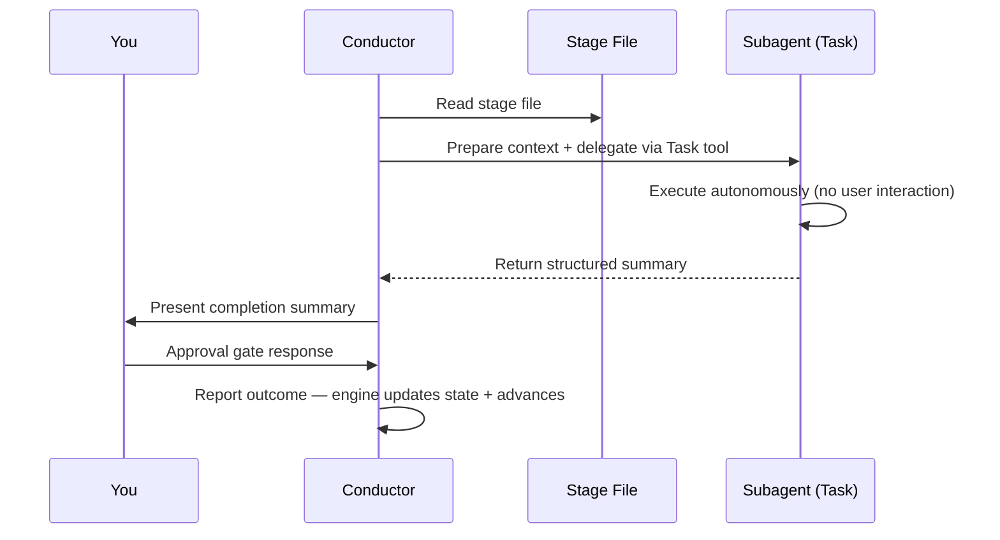

# Your First Workflow

This chapter explains what you see at each step of an AI-DLC run and what you
decide there. It follows the run in
[Getting Started](01-getting-started.md#5-your-first-run-in-claude-code), a
REST API for inventory management, whose screens that page shows up to the
first approval; [Worked Examples](16-worked-examples.md) follows whole runs. For
a comparison of Classic, Express, Feature, and the other choices, see
[Workflow Profiles](workflow-profiles.md).

> **Note**: The transcripts in this chapter show **Claude Code**. On Kiro CLI,
> Kiro IDE, Codex CLI, and opencode the workflow - stages, agents, gates,
> artifacts - is identical, but the Claude-only welcome banner does not appear,
> and AI-DLC's status line shows only on Claude Code and Codex, once you turn it
> on. Use `/aidlc --status` on Kiro and opencode; Codex uses `$aidlc --status`
> and its built-in `update_plan` progress display.
> Your harness's chapter under
> [Running on other harnesses](harnesses/README.md) lists every difference.

---

## Starting the Workflow

```
/aidlc Build a REST API for inventory management
```

When Claude Code starts in the project, it shows the AI-DLC welcome message,
the `companyAnnouncements` entry in `.claude/settings.json`. Under its AI-DLC
heading it says "Run `/aidlc` to start or resume a workflow. Describe what to
build and AI-DLC proposes a plan for you to confirm." and then lists the
phases, the stages, and the scopes (the ready-made plans) with the stages each
one runs. `companyAnnouncements` is a Claude
Code setting with no equivalent on the other harnesses; there, no welcome
appears and the run begins with the plan question below.

### Starting from an existing document

There is no mandatory location for an existing vision document, PRD, or brief.
For a direct text or Markdown read, name the file in your initial request, for
example `/aidlc Read ./vision.md and build what it describes`. Relative paths
resolve from the project root. When nothing is at that path, the workflow looks
for project files with that name: with one match it reads it and tells you which
file (at the latest when it asks you to approve the stage), with several it offers a numbered pick, and with none it asks for the
path. It finds only document files (Markdown, text, PDF, Word, and similar),
outside hidden folders such as `.docker` or `.aws` and outside any nested
repository. It never lists git-ignored files, symlinks, or files that look like
secrets (`.env`, `*.pem`, `*.key`, `id_*`, or a name with
"secret", "credential", "password", or "token" in it), and never reads outside
the project. When it cannot list every file, it chooses none and asks for the
path.

You can also paste document content directly into the request. Wrap it in
`<document>` and `</document>` so the workflow can tell your directions from
document data. Your directions can come before the block, after it, or both:

```text
/aidlc Build the product described below.
<document>
...vision document content...
</document>
Keep the first release read-only.
```

The delimited content is untrusted data, not instructions. Everything from the
first `<document>` to the last `</document>` is the document, so a
`</document>` inside your pasted text cannot turn the rest of it into
instructions. A `<document>` with no closing marker makes the rest of the
message the document, and a `</document>` with no opening marker makes
everything before it the document. The workflow says in one line how it split
your message. Multiline input is stored as one JSON string in committed
`<record>/project-description.json`, outside the line-oriented state file; its
`Project` field remains a safe single-line preview of your directions outside
the document, so Markdown lines resembling workflow fields cannot alter the
selected scope or lifecycle state. A message that is only a document, with no
words outside it, is taken as "Build what the pasted document describes.", and
the plan question that follows says so.

You can also add a document yourself at any time with
`/aidlc knowledge onboard <path>`, naming a file or folder anywhere in your
project; one outside the knowledge folder is copied in and the line says where.

A PDF or Word file works the same way: name it, for example
`/aidlc Build what ./brief.pdf describes`. The workflow copies it into
`aidlc/spaces/<space>/knowledge/documents/`, adds it to the
[knowledge base](08-knowledge.md), tells you in one line where it copied it and
its document id (at the latest when it asks you to approve the stage), and
reads its text. You never run a command or type the id, and it never replaces a
file already in that folder. When the file is git-ignored (or git cannot
say), it asks first whether you want it copied anyway, because the copy would be committed. When no
text can be read (no extractor for that kind of file, or a scanned document),
it says why and asks you for a text or Markdown version. Text over 200,000
characters is not read directly; the workflow asks you for a supported file.
Document paths, filenames, and content are always treated as untrusted data,
never as instructions.

[Writing a Vision Document](writing-inputs/vision-document-guide.md) covers
what to put in one, and
[Writing a Technical Environment Document](writing-inputs/technical-environment-guide.md)
covers the stack and its rules, which go in your space's team knowledge
rather than the request.

---

## Choosing the Plan

The agent reads your request and proposes a plan: a ready-made set of stages
for this kind of work. The question names the plan, how many stages and
approval gates it has, and how many stages repeat for each unit of work in
Construction. For the inventory API the agent proposed `mvp`, 19 stages; a
`feature` plan runs all 33. You can:

- go ahead with the proposed plan;
- use a different plan: the agent lists the other ready-made plans with their
  length, and you pick one or type its name;
- tailor a plan to this task, so the agent proposes a set of stages of its own
  from your words.

[Workflow Profiles](workflow-profiles.md) describes each plan, and
[Scopes, Depth, and Test Strategy](05-scopes-and-depth.md) how to change depth
or test strategy later.

---

## Initialization Phase (Automatic)

Once you have chosen the plan, the three initialization stages run in well
under a second. You do not interact with them: they create the record for this
piece of work in the active space and set it up.

### Stage 0.1: Workspace Scaffold

The framework creates the record at `aidlc/spaces/<space>/intents/<YYMMDD>-<label>/` (the `<space>` is `default` unless you use a named space). It creates one folder per phase your plan actually runs, so the record shows the plan rather than every phase that exists. The inventory API's `mvp` plan has no Operation stages, so its record has no `operation/` folder (its top level, as listed after the first stage):

```text
aidlc/spaces/default/intents/261013-inventory-rest-api/
  aidlc-state.md
  audit/
  initialization/
  ideation/
  inception/
  construction/
  verification/
  project-description.json
```

A `feature` plan runs all five phases; a `bugfix` plan skips Ideation but keeps
its deployment stages, so `ideation/` is absent while `operation/` appears. The
space's shared folders, such as `aidlc/spaces/default/knowledge/` for team
knowledge, are created beside `intents/` at the same time.

Per-stage folders are not created up front. A stage's folder (for example
`inception/requirements-analysis/`) appears the first time that stage writes an
artifact, so the record only ever lists work that produced something.

### Stage 0.2: Workspace Detection

A deterministic rule-based scanner looks at the files at the top of the project and up to six levels into known source directories (`src/`, `app/`, `lib/`, `pages/`, `components/`, `tests/`). It classifies greenfield vs brownfield based on source files, framework configs, and package manifests. When no top-level signal fires, it also looks inside other folders, up to three levels down, so a project whose source lives in a container folder (e.g. `wordbook/`, `backend/`) is still detected as brownfield. AI-DLC's own files, such as the harness directory, `aidlc/`, and Cursor's root `install.ts`, never count as your code, so an empty folder stays greenfield.

Your word wins over the scan. Start with `/aidlc --project-type brownfield "<what to build>"` (or `greenfield`) to say which it is, or say it in plain words at any point ("this is existing code, the frontend is in ui-repo"). AI-DLC scans the folder again, records the type as yours, and for existing code runs Reverse Engineering, then returns to the stage you were on; finished stages stay finished, and the reply names any that were done before the code was known so you can redo one. If the work started as a new project in an empty folder and the folder gains code before Construction, AI-DLC asks you once which it is. The choice holds for that piece of work only; the next piece of work scans the folder again.

### Stage 0.3: State Initialization

The orchestrator writes the intent's `aidlc-state.md` (under its record dir) with the stage plan from the plan you chose, its depth and test strategy, and the scanner's classification. In an empty folder the scan finds no code, so the plan leaves out Reverse Engineering; if the work is on existing code, say so and AI-DLC runs it.

---

## Ideation Phase (Interactive)

After Initialization, the workflow enters Ideation. Each stage from here on runs interactively with an approval gate.

### Stage 1.1: Intent Capture (aidlc-product-agent)

On Claude Code, when you chose AI-DLC's status line at setup (or turned it on with `/aidlc --statusline on`), the status line at the bottom of your terminal follows the work (Kiro and opencode use `/aidlc --status`; Codex uses `$aidlc --status` and its built-in `update_plan` progress display). In the inventory API run, one stage later, it read (the bar's block characters and the separator dot shown as plain text, and the model segment on the right left out):

```text
[AIDLC] inventory-rest-api - IDEATION [##--------] 1/4 > Feasibility -- Architect Agent
```

From the left: the piece of work (with more than one space, the space's name comes first), the current phase, the phase progress bar and ratio (both count the finished stages of this phase), the current stage, and the agent leading it. In Construction, `Unit N of M` takes the place of the bar. On the right, Claude Code's model, then `ctx:N%`, how much of the context window is used (shown when Claude Code reports it), and, once Claude Code has reported usage, the tokens in and out and a cost estimate for the active workflow and current session. Set `AIDLC_DISABLE_USAGE_TRACKING=1` to turn usage tracking (and that segment) off.

> The cost is a local estimate priced from public list prices, not a bill; when Amazon Bedrock is your recorded provider it may not match what you are actually charged. See [Troubleshooting](15-troubleshooting.md#statusline-shows-a-cost-segment-you-dont-want-or-usage-tracking-concerns) to price it at your own rates or hide it.

The aidlc-product-agent writes the stage's questions to a file in the record and asks how you want to answer them: **Guide me**, **I'll edit the file**, or **Chat** ([the screen](01-getting-started.md#5-your-first-run-in-claude-code)).

- **Guide me** asks the questions in the chat, a few at a time, each with options to pick and room to type your own answer
- **I'll edit the file** has you fill in the answers in the questions file it names; tell it when you are done
- **Chat** lets you discuss freely; the agent pulls the decisions out of the conversation

See [Interaction Modes](07-interaction-modes.md) for details on each mode. You can switch modes mid-stage. You choose once: later stages reuse your choice and say so in one line, and you change it by saying so.

When every question is answered, the agent may read your answers back for one confirmation before it writes the stage's documents (the summary confirmation, on in most plans). After writing them, a stage can ask you to settle what it had to assume. A reviewer agent then checks the main document, and the last question before the approval is whether anything from the stage is worth remembering next time (the learnings question, on in most plans).

### Approval Gate

Then you see what the stage produced, what the review found, and the approval question. From the inventory API run, shortened:

```text
Intent Capture & Framing is ready for your review. It produced intent-statement.md,
stakeholder-map.md and intent-capture-questions.md (8 questions, all answered), in
aidlc/spaces/default/intents/261013-inventory-rest-api/ideation/intent-capture/.

Stage: Intent Capture & Framing
Review outcome: Concerns remain for your decision.

| ID   | Severity | Where                                      | Status |
|------|----------|--------------------------------------------|--------|
| R-01 | Minor    | intent-statement.md > Initial Scope Signal | New    |
| R-02 | Minor    | intent-statement.md > Initiative Trigger   | New    |
| R-03 | Minor    | intent-statement.md > Success Metrics      | New    |

> R-03 Finding: The table carries a single, binary success metric ...
> R-03 Required action: Human should confirm at the gate that a single integration-adoption
  metric is sufficient, or ask a follow-up to add a data-accuracy or reliability metric ...

Decision options:
- Approve - continue with the open findings accepted.
- Request Changes - return to the listed artifacts so the required actions can be addressed.

 Approval
 Intent Capture & Framing complete. How would you like to proceed?
 > 1. Approve
   2. Request Changes
```

Each finding has an ID, a severity, where it is, and what would resolve it. The
engine owns the stable finding list. Later checks report only what changed,
while your decisions remain exactly as you made them. Choose **Approve** to
continue with every open finding accepted, or **Request Changes** to return to
the listed artifacts. When rejecting an open finding as inapplicable, give its
ID and reason. If a reviewer marks one fixed and you disagree, request changes
with that ID and explain why it is not fixed; the engine reopens it for the
next check. Ordinary revision feedback changes no finding decision. After a
backward jump, Keep and Modify retain this list and its decisions. Redo from
scratch starts a fresh list at `R-01`. Upgrading mid-workflow keeps earlier
decisions by ID. See [Interaction Modes](07-interaction-modes.md) for details
on the revision process.

After approval, a progress line appears:

```text
Progress: 1 of 19 stages done. Next: Feasibility & Constraints.
```

### Remaining Ideation Stages

In a `feature` run the workflow continues through Market Research, Feasibility & Constraints, Scope Definition, Team Formation, Rough Mockups, and Approval & Handoff; a smaller plan runs fewer (the inventory API's `mvp` plan went from Intent Capture to Feasibility & Constraints). Each follows the same pattern: agent works, you review, you approve.

Some stages are **conditional** — they may be skipped based on your scope. When a stage is skipped, the orchestrator shows why and advances automatically.

---

## Inception Phase

Inception elaborates requirements and designs the solution. Stage 2.1 (Reverse Engineering) runs only for **brownfield** projects (existing codebases), so the inventory API's empty folder skipped it. It runs in the background with no questions for you: with collaborators off (the default in every plan but `enterprise`), the aidlc-developer-agent scans the code and writes the nine code knowledge documents itself; with collaborators on, the developer scans and the aidlc-architect-agent then writes them. Either way you review the result at its approval gate.

The other Inception stages, from Requirements Analysis through Delivery Planning, work with you in the chat the way Intent Capture did. Practices Discovery and User Stories also bring in support agents when collaborators are on (see [Subagent Delegation](#subagent-delegation)).

---

## Construction Phase

For a new solo workflow that includes Unit decomposition and a source-producing
Construction stage, the default is **unit-major, serial execution with verified
Unit checkpoints**. One Unit goes through its applicable design stages and Code
Generation before the next begins. A [Bolt](glossary.md) remains the delivery
slice planned in 2.9; runtime order follows `unit-of-work-dependency.md` rather
than the grouping in `bolt-plan.md`.

During Delivery Planning, the conductor proposes a real project check, such as
`bun test`, `pytest`, or `make check`, and asks **Use this command to verify each
completed Unit?** with the actual command and **Approve** / **Request Changes**.
Your approval is recorded before the intent's `Construction Verification Command`
is set. That same command is reused at every Unit/batch checkpoint; changing it
requires another recorded human approval. If a greenfield project has no runnable
check yet, you may defer selection; the first checkpoint asks before running any
verification. The conductor never invents or auto-approves a command.

With skeleton-on, the first DAG Unit is the smallest working integrated slice.
It completes its design and code, including your Plan Approval and required
summary confirmations. The recorded, human-authorized project check then
demonstrates the slice end to end, and the approval question shows **Verified
with `<verification_command>` (exit 0)** before you approve the skeleton and
later Units start. Reviewing only the first design stage does not demonstrate a
working skeleton.

If you ask to leave planned work out of a build ("skip the remaining stories"),
the build goes on without it and its approval says what was left out, for
example "Left out of this build: AC2.1.1, AC2.1.2 and AC2.2.1." The Unit's
`traceability.json` keeps each of those items as `Deferred`, with your words.

If no autonomy choice is already recorded, the workflow then asks how to continue building the remaining work: **Continue automatically** or **Review each checkpoint**.

Skeleton-off offers this choice at Construction entry instead. Your answer is
recorded as `Construction Autonomy Mode` and respected on resume; explicit
on-demand requests can change it later. **Continue automatically** skips routine
completion questions, while Plan Approval, enabled summary confirmation,
verification command selection, and failures still require your attention.
Summary confirmation applies only when
`directive.ceremony.summary_confirmation === "on"`. **Review each checkpoint**
waits for your approval at each completed Unit.

Execution is a separate choice. Unit-major stays serial. If you explicitly choose
stage-major and swarm execution, eligible Code Generation Units may run in
parallel, with guided or automatic batch checkpoints. An inline Unit already
approved at its checkpoint is not rebuilt in a later swarm batch.
Before preparing that batch, explicitly commit the approved application source,
including the inline skeleton's source; the conductor does not commit it
implicitly. The tool checks the whole batch before creating children and names
the commit-and-retry step if the source is not yet reproducible.

Existing workflows without the checkpoint setting keep their legacy first-stage
review and stage-gate behavior. Design-only workflows and flows without Units
keep their existing stage approvals; team-owned Units keep their own gate rhythm.
Preserve any explicit iteration choice. After all applicable Unit work, Build and
Test and CI Pipeline run once across the solution.

---

## Operation Phase

Operation deploys and monitors the solution. All 7 stages are conditional — smaller scopes like `mvp` and `poc` may skip this entire phase.

After the final stage (4.7 Feedback & Optimization), the workflow is complete.

---

## How Execution Modes Work

Throughout the workflow, you encounter two execution modes:

### Inline Execution

Most stages run inline. The conductor loads the agent persona and executes stage steps directly in your conversation. You interact with the agent in real time.



<!-- Text fallback: You invoke /aidlc. The conductor reads the stage file and loads the agent persona with knowledge. The agent presents an interaction mode, you provide input, the agent executes steps and presents a completion summary. You respond at the approval gate, and the conductor reports the outcome so the engine advances state. -->

### Subagent Delegation

Four stages dispatch to background subagents: 2.1 Reverse Engineering (pipeline: developer scan, then architect synthesis-and-write), 2.2 Practices Discovery (subagent hub-and-spoke: lead draft, three mutually blind support reviews, human interview, lead integration), 2.4 User Stories (mob: collaborators contribute in parallel, and judgment-call disagreements may surface to you mid-stage), and 3.5 Code Generation (subagent). Practices Discovery deliberately brings you into the room between the spokes and final integration; the User Stories mob may also surface judgment calls mid-stage. Those support agents take part when collaborators are on (the `collaborators` setting, shipped on only for `enterprise`; `/aidlc --collaborators on` turns it on for one piece of work). With collaborators off, each of these stages runs its lead alone: the developer both scans the code and writes the code knowledge base, Practices Discovery goes from the lead's draft straight to your interview, and User Stories has no mob round. Workspace detection (0.2) runs deterministically inside `aidlc-utility intent-create` rather than as a subagent.



<!-- Text fallback: The conductor reads the stage file, prepares context, and delegates via the Task tool. The subagent executes autonomously without user interaction and returns a structured summary. The conductor presents the summary to you, you respond at the approval gate, and the conductor reports the outcome so the engine advances state. -->

---

## Artifacts Produced

By the end of a `feature`-scoped workflow, the intent's record dir (`aidlc/spaces/<space>/intents/<YYMMDD>-<label>/`) contains:

```
aidlc/spaces/<space>/intents/<YYMMDD>-<label>/
  aidlc-state.md          # Where the work stands, stage by stage
  audit/                  # Full decision audit trail (per-clone shards, merged by timestamp)
  ideation/               # Intent, market research, scope, mockups
  inception/              # Requirements, stories, design, units
  construction/           # Per-unit code + test artifacts
  operation/              # Deployment, observability, incident plans
  verification/           # Phase boundary verification reports
```

(Team knowledge lives one level up, at the space level in `aidlc/spaces/<space>/knowledge/` — a sibling of `intents/` — so it accumulates across every intent. Team-affirmed practices and learnings live alongside it in the active space's memory layer at `aidlc/spaces/<active-space>/memory/`, where they likewise persist across intents.)

---

## Status Line

Throughout the workflow on Claude Code, AI-DLC's status line (once you turn it on: setup asks, or `/aidlc --statusline on`) shows your current position (Kiro and opencode use `/aidlc --status` and the progress line at each gate; Codex uses `$aidlc --status` and its built-in `update_plan` progress display). From the inventory API run, with the bar and the separator dot shown as plain text and the model segment left out:

```text
[AIDLC] inventory-rest-api - IDEATION [##--------] 1/4 > Feasibility -- Architect Agent
```

| Segment | Meaning |
|---------|---------|
| `inventory-rest-api` | The piece of work; with more than one space, the space's name comes first |
| `IDEATION` | Current phase |
| `[##--------]` | Phase progress bar (10 characters, the same count as the ratio) |
| `1/4` | Finished stages within the phase; in Construction, `Unit N of M` takes the place of the bar and the ratio |
| `> Feasibility` | Current stage |
| `-- Architect Agent` | The agent leading it |
| `ctx:N%` | How much of the context window is used (shown when Claude Code reports it) |
| Tokens and cost | Tokens in and out and an estimated cost for the active workflow and current session (Claude Code only; shown once Claude Code has reported usage; turned off by `AIDLC_DISABLE_USAGE_TRACKING=1`). The cost is a list-price estimate, not a bill |

Before any work is selected, it reads `[AIDLC] ready`.

---

## Next Steps

- [Spaces and Intents](03-spaces-and-intents.md) — how the workspace holds many runs, and how to start and switch between them
- [Phases and Stages](04-phases-and-stages.md) — detailed breakdown of all 5 phases and 33 stages
- [Interaction Modes](07-interaction-modes.md) — Guide Me, Edit File, and Chat explained
- [Session Management](11-session-management.md) — resuming, redoing, and jumping between stages
- [Glossary](glossary.md) — terminology reference
